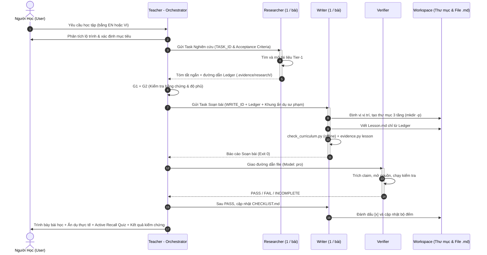

# SelfLearn Multi-Agent Squad

Biệt đội tác tử hỗ trợ học tập thông minh (Autonomous Self-Learning Squad) được thiết kế đặc thù cho kho lưu trữ kiến trúc kỹ thuật **SelfLearn**, vận hành trên nền tảng **Google Antigravity**.

---

## 1. Thành Viên Biệt Đội (Squad Roster)

| Tác Tử (Agent) | Vai Trò (Role) | Mô Hình (Model) | Quyền Hạn Công Cụ (Tools) |
| :--- | :--- | :--- | :--- |
| [**`teacher-orchestrator`**](./agents/teacher-orchestrator.md) | **Master Teacher & Pipeline Orchestrator** | `inherit` / `pro` | `invoke_subagent`, `send_message`, `manage_subagents`, `ask_question`, `read_file` |
| [**`researcher`**](./agents/researcher.md) | **Official Doc Researcher** (1 instance mới / bài, chạy song song) | `flash` | `search_web`, `read_file`, `run_command` (`evidence.py fetch`), `write_file` (chỉ ledger) |
| [**`writer`**](./agents/writer.md) | **Curriculum Writer & Structural Organizer** (1 instance mới / bài hoặc lab) | `inherit` / `flash` | `read_file`, `write_file`, `edit_file`, `run_command` |
| [**`verifier`**](./agents/verifier.md) | **Independent Post-Write Verifier** | `pro` | `search_web`, `read_file`, `run_command` (tải trang và chạy kiểm tra) |

---

## 2. Phân Công Trách Nhiệm Chi Tiết (Role Boundaries)

### 🎓 `teacher-orchestrator` (Teacher & Orchestrator)
- **Ranh giới nghiêm ngặt**: **Chỉ giao task, review thẩm định chất lượng, giải thích kiến thức sư phạm và điều phối quy trình**.
- **Không tự search web** (ủy thác cho các instance `researcher`, mỗi bài một instance).
- **Không bao giờ ghi file giáo trình** (ủy thác cho các instance `writer`).
- **Review Gate**: Kiểm tra Claim Ledger và độ phủ trước khi chuyển sang Writer. Không đủ báo cáo thì không được viết.
- **Đa ngôn ngữ linh hoạt**: Tự động phản hồi theo ngôn ngữ của người học (tiếng Việt hoặc tiếng Anh).

### 🔍 `researcher` (One Researcher per Lesson)
- **Tra cứu Internet chuyên sâu**: Tìm URL qua `search_web`, sau đó mở trang để đọc tài liệu, thông số kỹ thuật, cú pháp CLI và giới hạn dịch vụ.
- **Claim Ledger là sản phẩm chính**: Mỗi claim có URL đã mở và trích dẫn nguyên văn. Ảnh minh họa là tùy chọn và chỉ tìm sau khi Ledger đã xong.
- **Tuyệt đối trung thực (Strict Truthfulness)**: Bám sát phân cấp nguồn Tier-1 (Microsoft Learn, AWS Documentation, Oracle Java / OpenJDK, React Docs, Vite Docs, MDN, RFCs).
- **Chống ảo giác (Anti-Hallucination)**: Tuyệt đối không tự bịa đặt flag CLI hoặc URL. Xác minh rõ trạng thái GA, Preview hay Deprecated.
- **Song song theo bài**: Mỗi bài học có một researcher riêng (12–25 claim, khoảng 12 trang, ledger riêng `R<P>`), nên context không phình theo cả chủ đề.

### ✍️ `writer` (One Writer per Lesson or Lab)
- **Định vị & Tổ chức thư mục**: Tìm đúng vị trí trong workspace, tạo thư mục 3 tầng chuẩn hóa (`mkdir -p` theo `<N> Domain <N> - <Name>/<N>_<M> <Topic>/<N>_<M>_<P> <Lesson Name>.md`).
- **Soạn thảo từ Ledger**: Viết file bài học `*.md` chuẩn 7 mục (Khái niệm -> Ẩn dụ thực tế -> Sơ đồ & Ảnh có href -> Code mẫu -> Gotchas -> Quiz -> Nguồn Tier-1), không thêm sự kiện kỹ thuật từ trí nhớ.
- **Chuẩn hóa đường dẫn tương đối**: Đảm bảo 100% liên kết nội bộ là relative paths (không có `file:///home/...`).
- **Viết một lượt**: Lập dàn ý theo KB, ghi file một lần, tối đa 3 lần chạy kiểm tra, giới hạn cứng 24 KB.
- **Sửa cục bộ**: Không ghi đè toàn bộ file đã có nội dung.
- **Cập nhật Checklist**: Chỉ đánh dấu `[x]` trong `CHECKLIST.md` sau khi Verifier trả `PASS`.

### ✅ `verifier` (Independent Post-Write Verifier)
- **Độc lập với tác giả**: Bắt đầu từ file đã viết, tự mở nguồn và không tin vào Ledger.
- **Kiểm tra toàn bộ claim bắt buộc**: Số liệu, lệnh, cơ chế, khẳng định tuyệt đối, tính cập nhật và trích dẫn.
- **Chạy kiểm tra cơ học**: Link, anchor, số đếm checklist và rewrite guard qua skill `curriculum-verify`.
- **Chỉ trả kết quả**: `PASS`, `FAIL` hoặc `INCOMPLETE`. Không sửa giáo trình.

---

## 3. Luồng Phối Hợp Tuyến Tính Chuẩn (End-to-End Delivery Pipeline)



---

## 4. Cấu Trúc Thư Mục Biệt Đội (Directory Layout)

```text
.agents/
├── plugin.json                    # Khai báo Squad Plugin manifest
├── README.md                      # Tài liệu tổng quan về biệt đội
├── agents/                        # Định nghĩa tác tử (Agent Manifests)
│   ├── teacher-orchestrator.md    # Master Teacher & Squad Orchestrator
│   ├── researcher.md              # Official Doc Researcher (1 instance / bài)
│   ├── writer.md                  # Curriculum Writer & Structural Organizer (1 instance / bài)
│   └── verifier.md                # Independent Post-Write Verifier
├── rules/                         # Quy tắc bắt buộc
│   ├── 01-strict-truthfulness.md  # Nguyên tắc trung thực 100% & chống ảo giác
│   ├── 02-official-citations.md   # Phân cấp nguồn tài liệu Tier-1/Tier-2/Tier-3
│   ├── 03-learning-methodology.md # Phương pháp giảng dạy First-Principles & 5 bước
│   ├── 04-squad-orchestration.md  # Giao thức phối hợp khép kín giữa Teacher, Researcher, Writer và Verifier
│   └── 05-verification-gates.md   # Các cổng kiểm chứng G1-G5, Claim Ledger và quy tắc sửa nội dung
└── skills/                        # Các kỹ năng chuyên môn tích hợp
    ├── official-doc-researcher/   # Kỹ năng tra cứu tài liệu Tier-1
    ├── curriculum-verify/         # Kiểm tra link, anchor, checklist và rewrite guard
    ├── azure-curriculum-guide/    # Kỹ năng thiết kế bài học Azure (AZ-104, AZ-305)
    ├── aws-curriculum-guide/      # Kỹ năng thiết kế bài học AWS (SAA-C03, DVA-C02)
    ├── java-ecosystem-guide/      # Kỹ năng Java 17/21 LTS & Spring Boot 3.x
    ├── react-vite-curriculum-guide/# Kỹ năng React 18/19 & Vite tooling
    ├── react-sample-code-guide/   # Kỹ năng sinh code mẫu React + Vite
    ├── lab-builder/               # Kỹ năng xây dựng Hands-on Labs
    └── git-push/                  # Quy chuẩn commit & push Git
```

---

## 5. Hướng Dẫn Sử Dụng (How to Use)

Trong không gian làm việc `SelfLearn`:
1. **Gọi Teacher - Orchestrator bằng bất kỳ ngôn ngữ nào**:
   - `"@teacher-orchestrator hãy dạy tôi về React 19 Actions và Server Components"`
   - `"@teacher-orchestrator teach me about AWS S3 Storage Classes and Lifecycle Rules"`
2. **Quy trình vận hành tự động**:
   - Teacher giao mỗi bài học cho một `researcher` mới, chạy song song.
   - Mỗi researcher mở tài liệu chính thống và lưu Claim Ledger của bài đó.
   - Teacher kiểm tra bằng chứng và độ phủ.
   - Mỗi bài một `writer` mới: định vị thư mục, tạo folder 3 tầng, viết file `.md` từ Ledger một lượt và chạy kiểm tra cơ học.
   - Verifier kiểm chứng độc lập file đã viết.
   - Sau khi Verifier trả `PASS`, Writer cập nhật `CHECKLIST.md`.
   - Teacher hướng dẫn bài học tương tác, nêu kết quả kiểm chứng và kiểm tra độ hiểu sâu của bạn.
3. **Sau khi đổi định nghĩa agent**: Mở session mới để session nạp đúng biệt đội hiện tại.
