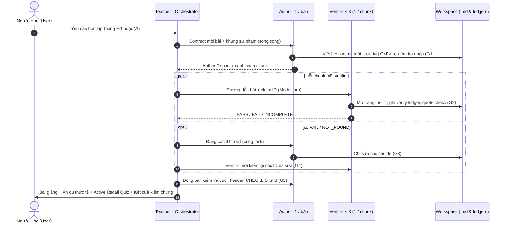

# SelfLearn Multi-Agent Squad

Biệt đội tác tử hỗ trợ học tập thông minh (Autonomous Self-Learning Squad) được thiết kế đặc thù cho kho lưu trữ kiến trúc kỹ thuật **SelfLearn**, vận hành trên nền tảng **Google Antigravity**.

---

## 1. Thành Viên Biệt Đội (Squad Roster)

| Tác Tử (Agent) | Vai Trò (Role) | Mô Hình (Model) | Quyền Hạn Công Cụ (Tools) |
| :--- | :--- | :--- | :--- |
| [**`teacher-orchestrator`**](./agents/teacher-orchestrator.md) | **Master Teacher & Pipeline Orchestrator** | `inherit` | `invoke_subagent`, `send_message`, `manage_subagents`, `ask_question`, `read_file` |
| [**`author`**](./agents/author.md) | **Curriculum Author**: viết bản nháp ngay, gắn claim ID cho mọi fact, chỉ sửa claim bị FAIL (1 instance mới / bài, chạy song song) | `flash` | `read_file`, `write_file`, `edit_file`, `run_command` (không có `search_web`) |
| [**`verifier`**](./agents/verifier.md) | **Independent Claim Verifier**: 1 instance / chunk ≤ 10 claim, chạy song song | `pro` (xem lưu ý ở mục 2) | `search_web`, `read_file`, `write_file` (chỉ verify ledger), `run_command` |

> Từ 20/11/2026 quy trình là **viết trước, kiểm chứng sau**: Author không nghiên cứu trước khi viết, các Verifier nghiên cứu từng claim sau khi viết. Lý do và số liệu: [rule 04 mục 2.1 điểm 12](./rules/04-squad-orchestration.md).

---

## 2. Phân Công Trách Nhiệm Chi Tiết (Role Boundaries)

### 🎓 `teacher-orchestrator` (Teacher & Orchestrator)
- **Chỉ giao task, review báo cáo, thiết kế khung sư phạm và giảng dạy.**
- **Không tự search web và không ghi file giáo trình.**
- Kiểm báo cáo nháp (G1), chia claim cho các Verifier song song (G2), chuyển đúng các ID trượt cho Author (G3), gọi Verifier kiểm lại (G4).
- **Đa ngôn ngữ linh hoạt**: Phản hồi theo ngôn ngữ của người học.

### ✍️ `author` (One Author per Lesson or Lab)
- **Viết ngay, một lượt**: Bài `*.md` chuẩn 7 mục, viết cho người mới, giới hạn cứng 24 KB, 100% relative path. Không chắc thì bỏ hoặc nói khái quát, không bịa flag hay URL.
- **Gắn claim ID**: Mỗi fact một tag `<!-- ev: C<P>.n -->`, 12–25 claim. Header ghi `Bản nháp, chờ kiểm chứng`.
- **Kiểm tra nháp**: `check_curriculum.py --only`, `evidence.py lesson` (draft mode), `evidence.py claims --chunk 10`, tối đa 2 lần.
- **Sửa cục bộ** chỉ các câu FAIL / NOT_FOUND; **đóng bài** sau PASS (kiểm tra cuối, header, `CHECKLIST.md`).

### ✅ `verifier` (Independent Claim Verifier)
- **Độc lập với tác giả**: Đọc câu trong bài qua `evidence.py claims`, tự tìm và mở trang Tier-1, không dùng trí nhớ làm bằng chứng.
- **Ghi verify ledger**: Mỗi claim một dòng có trích dẫn nguyên văn, kết luận `VERIFIED` / `FAIL` (kèm câu đúng) / `NOT_FOUND`, rồi `evidence.py quotes`.
- **Sweep** (một instance mỗi bài): fact không có tag, link mục 7, coverage.
- **Không sửa giáo trình.**
- **Lưu ý model**: Ở RUN 6_3, 6_5 và 8830302d, Verifier thực tế chạy `gemini-3.8-flash-tiered` dù contract yêu cầu `pro`. Kiểm tra bằng `run_cost.py` sau mỗi RUN.

---

## 3. Luồng Phối Hợp (End-to-End Delivery Pipeline)



---

## 4. Cấu Trúc Thư Mục Biệt Đội (Directory Layout)

```text
.agents/
├── plugin.json                    # Khai báo Squad Plugin manifest
├── README.md                      # Tài liệu tổng quan về biệt đội
├── agents/
│   ├── teacher-orchestrator.md    # Master Teacher & Squad Orchestrator
│   ├── author.md                  # Curriculum Author: viết nháp ngay + sửa cục bộ (1 instance / bài)
│   └── verifier.md                # Independent Claim Verifier (1 instance / chunk ≤ 10 claim)
├── rules/
│   ├── 01-strict-truthfulness.md  # Nguyên tắc trung thực 100% & chống ảo giác
│   ├── 02-official-citations.md   # Phân cấp nguồn tài liệu Tier-1/Tier-2/Tier-3
│   ├── 03-learning-methodology.md # Phương pháp giảng dạy First-Principles + viết cho người mới (mục 2)
│   ├── 04-squad-orchestration.md  # Giao thức phối hợp Teacher, Author, Verifier + ngân sách chi phí
│   └── 05-verification-gates.md   # Các cổng kiểm chứng G1-G5 (viết trước, kiểm sau), Verify Ledger, sửa cục bộ
└── skills/
    ├── official-doc-researcher/   # Kỹ năng tra cứu tài liệu Tier-1
    ├── curriculum-verify/         # Kiểm tra link, anchor, checklist + run_cost.py
    ├── azure-curriculum-guide/    # Kỹ năng thiết kế bài học Azure (AZ-104, AZ-305)
    ├── aws-curriculum-guide/      # Kỹ năng thiết kế bài học AWS (SAA-C03, DVA-C02)
    ├── java-ecosystem-guide/      # Kỹ năng Java 17/21 LTS & Spring Boot 3.x
    ├── react-vite-curriculum-guide/# Kỹ năng React 18/19 & Vite tooling
    ├── react-sample-code-guide/   # Kỹ năng sinh code mẫu React + Vite
    ├── lab-builder/               # Kỹ năng xây dựng Hands-on Labs
```

---

## 5. Hướng Dẫn Sử Dụng (How to Use)

1. **Gọi Teacher - Orchestrator bằng bất kỳ ngôn ngữ nào**:
   - `"@teacher-orchestrator hãy dạy tôi về React 19 Actions và Server Components"`
   - `"@teacher-orchestrator teach me about AWS S3 Storage Classes and Lifecycle Rules"`
2. **Quy trình vận hành tự động**:
   - Teacher giao mỗi bài cho một `author` mới, chạy song song, kèm khung sư phạm.
   - Mỗi Author viết bản nháp ngay, gắn claim ID cho mọi fact, chạy kiểm tra nháp.
   - Teacher chia claim thành chunk ≤ 10 và gọi các Verifier song song; mỗi Verifier kiểm chứng claim trên trang chính thức.
   - Claim trượt quay lại đúng Author đó để sửa cục bộ, rồi một Verifier mới kiểm lại các ID đã sửa.
   - Sau PASS, Author đóng bài (kiểm tra cuối, header, `CHECKLIST.md`), Teacher giảng bài và nêu kết quả kiểm chứng.
3. **Đo chi phí sau mỗi RUN**: `python3 .agents/skills/curriculum-verify/scripts/run_cost.py` (đọc transcript Antigravity trong `~/.gemini/antigravity/brain`, in token theo vai trò và model thực tế).
4. **Sau khi đổi định nghĩa agent**: Mở session mới để session nạp đúng biệt đội hiện tại.
