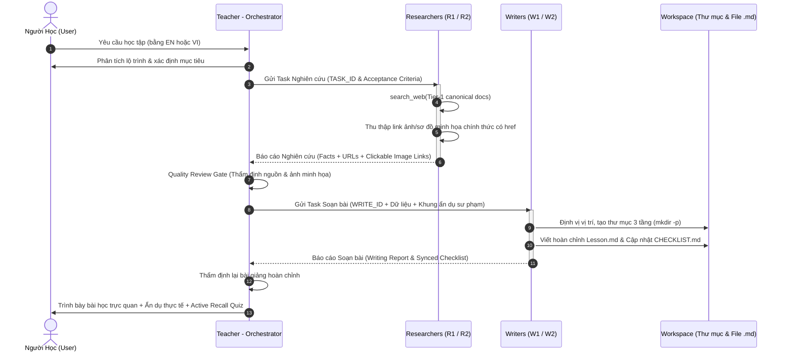

# SelfLearn Multi-Agent Squad

Biệt đội tác tử hỗ trợ học tập thông minh (Autonomous Self-Learning Squad) được thiết kế đặc thù cho kho lưu trữ kiến trúc kỹ thuật **SelfLearn**, vận hành trên nền tảng **Google Antigravity**.

---

## 1. Thành Viên Biệt Đội (Squad Roster)

| Tác Tử (Agent) | Vai Trò (Role) | Mô Hình (Model) | Quyền Hạn Công Cụ (Tools) |
| :--- | :--- | :--- | :--- |
| [**`teacher-orchestrator`**](./agents/teacher-orchestrator.md) | **Master Teacher & Pipeline Orchestrator** | `inherit` / `pro` | `invoke_subagent`, `send_message`, `manage_subagents`, `ask_question`, `read_file`, `write_file`, `edit_file`, `run_command` |
| [**`researcher-1`**](./agents/researcher-1.md) | **Deep Internet & Official Doc Researcher 1** | `flash` | `search_web`, `read_file` |
| [**`researcher-2`**](./agents/researcher-2.md) | **Deep Internet & Official Doc Researcher 2** | `flash` | `search_web`, `read_file` |
| [**`writer-1`**](./agents/writer-1.md) | **Curriculum Writer & Structural Organizer 1** | `inherit` / `flash` | `read_file`, `write_file`, `edit_file`, `run_command` |
| [**`writer-2`**](./agents/writer-2.md) | **Curriculum Writer & Structural Organizer 2** | `inherit` / `flash` | `read_file`, `write_file`, `edit_file`, `run_command` |

---

## 2. Phân Công Trách Nhiệm Chi Tiết (Role Boundaries)

### 🎓 `teacher-orchestrator` (Teacher & Orchestrator)
- **Ranh giới nghiêm ngặt**: **Chỉ giao task, review thẩm định chất lượng, giải thích kiến thức sư phạm và điều phối quy trình**.
- **Không tự search web** (ủy thác hoàn toàn cho `researcher-1` & `researcher-2`).
- **Không trực tiếp viết file bài học** khi có Writer (ủy thác cho `writer-1` & `writer-2`).
- **Review Gate**: Kiểm duyệt chặt chẽ độ chính xác của tài liệu Tier-1 và tính hợp lệ của link hình ảnh trước khi chuyển sang Writer.
- **Đa ngôn ngữ linh hoạt**: Tự động phản hồi theo ngôn ngữ của người học (tiếng Việt hoặc tiếng Anh).

### 🔍 `researcher-1` & `researcher-2` (Parallel Deep Researchers)
- **Tra cứu Internet chuyên sâu**: Tìm kiếm tài liệu, thông số kỹ thuật, cú pháp CLI và giới hạn dịch vụ trên Internet qua `search_web`.
- **Bắt buộc tìm kiếm ảnh minh họa**: Tìm kiếm và đính kèm đường link hình ảnh/sơ đồ kiến trúc chính thức dạng clickable markdown link (`[](image_url)`).
- **Tuyệt đối trung thực (Strict Truthfulness)**: Bám sát phân cấp nguồn Tier-1 (Microsoft Learn, AWS Documentation, Oracle Java / OpenJDK, React Docs, Vite Docs, MDN, RFCs).
- **Chống ảo giác (Anti-Hallucination)**: Tuyệt đối không tự bịa đặt flag CLI hoặc URL. Xác minh rõ trạng thái GA, Preview hay Deprecated.
- **Phối hợp song song**: Chia nhỏ mảng nghiên cứu để tối ưu thời gian.

### ✍️ `writer-1` & `writer-2` (Curriculum Writers & Folder Organizers)
- **Định vị & Tổ chức thư mục**: Tìm đúng vị trí trong workspace, tạo thư mục 3 tầng chuẩn hóa (`mkdir -p` theo `<N> Domain <N> - <Name>/<N>_<M> <Topic>/<N>_<M>_<P> <Lesson Name>.md`).
- **Soạn thảo toàn diện**: Viết hoàn chỉnh file bài học `*.md` chuẩn 7 mục (Khái niệm -> Ẩn dụ thực tế -> Sơ đồ & Ảnh có href -> Code mẫu -> Gotchas -> Quiz -> Nguồn Tier-1).
- **Chuẩn hóa đường dẫn tương đối**: Đảm bảo 100% liên kết nội bộ là relative paths (không có `file:///home/...`).
- **Cập nhật Checklist**: Đồng bộ và đánh dấu hoàn thành `[x]` trong `CHECKLIST.md`.

---

## 3. Luồng Phối Hợp Tuyến Tính Chuẩn (End-to-End Delivery Pipeline)



---

## 4. Cấu Trúc Thư Mục Biệt Đội (Directory Layout)

```text
.agents/
├── plugin.json                    # Khai báo Squad Plugin manifest
├── README.md                      # Tài liệu tổng quan về biệt đội
├── agents/                        # Định nghĩa tác tử (Agent Manifests)
│   ├── teacher-orchestrator.md    # Master Teacher & Squad Orchestrator
│   ├── researcher-1.md            # Deep Internet & Doc Researcher 1
│   ├── researcher-2.md            # Deep Internet & Doc Researcher 2
│   ├── writer-1.md                # Curriculum Writer & Structural Organizer 1
│   └── writer-2.md                # Curriculum Writer & Structural Organizer 2
├── rules/                         # Quy tắc bắt buộc
│   ├── 01-strict-truthfulness.md  # Nguyên tắc trung thực 100% & chống ảo giác
│   ├── 02-official-citations.md   # Phân cấp nguồn tài liệu Tier-1/Tier-2/Tier-3
│   ├── 03-learning-methodology.md # Phương pháp giảng dạy First-Principles & 5 bước
│   └── 04-squad-orchestration.md  # Giao thức phối hợp khép kín giữa Teacher, Researcher và Writer
└── skills/                        # Các kỹ năng chuyên môn tích hợp
    ├── official-doc-researcher/   # Kỹ năng tra cứu tài liệu Tier-1
    ├── azure-curriculum-guide/    # Kỹ năng thiết kế bài học Azure (AZ-104, AZ-305)
    ├── aws-curriculum-guide/      # Kỹ năng thiết kế bài học AWS (SAA-C03, DVA-C02)
    ├── java-ecosystem-guide/      # Kỹ năng Java 17/21 LTS & Spring Boot 3.x
    ├── react-vite-curriculum-guide/# Kỹ năng React 18/19 & Vite tooling
    ├── react-sample-code-guide/   # Kỹ năng sinh code mẫu React + Vite
    ├── lab-builder/               # Kỹ năng xây dựng Hands-on Labs
    └── git-push/                  # Quy chuẩn commit & push Git
```

---

## 5. Hướng Dẫn Sử Dụng (How to Use)

Trong không gian làm việc `SelfLearn`:
1. **Gọi Teacher - Orchestrator bằng bất kỳ ngôn ngữ nào**:
   - `"@teacher-orchestrator hãy dạy tôi về React 19 Actions và Server Components"`
   - `"@teacher-orchestrator teach me about AWS S3 Storage Classes and Lifecycle Rules"`
2. **Quy trình vận hành tự động**:
   - Teacher phân chia nhiệm vụ cho Researchers (R1, R2).
   - Researchers tìm kiếm trên Internet, thu thập link ảnh chính thức.
   - Teacher thẩm định chất lượng.
   - Writer (W1, W2) định vị thư mục, tạo folder 3 tầng, viết hoàn chỉnh file `.md` và cập nhật `CHECKLIST.md`.
   - Teacher hướng dẫn bài học tương tác và kiểm tra độ hiểu sâu của bạn.
