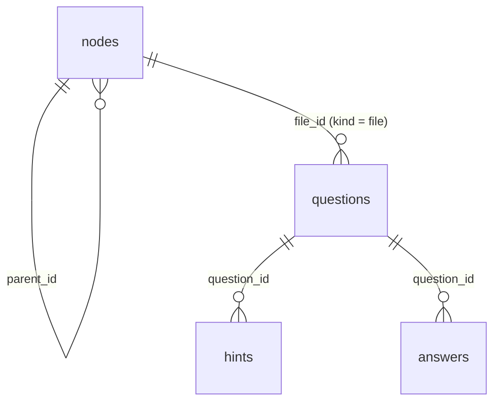

# Build Plan: `quiz-app` (Node.js + SQLite Quiz Server)

> A small local web app for self-testing on the lessons in this workspace.
> Topics, subtopics and lesson files mirror the workspace tree. Each lesson file holds multiple-choice questions (A, B, C, D) with Markdown and Mermaid support, optional hints, and an explanation. Answers are stored and scored, with a dashboard.

---

## 1. Decisions

| Area | Choice | Why |
| :--- | :--- | :--- |
| Runtime | Node.js 22 LTS (installed: `v22.22.2`) | Already on the machine. |
| HTTP | Express `5.x` (latest `5.3.0`) | Smallest familiar router; async errors are handled natively in v5. |
| Database | `better-sqlite3` `13.x`, file `quiz-app/data/quiz.db` | Synchronous, fast, prebuilt binaries. The built-in `node:sqlite` works on Node 22 but still prints an `ExperimentalWarning`, so it is not the default. |
| Frontend | One static page: plain HTML + vanilla JS + one CSS file, hash routing | No build step. Simple UI, no framework. |
| Markdown | `marked` `18.x` + `dompurify` `3.x` | Render Markdown, then sanitize before inserting into the DOM. |
| Diagrams | `mermaid` `12.x`, `securityLevel: 'strict'` | Renders ```` ```mermaid ```` blocks in questions, options, hints and explanations. |
| Asset delivery | Serve the three libraries from `node_modules` via `express.static` | Works offline, no CDN. |
| Auth | None. Single local user, binds to `127.0.0.1` | Personal study tool. |
| Tests | `node:test` + global `fetch` against a server on a temp DB | No extra test dependency. |

Non-goals: multiple users, login, deployment, question types other than single-answer A to D.

---

## 2. Data Model

Topics, subtopics and files live in **one tree table**. Workspace depth varies (`aws/Occupify/...` vs `cloud_devops_basic/network/<Domain>/<Topic>/<file>.md`), so a fixed topic/subtopic/file split would not fit.

- **Topic** = a root folder (`parent_id IS NULL`), for example `aws`, `azure`, `cloud_devops_basic`.
- **Subtopic** = any nested folder, for example `cloud_devops_basic/network`.
- **File** = a leaf (`kind = 'file'`), for example `.../2_1_1 How Networks Transfer Data.md`. Only files hold questions.



```sql
PRAGMA foreign_keys = ON;
PRAGMA journal_mode = WAL;

CREATE TABLE nodes (
  id          INTEGER PRIMARY KEY,
  parent_id   INTEGER REFERENCES nodes(id) ON DELETE CASCADE,
  kind        TEXT NOT NULL CHECK (kind IN ('folder','file')),
  name        TEXT NOT NULL,              -- display name, e.g. "2_1_1 How Networks Transfer Data.md"
  path        TEXT NOT NULL UNIQUE,       -- full path from workspace root, "/" separated
  position    INTEGER NOT NULL DEFAULT 0, -- manual ordering among siblings
  created_at  TEXT NOT NULL DEFAULT (datetime('now')),
  updated_at  TEXT NOT NULL DEFAULT (datetime('now')),
  UNIQUE (parent_id, name)
);

CREATE TABLE questions (
  id           INTEGER PRIMARY KEY,
  file_id      INTEGER NOT NULL REFERENCES nodes(id) ON DELETE CASCADE,
  position     INTEGER NOT NULL DEFAULT 0,
  question     TEXT NOT NULL,             -- Markdown + Mermaid
  option_a     TEXT NOT NULL,
  option_b     TEXT NOT NULL,
  option_c     TEXT NOT NULL,
  option_d     TEXT NOT NULL,
  correct      TEXT NOT NULL CHECK (correct IN ('A','B','C','D')),
  explanation  TEXT NOT NULL DEFAULT '',
  created_at   TEXT NOT NULL DEFAULT (datetime('now')),
  updated_at   TEXT NOT NULL DEFAULT (datetime('now'))
);

CREATE TABLE hints (                      -- 0..n hints per question, ordered
  id           INTEGER PRIMARY KEY,
  question_id  INTEGER NOT NULL REFERENCES questions(id) ON DELETE CASCADE,
  position     INTEGER NOT NULL,          -- 1 = hint_1, 2 = hint_2, ...
  content      TEXT NOT NULL,
  UNIQUE (question_id, position)
);

CREATE TABLE answers (                    -- full attempt history
  id           INTEGER PRIMARY KEY,
  question_id  INTEGER NOT NULL REFERENCES questions(id) ON DELETE CASCADE,
  selected     TEXT NOT NULL CHECK (selected IN ('A','B','C','D')),
  is_correct   INTEGER NOT NULL CHECK (is_correct IN (0,1)),
  hints_used   INTEGER NOT NULL DEFAULT 0,
  answered_at  TEXT NOT NULL DEFAULT (datetime('now'))
);

CREATE INDEX idx_nodes_parent      ON nodes(parent_id);
CREATE INDEX idx_questions_file    ON questions(file_id);
CREATE INDEX idx_answers_question  ON answers(question_id, answered_at);
```

Rules enforced in code (not SQL):
- A question's `file_id` must point at a `kind = 'file'` node.
- A `file` node cannot have children.
- Renaming or moving a node rewrites `path` for that node and all descendants in one transaction.
- `kind` cannot change after creation.

### Scoring

- **Question status**: from the **latest** answer only: `correct`, `wrong`, or `unanswered`.
- **File score** = latest-correct questions / total questions, shown as `7 / 10 (70%)`.
- **Folder/topic score** = the same ratio summed over every file underneath.
- `hints_used` is stored and shown, but does not change the score (can be added later).
- Full history stays in `answers` for the dashboard's "recent activity" and accuracy-over-time view.

---

## 3. REST API

Base: `http://127.0.0.1:3000/api`. JSON in and out. Errors: `{ "error": "message" }` with `400` (validation), `404` (not found), `409` (duplicate name/path or wrong node kind).

### 3.1 Tree (topics, subtopics, files)

| Method | Path | Purpose |
| :--- | :--- | :--- |
| `GET` | `/nodes` | Root topics with stats. |
| `GET` | `/nodes/:id` | One node + children (with stats) + breadcrumb. |
| `GET` | `/nodes/by-path?path=<url-encoded path>` | Look up by workspace path. For agents. |
| `POST` | `/nodes` | Create. Body: `{ "parent_id": 12 \| null, "kind": "folder" \| "file", "name": "..." }`. |
| `PATCH` | `/nodes/:id` | Rename / move / reorder. Body: any of `{ "name", "parent_id", "position" }`. |
| `DELETE` | `/nodes/:id` | Delete node and everything below (questions, hints, answers cascade). |

"Stats" on every node: `{ "questions": 10, "answered": 8, "correct": 7 }`.

### 3.2 Questions (quiz)

| Method | Path | Purpose |
| :--- | :--- | :--- |
| `GET` | `/files/:fileId/questions` | Quiz mode: questions, options, hint **count**, and the user's latest answer. `correct`, `explanation` and hint text are only included for questions already answered. |
| `GET` | `/files/:fileId/questions?mode=edit` | Edit mode: everything, including `correct`, `explanation`, all hints. |
| `GET` | `/questions/:id` | One question (edit view). |
| `GET` | `/questions/:id/hints/:n` | Reveal hint `n` (1-based). |
| `POST` | `/files/:fileId/questions` | Create one question. |
| `POST` | `/files/:fileId/questions/bulk` | Create many in one transaction. Body: `{ "questions": [ ... ], "replace": false }`. `replace: true` deletes the file's existing questions first. For agents generating quizzes from a lesson. |
| `PUT` | `/questions/:id` | Full update. Sending `hints` replaces the hint list. |
| `PATCH` | `/questions/:id` | Partial update, including `position`. |
| `DELETE` | `/questions/:id` | Delete question (hints and answers cascade). |

Question body (create / update). `hints` may be `[]` or omitted.

```json
{
  "question": "Which layer does a **router** operate at?\n\n```mermaid\nflowchart LR\n  A[Host] --> R((Router)) --> B[Host]\n```",
  "options": { "A": "Layer 2", "B": "Layer 3", "C": "Layer 4", "D": "Layer 7" },
  "correct": "B",
  "explanation": "Routers forward packets using **IP addresses**, which live at the network layer (L3).",
  "hints": ["Think about which header holds the IP address.", "It is the same layer as ICMP."]
}
```

Validation: `question` non-empty; all of `options.A` to `options.D` non-empty; `correct` in `A`/`B`/`C`/`D`; `hints` is an array of non-empty strings.
The flat form `option_a ... option_d`, `hint_1, hint_2, ...` is also accepted on input and normalized to the shape above, so either style works.

### 3.3 Answers

| Method | Path | Purpose |
| :--- | :--- | :--- |
| `POST` | `/questions/:id/answers` | Submit. Body: `{ "selected": "B", "hints_used": 1 }`. Returns `{ "is_correct", "correct", "explanation", "file_stats" }`. |
| `GET` | `/questions/:id/answers` | Attempt history for one question. |
| `DELETE` | `/questions/:id/answers` | Reset one question. |
| `DELETE` | `/files/:fileId/answers` | Reset the whole file. |
| `DELETE` | `/nodes/:id/answers` | Reset everything under a folder/topic (same SQL, works for files too). |

### 3.4 Dashboard

| Method | Path | Purpose |
| :--- | :--- | :--- |
| `GET` | `/stats` | Totals: questions, answered, correct, accuracy; per-topic breakdown. |
| `GET` | `/stats/files?under=:nodeId&sort=score` | Per-file table: path, questions, answered, correct, %, last answered. Sort `score` puts the weakest files first. |
| `GET` | `/stats/recent?limit=20` | Latest attempts with file path and result. |
| `GET` | `/stats/daily?days=30` | Attempts and correct per day. |

### 3.5 Health

`GET /api/health` returns `{ "ok": true, "db": "<path>" }`.

---

## 4. Workspace Sync Script

`npm run sync` (`scripts/sync-workspace.js`) walks the workspace and creates any missing folder/file nodes so the tree matches the repo.

- Root: `WORKSPACE_ROOT` env var, default `..` (the repo root from `quiz-app/`).
- Includes only `.md` lesson files whose names start with a lesson number (`/^\d+_\d+_\d+ /`), plus the folders on the way to them.
- Skips: `.git`, `.agents`, `.evidence`, `.vscode`, `node_modules`, `quiz-app`, and `README.md` / `CHECKLIST.md`.
- **Additive and idempotent**: matches by `path`, inserts what is missing, never deletes or renames. Prints `created N folders, M files; K already present`.
- Flags: `--dry-run` (print only), `--prune` (also delete nodes whose path no longer exists, **only if they have no questions**; nodes with questions are listed and kept).

---

## 5. UI (Simple, No Framework)

One page, hash routes. Neutral look: system font, white/near-black background with a dark mode via `prefers-color-scheme`, one accent color, max width ~860px, no animations, no emoji, no gradients.

| Route | Screen |
| :--- | :--- |
| `#/` | Topic list: name, `answered/total`, score %. "New topic" button. |
| `#/node/:id` | Folder view: breadcrumb, children list (folder icon or file), each with its stats bar. Inline "New folder", "New file", "Rename", "Delete" (with a confirm dialog). |
| `#/file/:id` | Quiz: header with file score and "Reset all answers". One card per question: rendered question, four option buttons (A to D, each rendered Markdown), "Show hint (1/3)" button revealing hints one at a time, "Submit". After submit: correct option green, chosen wrong option red, explanation shown, small "Reset" link on the card. |
| `#/file/:id/edit` | Editor: list of questions with up/down, edit, delete. Form: question, A to D, correct (radio), explanation, dynamic hint list (add/remove). Each textarea has a live preview beside it (stacks on mobile). |
| `#/dashboard` | Totals row, per-topic table, weakest-files table (links into the quiz), recent attempts, a small daily bar chart drawn with plain SVG. |

Rendering pipeline (one function, `renderMarkdown(el, md)`):
1. `marked.parse(md)` with a custom `code` renderer: language `mermaid` becomes `<pre class="mermaid">` with the escaped source; other code stays `<pre><code>`.
2. `DOMPurify.sanitize(html)`.
3. Insert into `el`, then `mermaid.run({ nodes: el.querySelectorAll('.mermaid') })`.
4. On a Mermaid syntax error, show the raw source and the error inside the block instead of breaking the page.

---

## 6. Project Layout

```text
quiz-app/
├── package.json            # "type": "module", scripts: start, dev, sync, test
├── .gitignore              # data/*.db*, node_modules/
├── README.md               # for humans and AI agents (section 8)
├── src/
│   ├── server.js           # express app, static files, error handler, listen
│   ├── db.js               # open DB, run schema.sql, pragmas
│   ├── schema.sql
│   ├── validate.js         # body validation + flat/nested question normalization
│   ├── stats.js            # shared score queries (recursive CTE over nodes)
│   └── routes/
│       ├── nodes.js
│       ├── questions.js
│       ├── answers.js
│       └── stats.js
├── scripts/
│   └── sync-workspace.js
├── public/
│   ├── index.html
│   ├── app.js              # router, views, api() helper
│   ├── markdown.js         # renderMarkdown()
│   └── style.css
├── test/
│   └── api.test.js
└── data/                   # created at runtime, holds quiz.db
```

Config by env vars: `PORT` (default `3000`), `HOST` (default `127.0.0.1`), `DB_PATH` (default `./data/quiz.db`), `WORKSPACE_ROOT` (default `..`).

---

## 7. Build Phases

Each phase ends with its check passing before the next starts.

| # | Phase | Work | Done when |
| :--- | :--- | :--- | :--- |
| 1 | Scaffold | `package.json`, deps, `db.js`, `schema.sql`, `server.js`, `/api/health`, `.gitignore`. | `npm start` then `curl /api/health` returns `ok: true`, and `data/quiz.db` exists. |
| 2 | Tree API | `routes/nodes.js`, path rewrite on rename/move, cascade delete. | Tests: create topic, subtopic, file; rename updates descendant paths; duplicate name returns `409`; delete removes the subtree. |
| 3 | Questions API | `validate.js`, `routes/questions.js`, hints, bulk, reorder, quiz vs edit mode. | Tests: missing option D returns `400`; `correct: "E"` returns `400`; question on a folder returns `409`; hints keep order; quiz mode hides `correct` until answered. |
| 4 | Answers + stats | `routes/answers.js`, `stats.js`, `routes/stats.js`. | Tests: wrong then right answer counts as correct; reset question / file / folder clears history and stats; folder stats equal the sum of its files. |
| 5 | Sync script | `scripts/sync-workspace.js`. | `npm run sync -- --dry-run` lists `aws`, `azure`, `cloud_devops_basic`, `react+vite`, ... Running `npm run sync` twice creates nodes once, then reports 0 created. |
| 6 | UI: browse + quiz | `index.html`, `app.js`, `markdown.js`, `style.css`; routes `#/`, `#/node/:id`, `#/file/:id`. | Manual: a question with a Mermaid flowchart in the question and in option B renders both; hints reveal one at a time; submit shows explanation; reset works. A `<script>` in Markdown is stripped. |
| 7 | UI: editor + dashboard | `#/file/:id/edit`, `#/dashboard`, folder CRUD buttons. | Manual: create/edit/delete/reorder questions with live preview; dashboard numbers match `/api/stats`. Layout works at 375px width. |
| 8 | README | Write `quiz-app/README.md` (section 8). | Another agent, reading only the README, can start the server, find a lesson by path, bulk-add 5 questions, and read the score. Verify by doing exactly that with `curl`. |

---

## 8. README Contents (Phase 8)

`quiz-app/README.md` must include, in this order:

1. **What it is**: one paragraph.
2. **Quick start**: `cd quiz-app && npm install && npm run sync && npm start`, then open `http://127.0.0.1:3000`.
3. **Config**: the env var table.
4. **Concepts**: node tree (topic, subtopic, file), question shape, scoring rule (latest answer counts).
5. **API reference**: every endpoint from section 3 with one `curl` example each.
6. **Agent recipe: add a quiz to a lesson**:
   1. `GET /api/nodes/by-path?path=...` to get the file id (run `npm run sync` first if `404`).
   2. Read the lesson `.md` from the workspace.
   3. `POST /api/files/:id/questions/bulk` with the questions JSON.
   4. `GET /api/files/:id/questions?mode=edit` to confirm.
7. **Question authoring rules** for agents: exactly four options, one correct; Markdown allowed everywhere; Mermaid in ```` ```mermaid ```` fences; explanation should say why the right answer is right and the others wrong; hints go from vague to specific; content must follow `AGENTS.md` (facts from Tier 1 sources only).
8. **Data**: where the DB lives, how to back it up (copy `data/quiz.db` while the server is stopped), how to reset (delete the file).
9. **Development**: `npm test`, project layout.

---

## 9. Risks

| Risk | Mitigation |
| :--- | :--- |
| `better-sqlite3` native build fails on a future Node version | Keep all SQL in `db.js`/routes behind `prepare/run/get/all`, and wrap transactions in one helper in `db.js`. Then switching to `node:sqlite` is a small change: its statements also have `run/get/all`, but it has no `db.transaction()`, so the helper would use `BEGIN`/`COMMIT` instead. |
| Mermaid in a narrow option button overflows | Option content gets `overflow-x: auto`; diagrams scale with `max-width: 100%`. |
| Workspace folder renamed after questions exist | `sync` never deletes nodes that have questions; rename the node in the UI or `PATCH /api/nodes/:id` to match. |
| XSS through Markdown | Always sanitize with DOMPurify; Mermaid `securityLevel: 'strict'`. |
