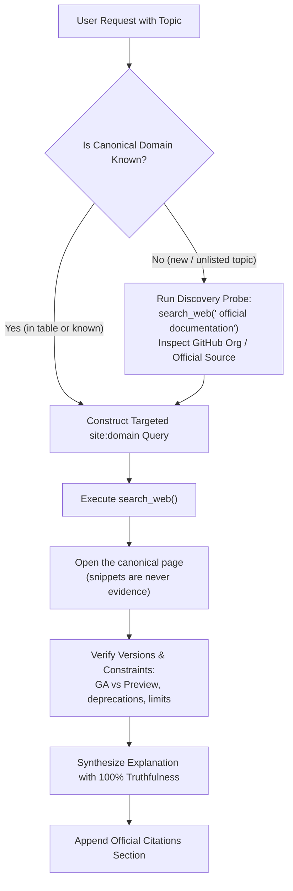

# Official Doc Researcher Skill

This skill guides the agent to dynamically identify, verify, and cite authoritative Tier-1 documentation for **any technology, framework, cloud provider, programming language, tool, or standard**—guaranteeing 100% truthfulness, version awareness, and eliminating hallucinations.

---

## 1. When to Use This Skill

- The user asks about **any technical topic**, whether explicitly listed in the curriculum or not (cloud providers, programming languages, build tools, databases, DevOps tools, libraries, protocols, or operating systems).
- The agent needs to verify syntax, configuration parameters, quotas/limits, API signatures, or architecture patterns.
- The agent needs to verify whether a feature is in GA (General Availability), Preview, Experimental, or Deprecated.
- The agent needs to verify version-specific changes (e.g., Spring Boot 2 vs 3, Java 17 vs 21, React 18 vs 19, AWS SDK v2 vs v3).
- The agent needs direct authoritative documentation links for required citations.

---

## 2. Dynamic Source Resolution Framework (Any Topic)

When dealing with **any topic—including new, niche, or unlisted technologies**—apply this universal hierarchy to locate the Tier-1 authoritative source:

### Authoritative Hierarchy (Tier 1 vs Tier 2 vs Tier 3)

| Tier | Source Category | Examples | Trust Level & Usage |
| :--- | :--- | :--- | :--- |
| **Tier 1 (Supreme)** | **Official Vendor/Project Docs, Specifications, RFCs** | `learn.microsoft.com`, `docs.aws.amazon.com`, `docs.oracle.com`, `react.dev`, `vite.dev`, `kubernetes.io/docs`, `docs.docker.com`, `datatracker.ietf.org` | **Ground Truth**. Mandatory primary source for definitions, parameters, limits, and syntax. |
| **Tier 2 (Official Code)** | **Official GitHub Repositories, Release Notes, CHANGELOGs** | `github.com/<official-org>/<repo>`, official GitHub Discussions, GitHub Releases | **Secondary Verification**. Use when official web docs lag behind the latest release or for exact commit diffs. |
| **Tier 3 (Community)** | **Reputable Community Blogs, Tutorials** | Baeldung, Martin Fowler, InfoQ, web.dev, official dev blogs | **Illustrative Only**. Use strictly for real-world tips or analogies. **Never** use as authoritative ground truth instead of Tier 1/2. |

### Dynamic Heuristic: How to Discover the Canonical Source for Unlisted Topics

If the user asks about a topic not in the reference table below:

1. **Identify the Governing Entity / Creator**:
   - *Standards & RFCs*: IETF (`datatracker.ietf.org`), W3C (`w3.org`), WHATWG (`whatwg.org`).
   - *Foundations*: CNCF (`cncf.io`), Apache Foundation (`apache.org`), Linux Foundation (`linuxfoundation.org`), Eclipse (`eclipse.org`).
   - *Primary Vendors / Organizations*: Google, Microsoft, Amazon, Meta, HashiCorp, Docker, Red Hat, Apple, etc.
   - *Language Stewards*: Python Software Foundation (`python.org`), Rust Foundation (`rust-lang.org`), Golang (`go.dev`), Node.js (`nodejs.org`).

2. **Probe Query to Locate Canonical Docs**:
   If the exact domain is not known beforehand, run a probe search:
   ```text
   search_web(query='<topic_name> official documentation OR site:github.com')
   ```
   - Inspect the search results to identify the official domain (e.g., `*.org`, `*.dev`, `docs.*`, or the verified official GitHub repo).
   - Reject SEO spam, aggregator sites (GeeksforGeeks, W3Schools, Tutorialspoint, Medium), and unauthorized clones.

3. **Pin & Restrict Search to the Discovered Canonical Domain**:
   Once identified, execute targeted queries using `site:<canonical-domain>`:
   ```text
   search_web(query='site:<canonical-domain> <specific_feature_or_parameter>')
   ```

---

## 3. Reference Domain Mapping (Baseline Examples)

Use these established mappings for common topics, and use them as patterns when resolving new topics:

| Category | Topic / Ecosystem | Target Domains | Search Query Pattern Example |
| :--- | :--- | :--- | :--- |
| **Cloud** | Azure Services | `learn.microsoft.com/azure` | `site:learn.microsoft.com/azure "blob storage" access tiers` |
| **Cloud** | Azure Architecture | `learn.microsoft.com/azure/architecture` | `site:learn.microsoft.com/azure/architecture hub-spoke` |
| **Cloud** | Azure CLI | `learn.microsoft.com/cli/azure` | `site:learn.microsoft.com/cli/azure az vm create` |
| **Cloud** | AWS Documentation | `docs.aws.amazon.com` | `site:docs.aws.amazon.com "Amazon S3" storage classes` |
| **Cloud** | AWS Architecture | `aws.amazon.com/architecture` | `site:aws.amazon.com/architecture well-architected` |
| **Cloud** | AWS CLI | `awscli.amazonaws.com` | `site:awscli.amazonaws.com aws s3 sync` |
| **Cloud** | Google Cloud (GCP) | `cloud.google.com/docs` | `site:cloud.google.com/docs cloud run concurrency` |
| **Backend & Java** | Java SE Specs & API | `docs.oracle.com/en/java/javase` | `site:docs.oracle.com/en/java/javase/21 VirtualThread api` |
| **Backend & Java** | OpenJDK Features / JEPs | `openjdk.org/jeps` | `site:openjdk.org/jeps 444 virtual threads` |
| **Backend & Java** | Spring Boot / Framework | `docs.spring.io` | `site:docs.spring.io/spring-boot/docs security configuration` |
| **Backend & Java** | Jakarta EE | `jakarta.ee/specifications` | `site:jakarta.ee persistence specification` |
| **Frontend** | React (Core & Hooks) | `react.dev` | `site:react.dev/learn "render and commit"` |
| **Frontend** | Vite Tooling | `vite.dev` | `site:vite.dev/guide "why vite"` |
| **Frontend** | Web Standards / JS / CSS | `developer.mozilla.org` | `site:developer.mozilla.org/en-US/docs/Web EventLoop` |
| **Frontend** | TypeScript | `www.typescriptlang.org/docs` | `site:typescriptlang.org/docs utility types` |
| **Frontend** | Testing (Vitest / Jest) | `vitest.dev`, `jestjs.io` | `site:vitest.dev/guide mock functions` |
| **Frontend** | React Router | `reactrouter.com` | `site:reactrouter.com createBrowserRouter` |
| **Containers & K8s** | Docker | `docs.docker.com` | `site:docs.docker.com build multi-stage` |
| **Containers & K8s** | Kubernetes | `kubernetes.io/docs` | `site:kubernetes.io/docs concepts ingress` |
| **DevOps / IaC** | Terraform / OpenTofu | `developer.hashicorp.com/terraform` | `site:developer.hashicorp.com/terraform/docs state backend` |
| **Databases** | PostgreSQL | `postgresql.org/docs` | `site:postgresql.org/docs "wal" replication` |
| **Databases** | Redis | `redis.io/docs` | `site:redis.io/docs data-types` |
| **Languages** | Python | `docs.python.org` | `site:docs.python.org/3 asyncio event loop` |
| **Languages** | Go | `go.dev/doc` | `site:go.dev/doc memory model` |
| **Standards** | IETF RFCs | `datatracker.ietf.org/doc/html` | `site:datatracker.ietf.org/doc/html rfc6749` |
| **Any Other Topic** | *Dynamic Resolution* | *(Follow Section 2 Heuristics)* | `site:<canonical_domain> <feature>` |

---

## 4. End-to-End Execution Workflow



### Step 1: Dynamic Domain Discovery & Query Formulation
- **Known / Mapped Topic**: Formulate targeted query immediately:
  `search_web(query='site:<domain> <keywords>')`
- **New / Unlisted Topic**:
  1. Probe: `search_web(query='<topic> official documentation')`
  2. Pinpoint the primary authoritative domain (e.g., `docs.example.org`).
  3. Query: `search_web(query='site:docs.example.org <keywords>')`

### Step 2: Read & Verify via Official URL
- Open every page you rely on. Search snippets only help you find URLs, and they are never evidence for a claim.
- Fetch the page with `read_url_content(Url='<official_url>')` if that tool is available. Otherwise use `run_command`:
  ```bash
  mkdir -p /tmp/selflearn-research
  curl -sSL -A 'selflearn-research' -m 30 -o /tmp/selflearn-research/page.txt '<official_url>'
  grep -n -i '<term>' /tmp/selflearn-research/page.txt
  ```
- Inspect specific sections, code blocks, parameter flags, and configuration properties directly from the canonical page.
- Check constraints: minimum versions required, breaking changes, deprecated fields, and platform compatibility.

### Step 3: Synthesize with Strict Truthfulness & Version Awareness
- Present facts directly verified against the documentation.
- **Never guess**: If a parameter name, flag, or limit is not explicitly documented, do not fabricate it.
- **Version Awareness**: Specify which version the documentation applies to (e.g., Java 21, Spring Boot 3.3, React 19, Python 3.12).
- **Acknowledge Gaps**: If an unlisted/cutting-edge tool has incomplete or rapidly changing docs, state:
  > *"Tính năng này có sự thay đổi gần đây hoặc tài liệu chính thức chưa công bố chi tiết đầy đủ, cần đối chiếu trực tiếp tại [URL]."*

### Step 4: Add Official Citations
Every technical explanation, curriculum lesson, or lab guide BẮT BUỘC must conclude with:

```markdown
## 📚 Nguồn Tài Liệu Chính Thống (Official References)
- [Tiêu Đề Bài Viết Chính Thức](https://official-domain.com/path/to/page) - Mô tả ngắn gọn nội dung tài liệu trích dẫn.
```
*(Do not use generic homepage URLs like `https://aws.amazon.com` or `https://python.org`. Always provide direct, deep links to the specific documentation page or RFC).*
