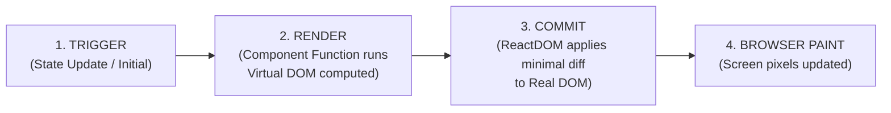
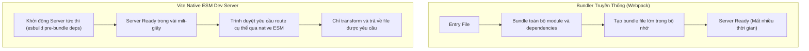

# React Sample Code & Visual Media Guide Skill

This skill provides a standard protocol for authoring runnable, idiomatic React + Vite sample code, along with a curated and verified catalog of official public illustrations from `react.dev` and `vite.dev`.

---

## 1. When to Use This Skill
- The user requests sample code, code examples, or syntax explanations for React (18/19) and Vite.
- Authoring code examples inside lesson files under `react+vite/`.
- Embedding visual diagrams or official illustrations to explain abstract frontend concepts (Render vs Commit, State Snapshot, Batching, Vite Native ESM).
- Designing Mermaid diagrams representing component trees, state flows, or build pipelines.

---

## 2. Official Public Visual Media Catalog

All image URLs below are verified, high-availability public assets hosted directly on official CDNs and repositories (`react.dev` and `vite.dev`). Use markdown image syntax `` when embedding them in lessons and responses.

### A. Vite Architecture Diagrams
| Khái niệm minh họa | Markdown Embed Snippet | Nguồn |
| :--- | :--- | :--- |
| **Traditional Bundler Dev Server** *(chậm vì bundle toàn bộ app)* | `` | Vite Official Repo |
| **Vite Native ESM Dev Server** *(cực nhanh vì serve on-demand)* | `` | Vite Official Repo |
| **Vite HMR Performance Benchmark** | `` | Vite Official Repo |

### B. React Core & Mental Model
| Khái niệm minh họa | Markdown Embed Snippet | Nguồn |
| :--- | :--- | :--- |
| **Declarative UI Programming** *(UI phản ánh State)* | `` | React.dev Official CDN |
| **Imperative UI Programming** *(Thao tác DOM thủ công kiểu cũ)* | `` | React.dev Official CDN |
| **Children Prop & Composition** *(Lồng ghép component linh hoạt)* | `` | React.dev Official CDN |
| **Pure Component Recipe** *(Hàm thuần khiết: Cùng đầu vào -> Cùng JSX)* | `` | React.dev Official CDN |

### C. React Rendering Lifecycle (Restaurant Analogy)
React chính thức so sánh chu trình Render & Commit như quy trình phục vụ tại nhà hàng:
- **Khách gọi món / Đổi món** = Trigger render
- **Đầu bếp chế biến món ăn** = Component Render (tạo JSX/Virtual DOM)
- **Bồi bàn mang đĩa ra bàn** = Commit phase (ghi vào real DOM)
- **Khách thưởng thức món ăn** = Browser Paint (vẽ điểm ảnh ra màn hình)

| Giai đoạn | Markdown Embed Snippet | Mô tả minh họa |
| :--- | :--- | :--- |
| **Phase 1: Trigger** | `` | Bồi bàn nhận yêu cầu từ người dùng |
| **Phase 2: Render** | `` | Đầu bếp nấu món ăn (chạy hàm component) |
| **Phase 3: Commit** | `` | Bồi bàn đưa đĩa đồ ăn ra bàn khách |
| **Browser Paint** | `` | Trình duyệt vẽ giao diện lên màn hình |

### D. State, Re-render & Batching
| Khái niệm minh họa | Markdown Embed Snippet | Nguồn |
| :--- | :--- | :--- |
| **Re-render Triggered** | `` | React.dev Official CDN |
| **Chef Recalculates UI** | `` | React.dev Official CDN |
| **State as a Snapshot (Step 1)** | `` | React.dev Official CDN |
| **State as a Snapshot (Step 2)** | `` | React.dev Official CDN |
| **State as a Snapshot (Step 3)** | `` | React.dev Official CDN |
| **Automatic Batching** | `` | React.dev Official CDN |
| **Refs vs State** | `` | React.dev Official CDN |

---

## 3. Quy Chuẩn Xây Dựng Code Mẫu (Sample Code Standards)

Mỗi đoạn code mẫu minh họa lý thuyết phải đáp ứng 4 tiêu chí cốt lõi:

1. **Tự Độc Lập & Thực Thi Được (Self-Contained & Runnable)**:
   - Cung cấp đầy đủ import và kiểu TypeScript (hoặc ES6+ chuẩn).
   - Người học có thể copy trực tiếp vào dự án Vite (`src/App.tsx` hoặc `src/components/...`) để chạy thử ngay lập tức.
2. **Cấu Trúc Khối Code Chuẩn Mực (Structured Sections)**:
   - **Khai báo Props / Types**: Định nghĩa rõ ràng dữ liệu đầu vào.
   - **Khai báo State / Hooks**: Đặt ở đầu hàm component theo đúng Rules of Hooks.
   - **Hàm Xử Lý Sự Kiện (Event Handlers)**: Tách riêng khỏi JSX, đặt tên trực quan (`handle...`).
   - **Khối Return JSX**: Rõ ràng, ngữ nghĩa (semantic HTML).
3. **Chú Thích Cơ Chế Ngầm (Explain Behind-the-Scenes)**:
   - Sử dụng comment giải thích rõ tại sao lại viết như vậy, điều gì xảy ra ở Trigger/Render/Commit phase.
4. **Minh Họa Bằng Console Logs Thực Tế**:
   - Thêm các lệnh `console.log` có chủ đích (ví dụ: in ra khi component render hoặc khi cleanup chạy) để người học mở F12 Developer Tools và tự mình quan sát luồng hoạt động.

### Mẫu Code Chuẩn (Template Reference):

```tsx
import React, { useState, useEffect } from 'react';

// 1. Interface & Types
interface UserProfileProps {
  userId: string;
  initialName?: string;
}

export const UserProfile: React.FC<UserProfileProps> = ({ userId, initialName = 'Khách' }) => {
  // 2. State & Hooks (Được gọi ở top-level)
  const [name, setName] = useState<string>(initialName);
  const [isUpdating, setIsUpdating] = useState<boolean>(false);

  // Quan sát Re-render trong console
  console.log(`[RENDER] UserProfile component render với name = "${name}"`);

  // 3. Side Effects (Chỉ chạy sau khi Commit phase hoàn tất)
  useEffect(() => {
    console.log(`[EFFECT] Bắt đầu đồng bộ cho userId = ${userId}`);

    // Hàm Cleanup (Chạy trước lần effect kế tiếp hoặc khi unmount)
    return () => {
      console.log(`[CLEANUP] Hủy đăng ký hoặc dọn dẹp cho userId = ${userId}`);
    };
  }, [userId]);

  // 4. Event Handlers
  const handleUpdate = () => {
    // Kích hoạt TRIGGER phase
    setIsUpdating(true);
    setTimeout(() => {
      setName((prev) => `${prev} (Đã cập nhật)`);
      setIsUpdating(false);
    }, 500);
  };

  // 5. JSX Return (Khai báo giao diện Declarative)
  return (
    <div className="p-4 border rounded shadow-sm">
      <h3 className="text-lg font-bold">Hồ Sơ: {name}</h3>
      <p className="text-sm text-gray-500">Mã người dùng: {userId}</p>
      <button 
        onClick={handleUpdate}
        disabled={isUpdating}
        className="mt-3 px-4 py-2 bg-blue-600 text-white rounded hover:bg-blue-700 disabled:opacity-50"
      >
        {isUpdating ? 'Đang xử lý...' : 'Cập nhật tên'}
      </button>
    </div>
  );
};
```

---

## 4. Mẫu Sơ Đồ Mermaid Trực Quan (Mermaid Templates)

### A. Sơ đồ Luồng Render & Commit Trong React:


### B. Sơ đồ Cơ Chế Vite Dev Server vs Bundler Truyền Thống:

