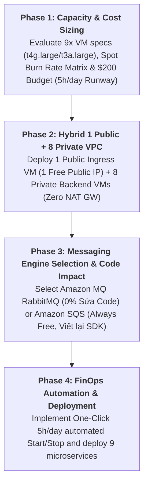

# 📋 Occupify Microservices: AWS Architecture & Cloud Migration Checklist

> **Target**: Comprehensive Architecture, Cost Engineering, Sizing & Deployment for Occupify Microservices System on AWS Cloud  
> **Budget Constraint**: Strict $200 AWS Credit Cap Optimization  
> **System Scope**: 9 Distributed Microservice Nodes (>= 2 vCPU, >= 6 GiB RAM each), Scalable Messaging, 1 Public + 8 Private Subnets  
> **Authoritative References**: [AWS Free Tier](https://aws.amazon.com/free/) | [Amazon EC2 Spot Instances](https://aws.amazon.com/ec2/spot/) | [Amazon SQS Developer Guide](https://docs.aws.amazon.com/AWSimpleQueueService/latest/SQSDeveloperGuide/) | [Amazon MQ Developer Guide](https://docs.aws.amazon.com/amazon-mq/latest/developer-guide/) | [VPC Subnets Scenario](https://docs.aws.amazon.com/vpc/latest/userguide/VPC_Scenario2.html)

---

## 📊 Study & Implementation Progress Tracker

| Domain | Focus Topics | Total Items | Completed | Progress |
| :--- | :--- | :---: | :---: | :---: |
| **Domain 1: Budget Optimization, Sizing & Capacity Planning** | $200 Credit Realities, 9x VM Sizing (`t4g.large` vs `t3a.large`), Spot vs On-Demand, EBS gp3 & 5h/day Runway | 5 items | `[x] 1 / 5` | `20%` |
| **Domain 2: Practical VPC & Security Architecture** | 1 Public Subnet VM (Ingress), 8 Private Subnet VMs, Port 443 SSL/TLS Ingress, CloudFront VPC Origins & S3 OAC | 6 items | `[x] 4 / 6` | `67%` |
| **Domain 3: Distributed Messaging & Event Architecture** | RabbitMQ vs Amazon SQS Code Impact, AMQP 0-9-1 vs AWS SDK, Visibility Timeout & DLQ | 4 items | `[x] 2 / 4` | `50%` |
| **Domain 4: Automated Containerized Deployment** | EC2 Launch Templates, Spot Fleet Automation, Docker Compose Orchestration, Service Discovery | 4 items | `[ ] 0 / 4` | `0%` |
| **Domain 5: FinOps, Scheduling & Production Governance** | AWS Budgets $200 Hard Cap, One-Click Start/Stop Automation (5h/day), CloudWatch Alarms | 3 items | `[x] 1 / 3` | `33%` |
| **TOTAL** | **Occupify AWS Cloud Migration & Architecture Playbook** | **22 items** | `[x] 8 / 22` | **`36%`** |

---

## 🗺️ Recommended 4-Phase Architecture Roadmap

---

## 🎯 Detailed Architecture & Implementation Checklist

---

### Domain 1: Budget Optimization, Sizing & Capacity Planning (5 Items)

- [x] **1_1 AWS $200 Budget Optimization & 9x VM Sizing Strategy**: Master the financial mechanics of AWS Free Tier credits, sizing 9 VMs with >= 2 vCPU and 8 GiB RAM (`t4g.large` Graviton vs `t3a.large` AMD), calculating EBS gp3 storage costs, eliminating public IPv4 fees, and establishing the 82-day to 120-day runway matrix.  
  *(Documentation: [README.md](./README.md))*
- [ ] **1_2 EC2 Spot Fleet & Mixed Instances Architecture**: Configure Launch Templates with Spot market options, handle two-minute interruption notices via EC2 Instance Metadata Service (IMDSv2) and Amazon EventBridge.
- [ ] **1_3 EBS gp3 Storage Optimization**: Provision 20 GB gp3 root volumes per node, tune IOPS (3,000 baseline) and throughput (125 MiB/s baseline), and implement cleanup policies for unattached volumes and old snapshots.
- [ ] **1_4 Graviton (ARM64) vs x86_64 Binary Compatibility Assessment**: Audit microservice dependencies (JVM, Node.js, Python, native libraries) to validate cross-architecture execution on Graviton (`t4g.large`) for 15-20% cost savings.
- [ ] **1_5 Data Transfer Out (DTO) Optimization**: Minimize inter-AZ and internet data egress by co-locating microservice VMs within a single Availability Zone for lab environments.

---

### Domain 2: Practical VPC & Security Architecture (5 Items)

- [x] **2_1 VPC Design with Hybrid Subnets (1 Public + 8 Private VMs)**: Scaffolding VPC `/16`, 1 Public Subnet VM (Nginx Ingress / Bastion) utilizing the single Free Tier Public IPv4, and 8 Private Subnet VMs isolated from internet threats without NAT Gateway fees.  
  *(Documentation: [README.md](./README.md))*
- [ ] **2_2 EC2 Instance Connect Endpoint (EICE) Implementation**: Provision an optional free EICE within the private subnet, allowing secure SSH tunneling to all private EC2 instances without public IP addresses.
- [x] **2_3 Microservice Security Groups & Network Segmentation**: Enforce ingress/egress least privilege rules between services: Public SG (ports 80, 443, 22) and Private Backend SG (only accepting traffic from Ingress SG and intra-subnet).  
  *(Documentation: [README.md](./README.md))*
- [ ] **2_4 IAM Roles & Instance Profiles**: Attach least-privilege IAM roles to EC2 instances for secure SQS access, CloudWatch Logs streaming, and Systems Manager (SSM) agent communication without hardcoded API keys.
- [x] **2_5 Port 443 HTTPS & SSL/TLS Termination Strategy: AWS Certificate Manager (ACM) vs Certbot (Let's Encrypt)**: Evaluate public certificate constraints (ACM private key non-exportability preventing direct EC2 Nginx installation), CloudFront + ACM Edge Ingress ($0.00 Always Free Tier), ALB cost penalty analysis (~$16-$22/mo), and Certbot DNS-01 challenge via Route 53 IAM Role to eliminate dynamic EC2 Public IP renewal failures.  
  *(Documentation: [README.md](./README.md))*
- [x] **2_6 CloudFront Origin Architecture: Private Subnet EC2 (VPC Origins) vs S3 Frontend (OAC Best Practice)**: Comprehensive evaluation of whether EC2 frontend requires a public subnet when using CloudFront; deep dive into CloudFront VPC Origins (GA Nov 2024, managed ENI in private subnets, zero public IP/ALB); Origin Shielding (AWS Managed Prefix List `com.amazonaws.global.cloudfront.origin-facing` + `X-Origin-Verify` custom header); and enforce the Golden Rule: decouple React/Vite SPA to private Amazon S3 with Origin Access Control (OAC) + CloudFront behaviors routing (`/*` to S3 OAC, `/api/*` to EC2 Ingress) achieving $0.00 compute cost and liberating VM capacity.  
  *(Documentation: [README.md](./README.md))*

---

### Domain 3: Distributed Messaging & Event Architecture (4 Items)

- [x] **3_1 Messaging Strategy Tradeoff & Code Impact Analysis**: Comprehensive evaluation between Amazon MQ for RabbitMQ (0% code impact, AMQP 0-9-1 compliant) and Amazon SQS (100% messaging rewrite, Consumer-Pull, Visibility Timeout, Always Free 1M requests).  
  *(Documentation: [README.md](./README.md))*
- [ ] **3_2 Amazon SQS Integration & Decoupling**: Configure Standard and FIFO queues, tune Visibility Timeout (30s), implement Long Polling (`ReceiveMessageWaitTimeSeconds = 20`), and attach Dead Letter Queues (DLQ) with `maxReceiveCount = 3`.
- [ ] **3_3 Amazon SNS + SQS Fanout Architecture**: Implement topic-based pub/sub fanout to broadcast domain events (e.g., `OrderPlaced`) to multiple microservices simultaneously.
- [x] **3_4 Amazon MQ for RabbitMQ Setup & Code Comparison**: Provision single-instance broker with `mq.t3.micro` under the 750-hour Free Tier, configure SSL Port 5671, compare side-by-side Java Spring Boot code for RabbitMQ vs SQS.  
  *(Documentation: [README.md](./README.md))*

---

### Domain 4: Automated Containerized Deployment (4 Items)

- [ ] **4_1 EC2 User Data & Auto-Provisioning**: Author bash initialization scripts to install Docker, containerd, Docker Compose plugin, and AWS SSM Agent automatically upon VM launch.
- [ ] **4_2 Multi-Container Microservice Orchestration**: Scaffold Docker Compose configurations for the 9 microservices, configuring memory limits (`mem_limit: 6g`), logging drivers, and health checks.
- [ ] **4_3 Internal Service Discovery**: Configure lightweight internal service discovery via DNS / `/etc/hosts` or Docker Bridge networks across instances.
- [ ] **4_4 Graceful Shutdown & Spot Termination Handling**: Implement termination signal handlers (`SIGTERM`) in container runtimes to flush in-flight messages within the 120-second Spot interruption window.

---

### Domain 5: FinOps, Scheduling & Production Governance (3 Items)

- [ ] **5_1 AWS Budgets & Anomaly Detection ($200 Hard Cap)**: Configure zero-spend and threshold alerts at 50% ($100), 75% ($150), and 90% ($180) with SNS email notifications.
- [x] **5_2 Automated Schedule (5h/8h) via Bash / SSM**: Deploy one-click lifecycle automation script (`manage-occupify-cluster.sh`) stopping all 9 EC2 instances when idle and starting them during active lab sessions to maintain the 120-day runway.  
  *(Documentation: [README.md](./README.md))*
- [ ] **5_3 Complete Environment Teardown & Scratch Cleanup Script**: Author a single-command teardown script utilizing AWS CLI to terminate EC2 instances, delete EBS volumes, deregister EICE, and purge SQS queues.
