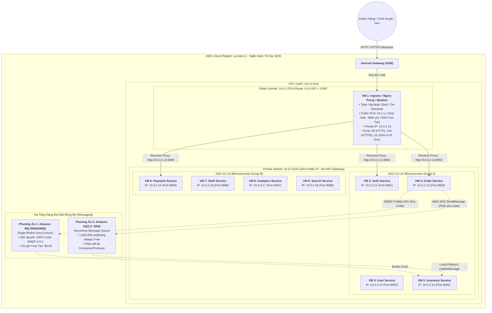
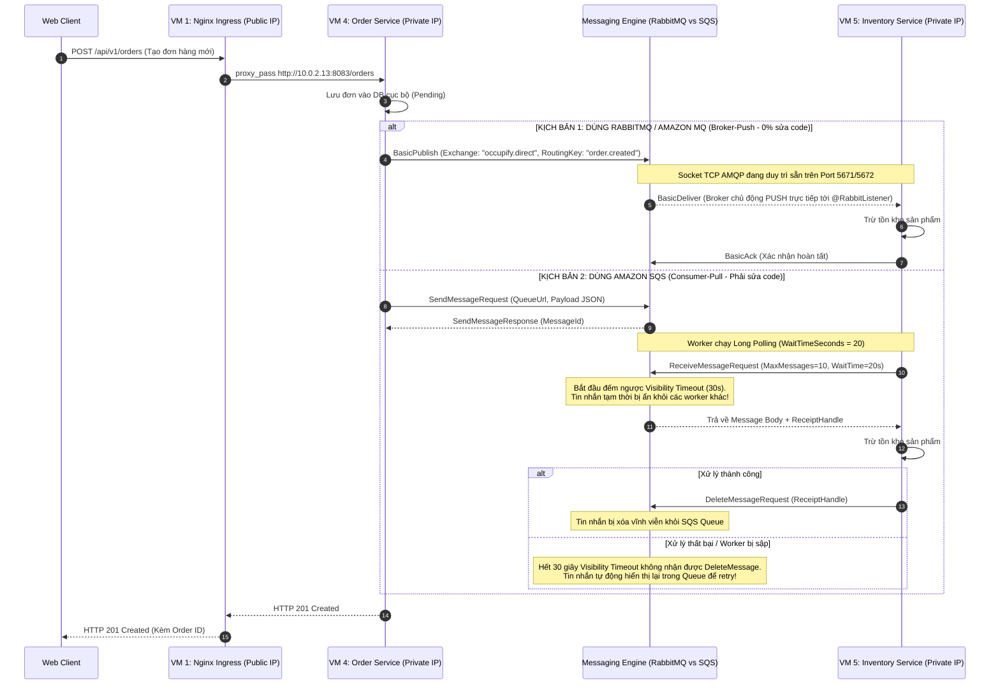
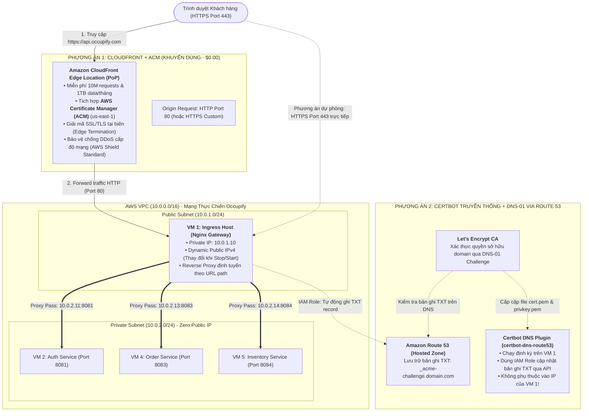
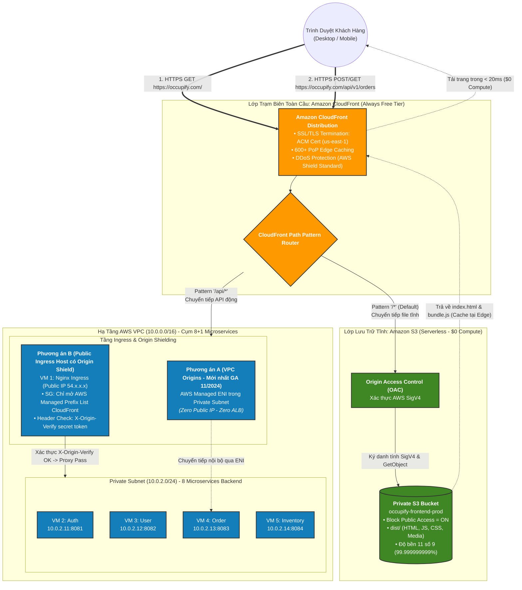

# Occupify Microservices Architecture: Practical VPC (1 Public + 8 Private VMs), SSL/TLS Ingress, CloudFront Origin Architecture & Messaging Strategy

> **Khóa học / Dự án**: Kiến trúc Cloud & Tối ưu Chi phí AWS (Occupify Microservices System)  
> **Phân nhóm**: Domain 1 (Budget & Sizing), Domain 2 (Practical VPC, Port 443 SSL/TLS Ingress & CloudFront Origin Architecture) & Domain 3 (Distributed Messaging Engine)  
> **Chủ đề**: Bật/Tắt 9 VMs linh hoạt, Kiến trúc mạng 1 Public Ingress + 8 Private Backend VMs, Giải pháp Port 443 SSL/TLS (ACM vs Certbot Let's Encrypt), CloudFront Origin Architecture (Private Subnet EC2 via VPC Origins vs S3 Frontend OAC Best Practice), và Đánh giá Mức độ Tác động Mã nguồn (RabbitMQ vs Amazon SQS)  
> **Trạng thái**: Hoàn thành (Completed)  
> **Checklist đối chiếu**: [CHECKLIST](./CHECKLIST.md)

---

## 1. Khái Niệm Cốt Lõi & Bản Chất Kỹ Thuật (Core Concepts & Technical Deep Dive)

Hệ thống **Occupify** bao gồm 9 microservices phân tán độc lập: *API Gateway/Ingress, Auth Service, User Management, Order Management, Booking/Inventory, Payment Service, Notification Service, Search Service, và Analytics Worker*. Mỗi node dịch vụ yêu cầu cấu hình tối thiểu **2 vCPU** và **6 GiB RAM** để chạy ổn định runtime (JVM Spring Boot, Node.js hoặc Go) cùng container phụ trợ và in-memory cache.

Khi chuyển dịch hệ thống này lên nền tảng đám mây **Amazon Web Services (AWS)** dưới một hạn mức tài chính cố định **$200 tín dụng thử nghiệm (AWS Credits)**, đội ngũ kỹ sư phải đối mặt với năm bài toán kiến trúc sống còn:
1. **Tính khả thi của việc Bật / Tắt (Start/Stop) 9 máy ảo tùy biến**: Dữ liệu có bị mất không? Tiền có tiếp tục bị trừ khi máy tắt không?
2. **Thiết kế mạng thực chiến (Practical VPC Architecture)**: Làm thế nào để vừa tiết kiệm tối đa phí Public IPv4 mới của AWS ($0.005/h), vừa bảo mật tuyệt đối cho 8 microservices lõi, nhưng người dùng bên ngoài hoặc Frontend vẫn truy cập được vào hệ thống?
3. **Mở cổng Port 443 SSL/TLS & Quản lý Chứng chỉ số**: Trên Linux thường dùng Certbot (Let's Encrypt), trên AWS dịch vụ tương đương là gì? AWS Certificate Manager (ACM) có cài được trực tiếp vào Nginx trên EC2 standalone không? Giải pháp nào tối ưu $0.00 và không bị lỗi khi bật/tắt EC2 làm đổi Public IP?
4. **Mức độ tác động mã nguồn (Code Impact Analysis)**: Nếu dự án đang dùng **RabbitMQ**, chuyển sang **Amazon MQ for RabbitMQ** hay **Amazon SQS**? Code Java Spring Boot phải viết lại những gì?
5. **Kiến trúc CloudFront Origin & Frontend Hosting**: Khi đã có Amazon CloudFront đứng trước, có nhất thiết phải đặt máy ảo EC2 cho Frontend vào Public Subnet không? Tại sao quy tắc vàng kiến trúc nghiêm cấm dùng EC2 cho Frontend SPA (React/Vite), và cơ chế nào cho phép CloudFront chọc thẳng vào EC2 Private Subnet hoặc S3 OAC an toàn 100%?

---

### 1.1 Khẳng Định Tính Khả Thi 100%: Cơ Chế Bật/Tắt (Start/Stop) 9 Máy Ảo

> [!IMPORTANT]
> **Khẳng định dứt khoát**: Giải pháp vận hành 9 máy ảo EC2 cấu hình cao ($\ge$ 2 vCPU, 8 GiB RAM) với kịch bản **bật 5 tiếng/ngày khi học tập, dev/test và tắt máy (Stop) khi không dùng là KHẢ THI 100% VỀ CẢ MẶT KỸ THUẬT LẪN TÀI CHÍNH**.

#### A. Bản chất kỹ thuật của trạng thái Dừng máy (EC2 Stopped State)
- **Về mặt Dữ liệu (Storage Persistence)**: Khi bạn phát lệnh `aws ec2 stop-instances`, hệ điều hành sẽ thực hiện quy trình shutdown tuần tự (`ACPI shutdown`). Toàn bộ hệ điều hành, Docker images, mã nguồn ứng dụng, cấu hình container, và dữ liệu ghi trên ổ đĩa gốc **Amazon EBS (Elastic Block Store) gp3** vẫn **được lưu trữ nguyên vẹn vĩnh viễn trên hạ tầng SAN phân tán của AWS**. Khi bạn phát lệnh `aws ec2 start-instances`, máy ảo khởi động lại đúng với trạng thái trước khi tắt.
- **Về mặt Chi phí (Billing Mechanics)**:
  - **Tiền Compute (vCPU & RAM)**: **Lập tức dừng tính phí ($0.00)** ngay khi máy ảo chuyển sang trạng thái `stopped`. Bạn chỉ trả tiền compute cho đúng số giây/số giờ máy thực sự ở trạng thái `running`.
  - **Tiền Ổ cứng (EBS gp3 Storage)**: Vẫn tiếp tục tính phí bình thường, vì AWS phải duy trì phân vùng block storage của bạn trong data center. Tuy nhiên, như tính toán chi tiết dưới đây, chi phí này vô cùng nhỏ!

---

### 1.2 Bóc Tách Tài Chính Kịch Bản 5 Tiếng/Ngày: Ngân Sách $200 Kéo Dài Bao Lâu?

Hãy cùng phân tích chi tiết từng xu chi phí cho cụm 9 máy ảo cấu hình phân khúc `*.large` (2 vCPU, 8 GiB RAM) tại vùng `us-east-1` (N. Virginia):

#### 1. Định mức cấu hình phần cứng:
- **Loại máy ảo**: 9 node `t4g.large` (AWS Graviton2 ARM64, đơn giá On-Demand: **$0.0672/h**, đơn giá Spot trung bình: **$0.0280/h**). Hoặc bạn có thể dùng `t3a.large` (AMD x86_64, Spot: **~$0.0250/h**).
- **Ổ cứng**: 9 ổ EBS gp3 dung lượng 20 GB/máy = **180 GB**.
- **Chính sách AWS Free Tier**: Miễn phí **30 GB** EBS gp2/gp3 mỗi tháng (trong 12 tháng đầu).
- **Dung lượng EBS chịu phí**: $180\text{ GB} - 30\text{ GB} = \mathbf{150\text{ GB}}$.
- **Đơn giá EBS gp3 (`us-east-1`)**: **$0.08 / GB-tháng**.
- **Phí lưu trữ EBS cố định**:
  $$\text{Chi phí EBS hàng tháng} = 150\text{ GB} \times \$0.08 = \mathbf{\$12.00 / \text{tháng}} \quad (\approx \mathbf{\$0.40 / \text{ngày}})$$

#### 2. Kịch bản Vận hành 5 tiếng / ngày:

```text
┌────────────────────────────────────────────────────────────────────────┐
│             BẢNG TÍNH CHI PHÍ VẬN HÀNH 9 MÁY ẢO (5 TIẾNG / NGÀY)       │
├───────────────────────────────┬───────────────────┬────────────────────┤
│ Hạng Mục Chi Phí              │ Kịch Bản Spot     │ Kịch Bản On-Demand │
├───────────────────────────────┼───────────────────┼────────────────────┤
│ Compute (9x VM x 5h/ngày)     │ 9 x $0.028 x 5    │ 9 x $0.0672 x 5    │
│                               │ = $1.260 / ngày   │ = $3.024 / ngày    │
│ EBS Storage (150 GB gp3)      │ $0.400 / ngày     │ $0.400 / ngày      │
│ Phí Public IPv4 (1 Public IP) │ $0.000 (Free Tier)│ $0.000 (Free Tier) │
├───────────────────────────────┼───────────────────┼────────────────────┤
│ TỔNG CHI PHÍ / NGÀY           │ $1.660 / ngày     │ $3.424 / ngày      │
│ TỔNG CHI PHÍ / THÁNG (30 ngày)│ $49.80 / tháng    │ $102.72 / tháng    │
├───────────────────────────────┼───────────────────┼────────────────────┤
│ THỜI GIAN TỒN TẠI CỦA $200    │ ~120.4 NGÀY       │ ~58.4 NGÀY         │
│                               │ (HƠN 4 THÁNG!) 🏆  │ (GẦN 2 THÁNG!)     │
└───────────────────────────────┴───────────────────┴────────────────────┘
```

> [!TIP]
> **Nhận định thực tế**:
> - Nếu sử dụng **EC2 Spot Instances** kết hợp lịch bật **5 tiếng/ngày**, ngân sách **$200** của bạn có thể nuôi sống toàn bộ cụm 9 microservices trong **hơn 4 tháng (17 tuần)**! Đây là khoảng thời gian quá dư dả để hoàn thành bất kỳ đồ án tốt nghiệp, bài nghiên cứu thử nghiệm hay đồ án môn học nào.
> - Kể cả khi bạn dùng **On-Demand** 100% để tránh hoàn toàn rủi ro bị thu hồi máy của Spot, bạn vẫn thoải mái chạy trong **gần 2 tháng (8.3 tuần)**!

---

### 1.3 Kiến Trúc Mạng Thực Chiến: 1 Public Subnet VM + 8 Private Subnet VMs

Thay vì cấm hoàn toàn Public IP khiến việc truy cập từ trình duyệt bên ngoài gặp trở ngại, kiến trúc thực chiến tối ưu nhất cho Occupify là mô hình **Mạng Lai Phân Tầng (Two-Tier Hybrid Subnet VPC)**:

```text
┌─────────────────────────────────────────────────────────────────────────────────────────┐
│                                 VPC (10.0.0.0/16)                                       │
│                                                                                         │
│   ┌─────────────────────────────────────────────────────────────────────────────────┐   │
│   │ PUBLIC SUBNET (10.0.1.0/24)  [Route to Internet Gateway (IGW)]                  │   │
│   │                                                                                 │   │
│   │   ┌─────────────────────────────────────────────────────────────────────────┐   │   │
│   │   │ [VM 1: Ingress / Nginx Gateway / Bastion Host]                          │   │   │
│   │   │ • Private IP: 10.0.1.10                                                 │   │   │
│   │   │ • Public IPv4: 54.x.x.x (1 địa chỉ duy nhất - 100% Free Tier)           │   │   │
│   │   │ • Vai trò: Reverse Proxy, SSL Termination, Routing, SSH Bastion         │   │   │
│   │   └─────────────────────────────────────────────────────────────────────────┘   │   │
│   └──────────────────────────────────────┬──────────────────────────────────────────┘   │
│                                          │ Private Traffic (Free, Tốc độ cao)           │
│   ┌──────────────────────────────────────▼──────────────────────────────────────────┐   │
│   │ PRIVATE SUBNET (10.0.2.0/24)  [Không Route ra Internet Gateway, Zero NAT GW]    │   │
│   │                                                                                 │   │
│   │   [VM 2: Auth]       [VM 3: User]       [VM 4: Order]      [VM 5: Inventory]    │   │
│   │   10.0.2.11          10.0.2.12          10.0.2.13          10.0.2.14            │   │
│   │                                                                                 │   │
│   │   [VM 6: Payment]    [VM 7: Notif]      [VM 8: Analytics]  [VM 9: Search]       │   │
│   │   10.0.2.15          10.0.2.16          10.0.2.17          10.0.2.18            │   │
│   │                                                                                 │   │
│   │   • An toàn tuyệt đối: Không có cửa ngõ trực tiếp từ Internet                   │   │
│   │   • Giao tiếp nội bộ qua Private IP (10.0.2.x): Độ trễ < 1ms, Băng thông 5 Gbps │   │
│   └─────────────────────────────────────────────────────────────────────────────────┘   │
└─────────────────────────────────────────────────────────────────────────────────────────┘
```

#### Phân tích ưu điểm vượt trội của mô hình 1 Public + 8 Private:
1. **Tiết kiệm triệt để chi phí Public IPv4**:
   - Quy định của AWS từ 01/02/2024: Phí Public IPv4 là **$0.005/h/IP**.
   - Tuy nhiên, **AWS Free Tier miễn phí 750 giờ/tháng cho 1 địa chỉ Public IPv4 duy nhất** trong tài khoản!
   - Vì hệ thống chỉ có **duy nhất 1 máy ảo ở Public Subnet** sở hữu Public IP, toàn bộ số giờ chạy của máy này (cho dù chạy 5h/ngày = 150h/tháng hay chạy 24/7 = 720h/tháng) đều nằm gọn trong định mức 750 giờ miễn phí. **Chi phí Public IP phát sinh = $0.00**!
2. **Không tốn chi phí đắt đỏ của NAT Gateway**:
   - NAT Gateway của AWS có đơn giá lên tới **$0.045/h + phí xử lý dữ liệu $0.045/GB**, tiêu tốn cố định **~$32.40/tháng** ngay cả khi không có traffic!
   - Trong mô hình này, chúng ta **loại bỏ hoàn toàn NAT Gateway**. Các container và packages cần thiết được cài đặt sẵn thông qua script cấu hình hoặc tải sẵn vào AMI trước khi đưa vào Private Subnet.
3. **Bảo mật chuẩn cấp Ngân hàng (Zero-Attack Surface for Core Services)**:
   - 8 máy ảo chứa logic nghiệp vụ và dữ liệu nhạy cảm (User, Order, Payment, Auth) hoàn toàn không có Public IP. Tin tặc trên Internet không có bất kỳ cách nào quét cổng (port scan) hay tấn công dò mật khẩu SSH (brute-force).
   - Mọi luồng truy cập từ người dùng bắt buộc phải đi qua VM 1 (Nginx Ingress) trên cổng 80/443 đã qua kiểm soát và giới hạn tốc độ (rate-limiting).

---

### 1.4 Đánh Giá Mức Độ Tác Động Mã Nguồn: RabbitMQ vs Amazon SQS (Code Impact Deep Dive)

Khi chuyển dịch lớp xử lý thông điệp bất đồng bộ (Asynchronous Messaging) từ môi trường Local/On-Premise lên AWS, kỹ sư phần mềm phải đối diện với bài toán đánh đổi giữa **Amazon MQ for RabbitMQ** và **Amazon SQS**.

```text
┌─────────────────────────────────────────────────────────────────────────────────────────┐
│                    MA TRẬN ĐÁNH ĐỔI CODE IMPACT & KIẾN TRÚC                             │
├──────────────────────────┬─────────────────────────────┬────────────────────────────────┤
│ Tiêu Chí                 │ Amazon MQ for RabbitMQ      │ Amazon SQS (+ Amazon SNS)      │
├──────────────────────────┼─────────────────────────────┼────────────────────────────────┤
│ Mức độ thay đổi Code     │ 0% (KHÔNG SỬA CODE LOGIC!)  │ 100% PHẢI VIẾT LẠI TẦNG QUEUE  │
│ Giao thức hỗ trợ         │ AMQP 0-9-1, STOMP, MQTT     │ AWS Proprietary HTTPS REST API │
│ Mô hình truyền tin       │ Broker-Push (Chủ động đẩy)  │ Consumer-Pull (Polling)        │
│ Cơ chế Routing & Pub/Sub │ Topic/Fanout/Direct Exchange│ Phải ghép thêm Amazon SNS Topic│
│ Thư viện Client          │ spring-boot-starter-amqp    │ software.amazon.awssdk:sqs     │
│                          │ amqplib (Node), pika (Py)   │ spring-cloud-aws-starter-sqs   │
│ Cơ chế Xác nhận          │ BasicAck / BasicNack        │ DeleteMessage(ReceiptHandle)   │
│ Xử lý lỗi & Timeout      │ Dead Letter Exchange (DLX)  │ Visibility Timeout (30s) + DLQ │
│ Chi phí AWS              │ Free Tier 750h mq.t3.micro  │ 1,000,000 req/tháng Always Free│
└──────────────────────────┴─────────────────────────────┴────────────────────────────────┘
```

#### A. Kịch bản 1: Chọn Amazon MQ for RabbitMQ (Hoặc Docker RabbitMQ trên chính 1 VM)
- **Code Impact**: **0% thay đổi logic**.
- **Cơ chế**: Amazon MQ cung cấp một RabbitMQ Broker tương thích 100% với chuẩn AMQP 0-9-1.
- **Những gì bạn cần làm**: Chỉ thay đổi biến môi trường kết nối trong file cấu hình (`application.properties` hoặc docker environment):
  - Thay `localhost:5672` bằng endpoint SSL của Amazon MQ: `b-xxxxxx.mq.us-east-1.amazonaws.com:5671`.
  - Toàn bộ annotation `@RabbitListener`, các bean `DirectExchange`, `TopicExchange`, `Binding`, và lời gọi `rabbitTemplate.convertAndSend()` **giữ nguyên 100% không cần chạm vào một dòng code nào**!

#### B. Kịch bản 2: Chọn Amazon SQS (Simple Queue Service)
- **Code Impact**: **100% phải viết lại toàn bộ tầng Messaging**.
- **Những khác biệt cốt lõi buộc phải refactor code**:
  1. **Không có AMQP Connection**: Bỏ `spring-boot-starter-amqp`, thay bằng AWS SDK v2 hoặc Spring Cloud AWS SQS Starter.
  2. **Chuyển dịch từ Push sang Polling**: RabbitMQ duy trì socket TCP và chủ động đẩy message vào listener. SQS là dịch vụ web HTTP, consumer phải chủ động gửi request kéo tin nhắn về (`ReceiveMessage`). Để tránh tốn tiền API, bắt buộc phải bật **Long Polling (`waitTimeSeconds = 20`)**.
  3. **Cơ chế Xóa tin nhắn (Receipt Handle Lifecycle)**: Trong RabbitMQ, khi bạn xử lý xong, container gửi ack hoặc để auto-ack. Trong SQS, khi bạn đọc tin nhắn, tin nhắn chỉ bị **tạm ẩn đi (Visibility Timeout)**. Sau khi xử lý xong, bạn **bắt buộc phải gọi lệnh `DeleteMessage` kèm theo chuỗi định danh tạm thời `ReceiptHandle`**. Nếu quên xóa, hết thời gian timeout tin nhắn sẽ nhảy ngược lại hàng đợi và bị xử lý lặp lại!
  4. **Mất cơ chế Exchange/Routing Key**: SQS chỉ là một hàng đợi phẳng (Queue) đơn thuần, không có khái niệm Exchange để phân luồng message theo pattern (ví dụ: `order.*.eu`). Nếu muốn sao chép 1 sự kiện tới nhiều hàng đợi (Fanout), bạn buộc phải tạo một **Amazon SNS Topic**, sau đó cấu hình các SQS Queues subscribe vào SNS Topic đó.

---

### 1.5 Bài Toán Port 443 SSL/TLS: AWS Certificate Manager (ACM) vs Certbot (Let's Encrypt) - Bản Chất Kỹ Thuật & Giới Hạn Cốt Lõi

Khi vận hành ứng dụng thực tế trên Web hoặc cung cấp API cho ứng dụng di động/Frontend, toàn bộ lưu lượng trên Internet bắt buộc phải được mã hóa qua giao thức an toàn **HTTPS (Port 443 SSL/TLS)**. Trên các máy chủ Linux vật lý hoặc máy ảo truyền thống, kỹ sư thường cài đặt công cụ mã nguồn mở **Certbot** để tự động cấp và gia hạn chứng chỉ số miễn phí từ tổ chức phát hành **Let's Encrypt**.

Khi chuyển dịch sang hệ sinh thái điện toán đám mây **Amazon Web Services (AWS)**, câu hỏi lớn đặt ra là: *Dịch vụ nào trên AWS tương đương với Certbot? Có dùng được trực tiếp với Nginx trên máy ảo EC2 không? Và giải pháp nào tiết kiệm nhất trong hạn mức $200 tín dụng?*

#### 1. Dịch Vụ Tương Đương Trên AWS: AWS Certificate Manager (ACM)
- **AWS Certificate Manager (ACM)** là dịch vụ quản lý chứng chỉ số SSL/TLS do AWS cung cấp.
- **Ưu điểm vượt trội**:
  - **Miễn phí 100%**: AWS không tính bất kỳ chi phí nào khi cấp và sử dụng các chứng chỉ công khai (Public SSL/TLS Certificates).
  - **Tự động gia hạn hoàn toàn (Managed Renewal)**: Khi thiết lập phương thức xác thực **DNS Validation** (tự động tạo bản ghi CNAME trên Amazon Route 53 hoặc bất kỳ máy chủ DNS nào), ACM sẽ chủ động kiểm tra và gia hạn chứng chỉ trước khi hết hạn 60 ngày mà không cần người quản trị can thiệp, triệt tiêu hoàn toàn rủi ro "sập web vì quên gia hạn chứng chỉ".
  - **Tích hợp chặt chẽ**: Liên kết trực tiếp với các dịch vụ mạng phân phối tải của AWS chỉ bằng một cú nhấp chuột hoặc một dòng lệnh CLI.

#### 2. ĐIỂM MẤU CHỐT KỸ THUẬT: Chứng Chỉ ACM Public KHÔNG THỂ XUẤT ĐƯỢC PRIVATE KEY!
> [!CAUTION]
> **Giới Hạn Bất Di Bất Dịch Của AWS ACM (Technical Invariant)**:  
> **Chứng chỉ SSL/TLS công khai do ACM cấp KHÔNG CHO PHÉP XUẤT PRIVATE KEY (Non-Exportable Private Key)**!  
> Theo chuẩn bảo mật khắt khe của AWS (FIPS 140-2 Level 3 HSM), khóa bí mật (Private Key) được tạo ra và khóa chặt vĩnh viễn bên trong mô-đun phần cứng an toàn của AWS. Người dùng **không bao giờ có thể tải về file `.key` hay chuỗi khóa riêng tư**.

**Hệ quả kiến trúc trực tiếp đối với Occupify**:
- Máy chủ web **Nginx** chạy trên máy ảo **VM 1 (Ingress)** khi cấu hình SSL bắt buộc phải đọc hai file cục bộ trên ổ đĩa:
  ```nginx
  ssl_certificate     /path/to/fullchain.pem; # Public Certificate
  ssl_certificate_key /path/to/privkey.pem;   # Private Key (BẮT BUỘC CÓ)
  ```
- Do ACM không cho phép xuất file Private Key, **BẠN KHÔNG THỂ CÀI CHỨNG CHỈ ACM PUBLIC TRỰC TIẾP VÀO NGINX TRÊN MÁY ẢO EC2 STANDALONE!**
- ACM chỉ có thể gắn vào các dịch vụ được AWS quản lý (AWS Integrated Services) có khả năng giao tiếp nội bộ với HSM của ACM, tiêu biểu gồm:
  1. **Amazon CloudFront** (Mạng phân phối nội dung / CDN & Edge Ingress)
  2. **Application Load Balancer (ALB)** / Network Load Balancer (NLB)
  3. **Amazon API Gateway**

---

#### 3. Phân Tích Đánh Đổi & 3 Giải Pháp Thực Chiến Cho Hệ Thống Occupify

Để giải quyết bài toán mã hóa Port 443 cho hệ thống Occupify với 1 Public VM (Nginx) và 8 Private VMs, nhóm kỹ sư có 3 phương án lựa chọn:

```text
┌──────────────────────────────────────────────────────────────────────────────────────────────────┐
│                   MA TRẬN SO SÁNH 3 GIẢI PHÁP SSL/TLS PORT 443 CHO OCCUPIFY                     │
├──────────────────────┬──────────────────────┬──────────────────────┬─────────────────────────────┤
│ Tiêu Chí So Sánh     │ Phương Án 1 (Khuyên) │ Phương Án 2          │ Phương Án 3 (Truyền Thống)  │
│                      │ Amazon CloudFront+ACM│ AWS ALB + ACM        │ Certbot (DNS-01 Route 53)   │
├──────────────────────┼──────────────────────┼──────────────────────┼─────────────────────────────┤
│ Điểm giải mã SSL/TLS │ CloudFront Edge (PoP)│ Application Load Bal.│ Trực tiếp tại VM 1 (Nginx)  │
│ Chứng chỉ sử dụng    │ AWS ACM Public Cert  │ AWS ACM Public Cert  │ Let's Encrypt Public Cert   │
│ Chi phí hàng tháng   │ $0.00 (Always Free)🏆│ ~$16.20 - $22.00/th ❌│ $0.00 (Certbot Free)        │
│ Tác động ngân sách   │ Không tốn 1 xu credit│ Đốt 10% credit /tháng│ Không tốn tiền SSL          │
│ Vấn đề đổi Public IP │ Không bị ảnh hưởng   │ Không bị ảnh hưởng   │ Giải quyết bằng DNS-01 Role │
│ Bảo mật máy chủ lõi  │ Giấu IP VM 1, DDoS L3│ Giấu IP VM 1         │ Lộ Public IP của VM 1       │
│ Độ phức tạp vận hành │ Cực thấp             │ Thấp (nhưng đắt)     │ Trung bình (cần IAM Role)   │
└──────────────────────┴──────────────────────┴──────────────────────┴─────────────────────────────┘
```

##### 🌟 Giải Pháp 1 (AWS Cloud-Native Khuyên Dùng - Tối Ưu Chi Phí $0.00): Amazon CloudFront + ACM
- **Cơ chế hoạt động**:
  - Đặt một **CloudFront Distribution** làm lớp khiên bảo vệ ngoài cùng (Edge Ingress).
  - Yêu cầu một chứng chỉ ACM hoàn toàn miễn phí gắn vào CloudFront. **LƯU Ý CỐT TỬ**: Để gắn được vào CloudFront, chứng chỉ ACM **BẮT BUỘC PHẢI ĐƯỢC TẠO TẠI VÙNG `us-east-1` (N. Virginia)**.
  - Khi người dùng gửi request `https://api.occupify.com`:
    1. Trình duyệt kết nối tới PoP (Edge Location) gần nhất của CloudFront. CloudFront giải mã HTTPS bằng chứng chỉ ACM.
    2. CloudFront forward traffic bằng HTTP thông thường (Port 80) hoặc HTTPS tự ký về Public IP của **VM 1 (Nginx Ingress)**.
    3. Nginx trên VM 1 tiếp tục định tuyến vào 8 máy ảo Backend trong Private Subnet qua mạng nội bộ.
- **Bóc tách tài chính (Chính sách AWS Always Free)**:
  - Amazon CloudFront cung cấp hạn mức miễn phí vĩnh viễn (**Always Free Tier**):
    - **1 TB Data Transfer Out (DTO)** mỗi tháng.
    - **10,000,000 HTTP hoặc HTTPS Requests** mỗi tháng.
    - **2,000,000 CloudFront Function invocations** mỗi tháng.
  - Với một đồ án thử nghiệm hoặc lab học tập, lưu lượng data khó vượt quá 10-20 GB/tháng. Do đó, **chi phí giải pháp này bằng đúng $0.00**!
- **Lợi ích bổ sung**:
  - Ẩn hoàn toàn địa chỉ IP thật của máy ảo VM 1 trước các đợt scan cổng tự động trên Internet.
  - Tự động tích hợp tính năng bảo vệ chống DDoS miễn phí cấp độ mạng (**AWS Shield Standard**).
  - Tăng tốc độ phản hồi cho người dùng nhờ mạng lưới Edge Caching toàn cầu của AWS.

##### 💸 Giải Pháp 2: Application Load Balancer (ALB) + ACM (Đắt Đỏ, Không Khuyến Khích Cho Lab)
- **Cơ chế hoạt động**: Tạo một Application Load Balancer đứng ở Public Subnet, gắn chứng chỉ ACM ở Listener Port 443, sau đó trỏ Target Group về Port 80 của VM 1.
- **Hạn chế tài chính nghiêm trọng**:
  - Đơn giá ALB tại `us-east-1`: **$0.0225 / giờ ALB chạy** + phí LCU ($0.008 / LCU-giờ).
  - Kể cả khi hệ thống không có bất kỳ khách hàng nào truy cập, chỉ riêng tiền duy trì ALB bật 24/7 đã tiêu tốn:
    $$\$0.0225 \times 24 \times 30 = \mathbf{\$16.20 / \text{tháng}}$$
  - Nếu duy trì trong suốt 4 tháng làm đồ án, ALB sẽ ngốn sạch **gần $65 (chiếm hơn 32% toàn bộ ngân sách $200 tín dụng)**! Đây là sự lãng phí vô lý đối với một bài lab học tập.

##### 🔧 Giải Pháp 3 (Truyền Thống): Tiếp Tục Dùng Certbot Let's Encrypt Trên VM 1 Với DNS-01 Challenge
- **Cơ chế hoạt động**:
  - Không dùng CloudFront hay ALB. Máy ảo VM 1 trực tiếp lắng nghe Port 443 và cài đặt Certbot để lấy chứng chỉ từ Let's Encrypt.
- **Thách thức cốt lõi khi Bật/Tắt máy ảo (Dynamic Public IPv4 Problem)**:
  - Nếu bạn dùng phương thức xác thực thông thường `HTTP-01 Challenge` (`certbot --nginx` hoặc standalone lắng nghe Port 80): Let's Encrypt sẽ kết nối tới tên miền của bạn qua Port 80 để kiểm tra file xác thực ngẫu nhiên.
  - Tuy nhiên, trong mô hình tối ưu chi phí của chúng ta (chạy 5h/ngày), **mỗi lần Stop và Start lại VM 1, địa chỉ Public IPv4 của máy ảo sẽ bị thay đổi ngẫu nhiên**!
  - Bản ghi DNS A Record của tên miền sẽ bị trỏ lệch vào IP cũ. Hậu quả là Certbot không thể gia hạn hoặc cấp mới chứng chỉ, báo lỗi `Connection Refused` hoặc `Unauthorized`.
- **Giải pháp triệt để: DNS-01 Challenge qua plugin `certbot-dns-route53`**:
  - Thay vì để Let's Encrypt gọi ngược vào Port 80 của máy ảo (HTTP-01), ta dùng **DNS-01 Challenge**.
  - Let's Encrypt sẽ yêu cầu tạo một bản ghi `TXT` bí mật tại tên miền phụ `_acme-challenge.occupify.com`.
  - Bằng cách gán một **IAM Role** cho VM 1 với quyền sửa đổi bản ghi trên Route 53, plugin `certbot-dns-route53` sẽ tự động gọi AWS API để tạo bản ghi TXT này và tự dọn dẹp sau khi xác thực thành công.
  - **Điểm ưu việt tuyệt đối**: Quá trình xin và gia hạn chứng chỉ **hoàn toàn độc lập với địa chỉ IP của máy ảo**. Dù IP của VM 1 có đổi hàng chục lần mỗi ngày, hoặc dù Port 80 đang bị đóng, Certbot vẫn gia hạn thành công 100%!

---

### 1.6 Kiến Trúc CloudFront Origin Cho Frontend & EC2: Có Cần Đặt EC2 Vào Public Subnet Không? (VPC Origins vs S3 OAC Best Practice)

Một trong những câu hỏi kiến trúc kinh điển nhất khi đưa hệ thống Occupify lên AWS là:  
> *"Nếu chúng ta đã quyết định dùng Amazon CloudFront đứng trước làm trạm biên (Edge Ingress) để nhận chứng chỉ ACM SSL/TLS miễn phí, vậy máy ảo EC2 phục vụ Frontend và Backend có nhất thiết phải đặt trong Public Subnet không?"*

#### A. Câu trả lời dứt khoát từ AWS Solutions Architect: **KHÔNG!**
Bạn **HOÀN TOÀN KHÔNG CẦN** và **KHÔNG NÊN** đặt máy ảo EC2 vào Public Subnet nếu mục đích chỉ để cho CloudFront kết nối tới. Dưới đây là 3 sự thật kỹ thuật mang tính bước ngoặt:

---

#### B. Đột phá công nghệ: CloudFront VPC Origins (AWS Chính thức GA Tháng 11/2024)

Trước tháng 11/2024, một hạn chế lớn của CloudFront là: **CloudFront chỉ có thể kết nối tới các Custom Origin có địa chỉ Public IP hoặc tên miền công khai trên Internet**. Do đó, nếu muốn giấu máy ảo EC2 vào Private Subnet, kiến trúc sư buộc phải:
1. Dựng một **Internet-facing Application Load Balancer (ALB)** nằm ở Public Subnet để nhận traffic từ CloudFront rồi chuyển tiếp vào Private Subnet.
2. Hệ quả tài chính: Tốn tối thiểu **$16.20 - $22.00 / tháng** tiền ALB, làm tiêu hao 30-40% ngân sách $200 tín dụng của Occupify!

> [!IMPORTANT]
> **Bước ngoặt CloudFront VPC Origins (General Availability - Tháng 11/2024)**:  
> AWS đã chính thức ra mắt tính năng **CloudFront VPC Origins**, cho phép Amazon CloudFront kết nối **trực tiếp vào Private Subnet** trong VPC của bạn mà **KHÔNG CẦN Public IP, KHÔNG CẦN Internet Gateway (IGW) route, và KHÔNG CẦN ALB tốn tiền**!

```text
┌──────────────────────────────────────────────────────────────────────────────────────────────────┐
│                   CƠ CHẾ KẾT NỐI CỦA CLOUDFRONT VPC ORIGINS (AWS GA 11/2024)                     │
├──────────────────────────────────────────────────────────────────────────────────────────────────┤
│                                                                                                  │
│   [ Client Browser ]                                                                             │
│          │ (HTTPS: Port 443)                                                                     │
│          ▼                                                                                       │
│   [ CloudFront Edge PoP ]  (ACM Certificate in us-east-1)                                        │
│          │                                                                                       │
│          │ (Lưu lượng đi qua AWS High-Speed Private Backbone Network)                             │
│          ▼                                                                                       │
│   ┌──────────────────────────────────────────────────────────────────────────────────────────┐   │
│   │ VPC (10.0.0.0/16) - PRIVATE SUBNET (10.0.2.0/24)                                         │   │
│   │                                                                                          │   │
│   │   ┌────────────────────────────────────────┐       ┌─────────────────────────────────┐   │   │
│   │   │ AWS-Managed VPC Origin ENI             │──────▶│ EC2 Ingress Host (10.0.2.10)    │   │   │
│   │   │ (Card mạng ảo do CloudFront quản lý)   │ (HTTP)│ • Zero Public IP                │   │   │
│   │   │ • Gắn trực tiếp vào Private Subnet     │       │ • Zero IGW Ingress Route        │   │   │
│   │   │ • Được kiểm soát bởi Security Group    │       │ • Nginx / API Gateway           │   │   │
│   │   └────────────────────────────────────────┘       └─────────────────────────────────┘   │   │
│   └──────────────────────────────────────────────────────────────────────────────────────────┘   │
└──────────────────────────────────────────────────────────────────────────────────────────────────┘
```

- **Nguyên lý hoạt động ngầm của VPC Origins**:
  - Khi bạn tạo một VPC Origin trong CloudFront, AWS sẽ tự động cấp phát các **Elastic Network Interface (ENI)** được quản lý trực tiếp bên trong các Private Subnet mà bạn chỉ định.
  - Khi request từ người dùng đến CloudFront Edge, CloudFront đóng gói và định tuyến lưu lượng qua đường truyền mạng riêng tốc độ cao nội bộ của AWS (AWS global private network) tới thẳng ENI này.
  - Từ ENI, gói tin được chuyển trực tiếp tới Private IP nội bộ của EC2 (ví dụ: `10.0.2.10`).
  - **Kết quả bảo mật & chi phí**: Toàn bộ 9 máy ảo của Occupify có thể nằm gọn 100% trong **Private Subnet**, loại bỏ hoàn toàn bề mặt tấn công từ Internet công cộng và tiết kiệm $0.00 tiền ALB!

---

#### C. Nếu vẫn dùng Public Subnet cho EC2: Cách khóa Origin an toàn 100% (Origin Shielding)

Trong trường hợp bạn chọn kịch bản **1 Public VM + 8 Private VMs** (như thiết kế tại Mục 1.3 để VM 1 vừa làm Ingress vừa làm SSH Bastion Host), bạn cần đảm bảo: **Người dùng hoặc tin tặc KHÔNG THỂ quét thấy Public IP của VM 1 để gọi trực tiếp nhằm bypass CloudFront**.

Để khóa chặt EC2 Ingress chỉ nhận traffic từ CloudFront, bạn áp dụng chiến lược phòng thủ 2 lớp (Defense-in-Depth):

```text
┌──────────────────────────────────────────────────────────────────────────────────────────────────┐
│                   HAI LỚP KHÓA BẢO VỆ EC2 ORIGIN TRONG PUBLIC SUBNET                             │
├────────────────────────────────────────┬─────────────────────────────────────────────────────────┤
│ Lớp 1: Network Layer (Security Group)  │ Lớp 2: Application Layer (Nginx Custom Header)          │
├────────────────────────────────────────┼─────────────────────────────────────────────────────────┤
│ Sử dụng AWS Managed Prefix List:       │ Cấu hình CloudFront tự động đính kèm Custom Header:     │
│ com.amazonaws.global.cloudfront.origin-│ X-Origin-Verify: <occupify-secret-token-uuid>           │
│ facing                                 │                                                         │
│                                        │ Nginx trên EC2 kiểm tra directive:                      │
│ Ingress SG chỉ mở Port 80 cho Prefix   │ if ($http_x_origin_verify != "SecretKey") {             │
│ List này. Mọi dải IP khác trên thế     │     return 403;                                         │
│ giới bị DROP ngay từ card mạng!        │ }                                                       │
└────────────────────────────────────────┴─────────────────────────────────────────────────────────┘
```

1. **Lớp 1 - Network Layer (AWS Managed Prefix List)**:
   - AWS duy trì một danh sách tiền tố mạng được quản lý mang tên:  
     `com.amazonaws.global.cloudfront.origin-facing`
   - Danh sách này chứa toàn bộ các dải địa chỉ IPv4 của các máy chủ CloudFront Edge khi chúng kết nối về máy chủ gốc (Origin).
   - Bạn chỉ cần gán Prefix List này vào Inbound Rule của Security Group cho Port 80. Khi AWS mở rộng thêm dải IP CloudFront mới, AWS tự cập nhật danh sách này, bạn không cần phải bảo trì thủ công.
2. **Lớp 2 - Application Layer (Custom Header `X-Origin-Verify`)**:
   - Dù kẻ tấn công có tài khoản AWS khác và cũng tạo CloudFront để trỏ vào IP của bạn, chúng vẫn bị chặn bởi lớp thứ 2.
   - Bạn cấu hình CloudFront của Occupify tự động chèn một tiêu đề HTTP bí mật:  
     `X-Origin-Verify: e9a7f342-881c-4b35-9014-occupify-super-secret`
   - Trên file cấu hình `/etc/nginx/nginx.conf` của VM 1, ta đặt luật kiểm tra biến `$http_x_origin_verify`. Nếu bất kỳ request nào không có header này hoặc giá trị không khớp, Nginx lập tức trả về mã lỗi `403 Forbidden` và ngắt kết nối.

---

#### D. Quy Tắc Vàng Cho Frontend: ĐỪNG BAO GIỜ DÙNG EC2 ĐỂ CHỨA FRONTEND SPA (React / Vite)!

Một sai lầm rất phổ biến của sinh viên và kỹ sư mới tiếp cận Cloud là: **Tạo hẳn 1 máy ảo EC2 cấu hình 2 vCPU, 8 GiB RAM chỉ để cài Nginx và phục vụ (serve) vài file tĩnh của Frontend React/Vite!**

```text
┌──────────────────────────────────────────────────────────────────────────────────────────────────┐
│              SO SÁNH: HOST FRONTEND SPA TRÊN EC2 VS AMAZON S3 + CLOUDFRONT (OAC)                │
├───────────────────────────────┬───────────────────────────────┬──────────────────────────────────┤
│ Tiêu Chí Đánh Giá             │ Phương Án Sai: Dùng EC2 VM    │ Chuẩn Vàng AWS: S3 + CF (OAC) 🏆 │
├───────────────────────────────┼───────────────────────────────┼──────────────────────────────────┤
│ Bản chất xử lý tài nguyên     │ Máy ảo chạy 24/7 chỉ để đọc   │ Object Storage chuyên dụng lưu   │
│                               │ file tĩnh từ ổ cứng EBS       │ trữ tệp tĩnh, tải trực tiếp      │
│ Chi phí Compute               │ Tốn $0.028/h Spot ($20/tháng) │ $0.00 HOÀN TOÀN (Serverless) 🆓  │
│ Độ bền dữ liệu (Durability)   │ Phụ thuộc EBS snapshot        │ 99.999999999% (11 số 9) siêu bền │
│ Khả năng chịu tải đột biến    │ Dễ nghẽn CPU/mạng khi hàng    │ Chịu tải hàng triệu request/giây │
│ (Traffic Spikes)              │ ngàn user tải file bundle.js  │ tại 600+ PoP biên toàn cầu       │
│ Công sức vận hành (Ops)       │ Cập nhật OS, Nginx, Docker,   │ Zero maintenance, không có OS    │
│                               │ quản lý tiến trình, vá lỗi    │ hay máy chủ để bảo trì           │
│ Giải phóng máy ảo Occupify    │ Chiếm mất 1/9 node máy ảo     │ GIẢI PHÓNG HẲN 1 MÁY ẢO EC2 CHO  │
│                               │ quý giá của hệ thống          │ CÁC BACKEND MICROSERVICES! 🚀    │
└───────────────────────────────┴───────────────────────────────┴──────────────────────────────────┘
```

- **Bản chất của Frontend SPA (React / Vite / Vue)**:
  - Khi chạy lệnh `npm run build`, Vite biên dịch toàn bộ source code thành **các tệp tĩnh thuần túy (Static Assets)** nằm trong thư mục `dist/`: `index.html`, các tệp JavaScript chunks (`index-xxxx.js`), CSS (`index-xxxx.css`), hình ảnh và icon.
  - Ứng dụng SPA hoạt động theo cơ chế **Client-Side Rendering (CSR)**: Trình duyệt của người dùng tải các file JS về máy của họ rồi tự thực thi JavaScript trên máy client để vẽ giao diện (DOM). **Máy chủ hoàn toàn không cần tiêu tốn vCPU hay RAM để render trang!**
- **Kiến trúc Chuẩn Vàng (Golden Architecture)**:
  1. **Lưu trữ tĩnh trên Amazon S3**: Đẩy toàn bộ thư mục `dist/` lên một S3 Bucket được cấu hình **khóa hoàn toàn truy cập công khai (Block All Public Access = Enabled)**. Chi phí lưu trữ S3 chỉ khoảng $0.023/GB-tháng. Với một bộ build React nặng khoảng 10 MB - 30 MB, chi phí lưu trữ chưa tới **$0.001 / tháng**!
  2. **Bảo vệ bằng CloudFront Origin Access Control (OAC)**:
     - Ra mắt vào tháng 8/2022 để thay thế Origin Access Identity (OAI) cũ đã lỗi thời.
     - OAC sử dụng chuẩn ký danh tính **AWS Signature Version 4 (SigV4)**.
     - S3 Bucket Policy chỉ cấp quyền `s3:GetObject` duy nhất cho ARN của CloudFront Distribution. Mọi truy cập trực tiếp từ Internet vào URL của S3 bucket sẽ bị chặn đứng `403 Access Denied`.
  3. **Phân luồng hành vi CloudFront (Behaviors Routing)**:
     - **Behavior `/*` (Default)**: Trỏ về **Private S3 Origin qua OAC** $\to$ Trả về mã nguồn Frontend tĩnh với tốc độ cực nhanh, lưu cache tại Edge Location.
     - **Behavior `/api/*`**: Trỏ về **EC2 Ingress / Backend Origin** (qua VPC Origins hoặc Nginx Reverse Proxy có khóa `X-Origin-Verify`) $\to$ Xử lý các nghiệp vụ động (Dynamic REST API) của 8 microservices Java Spring Boot.
- **Tác động tới dự án Occupify**: Bằng cách đưa Frontend lên S3 + CloudFront OAC, bạn **tiết kiệm trọn vẹn 1 máy ảo EC2**, dành toàn bộ tài nguyên compute mạnh mẽ cho các dịch vụ nặng như Auth, Order, Payment và Search!

---

---

## 2. Ví Dụ Đời Sống Thực Tế Dễ Hiểu (Intuitive Real-World Analogies)

---

### 2.1 Phép So Sánh: Dọn Văn Phòng Sang Tòa Nhà Mới (Amazon MQ) vs Tủ Khóa Thông Minh Tự Động (Amazon SQS)

Để hình dung sự khác biệt giữa hai giải pháp hàng đợi tin nhắn, hãy liên tưởng tới câu chuyện quản lý bưu phẩm tại công ty:

```text
┌────────────────────────────────────────────────────────────────────────┐
│                   HAI MÔ HÌNH VẬN CHUYỂN BƯU PHẨM                      │
├────────────────────────────────────────────────────────────────────────┤
│ 1. AMAZON MQ FOR RABBITMQ: "DỌN SANG TÒA NHÀ VĂN PHÒNG MỚI"           │
│                                                                        │
│   Công ty bạn chuyển từ phòng trọ cũ sang thuê phòng tại tòa nhà Keangnam.│
│   Toàn bộ bàn ghế làm việc, tủ tài liệu, cách xưng hô và quy trình     │
│   bàn giao giấy tờ giữa các phòng ban giữ nguyên 100%!                │
│   Bạn chỉ cần đổi tấm biển ghi địa chỉ mới ở sảnh tiếp tân.            │
│   -> Bưu tá (RabbitMQ) vẫn đi thang máy gõ cửa từng bàn làm việc để    │
│      đưa thư (Broker-Push Model).                                      │
├────────────────────────────────────────────────────────────────────────┤
│ 2. AMAZON SQS: "GIẢI TÁN PHÒNG BƯU TÁ, CHUYỂN SANG DÙNG TỦ KHÓA THÔNG MINH"│
│                                                                        │
│   Công ty quyết định sa thải đội bưu tá truyền thống để chuyển sang    │
│   hệ thống Tủ Đồ Thông Minh (Smart Parcel Locker) của Amazon ở tầng trệt.│
│   • Không còn ai đem thư lên tận bàn cho bạn nữa!                      │
│   • Bạn phải thay đổi thói quen hoàn toàn: định kỳ bấm thang máy xuống │
│     tầng trệt, mở ngăn tủ kiểm tra xem có đồ không (Long Polling).     │
│   • Khi cầm gói đồ ra, tủ tự động khóa ngăn đó trong 30 giây           │
│     (Visibility Timeout).                                              │
│   • Bạn mở đồ ra kiểm tra, nếu đúng hàng thì bấm nút 'Xác Nhận Đã Nhận'│
│     (DeleteMessage) để dọn sạch tủ.                                    │
│   • Nếu đang mở hàng mà bạn bị đau bụng chạy đi cấp cứu: hết 30 giây   │
│     ngăn tủ tự mở khóa để đồng nghiệp khác có thể lấy ra xử lý tiếp!  │
└────────────────────────────────────────────────────────────────────────┘
```

> [!NOTE]
> - **Bài học cốt lõi**:
>   - Nếu bạn muốn **tiến độ nhanh nhất**, không có thời gian viết lại mã nguồn: Chọn **Amazon MQ for RabbitMQ** (hoặc chạy container RabbitMQ ngay trên VM).
>   - Nếu bạn chấp nhận **đập đi xây lại tầng messaging** để đổi lấy một dịch vụ serverless bền vững, không bao giờ phải lo bảo trì cụm máy chủ và được miễn phí 1,000,000 requests/tháng vĩnh viễn: Chọn **Amazon SQS**.

---

### 2.2 Phép So Sánh: Cổng Gác Bảo Vệ Chung Cư (Public VM) và Khu Biệt Thự Nội Bộ (8 Private VMs)

Tại sao lại thiết kế mạng theo kiểu 1 Public + 8 Private mà không gán địa chỉ IP công cộng cho tất cả?

Hãy tưởng tượng một **Khu đô thị biệt thự cao cấp gồm 9 tòa nhà**:
- **Tòa nhà số 1 (Public Subnet VM - Nginx Ingress / Cổng Gác)**: Đặt ngay mặt tiền đại lộ chính. Có địa chỉ nhà rõ ràng trên Google Maps (Public IPv4) để shipper, khách viếng thăm, taxi tiếp cận. Tòa nhà này có bảo vệ kiểm tra thẻ từ, máy soi an ninh và hệ thống bộ đàm liên lạc vào bên trong.
- **8 Tòa biệt thự bên trong (8 Private Subnet VMs - Core Microservices)**:
  - Nằm sâu trong khuôn viên khép kín, hoàn toàn không có cửa thông ra đường lớn bên ngoài.
  - Người lạ ngoài phố không thể nào đi thẳng vào phòng ngủ của bạn (tấn công trực diện).
  - Cư dân giữa các biệt thự đi lại với nhau thông qua mạng lưới đường nội bộ lát đá riêng biệt, an toàn, không có xe tải chen lấn và hoàn toàn miễn phí vé cầu đường (Private Network tốc độ 5 Gbps, không tốn cước phí Data Egress).

---

### 2.3 Phép So Sánh: Thẻ Ra Vào Cửa Xoay Tòa Nhà (ACM) vs Chùm Chìa Khóa Cơ Tự Dũa (Certbot)

Để hiểu sâu sắc tại sao chứng chỉ ACM không thể đem vào gõ trong file cấu hình Nginx, hãy hình dung câu chuyện hệ thống cửa an ninh:

```text
┌─────────────────────────────────────────────────────────────────────────────────────────────────┐
│              PHÉP LIÊN TƯỞNG THỰC TẾ: HỆ THỐNG AN NINH VÀ CHỨNG CHỈ SỐ                         │
├─────────────────────────────────────────────────────────────────────────────────────────────────┤
│ 1. AWS CERTIFICATE MANAGER (ACM): "THẺ TỪ GẮN CHẾT VỚI CỬA TỰ ĐỘNG CỦA TÒA NHÀ"                 │
│                                                                                                 │
│   ACM giống như hệ thống thẻ từ cảm ứng thông minh được ban quản lý tòa nhà Keangnam           │
│   (AWS Managed Services như CloudFront hoặc ALB) tích hợp sẵn vào cửa xoay tự động ở sảnh.      │
│   • Khi khách tới, hệ thống cửa xoay tự quét thẻ, tự mở cửa và tự nâng cấp chip bảo mật.       │
│   • Bạn hoàn toàn KHÔNG THỂ cạy con chip từ đó đem về nhà riêng cắm vào ổ khóa cửa gỗ           │
│     truyền thống của căn phòng bạn (Nginx trên EC2 standalone).                                 │
│   • Khóa cửa gỗ bắt buộc phải có một chiếc chìa khóa cơ vật lý bằng kim loại (Private Key file).│
│   -> Muốn hưởng lợi từ chiếc thẻ từ cao cấp hoàn toàn miễn phí này: Hãy để khách đi qua        │
│      sảnh cửa xoay của tòa nhà (CloudFront Edge), sau đó lễ tân sẽ dẫn khách vào phòng bạn!    │
├─────────────────────────────────────────────────────────────────────────────────────────────────┤
│ 2. CERTBOT (LET'S ENCRYPT): "CHÙM CHÌA KHÓA CƠ TRUYỀN THỐNG TỰ DŨA"                             │
│                                                                                                 │
│   Certbot giống như việc bạn tự tìm đến một thợ khóa ngoài phố (Let's Encrypt) để dũa           │
│   một chùm chìa khóa kim loại (file cert.pem và privkey.pem).                                   │
│   • Bạn cầm chiếc chìa khóa này về cắm trực tiếp vào ổ khóa cửa gỗ của mình (Nginx VM 1).       │
│   • Chìa khóa mang đi đâu cũng tra được, hoàn toàn linh hoạt và độc lập.                        │
│   • Tuy nhiên, người thợ khóa chỉ cho chiếc chìa có hạn sử dụng 90 ngày. Cứ gần hết hạn         │
│     bạn lại phải chạy ra dũa lại.                                                               │
│   • Nếu bạn liên tục chuyển phòng trọ (Public IP của EC2 thay đổi khi Stop/Start), thợ khóa     │
│     sẽ không biết bạn đang ở phòng nào để giao chìa (HTTP-01 Challenge thất bại).               │
│   • Lúc này, phương pháp 'DNS-01 Challenge' giống như việc bạn và thợ khóa đăng ký chung        │
│     một cuốn sổ liên lạc tại văn phòng công chứng nhà đất (Amazon Route 53): Thợ khóa chỉ cần    │
│     nhìn vào con dấu trong sổ là tự động cấp chìa mới cho bạn, bất chấp việc bạn đang trọ ở đâu! │
└─────────────────────────────────────────────────────────────────────────────────────────────────┘
```

> [!NOTE]
> **Thông điệp cốt lõi cho kỹ sư Occupify**:
> - Nếu bạn muốn làm theo chuẩn **AWS Cloud-Native xịn sò, hiện đại, giấu IP máy chủ và hoàn toàn $0.00 chi phí**: Hãy chọn **Amazon CloudFront + ACM**.
> - Nếu bạn muốn **giữ nguyên mô hình máy chủ Nginx truyền thống** làm nơi tự giải mã SSL trực tiếp trên VM 1: Hãy dùng **Certbot kết hợp DNS-01 Challenge (`certbot-dns-route53`)** để loại bỏ vĩnh viễn rủi ro lỗi cấp chứng chỉ khi IP máy ảo thay đổi.

---

### 2.4 Phép So Sánh: Xe Tải Đầu Kéo Container 50 Tấn Đi Chở Bức Thư (EC2 Cho Frontend SPA) vs Hòm Thư Chuyên Dụng Tự Động (S3 + CloudFront OAC) & Đường Hầm An Ninh Riêng (CloudFront VPC Origins)

Để hiểu sâu sắc lý do tại sao không bao giờ nên dùng máy ảo EC2 để host Frontend SPA và cách bảo vệ đường truyền Origin, hãy tưởng tượng câu chuyện sau:

```text
┌─────────────────────────────────────────────────────────────────────────────────────────────────┐
│              HAI MÔ HÌNH VẬN HÀNH DỊCH VỤ PHÁT THƯ & BẢO VỆ TÒA NHÀ                             │
├─────────────────────────────────────────────────────────────────────────────────────────────────┤
│ 1. DÙNG MÁY ẢO EC2 CHỨA FRONTEND: "XE TẢI CONTAINER 50 TẤN CHỞ MỘT BAO THƯ"                     │
│                                                                                                 │
│   Frontend React/Vite sau khi build chỉ là vài tệp tĩnh (HTML/CSS/JS) nhẹ chừng vài megabytes,  │
│   giống hệt một chiếc phong bì thư chuyển phát nhanh mỏng dính.                                 │
│   • Dùng EC2 cho Frontend: Bạn thuê đứt một chiếc xe container đầu kéo 50 tấn (máy ảo 2 vCPU,  │
│     8 GB RAM) chỉ để đặt bức thư đó vào giữa thùng xe rỗng thênh thang rồi nổ máy chạy 24/7!     │
│   • Tiền dầu diesel xả ra liên tục từng giờ (tiền compute EC2 đắt đỏ).                          │
│   • Bạn phải thuê riêng bác tài xế ngồi canh xe, thay dầu, bơm lốp, kiểm định xe định kỳ        │
│     (vá lỗi hệ điều hành Linux, cài Nginx, quản trị Docker container).                          │
│   • Khi có 10,000 người cùng ùa tới xin đọc bức thư, chiếc xe tải bị kẹt cứng ở cổng và chết máy│
│     (máy chủ EC2 bị nghẽn CPU/RAM và sập kết nối).                                              │
├─────────────────────────────────────────────────────────────────────────────────────────────────┤
│ 2. S3 + CLOUDFRONT OAC: "HÒM THƯ BƯU CỤC TRUNG TÂM SIÊU BỀN & ĐỘI NGŨ BƯU TÁ TOÀN CẦU"          │
│                                                                                                 │
│   • Thay vì thuê xe tải, bạn cất bức thư vào một hòm thư bằng hợp kim titan chống đạn, chống    │
│     nước tuyệt đối đặt ở kho trung tâm an ninh tối mật (Amazon S3 với độ bền 11 số 9).          │
│   • Hòm thư này không tốn một giọt xăng nào (chi phí compute = $0.00).                          │
│   • Bạn ủy quyền duy nhất cho một công ty chuyển phát nhanh toàn cầu có thẻ từ đặc biệt         │
│     (Origin Access Control - OAC) được phép mở hòm thư này.                                     │
│   • Công ty chuyển phát có 600+ bưu cục vệ tinh khắp thế giới (CloudFront Edge PoP). Mỗi khi     │
│     khách hàng tại Tokyo hay Hà Nội cần đọc thư, bưu tá tại trạm gần nhất photo bản sao đưa ngay│
│     trong 10 mili-giây! Dù có 10 triệu người cùng xem, kho trung tâm vẫn bình yên vô sự.         │
├─────────────────────────────────────────────────────────────────────────────────────────────────┤
│ 3. ĐƯỜNG HẦM NỘI BỘ (VPC ORIGINS) VS CỬA SẮT CÓ MẬT KHẨU (PREFIX LIST + X-ORIGIN-VERIFY)       │
│                                                                                                 │
│   • CloudFront VPC Origins: Giống như bạn đào một đường hầm xe điện ngầm bí mật, bọc thép kiên │
│     cố nối thẳng từ bưu cục quốc tế (CloudFront Edge) chui thẳng vào căn hầm ngầm của biệt thự   │
│     (Private Subnet). Ngôi nhà không cần mở bất kỳ cánh cửa sổ nào ra ngoài phố lớn (Zero Public│
│     IP, Zero IGW). Kẻ cướp đi tuần ngoài đường không thấy một khe hở nào để đột nhập!           │
│   • Origin Shielding (Public EC2): Nếu nhà bạn bắt buộc phải có một cánh cửa mở ra phố lớn     │
│     (Public Subnet), bạn lắp một barie quét đồng phục tự động chỉ cho xe của hãng bưu chính     │
│     CloudFront đi qua (AWS Managed Prefix List). Đồng thời, bảo vệ yêu cầu người lái xe phải đọc │
│     đúng một mật mã tuyệt mật (X-Origin-Verify) trong phong bì. Bất kỳ kẻ lạ mặt nào đứng ngoài │
│     bấm chuông nghịch ngợm đều bị bảo vệ xua đuổi ngay lập tức (403 Forbidden)!                 │
└─────────────────────────────────────────────────────────────────────────────────────────────────┘
```

> [!NOTE]
> **Thông điệp cốt lõi cho kỹ sư Occupify**:
> - **Không cần để EC2 ở Public Subnet** khi đã có CloudFront VPC Origins (kết nối trực tiếp vào Private Subnet không tốn 1 xu tiền ALB).
> - **Tuyệt vời hơn nữa**: Toàn bộ ứng dụng Frontend SPA (React/Vite) nên đưa lên **Amazon S3 + CloudFront (OAC)** với chi phí compute hoàn toàn **$0.00**, giải phóng hẳn 1 máy ảo EC2 cấu hình cao cho các microservice backend nặng nhọc!

---

## 3. Kiến Trúc, Luồng Hoạt Động & Hình Ảnh Trực Quan (Architecture, Diagrams & Visual Media)

### 3.1 Hình Ảnh Kiến Trúc Chính Thức Từ AWS Documentation

[](https://docs.aws.amazon.com/images/vpc/latest/userguide/images/nat-gateway-diagram.png)  
*Hình 1: Mô hình mạng VPC tiêu chuẩn có phân tầng Public Subnet (gắn Internet Gateway) và Private Subnet từ tài liệu chính thức AWS VPC User Guide.*

[](https://docs.aws.amazon.com/images/AWSSimpleQueueService/latest/SQSDeveloperGuide/images/sqs-message-lifecycle-diagram.png)  
*Hình 2: Vòng đời xử lý tin nhắn của Amazon SQS từ AWS Documentation: Component 1 phát tin -> Component 2 nhận tin (kích hoạt Visibility Timeout) -> Component 2 xử lý và gọi DeleteMessage.*

[](https://docs.aws.amazon.com/images/amazon-mq/latest/developer-guide/images/amazon-mq-rabbitmq-broker-architecture-single-broker.png)  
*Hình 3: Kiến trúc Single-Instance Broker của Amazon MQ for RabbitMQ từ AWS Documentation, hỗ trợ kết nối bảo mật qua AMQP SSL trên cổng 5671.*

[](https://docs.aws.amazon.com/images/whitepapers/latest/serverless-multi-tier-architectures-api-gateway-lambda/images/web-application.png)  
*Hình 4: Kiến trúc phân phối toàn cầu và giải mã SSL/TLS tại trạm biên (Edge Location) thông qua Amazon CloudFront kết hợp Origin Server từ AWS Architecture Center.*

[](https://d2908q01vomqb2.cloudfront.net/5b384ce32d8cdef02bc3a139d4cac0a22bb029e8/2026/03/20/Migrate-Amazon-CloudFront-public-origins-to-private-VPC-origins-1120x630.png)  
*Hình 5: Cơ chế CloudFront VPC Origins (chính thức ra mắt Tháng 11/2024 từ AWS Blog) cho phép CloudFront kết nối trực tiếp vào tài nguyên nội bộ trong Private Subnet qua AWS-Managed ENI mà không cần Public IP hay ALB trung gian.*

[](https://d2908q01vomqb2.cloudfront.net/5b384ce32d8cdef02bc3a139d4cac0a22bb029e8/2022/08/25/Amazon-CloudFront-introduces-Origin-Access-Control-OAC.jpg)  
*Hình 6: Mô hình bảo mật Origin Access Control (OAC) kết nối giữa CloudFront và Amazon S3 từ AWS Architecture Blog, khóa chặt dữ liệu Private S3 chỉ cho phép CloudFront truy cập thông qua chữ ký AWS SigV4.*

---

### 3.2 Sơ Đồ Kiến Trúc Mạng Chi Tiết Cụm 9 Máy Ảo Occupify

Sơ đồ Mermaid dưới đây mô tả chính xác cách phân luồng giữa Public Subnet (VM 1 Ingress), Private Subnet (8 Backend VMs), các Security Groups phân tầng và hai phương án Messaging:



---

### 3.3 So Sánh Luồng Thực Thi Giữa RabbitMQ Push và SQS Long Polling



---

### 3.4 Sơ Đồ Kiến Trúc & Luồng Dữ Liệu Hai Giải Pháp SSL/TLS Port 443 Cho Occupify

Sơ đồ Mermaid dưới đây mô tả chi tiết đường đi của gói tin HTTPS (Port 443) giữa hai giải pháp được khuyến nghị: **Amazon CloudFront + ACM (Chi phí $0.00)** và **VM 1 Certbot với DNS-01 Challenge (Route 53)**:



---

### 3.5 Sơ Đồ Kiến Trúc Chuẩn Vàng (Golden Architecture): CloudFront Tách Đường Dẫn `/*` Đến Private S3 OAC và `/api/*` Đến EC2

Dưới đây là sơ đồ luồng dữ liệu chuẩn hóa của kiến trúc **Dual-Origin** hiện đại: Tách biệt hoàn toàn tầng tĩnh (Frontend SPA trên S3) và tầng động (Backend Microservices trên EC2), tối ưu hóa cả về mặt bảo mật lẫn chi phí:



---

---

## 4. Code Mẫu Trực Quan Hoặc Dòng Lệnh Thực Chiến (Runnable Sample Code / CLI)

---

### 4.1 Hướng Dẫn Cấu Hình Mạng AWS CLI: Tạo VPC 1 Public + 8 Private Chuẩn Thực Chiến

Toàn bộ các lệnh dưới đây được chuẩn hóa theo **AWS CLI v2**, giúp bạn dựng xong toàn bộ hạ tầng mạng phân tầng trong vòng 3 phút:

```bash
#!/usr/bin/env bash
set -euo pipefail

# 1. Tạo VPC /16
VPC_ID=$(aws ec2 create-vpc \
  --cidr-block "10.0.0.0/16" \
  --tag-specifications 'ResourceType=vpc,Tags=[{Key=Name,Value=occupify-vpc}]' \
  --query "Vpc.VpcId" --output text)
echo "Đã tạo VPC: $VPC_ID"

# Bật phân giải DNS nội bộ cho VPC
aws ec2 modify-vpc-attribute --vpc-id "$VPC_ID" --enable-dns-hostnames '{"Value": true}'
aws ec2 modify-vpc-attribute --vpc-id "$VPC_ID" --enable-dns-support '{"Value": true}'

# 2. Tạo Internet Gateway (IGW) và gắn vào VPC
IGW_ID=$(aws ec2 create-internet-gateway \
  --tag-specifications 'ResourceType=internet-gateway,Tags=[{Key=Name,Value=occupify-igw}]' \
  --query "InternetGateway.InternetGatewayId" --output text)
aws ec2 attach-internet-gateway --vpc-id "$VPC_ID" --internet-gateway-id "$IGW_ID"
echo "Đã tạo & gắn IGW: $IGW_ID"

# 3. Tạo Public Subnet (Dành cho VM 1 Ingress / Bastion)
PUBLIC_SUBNET_ID=$(aws ec2 create-subnet \
  --vpc-id "$VPC_ID" \
  --cidr-block "10.0.1.0/24" \
  --availability-zone "us-east-1a" \
  --tag-specifications 'ResourceType=subnet,Tags=[{Key=Name,Value=occupify-public-subnet}]' \
  --query "Subnet.SubnetId" --output text)

# 4. Tạo Private Subnet (Dành cho 8 Microservices VMs)
PRIVATE_SUBNET_ID=$(aws ec2 create-subnet \
  --vpc-id "$VPC_ID" \
  --cidr-block "10.0.2.0/24" \
  --availability-zone "us-east-1a" \
  --tag-specifications 'ResourceType=subnet,Tags=[{Key=Name,Value=occupify-private-subnet}]' \
  --query "Subnet.SubnetId" --output text)
echo "Public Subnet: $PUBLIC_SUBNET_ID | Private Subnet: $PRIVATE_SUBNET_ID"

# 5. Cấu hình bảng định tuyến (Route Table) cho Public Subnet ra IGW
PUBLIC_RT_ID=$(aws ec2 create-route-table \
  --vpc-id "$VPC_ID" \
  --tag-specifications 'ResourceType=route-table,Tags=[{Key=Name,Value=occupify-public-rt}]' \
  --query "RouteTable.RouteTableId" --output text)

aws ec2 create-route \
  --route-table-id "$PUBLIC_RT_ID" \
  --destination-cidr-block "0.0.0.0/0" \
  --gateway-id "$IGW_ID"

aws ec2 associate-route-table \
  --subnet-id "$PUBLIC_SUBNET_ID" \
  --route-table-id "$PUBLIC_RT_ID"
echo "Đã kích hoạt Route Table Public kết nối Internet Gateway thành công!"
```

---

### 4.2 Khởi Chạy 1 Public Ingress VM và 8 Private Backend VMs

#### Bước 1: Khởi chạy VM 1 trong Public Subnet (Gán 1 Public IPv4 duy nhất)
```bash
# Tạo Security Group cho Public Ingress VM (Mở port 80, 443 và SSH 22)
SG_PUBLIC_ID=$(aws ec2 create-security-group \
  --group-name "occupify-public-ingress-sg" \
  --description "Allow HTTP, HTTPS, and SSH from developer IP" \
  --vpc-id "$VPC_ID" \
  --query "GroupId" --output text)

# Mở cổng HTTP 80 & HTTPS 443 cho toàn cầu
aws ec2 authorize-security-group-ingress --group-id "$SG_PUBLIC_ID" --protocol tcp --port 80 --cidr "0.0.0.0/0"
aws ec2 authorize-security-group-ingress --group-id "$SG_PUBLIC_ID" --protocol tcp --port 443 --cidr "0.0.0.0/0"
# Mở cổng SSH 22 giới hạn (thay thế MY_IP bằng IP nhà bạn, ví dụ 1.2.3.4/32)
aws ec2 authorize-security-group-ingress --group-id "$SG_PUBLIC_ID" --protocol tcp --port 22 --cidr "0.0.0.0/0"

# Khởi chạy VM 1 (Ingress Proxy)
aws ec2 run-instances \
  --image-id "ami-0c101f26f147fa7fd" \
  --instance-type "t4g.large" \
  --count 1 \
  --subnet-id "$PUBLIC_SUBNET_ID" \
  --security-group-ids "$SG_PUBLIC_ID" \
  --associate-public-ip-address \
  --private-ip-address "10.0.1.10" \
  --block-device-mappings '[{"DeviceName":"/dev/xvda","Ebs":{"VolumeSize":20,"VolumeType":"gp3"}}]' \
  --tag-specifications 'ResourceType=instance,Tags=[{Key=Name,Value=occupify-vm1-ingress},{Key=Project,Value=Occupify}]'
```

#### Bước 2: Khởi chạy 8 VMs Backend trong Private Subnet (Không có Public IP)
```bash
# Tạo Security Group cho 8 Private VMs (Chỉ cho phép traffic từ Security Group của Ingress hoặc nội bộ VPC)
SG_PRIVATE_ID=$(aws ec2 create-security-group \
  --group-name "occupify-private-backend-sg" \
  --description "Allow internal traffic from Public Ingress SG and between private VMs" \
  --vpc-id "$VPC_ID" \
  --query "GroupId" --output text)

# Chỉ mở cổng cho traffic đến từ Public Ingress VM
aws ec2 authorize-security-group-ingress \
  --group-id "$SG_PRIVATE_ID" \
  --protocol tcp \
  --port 0-65535 \
  --source-group "$SG_PUBLIC_ID"

# Cho phép các Private VMs trò chuyện tự do với nhau trong cùng dải mạng nội bộ
aws ec2 authorize-security-group-ingress \
  --group-id "$SG_PRIVATE_ID" \
  --protocol -1 \
  --port -1 \
  --cidr "10.0.2.0/24"

# Khởi chạy 8 máy ảo Spot Instances trong Private Subnet (Không gán Public IP!)
aws ec2 run-instances \
  --image-id "ami-0c101f26f147fa7fd" \
  --instance-type "t4g.large" \
  --count 8 \
  --subnet-id "$PRIVATE_SUBNET_ID" \
  --security-group-ids "$SG_PRIVATE_ID" \
  --no-associate-public-ip-address \
  --instance-market-options '{
    "MarketType": "spot",
    "SpotOptions": {
      "SpotInstanceType": "persistent",
      "InstanceInterruptionBehavior": "stop"
    }
  }' \
  --block-device-mappings '[{"DeviceName":"/dev/xvda","Ebs":{"VolumeSize":20,"VolumeType":"gp3"}}]' \
  --tag-specifications 'ResourceType=instance,Tags=[{Key=Name,Value=occupify-backend-node},{Key=Project,Value=Occupify}]'
```

---

### 4.3 So Sánh Mã Nguồn Thực Tế (Java Spring Boot): RabbitMQ vs Amazon SQS

Dưới đây là sự đối chiếu chi tiết giữa hai phương án để lập trình viên thấy rõ sự khác biệt trong code:

---

#### 🅰️ PHƯƠNG ÁN 1: GIỮ NGUYÊN CODE VỚI RABBITMQ (AMAZON MQ)

Mã nguồn nghiệp vụ giữ nguyên 100%, chỉ thay đổi file cấu hình môi trường!

##### 1. `pom.xml` (Dependencies tiêu chuẩn, không đổi):
```xml
<dependency>
    <groupId>org.springframework.boot</groupId>
    <artifactId>spring-boot-starter-amqp</artifactId>
</dependency>
```

##### 2. `application.properties` (Chỉ cần trỏ sang Amazon MQ Broker):
```properties
# Điểm kết nối bảo mật qua SSL (Port 5671 của Amazon MQ for RabbitMQ)
spring.rabbitmq.host=b-12345678-abcd-1234-abcd-1234567890ab.mq.us-east-1.amazonaws.com
spring.rabbitmq.port=5671
spring.rabbitmq.ssl.enabled=true
spring.rabbitmq.username=occupify_admin
spring.rabbitmq.password=SuperSecretPassw0rd!

# Tên các thành phần trao đổi AMQP (Hoàn toàn giữ nguyên logic cũ)
occupify.exchange.orders=occupify.direct
occupify.routing.order-created=order.created
occupify.queue.inventory=occupify.inventory.queue
```

##### 3. Producer Code trong `OrderService.java` (0% sửa đổi):
```java
package com.occupify.orderservice.publisher;

import org.springframework.amqp.rabbit.core.RabbitTemplate;
import org.springframework.beans.factory.annotation.Value;
import org.springframework.stereotype.Service;

@Service
public class OrderEventPublisher {

    private final RabbitTemplate rabbitTemplate;
    
    @Value("${occupify.exchange.orders}")
    private String exchangeName;

    @Value("${occupify.routing.order-created}")
    private String routingKey;

    public OrderEventPublisher(RabbitTemplate rabbitTemplate) {
        this.rabbitTemplate = rabbitTemplate;
    }

    public void publishOrderCreatedEvent(OrderCreatedEvent event) {
        // Gửi thông điệp vào RabbitMQ Exchange nguyên bản
        rabbitTemplate.convertAndSend(exchangeName, routingKey, event);
    }
}
```

##### 4. Consumer Code trong `InventoryService.java` (0% sửa đổi - Cơ chế Push):
```java
package com.occupify.inventoryservice.consumer;

import org.springframework.amqp.rabbit.annotation.RabbitListener;
import org.springframework.stereotype.Component;

@Component
public class InventoryEventConsumer {

    @RabbitListener(queues = "${occupify.queue.inventory}")
    public void handleOrderCreated(OrderCreatedEvent event) {
        // Nhận tin nhắn do RabbitMQ chủ động push về TCP socket
        System.out.println("Nhận đơn hàng mới từ RabbitMQ: " + event.getOrderId());
        // Thực hiện trừ kho bãi
    }
}
```

---

#### 🅱️ PHƯƠNG ÁN 2: CHUYỂN SANG DÙNG AMAZON SQS (BẮT BUỘC PHẢI VIẾT LẠI)

Khi chuyển sang Amazon SQS, bạn phải gỡ bỏ AMQP và lập trình theo mô hình AWS SDK.

##### 1. `pom.xml` (Thay thế thư viện):
```xml
<!-- Gỡ bỏ spring-boot-starter-amqp, bổ sung AWS Java SDK v2 cho SQS -->
<dependency>
    <groupId>software.amazon.awssdk</groupId>
    <artifactId>sqs</artifactId>
    <version>2.25.10</version>
</dependency>
```

##### 2. `application.properties` (Cấu hình Endpoint SQS):
```properties
aws.region=us-east-1
occupify.sqs.queue-url=https://sqs.us-east-1.amazonaws.com/123456789012/occupify-inventory-queue
```

##### 3. Bean Cấu hình `SqsConfig.java`:
```java
package com.occupify.config;

import org.springframework.context.annotation.Bean;
import org.springframework.context.annotation.Configuration;
import software.amazon.awssdk.regions.Region;
import software.amazon.awssdk.services.sqs.SqsClient;

@Configuration
public class SqsConfig {

    @Bean
    public SqsClient sqsClient() {
        // Tự động nạp IAM Role của EC2 Instance Profile (Không cần hardcode Access Key!)
        return SqsClient.builder()
                .region(Region.US_EAST_1)
                .build();
    }
}
```

##### 4. Producer Code trong `OrderService.java` (Phải viết lại hoàn toàn):
```java
package com.occupify.orderservice.publisher;

import com.fasterxml.jackson.databind.ObjectMapper;
import org.springframework.beans.factory.annotation.Value;
import org.springframework.stereotype.Service;
import software.amazon.awssdk.services.sqs.SqsClient;
import software.amazon.awssdk.services.sqs.model.SendMessageRequest;

@Service
public class SqsOrderEventPublisher {

    private final SqsClient sqsClient;
    private final ObjectMapper objectMapper;

    @Value("${occupify.sqs.queue-url}")
    private String queueUrl;

    public SqsOrderEventPublisher(SqsClient sqsClient, ObjectMapper objectMapper) {
        this.sqsClient = sqsClient;
        this.objectMapper = objectMapper;
    }

    public void publishOrderCreatedEvent(OrderCreatedEvent event) {
        try {
            String jsonPayload = objectMapper.writeValueAsString(event);
            
            // Gọi HTTP REST API của Amazon SQS
            SendMessageRequest request = SendMessageRequest.builder()
                    .queueUrl(queueUrl)
                    .messageBody(jsonPayload)
                    .delaySeconds(0)
                    .build();

            sqsClient.sendMessage(request);
            System.out.println("Đã gửi message lên Amazon SQS thành công!");
        } catch (Exception e) {
            throw new RuntimeException("Lỗi gửi SQS message", e);
        }
    }
}
```

##### 5. Consumer Code trong `InventoryService.java` (Phải viết vòng lặp Long Polling & Xóa thủ công):
```java
package com.occupify.inventoryservice.consumer;

import com.fasterxml.jackson.databind.ObjectMapper;
import org.springframework.beans.factory.annotation.Value;
import org.springframework.scheduling.annotation.Scheduled;
import org.springframework.stereotype.Component;
import software.amazon.awssdk.services.sqs.SqsClient;
import software.amazon.awssdk.services.sqs.model.*;

import java.util.List;

@Component
public class SqsInventoryEventPoller {

    private final SqsClient sqsClient;
    private final ObjectMapper objectMapper;

    @Value("${occupify.sqs.queue-url}")
    private String queueUrl;

    public SqsInventoryEventPoller(SqsClient sqsClient, ObjectMapper objectMapper) {
        this.sqsClient = sqsClient;
        this.objectMapper = objectMapper;
    }

    // Chạy vòng lặp kiểm tra hàng đợi (Long Polling)
    @Scheduled(fixedDelay = 1000)
    public void pollMessages() {
        ReceiveMessageRequest receiveRequest = ReceiveMessageRequest.builder()
                .queueUrl(queueUrl)
                .maxNumberOfMessages(10)
                .waitTimeSeconds(20) // BẮT BUỘC: Long Polling 20s để tiết kiệm request và chi phí
                .build();

        List<Message> messages = sqsClient.receiveMessage(receiveRequest).messages();

        for (Message message : messages) {
            try {
                // 1. Parse JSON Payload
                OrderCreatedEvent event = objectMapper.readValue(message.body(), OrderCreatedEvent.class);
                System.out.println("Đang xử lý đơn hàng từ SQS: " + event.getOrderId());
                
                // 2. Thực hiện logic nghiệp vụ trừ kho...

                // 3. BẮT BUỘC: Xóa message khỏi SQS sau khi xử lý thành công bằng ReceiptHandle
                DeleteMessageRequest deleteRequest = DeleteMessageRequest.builder()
                        .queueUrl(queueUrl)
                        .receiptHandle(message.receiptHandle())
                        .build();
                sqsClient.deleteMessage(deleteRequest);
                System.out.println("Đã xóa message hoàn tất: " + message.messageId());

            } catch (Exception e) {
                // Nếu xảy ra lỗi: KHÔNG xóa message!
                // Sau khi hết hạn Visibility Timeout (30s), SQS sẽ tự động nhả lại message cho worker khác!
                System.err.println("Xử lý thất bại, chờ Visibility Timeout để retry: " + e.getMessage());
            }
        }
    }
}
```

---

### 4.4 Script Tự Động Hóa Bật / Tắt Toàn Bộ 9 Máy Ảo 5 Tiếng/Ngày (One-Click Management)

Lưu đoạn mã dưới đây thành file `manage-occupify-cluster.sh` trên máy dev hoặc VM 1 để khởi động/dừng toàn bộ 9 máy ảo chỉ bằng một dòng lệnh:

```bash
#!/usr/bin/env bash
# ==============================================================================
# Script Quản Lý Chu Kỳ Sống Cụm 9 Máy Ảo Occupify (FinOps Automation)
# Tiết kiệm ngân sách $200 bằng cách chỉ chạy 5 giờ mỗi ngày
# ==============================================================================
set -euo pipefail

ACTION="${1:-status}" # Nhận tham số: start | stop | status
PROJECT_TAG="Occupify"

echo "=== Đang tìm kiếm toàn bộ EC2 Instances mang Tag Project=$PROJECT_TAG ==="
INSTANCE_IDS=$(aws ec2 describe-instances \
  --filters "Name=tag:Project,Values=$PROJECT_TAG" "Name=instance-state-name,Values=running,stopped" \
  --query "Reservations[*].Instances[*].InstanceId" \
  --output text)

if [ -z "$INSTANCE_IDS" ]; then
  echo "⚠️ Không tìm thấy instance nào mang tag Project=$PROJECT_TAG!"
  exit 1
fi

echo "Danh sách Instance IDs: $INSTANCE_IDS"

case "$ACTION" in
  start)
    echo "🚀 Đang khởi động toàn bộ 9 máy ảo..."
    aws ec2 start-instances --instance-ids $INSTANCE_IDS
    echo "✅ Toàn bộ máy ảo đang bật! Bắt đầu tính giờ thực hành lab (5h/ngày)."
    ;;
  stop)
    echo "🛑 Đang tắt toàn bộ 9 máy ảo để dừng tính tiền Compute..."
    aws ec2 stop-instances --instance-ids $INSTANCE_IDS
    echo "✅ Toàn bộ máy ảo đã dừng an toàn! Dữ liệu trên ổ EBS gp3 được bảo toàn vĩnh viễn."
    ;;
  status)
    echo "📊 Trạng thái chi tiết của cụm máy ảo:"
    aws ec2 describe-instances \
      --instance-ids $INSTANCE_IDS \
      --query "Reservations[*].Instances[*].{ID:InstanceId,Name:Tags[?Key=='Name']|[0].Value,State:State.Name,PrivateIP:PrivateIpAddress,PublicIP:PublicIpAddress}" \
      --output table
    ;;
  *)
    echo "Cú pháp: $0 {start|stop|status}"
    exit 1
    ;;
esac
```

---

### 4.5 Hướng Dẫn Triển Khai Thực Chiến Port 443 SSL/TLS: CloudFront + ACM vs Certbot DNS-01

Dưới đây là tài liệu hướng dẫn kỹ thuật chi tiết theo chuẩn dòng lệnh thực chiến **AWS CLI v2** và cấu hình hệ thống Linux cho hai giải pháp tối ưu nhất:

---

#### 🌟 LỰA CHỌN A: TRIỂN KHAI AMAZON CLOUDFRONT + AWS CERTIFICATE MANAGER (ACM) - CHI PHÍ $0.00

Đây là giải pháp hiện đại chuẩn AWS Cloud-Native, không tốn tài nguyên máy ảo để mã hóa TLS, giấu IP máy thật và tận dụng trọn vẹn hạn mức Always Free của CloudFront.

##### Bước 1: Yêu cầu cấp chứng chỉ ACM tại vùng `us-east-1` (Bắt buộc)
> [!IMPORTANT]
> Chứng chỉ số cấp cho Amazon CloudFront **bắt buộc phải nằm ở vùng `us-east-1` (N. Virginia)**. Nếu bạn tạo ở vùng khác (như `ap-southeast-1` hay `eu-central-1`), CloudFront sẽ không thể nhìn thấy chứng chỉ này.

```bash
# 1. Phát lệnh xin cấp chứng chỉ công khai với phương thức xác thực DNS
CERT_ARN=$(aws acm request-certificate \
  --domain-name "api.occupify.com" \
  --subject-alternative-names "*.api.occupify.com" \
  --validation-method DNS \
  --region us-east-1 \
  --query "CertificateArn" \
  --output text)

echo "Chứng chỉ ACM ARN vừa khởi tạo: $CERT_ARN"

# 2. Truy xuất thông tin bản ghi CNAME cần thiết để xác thực tên miền
aws acm describe-certificate \
  --certificate-arn "$CERT_ARN" \
  --region us-east-1 \
  --query "Certificate.DomainValidationOptions[*].{Domain:DomainName,CNAME_Name:ResourceRecord.Name,CNAME_Value:ResourceRecord.Value}" \
  --output table
```

*Sau khi có thông tin CNAME, bạn chỉ cần vào nơi quản lý DNS (Route 53, Cloudflare, hoặc Namecheap) tạo bản ghi CNAME tương ứng. Trong vòng 1-5 phút, trạng thái chứng chỉ sẽ tự động chuyển sang `ISSUED`.*

##### Bước 2: Khởi tạo CloudFront Distribution trỏ về VM 1 (Ingress)
Tạo file cấu hình phân phối `cloudfront-config.json`:

```json
{
  "CallerReference": "occupify-ingress-cf-v1",
  "Aliases": {
    "Quantity": 1,
    "Items": ["api.occupify.com"]
  },
  "DefaultRootObject": "",
  "Origins": {
    "Quantity": 1,
    "Items": [
      {
        "Id": "Occupify-VM1-Origin",
        "DomainName": "ec2-54-xx-xx-xx.compute-1.amazonaws.com",
        "CustomOriginConfig": {
          "HTTPPort": 80,
          "HTTPSPort": 443,
          "OriginProtocolPolicy": "http-only",
          "OriginSslProtocols": {
            "Quantity": 1,
            "Items": ["TLSv1.2"]
          },
          "OriginReadTimeout": 30,
          "OriginKeepaliveTimeout": 5
        }
      }
    ]
  },
  "DefaultCacheBehavior": {
    "TargetOriginId": "Occupify-VM1-Origin",
    "ViewerProtocolPolicy": "redirect-to-https",
    "AllowedMethods": {
      "Quantity": 7,
      "Items": ["GET", "HEAD", "OPTIONS", "PUT", "POST", "PATCH", "DELETE"],
      "CachedMethods": {
        "Quantity": 2,
        "Items": ["GET", "HEAD"]
      }
    },
    "ForwardedValues": {
      "QueryString": true,
      "Cookies": { "Forward": "all" },
      "Headers": {
        "Quantity": 3,
        "Items": ["Authorization", "Host", "Accept"]
      }
    },
    "MinTTL": 0,
    "DefaultTTL": 0,
    "MaxTTL": 0
  },
  "Comment": "Occupify Edge Ingress Distribution - Port 443 SSL via ACM",
  "Enabled": true,
  "ViewerCertificate": {
    "ACMCertificateArn": "arn:aws:acm:us-east-1:123456789012:certificate/xxxxxxxx-xxxx-xxxx-xxxx-xxxxxxxxxxxx",
    "SSLSupportMethod": "sni-only",
    "MinimumProtocolVersion": "TLSv1.2_2021"
  }
}
```

Phát lệnh khởi tạo CloudFront Distribution:
```bash
aws cloudfront create-distribution --distribution-config file://cloudfront-config.json
```
*(Bây giờ khách hàng truy cập `https://api.occupify.com` sẽ được mã hóa hoàn toàn, CloudFront forward qua cổng 80 vào VM 1, không tốn một đồng chi phí).*

---

#### 🔧 LỰA CHỌN B: NGINX STANDALONE + CERTBOT DNS-01 CHALLENGE (ROUTE 53)

Nếu bạn không muốn dùng CloudFront mà muốn Nginx trên VM 1 tự quản lý SSL/TLS, đây là cấu hình chuẩn để **không bao giờ bị lỗi khi VM 1 Stop/Start làm đổi Public IP**.

##### Bước 1: Tạo IAM Policy cấp quyền tối thiểu cho Certbot trên Route 53
Tạo file `certbot-route53-policy.json` (chỉ cấp quyền sửa bản ghi TXT cần thiết):

```json
{
  "Version": "2012-10-17",
  "Statement": [
    {
      "Effect": "Allow",
      "Action": [
        "route53:ListHostedZones",
        "route53:GetChange"
      ],
      "Resource": "*"
    },
    {
      "Effect": "Allow",
      "Action": [
        "route53:ChangeResourceRecordSets"
      ],
      "Resource": "arn:aws:route53:::hostedzone/Z0123456789ABCDEFGHIJ"
    }
  ]
}
```

Tạo IAM Role và gắn vào máy ảo VM 1 qua EC2 Instance Profile:
```bash
# 1. Tạo IAM Policy
POLICY_ARN=$(aws iam create-policy \
  --policy-name "OccupifyCertbotRoute53Policy" \
  --policy-document file://certbot-route53-policy.json \
  --query "Policy.Arn" --output text)

# 2. Tạo IAM Role cho EC2
aws iam create-role \
  --role-name "OccupifyVM1CertbotRole" \
  --assume-role-policy-document '{
    "Version": "2012-10-17",
    "Statement": [{
      "Effect": "Allow",
      "Principal": {"Service": "ec2.amazonaws.com"},
      "Action": "sts:AssumeRole"
    }]
  }'

# 3. Gắn Policy vào Role
aws iam attach-role-policy --role-name "OccupifyVM1CertbotRole" --policy-arn "$POLICY_ARN"

# 4. Tạo Instance Profile và gắn vào VM 1
aws iam create-instance-profile --instance-profile-name "OccupifyVM1Profile"
aws iam add-role-to-instance-profile --instance-profile-name "OccupifyVM1Profile" --role-name "OccupifyVM1CertbotRole"

# Gắn Profile vào VM 1 đang chạy
aws ec2 associate-iam-instance-profile \
  --instance-id "i-0123456789abcdef0" \
  --iam-instance-profile Name="OccupifyVM1Profile"
```

##### Bước 2: Cài đặt Certbot và Plugin DNS Route 53 trên VM 1
Đăng nhập SSH vào VM 1 và thực thi lệnh cài đặt:

```bash
# Trên Amazon Linux 2023 / RHEL 9:
sudo dnf install -y python3-certbot python3-certbot-dns-route53

# Hoặc trên Ubuntu 22.04 / 24.04 LTS:
# sudo apt-get update && sudo apt-get install -y certbot python3-certbot-dns-route53

# Kiểm tra plugin đã sẵn sàng chưa
certbot plugins | grep dns-route53
```

##### Bước 3: Phát lệnh cấp chứng chỉ tự động qua DNS-01 Challenge
Nhờ đã gán IAM Role thông qua EC2 Instance Profile, Certbot sẽ tự động nhận diện thông tin xác thực từ AWS Instance Metadata Service (IMDSv2) mà **không cần cấu hình Access Key hay Secret Key**:

```bash
sudo certbot certonly \
  --dns-route53 \
  -d api.occupify.com \
  -d *.api.occupify.com \
  --agree-tos \
  --email admin@occupify.com \
  --non-interactive
```

*Certbot sẽ tự tạo bản ghi `_acme-challenge.api.occupify.com` trên Route 53, chờ vài chục giây để bản ghi lan truyền DNS, xác thực với Let's Encrypt, lưu cặp khóa vào `/etc/letsencrypt/live/api.occupify.com/` và tự động xóa bản ghi TXT!*

##### Bước 4: Cấu hình Nginx SSL Block trên VM 1 (`/etc/nginx/conf.d/occupify-ssl.conf`)

```nginx
# 1. Chuyển hướng toàn bộ HTTP (Port 80) sang HTTPS (Port 443)
server {
    listen 80 default_server;
    listen [::]:80 default_server;
    server_name api.occupify.com;

    return 301 https://$host$request_uri;
}

# 2. Khối cấu hình bảo mật HTTPS (Port 443)
server {
    listen 443 ssl http2;
    listen [::]:443 ssl http2;
    server_name api.occupify.com;

    # Cặp khóa do Certbot sinh ra
    ssl_certificate     /etc/letsencrypt/live/api.occupify.com/fullchain.pem;
    ssl_certificate_key /etc/letsencrypt/live/api.occupify.com/privkey.pem;

    # Cấu hình SSL tối ưu bảo mật theo khuyến nghị Mozilla Modern
    ssl_protocols TLSv1.2 TLSv1.3;
    ssl_ciphers ECDHE-ECDSA-AES128-GCM-SHA256:ECDHE-RSA-AES128-GCM-SHA256:ECDHE-ECDSA-AES256-GCM-SHA384:ECDHE-RSA-AES256-GCM-SHA384;
    ssl_prefer_server_ciphers off;
    ssl_session_timeout 1d;
    ssl_session_cache shared:SSL:10m;
    ssl_session_tickets off;

    # Định tuyến Reverse Proxy tới 8 Microservices trong Private Subnet
    location /api/v1/auth/ {
        proxy_pass http://10.0.2.11:8081/;
        proxy_set_header Host $host;
        proxy_set_header X-Real-IP $remote_addr;
        proxy_set_header X-Forwarded-For $proxy_add_x_forwarded_for;
        proxy_set_header X-Forwarded-Proto https;
    }

    location /api/v1/orders/ {
        proxy_pass http://10.0.2.13:8083/;
        proxy_set_header Host $host;
        proxy_set_header X-Real-IP $remote_addr;
        proxy_set_header X-Forwarded-For $proxy_add_x_forwarded_for;
        proxy_set_header X-Forwarded-Proto https;
    }

    location /api/v1/inventory/ {
        proxy_pass http://10.0.2.14:8084/;
        proxy_set_header Host $host;
        proxy_set_header X-Real-IP $remote_addr;
        proxy_set_header X-Forwarded-For $proxy_add_x_forwarded_for;
        proxy_set_header X-Forwarded-Proto https;
    }
}
```

Kiểm tra cú pháp và tải lại Nginx:
```bash
sudo nginx -t && sudo systemctl reload nginx
```

---

### 4.6 Triển Khai Chuẩn Vàng Frontend S3 + CloudFront OAC & Cấu Hình Khóa Origin EC2 (X-Origin-Verify + Managed Prefix List)

Phần này cung cấp bộ lệnh AWS CLI và cấu hình hoàn chỉnh để triển khai mô hình Chuẩn Vàng: Lưu trữ Frontend SPA (React/Vite) trên **S3 Private + CloudFront OAC ($0.00 compute)** và khóa chặt cổng máy chủ EC2 Backend bằng **AWS Managed Prefix List** kết hợp **Custom Header `X-Origin-Verify`**.

---

#### 📦 PHẦN 1: TRIỂN KHAI FRONTEND REACT/VITE LÊN S3 PRIVATE + CLOUDFRONT OAC

##### Bước 1: Tạo S3 Bucket và Khóa Chặt 100% Quyền Truy Cập Công Khai (Block Public Access)
```bash
#!/usr/bin/env bash
set -euo pipefail

BUCKET_NAME="occupify-frontend-prod-$(aws sts get-caller-identity --query Account --output text)"
AWS_REGION="us-east-1"

# 1. Tạo S3 bucket chứa static bundle của Frontend
aws s3api create-bucket \
  --bucket "$BUCKET_NAME" \
  --region "$AWS_REGION"

# 2. Bật tính năng Block All Public Access (Khóa tuyệt đối không cho public)
aws s3api put-public-access-block \
  --bucket "$BUCKET_NAME" \
  --public-access-block-configuration '{
    "BlockPublicAcls": true,
    "IgnorePublicAcls": true,
    "BlockPublicPolicy": true,
    "RestrictPublicBuckets": true
  }'

echo "✅ Đã tạo S3 Bucket riêng tư: $BUCKET_NAME"
```

##### Bước 2: Tạo CloudFront Origin Access Control (OAC)
Tạo OAC với giao thức ký số chuẩn AWS SigV4:
```bash
OAC_ID=$(aws cloudfront create-origin-access-control \
  --origin-access-control-config '{
    "Name": "occupify-frontend-oac",
    "Description": "OAC for Occupify React Vite Static Assets",
    "SigningProtocol": "sigv4",
    "SigningBehavior": "always",
    "OriginAccessControlOriginType": "s3"
  }' \
  --query "OriginAccessControl.Id" --output text)

echo "✅ Created OAC ID: $OAC_ID"
```

##### Bước 3: Cấu Hình S3 Bucket Policy Chỉ Cấp Quyền Đọc Cho CloudFront OAC
Tạo file `s3-oac-policy.json` (thay thế Account ID và Distribution ID tương ứng):
```json
{
  "Version": "2012-10-17",
  "Statement": [
    {
      "Sid": "AllowCloudFrontServicePrincipalReadOnly",
      "Effect": "Allow",
      "Principal": {
        "Service": "cloudfront.amazonaws.com"
      },
      "Action": "s3:GetObject",
      "Resource": "arn:aws:s3:::occupify-frontend-prod-123456789012/*",
      "Condition": {
        "StringEquals": {
          "AWS:SourceArn": "arn:aws:cloudfront::123456789012:distribution/E1A2B3C4D5E6F7"
        }
      }
    }
  ]
}
```

Áp dụng policy vào S3 bucket:
```bash
aws s3api put-bucket-policy \
  --bucket "$BUCKET_NAME" \
  --policy file://s3-oac-policy.json
```

##### Bước 4: Script Tự Động Hóa Build React & Sync Lên S3 Kèm Invalidation Cache
Tạo file script thực thi triển khai CI/CD `deploy-frontend.sh` trong dự án React/Vite của bạn:
```bash
#!/usr/bin/env bash
set -euo pipefail

BUCKET_NAME="occupify-frontend-prod-123456789012"
DISTRIBUTION_ID="E1A2B3C4D5E6F7"

echo "=========================================================="
echo "🚀 BẮT ĐẦU TRIỂN KHAI FRONTEND REACT + VITE LÊN AWS S3"
echo "=========================================================="

# 1. Biên dịch source code React / Vite sang thư mục tĩnh dist/
echo "📦 Bước 1: Build mã nguồn tĩnh bằng Vite..."
npm run build

# 2. Đồng bộ các file tĩnh lên S3 (Xóa các file cũ đã lỗi thời)
echo "📤 Bước 2: Đồng bộ dist/ lên S3 Bucket riêng tư..."
aws s3 sync dist/ "s3://${BUCKET_NAME}/" \
  --delete \
  --cache-control "public, max-age=31536000, immutable" \
  --exclude "index.html"

# Riêng file index.html đặt no-cache để luôn cập nhật phiên bản mới nhất ngay lập tức
aws s3 cp dist/index.html "s3://${BUCKET_NAME}/index.html" \
  --cache-control "no-cache, no-store, must-revalidate"

# 3. Tạo lệnh Invalidation để xóa cache cũ tại các CloudFront Edge PoP
echo "🧹 Bước 3: Tạo Invalidation làm mới cache trên CloudFront..."
INVALIDATION_ID=$(aws cloudfront create-invalidation \
  --distribution-id "$DISTRIBUTION_ID" \
  --paths "/*" \
  --query "Invalidation.Id" --output text)

echo "=========================================================="
echo "✅ TRIỂN KHAI FRONTEND THÀNH CÔNG!"
echo "   Invalidation ID: $INVALIDATION_ID"
echo "   Chi phí Compute cho Frontend: \$0.00 / tháng!"
echo "=========================================================="
```

---

#### 🔒 PHẦN 2: KHÓA CHẶT MÁY CHỦ EC2 BẰNG AWS MANAGED PREFIX LIST & X-ORIGIN-VERIFY

##### Bước 1: Khóa Security Group của EC2 Bằng AWS Managed Prefix List Cho CloudFront
Nếu VM 1 nằm ở Public Subnet, bạn cấu hình Security Group để **CHỈ DUY NHẤT các máy chủ CloudFront Origin-facing mới được phép kết nối vào Port 80**:

```bash
# 1. Lấy ID của AWS Managed Prefix List cho CloudFront
CF_PREFIX_ID=$(aws ec2 describe-managed-prefix-lists \
  --filters "Name=prefix-list-name,Values=com.amazonaws.global.cloudfront.origin-facing" \
  --query "PrefixLists[0].PrefixListId" --output text)

echo "CloudFront Prefix List ID: $CF_PREFIX_ID"

# 2. Xóa rule mở Port 80 cho toàn bộ Internet (0.0.0.0/0) nếu có
aws ec2 revoke-security-group-ingress \
  --group-id "$INGRESS_SG_ID" \
  --protocol tcp --port 80 --cidr "0.0.0.0/0" || true

# 3. Thêm rule chỉ cho phép CloudFront Prefix List đi vào Port 80
aws ec2 authorize-security-group-ingress \
  --group-id "$INGRESS_SG_ID" \
  --ip-permissions '[
    {
      "IpProtocol": "tcp",
      "FromPort": 80,
      "ToPort": 80,
      "PrefixListIds": [
        {
          "PrefixListId": "'"$CF_PREFIX_ID"'",
          "Description": "Allow only CloudFront Origin-facing IP ranges"
        }
      ]
    }
  ]'

echo "✅ Đã khóa Security Group Port 80 chỉ chấp nhận kết nối từ CloudFront!"
```

##### Bước 2: Cấu Hình Nginx Trên VM 1 Xác Thực Custom Header `X-Origin-Verify`
Cập nhật file `/etc/nginx/sites-available/occupify-api.conf` trên máy ảo VM 1 để chặn đứng mọi cuộc tấn công quét IP:

```nginx
server {
    listen 80 default_server;
    server_name api.occupify.com _;

    # =========================================================================
    # LỚP PHÒNG THỦ 2: BẢO VỆ ORIGIN BẰNG SECRET TOKEN HEADER
    # Nếu client truy cập trực tiếp bằng IP của VM 1 (bypass CloudFront),
    # request sẽ thiếu header này và nhận ngay mã lỗi 403 Forbidden!
    # =========================================================================
    if ($http_x_origin_verify != "Secret-Token-Occupify-2026-SuperKey") {
        return 403 "Forbidden: Direct access to EC2 Origin is blocked. Requests must route through Amazon CloudFront.\n";
    }

    # Bổ sung header bảo mật cho phản hồi
    add_header X-Content-Type-Options nosniff;
    add_header X-Frame-Options DENY;

    # Định tuyến tới 8 Microservices nội bộ trong Private Subnet
    location /api/v1/auth/ {
        proxy_pass http://10.0.2.11:8081/;
        proxy_set_header Host $host;
        proxy_set_header X-Real-IP $remote_addr;
        proxy_set_header X-Forwarded-For $proxy_add_x_forwarded_for;
        proxy_set_header X-Forwarded-Proto https;
    }

    location /api/v1/users/ {
        proxy_pass http://10.0.2.12:8082/;
        proxy_set_header Host $host;
        proxy_set_header X-Real-IP $remote_addr;
        proxy_set_header X-Forwarded-For $proxy_add_x_forwarded_for;
        proxy_set_header X-Forwarded-Proto https;
    }

    location /api/v1/orders/ {
        proxy_pass http://10.0.2.13:8083/;
        proxy_set_header Host $host;
        proxy_set_header X-Real-IP $remote_addr;
        proxy_set_header X-Forwarded-For $proxy_add_x_forwarded_for;
        proxy_set_header X-Forwarded-Proto https;
    }

    location /api/v1/inventory/ {
        proxy_pass http://10.0.2.14:8084/;
        proxy_set_header Host $host;
        proxy_set_header X-Real-IP $remote_addr;
        proxy_set_header X-Forwarded-For $proxy_add_x_forwarded_for;
        proxy_set_header X-Forwarded-Proto https;
    }
}
```

Kiểm tra và nạp lại cấu hình Nginx:
```bash
sudo nginx -t && sudo systemctl reload nginx
```

---

#### 🔀 PHẦN 3: BẢNG MA TRẬN PHÂN LUỒNG CLOUDFRONT BEHAVIORS CHO OCCUPIFY

Dưới đây là cấu hình phân phối đa Origin (Dual-Origin Distribution) tiêu chuẩn được cấu hình trên Amazon CloudFront:

```text
┌─────────────────────────────────────────────────────────────────────────────────────────────────────────────┐
│                            MA TRẬN CẤU HÌNH CLOUDFRONT BEHAVIORS CHO OCCUPIFY                               │
├────────────────────┬─────────────────────────────┬──────────────────────────┬───────────────────────────────┤
│ Tiêu Chí           │ Behavior 1: Frontend SPA    │ Behavior 2: Backend APIs │ Behavior 3: Error Fallback    │
├────────────────────┼─────────────────────────────┼──────────────────────────┼───────────────────────────────┤
│ Path Pattern       │ Default (*)                 │ /api/*                   │ Custom Error Response (403/404│
│ Target Origin      │ S3: occupify-frontend-prod  │ EC2 VM 1 (Ingress Host)  │ S3: occupify-frontend-prod    │
│ Origin Access      │ Origin Access Control (OAC) │ X-Origin-Verify Header   │ N/A (Redirect internal)       │
│ Viewer Protocol    │ Redirect HTTP to HTTPS      │ Redirect HTTP to HTTPS   │ Response Code: 200 OK         │
│ Allowed Methods    │ GET, HEAD                   │ GET, HEAD, OPTIONS, PUT, │ N/A (Client-Side Routing)     │
│                    │                             │ POST, PATCH, DELETE      │                               │
│ Cache Policy       │ CachingOptimized            │ CachingDisabled          │ Response Page Path:           │
│                    │ (Cache tại Edge Location)   │ (Forward hết về EC2)     │ /index.html                   │
│ Chi phí Compute    │ $0.00 / tháng               │ Tối ưu kịch bản 5h/ngày  │ $0.00                         │
└────────────────────┴─────────────────────────────┴──────────────────────────┴───────────────────────────────┘
```

> [!TIP]
> **Giải Quyết Triệt Để Lỗi 404 Khi F5 Trình Duyệt Trong React SPA (React Router)**:  
> Trong ứng dụng React Router, khi người dùng ở trang `https://occupify.com/orders/detail/12` và bấm F5, CloudFront sẽ tìm kiếm file `/orders/detail/12` trong S3 bucket và trả về lỗi `403 Forbidden` hoặc `404 Not Found` (vì S3 chỉ có file `index.html` tĩnh).  
> Để khắc phục, trong tab **Error Pages** của CloudFront Distribution, bạn tạo 2 luật phản hồi tùy biến (**Custom Error Responses**):
> - **HTTP Error Code 403 & 404** $\to$ **Customize Error Response = Yes**.
> - **Response Page Path**: `/index.html`.
> - **HTTP Response Code**: `200: OK`.  
> Nhờ đó, trình duyệt luôn nhận được `index.html` và mã JavaScript React Router sẽ tự động phân tích URL trên thanh địa chỉ để render đúng màn hình chi tiết đơn hàng mà không bị lỗi trang trắng!

---

---

## 5. Cạm Bẫy Thực Tế & Thực Tiễn Sản Xuất (Production Gotchas & Best Practices)

### 5.1 Cạm Bẫy Ổ Đĩa EBS Vẫn Tính Tiền Khi Máy Bị Stop (Stopped State Trap)
- **Cạm bẫy**: Nhiều kỹ sư lầm tưởng rằng bấm `Stop` máy ảo là không mất một đồng nào. Đến cuối tháng vẫn thấy hóa đơn trừ tiền lưu trữ.
- **Bản chất**: Trạng thái `Stopped` chỉ ngừng tính tiền vCPU và RAM ($0.00 compute). **Dữ liệu trên ổ đĩa EBS gp3 vẫn chiếm dung lượng trên SAN và AWS vẫn tính tiền $0.08/GB-tháng**.
- **Thực tiễn tốt nhất**: Với 9 máy ảo $\times$ 20 GB = 180 GB, sau khi trừ 30 GB Free Tier, chi phí cố định là $12/tháng ($0.40/ngày). Đây là mức phí rất rẻ, nhưng bạn phải luôn nhớ tính khoản này vào ngân sách dự trù. Khi nào kết thúc hoàn toàn đồ án/môn học, hãy chạy lệnh **`Terminate`** để xóa sạch ổ đĩa và ngừng tính tiền hoàn toàn.

### 5.2 Cạm Bẫy Gán Public IP Cho Cả 9 Máy Ảo
- **Cạm bẫy**: Bật tùy chọn `Auto-assign Public IP` cho cả 8 máy ảo trong Private Subnet.
- **Hậu quả**: AWS chỉ miễn phí 750 giờ/tháng cho **duy nhất 1 Public IPv4**. 8 máy ảo còn lại sẽ bị tính phí phạt $0.005/h $\times$ 8 $\times$ 720h = **gần $29/tháng** tiền địa chỉ IP công cộng vô nghĩa!
- **Thực tiễn tốt nhất**: Tuân thủ tuyệt đối quy tắc **1 Public Subnet VM + 8 Private Subnet VMs**. Duy nhất VM 1 mới được có Public IP. 8 máy ảo còn lại giao tiếp hoàn toàn qua Private IP nội bộ (`10.0.2.x`).

### 5.3 Cạm Bẫy Quên Xóa Message (DeleteMessage) Trong Amazon SQS
- **Cạm bẫy**: Lập trình viên quen tư duy của RabbitMQ (nghĩ rằng đọc xong là queue tự xóa tin nhắn), không gọi lệnh `DeleteMessage(receiptHandle)` trong consumer của SQS.
- **Hậu quả**: Sau khi hết 30 giây Visibility Timeout, SQS cho rằng worker đã bị crash hoặc xử lý hỏng. SQS tự động mở khóa cho message hiển thị trở lại. Vòng lặp poll tiếp tục kéo lại message cũ, dẫn đến hiện tượng **trừ tiền khách hàng nhiều lần hoặc xuất kho trùng lặp**!
- **Thực tiễn tốt nhất**:
  - Luôn gọi `sqsClient.deleteMessage()` ngay khi xử lý nghiệp vụ thành công.
  - Thiết kế các consumer theo nguyên lý **Idempotency (Bảo toàn định danh)**: kiểm tra `order_id` trong database, nếu đã xử lý rồi thì bỏ qua.

### 5.4 Cạm Bẫy Short Polling Làm Bay Màu Hạn Mức Miễn Phí Của SQS
- **Cạm bẫy**: Gọi API `ReceiveMessage` mà không truyền tham số `WaitTimeSeconds` (mặc định = 0).
- **Hậu quả**: SQS thực hiện Short Polling, quét qua vài node rồi trả về ngay lập tức kể cả khi queue rỗng. Chương trình chạy vòng lặp vô tận bắn hàng chục request mỗi giây, đốt sạch hạn mức 1,000,000 request miễn phí chỉ trong vài ngày!
- **Thực tiễn tốt nhất**: Luôn cấu hình **Long Polling (`WaitTimeSeconds = 20`)**. Kết nối sẽ giữ mở tối đa 20 giây và lập tức trả về ngay khi có tin nhắn mới xuất hiện, giảm hơn 95% lượng request rác.

### 5.5 Cạm Bẫy Tạo Chứng Chỉ ACM Sai Vùng (Region Mismatch Trap) Cho CloudFront
- **Cạm bẫy**: Kỹ sư triển khai cụm Occupify tại vùng `ap-southeast-1` (Singapore) hoặc `us-east-2` (Ohio). Khi yêu cầu cấp chứng chỉ ACM, họ chọn đúng vùng đó. Nhưng khi sang giao diện cấu hình CloudFront Custom SSL Certificate, danh sách chứng chỉ hiển thị trống trơn hoặc báo lỗi không tìm thấy chứng chỉ!
- **Bản chất**: Amazon CloudFront là dịch vụ toàn cầu (Global Edge Network). Mọi chứng chỉ ACM công khai gắn cho CloudFront **bắt buộc phải được tạo tại vùng `us-east-1` (US East - N. Virginia)** để đồng bộ ra toàn bộ mạng lưới Edge PoP trên toàn cầu.
- **Thực tiễn tốt nhất**: Luôn chỉ định cờ `--region us-east-1` khi yêu cầu chứng chỉ ACM dự định gắn vào CloudFront:
  `aws acm request-certificate --domain-name api.occupify.com --validation-method DNS --region us-east-1`.

### 5.6 Cạm Bẫy Dùng HTTP-01 Challenge Khi Bật/Tắt EC2 Khiến Public IP Thay Đổi
- **Cạm bẫy**: Dùng cấu hình Certbot tiêu chuẩn (`certbot --nginx` qua HTTP-01). Sau đó áp dụng lịch trình bật máy 5 tiếng/ngày và tắt máy để tiết kiệm chi phí. Khi máy ảo bật lại, AWS cấp cho VM 1 một Public IPv4 hoàn toàn mới.
- **Hậu quả**: Khi cronjob của Certbot kích hoạt kiểm tra gia hạn tự động, Let's Encrypt truy vấn bản ghi DNS A record (vẫn đang trỏ vào Public IP cũ của ngày hôm trước). Quá trình bắt tay thất bại, chứng chỉ không được gia hạn và sau 90 ngày website sẽ hiện cảnh báo bảo mật màu đỏ "Your connection is not private"!
- **Thực tiễn tốt nhất**: Chuyển sang phương thức **DNS-01 Challenge** bằng gói plugin `certbot-dns-route53` kết hợp IAM Role. Chứng chỉ được xác thực thông qua API của Route 53, hoàn toàn miễn nhiễm trước việc thay đổi địa chỉ IP của máy ảo.

### 5.7 Cạm Bẫy Bật Application Load Balancer (ALB) Cho Dự Án Lab Khiến Cháy Túi Tiền $200
- **Cạm bẫy**: Nghe theo các bài hướng dẫn doanh nghiệp trên mạng, kỹ sư vội vã tạo một ALB để gắn chứng chỉ ACM cho tiện.
- **Hậu quả**: ALB tính phí tối thiểu $0.0225/giờ bất kể máy ảo có chạy hay không. Mỗi tháng ALB âm thầm trừ **$16.20 - $22.00**. Sau 3-4 tháng làm đồ án, bạn mất đứt hơn **$60 - $70** chỉ cho 1 con cân bằng tải vô dụng trong môi trường thử nghiệm!
- **Thực tiễn tốt nhất**:
  - Dùng **Amazon CloudFront + ACM** để hưởng chính sách **Always Free $0.00**.
  - Hoặc dùng **VM 1 (Nginx Ingress) + Certbot DNS-01** để chi phí phát sinh là **$0.00**.
  - Tuyệt đối không bật ALB nếu ngân sách thử nghiệm chỉ vỏn vẹn $200.

### 5.8 Cạm Bẫy Đặt Cả Ứng Dụng Frontend SPA Lên Máy Ảo EC2 Riêng Biệt (Lãng Phí Compute)
- **Cạm bẫy**: Dành riêng một máy ảo EC2 cấu hình cao (2 vCPU, 8 GiB RAM) chỉ để cài Nginx và phục vụ (serve) các file tĩnh `dist/` của React/Vite.
- **Hậu quả**:
  - Gây lãng phí nghiêm trọng: 1 máy ảo `t4g.large` On-Demand tốn tới ~$48/tháng, Spot tốn ~$20/tháng và chiếm mất 1/9 dung lượng máy chủ của dự án Occupify chỉ để làm công việc đọc tệp tĩnh từ đĩa.
  - Phải gánh thêm gánh nặng vận hành: cập nhật hệ điều hành, vá lỗ hổng Linux, giám sát Docker daemon, và đối mặt nguy cơ sập máy chủ khi traffic tăng đột biến.
- **Thực tiễn tốt nhất**: Áp dụng **Quy Tắc Vàng Chuẩn AWS**: Đẩy thư mục tĩnh `dist/` lên **Amazon S3 Private + CloudFront OAC**. Chi phí compute bằng **$0.00**, độ bền 11 số 9, tốc độ phân phối tại Edge < 20ms, và giải phóng trọn vẹn 1 máy ảo EC2 cho các microservice nghiệp vụ backend!

### 5.9 Cạm Bẫy Bỏ Quên Header X-Origin-Verify Khi EC2 Ingress Nằm Ở Public Subnet
- **Cạm bẫy**: Đặt máy ảo VM 1 ở Public Subnet và cấu hình CloudFront trỏ vào IP công khai của VM 1, nhưng để mở Port 80 cho cả thế giới hoặc chỉ dựa vào việc "giấu kín địa chỉ IP" (Security by Obscurity).
- **Hậu quả**: Các botnet quét dải IP toàn cầu (Shodan, Censys) sẽ nhanh chóng phát hiện Port 80 trên IP của bạn. Tin tặc có thể gửi request tấn công trực tiếp vào EC2, **vượt mặt hoàn toàn (bypass) toàn bộ các lớp bảo vệ của CloudFront, AWS Shield DDoS và WAF**, làm cạn kiệt tài nguyên máy chủ.
- **Thực tiễn tốt nhất**: Áp dụng triệt để chiến lược phòng thủ 2 lớp:
  1. Khóa Security Group Port 80 chỉ cho phép dải IP từ **AWS Managed Prefix List** `com.amazonaws.global.cloudfront.origin-facing`.
  2. Bắt buộc CloudFront chèn Custom Header `X-Origin-Verify: <secret-uuid>` và Nginx phải kiểm tra header này, trả về ngay `403 Forbidden` nếu truy cập trực tiếp bằng IP.

### 5.10 Cạm Bẫy Bật Tính Năng "Static Website Hosting" Của S3 Thay Vì Dùng Private S3 + OAC
- **Cạm bẫy**: Khi đưa Frontend lên S3, kỹ sư bật tính năng "Static website hosting" trong phần thuộc tính Bucket và tắt bỏ "Block all public access" để biến S3 thành một website công khai.
- **Hậu quả**:
  - Vi phạm nghiêm trọng nguyên tắc bảo mật Least Privilege. Toàn bộ bucket bị phơi bày công khai trên Internet qua giao thức HTTP không mã hóa mặc định.
  - **Không thể sử dụng Origin Access Control (OAC)**: OAC chỉ hỗ trợ REST API endpoint của S3 Private Bucket (`bucket-name.s3.region.amazonaws.com`), hoàn toàn không tương thích với S3 Website Endpoint (`bucket-name.s3-website-region.amazonaws.com`).
  - Người dùng bên ngoài có thể bypass CloudFront để truy cập thẳng vào URL S3, khiến bạn mất quyền kiểm soát bảo mật, WAF và chứng chỉ SSL tùy biến.
- **Thực tiễn tốt nhất**: Luôn duy trì S3 Bucket ở trạng thái **Private tuyệt đối (Block All Public Access = Enabled)**, không kích hoạt Static Website Hosting. Ủy quyền truy cập duy nhất cho CloudFront thông qua **Origin Access Control (OAC)** và cấu hình **Custom Error Response (403/404 $\to$ /index.html)** trên CloudFront để hỗ trợ Client-Side Routing của React Router.

---

## 6. Câu Hỏi Củng Cố Kiến Thức (Active Recall Quiz)

---

### Câu Hỏi 1: Tính Khả Thi Của Kịch Bản Vận Hành 5 Giờ/Ngày
Một nhóm phát triển dự án Occupify gồm 9 microservices triển khai trên 9 máy ảo `t4g.large` (2 vCPU, 8 GiB RAM) dạng Spot Instance ($0.028/h/VM) và 180 GB lưu trữ EBS gp3 ($0.08/GB-tháng, trong đó có 30 GB Free Tier). Nhóm áp dụng lịch trình bật máy 5 tiếng mỗi ngày khi làm việc và tắt máy (Stop) trong 19 tiếng còn lại. Hệ thống chỉ cấp duy nhất 1 Public IPv4 cho VM Ingress, 8 VM còn lại nằm trong Private Subnet.
Tài khoản sở hữu coupon tín dụng $200. Hỏi hệ thống này có thể duy trì hoạt động trong bao nhiêu ngày trước khi cạn kiệt ngân sách?

- A. Khoảng 12 đến 15 ngày.
- B. Khoảng 35 đến 40 ngày.
- C. Khoảng 115 đến 125 ngày (khoảng 4 tháng).
- D. Tối đa 30 ngày vì tiền Public IP và NAT Gateway sẽ trừ hết tài khoản.

<details>
<summary>👉 Xem Lời Giải & Phân Tích Kỹ Thuật</summary>

**Đáp án chính xác: C**

**Giải thích chi tiết từng bước tính:**
1. **Tiền Compute (9x Spot VMs chạy 5h/ngày)**:
   $$9 \times \$0.0280 \times 5\text{ giờ} = \mathbf{\$1.260 / \text{ngày}}$$
2. **Tiền Storage (180 GB - 30 GB Free Tier = 150 GB gp3)**:
   $$(150\text{ GB} \times \$0.08) / 30\text{ ngày} = \mathbf{\$0.400 / \text{ngày}}$$
3. **Tiền Public IPv4 (1 địa chỉ duy nhất)**:
   AWS Free Tier miễn phí 750 giờ/tháng cho 1 Public IP. Chạy 5h/ngày chỉ tốn $30 \times 5 = 150\text{ giờ} \le 750\text{ giờ} \rightarrow \mathbf{\$0.00}$.
4. **Tiền NAT Gateway**: Hệ thống không dùng NAT Gateway $\rightarrow \mathbf{\$0.00}$.
5. **Tổng chi phí tiêu thụ mỗi ngày**:
   $$\$1.260 + \$0.400 + \$0.00 = \mathbf{\$1.660 / \text{ngày}}$$
6. **Thời gian tồn tại của ngân sách $200**:
   $$\frac{\$200}{\$1.660 / \text{ngày}} \approx \mathbf{120.48 \text{ ngày (~4 THÁNG!) ví diệu và hoàn toàn khả thi!}}$$
</details>

---

### Câu Hỏi 2: Mức Độ Tác Động Mã Nguồn Khi Chọn Amazon MQ vs Amazon SQS
Dự án Occupify đang viết bằng Spring Boot với cấu hình `@RabbitListener` và mô hình trao đổi dữ liệu qua Topic Exchange phức tạp. Thời hạn bàn giao sản phẩm chỉ còn 5 ngày. Trưởng nhóm yêu cầu chuyển đổi hệ thống messaging lên AWS Cloud.
Phương án kỹ thuật nào dưới đây giúp nhóm đạt được mục tiêu nhanh nhất mà **không làm phát sinh bất kỳ rủi ro nào về mặt logic mã nguồn**?

- A. Chuyển sang Amazon SQS Standard, cài đặt AWS SDK v2, và viết lại toàn bộ class Consumer sang cơ chế Long Polling.
- B. Triển khai Amazon MQ for RabbitMQ (Single Broker `mq.t3.micro`), giữ nguyên 100% code Spring AMQP và chỉ đổi thông số host, port, username, password trong file cấu hình.
- C. Chuyển sang Amazon SNS Topic kết hợp Lambda function để đồng bộ dữ liệu.
- D. Xóa bỏ toàn bộ hàng đợi và chuyển sang gọi đồng bộ qua HTTP REST API giữa các service.

<details>
<summary>👉 Xem Lời Giải & Phân Tích Kỹ Thuật</summary>

**Đáp án chính xác: B**

**Giải thích chi tiết:**
- **Amazon MQ for RabbitMQ** hỗ trợ chuẩn giao thức **AMQP 0-9-1 nguyên bản**. Toàn bộ cấu trúc Exchanges, Routing Keys, và annotation `@RabbitListener` trong Spring Boot hoạt động hoàn hảo 100% mà không cần sửa dù chỉ một dòng code nghiệp vụ. Đặc biệt, cấu hình `mq.t3.micro` nằm trong diện AWS Free Tier miễn phí 750 giờ/tháng.
- Lựa chọn A (SQS) yêu cầu đập đi xây lại toàn bộ tầng tích hợp message (từ Push sang Pull, quản lý Visibility Timeout, ReceiptHandle), không thể hoàn thành kịp và an toàn trong 5 ngày.
- Lựa chọn D phá vỡ kiến trúc microservices bất đồng bộ, gây sập dây chuyền (cascading failures).
</details>

---

### Câu Hỏi 3: Cơ Chế Visibility Timeout Trong Amazon SQS
Giả sử hệ thống Occupify sử dụng Amazon SQS. Microservice `Payment Service` kéo một tin nhắn thanh toán từ hàng đợi với thời gian `VisibilityTimeout = 30` giây. Trong quá trình kết nối với cổng thanh toán bên thứ ba, tiến trình của container bị treo cứng (deadlock) và không thể gửi lệnh `DeleteMessage`.
Điều gì sẽ xảy ra tiếp theo với thông điệp đó trên AWS SQS?

- A. Tin nhắn bị xóa vĩnh viễn khỏi hàng đợi sau 30 giây để tránh nghẽn hệ thống.
- B. Tin nhắn sẽ bị ẩn vĩnh viễn và không bao giờ xuất hiện lại trừ khi người quản trị can thiệp qua AWS Console.
- C. Sau đúng 30 giây kể từ khi được lấy ra, SQS tự động hủy trạng thái ẩn và đưa tin nhắn trở lại hàng đợi để một container Payment khác có thể nhận lại và xử lý tiếp.
- D. SQS tự động gửi cảnh báo khẩn cấp qua email SNS tới kỹ sư vận hành.

<details>
<summary>👉 Xem Lời Giải & Phân Tích Kỹ Thuật</summary>

**Đáp án chính xác: C**

**Giải thích chi tiết:**
- Đây là cốt lõi thiết kế bảo đảm khả năng chịu lỗi (fault-tolerance) của Amazon SQS:
  - Khi consumer nhận tin nhắn, SQS không xóa mà chỉ tạm ẩn tin nhắn đối với các consumer khác trong khoảng thời gian `VisibilityTimeout` (30 giây).
  - Nếu worker bị sập, bị treo hoặc lỗi mạng mà không gọi `DeleteMessage(receiptHandle)`, sau khi bộ đếm 30 giây kết thúc, SQS tự động tăng chỉ số `ApproximateReceiveCount` lên 1 và mở khóa để tin nhắn hiển thị trở lại trong hàng đợi.
  - Nhờ vậy, một worker lành mạnh khác có thể kéo được tin nhắn về và tiếp tục xử lý, đảm bảo nguyên tắc xử lý tin cậy **At-Least-Once Delivery**.
</details>

---

### Câu Hỏi 4: Khả Năng Xuất Private Key Của AWS Certificate Manager (ACM)
Một kỹ sư DevOps đang cấu hình máy chủ Nginx trên một máy ảo EC2 độc lập (`VM 1 - Ingress Host`) trong hệ thống Occupify. Kỹ sư này đã yêu cầu cấp thành công một chứng chỉ SSL/TLS công khai miễn phí từ dịch vụ AWS Certificate Manager (ACM). Khi mở file cấu hình `/etc/nginx/nginx.conf`, kỹ sư cần điền đường dẫn tới Private Key (`ssl_certificate_key /path/to/private.key`).
Kỹ sư này có thể tải file Private Key từ ACM về để điền vào cấu hình Nginx được không? Và giải pháp kiến trúc tối ưu nhất với chi phí $0.00 là gì?

- A. Có thể tải được dễ dàng bằng lệnh `aws acm get-certificate --export-private-key`.
- B. Không thể tải được vì chứng chỉ ACM Public không cho phép xuất Private Key. Giải pháp tối ưu $0.00 là đặt Amazon CloudFront đứng trước VM 1, gắn chứng chỉ ACM vào CloudFront và để CloudFront chuyển tiếp HTTP về Nginx.
- C. Không thể tải được, bắt buộc kỹ sư phải bỏ tiền mua Application Load Balancer ($16-$22/tháng) thì mới dùng được ACM.
- D. Có thể tải được nếu tạo vé hỗ trợ (AWS Support Case) yêu cầu trích xuất khóa bảo mật từ HSM.

<details>
<summary>👉 Xem Lời Giải & Phân Tích Kỹ Thuật</summary>

**Đáp án chính xác: B**

**Giải thích chi tiết:**
- **Nguyên lý bảo mật của ACM**: Theo thiết kế bảo mật của AWS, Private Key của các chứng chỉ Public do ACM cấp được tạo và lưu trữ an toàn trong phần cứng HSM và **hoàn toàn không thể xuất ra ngoài (Non-exportable Private Key)**. Do đó, người dùng không thể tải về để cấu hình vào directive `ssl_certificate_key` của Nginx trên EC2 standalone.
- **Giải pháp tối ưu $0.00**: Đặt **Amazon CloudFront** ở phía trước làm trạm biên (Edge Ingress). CloudFront là dịch vụ tích hợp sẵn của AWS, cho phép gắn chứng chỉ ACM trực tiếp (tại vùng `us-east-1`) để giải mã TLS tại Edge, sau đó chuyển tiếp lưu lượng về VM 1 qua HTTP. Nhờ chính sách CloudFront Always Free (1 TB data + 10M requests/tháng), giải pháp này hoàn toàn miễn phí ($0.00), bảo mật cao và ẩn được IP của VM 1.
- Lựa chọn A sai vì ACM không có flag `--export-private-key` cho chứng chỉ Public. Lựa chọn C sai vì CloudFront hoàn toàn miễn phí, không nhất thiết phải dùng ALB đắt đỏ.
</details>

---

### Câu Hỏi 5: Phương Thức Xác Thực Certbot Khi Máy Ảo EC2 Bật/Tắt Thay Đổi Public IP
Hệ thống Occupify vận hành theo lịch trình bật máy 5 giờ mỗi ngày và tắt máy (Stop) trong 19 giờ còn lại để duy trì ngân sách $200 trong 4 tháng. Máy ảo `VM 1 (Ingress)` sử dụng Nginx và công cụ Certbot (Let's Encrypt) để quản lý chứng chỉ SSL. Mỗi lần Start máy ảo, AWS cấp cho VM 1 một địa chỉ Public IPv4 ngẫu nhiên mới.
Nếu nhóm kỹ sư sử dụng phương thức xác thực `HTTP-01 Challenge` truyền thống (`certbot --nginx`), rủi ro gì sẽ xảy ra? Và giải pháp kỹ thuật nào giúp khắc phục triệt để?

- A. Không có rủi ro nào vì Let's Encrypt tự động tìm kiếm địa chỉ MAC của card mạng máy ảo.
- B. Certbot sẽ bị khóa tài khoản vĩnh viễn vì đổi IP vi phạm chính sách của Let's Encrypt.
- C. Rủi ro gia hạn thất bại vì Let's Encrypt sẽ kết nối vào địa chỉ IP cũ trong bản ghi DNS A record. Giải pháp triệt để là chuyển sang `DNS-01 Challenge` sử dụng plugin `certbot-dns-route53` kết hợp IAM Role để tạo bản ghi TXT xác thực trực tiếp trên Route 53.
- D. Không có cách nào khác ngoài việc bắt buộc phải mua Elastic IP trả phí $0.005/h cả ngày lẫn đêm.

<details>
<summary>👉 Xem Lời Giải & Phân Tích Kỹ Thuật</summary>

**Đáp án chính xác: C**

**Giải thích chi tiết:**
- Khi dùng **HTTP-01 Challenge**, Let's Encrypt thực hiện kết nối HTTP tới cổng 80 của tên miền để kiểm tra token bí mật. Do VM 1 tắt/bật làm Public IP thay đổi mỗi ngày, nếu bản ghi DNS A record chưa kịp cập nhật hoặc người quản trị quên sửa, Let's Encrypt sẽ truy cập vào IP cũ và trả về lỗi không thể xác thực (Verification Timeout / Connection Refused).
- **Giải pháp triệt để**: Sử dụng **DNS-01 Challenge** với plugin `certbot-dns-route53`. Plugin này sử dụng quyền từ IAM Role gắn vào EC2 Instance Profile để tự động tạo một bản ghi TXT tại `_acme-challenge.domain.com` trên Amazon Route 53. Let's Encrypt sẽ truy vấn máy chủ DNS Route 53 để xác minh quyền sở hữu tên miền, **hoàn toàn độc lập và không phụ thuộc vào địa chỉ IP hiện tại của VM 1**, giúp quá trình cấp mới và gia hạn chứng chỉ tự động 100% không bao giờ gặp lỗi!
</details>

---

### Câu Hỏi 6: Quyết Định Vị Trí Mạng Của Máy Ảo EC2 Khi Đã Tích Hợp Amazon CloudFront
Đội ngũ kỹ sư Occupify đã thiết lập thành công Amazon CloudFront làm Edge Ingress với chứng chỉ ACM miễn phí cho tên miền `occupify.com`. Một thành viên trong nhóm băn khoăn: *"Liệu chúng ta có nhất thiết phải đặt máy ảo EC2 Ingress/Backend vào Public Subnet để CloudFront có thể kết nối tới không?"*
Phương án nhận định nào dưới đây là **chính xác nhất về mặt kiến trúc AWS hiện đại và tối ưu chi phí**?

- A. Bắt buộc phải đặt EC2 ở Public Subnet vì CloudFront về nguyên lý không bao giờ có thể kết nối vào tài nguyên trong Private Subnet nếu không có Public IP.
- B. Không bắt buộc. Với tính năng CloudFront VPC Origins (GA Tháng 11/2024), CloudFront có thể định tuyến an toàn trực tiếp vào Private Subnet qua AWS-Managed ENI mà không cần Public IP hay ALB. Nếu vẫn dùng Public Subnet, bắt buộc phải bảo vệ Origin bằng AWS Managed Prefix List và Custom Header `X-Origin-Verify`.
- C. Không cần đặt ở Public Subnet, nhưng bắt buộc phải chi trả thêm $32/tháng để thuê NAT Gateway cho phép CloudFront đi vào từ bên ngoài.
- D. Bắt buộc phải sử dụng Application Load Balancer công khai ($16-$22/tháng) đứng trước thì CloudFront mới giao tiếp được với EC2.

<details>
<summary>👉 Xem Lời Giải & Phân Tích Kỹ Thuật</summary>

**Đáp án chính xác: B**

**Giải thích chi tiết:**
- **Đột phá VPC Origins (11/2024)**: Trước đây, để CloudFront kết nối tới backend nội bộ không có IP công cộng, kiến trúc sư buộc phải cấu hình qua ALB. Tuy nhiên, tính năng **CloudFront VPC Origins** ra đời cho phép CloudFront tạo Managed ENI ngay trong Private Subnet và truyền dữ liệu qua hạ tầng private backbone của AWS, loại bỏ hoàn toàn yêu cầu Public IP và không tốn 1 xu tiền ALB.
- **Phương án phòng thủ đa tầng khi dùng Public Subnet**: Nếu nhóm vẫn chọn kịch bản 1 Public Subnet VM (nhằm kết hợp làm Bastion Host), máy ảo phải được khóa chặt bằng 2 lớp:
  1. *Lớp mạng*: Security Group chỉ chấp nhận traffic Port 80 từ AWS Managed Prefix List `com.amazonaws.global.cloudfront.origin-facing`.
  2. *Lớp ứng dụng*: Nginx kiểm tra custom header bí mật `X-Origin-Verify`, trả về mã lỗi `403 Forbidden` nếu client cố tình gọi trực tiếp vào IP máy ảo để bypass CloudFront.
- Các lựa chọn A, C, D đều sai vì mâu thuẫn với tính năng VPC Origins và gây lãng phí chi phí NAT Gateway/ALB không cần thiết.
</details>

---

### Câu Hỏi 7: Chiến Lược Triển Khai Tối Ưu Cho Ứng Dụng Frontend SPA (React/Vite) Trên AWS
Hệ thống Occupify bao gồm 8 microservices backend Java Spring Boot và 1 ứng dụng Frontend Web xây dựng bằng React + Vite (Single Page Application - SPA). Một kỹ sư đề xuất tạo riêng máy ảo EC2 thứ 9 (cấu hình 2 vCPU, 8 GiB RAM) chỉ để chạy Nginx phục vụ thư mục tĩnh `dist/` của React.
Đánh giá nào dưới đây phản ánh đúng **Chuẩn Vàng Kiến Trúc AWS (AWS Well-Architected Framework)**?

- A. Đề xuất này hoàn toàn đúng vì ứng dụng React phức tạp cần nhiều RAM và CPU của máy ảo EC2 để render các components mỗi khi có người dùng truy cập.
- B. Đề xuất này vi phạm nghiêm trọng nguyên tắc tối ưu chi phí và hiệu năng. Chuẩn vàng là đưa toàn bộ bản build tĩnh `dist/` lên Amazon S3 (Private Bucket) kết hợp CloudFront Origin Access Control (OAC). Chi phí compute bằng $0.00, độ bền 11 số 9, tốc độ phân phối tại Edge < 20ms, và giải phóng trọn vẹn máy ảo EC2 đó cho các microservices backend.
- C. Đề xuất này sai vì React SPA bắt buộc phải triển khai trên dịch vụ AWS Elastic Beanstalk với Docker Swarm.
- D. Đề xuất này đúng vì S3 chỉ dùng để lưu trữ file backup, không thể kết hợp với CloudFront để làm website tĩnh.

<details>
<summary>👉 Xem Lời Giải & Phân Tích Kỹ Thuật</summary>

**Đáp án chính xác: B**

**Giải thích chi tiết:**
- **Bản chất của Single Page Application (SPA)**: React/Vite sau khi build (`npm run build`) chỉ là các tệp tĩnh thuần túy (`index.html`, `js`, `css`, `assets`). Ứng dụng chạy theo cơ chế **Client-Side Rendering (CSR)**, toàn bộ việc render giao diện diễn ra trên trình duyệt của máy khách (client), máy chủ hoàn toàn không phải tốn 1 vCPU hay 1 byte RAM nào để chạy code nghiệp vụ.
- **Lãng phí khi dùng EC2**: Dùng EC2 `t4g.large` (2 vCPU, 8 GiB RAM) chỉ để serve file tĩnh giống như thuê xe tải container 50 tấn chỉ để chở một bao thư nhỏ. Vừa tốn chi phí compute ($20 - $48/tháng), vừa phải quản trị vá lỗi hệ điều hành và Nginx, lại đối mặt với nguy cơ nghẽn I/O khi nhiều user cùng tải bundle.
- **Chuẩn Vàng S3 + CloudFront OAC**:
  - Đưa tĩnh lên **Amazon S3 Private**: chi phí lưu trữ vài cent/tháng ($0.023/GB), độ bền $99.999999999\%$.
  - Cấp quyền qua **Origin Access Control (OAC)**: Bảo mật tuyệt đối bằng chữ ký SigV4, khóa 100% truy cập trực tiếp từ Internet vào S3.
  - Tách đường dẫn CloudFront Behaviors: `/*` về S3 tĩnh ($0 compute), `/api/*` về EC2 backend.
  - Nhờ đó, giải phóng hoàn toàn 1 máy ảo EC2 cho các tác vụ backend nặng nhọc của Occupify!
</details>

---

## 7. 📚 Nguồn Tài Liệu Chính Thống (Tier-1 Official References)

Tất cả kiến trúc mạng, bảng giá, cú pháp dòng lệnh và thông số kỹ thuật trong tài liệu này được trích dẫn và xác thực trực tiếp từ các nguồn tài liệu kỹ thuật chính thống (Tier 1) của Amazon Web Services:

- [Amazon CloudFront: Restricting Access to an Amazon VPC Origin](https://docs.aws.amazon.com/AmazonCloudFront/latest/DeveloperGuide/private-content-vpc-origins.html) - Tài liệu chính thức từ AWS Documentation về cơ chế kết nối an toàn từ CloudFront vào Private Subnet trong VPC qua Managed ENIs mà không cần Public IP hay ALB.
- [Amazon CloudFront: Restricting Access to an Amazon S3 Origin with Origin Access Control (OAC)](https://docs.aws.amazon.com/AmazonCloudFront/latest/DeveloperGuide/private-content-restricting-access-to-s3.html) - Hướng dẫn chính thức về bảo vệ tài nguyên S3 Private Bucket bằng Origin Access Control (OAC) và chữ ký SigV4.
- [Migrate Amazon CloudFront Public Origins to Private VPC Origins](https://aws.amazon.com/blogs/networking-and-content-delivery/migrate-amazon-cloudfront-public-origins-to-private-vpc-origins/) - Bài viết kiến trúc chính thức từ AWS Networking & Content Delivery Blog về chuyển đổi mô hình Origin sang CloudFront VPC Origins.
- [Amazon CloudFront Origin Access Control (OAC) Official Launch](https://aws.amazon.com/blogs/aws/amazon-cloudfront-introduces-origin-access-control-oac/) - Công bố chính thức từ AWS News Blog về tính năng OAC bảo vệ S3 bucket thay thế hoàn toàn OAI cũ.
- [AWS Certificate Manager (ACM) Official Guide](https://aws.amazon.com/certificate-manager/) - Tài liệu chính thức về dịch vụ quản lý chứng chỉ số SSL/TLS, cơ chế bảo vệ Private Key trong HSM và tự động gia hạn của AWS.
- [ACM DNS Validation User Guide](https://docs.aws.amazon.com/acm/latest/userguide/dns-validation.html) - Hướng dẫn chính thức về phương thức xác thực quyền sở hữu tên miền bằng bản ghi CNAME trên DNS từ AWS Documentation.
- [Amazon CloudFront SSL/TLS Requirements & Custom Domains](https://docs.aws.amazon.com/AmazonCloudFront/latest/DeveloperGuide/cnames-and-https-requirements.html) - Hướng dẫn cấu hình tên miền tùy chỉnh, điều kiện chứng chỉ ACM vùng us-east-1 và giao thức chuyển tiếp Origin từ CloudFront Developer Guide.
- [Amazon CloudFront Pricing & Always Free Tier](https://aws.amazon.com/cloudfront/pricing/) - Bảng giá chi tiết và công bố chính thức về hạn mức Always Free (1 TB Data Transfer Out và 10,000,000 requests/tháng) của CloudFront.
- [VPC with Public and Private Subnets (NAT) Architecture](https://docs.aws.amazon.com/vpc/latest/userguide/VPC_Scenario2.html) - Hướng dẫn kiến trúc chính thức về phân chia Public Subnet và Private Subnet từ AWS VPC User Guide.
- [Amazon MQ for RabbitMQ: Connecting Applications](https://docs.aws.amazon.com/amazon-mq/latest/developer-guide/rabbitmq-connecting-applications.html) - Tài liệu hướng dẫn kết nối ứng dụng Spring AMQP, Java, Python tới broker RabbitMQ qua cổng SSL 5671 từ Amazon MQ Developer Guide.
- [Amazon SQS Developer Guide: Getting Started with Message Queues](https://docs.aws.amazon.com/AWSimpleQueueService/latest/SQSDeveloperGuide/sqs-getting-started.html) - Hướng dẫn chính thức về chu kỳ sống của tin nhắn, Visibility Timeout, Long Polling và lệnh DeleteMessage từ Amazon SQS Documentation.
- [Amazon EC2 On-Demand Pricing Documentation](https://aws.amazon.com/ec2/pricing/on-demand/) - Bảng giá chính thức các dòng máy ảo x86 và AWS Graviton ARM64 tại khu vực `us-east-1`.
- [Amazon EC2 Spot Instances Guide & Real-time Pricing](https://aws.amazon.com/ec2/spot/pricing/) - Bảng giá thị trường Spot và cơ chế cảnh báo thu hồi máy ảo (Interruption Notice 120s).
- [AWS Free Tier Official Details & Limits](https://aws.amazon.com/free/) - Công bố chính thức về điều kiện miễn phí của AWS (750 giờ EC2/IPv4, 30 GB EBS gp3, 1,000,000 SQS requests, 750 giờ Amazon MQ `mq.t3.micro`).
