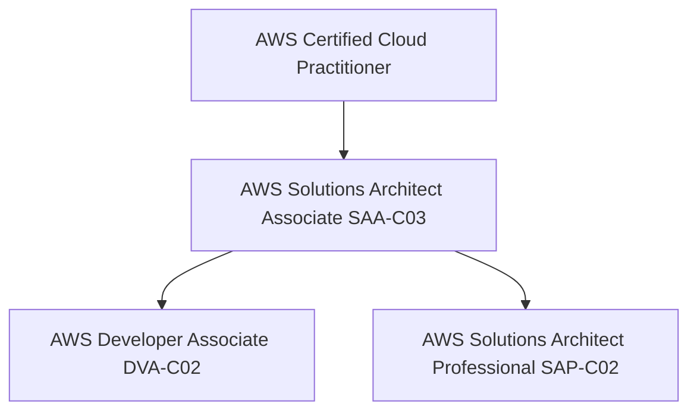

# Amazon Web Services (AWS) Learning Track

Kho lưu trữ kiến thức, sơ đồ kiến trúc và bài thực hành Amazon Web Services (AWS).

---

## 🗺️ Lộ Trình Học Tập (Curriculum Roadmap)

### Phân Hệ 1: IAM & Bảo Mật Nền Tảng (Security & Governance)
- **Vị trí**: `aws/01-fundamentals/`
- **Nội dung**: AWS IAM (Users, Roles, Policies, MFA, Permission Boundaries), AWS Organizations, Service Control Policies (SCPs), AWS KMS, CloudTrail, AWS GuardDuty.
- **Tài liệu chính thức**: [AWS IAM User Guide](https://docs.aws.amazon.com/IAM/latest/UserGuide/)

### Phân Hệ 2: Hạ Tầng Mạng & Lưu Trữ (Networking & Storage)
- **Vị trí**: `aws/02-compute-storage-network/`
- **Nội dung**: Amazon VPC (Public/Private Subnets, IGW, NAT Gateway, Security Groups vs NACLs, VPC Peering, Transit Gateway, VPC Endpoints), Amazon S3 (Storage Classes, Bucket Policies, Lifecycle), Amazon EBS (gp3, io2), Amazon EFS.
- **Tài liệu chính thức**: [Amazon VPC User Guide](https://docs.aws.amazon.com/vpc/latest/userguide/), [Amazon S3 Documentation](https://docs.aws.amazon.com/s3/)

### Phân Hệ 3: Điện Toán & Serverless (Compute & Serverless)
- **Nội dung**: Amazon EC2, Auto Scaling Groups (ASG), Elastic Load Balancing (ALB, NLB), AWS Lambda, Amazon API Gateway, Amazon ECS & Fargate, Amazon EKS.
- **Tài liệu chính thức**: [Amazon EC2 User Guide](https://docs.aws.amazon.com/AWSEC2/latest/UserGuide/), [AWS Lambda Developer Guide](https://docs.aws.amazon.com/lambda/latest/dg/)

### Phân Hệ 4: Cơ Sở Dữ Liệu & Event-Driven (Databases & Messaging)
- **Nội dung**: Amazon RDS, Amazon Aurora, Amazon DynamoDB, Amazon SQS, Amazon SNS, Amazon EventBridge, AWS Step Functions.
- **Tài liệu chính thức**: [Amazon DynamoDB Docs](https://docs.aws.amazon.com/amazondynamodb/), [Amazon SQS Developer Guide](https://docs.aws.amazon.com/sqs/)

### Phân Hệ 5: Bài Tập Thực Hành (Hands-on Labs)
- **Vị trí**: `aws/labs/`
- Bài thực hành triển khai qua AWS CLI v2, AWS CDK hoặc Terraform.

---

## 📚 Nguồn Học Chính Thống (Official References)
- [AWS Documentation](https://docs.aws.amazon.com/)
- [AWS Architecture Center](https://aws.amazon.com/architecture/)
- [AWS Well-Architected Framework](https://aws.amazon.com/architecture/well-architected/)
- [AWS CLI Command Reference](https://awscli.amazonaws.com/v2/documentation/api/latest/reference/)
