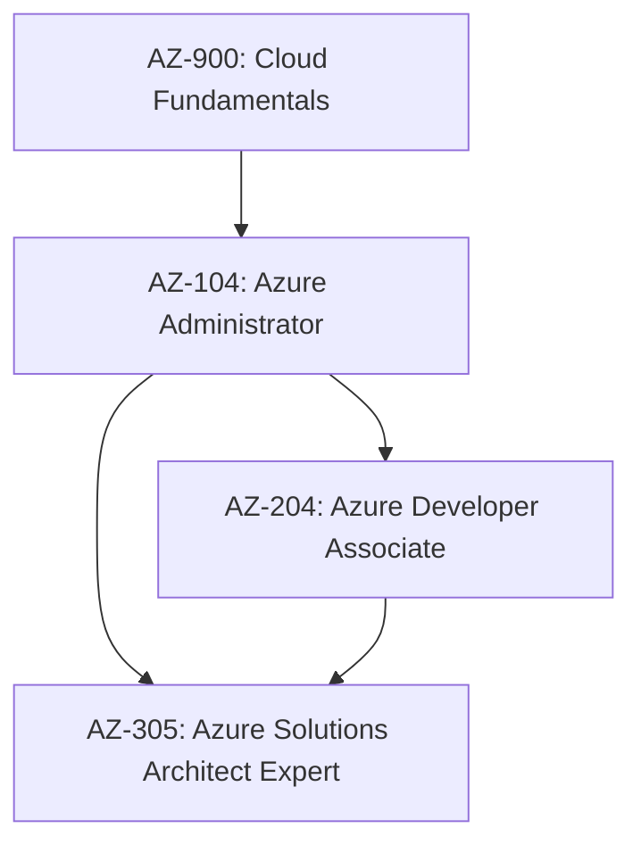

# Microsoft Azure Learning Track

Kho lưu trữ kiến thức, bài thực hành và tài liệu tự học Microsoft Azure.

---

## 🗺️ Lộ Trình Học Tập (Curriculum Roadmap)

### Phân Hệ 1: Nền Tảng & Quản Trị (Fundamentals & Governance)
- **Vị trí**: `azure/01-fundamentals/`
- **Nội dung**: Cloud concepts, Regions & Availability Zones, Microsoft Entra ID (RBAC, PIM, Managed Identity), Azure Resource Manager (ARM), Subscriptions, Resource Groups, Azure Policy, Cost Management.
- **Tài liệu chính thức**: [Microsoft Learn: Azure Fundamentals](https://learn.microsoft.com/credentials/certifications/azure-fundamentals/)

### Phân Hệ 2: Hạ Tầng & Mạng (Networking & Infrastructure)
- **Vị trí**: `azure/02-infrastructure/`
- **Nội dung**: Azure Virtual Networks (VNet), Subnets, NSG/ASG, VNet Peering, VPN/ExpressRoute, Azure Bastion, Private Link / Private Endpoints, Azure Firewall, Application Gateway, Azure Load Balancer.
- **Tài liệu chính thức**: [Azure Virtual Network Documentation](https://learn.microsoft.com/azure/virtual-network/)

### Phân Hệ 3: Điện Toán & Container (Compute & Containers)
- **Nội dung**: Virtual Machines (VMSS), Azure App Service, Azure Functions (Serverless), Azure Container Apps (ACA), Azure Kubernetes Service (AKS).
- **Tài liệu chính thức**: [Azure App Service Docs](https://learn.microsoft.com/azure/app-service/), [AKS Docs](https://learn.microsoft.com/azure/aks/)

### Phân Hệ 4: Dữ Liệu & Lưu Trữ (Storage & Databases)
- **Nội dung**: Azure Blob Storage (Access Tiers, Lifecycle), Azure Files, Azure SQL Database, Azure Cosmos DB.
- **Tài liệu chính thức**: [Azure Storage Documentation](https://learn.microsoft.com/azure/storage/), [Azure Cosmos DB Docs](https://learn.microsoft.com/azure/cosmos-db/)

### Phân Hệ 5: Bài Tập Thực Hành (Hands-on Labs)
- **Vị trí**: `azure/labs/`
- Các bài thực hành triển khai thực tế bằng Azure CLI và Bicep.

---

## 📚 Nguồn Học Chính Thống (Official References)
- [Microsoft Learn](https://learn.microsoft.com/azure/)
- [Azure Architecture Center](https://learn.microsoft.com/azure/architecture/)
- [Microsoft Azure Well-Architected Framework](https://learn.microsoft.com/azure/well-architected/)
- [Azure CLI Reference](https://learn.microsoft.com/cli/azure/)
