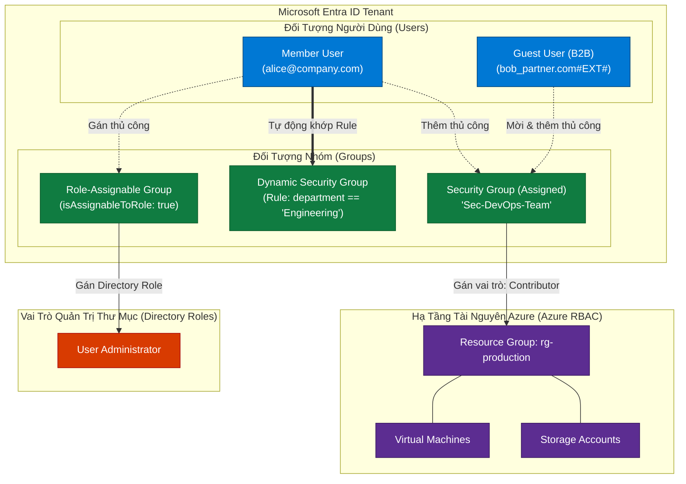

# Create Users and Groups

> **Kỳ thi**: AZ-104 (Microsoft Azure Administrator)  
> **Phân nhóm**: Domain 1: Manage Azure identities and governance (20–25%)  
> **Chủ đề**: Manage Microsoft Entra users and groups  
> **Trạng thái**: [x] Đã hoàn thành lý thuyết & thực hành CLI

---

## 1. Khái Niệm Cốt Lõi & Các Tài Nguyên Liên Quan (Core Concepts & Cloud Resources)

Trong hạ tầng đám mây Microsoft Azure, việc quản lý danh tính (Identity Management) là ranh giới an ninh đầu tiên và quan trọng nhất (The primary security perimeter). Mọi quyền truy cập vào máy ảo, cơ sở dữ liệu, mạng ảo hay tài khoản lưu trữ đều xuất phát từ đối tượng định danh trong **Microsoft Entra ID**.

---

### 1.1 Bản Chất Cốt Lõi: Microsoft Entra ID Là Dịch Vụ QUẢN LÝ, KHÔNG PHẢI Danh Tính

> [!IMPORTANT]
> **Điểm mấu chốt cần ghi nhớ**:  
> **Microsoft Entra ID KHÔNG PHẢI là một Identity (Danh tính)**.  
> Entra ID là **HỆ THỐNG / NỀN TẢNG QUẢN LÝ (Identity Provider - IdP / Control Plane)**. Nó đóng vai trò là "Cơ quan Quản lý Hộ tịch & Căn cước" chuyên thực hiện:
> 1. Lưu trữ và xác thực thông tin đăng nhập (Authentication - AuthN).
> 2. Cấp phát vé thông hành (Tokens: SAML, JWT, OAuth 2.0).
> 3. Quản lý vòng đời và chính sách truy cập cho các **Identities (Danh tính)** bên trong nó.

#### Phân biệt "Microsoft Entra ID" và "Tenant": 2 tên này có phải là một không?
- **Microsoft Entra ID**: Là tên của **Sản phẩm / Dịch vụ công nghệ** (giống như ta nói "Hệ quản trị PostgreSQL" hay "Hãng xe VinFast").
- **Tenant (Directory)**: Là một **Bản thể hiện độc lập (Dedicated Instance)** của dịch vụ đó được cấp phát cho một tổ chức hoặc một môi trường cụ thể (giống như một cơ sở dữ liệu `db_prod` cụ thể, hoặc một chiếc xe có biển số riêng).

#### 🏢 Case Study Thực Tế: Mô Hình 3 Tenants Tại Ngân Hàng NAB (National Australia Bank)
Tại các tập đoàn tài chính lớn như NAB, người dùng thường có 3 tài khoản ở 3 môi trường:
- `minh@nab.com.au` $\rightarrow$ Nằm tại **Tenant 1: PROD**
- `minhd@nabdev.com.au` $\rightarrow$ Nằm tại **Tenant 2: DEV**
- `minht@nabtest.com.au` $\rightarrow$ Nằm tại **Tenant 3: TEST**

> [!TIP]
> **🏢 Ví Dụ Đời Sống Siêu Trực Quan (NAB Case Study)**:
> - **Microsoft Entra ID** = Hãng sản xuất / xây dựng chung cư cao cấp.
> - **Tenant** = Từng tòa nhà độc lập do hãng đó xây dựng:
>   - **Tòa nhà 1 (PROD)**: Tòa nhà Hội Sở Ngân Hàng (Nơi giữ tiền thật, giao dịch thật. Ra vào phải soi vân tay, bảo vệ nghiêm ngặt).
>   - **Tòa nhà 2 (DEV)**: Tòa nhà Trung Tâm Đào Tạo / Phòng Thí Nghiệm (Nơi cho nhân viên mới vào học việc, dựng mô hình thử nghiệm. Lỡ làm cháy mô hình thì không ảnh hưởng đến tiền của khách).
>   - **Tòa nhà 3 (TEST)**: Tòa nhà Mô Phỏng (Nơi mời khách hàng thân thiết vào trải nghiệm thử sản phẩm mới trước khi mở bán thật).
> - **Bạn là nhân viên**:
>   - Khi đến Tòa Hội Sở, bạn dùng thẻ: `minh@nab.com.au`.
>   - Khi sang Tòa Thí Nghiệm, bạn dùng thẻ: `minhd@nabdev.com.au`.
>   - Khi sang Tòa Mô Phỏng, bạn dùng thẻ: `minht@nabtest.com.au`.
>   - Hai tòa nhà có 2 hệ thống camera, 2 ban quản lý, 2 danh sách bảo vệ hoàn toàn riêng biệt.

**Tại sao một ngân hàng lại phải tách thành 3 Tenant riêng biệt thay vì dùng chung 1 Tenant?**
1. **Ranh giới an ninh tối thượng (The Ultimate Security Boundary)**: Trong đám mây Microsoft, Tenant là ranh giới cô lập an ninh cao nhất. Nếu chung 1 Tenant, tài khoản ở Dev theo mặc định vẫn có quyền đọc danh bạ (Directory Read) của Prod. Tách 3 Tenant giúp 3 môi trường là 3 thế giới hoàn toàn độc lập: không chung danh bạ, không chung mật khẩu, không chung Global Admin.
2. **Thu hẹp vùng ảnh hưởng khi bị tấn công (Blast Radius)**: Nếu một kỹ sư vô tình làm lộ mật khẩu hoặc secret của `minhd@nabdev.com.au` trên GitHub, hacker chỉ vào phá được môi trường DEV (dữ liệu giả lập mock-data), **hoàn toàn không có đường nào nhảy sang Tenant PROD** (`nab.com.au`).
3. **Tuân thủ quy định khắt khe ngành ngân hàng (APRA Compliance)**: Các cơ quan quản lý tài chính (như APRA tại Úc) bắt buộc danh tính và dữ liệu khách hàng thật phải được cách ly tuyệt đối khỏi môi trường thử nghiệm.


---

### 1.2 "Giải Ngố" Bộ Khái Niệm Dễ Nhầm Lẫn Trong Azure Identity

Dưới đây là sơ đồ và bảng phân biệt rạch ròi bản chất kỹ thuật của các khái niệm:

```text
                               ┌──────────────────────────────────────────────────┐
                               │       MICROSOFT ENTRA ID (BỘ MÁY QUẢN LÝ)        │
                               └────────────────────────┬─────────────────────────┘
                                                        │
                      ┌─────────────────────────────────┴─────────────────────────────────┐
                      ▼                                                                   ▼
         [ HUMAN IDENTITIES (Con người) ]                                  [ WORKLOAD IDENTITIES (Máy móc / App) ]
         - User Account (Member, Guest)                                     - Application Object (Bản thiết kế - Class)
         - Group (Security, M365)                                           - Service Principal (Thực thể - Instance)
                                                                            - Managed Identity (UMI / SAMI)
```

#### App Registration là "Class" cho cái gì?
> **`App Registration` (Application Object) chính là CLASS (Khuôn mẫu)** để sinh ra các **`Service Principals` (INSTANCES / Đối tượng thể hiện cụ thể)**!

- **Class (App Registration)**: Nằm duy nhất tại Home Tenant của nhà phát triển. Chỉ định nghĩa khuôn mẫu: App tên gì, `appId` là gì, cần những quyền hạn nào (`requiredResourceAccess`). Nó **không thể nhận quyền RBAC** vì nó chỉ là bản vẽ trên giấy.
- **Instance (Service Principal)**: Mỗi khi app được cấp phép (Consent) chạy trong một Tenant (kể cả chính Home Tenant của bạn hay Tenant của khách hàng), Entra ID sẽ **`new` (instantiate)** một Service Principal trong Tenant đó. Nó có `Object ID` riêng tại Tenant đó và **đây mới chính là đối tượng được nhận quyền RBAC**.

```csharp
// Minh họa theo tư duy lập trình Hướng Đối Tượng (OOP):
public class AppKiemKeKho { // <--- ĐÂY LÀ APP REGISTRATION (Class - nằm ở Home Tenant)
    public string AppId = "1111-2222-3333";
}

// Khi khách hàng cài đặt app vào Tenant của họ:
ServicePrincipal sp_NAB = new AppKiemKeKho(); // <--- ĐÂY LÀ SERVICE PRINCIPAL (Instance tại NAB)
sp_NAB.ObjectId = "nab-sp-001";
sp_NAB.AssignRole("Reader"); // Gán quyền cho Instance này tại NAB
```

**Chứng minh bằng 2 câu lệnh Azure CLI hoàn toàn tách biệt**:
```bash
# Bước 1: Tạo CLASS (App Registration)
az ad app create --display-name "AppKiemKeKho"
# => Trả về: appId (Application ID) - Đây là khuôn mẫu, CHƯA nhận được quyền RBAC!

# Bước 2: Tạo OBJECT từ Class trên (new Service Principal)
az ad sp create --id "<appId-vừa-tạo>"
# => Trả về: id (Object ID của Service Principal) - BÂY GIỜ MỚI GÁN ĐƯỢC QUYỀN RBAC!
```

> **Ví dụ ứng dụng Zoom**: Công ty Zoom tạo 1 App Registration (Class) trên Tenant của họ. Khi công ty bạn bấm "Đồng ý cho nhân viên dùng Zoom", một **Service Principal (Instance)** của Zoom được sinh ra ngay trong Tenant của công ty bạn (hiển thị trên màn hình **Enterprise Applications**).

| Khái niệm | Bản chất kỹ thuật là gì? | Vai trò thực sự trong hệ thống | Có nhận quyền RBAC được không? |
| :--- | :--- | :--- | :---: |
| **Microsoft Entra ID** | **Dịch vụ quản lý (IdP / Directory Service)** | Quản lý danh bạ, xác thực và cấp phát token cho mọi thực thể. | ❌ Không (Nó là bộ máy quản lý) |
| **User Account** | **Danh tính người dùng (Human Identity)** | Đại diện cho một con người cụ thể (nhân viên nội bộ hoặc khách đối tác ngoài). | ✅ Có |
| **App Registration** *(Application Object)* | **Class / Blueprint / Khuôn mẫu thiết kế** | **Chính là CLASS trong lập trình OOP**. Định nghĩa các thuộc tính toàn cầu của ứng dụng (`appId`, `redirectUris`, quyền API cần xin `requiredResourceAccess`, cấu hình Single/Multi-tenant). Nằm duy nhất tại Home Tenant của nhà phát triển. | ❌ Không (Nó chỉ là bản vẽ khai báo trên giấy) |
| **Service Principal (SP)** | **Object Instance / Đối tượng thể hiện cụ thể** | **Chính là INSTANCE sinh ra từ Class App Registration**. Khi một ứng dụng được cấp phép hoạt động trong một Tenant bất kỳ, Entra ID sẽ instantiate một Service Principal tương ứng trong Tenant đó. Nó có `Object ID` riêng. **Đây mới chính là danh tính thật sự của phần mềm để máy móc nói chuyện với nhau**. | ✅ **Có** (Gán vai trò Contributor, Reader trực tiếp cho SP này) |
| **Enterprise Application** | **Giao diện hiển thị (Portal UI Blade)** | **Bản chất nó chỉ là màn hình UI trên Azure Portal** liệt kê các Service Principal đang hoạt động trong Tenant của bạn (app nội bộ của công ty, app Microsoft như Office 365, app SaaS từ bên ngoài như Salesforce, ServiceNow). | ❌ Không (Nó là giao diện xem các Service Principal) |
| **System-Assigned Managed Identity (SAMI)** | **Service Principal tự động (gắn liền 1 tài nguyên)** | Một Service Principal đặc biệt do Azure tự tạo và gắn chết vào **duy nhất 1 tài nguyên** (ví dụ 1 máy ảo VM). Khi xóa VM, danh tính này tự động bị xóa theo. Lập trình viên không cần quản lý username/password. | ✅ Có (Cấp quyền cho chính VM đó vào Key Vault/Storage) |
| **User-Assigned Managed Identity (UMI)** | **Service Principal tự động (tồn tại độc lập / gán linh hoạt)** | Một tài nguyên Azure độc lập (`Microsoft.ManagedIdentity/userAssignedIdentities`). Bên dưới nền tảng, Azure cũng tự tạo một Service Principal tương ứng.<br>- **Gắn linh hoạt vào nhiều đối tượng**: Cụm nhiều VM, Container Instances, Kubernetes ServiceAccount (AKS Workload Identity), hoặc **Self-hosted CI/CD Pipeline Agents**.<br>- **Workload Identity Federation**: Cho phép các Cloud Pipeline Runner (GitHub Actions, Azure DevOps) dùng OIDC để liên kết mượn danh UMI mà hoàn toàn không cần lưu trữ Secret/Password! | ✅ Có (Cấp quyền cho UMI, mọi đối tượng mang UMI đó đều có quyền) |

---

### 1.3 Phân Loại Tài Khoản Người Dùng (User Types)

Trong Microsoft Entra ID, người dùng con người (Human Identity) được chia thành 2 loại cơ bản dựa trên nguồn gốc xác thực:

| Tiêu chí | Member User (Người dùng nội bộ) | Guest User (Người dùng khách / B2B) |
| :--- | :--- | :--- |
| **Nguồn gốc** | Được tạo trực tiếp trong Tenant hoặc đồng bộ từ On-premises AD qua Microsoft Entra Connect. | Được mời từ bên ngoài (từ một Tenant Entra ID khác, tài khoản Microsoft cá nhân `@outlook.com`, hoặc Gmail/Yahoo). |
| **Định dạng UPN** | `username@company.com` hoặc `username@company.onmicrosoft.com` | `username_gmail.com#EXT#@company.onmicrosoft.com` |
| **Nơi xác thực** | Xác thực trực tiếp tại Tenant của tổ chức bạn. | Xác thực tại Identity Provider (IdP) gốc của khách (Google, Microsoft cá nhân,...). Mật khẩu của họ **không bao giờ** lưu trong Tenant của bạn. |
| **Mục đích** | Dành cho nhân viên chính thức trong tổ chức. | Dành cho đối tác, nhà thầu phụ, chuyên gia tư vấn ngắn hạn (Entra B2B Collaboration). |
| **Quyền mặc định** | Có thể đọc hầu hết thông tin danh bạ thư mục (xem danh sách user, group, application). | Bị giới hạn quyền đọc (chỉ thấy thông tin cá nhân của chính mình, không xem được danh bạ toàn công ty). |

#### Các thuộc tính quan trọng của User:
1. **User Principal Name (UPN)**: Định danh đăng nhập chính của người dùng, có định dạng như email: `<username>@<verified-domain>`.
2. **Usage Location (Vị trí sử dụng)**: Mã quốc gia (ví dụ: `VN`, `US`). **Lưu ý thi quan trọng**: Bắt buộc phải thiết lập thuộc tính này trước khi gán bản quyền dịch vụ (như Microsoft 365, Entra ID P1/P2) cho người dùng.
3. **Account Enabled**: Cờ kích hoạt hoặc vô hiệu hóa quyền đăng nhập của tài khoản (`true` hoặc `false`).

---

### 1.4 Phân Loại Nhóm (Group Types)

Nhóm trong Entra ID được dùng để quản trị quyền hạn tập trung thay vì cấp quyền cho từng cá nhân riêng lẻ. Có 2 loại nhóm:

1. **Security Group (Nhóm bảo mật)**:
   - **Chức năng**: Dùng để phân quyền truy cập vào tài nguyên Azure (qua Azure RBAC), phân quyền vào các ứng dụng doanh nghiệp (Enterprise Applications), và phân bổ bản quyền tập trung (Group-based Licensing).
   - **Tài nguyên đi kèm**: Không có hộp thư chung hay site SharePoint đi kèm.
2. **Microsoft 365 Group (Nhóm cộng tác)**:
   - **Chức năng**: Dùng cho làm việc cộng tác nhóm giữa các người dùng.
   - **Tài nguyên đi kèm tự động**: Khi tạo 1 nhóm M365, hệ thống tự sinh ra một bộ tài nguyên tích hợp: Hộp thư chung (Shared Mailbox trên Exchange Online), trang lưu trữ tệp tin (SharePoint Team Site), sổ tay chung (OneNote), kế hoạch công việc (Planner), và có thể liên kết vào Microsoft Teams.

---

### 1.5 Cơ Chế Quản Lý Thành Viên Nhóm (Membership Types)

| Loại Membership | Cơ chế hoạt động | Yêu cầu License |
| :--- | :--- | :--- |
| **Assigned (Thủ công)** | Quản trị viên phải tự thêm hoặc xóa từng người dùng/thiết bị vào nhóm một cách thủ công. | Miễn phí (Bản Entra ID Free mặc định). |
| **Dynamic User (Tự động theo User)** | Thành viên được tự động thêm vào hoặc gỡ khỏi nhóm dựa trên truy vấn logic lọc thuộc tính của User (Ví dụ: Tất cả user có `Department = 'Marketing'`). | Yêu cầu tối thiểu **Microsoft Entra ID P1 hoặc P2**. |
| **Dynamic Device (Tự động theo Thiết bị)** | Thành viên được tự động thêm/gỡ dựa trên thuộc tính của thiết bị (Ví dụ: `device.deviceOSType -eq "Windows"`). | Yêu cầu tối thiểu **Microsoft Entra ID P1 hoặc P2**. |

---

### 1.6 Nhóm Có Thể Gán Vai Trò (Role-Assignable Groups) & Cơ Chế Chống Leo Thang Đặc Quyền

> **Câu hỏi quan trọng: "Có thể gán Directory Role (như Global Admin, User Admin) trực tiếp cho Cá nhân (User) không?"**  
> 👉 **CÓ, 100%!** Bạn hoàn toàn có thể gán trực tiếp cho từng cá nhân và đây là thao tác rất bình thường.

**Vậy tại sao Microsoft lại cấm gán Directory Role cho Nhóm thông thường?**  
Nguyên nhân là để ngăn chặn lỗ hổng **Leo thang đặc quyền (Privilege Escalation)**:
- Một nhóm thông thường luôn có một **Chủ nhóm (Group Owner)** — thường chỉ là nhân viên hoặc trưởng nhóm bình thường (không có quyền Admin).
- Nếu nhóm đó được gán quyền `Global Administrator`, thì Group Owner có thể **tự ý thêm tài khoản của chính mình hoặc bạn bè vào nhóm** $\rightarrow$ Gián tiếp biến người đó thành Global Administrator mà Sếp Tổng không hề hay biết!

**Giải pháp của Microsoft - Role-Assignable Group (`isAssignableToRole = true`)**:
Để vừa quản lý phân quyền theo nhóm tiện lợi, vừa chống được rủi ro trên, Microsoft đưa ra loại nhóm đặc biệt này với 3 quy tắc "bảo vệ thép":
1. **Chỉ bật được lúc tạo nhóm**: Không thể chỉnh sửa hoặc bật lại tính năng này sau khi nhóm đã được tạo.
2. **Khóa quyền Group Owner thông thường**: Chỉ có người mang vai trò `Global Administrator` hoặc `Privileged Role Administrator` mới có quyền thêm/bớt thành viên trong nhóm này.
3. **Chỉ hỗ trợ Assigned**: Tuyệt đối cấm Dynamic Membership (để ngăn hacker sửa thuộc tính user nhằm tự động chui vào nhóm quản trị viên).


---

## 2. Ví Dụ Đời Sống Thực Tế Dễ Hiểu (Intuitive Real-World Analogy)

Hãy hình dung **Microsoft Entra ID** giống như **Hệ thống Quản lý Thẻ Từ Ra Vào của Tòa Nhà Trụ Sở Tập Đoàn**:

```text
┌────────────────────────────────────────────────────────────────────────┐
│                        TÒA NHÀ TRỤ SỞ TẬP ĐOÀN                         │
│                    (Microsoft Entra ID / Tenant)                       │
├────────────────────────────────────────────────────────────────────────┤
│                                                                        │
│  [ Nhân Viên Chính Thức ]               [ Khách / Đối Tác Ngoài ]      │
│  - Có thẻ nhân viên gắn chip            - Dùng CCCD/Hộ chiếu cá nhân   │
│  - UPN: nam@tapdoan.vn                  - UPN: minh_gmail.com#EXT#...  │
│  ==> (Member User)                      ==> (Guest User)               │
│                                                                        │
│  ────────────────────────────────────────────────────────────────────  │
│                                                                        │
│  [ Thẻ Nhóm: Phòng Kỹ Thuật ]           [ Phòng Họp Nhóm Dự Án ]       │
│  - Dùng quẹt mở cửa phòng Server        - Có bàn tròn, bảng vẽ, máy in │
│  ==> (Security Group)                   ==> (Microsoft 365 Group)      │
│                                                                        │
│  ────────────────────────────────────────────────────────────────────  │
│                                                                        │
│  [ Cổng Soát Vé Thông Minh Tự Động ]                                  │
│  - Nhân viên có chức danh "IT" ghi trên hợp đồng HR tự động được qua. │
│  - Chuyển sang phòng "Kinh doanh" => Cổng tự động khóa cửa phòng IT.   │
│  ==> (Dynamic User Membership)                                         │
│                                                                        │
│  ────────────────────────────────────────────────────────────────────  │
│                                                                        │
│  [ Thẻ VIP Khắc Tên Đặc Biệt ]                                         │
│  - Mở được phòng Giám đốc / Két sắt. Phải do Tổng giám đốc đích thân   │
│    ký duyệt trao tay lúc phát thẻ, không được dùng cửa tự động.        │
│  ==> (Role-Assignable Group)                                           │
└────────────────────────────────────────────────────────────────────────┘
```

- **Tenant**: Toàn bộ tòa nhà trụ sở tập đoàn.
- **Member User**: Nhân viên ký hợp đồng dài hạn, được phòng nhân sự cấp mã số nhân viên và thẻ từ chính thức mang thương hiệu tập đoàn.
- **Guest User**: Chuyên gia kiểm toán độc lập đến làm việc 2 tuần. Họ mang theo Căn cước công dân của họ để lễ tân xác minh. Lễ tân chỉ dán một tem khách tạm thời cho phép vào đúng phòng họp tầng 3, hết dự án thì thu hồi quyền truy cập mà không cần tạo mới nhân viên.
- **Security Group**: Tấm thẻ cấp quyền phòng ban. Bảo vệ chỉ cần cài đặt "Ai thuộc nhóm Kỹ sư thì cửa phòng máy chủ mở", thay vì phải nhập tên từng nhân viên vào khóa cửa.
- **Dynamic Group**: Cổng nhận diện thông minh kết nối với phần mềm nhân sự. Bất kỳ ai trên hồ sơ nhân sự có ghi `Phòng ban = IT` thì cửa tự mở. Nếu họ chuyển sang phòng Marketing, hồ sơ đổi thì quyền mở cửa tự mất ngay lập tức.
- **Role-Assignable Group**: Chìa khóa vạn năng (Master Key) mở phòng Tổng Giám Đốc. Để tránh nhân viên bảo vệ bình thường tự ý sao chép chìa khóa này phát bừa bãi, tập đoàn quy định: Chìa này phải được đúc khuôn đặc biệt ngay từ đầu (lúc tạo) và chỉ đích danh Tổng giám đốc mới được cấp phát thủ công.

#### So sánh đời sống cho Workload Identities (Danh tính máy móc):
- **App Registration (Application Object)** = **Hồ sơ thiết kế sản phẩm của công ty phần mềm** (Bản vẽ kỹ thuật, quy định ứng dụng này cần xin những quyền gì).
- **Service Principal (SP)** = **Chi nhánh văn phòng cụ thể của công ty đó đặt tại tòa nhà của bạn**. Nó có con dấu pháp lý riêng (Object ID) và là đối tượng được bảo vệ cấp thẻ để vào ký hợp đồng hay truy cập kho tài nguyên.
- **Enterprise Application** = **Bảng danh bạ điện tử tại sảnh tòa nhà**. Nó KHÔNG PHẢI là một pháp nhân hay con người, nó ĐƠN THUẦN LÀ MÀN HÌNH UI hiển thị danh sách các chi nhánh công ty đang thuê và hoạt động trong tòa nhà!
- **System-Assigned Managed Identity (SAMI)** = **Thẻ quẹt dán cố định vào kính của một chiếc xe công vụ cụ thể**. Xe chạy đến cổng barrier tự mở mà tài xế không cần mang ví tiền hay nhớ mật mã. Khi chiếc xe này bị thanh lý rã xác, thẻ dán trên kính cũng tự biến mất.
- **User-Assigned Managed Identity (UMI)** = **Thẻ công vụ đa năng cầm tay của đội giao vận**. Thẻ này tồn tại độc lập. Tài xế lái chiếc xe bán tải A hay xe tải B chỉ cần cầm theo chiếc thẻ này là barrier đều tự động mở. Thậm chí cả đội 5 chiếc xe cùng dùng chung một chiếc thẻ công vụ này.


---

## 3. Kiến Trúc, Luồng Hoạt Động & Hình Ảnh Trực Quan (Architecture, Data Flow & Official Diagrams)

### 3.1 Sơ Đồ Kiến Trúc Microsoft Entra B2B Collaboration (Official Diagram)
Dưới đây là sơ đồ kiến trúc chính thức từ Microsoft Learn minh họa cách thức tài khoản khách (Guest User) từ bên ngoài (đối tác, Gmail, Tenant khác) được mời vào làm việc trong Tenant của doanh nghiệp mà không cần tạo mới mật khẩu:


> **Điểm mấu chốt**: Khi đối tác đăng nhập, Microsoft Entra ID sẽ chuyển hướng xác thực về chính Identity Provider gốc của đối tác (ví dụ Google hoặc Tenant công ty họ). Sau khi đăng nhập thành công ở máy chủ của họ, một token an toàn được gửi về Tenant của bạn để cấp quyền truy cập tài nguyên.

---

### 3.2 Sơ Đồ Gán Quyền Tài Nguyên Qua Nhóm Có Tính Kế Thừa (Transitive Role Assignment)
Sơ đồ minh họa nguyên lý cấp quyền của Microsoft: Phân quyền cho Nhóm (Group) sẽ tự động có hiệu lực đối với mọi User là thành viên của nhóm đó:


> **Điểm mấu chốt**: Thay vì gán vai trò Contributor cho 50 kỹ sư riêng lẻ, quản trị viên chỉ cần gán vai trò này cho nhóm `Engineering Group`. Bất kỳ ai được thêm vào nhóm sẽ lập tức nhận được quyền tương ứng.

---

### 3.3 Sơ Đồ Cấu Trúc Tổng Thể Người Dùng, Nhóm và Phân Quyền (Mermaid Diagram)

Sơ đồ trực quan sau đây mô tả mối quan hệ giữa Tenant, các loại User, cơ chế thành viên của Group (Assigned vs Dynamic) và cách thức phân bổ quyền quản trị thư mục (Directory Roles) và quyền tài nguyên Azure (Azure RBAC):




---

## 4. Hướng Dẫn Thực Hành Azure CLI (Hands-on Azure CLI)

Dưới đây là các câu lệnh `az` CLI chuẩn mực để thao tác với User và Group trong Microsoft Entra ID.

### 4.1 Đăng nhập và Kiểm tra Tenant hiện tại
```bash
# Đăng nhập vào tài khoản Azure
az login

# Xem thông tin Tenant ID và Domain hiện hành
az account show --query "{TenantId:tenantId, SubscriptionName:name, SubscriptionId:id}" -o table
```

---

### 4.2 Quản Lý Người Dùng (Users)

#### Tạo một Member User mới
```bash
# Tạo user nội bộ kèm mật khẩu khởi tạo (bắt buộc đổi mật khẩu ở lần đăng nhập đầu tiên)
az ad user create \
  --display-name "Nguyen Van A" \
  --user-principal-name "anguyen@yourdomain.onmicrosoft.com" \
  --password "P@ssw0rdSecure2026!" \
  --mail-nickname "anguyen" \
  --force-change-password-next-sign-in true
```

#### Cập nhật thuộc tính của User (Usage Location & Department)
```bash
# Cập nhật thông tin phòng ban và mã quốc gia (bắt buộc trước khi cấp license)
az ad user update \
  --id "anguyen@yourdomain.onmicrosoft.com" \
  --department "Information Technology" \
  --usage-location "VN"
```

#### Mời người dùng khách (Guest User / B2B Invitation)
```bash
# Gửi thư mời tài khoản đối tác ngoài tham gia vào Tenant
az account get-access-token --resource-type ms-graph \
  --query accessToken -o tsv > /tmp/token.txt

az rest --method post \
  --uri "https://graph.microsoft.com/v1.0/invitations" \
  --headers "Authorization=Bearer $(cat /tmp/token.txt)" "Content-Type=application/json" \
  --body '{
    "invitedUserEmailAddress": "partner_expert@gmail.com",
    "inviteRedirectUrl": "https://portal.azure.com",
    "sendInvitationMessage": true
  }'
```

#### Tìm kiếm và liệt kê người dùng
```bash
# Liệt kê 5 user đầu tiên hiển thị UPN, Tên và Trạng thái kích hoạt
az ad user list \
  --query "[].{Name:displayName, UPN:userPrincipalName, Enabled:accountEnabled, Dept:department}" \
  --output table
```

---

### 4.3 Quản Lý Nhóm (Groups)

#### Tạo Security Group với cơ chế gán thủ công (Assigned)
```bash
# Tạo nhóm bảo mật có tên "Sec-IT-Admins"
az ad group create \
  --display-name "Sec-IT-Admins" \
  --mail-nickname "sec-it-admins"
```

#### Tạo Security Group có thể gán vai trò Directory (Role-Assignable Group)
```bash
# Lưu ý: Chỉ tài khoản Global Admin hoặc Privileged Role Admin mới được chạy lệnh này
az ad group create \
  --display-name "Sec-Privileged-Helpdesk" \
  --mail-nickname "sec-privileged-helpdesk" \
  --assignable-to-role true
```

#### Tạo Dynamic Security Group (Tự động lọc thành viên)
```bash
# Tạo nhóm tự động thu nạp tất cả user thuộc phòng ban IT ở Việt Nam (Yêu cầu Entra ID P1/P2)
az ad group create \
  --display-name "Dyn-IT-Vietnam" \
  --mail-nickname "dyn-it-vietnam" \
  --group-types "DynamicMembership" \
  --membership-rule "(user.department -eq \"Information Technology\") -and (user.country -eq \"Vietnam\")" \
  --membership-rule-processing-state "On"
```

---

### 4.4 Thao Tác Thành Viên Trong Nhóm (Group Memberships)

#### Thêm người dùng vào nhóm
```bash
# Lấy Object ID của User
USER_ID=$(az ad user show --id "anguyen@yourdomain.onmicrosoft.com" --query id -o tsv)

# Lấy Object ID của Group
GROUP_ID=$(az ad group show --group "Sec-IT-Admins" --query id -o tsv)

# Thêm User vào Group
az ad group member add --group "$GROUP_ID" --member-id "$USER_ID"
```

#### Kiểm tra danh sách thành viên trong nhóm
```bash
# Xem danh sách thành viên của nhóm Sec-IT-Admins
az ad group member list \
  --group "$GROUP_ID" \
  --query "[].{DisplayName:displayName, UPN:userPrincipalName, ObjectType:odatatype}" \
  --output table
```

#### Kiểm tra danh sách các nhóm mà một user đang tham gia
```bash
# Kiểm tra user anguyen thuộc những nhóm nào
az ad user get-member-groups \
  --id "$USER_ID" \
  --query "[]" \
  --output tsv
```

#### Xóa người dùng khỏi nhóm
```bash
# Gỡ bỏ user khỏi nhóm
az ad group member remove --group "$GROUP_ID" --member-id "$USER_ID"
```

---

### 4.5 Dọn Dẹp Tài Nguyên Thử Nghiệm (Cleanup)
```bash
# Xóa User thử nghiệm
az ad user delete --id "anguyen@yourdomain.onmicrosoft.com"

# Xóa Group thử nghiệm
az ad group delete --group "Sec-IT-Admins"
az ad group delete --group "Sec-Privileged-Helpdesk"
az ad group delete --group "Dyn-IT-Vietnam"
```

---

## 📚 Nguồn Tài Liệu Chính Thống (Official References)
- [Manage Microsoft Entra users - Microsoft Learn](https://learn.microsoft.com/en-us/entra/identity/users/users-search-permanent-delete) - Hướng dẫn quản trị người dùng trong Microsoft Entra ID.
- [Manage Microsoft Entra groups and group membership](https://learn.microsoft.com/en-us/entra/identity/users/groups-create-group) - Hướng dẫn tạo nhóm và cơ chế quản lý thành viên.
- [Rules for dynamically populated groups membership - Microsoft Entra](https://learn.microsoft.com/en-us/entra/identity/users/groups-dynamic-membership) - Cú pháp xây dựng quy tắc thành viên động (Dynamic membership rules).
- [Use Microsoft Entra groups to manage role assignments](https://learn.microsoft.com/en-us/entra/identity/role-based-access-control/groups-concept) - Tài liệu về nhóm có thể gán vai trò thư mục (Role-assignable groups).
- [Microsoft Entra B2B collaboration overview](https://learn.microsoft.com/en-us/entra/external-id/what-is-b2b) - Hướng dẫn về quản lý External/Guest User trong Entra ID.
