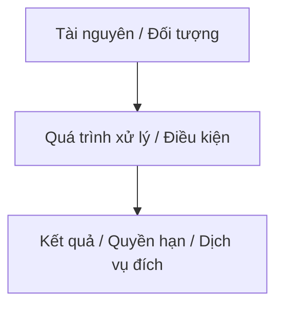

# Create and configure virtual network peering

> **Kỳ thi**: AZ-104 (Microsoft Azure Administrator)  
> **Phân nhóm**: Domain 4: Implement and manage virtual networking (15–20%)  
> **Chủ đề**: Configure and manage virtual networks in Azure  
> **Trạng thái**: [ ] Chưa hoàn thành (Chưa học / Chưa thực hành)

---

## 1. Khái Niệm Cốt Lõi & Các Tài Nguyên Liên Quan (Core Concepts & Cloud Resources)
<!--
- Giải thích tường tận bản chất kỹ thuật của từng dịch vụ, đối tượng cloud trong bài.
- Các thuộc tính, loại hình và vai trò trong hệ thống.
-->

---

## 2. Ví Dụ Đời Sống Thực Tế Dễ Hiểu (Intuitive Real-World Analogy)
<!--
- Ví dụ so sánh thực tế đời thường (tòa nhà, giao thông, ngân hàng...) giúp hình dung bản chất dịch vụ.
-->

---

## 3. Kiến Trúc & Luồng Hoạt Động (Architecture & Data Flow)
<!--
- Sơ đồ trực quan Mermaid.
- Cơ chế vận hành hoặc luồng tương tác giữa các tài nguyên.
-->



---

## 4. Hướng Dẫn Thực Hành Azure CLI (Hands-on Azure CLI)
<!--
- Tổng hợp đầy đủ các lệnh az CLI thực chiến, kèm chú thích chi tiết từng tham số.
-->

```bash
# Lệnh kiểm tra cấu hình
az --version
```

---

## 📚 Nguồn Tài Liệu Chính Thống (Official References)
- [Study guide for Exam AZ-104](https://learn.microsoft.com/en-us/credentials/certifications/resources/study-guides/az-104) - Đề cương chính thức từ Microsoft Learn.
- [Microsoft Learn Documentation](https://learn.microsoft.com/en-us/azure/) - Tài liệu chính thức từ Azure Documentation.
