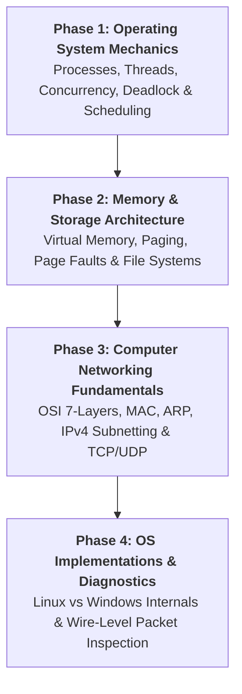
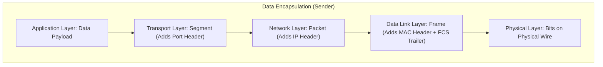

# 📋 Study Guide & Skills Checklist: Core Operating Systems & Computer Networking Fundamentals

> **Target**: Comprehensive Fundamentals Review (Computer Science Core: OS & Networking)  
> **Approach**: First-Principles + Low-Level Mechanics + System Implementations (Linux & Windows)  
> **Scope**: Pure Systems Foundations (No Cloud, Kubernetes, or Container abstraction layers)  
> **Authoritative References**: [roadmap.sh/network-engineer](https://roadmap.sh/network-engineer) | [roadmap.sh/linux](https://roadmap.sh/linux) | RFC Standards (IETF) | *Operating System Concepts* (Silberschatz) | *Computer Networking: A Top-Down Approach* (Kurose & Ross)

---

## 📊 Study Progress Tracker

| Domain | Focus Topics | Total Items | Completed | Progress |
| :--- | :--- | :---: | :---: | :---: |
| **Domain 1: Operating System Core Fundamentals** | Dual Mode, Syscalls, Processes, Threads, Concurrency, Deadlock, CPU Scheduling, Virtual Memory, File Systems | 45 items | `[ ] 0 / 45` | `0%` |
| **Domain 2: Computer Networking Core Fundamentals** | OSI 7 Layers, TCP/IP Stack, MAC, Ethernet, ARP, IPv4/IPv6, Subnetting, TCP/UDP, **Forward & Reverse Proxies**, DNS, DHCP | 33 items | `[ ] 0 / 33` | `0%` |
| **Domain 3: OS Realization & Diagnostics: Linux** | `task_struct`, `fork()`/`clone()`, pthreads, Virtual Memory & `/proc`, Inodes, Shell & Diagnostic CLI | 15 items | `[ ] 0 / 15` | `0%` |
| **Domain 4: OS Realization & Diagnostics: Windows** | `EPROCESS`/`ETHREAD`, Win32 API, Working Set vs Commit, NTFS MFT, Sysinternals & Task Manager | 10 items | `[ ] 0 / 10` | `0%` |
| **Domain 5: Wire-Level Network Inspection & Diagnostics** | Frame/Packet Analysis, TCP Handshake/Reset tracing, `ping`, `traceroute`, `arp`, `netstat`/`ss`, `tcpdump` | 10 items | `[ ] 0 / 10` | `0%` |
| **TOTAL** | **Core Systems & Networking Engineering Knowledge Base** | **113 items** | `[ ] 0 / 113` | **`0%`** |

---

## 🗺️ Recommended 4-Phase Learning Path



---

## 🎯 Detailed Skills Checklist

---

### Domain 1: Operating System Core Fundamentals (45 Items)

#### 1.1 OS Architecture & Hardware Privilege Modes
- [ ] **1_1_1 The Role of an Operating System**: Resource management (CPU, memory, I/O devices) and hardware abstraction; preventing user programs from destabilizing the machine.
- [ ] **1_1_2 Dual-Mode Operation (User Mode vs Kernel Mode)**: Hardware protection rings (Ring 3 User Mode vs Ring 0 Kernel Mode); the hardware Mode Bit.
- [ ] **1_1_3 System Calls (Syscalls) & Software Traps**: How user programs request privileged kernel operations via software interrupts/traps; CPU register state saving, trap vector table, and mode bit transitions.
- [ ] **1_1_4 Kernel Architectures**: Monolithic Kernels (Linux - entire OS services in Ring 0) vs Microkernels (Mach/seL4 - minimal Ring 0 kernel with user-space services) vs Hybrid Kernels (Windows NT).

#### 1.2 Process Management & Anatomy
- [ ] **1_2_1 Process Concept & Memory Anatomy**: What is a process (a program in execution). Anatomy of a process address space:
  - **Text / Code segment**: Read-only machine instructions.
  - **Data segment**: Initialized global and static variables.
  - **BSS segment**: Uninitialized global and static variables (zero-initialized).
  - **Heap segment**: Dynamically allocated memory (`malloc`, `free`), grows upward.
  - **Stack segment**: Function call frames, local variables, return addresses, grows downward.
- [ ] **1_2_2 Process States & Transitions**: 5-state model: `New` $\rightarrow$ `Ready` $\leftrightarrow$ `Running` $\rightarrow$ `Waiting / Blocked` $\rightarrow$ `Terminated`.
- [ ] **1_2_3 Process Control Block (PCB)**: Information tracked by the OS for every process: Process ID (PID), Parent PID (PPID), Process State, Program Counter (PC), CPU Registers, Scheduling Priority, Memory Management Info (page table pointers), and Open File Descriptors list.
- [ ] **1_2_4 Process Creation & Lifecycle (`fork`, `exec`, `wait`, `exit`)**:
  - `fork()`: Spawning a child process via Copy-on-Write (CoW) page duplication.
  - `exec()`: Overwriting current process address space with a new program image.
  - `wait()` / `waitpid()`: Parent waiting for child termination and reading its exit code.
- [ ] **1_2_5 Zombie vs Orphan Processes**:
  - **Zombie Process**: A terminated process whose parent has not yet called `wait()` (retains an entry in process table).
  - **Orphan Process**: A running child whose parent terminated; automatically adopted by PID 1 (`init` / `systemd`) to prevent permanent zombies.
- [ ] **1_2_6 Context Switching**: Mechanics of saving CPU hardware registers/state of the current process into its PCB and restoring the state of the scheduled process; CPU cache and TLB invalidation overhead.

#### 1.3 Thread Management & Multithreading
- [ ] **1_3_1 Process vs Thread**: Why threads are called "lightweight processes". What threads share within a process (Code, Data, Heap, File Descriptors) vs what is private per thread (Thread ID, Program Counter, CPU Registers, **Private Stack**).
- [ ] **1_3_2 Concurrency vs Parallelism**: Concurrency (interleaving execution on a single core via time-slicing) vs Parallelism (simultaneous hardware execution across multiple physical cores).
- [ ] **1_3_3 Multithreading Models**:
  - **Many-to-One**: User-level threads mapped to a single kernel thread (fast switching, but any blocking system call blocks all threads).
  - **One-to-One**: One user thread per kernel thread (standard POSIX `pthreads` on Linux, Win32 threads; true multicore parallelism).
  - **Many-to-Many**: Multiplexing $M$ user threads over $N$ kernel threads (Go Goroutines, virtual thread runtimes).

#### 1.4 Process Synchronization & Concurrency
- [ ] **1_4_1 Race Conditions & Critical Sections**: Definition of a race condition; definition of a Critical Section where shared mutable state is accessed.
- [ ] **1_4_2 The 3 Critical Section Requirements**:
  1. **Mutual Exclusion**: If process $P_i$ is executing in its critical section, no other processes can enter.
  2. **Progress**: If no process is in its critical section, only processes wanting to enter can participate in deciding who enters next.
  3. **Bounded Waiting**: There must be a limit on the number of times other processes can enter after a process has requested entry (prevents starvation).
- [ ] **1_4_3 Hardware Synchronization**: Atomic CPU instructions: Test-and-Set, Compare-and-Swap (CAS), and Memory Barriers.
- [ ] **1_4_4 Mutex (Mutual Exclusion Lock)**: Locking mechanism with ownership semantics (the thread that locks must be the thread that unlocks).
- [ ] **1_4_5 Spinlocks vs Sleep Locks**: Busy-waiting in user/kernel space; when to spin (very short wait, no context switch overhead) vs when to sleep (block and yield CPU).
- [ ] **1_4_6 Semaphores (Dijkstra)**: Integer variable accessed via atomic `wait()` (`P()`) and `signal()` (`V()`):
  - **Binary Semaphore**: Value 0 or 1 (similar to mutex, but lacks ownership; can be signaled by any thread).
  - **Counting Semaphore**: Value $N$ (controls access to a finite pool of resources).
- [ ] **1_4_7 Condition Variables**: Synchronization primitive enabling threads to suspend execution until notified by another thread that a condition is true (`wait()`, `signal()`, `broadcast()`).
- [ ] **1_4_8 Classic Synchronization Problems**:
  - **Producer-Consumer Problem** (Bounded buffer management using empty/full semaphores).
  - **Readers-Writers Problem** (Read-preference vs Write-preference starvation).
  - **Dining Philosophers Problem** (Demonstrating resource allocation deadlock and starvation).

#### 1.5 Deadlock Deep Dive
- [ ] **1_5_1 What is Deadlock?**: A set of blocked processes, each holding resources and waiting to acquire resources held by other processes in the set.
- [ ] **1_5_2 The 4 Coffman Conditions**: All 4 conditions must hold simultaneously for a deadlock to exist:
  1. **Mutual Exclusion**: At least one resource is held in a non-shareable mode.
  2. **Hold and Wait**: A process holds at least one resource and is waiting to acquire additional resources held by other processes.
  3. **No Preemption**: Resources cannot be taken away forcibly; they can only be released voluntarily by the holding process.
  4. **Circular Wait**: A closed chain of processes exists ($P_0$ waits for $P_1$, $P_1$ waits for $P_2$, ..., $P_n$ waits for $P_0$).
- [ ] **1_5_3 Resource Allocation Graph (RAG)**: Vertices (Processes, Resource types), edges (Request edges, Assignment edges); detecting cycles in single-instance vs multi-instance resource systems.
- [ ] **1_5_4 Deadlock Prevention**: Techniques to eliminate at least one of the 4 Coffman conditions (e.g., imposing total resource ordering to eliminate Circular Wait).
- [ ] **1_5_5 Deadlock Avoidance & Banker's Algorithm (Dijkstra)**: Safe State vs Unsafe State; using Available, Max, Allocation, and Need matrices to evaluate whether granting a request keeps the system in a safe state.
- [ ] **1_5_6 Deadlock Detection & Recovery**: Wait-For Graphs; recovery strategies: process termination (kill all vs kill one-by-one) and resource preemption (rollback to checkpoint).
- [ ] **1_5_7 Deadlock vs Livelock vs Starvation**:
  - **Deadlock**: Processes are permanently asleep/blocked waiting for impossible events.
  - **Livelock**: Processes actively change their state in response to each other, consuming CPU without making progress.
  - **Starvation**: A runnable process is indefinitely delayed because other processes continuously receive higher priority.

#### 1.6 CPU Scheduling
- [ ] **1_6_1 CPU Burst vs I/O Burst Cycle**: Alternating phases of CPU execution and I/O wait; CPU-bound vs I/O-bound processes.
- [ ] **1_6_2 Preemptive vs Non-Preemptive Scheduling**: Cooperative yielding vs timer-interrupt preemption by the kernel.
- [ ] **1_6_3 First-Come, First-Served (FCFS)**: Non-preemptive scheduling; the **Convoy Effect** (short processes stuck waiting behind a massive CPU-bound job).
- [ ] **1_6_4 Shortest Job First (SJF & SRTF)**: Provably optimal minimum average waiting time; impossibility of exact future knowledge; Shortest Remaining Time First (SRTF) preemptive variant.
- [ ] **1_6_5 Priority Scheduling & Aging**: Assigning priority integers; preventing starvation of low-priority processes by gradually increasing their priority over time (**Aging**).
- [ ] **1_6_6 Round Robin (RR)**: Time quantum ($q$) allocation; sizing tradeoffs (too large $\rightarrow$ degrades to FCFS; too small $\rightarrow$ context switch overhead dominates).
- [ ] **1_6_7 Multilevel Feedback Queue (MLFQ)**: Multiple priority queues with varying time quanta; dynamically adjusting process priority based on observed behavior (I/O-bound jobs stay high; CPU-heavy jobs sink).

#### 1.7 Memory Management & Virtual Memory
- [ ] **1_7_1 Logical (Virtual) vs Physical Address Space**: Base and Limit registers, hardware-level address translation by the Memory Management Unit (MMU).
- [ ] **1_7_2 Contiguous Allocation & Fragmentation**:
  - **External Fragmentation**: Total free memory is sufficient, but broken into small non-contiguous blocks.
  - **Internal Fragmentation**: Unused memory inside a fixed-size allocated block/page.
- [ ] **1_7_3 Paging Architecture**:
  - Dividing physical memory into fixed-size **Frames** and logical memory into equal-size **Pages** (typically 4KB).
  - Page Table: Mapping Page Number to Frame Number.
  - Page Table Entries (PTE) bits: Valid/Invalid bit, Read/Write/Execute permission bits, Dirty (Modified) bit, Reference bit.
- [ ] **1_7_4 Translation Lookaside Buffer (TLB)**: Hardware associative cache on the CPU storing recent page-to-frame translations; TLB Hit vs TLB Miss penalty; Multi-level page tables.
- [ ] **1_7_5 Virtual Memory & Demand Paging**: Loading pages into physical RAM only when referenced; step-by-step **Page Fault Handling** flow (Hardware trap $\rightarrow$ OS verifies validity $\rightarrow$ Fetch page from disk/swap into free frame $\rightarrow$ Update Page Table $\rightarrow$ Restart instruction).
- [ ] **1_7_6 Page Replacement Algorithms**:
  - **FIFO**: First-In, First-Out (demonstrating **Belady's Anomaly** where adding more physical frames increases page faults).
  - **Optimal (OPT / MIN)**: Replace page unused for the longest future duration (theoretical gold standard).
  - **Least Recently Used (LRU)**: Replace page unreferenced for the longest past time.
  - **Clock / Second-Chance Algorithm**: Hardware reference bit approximation of LRU.
- [ ] **1_7_7 Thrashing & The Working Set Model**: When a process lacks sufficient frames, leading to continuous page faulting and disk I/O thrashing; the Working Set parameter $\Delta$.

#### 1.8 Storage & File Systems
- [ ] **1_8_1 File Systems & Inode Architecture**: Superblocks, Inodes (metadata, permissions, direct block pointers, single/double/triple indirect block pointers), Directory entry tables (`dentry`).
- [ ] **1_8_2 File Allocation Methods**: Contiguous allocation vs Linked list allocation vs Indexed allocation.
- [ ] **1_8_3 Disk Scheduling Algorithms**: First-Come First-Served (FCFS), Shortest Seek Time First (SSTF), SCAN (Elevator Algorithm), and C-SCAN (Circular SCAN).

---

### Domain 2: Computer Networking Core Fundamentals (33 Items)

#### 2.1 Network Fundamentals & Models
- [ ] **2_1_1 How Networks Transfer Data**: Packet Switching vs Circuit Switching; Store-and-Forward transmission; Bandwidth, Latency, Propagation Delay, Transmission Delay, Queuing Delay.
- [ ] **2_1_2 Collision Domains vs Broadcast Domains**: How Layer 1 Hubs create shared collision domains; how Layer 2 Switches break collision domains; how Layer 3 Routers break broadcast domains.
- [ ] **2_1_3 The OSI 7-Layer Model**:
  - Layer 1: **Physical** (Bits, signals, cables, transceivers).
  - Layer 2: **Data Link** (Frames, MAC addresses, switch forwarding, error detection).
  - Layer 3: **Network** (Packets, IP addressing, routing, path determination).
  - Layer 4: **Transport** (Segments/Datagrams, end-to-end reliability, ports, flow/congestion control).
  - Layer 5: **Session** (Dialog control, session establishment/teardown).
  - Layer 6: **Presentation** (Data representation, character encoding, compression, encryption).
  - Layer 7: **Application** (User-facing network services: HTTP, DNS, SMTP, SSH).
- [ ] **2_1_4 The TCP/IP 4/5-Layer Model**: Mapping between OSI and TCP/IP (Network Access, Internet, Transport, Application).
- [ ] **2_1_5 Protocol Data Units (PDUs) & Encapsulation / Decapsulation**:
  - Outbound Encapsulation: Data $\rightarrow$ Segment (L4 header) $\rightarrow$ Packet (L3 header) $\rightarrow$ Frame (L2 header + FCS trailer) $\rightarrow$ Physical Bits.
  - Inbound Decapsulation: Bits $\rightarrow$ Frame validated $\rightarrow$ Packet routed $\rightarrow$ Segment reassembled $\rightarrow$ Data presented to application buffer.



#### 2.2 Data Link Layer (L2) & Physical Addressing
- [ ] **2_2_1 MAC Address Structure**: 48-bit physical address formatted in hexadecimal (e.g., `00:1A:2B:3C:4D:5E`).
  - First 24 bits: **OUI (Organizationally Unique Identifier)** assigned by IEEE to the manufacturer.
  - Last 24 bits: **NIC Specific / Extension Identifier** assigned by the vendor.
  - Broadcast MAC address (`FF:FF:FF:FF:FF:FF`) vs Multicast MAC addresses.
- [ ] **2_2_2 Ethernet Frame Structure (IEEE 802.3 / Ethernet II)**:
  - **Preamble** (7 bytes) & **SFD (Start Frame Delimiter)** (1 byte).
  - **Destination MAC** (6 bytes) & **Source MAC** (6 bytes).
  - **EtherType / Length** (2 bytes, e.g., `0x0800` for IPv4, `0x0806` for ARP, `0x86DD` for IPv6).
  - **Payload** (46 to 1500 bytes).
  - **FCS (Frame Check Sequence)** (4 bytes CRC-32 cyclic redundancy check).
- [ ] **2_2_3 Switches vs Hubs & The MAC Learning Process**:
  - Hubs: Layer 1 repeaters; electrical broadcast of every incoming bit to all ports.
  - Switches: Layer 2 intelligent devices; inspect Source MAC to populate **CAM / MAC Address Table** (Port-to-MAC mapping).
  - Unknown Unicast Flooding: When destination MAC is not in CAM table, switch floods frame to all ports except incoming port.

#### 2.3 Address Resolution Protocol (ARP)
- [ ] **2_3_1 The Need for ARP (RFC 826)**: Bridging Layer 3 logical IP addresses to Layer 2 physical MAC addresses on the local area network.
- [ ] **2_3_2 ARP Message Flow**:
  - **ARP Request**: Broadcast (`FF:FF:FF:FF:FF:FF`) asking "Who has IP 192.168.1.1? Tell 192.168.1.50".
  - **ARP Reply**: Unicast sent back by target: "192.168.1.1 is at 00:1A:2B:3C:4D:5E".
- [ ] **2_3_3 ARP Cache / Table**: Dynamic vs static entries; cache expiration timers; inspecting via `arp -a`.
- [ ] **2_3_4 Gratuitous ARP & ARP Poisoning / Spoofing**: Announcing IP changes or detecting duplicate IPs; how lack of authentication allows malicious ARP cache poisoning (Man-in-the-Middle).

#### 2.4 Network Layer (L3) & IP Addressing
- [ ] **2_4_1 IPv4 Header Anatomy (RFC 791)**:
  - Version (4 bits), IHL (Internet Header Length, 4 bits), Type of Service / DSCP (8 bits).
  - Total Length (16 bits), Identification (16 bits), Flags (DF - Don't Fragment, MF - More Fragments, 3 bits), Fragment Offset (13 bits).
  - **Time to Live (TTL)** (8 bits - decremented by 1 at each router hop to prevent routing loops; drops packet when TTL reaches 0).
  - Protocol (8 bits: `1` for ICMP, `6` for TCP, `17` for UDP).
  - Header Checksum (16 bits), Source IP Address (32 bits), Destination IP Address (32 bits).
- [ ] **2_4_2 IPv4 Address Classes vs CIDR**:
  - Historical Classful Addressing: Class A (`/8`), Class B (`/16`), Class C (`/24`), Class D (Multicast), Class E (Experimental).
  - Classless Inter-Domain Routing (CIDR, RFC 4632): Arbitrary prefix length `/N`.
- [ ] **2_4_3 Subnet Masking & IP Arithmetic**:
  - Bitwise AND between IP and Subnet Mask to calculate **Network ID**.
  - Host bits all `1`s = **Broadcast Address**.
  - Number of total IPs = $2^{(32 - N)}$; Number of usable host IPs = $2^{(32 - N)} - 2$ (subtracting Network ID and Broadcast ID).
- [ ] **2_4_4 Public vs Private IP Ranges (RFC 1918)**:
  - `10.0.0.0/8` (10.0.0.0 – 10.255.255.255).
  - `172.16.0.0/12` (172.16.0.0 – 172.31.255.255).
  - `192.168.0.0/16` (192.168.0.0 – 192.168.255.255).
  - Loopback range (`127.0.0.0/8`, `127.0.0.1`) and Link-Local / APIPA (`169.254.0.0/16`).
- [ ] **2_4_5 Default Gateway & Routing Basics**: How a host determines if a destination IP is on the local subnet (ARP directly) or remote (forward frame to MAC address of Default Gateway).
- [ ] **2_4_6 ICMP (Internet Control Message Protocol, RFC 792)**:
  - Error and diagnostic reporting protocol operating directly over IP.
  - Type 8 (Echo Request) & Type 0 (Echo Reply) - foundation of `ping`.
  - Type 3 (Destination Unreachable) & Type 11 (Time to Live Exceeded in Transit - foundation of `traceroute`).
- [ ] **2_4_7 IPv6 Architecture**: 128-bit hexadecimal notation; elimination of broadcast (replaced by multicast and anycast); link-local (`fe80::/10`) vs global unicast (`2000::/3`).

#### 2.5 Transport Layer (L4): Ports, TCP & UDP
- [ ] **2_5_1 Ports & Sockets**:
  - Ports: 16-bit integers ($0$ to $65535$) multiplexing network communication to OS processes.
  - Well-Known Ports ($0–1023$, e.g., 22 SSH, 53 DNS, 80 HTTP, 443 HTTPS).
  - Registered Ports ($1024–49151$).
  - Dynamic / Ephemeral Ports ($49152–65535$).
  - **Socket**: The 4-tuple identifying a unique connection: `(Src IP, Src Port, Dst IP, Dst Port)`.
- [ ] **2_5_2 User Datagram Protocol (UDP, RFC 768)**:
  - Minimal 8-byte header: Source Port (16 bits), Destination Port (16 bits), Length (16 bits), Checksum (16 bits).
  - Connectionless, unreliable, unordered, no flow/congestion control, zero handshake overhead.
- [ ] **2_5_3 Transmission Control Protocol (TCP, RFC 9293) Header**:
  - Source Port & Destination Port (16 bits each).
  - Sequence Number & Acknowledgment Number (32 bits each).
  - Data Offset / Header Length (4 bits), Reserved (3 bits).
  - **Control Flags** (9 bits): `SYN` (Synchronize), `ACK` (Acknowledge), `FIN` (Finish), `RST` (Reset), `PSH` (Push), `URG` (Urgent), `ECE`, `CWR`.
  - Window Size (16 bits), Checksum (16 bits), Urgent Pointer (16 bits), Options (e.g., MSS, Window Scale, SACK).
- [ ] **2_5_4 TCP 3-Way Handshake**:
  1. Client $\rightarrow$ Server: `SYN` (seq = $x$) [Client state: `SYN_SENT`].
  2. Server $\rightarrow$ Client: `SYN-ACK` (seq = $y$, ack = $x + 1$) [Server state: `SYN_RECEIVED`].
  3. Client $\rightarrow$ Server: `ACK` (seq = $x + 1$, ack = $y + 1$) [Both states: `ESTABLISHED`].
- [ ] **2_5_5 TCP 4-Way Connection Teardown**:
  1. Active closer sends `FIN` (seq = $u$) [Enters `FIN_WAIT_1`].
  2. Passive closer sends `ACK` (ack = $u + 1$) [Enters `CLOSE_WAIT`; active enters `FIN_WAIT_2`].
  3. Passive closer finishes sending data, sends `FIN` (seq = $w$, ack = $u + 1$) [Enters `LAST_ACK`].
  4. Active closer sends `ACK` (ack = $w + 1$) [Enters `TIME_WAIT` for $2 \times \text{MSL}$; passive reaches `CLOSED`].
- [ ] **2_5_6 TCP Flow Control (Sliding Window)**:
  - How receiver advertises its available buffer space via the **Receive Window (`rwnd`)** in TCP header to prevent sender buffer overrun.
  - Zero Window probing.
- [ ] **2_5_7 TCP Congestion Control**:
  - Congestion Window (`cwnd`) maintained by sender.
  - **Slow Start**: Exponential `cwnd` growth until reaching `ssthresh`.
  - **Congestion Avoidance**: Additive Increase Multiplicative Decrease (AIMD) linear growth.
  - **Fast Retransmit & Fast Recovery**: Triggered by 3 duplicate ACKs without waiting for retransmission timer timeout (RTO).

#### 2.6 Intermediaries & Proxy Architecture (Forward Proxy vs Reverse Proxy)
- [ ] **2_6_1 What is an Intermediary? (RFC 9110)**:
  - Definition of network intermediaries: Proxies, Gateways (Reverse Proxies), and Tunnels.
  - End-to-end vs hop-by-hop HTTP communication; the `Via` response header indicating intermediary traversal.
- [ ] **2_6_2 Forward Proxy (Client-Side Proxy)**:
  - **Who it represents**: Sits in front of a private client (or internal LAN) and represents the client to the external internet.
  - **Architecture & Location**: Deployed at client network egress boundary; clients explicitly configure proxy settings (IP and port) or are transparently intercepted via router policy routing.
  - **Core Use Cases**:
    - **Corporate Egress Filtering**: Restricting internal employees from visiting unauthorized external websites.
    - **Content Inspection & Data Loss Prevention (DLP)**: Scanning outgoing payloads for confidential data or malware.
    - **Forward Caching**: Storing downloaded external assets locally to save WAN bandwidth for all internal users.
    - **Client Anonymity & IP Masking**: Destination web servers only see the Forward Proxy's IP, concealing the client's actual origin IP.
  - **HTTPS & Tunneling via `HTTP CONNECT`**:
    - How clients tunnel encrypted TLS through a Forward Proxy without the proxy being able to read contents (Client sends `CONNECT example.com:443 HTTP/1.1`, proxy establishes TCP connection to origin, returns `200 Connection Established`, and blindly pipes raw TLS bytes).
    - SSL Forward Inspection: How enterprise firewalls act as a trusted Man-in-the-Middle by installing custom Root CA certificates on client workstations.
- [ ] **2_6_3 Reverse Proxy (Server-Side Proxy / Gateway)**:
  - **Who it represents**: Sits in front of one or many private backend origin servers and represents the servers to public external clients.
  - **Architecture & Location**: Deployed at server network DMZ/ingress boundary; external clients address the Reverse Proxy directly without knowing the origin servers exist.
  - **Core Use Cases**:
    - **Origin Shielding & Security**: Completely conceals internal server private IPs and network topology from the public internet.
    - **Load Balancing**: Distributing incoming requests across multiple backend server instances (Round Robin, Least Connections, IP Hash).
    - **SSL/TLS Termination**: Handling expensive cryptographic handshakes at the edge, freeing backend application servers to handle pure business logic over internal plaintext HTTP.
    - **Reverse Caching (Web Acceleration)**: Caching static assets (images, CSS, JS) and API responses to serve subsequent client requests with zero backend origin execution.
    - **Response Compression**: Compressing outbound payloads (Gzip, Brotli) at the edge.
    - **Security & DDoS Mitigation**: Acting as a single enforcement point for rate limiting, IP blacklisting, and Web Application Firewalls (WAF).
  - **Client Identity Preservation & Forwarding Headers**:
    - Why origin servers by default only see the Reverse Proxy's private IP as the remote socket address.
    - De-facto headers: `X-Forwarded-For` (appends client IP), `X-Forwarded-Proto` (preserves original `http` vs `https` scheme), `X-Forwarded-Host` (original `Host` header requested by client).
    - IETF Standard Header (**RFC 7239 `Forwarded`**): Structured format combining metadata: `Forwarded: for=192.0.2.60;proto=https;host=example.com;by=203.0.113.43`.
- [ ] **2_6_4 Forward Proxy vs Reverse Proxy Architectural Comparison**:
  - Distinguish: Directionality (Client-facing vs Server-facing), IP masked (Client IP hidden vs Server IP hidden), Configuration locus (Client must know proxy vs Server deploys proxy), and Primary beneficiary (Protects/empowers internal client vs Protects/empowers internal server).

#### 2.7 Core Application Layer Protocols
- [ ] **2_7_1 Domain Name System (DNS, RFC 1034 / 1035)**:
  - Hierarchy: Root (`.`), Top-Level Domain (TLD, `.com`), Second-Level Domain (`google.com`), Subdomain (`api.google.com`).
  - Recursive Resolver vs Authoritative Name Server.
  - Record types: `A` (IPv4), `AAAA` (IPv6), `CNAME` (Alias), `PTR` (Reverse), `MX` (Mail), `TXT` (Text records).
  - Root Server Hints and Iterative vs Recursive query flows.
- [ ] **2_7_2 Dynamic Host Configuration Protocol (DHCP)**:
  - The **DORA** cycle over UDP (Ports 67 Server, 68 Client):
    1. **Discover**: Client broadcasts to find DHCP servers.
    2. **Offer**: DHCP server offers IP address lease, subnet mask, default gateway, and DNS servers.
    3. **Request**: Client requests offered IP lease.
    4. **Acknowledge**: Server commits lease and confirms configuration.
- [ ] **2_7_3 HTTP / HTTPS Basics**:
  - Client-server request-response protocol; request methods (`GET`, `POST`, `PUT`, `DELETE`), status codes (`2xx`, `3xx`, `4xx`, `5xx`), and headers.
  - Transport Layer Security (TLS) handshake purpose: Encrypting application traffic using asymmetric key exchange and symmetric stream ciphers.

---

### Domain 3: Operating System Realization: Linux Deep Dive (15 Items)

#### 3.1 Process and Thread Implementation in the Linux Kernel
- [ ] **3_1_1 Linux Process Representation (`task_struct`)**: How the Linux kernel represents both processes and threads in `/usr/src/linux/include/linux/sched.h`.
- [ ] **3_1_2 Linux Thread Implementation (`clone` & NPTL)**: How `pthread_create()` invokes the `clone()` system call with shared memory flags (`CLONE_VM`, `CLONE_FS`, `CLONE_FILES`, `CLONE_SIGHAND`).
- [ ] **3_1_3 Linux Process States in Practice**: Decoding output of `ps` / `top`: `R` (Running), `S` (Interruptible Sleep), `D` (Uninterruptible Sleep - blocked on disk/NFS I/O), `Z` (Zombie), `T` (Stopped).
- [ ] **3_1_4 Linux Completely Fair Scheduler (CFS) Mechanics**: The concept of virtual runtime (`vruntime`) tracked inside red-black trees; process nice values (`-20` to `+19`).

#### 3.2 Linux Signals and Inter-Process Communication
- [ ] **3_2_1 Linux Signals in Detail**: Asynchronous notifications; `SIGINT` (Ctrl+C, 2), `SIGQUIT` (3), `SIGKILL` (9, non-catchable), `SIGTERM` (15, graceful stop), `SIGCHLD` (17), `SIGHUP` (1, reload config).
- [ ] **3_2_2 Inter-Process Communication (IPC) on Linux**: Pipes (`|`), Named FIFOs (`mkfifo`), Unix Domain Sockets (`AF_UNIX`), POSIX Shared Memory (`shm_open`).

#### 3.3 Linux Virtual Memory and the proc Subsystem
- [ ] **3_3_1 Virtual Memory in `/proc`**: Reading memory statistics through `/proc/meminfo` (MemTotal, MemFree, MemAvailable, Buffers, Cached, SwapCached); inspecting per-process mappings via `/proc/[pid]/maps` and `/proc/[pid]/smaps`.

#### 3.4 Virtual Filesystem and Storage Internals
- [ ] **3_4_1 Virtual Filesystem (VFS) in Linux**: VFS abstraction layer; Ext4 filesystem layout (Superblock, Inode tables, Data blocks, Journal); hard links vs soft/symbolic links.
- [ ] **3_4_2 Linux File Descriptors & Limits**: Standard streams: stdin (0), stdout (1), stderr (2); inspecting open handles via `/proc/[pid]/fd/` and managing limits via `ulimit -n` and `/proc/sys/fs/file-max`.

#### 3.5 Practical Linux Diagnostics and Performance Toolkit
- [ ] **3_5_1 Core Linux Process Commands**:
  - `ps aux` and `ps -ef` (Inspect active processes and hierarchy).
  - `top` / `htop` (Real-time CPU and memory monitoring; understanding load averages).
  - `kill` / `pkill` / `killall` (Sending signals to processes).
- [ ] **3_5_2 Memory & Swap Inspection CLI**:
  - `free -h` (Distinguishing between Free memory and Available memory).
  - `vmstat 1` (Paging rates: `si` swap-in, `so` swap-out; runnable `r` queue).
- [ ] **3_5_3 Disk & Storage Inspection CLI**:
  - `df -h` (Filesystem disk usage) and `df -i` (Inode usage).
  - `du -sh *` (Directory disk space accounting).
  - `iostat -xz 1` (Disk utilization `%util` and service time `await`).
- [ ] **3_5_4 System Call Tracing with `strace`**:
  - Running `strace -c <command>` to summarize syscall execution time and count.
  - Attaching `strace -p <PID> -T` to diagnose why a process is hung or blocked.
- [ ] **3_5_5 Open File & Socket Inspection with `lsof`**:
  - Finding open files by process: `lsof -p <PID>`.
  - Finding which process is holding a port: `lsof -i :80` or `lsof -i TCP`.
- [ ] **3_5_6 Linux Kernel Hardware Ring Buffer (`dmesg`)**:
  - Reading kernel events, boot logs, and hardware device discovery via `dmesg -T`.

---

### Domain 4: Operating System Realization: Windows Internals (10 Items)

#### 4.1 Windows NT Kernel Architecture and Execution Modes
- [ ] **4_1_1 Windows NT Kernel Architecture**: Executive Subsystem, Kernel, Hardware Abstraction Layer (HAL), and User-mode Subsystems (Win32 subsystem).

#### 4.2 Windows Process and Thread Architecture
- [ ] **4_2_1 Windows Process & Thread Structures**:
  - Executive Process Block (`EPROCESS`) and Executive Thread Block (`ETHREAD`) in kernel space.
  - Process Environment Block (`PEB`) and Thread Environment Block (`TEB`) in user space.
- [ ] **4_2_2 Windows Process Creation**: The Win32 `CreateProcess()` and `CreateThread()` APIs; inheritance of handles.
- [ ] **4_2_3 Windows Handle Concept**: The Windows Object Manager; using opaque 32/64-bit `HANDLE`s to reference files, events, semaphores, mutexes, and processes.

#### 4.3 Windows Memory Management and Storage Internals
- [ ] **4_3_1 Windows Memory Management Terminology**:
  - **Working Set**: The physical RAM currently allocated to a process (Private Working Set vs Shareable).
  - **Commit Charge**: Total virtual memory allocated that is backed by physical RAM or the pagefile (`pagefile.sys`).
  - **Paged Pool** (pageable kernel memory) vs **Non-Paged Pool** (kernel memory guaranteed to stay in physical RAM, used for interrupt handlers).
- [ ] **4_3_2 NTFS Architecture**: Master File Table (MFT), file attributes, and Access Control Lists (DACLs for permissions, SACLs for auditing).

#### 4.4 Practical Windows Diagnostics and Performance Toolkit
- [ ] **4_4_1 Windows Task Manager & Resource Monitor**: Interpreting CPU Utilization, Processes vs Services tabs, Working Set vs Commit memory, and disk response times.
- [ ] **4_4_2 Windows Performance Monitor (PerfMon)**: Adding and analyzing performance counter logs: `\Processor(_Total)\% Processor Time`, `\Memory\Available MBytes`.
- [ ] **4_4_3 Windows Sysinternals - Process Explorer (`procexp`)**: Viewing the live GUI process hierarchy tree, viewing open handles, loaded DLLs, and finding which process locks a file.
- [ ] **4_4_4 Windows Sysinternals - Process Monitor (`procmon`)**: Capturing and filtering real-time filesystem, registry, and process activity for troubleshooting application failures.

---

### Domain 5: Wire-Level Network Inspection & Diagnostics (10 Items)

#### 5.1 Wire-Level Inspection and Diagnostic Toolkit
- [ ] **5_1_1 Network Interface Inspection (`ip` / `ifconfig` / `ipconfig`)**:
  - Linux: `ip addr show`, `ip link show`, `ip route show`.
  - Windows: `ipconfig /all`.
  - Inspecting MAC address, IP address, subnet mask, default gateway, and link operational state.
- [ ] **5_1_2 Address Resolution Inspection (`arp`)**:
  - Viewing local ARP cache: `arp -a` (Linux/Windows) or `ip neigh` (Linux).
  - Clearing ARP cache: `arp -d` to observe live ARP resolution.
- [ ] **5_1_3 Active Socket & Connection Inspection (`ss` / `netstat`)**:
  - Inspecting listening ports and established sockets: `ss -tulpn` (Linux) or `netstat -ano` (Windows).
  - Identifying process PID owning specific ports.
- [ ] **5_1_4 Reachability & Latency Testing (`ping`)**:
  - Testing ICMP echo reachability; interpreting packet loss, Round-Trip Time (RTT), and TTL decrements.
  - Testing MTU fragmentation using DF bit: `ping -s 1472 -M do <ip>` (Linux) / `ping -f -l 1472 <ip>` (Windows).
- [ ] **5_1_5 Route Path Tracing (`traceroute` / `tracert` / `mtr`)**:
  - How traceroute manipulates IP TTL (sending packets starting at TTL=1, TTL=2...) to elicit ICMP Time Exceeded (Type 11) replies from each intermediate router.
  - Using `mtr` for dynamic, multi-hop latency and packet loss analysis.
- [ ] **5_1_6 Domain Resolution Inspection (`nslookup` / `dig`)**:
  - Direct DNS server queries: `nslookup domain.com 8.8.8.8`.
  - Recursive trace with detailed flags: `dig +trace +all domain.com`.
- [ ] **5_1_7 Raw TCP/UDP Port Probing (`nc` / Netcat)**:
  - Checking if a remote TCP port is listening without initiating application traffic: `nc -zv <ip> <port>`.
  - Testing UDP reachability: `nc -zvu <ip> <port>`.
- [ ] **5_1_8 Wire Packet Capture with `tcpdump`**:
  - Capturing live packets on an interface: `tcpdump -i eth0 -nn`.
  - Filtering by protocol and port: `tcpdump -i eth0 -nn 'port 80 or port 443'`.
  - Filtering for TCP flags (SYN / RST): `tcpdump -i eth0 -nn 'tcp[tcpflags] & (tcp-syn|tcp-rst) != 0'`.
  - Writing to PCAP file: `tcpdump -w trace.pcap`.
- [ ] **5_1_9 Packet Analysis with Wireshark**:
  - Loading PCAP files; inspecting Ethernet frame headers, IPv4 headers, and TCP sequence/acknowledgment progression.
  - Applying display filters: `ip.addr == 192.168.1.1`, `tcp.port == 80`, `tcp.flags.reset == 1`.
  - Analyzing TCP stream graphs (Round Trip Time, Throughput, Window Scaling).
- [ ] **5_1_10 Wire-Level Troubleshooting Scenarios**:
  - Verifying a TCP 3-way handshake on the wire.
  - Distinguishing between "Connection Refused" (Target host sends TCP `RST`) vs "Connection Timed Out" (Firewall silently drops `SYN` packet).

---

## 🖼️ Architectural Diagrams & Visual References

### 1. Dual-Mode Operation (User Mode vs Kernel Mode)
[](https://learn.microsoft.com/en-us/windows-hardware/drivers/gettingstarted/user-mode-and-kernel-mode)  
*Architectural division between Ring 3 (Applications, Win32 Subsystems) and Ring 0 (Executive, Kernel, Hardware Abstraction Layer).*

### 2. The OSI 7-Layer Communication Model
[](https://commons.wikimedia.org/wiki/File:OSI-model-Communication.svg)  
*Canonical model illustrating peer-to-peer virtual communication across layers and actual physical data flow through the stack.*

### 3. OSI Model vs TCP/IP Model Mapping
[](https://commons.wikimedia.org/wiki/File:OSI_vs_TCP_models.svg)  
*Direct structural comparison of the 7-layer theoretical OSI framework and the practical 4-layer TCP/IP protocol suite.*

### 4. Standard Ethernet II Frame Format
[](https://commons.wikimedia.org/wiki/File:Ethernet_II_Frame_Structure.png)  
*Breakdown of the Ethernet Data Link frame: Preamble, Destination MAC, Source MAC, EtherType, Payload, and CRC/FCS Trailer.*

### 5. TCP 3-Way Handshake Connection Establishment
[](https://commons.wikimedia.org/wiki/File:TCP_Three-Way_Handshake.svg)  
*Sequence diagram detailing the client-server flag exchange (SYN, SYN-ACK, ACK) and sequence number synchronization.*

### 6. Forward Proxy Architecture (Client-Side Intermediary)
[](https://commons.wikimedia.org/wiki/File:Forward_proxy_h2g2bob.svg)  
*Clients behind an internal network route external requests through a Forward Proxy to hide client identities, enforce egress filtering, and cache web content.*

### 7. Reverse Proxy Architecture (Server-Side Gateway)
[](https://commons.wikimedia.org/wiki/File:Reverse_proxy_h2g2bob.svg)  
*External internet clients contact the Reverse Proxy directly, which terminates connections, decrypts TLS, and forwards requests to isolated backend origin servers.*

---

## 🛠️ Core Diagnostic Command Quick Reference

```text
+-----------------------+---------------------------------------+-------------------------------------------------------------+
| Category              | Command / Tool                        | Specific Purpose                                            |
+-----------------------+---------------------------------------+-------------------------------------------------------------+
| MAC & L2 Link         | ip link show                          | Display interface MAC address, MTU, and link state          |
| ARP Table             | arp -a (or: ip neigh)                 | View IP-to-MAC resolution cache on local network            |
| Network Route         | ip route show (or: route -n)          | Inspect kernel routing table and default gateway            |
| Socket & Ports        | ss -tulpn                             | Display listening TCP/UDP sockets with process PIDs         |
| ICMP Diagnostics      | ping -c 4 <ip>                        | Test round-trip latency and packet loss                     |
| Route Path            | traceroute -n <dest> (or: mtr <dest>) | Trace router hops and locate intermediate packet drops      |
| DNS Query             | nslookup domain.com (or: dig domain)  | Query nameserver for A, AAAA, and CNAME records             |
| Raw TCP Probe         | nc -zvw3 <ip> <port>                  | Probe if remote TCP port is open/listening                  |
| Packet Sniffing       | tcpdump -i any -nn 'port 443'         | Sniff live network traffic on the wire                      |
| Process Inspection    | ps aux --sort=-%mem                   | List active processes sorted by memory consumption          |
| Virtual Memory        | free -h                               | Inspect Total, Used, Free, and Available RAM and Swap       |
| System Call Tracing   | strace -p <PID> -c                    | Count and measure execution time of all process syscalls    |
| Open File Handles     | lsof -p <PID>                         | Inspect all files, sockets, and pipes held by a process     |
| Windows Diagnostics   | procexp.exe                           | Sysinternals GUI for process tree, handles, and DLLs        |
+-----------------------+---------------------------------------+-------------------------------------------------------------+
```

---

## 📚 Authoritative Tier-1 References

### IETF Internet Standards (RFCs)
- [RFC 791: Internet Protocol (IPv4)](https://datatracker.ietf.org/doc/html/rfc791) - *Original specification of IPv4 header, addressing, fragmentation, and options.*
- [RFC 792: Internet Control Message Protocol (ICMP)](https://datatracker.ietf.org/doc/html/rfc792) - *Specification for echo, destination unreachable, and TTL exceeded packets.*
- [RFC 826: Address Resolution Protocol (ARP)](https://datatracker.ietf.org/doc/html/rfc826) - *Standard for dynamic mapping of IPv4 addresses to Ethernet MAC addresses.*
- [RFC 9293: Transmission Control Protocol (TCP)](https://datatracker.ietf.org/doc/html/rfc9293) - *Current comprehensive internet standard for TCP state machines, flags, and headers.*
- [RFC 768: User Datagram Protocol (UDP)](https://datatracker.ietf.org/doc/html/rfc768) - *Specification of the minimal connectionless transport protocol.*
- [RFC 1918: Address Allocation for Private Internets](https://datatracker.ietf.org/doc/html/rfc1918) - *Specification of the 10/8, 172.16/12, and 192.168/16 private ranges.*
- [RFC 9110: HTTP Semantics - Section 7: Intermediaries, Proxies & Gateways](https://datatracker.ietf.org/doc/html/rfc9110#section-7) - *Official specification defining Forward Proxies, Gateways (Reverse Proxies), and Tunnels.*
- [RFC 7239: Forwarded HTTP Extension](https://datatracker.ietf.org/doc/html/rfc7239) - *IETF standard header replacing de-facto X-Forwarded-For headers.*
- [RFC 1034 & 1035: Domain Names - Concepts and Facilities](https://datatracker.ietf.org/doc/html/rfc1034) - *Foundational RFCs for the global Domain Name System.*
- [MDN Web Docs: Proxy servers and tunneling](https://developer.mozilla.org/en-US/docs/Web/HTTP/Proxy_servers_and_tunneling) - *Mozilla guide on Forward vs. Reverse proxies and the HTTP CONNECT method.*

### Academic Textbooks & Classic Works
- **Operating System Concepts (10th Edition)** - *Abraham Silberschatz, Peter B. Galvin, Greg Gagne (John Wiley & Sons)*.
- **Modern Operating Systems (4th Edition)** - *Andrew S. Tanenbaum, Herbert Bos (Pearson)*.
- **Computer Networking: A Top-Down Approach (8th Edition)** - *James F. Kurose, Keith W. Ross (Pearson)*.

### Operating System Technical Manuals
- [Linux Kernel Documentation](https://docs.kernel.org/) - *Official Linux Kernel source documentation and subsystem guides.*
- [Linux Manual Pages (man7.org)](https://man7.org/linux/man-pages/) - *POSIX & Linux system call manual pages (`fork(2)`, `clone(2)`, `execve(2)`, `wait(2)`).*
- [Microsoft Learn: Windows Architecture](https://learn.microsoft.com/en-us/windows-hardware/drivers/gettingstarted/user-mode-and-kernel-mode) - *Official guide to user-mode, kernel-mode, and Windows OS executive architecture.*
- [Microsoft Learn: Windows Sysinternals](https://learn.microsoft.com/en-us/sysinternals/) - *Official guides for Process Explorer, Process Monitor, and core diagnostic tools.*
- [Roadmap.sh Network Engineer Roadmap](https://roadmap.sh/network-engineer) - *Community standard curriculum for computer networking fundamentals.*
- [Roadmap.sh Linux Roadmap](https://roadmap.sh/linux) - *Community standard curriculum for Linux systems engineering.*
