# 🎯 Interview Prep: Cloud-Native CI/CD & Kubernetes Engineer

> **Mục đích**: Ôn tập cho buổi phỏng vấn theo JD "phát triển và vận hành hệ thống CI/CD cho nền tảng cloud-native (microservices trên container, Kubernetes)", đối chiếu với CV hiện tại và workspace `SelfLearn`.
> **Ngày soạn**: 15-11-2026
> **Trạng thái**: Bản ôn tập cá nhân.

---

## ⚠️ 0. Lưu Ý Trước Khi Đọc

1. **JD không nhắc AWS hay Azure.** Đây là vị trí DevOps / Release Engineering cho một nền tảng **cloud-native, không gắn với nhà cung cấp cloud cụ thể**. Trọng tâm là Kubernetes, Helm, GitLab CI, Docker, Java, Bash, Linux, phân tích log. Kiến thức dịch vụ AWS/Azure chỉ cần để kể lại kinh nghiệm trong CV.
2. **Mức ưu tiên do mình suy ra từ JD**, không phải thông tin từ nhà tuyển dụng. Nếu có thêm thông tin (vòng phỏng vấn, có bài test kỹ thuật không), hãy điều chỉnh.
3. **Phiên bản công cụ thay đổi nhanh** (Kubernetes, Helm, GitLab, Kafka). Những chỗ mình chưa chắc về phiên bản đã được đánh dấu *"cần đối chiếu"*.
4. **Các link ngoài ở cuối file chưa được mở lại để kiểm tra** trong lần soạn này.
5. **File này chứa thông tin từ CV** (tên công ty, số liệu công việc). Repo `SelfLearn` có remote trên GitHub. Nếu repo công khai, hãy cân nhắc trước khi commit/push file này.

---

## 🔍 1. Đọc Hiểu JD: Họ Thực Sự Cần Gì

| Yêu cầu trong JD | Mức ưu tiên ôn | Bằng chứng trong CV | Khoảng trống |
| :--- | :---: | :--- | :--- |
| Quản lý & phát triển CI/release pipeline cho microservices | 🔴 P0 | Azure DevOps (Y2), GitHub Actions + GHCR (CUS), GitHub Actions → Azure (FPT), Harness | **Chưa có GitLab CI** |
| Docker, **Kubernetes**, **Helm** | 🔴 P0 | Docker, Podman rootless, Docker Compose; Kubernetes chỉ có ở mục Skills | **Chưa có bằng chứng dùng K8s thực tế; Helm không có trong CV** |
| Tự động hóa deploy vào **nhiều cluster K8s**, release strategy | 🔴 P0 | Tự động hóa patching ~2.000 VM, Terraform Enterprise | Chưa có kinh nghiệm deploy đa cluster |
| Troubleshoot, **phân tích log**, debug | 🔴 P0 | **Điểm mạnh nhất**: debug VM lỗi từ log, ~200 ticket BAU, lỗi RBAC của service principal | Cần chuyển kỹ năng sang ngữ cảnh K8s (`kubectl logs/describe/events`) |
| **Java** và **Bash** | 🔴 P0 | Java Spring Boot (FPT, I See You), Bash/PowerShell (Y2) | Cần ôn build Java (Maven/Gradle) và JVM trong container |
| Linux | 🟠 P1 | RHEL 7–9, Oracle Linux, systemd, Nginx | Ít; chỉ cần ôn lại lệnh chẩn đoán |
| End-to-end test strategy cho tương tác giữa microservices | 🟠 P1 | Có viết test (FPT) | **Chưa có kinh nghiệm thiết kế chiến lược test cho microservices** |
| Prometheus, Grafana | 🟠 P1 | Prometheus, Grafana, Loki (CUS) | Ít |
| Kafka, ZooKeeper, Cassandra, Geode, Elasticsearch | 🟡 P2 | RabbitMQ, PostgreSQL, Redis | **Chưa có**; cần hiểu ở mức khái niệm và vận hành cơ bản |
| Tiếng Anh nói và viết | 🟠 P1 | IELTS 7.0 | Luyện kể chuyện kỹ thuật bằng tiếng Anh |
| Đam mê cải tiến quy trình | 🟢 Điểm cộng | Y2 framework; patching 2h → 45 phút | Đây là câu chuyện chính để kể |

### Điểm mạnh nên nhấn mạnh
- **Troubleshooting từ log ở quy mô lớn**: khớp trực tiếp với "Good at log analytical, debugging, and problem-solving".
- **Tự động hóa và cải tiến quy trình**: Y2 framework, giảm thời gian patching. Khớp với "passion to enhance processes".
- **Đã làm CI/CD trên nhiều công cụ** (Azure DevOps, GitHub Actions, Harness). Các khái niệm chuyển sang GitLab CI rất nhanh.
- **Có nền Java Spring Boot và microservices**: hiểu thứ mà pipeline đang build.

### Rủi ro cần chuẩn bị trước
- **Kubernetes có trong Skills nhưng không có trong kinh nghiệm.** Người phỏng vấn gần như chắc chắn sẽ hỏi sâu. Hãy làm lab ở mục 7 để có trải nghiệm thật, và **trả lời trung thực** về mức độ đã dùng.
- **Jenkins cũng nằm trong Skills mà không có ví dụ.** Chuẩn bị câu trả lời thật về mức độ đã dùng.
- **Helm và GitLab CI không có trong CV** nhưng là yêu cầu chính. Cần học và nói được cách bạn chuyển kinh nghiệm cũ sang.
- Câu hỏi có thể gặp về CV: làm toàn thời gian khi chưa tốt nghiệp (dự kiến 02/2027); dự án freelance trùng thời gian với công việc chính.

---

## 🌉 2. Cầu Nối: Từ Thứ Bạn Đã Biết Sang Thứ JD Dùng

| Bạn đã dùng | JD dùng | Điểm giống | Điểm khác cần học |
| :--- | :--- | :--- | :--- |
| Azure DevOps / GitHub Actions | **GitLab CI** | Pipeline YAML, stage/job, runner/agent, biến bí mật, artifact | Cú pháp `.gitlab-ci.yml`, `rules`, `needs`, `environment`, runner executor |
| Docker Compose, Podman + systemd | **Kubernetes** | Container, cấu hình dịch vụ, khởi động lại khi lỗi | Scheduler, Pod/Deployment/Service, probe, rolling update, namespace, RBAC |
| Terraform (đóng gói hạ tầng có tham số) | **Helm** | Template + biến (`values.yaml` ~ variables) + lịch sử thay đổi | Release, revision, `upgrade`/`rollback`, chart dependency |
| Nginx reverse proxy | **Service / Ingress** | L4/L7, định tuyến theo host/path, TLS termination | Ingress controller, Service DNS trong cluster |
| Loki + Grafana | **Elasticsearch** + Grafana | Tập trung log, truy vấn log | Index, shard, cluster health |
| RabbitMQ | **Kafka** (+ ZooKeeper) | Message broker, producer/consumer | Log phân tán, partition, offset, consumer group, retention |
| PostgreSQL / Redis | **Cassandra** / **Geode** | Lưu trữ dữ liệu, cache | Cassandra: NoSQL phân tán, tunable consistency. Geode: in-memory data grid |
| Azure Run Command + Ansible trên VM | `kubectl` / Helm trên cluster | Tự động hóa thao tác trên nhiều đích | Khai báo trạng thái mong muốn (declarative), reconcile |

---

## 📚 3. Những Gì Cần Học (Theo Mức Ưu Tiên)

### 🔴 P0-1: Kubernetes

**Cần giải thích được:**
- Kiến trúc: control plane (API server, etcd, scheduler, controller manager) và node (kubelet, container runtime, kube-proxy).
- Workload: **Pod**, **Deployment**, ReplicaSet, **StatefulSet** (dùng cho Kafka/Cassandra/ZooKeeper), DaemonSet, Job/CronJob.
- Mạng: **Service** (ClusterIP / NodePort / LoadBalancer), DNS nội bộ, **Ingress**, NetworkPolicy.
- Cấu hình: ConfigMap, Secret (lưu ý: Secret mặc định chỉ được mã hóa base64, không phải mã hóa thật).
- Lưu trữ: PersistentVolume, PersistentVolumeClaim, StorageClass.
- Sức khỏe: **liveness, readiness, startup probe**, khác nhau thế nào và cấu hình sai gây hậu quả gì.
- Tài nguyên: **requests vs limits**, OOMKilled, CPU throttling, HorizontalPodAutoscaler.
- Rolling update: `maxSurge`, `maxUnavailable`, rollback; PodDisruptionBudget.
- Quyền: namespace, ServiceAccount, Role/ClusterRole, RoleBinding. Liên hệ với kinh nghiệm RBAC trên Azure.
- Khái niệm Operator và CRD (các nền tảng dùng Kafka/Cassandra thường chạy chúng qua operator).

**Lệnh debug phải thuộc:**

```bash
kubectl get pods -n <ns> -o wide
kubectl describe pod <pod> -n <ns>               # xem Events: lý do Pending, ImagePullBackOff, probe fail
kubectl logs <pod> -n <ns> [-c <container>]
kubectl logs <pod> -n <ns> --previous            # log của lần chạy trước (khi CrashLoopBackOff)
kubectl get events -n <ns> --sort-by=.metadata.creationTimestamp
kubectl exec -it <pod> -n <ns> -- sh
kubectl rollout status deployment/<name> -n <ns>
kubectl rollout history deployment/<name> -n <ns>
kubectl rollout undo deployment/<name> -n <ns>
kubectl top pod -n <ns>                          # cần metrics-server
kubectl auth can-i <verb> <resource> --as=system:serviceaccount:<ns>:<sa>
```

**Trạng thái lỗi phải giải thích được:** `Pending`, `ImagePullBackOff` / `ErrImagePull`, `CrashLoopBackOff`, `OOMKilled` (exit code 137 = 128 + SIGKILL 9), readiness fail khiến Pod không nhận traffic, `CreateContainerConfigError` (thiếu ConfigMap/Secret).

### 🔴 P0-2: Helm

- Chart, `Chart.yaml`, `values.yaml`, `templates/`, helper `_helpers.tpl`.
- Release và revision; `helm upgrade --install` (idempotent), `helm rollback`, `helm history`.
- Ghi đè giá trị theo môi trường: `-f values-dev.yaml -f values-prod.yaml`, `--set`.
- Kiểm tra trước khi deploy: `helm lint`, `helm template` (render ra YAML), `--dry-run`.
- `--wait` / `--atomic` (Helm 3: tự rollback khi upgrade thất bại). *Cần đối chiếu: Helm 4 đã phát hành và có thể đổi tên/hành vi một số cờ, xem trang helm.sh trước khi nói.*
- Chart dependency (subchart), chart repository / OCI registry.
- **Câu chuyện cần nói được**: một microservice có chart riêng, cùng một chart được deploy vào nhiều cluster/môi trường bằng các file values khác nhau.

### 🔴 P0-3: GitLab CI

- `.gitlab-ci.yml`: `stages`, `jobs`, `script`, `image`, `services`.
- Điều kiện chạy: **`rules`** (GitLab khuyến nghị dùng thay `only/except`), merge request pipelines.
- Tối ưu: `needs` (chạy theo DAG thay vì đợi cả stage), `cache` vs `artifacts`, `parallel:matrix`.
- Tái sử dụng: `include`, `extends`, template, YAML anchors.
- Biến và bí mật: CI/CD variables (masked, protected), không in secret ra log.
- Deploy: `environment`, `when: manual` (duyệt thủ công), `resource_group` (tránh hai job deploy đè nhau).
- Runner: shared vs specific; executor `shell`, `docker`, `kubernetes`.
- Kết nối tới Kubernetes: kubeconfig làm biến CI hoặc GitLab agent for Kubernetes (khái niệm).

**Pipeline mẫu cần vẽ được trên bảng:**

```mermaid
flowchart LR
    A["Commit / MR"] --> B["Build<br/>mvn package"]
    B --> C["Unit test<br/>+ static analysis"]
    C --> D["Docker build<br/>tag = commit SHA"]
    D --> E["Image scan<br/>+ push registry"]
    E --> F["Helm lint/template"]
    F --> G["Deploy dev cluster<br/>helm upgrade --install"]
    G --> H["Integration / E2E test"]
    H --> I{"Approve?"}
    I -->|"manual"| J["Deploy staging / prod<br/>(nhiều cluster)"]
    J --> K["Smoke test<br/>+ theo dõi metrics"]
    K -->|"lỗi"| L["helm rollback"]
```



### 🔴 P0-4: Docker / Container Image

- Image vs container, layer và build cache, thứ tự lệnh trong `Dockerfile` ảnh hưởng cache thế nào.
- **Multi-stage build** cho Java (stage build bằng Maven/Gradle, stage runtime chỉ có JRE).
- Chạy non-root, image nhỏ, không đưa secret vào image.
- Tag bất biến (commit SHA / version) thay vì chỉ `latest`; image digest.
- Quét lỗ hổng image (ví dụ Trivy) ở mức khái niệm.
- Liên hệ nền tảng: container = process Linux + namespaces + cgroups (mục 3_8 trong [CHECKLIST](./CHECKLIST.md)).

### 🔴 P0-5: Linux, Bash & Phân Tích Log

- Bash an toàn: `set -euo pipefail`, `trap`, hàm, exit code, quoting, `shellcheck`.
- Xử lý log: `grep`, `awk`, `sed`, `sort | uniq -c`, `tail -f`, `jq` cho log JSON.
- Chẩn đoán: `journalctl`, `systemctl`, `ss`, `curl -v`, `dig`, `df -h` / `df -i`, `free -h`, `top`.
- **Phương pháp phân tích log** (nói được thành quy trình): xác định thời điểm bắt đầu lỗi → lọc theo correlation/request ID → tìm lỗi *đầu tiên* chứ không phải lỗi cuối → so sánh với lần chạy thành công → kiểm chứng giả thuyết.

### 🟠 P1-1: Chiến Lược Release & Deploy Nhiều Cluster

- Rolling update, **blue/green**, **canary**: cơ chế, ưu nhược điểm, cách rollback.
- Semantic versioning cho service và chart; promote cùng một artifact qua các môi trường (build once, deploy many).
- Deploy nhiều cluster: mỗi cluster có kubeconfig/context và file values riêng; deploy tuần tự (dev → staging → prod) có cổng kiểm tra.
- GitOps (Argo CD / Flux) ở mức khái niệm: JD không nhắc nhưng là cách phổ biến để quản lý nhiều cluster.
- Tương thích ngược giữa các microservice khi release độc lập (API versioning, schema migration).

### 🟠 P1-2: Chiến Lược Test Cho Microservices

- Kim tự tháp test: unit → integration → **contract** → **end-to-end**.
- Contract testing (ví dụ Pact, Spring Cloud Contract): kiểm tra hai service vẫn "nói cùng ngôn ngữ" mà không cần dựng toàn hệ thống.
- Integration test với dependency thật trong container (ví dụ Testcontainers).
- E2E trên K8s: dựng môi trường tạm (namespace riêng cho mỗi MR), seed dữ liệu, chạy test, dọn dẹp.
- Xử lý **flaky test**: nguyên nhân (timing, dữ liệu dùng chung, phụ thuộc thứ tự), cách cô lập.
- Test tương tác bất đồng bộ qua Kafka: chờ theo điều kiện thay vì `sleep` cố định.

### 🟠 P1-3: Java Trong Pipeline

- Maven lifecycle (`validate` → `compile` → `test` → `package` → `verify` → `install` → `deploy`) hoặc Gradle task tương ứng.
- Unit test (JUnit) vs integration test (`maven-failsafe-plugin`), báo cáo test trong pipeline.
- JVM trong container: JVM nhận biết giới hạn bộ nhớ của container (JDK 10+ và 8u191+), `-XX:MaxRAMPercentage`; vì sao heap đặt sát `limits` vẫn bị OOMKilled (bộ nhớ ngoài heap).
- Debug Java: đọc stack trace, thread dump (`jcmd <pid> Thread.print` / `jstack`), heap dump.
- Spring Boot Actuator health endpoint dùng cho readiness/liveness probe.

### 🟠 P1-4: Observability (Prometheus & Grafana)

- Prometheus: mô hình **pull/scrape**, exporter, label, PromQL cơ bản (`rate()`, `sum by`), Alertmanager.
- Trên K8s: Prometheus Operator, `ServiceMonitor` (khái niệm).
- Grafana: dashboard, data source, alert.
- Bốn tín hiệu vàng (latency, traffic, errors, saturation) để giám sát microservice.
- Kể lại kinh nghiệm Prometheus/Grafana/Loki ở CUS.

### 🟡 P2: Các Thành Phần Mã Nguồn Mở Trong Nền Tảng

Không cần thành chuyên gia, nhưng cần biết **chúng là gì, chạy trên K8s thế nào, và lỗi thường gặp**.

| Thành phần | Là gì | Khái niệm chính cần nói được | Kiểm tra sức khỏe / lỗi hay gặp |
| :--- | :--- | :--- | :--- |
| **Apache Kafka** | Nền tảng event streaming phân tán | Topic, partition, offset, consumer group, replication factor, leader/ISR, retention | Consumer lag, rebalance liên tục, broker mất kết nối |
| **Apache ZooKeeper** | Dịch vụ điều phối phân tán | Ensemble, quorum (số node lẻ), leader election | Mất quorum làm hệ thống phụ thuộc ngừng hoạt động. *Cần đối chiếu: Kafka mới dùng KRaft thay ZooKeeper; Kafka 4.0 đã bỏ chế độ ZooKeeper* |
| **Apache Cassandra** | CSDL NoSQL phân tán, wide-column | Kiến trúc ring peer-to-peer, partition key, replication factor, consistency level (ONE / QUORUM / ALL) | `nodetool status`, node down, lỗi timeout khi không đủ replica |
| **Apache Geode** | In-memory data grid | Region, locator, server, phân vùng/nhân bản dữ liệu | Locator không tìm thấy member. *Cần đối chiếu trạng thái dự án trên trang Apache* |
| **Elasticsearch** | Công cụ tìm kiếm & phân tích, thường dùng lưu log | Index, document, shard primary/replica | Cluster health: green (đủ shard), yellow (thiếu replica), red (thiếu primary) |
| **Prometheus / Grafana** | Giám sát và trực quan hóa | (xem P1-4) | Target down, scrape lỗi |

**Điểm chung khi chạy trên K8s:** các thành phần có trạng thái thường chạy bằng **StatefulSet** với danh tính Pod ổn định và **PVC** riêng, hoặc qua **Operator**. Nâng cấp phải làm tuần tự từng node và giữ quorum. Đây là câu trả lời hay cho câu "Deployment khác StatefulSet thế nào".

### 🟢 P3: Ưu Tiên Thấp Cho JD Này
- Chi tiết dịch vụ AWS/Azure (VPC, EC2, Blob...): chỉ cần đủ để kể kinh nghiệm Azure trong CV.
- Lý thuyết OS sâu: Banker's Algorithm, thuật toán lập lịch/thay trang, disk scheduling.

---

## 🧪 4. Câu Hỏi Phỏng Vấn Dự Kiến (Tiếng Anh)

> Hãy tự trả lời to bằng tiếng Anh, rồi đối chiếu với tài liệu chính thức ở cuối file.

**About you / behavioral**
1. Walk me through your background and why this role.
2. Tell me about the most difficult issue you debugged from logs.
3. Tell me about a process you improved. What was the impact?
4. You list Kubernetes on your CV. What have you actually done with it?
5. How do you work with teams in different time zones? How do you write a good bug report or incident summary?

**CI/CD**
6. Design a CI/CD pipeline for 20 Java microservices deployed to several Kubernetes clusters.
7. How do you make a pipeline faster? (cache, `needs`, parallel jobs, smaller images)
8. How do you handle secrets in GitLab CI?
9. Rolling vs blue/green vs canary: when would you use each?
10. A deploy succeeded in dev but fails in prod. How do you investigate?
11. "Build once, deploy many": why does it matter?

**Kubernetes & Helm**
12. A Pod is in `CrashLoopBackOff`. Walk me through your debugging steps.
13. Liveness vs readiness probe. What happens if the liveness probe is misconfigured?
14. Requests vs limits. Why was my Java Pod `OOMKilled` even though the heap is smaller than the limit?
15. Deployment vs StatefulSet. Which would you use for Kafka and why?
16. How does a Service find its Pods?
17. How do you roll back a bad Helm release? What does `helm upgrade --install` do?
18. How do you manage different configuration for dev/staging/prod with Helm?

**Testing**
19. How would you test the interaction between microservices without running the whole platform?
20. How do you deal with flaky end-to-end tests?

**Platform components**
21. What is a Kafka consumer group? What is consumer lag?
22. Why does ZooKeeper need an odd number of nodes?
23. What does Cassandra consistency level QUORUM mean?
24. Elasticsearch cluster is yellow. What does that mean?

**Linux & Bash**
25. Write a Bash one-liner to count the top 10 error messages in a log file.
26. What does `set -euo pipefail` do?
27. A service on Linux will not start. What do you check?

---

## 🔥 5. Tình Huống Troubleshooting (Luyện Nói Theo Quy Trình)

| Tình huống | Hướng kiểm tra |
| :--- | :--- |
| Pod `ImagePullBackOff` | Tên/tag image, quyền pull registry (imagePullSecret), registry có truy cập được từ node không |
| Pod `CrashLoopBackOff` | `kubectl logs --previous`, `describe` (exit code, OOMKilled), ConfigMap/Secret thiếu, probe quá gắt |
| Pod `Pending` | `describe` → Events: thiếu CPU/RAM, PVC chưa bind, nodeSelector/taint không khớp |
| Service không gọi được | Selector khớp label Pod chưa, endpoints có rỗng không, port/targetPort, readiness, NetworkPolicy, DNS |
| Helm upgrade bị kẹt / thất bại | `helm history`, `helm status`, Pod mới có ready không, `helm rollback` |
| Pipeline GitLab chậm hoặc lỗi chập chờn | Cache, runner quá tải, test flaky, dependency mạng bên ngoài |
| Consumer Kafka bị lag tăng dần | Consumer chậm hoặc lỗi, số consumer so với số partition, rebalance liên tục |
| Release mới làm tăng lỗi 5xx | So sánh metrics trước/sau, log của version mới, rollback trước rồi mới điều tra |

**Nguyên tắc khi trả lời**: khôi phục dịch vụ trước (rollback), điều tra nguyên nhân gốc sau, rồi tự động hóa để lỗi không lặp lại. Nguyên tắc này khớp với câu Objective trong CV của bạn.

---

## 🗣️ 6. Câu Chuyện Từ CV (STAR) Ghép Với JD

Dùng khung **STAR** (Situation, Task, Action, Result). Các dòng dưới đây chỉ là dàn ý dựa trên CV. Hãy điền chi tiết thật mà bạn nhớ, không thêm số liệu không có thật.

| JD hỏi về | Câu chuyện nên kể | Ý chính |
| :--- | :--- | :--- |
| Log analysis, troubleshooting | Debug VM lỗi tại NAB (patch thất bại, login lỗi, rớt kết nối do proxy/network rule/gateway) | Quy trình đi từ log → giả thuyết → xác minh; sửa xong đưa vào Ansible |
| Tìm lỗi deploy | Ticket BAU: deploy Terraform Enterprise thất bại do service principal thiếu role RBAC | Đọc lỗi, khoanh vùng quyền, hướng dẫn team ứng dụng |
| Cải tiến quy trình, tự động hóa | Y2 framework trên Azure DevOps | Vấn đề ban đầu (script dài, ARM throttling), thiết kế (YAML → bước tái sử dụng), team 5 người dùng hằng tuần |
| Hiệu năng | Patching 2h → 45 phút bằng Azure Resource Graph (KQL) | Đo trước/sau, tìm điểm nghẽn (quét lặp lại), thay bằng một truy vấn |
| CI/CD + monitoring | CUS-Education: GitHub Actions + GHCR, Prometheus/Grafana/Loki | Toàn bộ pipeline từ commit tới server; cách giám sát |
| Microservices, messaging | I See You (Spring Boot microservices + message broker + Docker Compose), Occupify (RabbitMQ RPC) | Hiểu ứng dụng mà pipeline phải build/test; liên hệ RabbitMQ → Kafka |

### Khung tự giới thiệu (60–90 giây, tiếng Anh)

> Chỉ dùng các ý có trong CV. Diễn đạt bằng lời của bạn, đừng học thuộc.

1. Hiện tại: Cloud Engineer, giữ khoảng 2.000 VM Linux/Windows tuân thủ, troubleshoot từ log, đóng góp tự động hóa (Ansible, Azure DevOps).
2. Thành tích nổi bật: Y2 framework và giảm thời gian patching.
3. Nền tảng: Software Engineering, Java Spring Boot, đã làm CI/CD và monitoring (GitHub Actions, Prometheus/Grafana).
4. Vì sao vị trí này: muốn đi sâu vào cloud-native, Kubernetes và release engineering cho microservices. Nói thật rằng đây là bước tiếp theo bạn đang chủ động học (kèm lab ở mục 7).

---

## 🧰 7. Lab Thực Hành Gợi Ý (Lấp Khoảng Trống K8s / Helm / GitLab)

Mục tiêu: có trải nghiệm thật để trả lời câu hỏi số 4. Mỗi bước nên chụp lại lệnh và kết quả để làm ghi chú.

1. **Cluster cục bộ**: dùng `kind` hoặc `minikube`.
2. **Đóng gói ứng dụng**: một Spring Boot service nhỏ có endpoint health, `Dockerfile` multi-stage.
3. **Helm chart**: tạo bằng `helm create`, thêm readiness/liveness probe, requests/limits, values riêng cho `dev` và `prod`.
4. **Deploy & rollback**: cài, nâng cấp sang bản lỗi có chủ đích, quan sát, rồi rollback.
5. **Tự gây lỗi để debug**: sai tag image, limit quá thấp (OOMKilled), probe sai đường dẫn, thiếu ConfigMap.
6. **GitLab CI**: viết `.gitlab-ci.yml` gồm build → test → build image → `helm lint`/`helm template`. Bước deploy vào cluster cục bộ cần GitLab Runner chạy trên máy bạn.
7. **Kafka cơ bản (nếu còn thời gian)**: chạy theo quickstart chính thức của Kafka, tạo topic, producer/consumer, xem consumer group và lag.

```bash
kind create cluster --name lab
helm create demo
helm lint ./demo
helm template demo ./demo -f values-dev.yaml          # xem YAML được render
helm upgrade --install demo ./demo -n dev --create-namespace -f values-dev.yaml --wait
kubectl get pods -n dev
helm history demo -n dev
helm rollback demo 1 -n dev
```

---

## 🗂️ 8. Phần Nào Trong Workspace Vẫn Hữu Ích

| Nội dung trong repo | Liên quan JD | Ghi chú |
| :--- | :--- | :--- |
| Networking: DNS, TCP, L4/L7 load balancing, reverse proxy, TLS (2_5, 2_6, 2_7 trong [CHECKLIST](./CHECKLIST.md)) | Cao | Nền cho Service, Ingress, debug kết nối giữa microservice |
| Công cụ chẩn đoán mạng (5_1_x) | Cao | `curl -v`, `dig`, `ss`, `tcpdump` dùng được bên trong Pod |
| Linux ([lộ trình](./linux/README.md)): shell, xử lý text, systemd, journald, cgroups, namespaces, troubleshooting | **Rất cao** | Chưa có bài giảng. Ưu tiên 3_1_2, 3_1_3, 3_5_2 (OOM), 3_8 (cgroups/namespaces), 3_9_7 |
| OS: process, signal, memory | Trung bình | Hiểu SIGTERM/SIGKILL khi Pod bị dừng, OOM |
| AWS [Occupify](../aws/Occupify/README.md), Azure [AZ-104](../azure/az-104/CHECKLIST.md) | Thấp | Không phải trọng tâm của JD |

---

## 📅 9. Thứ Tự Ôn Tập

1. **Kubernetes cốt lõi + lab** (mục 3 P0-1, mục 7). Đây là khoảng trống lớn nhất.
2. **Helm** và **GitLab CI**; vẽ được pipeline ở mục 3 P0-3.
3. **Docker multi-stage cho Java**, JVM trong container.
4. **Kể chuyện STAR bằng tiếng Anh** (mục 6) và luyện câu hỏi ở mục 4.
5. **Release strategy** và **test strategy** cho microservices.
6. **Kafka, ZooKeeper, Cassandra, Elasticsearch** ở mức khái niệm (bảng P2).
7. Ôn lại Linux/Bash/log và các tình huống troubleshooting (mục 5).

---

## 📚 Nguồn Tài Liệu Chính Thống (Official References)

> Chưa mở lại các link này để kiểm tra trong lần soạn file. Một số trang tài liệu (GitLab, Elastic) đã đổi cấu trúc URL trong thời gian gần đây; nếu link chuyển hướng, hãy dùng trang đích mới.

**Kubernetes**
- [Kubernetes - Deployments](https://kubernetes.io/docs/concepts/workloads/controllers/deployment/) - Rolling update, rollback, `maxSurge` / `maxUnavailable`.
- [Kubernetes - StatefulSets](https://kubernetes.io/docs/concepts/workloads/controllers/statefulset/) - Workload có trạng thái, danh tính Pod ổn định.
- [Kubernetes - Configure Liveness, Readiness and Startup Probes](https://kubernetes.io/docs/tasks/configure-pod-container/configure-liveness-readiness-startup-probes/) - Cấu hình probe.
- [Kubernetes - Resource Management for Pods and Containers](https://kubernetes.io/docs/concepts/configuration/manage-resources-containers/) - Requests và limits.
- [Kubernetes - Service](https://kubernetes.io/docs/concepts/services-networking/service/) - Service và cách chọn Pod.
- [Kubernetes - Debug Pods](https://kubernetes.io/docs/tasks/debug/debug-application/debug-pods/) - Hướng dẫn debug Pod chính thức.

**Helm**
- [Helm Documentation](https://helm.sh/docs/) - Tài liệu chính thức của Helm.
- [Helm - Charts](https://helm.sh/docs/topics/charts/) - Cấu trúc chart, dependency.

**GitLab CI**
- [GitLab CI/CD YAML syntax reference](https://docs.gitlab.com/ci/yaml/) - Tra cứu từ khóa `.gitlab-ci.yml` (`rules`, `needs`, `environment`, `resource_group`...).
- [GitLab CI/CD pipelines](https://docs.gitlab.com/ci/pipelines/) - Khái niệm pipeline.

**Container & Java**
- [Docker - Multi-stage builds](https://docs.docker.com/build/building/multi-stage/) - Build image nhiều giai đoạn.
- [Apache Maven - Introduction to the Build Lifecycle](https://maven.apache.org/guides/introduction/introduction-to-the-lifecycle.html) - Vòng đời build của Maven.
- [Oracle Java SE Documentation](https://docs.oracle.com/en/java/javase/) - Tài liệu Java chính thức (tham số JVM, công cụ `jcmd`).
- [GNU Bash Reference Manual](https://www.gnu.org/software/bash/manual/) - Tài liệu Bash chính thức.

**Observability & thành phần nền tảng**
- [Prometheus - Overview](https://prometheus.io/docs/introduction/overview/) - Kiến trúc và mô hình dữ liệu Prometheus.
- [Grafana Documentation](https://grafana.com/docs/grafana/latest/) - Tài liệu chính thức Grafana.
- [Apache Kafka Documentation](https://kafka.apache.org/documentation/) - Khái niệm topic, partition, consumer group, KRaft.
- [Apache ZooKeeper Documentation](https://zookeeper.apache.org/doc/current/) - Tài liệu chính thức ZooKeeper.
- [Apache Cassandra Documentation](https://cassandra.apache.org/doc/latest/) - Kiến trúc và consistency level.
- [Apache Geode Documentation](https://geode.apache.org/docs/) - Tài liệu chính thức Geode.
- [Elasticsearch Reference](https://www.elastic.co/guide/en/elasticsearch/reference/current/index.html) - Tài liệu chính thức Elasticsearch (cluster health, shard).
