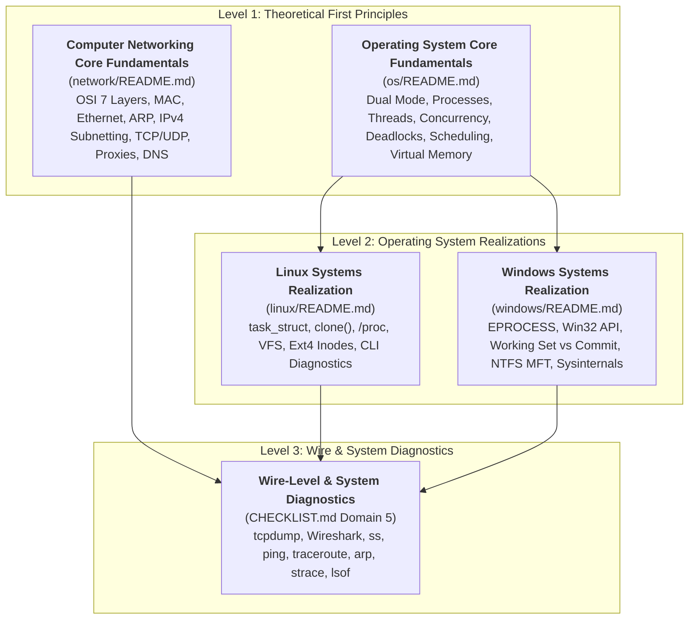
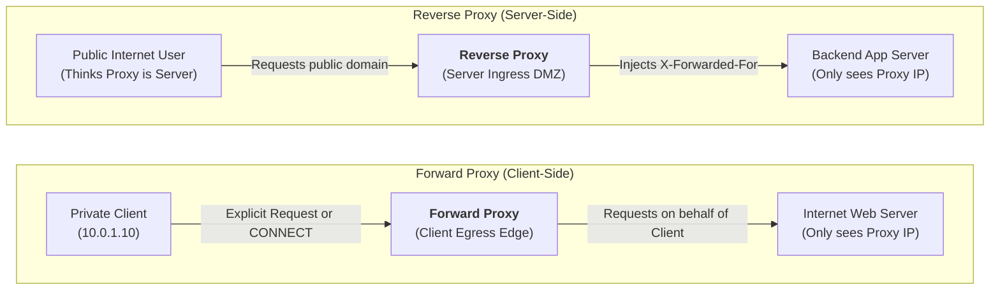

# 🚀 Operating Systems & Computer Networking: Core Fundamentals Roadmap

Welcome to the **Operating Systems & Computer Networking Core Fundamentals** curriculum in the `SelfLearn` workspace.

This track is engineered specifically to review, reinforce, and master foundational **Computer Science & Systems Engineering** principles from first principles—covering process mechanics, thread concurrency, deadlocks, virtual memory, the OSI 7-layer model, Ethernet frames, MAC addresses, ARP, the TCP/IP stack, and **Forward vs. Reverse Proxy architectures**.

All cloud, Kubernetes, and container abstractions have been stripped away so you can master the raw underlying mechanics that govern every physical machine and network stream.

---

## 🎯 Quick Navigation & Roadmap Links

| Roadmap Document | Primary Focus | Link |
| :--- | :--- | :---: |
| 📋 **Master Skills Checklist** | Interactive tracker of all 109 core competencies across 5 domains | **[CHECKLIST.md](./CHECKLIST.md)** |
| 🧠 **Operating Systems Roadmap** | Dual-mode, Processes, Threads, Concurrency, Deadlock, CPU Scheduling, Virtual Memory, Storage | **[os/README.md](./os/README.md)** |
| 🌐 **Computer Networking Roadmap** | OSI 7 Layers, TCP/IP, MAC, Ethernet, ARP, IPv4 Subnetting, TCP/UDP, **Forward vs Reverse Proxy**, DNS | **[network/README.md](./network/README.md)** |
| 🐧 **Linux Systems Realization** | `task_struct`, `fork`/`clone`, `pthreads`, `/proc`, VFS, Ext4, Inodes, signals, CLI diagnostics | **[linux/README.md](./linux/README.md)** |
| 🪟 **Windows Systems Realization** | Windows NT, `EPROCESS`/`ETHREAD`, Win32 `HANDLE`s, Working Set vs Commit, NTFS MFT, Sysinternals | **[windows/README.md](./windows/README.md)** |

---

## 🗺️ Master Curriculum Architecture



---

## 🔍 Deep Dive: Forward Proxy vs. Reverse Proxy Architecture

Proxies are network intermediaries (RFC 9110) positioned between clients and destination servers to intercept, inspect, modify, and relay traffic.



### 1. Forward Proxy (Client-Side Intermediary)
- **Who it Represents**: Sits on the **client side** of the connection. It acts on behalf of private clients communicating with the outside world.
- **Physical Location**: Deployed at the egress perimeter of an internal private local area network (LAN).
- **Client & Server Awareness**:
  - The client is aware of the proxy (configured in OS settings or via `http_proxy`/`https_proxy` environment variables).
  - The destination web server does not know who the client is; it only sees the Forward Proxy's IP address.
- **Primary Use Cases**:
  - **Corporate Egress Filtering & Compliance**: Restricting internal employees from accessing unauthorized or malicious websites.
  - **Data Loss Prevention (DLP)**: Scanning outbound payload data to prevent leakage of credentials or intellectual property.
  - **Client Anonymity**: Hiding the client's actual geographical IP address.
  - **Forward Caching**: Caching frequently accessed external static files locally to conserve expensive WAN bandwidth.
- **Handling HTTPS via `HTTP CONNECT` Tunneling**:
  Because the forward proxy cannot decrypt end-to-end TLS traffic without custom Root CAs, it uses the **`HTTP CONNECT` method**:
  1. Client sends: `CONNECT destination.com:443 HTTP/1.1`.
  2. Proxy establishes a raw TCP socket connection to `destination.com:443`.
  3. Proxy responds with: `HTTP/1.1 200 Connection Established`.
  4. Proxy acts as a transparent, blind TCP byte pipe, passing raw encrypted TLS frames back and forth without inspecting payloads.

---

### 2. Reverse Proxy (Server-Side Gateway)
- **Who it Represents**: Sits on the **server side** of the connection. It acts on behalf of private backend application origin servers.
- **Physical Location**: Deployed at the ingress DMZ/edge of a data center or server farm.
- **Client & Server Awareness**:
  - The client has no idea backend origin servers exist; the client believes the Reverse Proxy *is* the actual web server.
  - The backend application servers only accept connections from the Reverse Proxy.
- **Primary Use Cases**:
  - **Origin Shielding & Security**: Completely conceals the private IP addresses and network topology of backend application servers from the public internet.
  - **Load Balancing**: Distributing incoming traffic across multiple backend servers (Round Robin, Least Connections, IP Hash).
  - **SSL/TLS Termination**: Handling expensive cryptographic handshakes at the edge, allowing backend application servers to process requests over fast internal plaintext HTTP.
  - **Reverse Caching (Web Acceleration)**: Caching static assets (HTML, images, CSS) and API responses to serve client requests with zero backend origin execution.
  - **Security & DDoS Mitigation**: Centralized location for rate limiting, IP blacklisting, and Web Application Firewalls (WAF).
- **Client IP Preservation & Forwarding Headers**:
  Because backend origin servers only see the Reverse Proxy's socket IP address, the proxy injects metadata headers:
  - `X-Forwarded-For`: Appends the client's original public IP address.
  - `X-Forwarded-Proto`: Preserves whether the client used `http` or `https`.
  - `X-Forwarded-Host`: Preserves the original `Host` header requested by the client.
  - **RFC 7239 `Forwarded` Standard**: The standardized unified header: `Forwarded: for=198.51.100.1;proto=https;host=example.com`.

---

### 3. Comparison Matrix: Forward Proxy vs. Reverse Proxy

| Dimension | Forward Proxy (Client Proxy) | Reverse Proxy (Server Gateway) |
| :--- | :--- | :--- |
| **Whom it represents** | Represents the **Client** to the outside world | Represents the **Server** to the outside world |
| **Physical location** | In front of internal clients (Client LAN / Egress edge) | In front of backend origin servers (Server DMZ / Ingress edge) |
| **Who configures it?** | Configured by the client or corporate network admin | Deployed and configured by the application/system owner |
| **Identity concealed** | Conceals the **Client's identity** (server only sees proxy IP) | Conceals the **Server's identity** (client only sees proxy IP) |
| **Client awareness** | Client knows the proxy exists (sets proxy IP & port) | Client believes the proxy is the real destination origin |
| **Primary capabilities** | Egress filtering, content censorship, DLP, WAN caching, client anonymity | Ingress load balancing, SSL termination, origin shielding, reverse caching, WAF |
| **TLS handling** | Uses `HTTP CONNECT` to tunnel raw TLS without decryption | Terminates TLS, decrypts payload, and re-encrypts or forwards plaintext |
| **Prominent software** | Squid, Apache Traffic Server, Privoxy, corporate firewalls | NGINX, HAProxy, Envoy, Apache HTTP Server (`mod_proxy`), Caddy |

---

## 🖼️ Canonical Diagrams & Visual References

### 1. Forward Proxy Architecture
[](https://commons.wikimedia.org/wiki/File:Forward_proxy_h2g2bob.svg)  
*Clients behind an internal network route external requests through a Forward Proxy to hide client identities, enforce egress filtering, and cache web content.*

### 2. Reverse Proxy Architecture
[](https://commons.wikimedia.org/wiki/File:Reverse_proxy_h2g2bob.svg)  
*External internet clients contact the Reverse Proxy directly, which terminates connections, decrypts TLS, and forwards requests to isolated backend origin servers.*

### 3. The OSI 7-Layer Communication Model
[](https://commons.wikimedia.org/wiki/File:OSI-model-Communication.svg)

### 4. TCP 3-Way Handshake Connection Establishment
[](https://commons.wikimedia.org/wiki/File:TCP_Three-Way_Handshake.svg)

---

## 🛠️ Fundamental Diagnostic Command Quick Reference

```text
+-----------------------+---------------------------------------+-------------------------------------------------------------+
| Category              | Command / Tool                        | Specific Purpose                                            |
+-----------------------+---------------------------------------+-------------------------------------------------------------+
| MAC & L2 Link         | ip link show                          | Display interface MAC address, MTU, and link state          |
| ARP Table             | arp -a (or: ip neigh)                 | View IP-to-MAC resolution cache on local network            |
| Network Route         | ip route show (or: route -n)          | Inspect kernel routing table and default gateway            |
| Socket & Ports        | ss -tulpn                             | Display listening TCP/UDP sockets with process PIDs         |
| ICMP Diagnostics      | ping -c 4 <ip>                        | Test round-trip latency and packet loss                     |
| Route Path            | traceroute -n <dest>                  | Trace router hops via TTL expiration and ICMP replies       |
| DNS Query             | nslookup domain.com (or: dig domain)  | Query nameserver for A, AAAA, and CNAME records             |
| Raw TCP Probe         | nc -zvw3 <ip> <port>                  | Probe if remote TCP port is open/listening                  |
| Packet Sniffing       | tcpdump -i any -nn 'port 80'          | Sniff live network traffic on the wire                      |
| Process Inspection    | ps aux --sort=-%mem                   | List active processes sorted by memory consumption          |
| Virtual Memory        | free -h                               | Inspect Total, Used, Free, and Available RAM and Swap       |
| System Call Tracing   | strace -p <PID> -c                    | Count and measure execution time of all process syscalls    |
| Open File Handles     | lsof -p <PID>                         | Inspect all files, sockets, and pipes held by a process     |
| Windows Diagnostics   | procexp.exe                           | Sysinternals GUI for process tree, handles, and DLLs        |
+-----------------------+---------------------------------------+-------------------------------------------------------------+
```

---

## 📚 Tier-1 Canonical References
- [RFC 791: Internet Protocol (IPv4)](https://datatracker.ietf.org/doc/html/rfc791)
- [RFC 792: Internet Control Message Protocol (ICMP)](https://datatracker.ietf.org/doc/html/rfc792)
- [RFC 826: Address Resolution Protocol (ARP)](https://datatracker.ietf.org/doc/html/rfc826)
- [RFC 9293: Transmission Control Protocol (TCP)](https://datatracker.ietf.org/doc/html/rfc9293)
- [RFC 768: User Datagram Protocol (UDP)](https://datatracker.ietf.org/doc/html/rfc768)
- [RFC 9110: HTTP Semantics - Section 7: Intermediaries, Proxies & Gateways](https://datatracker.ietf.org/doc/html/rfc9110#section-7)
- [RFC 7239: Forwarded HTTP Extension](https://datatracker.ietf.org/doc/html/rfc7239)
- [MDN Web Docs: Proxy servers and tunneling](https://developer.mozilla.org/en-US/docs/Web/HTTP/Proxy_servers_and_tunneling)
- *Operating System Concepts* (10th Edition) - Silberschatz, Galvin, Gagne.
- *Modern Operating Systems* (4th Edition) - Andrew S. Tanenbaum.
- *Computer Networking: A Top-Down Approach* (8th Edition) - Kurose & Ross.
- [Linux Kernel Documentation](https://docs.kernel.org/)
- [Microsoft Learn: User Mode and Kernel Mode](https://learn.microsoft.com/en-us/windows-hardware/drivers/gettingstarted/user-mode-and-kernel-mode)
