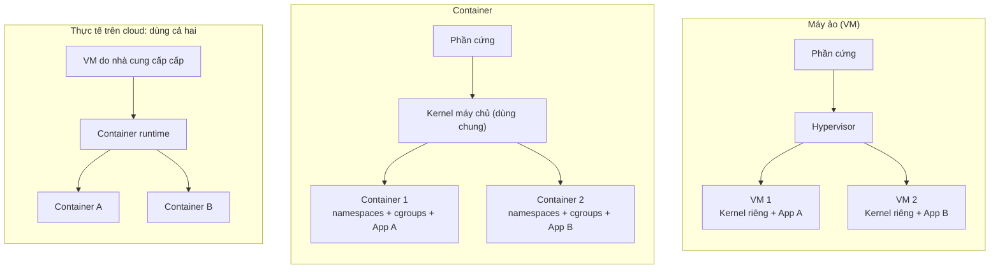

# 6_1_1 Containers vs Virtual Machines

> **Khóa học**: Cloud DevOps Basic — Containers & Kubernetes  
> **Phân nhóm**: 6 Domain 6 - Containers and Kubernetes › 6_1 Container Fundamentals  
> **Chủ đề**: Container khác máy ảo ở đâu: dùng chung kernel, cô lập bằng namespaces và cgroups  
> **Phiên bản áp dụng**: Docker Docs / Podman (trang `latest`), Linux kernel (man-pages), Kubernetes RuntimeClass  
> **Trạng thái**: Draft (WRITE-CTR-6_1_1, 16-11-2026): qua G1–G4, chưa qua G5 (verifier độc lập)  
> **Phạm vi**: [Topic README](./README.md#6_1_1-container-vs-máy-ảo-vm) · **Checkpoint của người học**: [CHECKLIST](../../CHECKLIST.md#6_1-container-fundamentals)

---

## 1. Khái Niệm Cốt Lõi & Bản Chất Kỹ Thuật (Core Concepts & Technical Deep Dive)

### 1.1 Container Là Một Process Bị Cô Lập

Docker mô tả container là *"isolated processes for each of your app's components"*. <!-- ev: R1.1 -->
Nói gọn: **container là một process bị cô lập, đi kèm các file nó cần để chạy**. <!-- ev: R1.2 -->
Đây là điểm xuất phát cho cả Domain 6: khi container "lạ" (bị kill, không nhận tín hiệu, mất file), hãy hỏi "process này đang bị kernel xử lý ra sao".

Docker liệt kê các đặc tính của container, hai đặc tính quan trọng cho bài này:
- **Isolated**: container chạy cô lập nên ít ảnh hưởng tới máy chủ và container khác. <!-- ev: R1.7 -->
- **Self-contained**: mỗi container có mọi thứ nó cần, không phụ thuộc gói cài sẵn trên máy chủ. <!-- ev: R1.8 -->

### 1.2 Máy Ảo (VM) So Với Container

| Tiêu chí | Máy ảo (VM) | Container |
| :--- | :--- | :--- |
| Nó là gì | Cả một hệ điều hành với kernel, driver phần cứng, chương trình và ứng dụng riêng <!-- ev: R1.3 --> | Một process bị cô lập cùng các file nó cần <!-- ev: R1.2 --> |
| Kernel | Mỗi VM có kernel riêng <!-- ev: R1.3 --> | Các container trên cùng máy chủ dùng chung một kernel <!-- ev: R1.4 --> |
| Chi phí | Dựng cả VM chỉ để cô lập một ứng dụng là *a lot of overhead* <!-- ev: R1.5 --> | Chạy được nhiều ứng dụng hơn trên ít hạ tầng hơn <!-- ev: R1.4 --> |

> **Suy luận từ hai dòng trên (không phải câu trích dẫn)**: vì container dùng chung kernel của máy chủ, container Linux cần kernel Linux ở máy chủ, và không thể chạy "kernel khác" như VM.

### 1.3 "Cô Lập" Đến Từ Đâu

Container không phải một tính năng kernel đơn lẻ mà là **sự kết hợp** của hai cơ chế kernel (mỗi cơ chế có lesson riêng):
- **Namespaces**: kernel bao một tài nguyên toàn cục trong lớp trừu tượng, khiến process trong namespace thấy *bản cô lập riêng* của tài nguyên đó. <!-- ev: R1.9 --> Xem [6_1_2](<./6_1_2 Linux Namespaces for Containers.md>).
- **cgroups v2**: giới hạn tài nguyên. Ví dụ `memory.max` là giới hạn cứng, và là cơ chế chính để giới hạn bộ nhớ của một cgroup. <!-- ev: R1.10 --> Xem [6_1_3](<./6_1_3 Control Groups v2 for Containers.md>).

Lưu ý quan trọng: **mặc định container không bị giới hạn tài nguyên**, nó dùng được bao nhiêu tùy bộ lập lịch của kernel máy chủ. <!-- ev: R1.11 --> Muốn có giới hạn phải đặt rõ (`--memory`, `--cpus`, hoặc `resources.limits` trong Kubernetes).

### 1.4 Khi Nào Vẫn Cần Cách Ly Mạnh Hơn

Cô lập bằng kernel dùng chung là đánh đổi: nhẹ nhưng ranh giới yếu hơn VM (đây là cách hiểu chung; tài liệu Docker chỉ nói container "có ảnh hưởng tối thiểu" tới máy chủ). <!-- ev: R1.7 -->
Kubernetes cho phép chọn runtime khác cho từng Pod: với workload cần mức đảm bảo bảo mật cao, có thể chạy Pod trong container runtime dùng **ảo hóa phần cứng**. <!-- ev: R1.12 --> Bạn được thêm cô lập, **đổi lại là thêm overhead**. <!-- ev: R1.13 -->

Hai công nghệ thường được dùng *cùng nhau*: trên cloud, máy được cấp thường là VM, và một VM chạy container runtime có thể chạy nhiều ứng dụng container hóa. <!-- ev: R1.6 -->

---

## 2. Ví Dụ Đời Sống Thực Tế Dễ Hiểu (Intuitive Real-World Analogies)

**Nhà riêng vs căn hộ chung cư.**
- **VM = nhà riêng**: có móng, hệ thống điện nước và mái riêng. Rất độc lập, nhưng xây một căn chỉ để ở một người thì tốn kém.
- **Container = căn hộ trong chung cư**: các căn dùng chung móng và hệ thống điện nước (**kernel**), nhưng mỗi căn có cửa khóa riêng (**namespaces**) và đồng hồ điện nước giới hạn mức dùng (**cgroups**).
- **Nhà phát triển cần mức riêng tư rất cao** (ví dụ ngân hàng) có thể chọn "căn hộ có tường bê tông dày" hay thậm chí "nhà riêng trong khu chung cư": đó chính là RuntimeClass dùng ảo hóa phần cứng.

Chung cư nhiều căn hơn trên cùng một mảnh đất (ít hạ tầng hơn), nhưng nếu hỏng móng (lỗi kernel) thì mọi căn đều bị ảnh hưởng, còn nhà riêng thì không lan sang nhau.

---

## 3. Kiến Trúc, Luồng Hoạt Động & Hình Ảnh Trực Quan (Architecture, Diagrams & Visual Media)

<!-- ev: R1.3 R1.4 R1.6 R1.9 R1.10 -->


---

## 4. Thực Hành (Hands-on)

> **Môi trường**: Linux có Podman 5.x (Fedora 43 theo [container/README.md](../../README.md)); với Docker, thay `podman` bằng `docker`.  
> ⚠️ Chưa chạy thử (not executed by the squad). Kết quả mô tả là **dự đoán theo tài liệu**, không phải output thật.

### 4.1 Chứng Minh "Chung Kernel" Và "Là Một Process"

<!-- ev: R1.14 R1.15 R1.16 R1.17 R1.18 R1.4 R1.2 -->
```bash
# 1. Kernel release của máy chủ
uname -r

# 2. Kernel release nhìn từ trong container (xóa container ngay sau khi chạy xong)
podman run --rm docker.io/library/alpine uname -r
# Dự đoán theo R1.4: hai chuỗi giống nhau vì container dùng chung kernel máy chủ

# 3. Chạy một container nền có tên, rồi xem process của nó
podman run -d --name demo docker.io/library/alpine sleep 600
podman top demo           # process của container, nhìn từ phía Podman
ps aux | grep "sleep 600" # process thật trên máy chủ: container chỉ là process

# 4. Dọn dẹp
podman rm -f demo
```

### 4.2 Điều Cần Quan Sát
- Hai chuỗi `uname -r` có giống nhau không? Nếu khác (ví dụ khi dùng máy ảo bên dưới công cụ container), hãy ghi lại nền tảng của bạn thay vì suy đoán lý do.
- `ps` trên máy chủ có thấy `sleep 600` không?

Thực hành sâu hơn: [lab-6_1_1-namespaces-and-cgroups-by-hand](./README.md#lab-6_1_1-namespaces-and-cgroups-by-hand) (lab đang ở trạng thái "Định nghĩa").

---

## 5. Cạm Bẫy Thực Tế & Thực Tiễn Sản Xuất (Production Gotchas & Best Practices)

### 5.1 Cạm Bẫy: Tưởng Container Có Giới Hạn Sẵn
- **Hiện tượng**: một container "ăn" hết RAM/CPU của node, ảnh hưởng container khác.
- **Bản chất**: mặc định container không có giới hạn tài nguyên, dùng bao nhiêu tùy scheduler của kernel máy chủ. <!-- ev: R1.11 -->
- **Thực tiễn**: luôn đặt giới hạn (`--memory`/`--cpus` hoặc `resources.limits` ở 6_3_6).

### 5.2 Cạm Bẫy: Coi Container Là Ranh Giới Bảo Mật Tuyệt Đối
- **Bản chất**: các container trên cùng máy chủ dùng chung một kernel. <!-- ev: R1.4 --> *Suy luận (không phải câu trích dẫn)*: một lỗ hổng ở kernel có thể ảnh hưởng nhiều container trên cùng máy.
- **Thực tiễn**: workload cần đảm bảo bảo mật cao có thể dùng runtime cách ly mạnh qua RuntimeClass, chấp nhận overhead. <!-- ev: R1.12 R1.13 -->
- Các lớp bảo mật khác (capabilities, seccomp, user namespace) được dạy ở [6_1_7](<./README.md#6_1_7-bảo-mật-container>).

### 5.3 Thực Tiễn: Không Đối Lập VM Và Container
- Trên cloud, container thường chạy **bên trong** VM. <!-- ev: R1.6 --> Câu trả lời tốt cho "chọn VM hay container" là "tùy mức cách ly, mật độ và vận hành", không phải "cái nào hơn".

---

## 6. Câu Hỏi Củng Cố Kiến Thức (Active Recall Quiz)

### Câu Hỏi 1: Khác biệt cốt lõi giữa container và VM về kernel là gì, và hệ quả?

<details>
<summary>Đáp án</summary>

VM là cả một hệ điều hành với kernel riêng; các container trên cùng máy chủ **dùng chung một kernel**. Hệ quả: container nhẹ hơn, chạy được nhiều ứng dụng hơn trên ít hạ tầng, nhưng chia sẻ kernel với máy chủ.
</details>

### Câu Hỏi 2: Hai cơ chế kernel nào tạo nên "cô lập" và "giới hạn" cho container?

<details>
<summary>Đáp án</summary>

**Namespaces** cho process thấy bản cô lập riêng của tài nguyên toàn cục (cô lập "nhìn thấy gì"); **cgroups** giới hạn tài nguyên (ví dụ `memory.max`). Mặc định container không có giới hạn nếu bạn không đặt.
</details>

### Câu Hỏi 3: Khi nào dùng runtime cách ly mạnh hơn, và cái giá là gì?

<details>
<summary>Đáp án</summary>

Khi workload cần mức đảm bảo bảo mật cao: Kubernetes cho chọn runtime dùng ảo hóa phần cứng qua RuntimeClass. Cái giá là thêm overhead.
</details>

---

## 7. 📚 Nguồn Tài Liệu Chính Thống (Tier-1 Official References)

- [Docker Docs — What is a container?](https://docs.docker.com/get-started/docker-concepts/the-basics/what-is-a-container/) — Định nghĩa container, so sánh với VM, dùng chung kernel.
- [namespaces(7) — Linux manual page](https://man7.org/linux/man-pages/man7/namespaces.7.html) — Khái niệm và danh sách namespace.
- [Control Group v2 — Linux Kernel documentation](https://docs.kernel.org/admin-guide/cgroup-v2.html) — `memory.max` và các file giới hạn tài nguyên.
- [Docker Docs — Resource constraints](https://docs.docker.com/engine/containers/resource_constraints/) — Mặc định không giới hạn và cách đặt giới hạn.
- [Kubernetes — Runtime Class](https://kubernetes.io/docs/concepts/containers/runtime-class/) — Chọn runtime cách ly mạnh hơn cho từng Pod.
- [podman-run(1)](https://docs.podman.io/en/latest/markdown/podman-run.1.html) và [podman-top(1)](https://docs.podman.io/en/latest/markdown/podman-top.1.html) — Các cờ `--rm`, `-d`, `--name` và lệnh `top` dùng trong thực hành.
- [uname(1) — Linux manual page](https://man7.org/linux/man-pages/man1/uname.1.html) — Cờ `-r` in kernel release.
