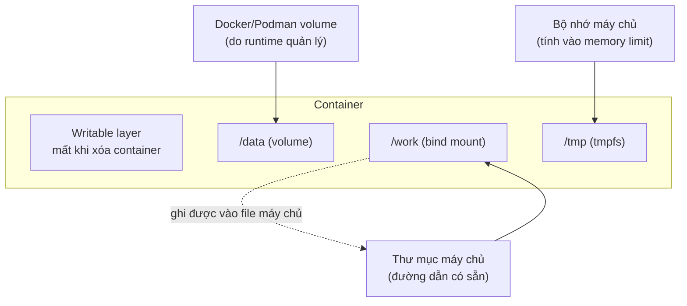

# 6_1_10 Container Data Storage

> **Khóa học**: Cloud DevOps Basic — Containers & Kubernetes  
> **Phân nhóm**: 6 Domain 6 - Containers and Kubernetes › 6_1 Container Fundamentals  
> **Chủ đề**: Volume vs bind mount vs tmpfs, dữ liệu mất khi xóa container, quyền sở hữu file khi rootless  
> **Phiên bản áp dụng**: Docker Engine docs, Podman (trang `latest`)  
> **Trạng thái**: Draft (WRITE-CTR-6_1_10, 16-11-2026): qua G1–G4, chưa qua G5 (verifier độc lập)  
> **Phạm vi**: [Topic README](./README.md#6_1_10-lưu-trữ-dữ-liệu) · **Checkpoint của người học**: [CHECKLIST](../../CHECKLIST.md#6_1-container-fundamentals)

---

## 1. Khái Niệm Cốt Lõi & Bản Chất Kỹ Thuật (Core Concepts & Technical Deep Dive)

### 1.1 Ba Cách Đưa Dữ Liệu Vào/Ra Container

Từ [6_1_4](<./6_1_4 Images Layers and Overlay Filesystem.md>): dữ liệu ghi vào **lớp ghi** của container bị xóa cùng container, nên dữ liệu cần giữ phải nằm ở nơi khác. <!-- ev: R10.15 --> Có ba cơ chế:

| Cơ chế | Nó là gì | Đặc điểm chính |
| :--- | :--- | :--- |
| **Volume** | Kho dữ liệu bền do Docker tạo và quản lý <!-- ev: R10.1 --> | Cơ chế **được ưu tiên** để lưu dữ liệu do container sinh ra và dùng <!-- ev: R10.3 --> |
| **Bind mount** | File/thư mục **của máy chủ** được mount vào container <!-- ev: R10.4 --> | Có quyền ghi vào file máy chủ theo mặc định <!-- ev: R10.5 --> |
| **tmpfs** | Mount tạm thời **chỉ nằm trong bộ nhớ** máy chủ <!-- ev: R10.7 --> | Bị xóa khi container dừng <!-- ev: R10.7 --> |

### 1.2 Volume

- Có thể tạo tường minh bằng `docker volume create` hoặc để Docker tự tạo khi tạo container/service. <!-- ev: R10.2 -->
- Khi dùng volume, một thư mục **mới** được tạo trong vùng lưu trữ của Docker trên máy chủ, thay vì dùng một thư mục có sẵn của bạn. <!-- ev: R10.4 -->
- Podman: `-v SOURCE-VOLUME:/CONTAINER-DIR` mount named volume vào container; **nếu chưa có volume đó, Podman tạo mới**. `-v /HOST-DIR:/CONTAINER-DIR` thì tạo bind mount. <!-- ev: R10.9 -->

### 1.3 Bind Mount Và Rủi Ro

Bind mount gắn trực tiếp thư mục của máy chủ, rất tiện cho phát triển. Cái giá: **process trong container có thể tạo/sửa/xóa file hệ thống quan trọng trên máy chủ**. <!-- ev: R10.6 --> Đây là hệ quả bảo mật cần nhớ.

### 1.4 tmpfs

- tmpfs mount là tạm thời, chỉ lưu trong bộ nhớ máy chủ; khi container dừng, mount bị xóa và file ghi vào đó không còn. <!-- ev: R10.7 -->
- Dữ liệu tmpfs **tính vào giới hạn bộ nhớ cgroup** của container ([6_1_3](<./6_1_3 Control Groups v2 for Containers.md>)). <!-- ev: R10.8 --> Vì vậy ghi quá nhiều vào tmpfs có thể làm container bị OOM (suy luận từ việc nó tính vào giới hạn bộ nhớ).
- Podman: `--tmpfs` gắn một tmpfs vào container. <!-- ev: R10.10 -->

### 1.5 Quyền Sở Hữu File Khi Rootless/Non-root

Khi container rootless hoặc chạy bằng user không phải root, **UID trong container khác UID trên máy chủ** (user namespace, [6_1_7](<./6_1_7 Container Security Fundamentals.md>)). Nên thư mục bạn mount có thể không ghi được. Podman cung cấp:
- `--userns=keep-id`: ánh xạ user của bạn sang **cùng UID** trong container. <!-- ev: R10.13 -->
- Tùy chọn volume `U`/`chown`: đổi đệ quy chủ sở hữu của volume nguồn dựa trên UID/GID của container. <!-- ev: R10.12 -->
- Trên SELinux (Fedora/RHEL), thêm nhãn: `:Z` gắn nhãn **riêng**, chỉ container hiện tại dùng được. <!-- ev: R10.14 -->

### 1.6 Cú Pháp `--mount`

Podman còn có `--mount=type=...`; các loại hiện hỗ trợ theo trang `latest` gồm artifact, bind, devpts, glob, image, ramfs, tmpfs và volume. <!-- ev: R10.11 --> *Danh sách này phụ thuộc phiên bản Podman, hãy đối chiếu bản bạn dùng.*

---

## 2. Ví Dụ Đời Sống Thực Tế Dễ Hiểu (Intuitive Real-World Analogies)

**Thuê phòng khách sạn và kho đồ.**
- **Lớp ghi của container = đồ để trong phòng khách sạn**: trả phòng (xóa container) là dọn sạch.
- **Volume = gửi đồ ở kho riêng của khách sạn**: khách sạn quản lý, đồ còn đó khi bạn đổi phòng.
- **Bind mount = bạn mở cửa cho khách sạn bước thẳng vào phòng của bạn ở nhà**: tiện, nhưng khách sạn (container) có thể sắp xếp lại, thậm chí vứt đồ ở nhà bạn.
- **tmpfs = bảng trắng trong phòng**: viết nhanh, cuối ngày bị lau sạch, và chiếm không gian (bộ nhớ) của phòng.
- **Rootless UID = bạn và khách sạn đánh số phòng khác nhau**: cùng một "phòng" nhưng tên trên cửa khác nhau nên đôi khi bạn không có chìa.

---

## 3. Kiến Trúc, Luồng Hoạt Động & Hình Ảnh Trực Quan (Architecture, Diagrams & Visual Media)

<!-- ev: R10.1 R10.4 R10.7 R10.8 R10.15 -->


---

## 4. Thực Hành (Hands-on)

> **Môi trường**: Linux, Podman 5.x (Fedora 43, SELinux). Với Docker, đổi `podman` thành `docker`.  
> ⚠️ Chưa chạy thử (not executed by the squad). Kết quả là **dự đoán theo tài liệu**.

### 4.1 Chứng Minh Volume Sống Sót Khi Xóa Container

<!-- ev: R10.9 R10.15 -->
```bash
podman run --rm -v mydata:/data docker.io/library/alpine sh -c 'echo giu-lai > /data/f.txt'
# Container đã bị xóa (--rm). Tạo container mới mount lại cùng volume:
podman run --rm -v mydata:/data docker.io/library/alpine cat /data/f.txt   # dự đoán: giu-lai
podman volume rm mydata
```

### 4.2 Bind Mount Và Quyền Sở Hữu (Rootless)

<!-- ev: R10.9 R10.13 R10.14 R10.12 -->
```bash
mkdir -p ~/lab-data && echo hello > ~/lab-data/a.txt

# Thử ghi vào thư mục mount bằng user mặc định trong container, kèm nhãn SELinux :Z
podman run --rm -v ~/lab-data:/data:Z docker.io/library/alpine sh -c 'echo them >> /data/a.txt; ls -ln /data'

# Giữ UID của bạn trong container
podman run --rm --userns=keep-id -v ~/lab-data:/data:Z docker.io/library/alpine sh -c 'id; ls -ln /data'
```

Quan sát: UID/GID hiển thị trong `ls -ln` khác nhau thế nào giữa hai lần chạy; so sánh với UID của bạn trên máy chủ.

### 4.3 tmpfs

<!-- ev: R10.10 R10.7 -->
```bash
podman run --rm --tmpfs /scratch docker.io/library/alpine sh -c 'echo x > /scratch/t && ls /scratch'
# Khi container dừng, nội dung tmpfs không còn
```

---

## 5. Cạm Bẫy Thực Tế & Thực Tiễn Sản Xuất (Production Gotchas & Best Practices)

### 5.1 Cạm Bẫy: Dữ Liệu Mất Khi Container Bị Thay Thế
- **Bản chất**: lớp ghi của container bị xóa cùng container; dữ liệu cần tồn tại, ghi nhiều hoặc chia sẻ nên dùng volume. <!-- ev: R10.15 -->
- **Thực tiễn**: đặt dữ liệu của database, upload... trên volume; ở Kubernetes dùng PersistentVolume (6_4_6).

### 5.2 Cạm Bẫy: Bind Mount Mở Quyền Quá Rộng
- **Bản chất**: bind mount có quyền ghi mặc định, container có thể sửa/xóa file quan trọng của máy chủ. <!-- ev: R10.5 R10.6 -->
- **Thực tiễn**: chỉ mount đúng thư mục cần; cân nhắc mount chỉ đọc (cờ `:ro`; tôi chưa trích dẫn cờ này, hãy đọc trang `podman-run`/Docker bind mounts).

### 5.3 Cạm Bẫy: Permission Denied Với Rootless/Non-root
- **Bản chất**: UID trong container ≠ UID máy chủ (user namespace). <!-- ev: R10.13 -->
- **Thực tiễn**: dùng `--userns=keep-id`, tùy chọn volume `U`, hoặc chỉnh quyền thư mục; trên SELinux thêm `:Z`. <!-- ev: R10.13 R10.12 R10.14 -->

### 5.4 Cạm Bẫy: tmpfs "Ăn" Bộ Nhớ
- **Bản chất**: dữ liệu tmpfs tính vào giới hạn bộ nhớ cgroup. <!-- ev: R10.8 -->
- **Thực tiễn**: đặt kích thước tmpfs hợp lý và tính vào `--memory`.

---

## 6. Câu Hỏi Củng Cố Kiến Thức (Active Recall Quiz)

### Câu Hỏi 1: Khi nào dùng volume, khi nào dùng bind mount, khi nào dùng tmpfs?

<details>
<summary>Đáp án</summary>

Volume: dữ liệu cần bền do runtime quản lý (cơ chế được ưu tiên). Bind mount: cần đưa thư mục có sẵn của máy chủ vào container (ví dụ mã nguồn khi dev), nhớ rủi ro ghi vào máy chủ. tmpfs: dữ liệu tạm, chỉ ở bộ nhớ, mất khi container dừng và tính vào giới hạn bộ nhớ.
</details>

### Câu Hỏi 2: Vì sao container rootless không ghi được vào thư mục mount, và sửa thế nào?

<details>
<summary>Đáp án</summary>

UID trong container khác UID trên máy chủ do user namespace. Dùng `--userns=keep-id`, tùy chọn volume `U`/`chown`, hoặc chỉnh quyền; trên SELinux thêm `:Z`.
</details>

### Câu Hỏi 3: Dữ liệu ghi vào filesystem của container (không mount gì) đi đâu khi `rm` container?

<details>
<summary>Đáp án</summary>

Nằm ở lớp ghi của container nên bị xóa cùng container; image gốc không đổi.
</details>

---

## 7. 📚 Nguồn Tài Liệu Chính Thống (Tier-1 Official References)

- [Docker Docs — Volumes](https://docs.docker.com/engine/storage/volumes/) — Volume, cách tạo, khi nào dùng.
- [Docker Docs — Bind mounts](https://docs.docker.com/engine/storage/bind-mounts/) — Bind mount và cân nhắc bảo mật.
- [Docker Docs — tmpfs mounts](https://docs.docker.com/engine/storage/tmpfs/) — tmpfs và giới hạn bộ nhớ.
- [Docker Docs — Storage drivers](https://docs.docker.com/engine/storage/drivers/) — Lớp ghi của container.
- [podman-run(1)](https://docs.podman.io/en/latest/markdown/podman-run.1.html) — `--volume`, `--mount`, `--tmpfs`, `--userns`, tùy chọn `U`, `z`/`Z`.
