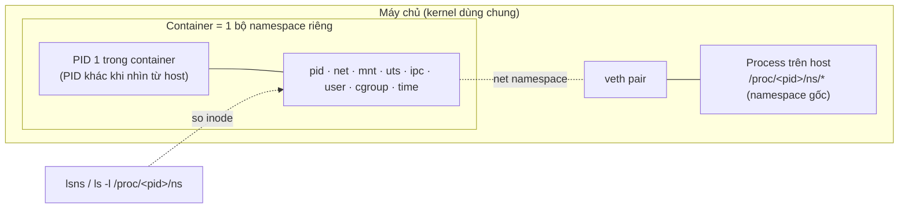
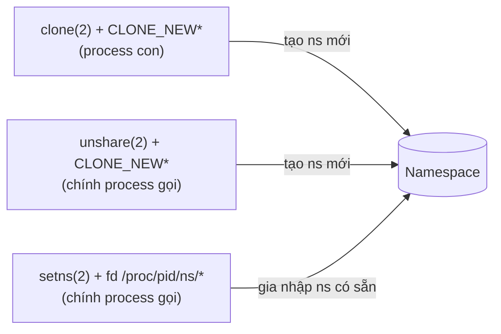

# 6_1_2 Linux Namespaces for Containers

> **Khóa học**: Cloud DevOps Basic — Containers & Kubernetes  
> **Phân nhóm**: 6 Domain 6 - Containers and Kubernetes › 6_1 Container Fundamentals  
> **Chủ đề**: Namespaces: cơ chế kernel quyết định một process "nhìn thấy gì" (PID, mạng, mount, hostname...)  
> **Phiên bản áp dụng**: Linux (man-pages), util-linux (`unshare`, `nsenter`, `lsns`)  
> **Trạng thái**: Draft (WRITE-CTR-6_1_2, 16-11-2026; bổ sung 17-11-2026: mục 1.6–1.8, 4.4, claim R2.26–R2.41): G4 chạy lại sau bổ sung: 0 lỗi (23.8 KB, sát giới hạn 24 KB); chưa qua G5 (verifier độc lập)  
> **Phạm vi**: [Topic README](./README.md#6_1_2-linux-namespaces-cô-lập-nhìn-thấy-gì) · **Checkpoint của người học**: [CHECKLIST](../../CHECKLIST.md#6_1-container-fundamentals)

> Bài này dạy **góc nhìn container**. Chi tiết kernel nằm ở Domain 3 (mục 3.8 trong [CHECKLIST gốc](../../../CHECKLIST.md)).

---

## 1. Khái Niệm Cốt Lõi & Bản Chất Kỹ Thuật (Core Concepts & Technical Deep Dive)

### 1.1 Namespace Là Gì

Theo `namespaces(7)`: một namespace **bao một tài nguyên toàn cục** trong một lớp trừu tượng, làm cho process trong namespace *thấy như chúng có một bản cô lập riêng* của tài nguyên đó. <!-- ev: R2.1 -->
Container = process được đặt vào một **bộ** namespace riêng. Namespace quyết định "nhìn thấy gì", còn "được dùng bao nhiêu" thuộc về cgroups ([6_1_3](<./6_1_3 Control Groups v2 for Containers.md>)).

### 1.2 Tám Loại Namespace

Linux có 8 loại, mỗi loại tương ứng một cờ `CLONE_NEW*` khi tạo process: <!-- ev: R2.2 -->

| Namespace | Cờ | Cô lập cái gì (cột "Isolates" của `namespaces(7)`) |
| :--- | :--- | :--- |
| `cgroup` | `CLONE_NEWCGROUP` | Cgroup root directory <!-- ev: R2.22 --> |
| `ipc` | `CLONE_NEWIPC` | System V IPC, POSIX message queues <!-- ev: R2.22 --> |
| `net` | `CLONE_NEWNET` | Network devices, stacks, ports, etc. <!-- ev: R2.22 --> |
| `mnt` | `CLONE_NEWNS` | Mount points <!-- ev: R2.22 --> |
| `pid` | `CLONE_NEWPID` | Process IDs <!-- ev: R2.23 --> |
| `time` | `CLONE_NEWTIME` | Boot and monotonic clocks <!-- ev: R2.23 --> |
| `user` | `CLONE_NEWUSER` | User and group IDs <!-- ev: R2.23 --> |
| `uts` | `CLONE_NEWUTS` | Hostname and NIS domain name <!-- ev: R2.23 --> |

Namespace `time` có handle `/proc/pid/ns/time` **từ Linux 5.6**. <!-- ev: R2.3 --> *Suy luận (không phải trích dẫn)*: tài liệu cũ liệt kê 7 loại là do viết trước khi có `time`.

### 1.3 PID Namespace Và "PID 1"

- Process đầu tiên tạo trong PID namespace mới có **PID 1** và là process **init** của namespace đó. <!-- ev: R2.6 -->
- Process mồ côi (orphan) được **gán lại cho init** của PID namespace của cha nó. <!-- ev: R2.8 -->
- Nếu init của PID namespace kết thúc, kernel **giết mọi process** trong namespace bằng `SIGKILL`. <!-- ev: R2.7 -->

Đây là gốc rễ của hai hiện tượng bạn sẽ gặp ở [6_1_8](<./README.md#6_1_8-vòng-đời-container-pid-1-và-tín-hiệu>): process chính của container chính là PID 1, và nó chết thì cả container chết.

### 1.4 Network Namespace

- Một thiết bị mạng vật lý chỉ thuộc **đúng một** network namespace. <!-- ev: R2.9 -->
- Cặp `veth` là "đường ống" nối các network namespace với nhau. <!-- ev: R2.10 -->
- Khi một network namespace bị giải phóng, các thiết bị `veth` bên trong bị hủy. <!-- ev: R2.11 -->

Đây là cơ sở để runtime nối container ra mạng (xem [6_1_9](<./README.md#6_1_9-mạng-container-cơ-bản>)).

### 1.5 Quan Sát Namespace Từ Bên Ngoài

- Mỗi process có thư mục `/proc/pid/ns/`, chứa một mục cho mỗi namespace hỗ trợ `setns(2)`. <!-- ev: R2.4 -->
- Mỗi mục là symlink có nội dung dạng "loại:[inode]", ví dụ `uts:[4026531838]`; hai process có cùng inode là **cùng namespace**. <!-- ev: R2.5 -->
- `lsns` liệt kê các namespace đang truy cập được. <!-- ev: R2.12 -->
- `unshare` chạy chương trình trong namespace **mới**; `nsenter` chạy chương trình trong namespace **đã có**. <!-- ev: R2.13 R2.14 -->

### 1.6 Ba Syscall Làm Việc Với Namespace

| Syscall | Làm gì |
| :--- | :--- |
| `clone(2)` | Tạo process mới; với các cờ `CLONE_NEW*`, namespace mới được tạo cho từng cờ và **process con** trở thành thành viên. <!-- ev: R2.28 --> |
| `unshare(2)` | Chuyển **chính process gọi** sang namespace mới. <!-- ev: R2.29 --> |
| `setns(2)` | Cho process gọi **gia nhập namespace đã có**. <!-- ev: R2.30 --> |

- Tạo namespace bằng `clone(2)`/`unshare(2)` trong hầu hết trường hợp cần capability `CAP_SYS_ADMIN`. <!-- ev: R2.26 -->
- **Ngoại lệ là user namespace**: từ Linux 3.8, tạo user namespace không cần đặc quyền. <!-- ev: R2.27 -->

*Suy luận (không phải trích dẫn)*: `unshare`/`nsenter` (util-linux) là lớp vỏ dòng lệnh quanh các syscall này, nên `nsenter` là cách làm "kiểu `setns`" từ shell. Trang `namespaces(7)` không nói trực tiếp về `docker exec`/`kubectl exec`; đừng suy ra cách chúng cài đặt từ bài này.

#### Ví Dụ Code: Ba Syscall Trong Thực Tế

> **Đã chạy thử** (17-11-2026): Fedora, kernel 7.3.3, `gcc`. Cả ba chương trình dùng `CLONE_NEWUSER` kèm `CLONE_NEWUTS` để chạy được **không cần `sudo`** (xem mục 1.7). Số inode trong output sẽ khác ở mỗi lần chạy và mỗi máy; chỉ cần để ý chúng **giống hay khác nhau**.

**Ví dụ 1: `clone(2)`: process CON vào namespace mới, process cha giữ nguyên**

<!-- ev: R2.28 R2.27 -->
```c
// clone(2): tạo process CON trong namespace mới
#define _GNU_SOURCE
#include <sched.h>
#include <stdio.h>
#include <stdlib.h>
#include <string.h>
#include <unistd.h>
#include <sys/wait.h>

static char stack[1024 * 1024];            // stack cho process con

static void show(const char *who) {
    char host[64], ns[64] = {0};
    gethostname(host, sizeof host);
    readlink("/proc/self/ns/uts", ns, sizeof ns - 1);
    printf("%-6s hostname=%-12s %s\n", who, host, ns);
}

static int child(void *arg) {
    sethostname("in-child", 8);            // chỉ đổi trong UTS ns mới của con
    show("child");
    return 0;
}

int main(void) {
    setvbuf(stdout, NULL, _IONBF, 0);      // tắt buffer: process con thoát bằng _exit, không flush stdio
    show("parent");
    // CLONE_NEWUSER cho phép làm việc này không cần root; CLONE_NEWUTS = UTS ns mới
    pid_t pid = clone(child, stack + sizeof stack,
                      CLONE_NEWUSER | CLONE_NEWUTS | SIGCHLD, NULL);
    if (pid == -1) { perror("clone"); exit(1); }
    waitpid(pid, NULL, 0);
    show("parent");                        // hostname của cha không đổi
    return 0;
}
```

```bash
gcc -Wall -o clone_demo clone_demo.c && ./clone_demo
# parent hostname=fedora       uts:[4026531838]
# child  hostname=in-child     uts:[4026534246]   <- con: UTS ns mới, hostname riêng
# parent hostname=fedora       uts:[4026531838]   <- cha không bị ảnh hưởng
```

Giải thích:
- Hai cờ `CLONE_NEWUSER | CLONE_NEWUTS` bảo kernel tạo user ns và UTS ns mới cho **process con**; `SIGCHLD` để cha `waitpid` được như `fork`. <!-- ev: R2.28 -->
- Con đổi hostname bằng `sethostname` nhưng cha vẫn thấy hostname cũ, vì chúng ở hai UTS namespace khác nhau (inode khác nhau, mục 1.5).
- Quan sát khi chạy thử: lần đầu không có `setvbuf(...)`, dòng `child` **không in ra** khi output đi qua pipe. *Suy luận*: con thoát bằng `_exit` nên buffer `stdout` không được xả; vì vậy ví dụ tắt buffer.

**Ví dụ 2: `unshare(2)`: chính process gọi đổi namespace**

<!-- ev: R2.29 R2.27 -->
```c
// unshare(2): chính process gọi chuyển sang namespace mới
#define _GNU_SOURCE
#include <sched.h>
#include <stdio.h>
#include <stdlib.h>
#include <unistd.h>

static void show(const char *when) {
    char host[64], ns[64] = {0};
    gethostname(host, sizeof host);
    readlink("/proc/self/ns/uts", ns, sizeof ns - 1);
    printf("%-8s hostname=%-12s %s\n", when, host, ns);
}

int main(void) {
    show("before");
    if (unshare(CLONE_NEWUSER | CLONE_NEWUTS) == -1) { perror("unshare"); exit(1); }
    sethostname("after-unshare", 13);
    show("after");                          // cùng PID, nhưng uts namespace đã đổi
    return 0;
}
```

```bash
gcc -Wall -o unshare_demo unshare_demo.c && ./unshare_demo
# before   hostname=fedora        uts:[4026531838]
# after    hostname=after-unshare uts:[4026534247]   <- CÙNG process, namespace đã đổi
```

Giải thích:
- Không có process con nào: cùng một PID, trước và sau lệnh gọi `unshare(2)`, `/proc/self/ns/uts` trỏ tới hai inode khác nhau. <!-- ev: R2.29 -->
- Đây là cách lệnh `unshare` (util-linux) làm việc ở mục 4.1: tạo namespace rồi chạy chương trình trong đó. *Suy luận*: `unshare(1)` bọc `unshare(2)`; trang `unshare(1)` không nói chi tiết cài đặt.

**Ví dụ 3: `setns(2)`: gia nhập namespace đã có**

<!-- ev: R2.30 R2.39 R2.40 R2.41 -->
```c
// setns(2): gia nhập namespace ĐÃ CÓ qua fd của /proc/<pid>/ns/*
#define _GNU_SOURCE
#include <fcntl.h>
#include <sched.h>
#include <stdio.h>
#include <stdlib.h>
#include <unistd.h>

static void join(const char *pid, const char *type, int nstype) {
    char path[64];
    snprintf(path, sizeof path, "/proc/%s/ns/%s", pid, type);
    int fd = open(path, O_RDONLY);
    if (fd == -1) { perror(path); exit(1); }
    if (setns(fd, nstype) == -1) { perror("setns"); exit(1); }
    close(fd);
}

int main(int argc, char **argv) {
    if (argc != 2) { fprintf(stderr, "usage: %s <target-pid>\n", argv[0]); return 1; }
    char host[64], ns[64] = {0};
    gethostname(host, sizeof host);
    printf("before: hostname=%s\n", host);
    join(argv[1], "user", CLONE_NEWUSER);   // vào user ns trước để có quyền trong ns đó
    join(argv[1], "uts",  CLONE_NEWUTS);    // rồi mới vào uts ns của target
    gethostname(host, sizeof host);
    readlink("/proc/self/ns/uts", ns, sizeof ns - 1);
    printf("after : hostname=%s %s\n", host, ns);
    return 0;
}
```

```bash
# Terminal 1: tạo "target" có UTS ns riêng và hostname riêng
unshare -r -u bash -c 'hostname target-host; exec sleep 300'

# Terminal 2: lấy PID của sleep rồi cho chương trình gia nhập namespace của nó
gcc -Wall -o setns_demo setns_demo.c
./setns_demo <PID-của-sleep>
# before: hostname=fedora
# after : hostname=target-host uts:[4026534248]   <- inode khớp với /proc/<PID>/ns/uts của target
hostname    # ngoài chương trình: vẫn là fedora
```

Giải thích:
- `setns(2)` nhận **file descriptor** mở từ `/proc/<pid>/ns/<loại>`; đối số thứ hai (`CLONE_NEWUSER`, `CLONE_NEWUTS`) nói rõ ta mong đợi loại namespace nào. <!-- ev: R2.30 -->
- **Vì sao phải vào `user` trước `uts`**: gia nhập UTS namespace cần `CAP_SYS_ADMIN` cả trong user namespace của chính mình **và** trong user namespace sở hữu namespace đích. <!-- ev: R2.41 --> Gia nhập user namespace cần `CAP_SYS_ADMIN` trong user namespace đích. <!-- ev: R2.40 --> Process cha có cùng effective UID với chủ sở hữu (owner) của user namespace con thì có mọi capability trong đó. <!-- ev: R2.39 --> Ở ví dụ này, user ns của target do chính user của bạn tạo nên bước vào user ns thành công, từ đó mới đủ quyền vào UTS ns. *Suy luận (nối từ ba quy tắc trên, đã khớp với kết quả chạy thử)*.
- Với container thật chạy bằng root, bạn thường dùng `sudo nsenter -t <PID> -u` (mục 4.3); lệnh này làm công việc tương tự bằng `setns(2)`. *Suy luận*, `nsenter(1)` không mô tả cài đặt.

### 1.7 User Namespace: Ánh Xạ UID/GID

- User namespace mới tạo ra **chưa có ánh xạ** user ID/group ID tới user namespace cha. <!-- ev: R2.31 -->
- Các file `/proc/pid/uid_map` và `/proc/pid/gid_map` chứa ánh xạ; mỗi dòng là ánh xạ 1-1 một **dải** ID liên tiếp giữa hai user namespace. <!-- ev: R2.32 -->

Ý nghĩa với container: bên trong namespace bạn có thể là UID 0, nhưng UID 0 đó chỉ là một UID thường (ví dụ 1000) khi nhìn từ ngoài, tùy ánh xạ. Đây là nền tảng của container *rootless*; *suy luận*: container rootless dựa vào cơ chế này; chi tiết ở [6_1_7 Container Security Fundamentals](<./6_1_7 Container Security Fundamentals.md>).

### 1.8 Time Namespace: Chỉ Ảo Hóa Hai Đồng Hồ

- Time namespace ảo hóa **hai** đồng hồ: `CLOCK_MONOTONIC` và `CLOCK_BOOTTIME`. <!-- ev: R2.33 -->
- Mỗi time namespace có **offset** so với time namespace khởi tạo, xem ở `/proc/pid/timens_offsets`. <!-- ev: R2.35 -->
- `unshare(2)` với `CLONE_NEWTIME` **không** đưa process gọi vào namespace mới; chỉ các process con tạo sau đó vào. <!-- ev: R2.34 --> Vì vậy handle tương ứng là `/proc/pid/ns/time_for_children`.

Lưu ý: đồng hồ thời gian thực (wall-clock) **không** nằm trong danh sách hai đồng hồ trên, nên time namespace không dùng để "đổi ngày giờ" của container. *Suy luận từ danh sách trên*, hãy đối chiếu `time_namespaces(7)` khi cần chắc chắn.

---

## 2. Ví Dụ Đời Sống Thực Tế Dễ Hiểu (Intuitive Real-World Analogies)

**Khách sạn có nhiều phòng.** Cả khách sạn là một máy chủ (một kernel).
- Mỗi phòng có **bảng số phòng riêng** và danh bạ điện thoại nội bộ riêng (PID/mạng riêng): khách phòng 101 chỉ thấy "người trong phòng mình", dù ngoài hành lang còn nhiều người khác.
- Nhân viên lễ tân (host) thấy **tất cả các phòng** và có thể "đi vào" phòng nào cần kiểm tra (`nsenter`).
- **Người đầu tiên vào phòng** giữ chìa khóa phòng (PID 1): họ rời đi mà không bàn giao thì cả phòng bị dọn sạch (init chết → mọi process bị `SIGKILL`).

Mở rộng phép so sánh cho từng loại namespace (chỉ là ẩn dụ để nhớ, không phải định nghĩa kỹ thuật):

| Namespace | Trong khách sạn |
| :--- | :--- |
| `uts` | Biển tên gắn cửa phòng: mỗi phòng tự đặt tên (hostname) mà không đổi tên khách sạn. |
| `pid` | Số thứ tự khách *trong phòng*: người đầu tiên luôn là "số 1", dù ở sảnh họ mang số khác. |
| `net` | Đường dây điện thoại và bảng số máy lẻ riêng của từng phòng. |
| `mnt` | Sơ đồ tủ kệ trong phòng: khách chỉ thấy các kệ của phòng mình. |
| `ipc` | Hòm thư nội bộ trong phòng; phòng khác không bỏ thư vào được. |
| `user` | Thẻ chức danh: trong phòng bạn là "chủ phòng" (UID 0), nhưng với ban quản lý khách sạn bạn chỉ là khách thường (UID 1000). |
| `cgroup` | Bảng điện nước của phòng: khách chỉ nhìn thấy phần của mình. |
| `time` | Đồng hồ treo tường của phòng có thể chạy lệch so với sảnh (offset), nhưng lịch ngày tháng thật của khách sạn không đổi. |

*Giới hạn của phép so sánh*: khách sạn có nhiều tòa nhà, còn ở đây tất cả phòng dùng **chung một kernel**, đó là lý do namespace không phải máy ảo.

---

## 3. Kiến Trúc, Luồng Hoạt Động & Hình Ảnh Trực Quan (Architecture, Diagrams & Visual Media)

<!-- ev: R2.2 R2.4 R2.5 R2.6 R2.10 -->


Ba cách một process vào một namespace (mục 1.6):

<!-- ev: R2.28 R2.29 R2.30 -->


---

## 4. Thực Hành (Hands-on)

> **Môi trường**: Linux, quyền `sudo`. Công cụ: `unshare`, `nsenter`, `lsns` (util-linux).  
> ⚠️ Chưa chạy thử (not executed by the squad). Chỉ chạy trên máy học tập của bạn. Kết quả bên dưới là **dự đoán theo tài liệu**.

### 4.1 Tự Tạo Namespace Bằng `unshare`

<!-- ev: R2.13 R2.15 R2.16 R2.17 R2.18 -->
```bash
# Tạo PID + UTS + network namespace mới rồi chạy bash trong đó
# -p tạo PID ns, -f fork (hữu ích khi tạo PID ns), -u tạo UTS ns, -n tạo net ns
sudo unshare -p -f -u -n bash
```

Trong shell mới, bạn có thể đổi hostname mà **không ảnh hưởng máy chủ** (do UTS namespace). Quan sát PID và danh sách interface rồi đối chiếu với máy chủ.

> Trang `unshare(1)` ở mục `--pid` nhắc xem thêm các tùy chọn `--fork` và `--mount-proc`. <!-- ev: R2.25 --> `--mount-proc` mount filesystem `proc` ngay trước khi chạy chương trình và hữu ích khi tạo PID namespace mới. <!-- ev: R2.38 --> Ví dụ dùng nó ở mục 4.4.

### 4.2 Đọc Namespace Của Một Process

<!-- ev: R2.4 R2.5 R2.12 R2.21 -->
```bash
# Namespace của shell hiện tại (symlink dạng "loại:[inode]")
ls -l /proc/$$/ns

# Liệt kê namespace trên máy, chỉ loại net
lsns -t net
```

So sánh inode `net` của process trong container với inode của PID 1 trên máy chủ để biết hai bên có chung namespace hay không.

### 4.3 Vào Namespace Của Container Đang Chạy

<!-- ev: R2.14 R2.19 R2.20 -->
```bash
# <PID> là PID của process container nhìn từ máy chủ
# (lấy bằng cách xem `podman inspect <tên>` và tìm trường chứa PID)
sudo nsenter -t <PID> -n ip addr
```

`-t` chọn process đích, `-n` vào network namespace của nó; không có đối số thì dùng network namespace của process đích. Bạn sẽ thấy interface **của container**, không phải của máy chủ.

### 4.4 User, PID Và Time Namespace Không Cần `sudo`

> **Đã chạy thử** (17-11-2026, phiên chỉnh sửa này): Fedora, kernel 7.3.3, util-linux 2.41.6 (`unshare --version`). Kết quả bên dưới là output thật, rút gọn. Nếu máy bạn chặn user namespace thì lệnh có thể lỗi; khi đó dùng `sudo` và bỏ `-r`.

<!-- ev: R2.27 R2.37 R2.31 R2.32 -->
```bash
# -r (--map-root-user): ánh xạ user hiện tại thành root trong user namespace mới
unshare -r bash -c 'id -u; cat /proc/self/uid_map'
# 0
#          0       1000          1      <- UID 0 trong ns = UID 1000 bên ngoài, dải dài 1
```

<!-- ev: R2.15 R2.16 R2.38 R2.6 -->
```bash
# PID ns + mount /proc mới để ps chỉ thấy process trong ns; -f để bash là con của unshare
unshare -r -p -f --mount-proc bash -c 'echo PID=$$; ps -e'
# PID=1
#     PID TTY          TIME CMD
#       1 ?        00:00:00 bash
#       2 ?        00:00:00 ps
```

<!-- ev: R2.34 R2.35 R2.36 R2.33 -->
```bash
cat /proc/uptime                       # ví dụ: 55988.41 ...
unshare -r -T --boottime 86400 bash -c 'cat /proc/uptime; cat /proc/self/timens_offsets'
# 142388.42 ...                        <- uptime tăng thêm 86400 giây trong ns
# monotonic           0         0
# boottime        86400         0
```

Điều quan sát được: `ps` chỉ thấy 3 process và `bash` là PID 1; uptime trong time namespace lệch đúng offset `--boottime` mà đồng hồ máy chủ không đổi. Lệnh `unshare -T` ở đây không cần `-f` vì `unshare(1)` đã đặt process chạy chương trình vào namespace mới; *suy luận từ kết quả chạy thử*, tài liệu `time_namespaces(7)` chỉ nói children mới vào namespace (mục 1.8).

Thực hành sâu hơn: [lab-6_1_1-namespaces-and-cgroups-by-hand](./README.md#lab-6_1_1-namespaces-and-cgroups-by-hand).

---

## 5. Cạm Bẫy Thực Tế & Thực Tiễn Sản Xuất (Production Gotchas & Best Practices)

### 5.1 Cạm Bẫy: Quên `--fork` Khi Tạo PID Namespace Bằng `unshare`
- **Hiện tượng**: lệnh lỗi hoặc process không nằm trong PID namespace như mong đợi.
- **Bản chất**: `-f` chạy chương trình như tiến trình con của `unshare` và được ghi là "hữu ích khi tạo PID namespace mới". <!-- ev: R2.16 --> Tài liệu cũng nói tạo PID namespace **bền vững** (persistent) sẽ lỗi nếu không chỉ định `--fork`. <!-- ev: R2.24 -->
- **Thực tiễn**: dùng `-f` cùng `-p`.

### 5.2 Cạm Bẫy: Giả Định Số Lượng Namespace
- **Bản chất**: hiện có 8 loại, trong đó `time` chỉ có từ Linux 5.6. <!-- ev: R2.2 R2.3 --> Tài liệu liệt kê 7 loại có thể đã cũ.
- **Thực tiễn**: dùng `lsns -t` với danh sách loại hỗ trợ: mnt, net, ipc, user, pid, uts, cgroup, time. <!-- ev: R2.21 -->

### 5.3 Thực Tiễn: Kiểm Tra "Cùng Namespace" Bằng Inode, Không Bằng Tên
- Hai process cùng namespace khi inode trong `/proc/pid/ns/<loại>` giống nhau. <!-- ev: R2.5 --> Đây là cách đáng tin cậy khi debug container "có đang dùng chung mạng với host không".

---

## 6. Câu Hỏi Củng Cố Kiến Thức (Active Recall Quiz)

### Câu Hỏi 1: Namespace làm gì, và 8 loại là những loại nào?

<details>
<summary>Đáp án</summary>

Namespace bao một tài nguyên toàn cục để process trong namespace thấy bản cô lập riêng. Tám loại: `cgroup`, `ipc`, `mnt`, `net`, `pid`, `time`, `user`, `uts`.
</details>

### Câu Hỏi 2: Vì sao process chính của container chết thì cả container chết?

<details>
<summary>Đáp án</summary>

Process đầu tiên trong PID namespace là PID 1 (init) của namespace. Khi init kết thúc, kernel giết mọi process còn lại trong namespace bằng `SIGKILL`. Process mồ côi cũng được gán cho init.
</details>

### Câu Hỏi 3: Phân biệt `unshare` và `nsenter`.

<details>
<summary>Đáp án</summary>

`unshare` chạy chương trình trong namespace **mới**; `nsenter` chạy chương trình trong namespace **đã tồn tại** của một process khác (chọn bằng `-t`). Dùng `unshare` để tự dựng "container thô", dùng `nsenter` để vào container đang chạy.
</details>

---

## 7. 📚 Nguồn Tài Liệu Chính Thống (Tier-1 Official References)

- [namespaces(7)](https://man7.org/linux/man-pages/man7/namespaces.7.html) — Khái niệm, danh sách 8 loại, `/proc/pid/ns/`.
- [pid_namespaces(7)](https://man7.org/linux/man-pages/man7/pid_namespaces.7.html) — PID 1/init của namespace, nhận nuôi process mồ côi, hậu quả khi init chết.
- [network_namespaces(7)](https://man7.org/linux/man-pages/man7/network_namespaces.7.html) — Thiết bị mạng và `veth` giữa các network namespace.
- [user_namespaces(7)](https://man7.org/linux/man-pages/man7/user_namespaces.7.html) — Ánh xạ UID/GID (`uid_map`, `gid_map`).
- [time_namespaces(7)](https://man7.org/linux/man-pages/man7/time_namespaces.7.html) — Hai đồng hồ được ảo hóa và `/proc/pid/timens_offsets`.
- [setns(2)](https://man7.org/linux/man-pages/man2/setns.2.html) — Gia nhập namespace đã có và quyền cần thiết theo từng loại.
- [unshare(1)](https://man7.org/linux/man-pages/man1/unshare.1.html) — Chạy chương trình trong namespace mới.
- [nsenter(1)](https://man7.org/linux/man-pages/man1/nsenter.1.html) — Vào namespace của process khác.
- [lsns(8)](https://man7.org/linux/man-pages/man8/lsns.8.html) — Liệt kê namespace.
