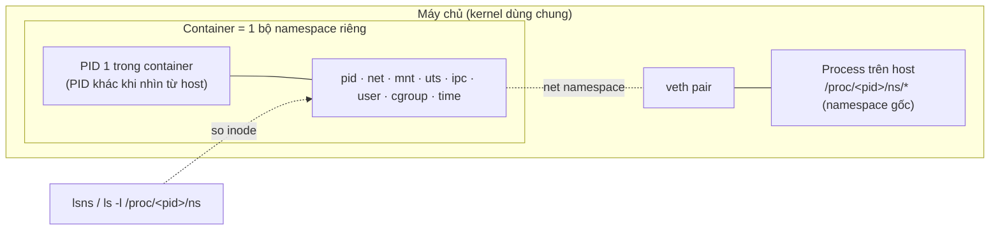

# 6_1_2 Linux Namespaces for Containers

> **Khóa học**: Cloud DevOps Basic — Containers & Kubernetes  
> **Phân nhóm**: 6 Domain 6 - Containers and Kubernetes › 6_1 Container Fundamentals  
> **Chủ đề**: Namespaces: cơ chế kernel quyết định một process "nhìn thấy gì" (PID, mạng, mount, hostname...)  
> **Phiên bản áp dụng**: Linux (man-pages), util-linux (`unshare`, `nsenter`, `lsns`)  
> **Trạng thái**: Draft (WRITE-CTR-6_1_2, 16-11-2026): qua G1–G4, chưa qua G5 (verifier độc lập)  
> **Phạm vi**: [Topic README](./README.md#6_1_2-linux-namespaces-cô-lập-nhìn-thấy-gì) · **Checkpoint của người học**: [CHECKLIST](../../CHECKLIST.md#6_1-container-fundamentals)

> Bài này dạy **góc nhìn container**. Chi tiết kernel nằm ở Domain 3 (mục 3.8 trong [CHECKLIST gốc](../../../CHECKLIST.md)).

---

## 1. Khái Niệm Cốt Lõi & Bản Chất Kỹ Thuật (Core Concepts & Technical Deep Dive)

### 1.1 Namespace Là Gì

Theo `namespaces(7)`: một namespace **bao một tài nguyên toàn cục** trong một lớp trừu tượng, làm cho process trong namespace *thấy như chúng có một bản cô lập riêng* của tài nguyên đó. <!-- ev: R2.1 -->
Container = process được đặt vào một **bộ** namespace riêng. Namespace quyết định "nhìn thấy gì", còn "được dùng bao nhiêu" thuộc về cgroups ([6_1_3](<./6_1_3 Control Groups v2 for Containers.md>)).

### 1.2 Tám Loại Namespace

Linux có 8 loại, mỗi loại tương ứng một cờ `CLONE_NEW*` khi tạo process: <!-- ev: R2.2 -->

| Namespace | Cờ | Cô lập cái gì (cột "Isolates" của `namespaces(7)`) |
| :--- | :--- | :--- |
| `cgroup` | `CLONE_NEWCGROUP` | Cgroup root directory <!-- ev: R2.22 --> |
| `ipc` | `CLONE_NEWIPC` | System V IPC, POSIX message queues <!-- ev: R2.22 --> |
| `net` | `CLONE_NEWNET` | Network devices, stacks, ports, etc. <!-- ev: R2.22 --> |
| `mnt` | `CLONE_NEWNS` | Mount points <!-- ev: R2.22 --> |
| `pid` | `CLONE_NEWPID` | Process IDs <!-- ev: R2.23 --> |
| `time` | `CLONE_NEWTIME` | Boot and monotonic clocks <!-- ev: R2.23 --> |
| `user` | `CLONE_NEWUSER` | User and group IDs <!-- ev: R2.23 --> |
| `uts` | `CLONE_NEWUTS` | Hostname and NIS domain name <!-- ev: R2.23 --> |

Namespace `time` có handle `/proc/pid/ns/time` **từ Linux 5.6**. <!-- ev: R2.3 --> *Suy luận (không phải trích dẫn)*: tài liệu cũ liệt kê 7 loại là do viết trước khi có `time`.

### 1.3 PID Namespace Và "PID 1"

- Process đầu tiên tạo trong PID namespace mới có **PID 1** và là process **init** của namespace đó. <!-- ev: R2.6 -->
- Process mồ côi (orphan) được **gán lại cho init** của PID namespace của cha nó. <!-- ev: R2.8 -->
- Nếu init của PID namespace kết thúc, kernel **giết mọi process** trong namespace bằng `SIGKILL`. <!-- ev: R2.7 -->

Đây là gốc rễ của hai hiện tượng bạn sẽ gặp ở [6_1_8](<./README.md#6_1_8-vòng-đời-container-pid-1-và-tín-hiệu>): process chính của container chính là PID 1, và nó chết thì cả container chết.

### 1.4 Network Namespace

- Một thiết bị mạng vật lý chỉ thuộc **đúng một** network namespace. <!-- ev: R2.9 -->
- Cặp `veth` là "đường ống" nối các network namespace với nhau. <!-- ev: R2.10 -->
- Khi một network namespace bị giải phóng, các thiết bị `veth` bên trong bị hủy. <!-- ev: R2.11 -->

Đây là cơ sở để runtime nối container ra mạng (xem [6_1_9](<./README.md#6_1_9-mạng-container-cơ-bản>)).

### 1.5 Quan Sát Namespace Từ Bên Ngoài

- Mỗi process có thư mục `/proc/pid/ns/`, chứa một mục cho mỗi namespace hỗ trợ `setns(2)`. <!-- ev: R2.4 -->
- Mỗi mục là symlink có nội dung dạng "loại:[inode]", ví dụ `uts:[4026531838]`; hai process có cùng inode là **cùng namespace**. <!-- ev: R2.5 -->
- `lsns` liệt kê các namespace đang truy cập được. <!-- ev: R2.12 -->
- `unshare` chạy chương trình trong namespace **mới**; `nsenter` chạy chương trình trong namespace **đã có**. <!-- ev: R2.13 R2.14 -->

---

## 2. Ví Dụ Đời Sống Thực Tế Dễ Hiểu (Intuitive Real-World Analogies)

**Khách sạn có nhiều phòng.** Cả khách sạn là một máy chủ (một kernel).
- Mỗi phòng có **bảng số phòng riêng** và danh bạ điện thoại nội bộ riêng (PID/mạng riêng): khách phòng 101 chỉ thấy "người trong phòng mình", dù ngoài hành lang còn nhiều người khác.
- Nhân viên lễ tân (host) thấy **tất cả các phòng** và có thể "đi vào" phòng nào cần kiểm tra (`nsenter`).
- **Người đầu tiên vào phòng** giữ chìa khóa phòng (PID 1): họ rời đi mà không bàn giao thì cả phòng bị dọn sạch (init chết → mọi process bị `SIGKILL`).

---

## 3. Kiến Trúc, Luồng Hoạt Động & Hình Ảnh Trực Quan (Architecture, Diagrams & Visual Media)

<!-- ev: R2.2 R2.4 R2.5 R2.6 R2.10 -->


---

## 4. Thực Hành (Hands-on)

> **Môi trường**: Linux, quyền `sudo`. Công cụ: `unshare`, `nsenter`, `lsns` (util-linux).  
> ⚠️ Chưa chạy thử (not executed by the squad). Chỉ chạy trên máy học tập của bạn. Kết quả bên dưới là **dự đoán theo tài liệu**.

### 4.1 Tự Tạo Namespace Bằng `unshare`

<!-- ev: R2.13 R2.15 R2.16 R2.17 R2.18 -->
```bash
# Tạo PID + UTS + network namespace mới rồi chạy bash trong đó
# -p tạo PID ns, -f fork (hữu ích khi tạo PID ns), -u tạo UTS ns, -n tạo net ns
sudo unshare -p -f -u -n bash
```

Trong shell mới, bạn có thể đổi hostname mà **không ảnh hưởng máy chủ** (do UTS namespace). Quan sát PID và danh sách interface rồi đối chiếu với máy chủ.

> Trang `unshare(1)` ở mục `--pid` nhắc xem thêm các tùy chọn `--fork` và `--mount-proc`. <!-- ev: R2.25 --> Bài này không dùng `--mount-proc` vì chưa kiểm chứng ngữ nghĩa của nó; hãy đọc trang `unshare(1)` nếu cần.

### 4.2 Đọc Namespace Của Một Process

<!-- ev: R2.4 R2.5 R2.12 R2.21 -->
```bash
# Namespace của shell hiện tại (symlink dạng "loại:[inode]")
ls -l /proc/$$/ns

# Liệt kê namespace trên máy, chỉ loại net
lsns -t net
```

So sánh inode `net` của process trong container với inode của PID 1 trên máy chủ để biết hai bên có chung namespace hay không.

### 4.3 Vào Namespace Của Container Đang Chạy

<!-- ev: R2.14 R2.19 R2.20 -->
```bash
# <PID> là PID của process container nhìn từ máy chủ
# (lấy bằng cách xem `podman inspect <tên>` và tìm trường chứa PID)
sudo nsenter -t <PID> -n ip addr
```

`-t` chọn process đích, `-n` vào network namespace của nó; không có đối số thì dùng network namespace của process đích. Bạn sẽ thấy interface **của container**, không phải của máy chủ.

Thực hành sâu hơn: [lab-6_1_1-namespaces-and-cgroups-by-hand](./README.md#lab-6_1_1-namespaces-and-cgroups-by-hand).

---

## 5. Cạm Bẫy Thực Tế & Thực Tiễn Sản Xuất (Production Gotchas & Best Practices)

### 5.1 Cạm Bẫy: Quên `--fork` Khi Tạo PID Namespace Bằng `unshare`
- **Hiện tượng**: lệnh lỗi hoặc process không nằm trong PID namespace như mong đợi.
- **Bản chất**: `-f` chạy chương trình như tiến trình con của `unshare` và được ghi là "hữu ích khi tạo PID namespace mới". <!-- ev: R2.16 --> Tài liệu cũng nói tạo PID namespace **bền vững** (persistent) sẽ lỗi nếu không chỉ định `--fork`. <!-- ev: R2.24 -->
- **Thực tiễn**: dùng `-f` cùng `-p`.

### 5.2 Cạm Bẫy: Giả Định Số Lượng Namespace
- **Bản chất**: hiện có 8 loại, trong đó `time` chỉ có từ Linux 5.6. <!-- ev: R2.2 R2.3 --> Tài liệu liệt kê 7 loại có thể đã cũ.
- **Thực tiễn**: dùng `lsns -t` với danh sách loại hỗ trợ: mnt, net, ipc, user, pid, uts, cgroup, time. <!-- ev: R2.21 -->

### 5.3 Thực Tiễn: Kiểm Tra "Cùng Namespace" Bằng Inode, Không Bằng Tên
- Hai process cùng namespace khi inode trong `/proc/pid/ns/<loại>` giống nhau. <!-- ev: R2.5 --> Đây là cách đáng tin cậy khi debug container "có đang dùng chung mạng với host không".

---

## 6. Câu Hỏi Củng Cố Kiến Thức (Active Recall Quiz)

### Câu Hỏi 1: Namespace làm gì, và 8 loại là những loại nào?

<details>
<summary>Đáp án</summary>

Namespace bao một tài nguyên toàn cục để process trong namespace thấy bản cô lập riêng. Tám loại: `cgroup`, `ipc`, `mnt`, `net`, `pid`, `time`, `user`, `uts`.
</details>

### Câu Hỏi 2: Vì sao process chính của container chết thì cả container chết?

<details>
<summary>Đáp án</summary>

Process đầu tiên trong PID namespace là PID 1 (init) của namespace. Khi init kết thúc, kernel giết mọi process còn lại trong namespace bằng `SIGKILL`. Process mồ côi cũng được gán cho init.
</details>

### Câu Hỏi 3: Phân biệt `unshare` và `nsenter`.

<details>
<summary>Đáp án</summary>

`unshare` chạy chương trình trong namespace **mới**; `nsenter` chạy chương trình trong namespace **đã tồn tại** của một process khác (chọn bằng `-t`). Dùng `unshare` để tự dựng "container thô", dùng `nsenter` để vào container đang chạy.
</details>

---

## 7. 📚 Nguồn Tài Liệu Chính Thống (Tier-1 Official References)

- [namespaces(7)](https://man7.org/linux/man-pages/man7/namespaces.7.html) — Khái niệm, danh sách 8 loại, `/proc/pid/ns/`.
- [pid_namespaces(7)](https://man7.org/linux/man-pages/man7/pid_namespaces.7.html) — PID 1/init của namespace, nhận nuôi process mồ côi, hậu quả khi init chết.
- [network_namespaces(7)](https://man7.org/linux/man-pages/man7/network_namespaces.7.html) — Thiết bị mạng và `veth` giữa các network namespace.
- [unshare(1)](https://man7.org/linux/man-pages/man1/unshare.1.html) — Chạy chương trình trong namespace mới.
- [nsenter(1)](https://man7.org/linux/man-pages/man1/nsenter.1.html) — Vào namespace của process khác.
- [lsns(8)](https://man7.org/linux/man-pages/man8/lsns.8.html) — Liệt kê namespace.
