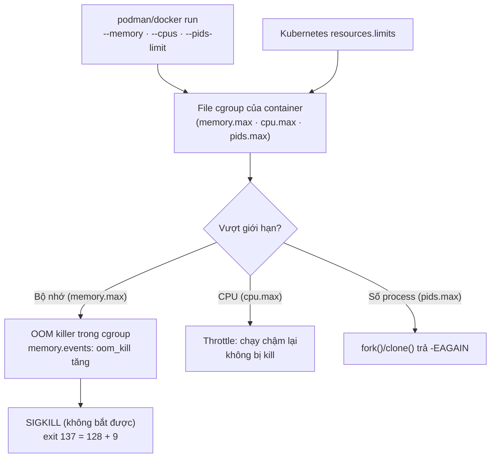

# 6_1_3 Control Groups v2 for Containers

> **Khóa học**: Cloud DevOps Basic — Containers & Kubernetes  
> **Phân nhóm**: 6 Domain 6 - Containers and Kubernetes › 6_1 Container Fundamentals  
> **Chủ đề**: cgroups v2: giới hạn "dùng bao nhiêu" (bộ nhớ, CPU, số process) và vì sao container bị OOM kill (exit code 137)  
> **Phiên bản áp dụng**: Linux cgroup v2 (kernel docs), Docker Engine, Podman (trang `latest`), Kubernetes  
> **Trạng thái**: Draft (WRITE-CTR-6_1_3, 16-11-2026): qua G1–G4, chưa qua G5 (verifier độc lập)  
> **Phạm vi**: [Topic README](./README.md#6_1_3-control-groups-v2-giới-hạn-dùng-bao-nhiêu) · **Checkpoint của người học**: [CHECKLIST](../../CHECKLIST.md#6_1-container-fundamentals)

> Bài này dạy **góc nhìn container**. Chi tiết kernel nằm ở Domain 3 (mục 3.8 và 3.5 trong [CHECKLIST gốc](../../../CHECKLIST.md)).

---

## 1. Khái Niệm Cốt Lõi & Bản Chất Kỹ Thuật (Core Concepts & Technical Deep Dive)

### 1.1 cgroup v2 Là Gì Với Container

Namespaces ([6_1_2](<./6_1_2 Linux Namespaces for Containers.md>)) quyết định process **thấy gì**; cgroups quyết định process **được dùng bao nhiêu**. cgroup v2 chỉ có **một hierarchy duy nhất** (khác v1). <!-- ev: R3.1 -->
Khi bạn dùng cờ giới hạn tài nguyên, Docker **sửa cài đặt cgroup** của container trên máy chủ. <!-- ev: R3.12 --> Kubernetes `resources.limits` cũng cuối cùng được kernel thực thi (xem mục 1.5).
Để biết process thuộc cgroup nào: đọc `/proc/<pid>/cgroup`, file mô tả các control group mà process thuộc về. <!-- ev: R3.21 -->

### 1.2 Bộ Nhớ: `memory.max`, `memory.events`, `memory.current`, `memory.peak`

| File | Ý nghĩa |
| :--- | :--- |
| `memory.max` | Giới hạn cứng, mặc định `max`; là cơ chế chính để giới hạn bộ nhớ của cgroup <!-- ev: R3.2 --> |
| `memory.current` | Tổng bộ nhớ cgroup và các cgroup con đang dùng <!-- ev: R3.5 --> |
| `memory.peak` | Mức dùng tối đa kể từ khi tạo cgroup hoặc lần reset gần nhất <!-- ev: R3.6 --> |
| `memory.events` → `oom_kill` | Số process của cgroup bị OOM killer giết <!-- ev: R3.4 --> |

Quan trọng nhất: khi bộ nhớ cgroup chạm `memory.max` và không giảm được, **OOM killer được gọi trong cgroup đó**. <!-- ev: R3.3 -->
Kubernetes mô tả tương tự: giới hạn `memory` được kernel thực thi bằng **OOM kill**; nhưng việc kill **chỉ xảy ra khi kernel phát hiện áp lực bộ nhớ**, nên container cấp phát vượt giới hạn **chưa chắc bị giết ngay**. <!-- ev: R3.18 -->

### 1.3 CPU: `cpu.max` (Throttling) Và `cpu.weight` (Chia Tỉ Lệ)

- `cpu.max` có dạng `$MAX $PERIOD`, mặc định `max 100000`: nhóm được dùng tối đa `$MAX` trong mỗi `$PERIOD`; `max` nghĩa là không giới hạn. <!-- ev: R3.7 -->
- `cpu.weight` **chia CPU theo tỉ lệ** cho các nhóm đang hoạt động; mặc định 100, dải [1, 10000]. <!-- ev: R3.9 R3.8 -->
- Docker: `--cpus="1.5"` tương đương `--cpu-period="100000"` và `--cpu-quota="150000"`. <!-- ev: R3.16 -->
- Hệ quả: vượt giới hạn CPU là **bị làm chậm (throttle)**, **không bị kill**. Kubernetes: *"cpu limits are enforced by CPU throttling"*, chạm giới hạn thì kernel hạn chế truy cập CPU. <!-- ev: R3.17 -->

### 1.4 Số Process: `pids.max`

`pids.max` là giới hạn cứng số process, mặc định `max`. <!-- ev: R3.10 --> Khi tạo process mới sẽ vi phạm chính sách, `fork()` hoặc `clone()` trả `-EAGAIN`. <!-- ev: R3.11 --> Công cụ container map cờ vào đây, ví dụ Podman `--pids-limit` (mặc định 2048 nếu hệ thống hỗ trợ pids cgroup controller; -1 là không giới hạn). <!-- ev: R3.13 -->

### 1.5 Vì Sao Exit Code 137

1. `SIGKILL` (signal 9) **không thể bị bắt, chặn hay bỏ qua**. <!-- ev: R3.20 -->
2. Bash/shell tính exit status là `128+n` khi lệnh bị kết thúc bởi signal n. <!-- ev: R3.19 -->
3. Vậy process chết vì `SIGKILL` cho exit status `128 + 9 = 137`; `SIGTERM` (15) cho `128 + 15 = 143`.

> Việc OOM killer dùng `SIGKILL` là **hiểu biết chung, chưa có trích dẫn trong ledger của bài này**. Vì vậy đừng chỉ dựa vào mã thoát: hãy xác nhận bằng `oom_kill` trong `memory.events` và `OOMKilled` trong `inspect`. <!-- ev: R3.4 R3.22 -->

### 1.6 Ánh Xạ Công Cụ → File cgroup

| Bạn đặt | Podman | Docker | Kubernetes | Cuối cùng là file |
| :--- | :--- | :--- | :--- | :--- |
| Bộ nhớ | `--memory` <!-- ev: R3.14 --> | cờ giới hạn bộ nhớ <!-- ev: R3.12 --> | `limits.memory` <!-- ev: R3.18 --> | `memory.max` |
| CPU | `--cpus` <!-- ev: R3.15 --> | `--cpus` <!-- ev: R3.16 --> | `limits.cpu` <!-- ev: R3.17 --> | `cpu.max` |
| Số process | `--pids-limit` <!-- ev: R3.13 --> | tương tự | không đặt trực tiếp ở bài này | `pids.max` |

*Cột cuối là ánh xạ theo ý nghĩa các file ở mục 1.2–1.4; để chắc chắn, đọc trực tiếp file cgroup của container (mục 4.2).*

---

## 2. Ví Dụ Đời Sống Thực Tế Dễ Hiểu (Intuitive Real-World Analogies)

**Căn hộ có đồng hồ điện nước và cầu dao.**
- **`memory.max` = cầu dao tổng của căn hộ**: dùng vượt mức thì "nhảy cầu dao" (OOM kill), không có chuyện "chạy chậm lại".
- **`cpu.max` = van nước giới hạn lưu lượng**: mở hết cỡ cũng chỉ chảy tối đa mức đã đặt, nước chảy chậm lại chứ không bị cắt (throttle).
- **`cpu.weight` = quy ước chia nước khi cả tòa nhà cùng xả**: ai có "trọng số" lớn hơn được chia nhiều hơn khi tranh chấp.
- **`pids.max` = số khách tối đa được vào căn hộ**: vượt số, người mới bị từ chối ở cửa (`fork()` lỗi `-EAGAIN`).

---

## 3. Kiến Trúc, Luồng Hoạt Động & Hình Ảnh Trực Quan (Architecture, Diagrams & Visual Media)

<!-- ev: R3.2 R3.3 R3.4 R3.7 R3.10 R3.12 R3.17 R3.18 R3.19 R3.20 -->


---

## 4. Thực Hành (Hands-on)

> **Môi trường**: Linux cgroup v2, Podman 5.x (Fedora 43). Với Docker, đổi `podman` thành `docker`.  
> ⚠️ Chưa chạy thử (not executed by the squad). Kết quả mô tả là **dự đoán theo tài liệu**.  
> Truy cập file cgroup có thể cần quyền root; với rootless, một số giới hạn có thể không được phép (tài liệu Podman nêu "On some systems, changing the CPU limits may not be allowed for non-root users"). <!-- ev: R3.24 -->

### 4.1 Đặt Giới Hạn Và Kiểm Tra Bằng `inspect`

<!-- ev: R3.13 R3.14 R3.15 R3.22 -->
```bash
# Chạy container nền với giới hạn bộ nhớ, CPU và số process
podman run -d --name limits-demo --memory 128m --cpus 0.5 --pids-limit 50 \
  docker.io/library/alpine sleep 600

# Xem JSON đầy đủ; khóa của JSON dùng được làm giá trị cho --format
podman inspect limits-demo

# Ví dụ trong tài liệu Podman: có OOM kill hay không
podman inspect limits-demo --format '{{.State.OOMKilled}}'
```

### 4.2 Đọc Thẳng File cgroup

<!-- ev: R3.21 R3.25 R3.26 R3.2 R3.7 R3.10 R3.4 -->
```bash
# <PID> là PID của process container nhìn từ máy chủ (tìm trong `podman inspect`)
cat /proc/<PID>/cgroup
# Với cgroup v2, trường hierarchy-ID là 0 và danh sách controller rỗng, nên dòng có dạng "0::<đường dẫn>" (R3.25)
# Thư mục cgroup = nơi hierarchy v2 được mount (thường /sys/fs/cgroup, hãy xác nhận trên máy bạn) + <đường dẫn>
cat /sys/fs/cgroup/<đường dẫn>/memory.max
cat /sys/fs/cgroup/<đường dẫn>/cpu.max
cat /sys/fs/cgroup/<đường dẫn>/pids.max
cat /sys/fs/cgroup/<đường dẫn>/memory.events
```

Đối chiếu giá trị với cờ bạn truyền ở 4.1: `128m` ↔ `memory.max`, `0.5` ↔ `cpu.max` (dạng `$MAX $PERIOD`), `50` ↔ `pids.max`. Điều này **chưa được tôi chạy**; nếu số khác, hãy ghi lại nền tảng/phiên bản của bạn.

Thực hành sâu hơn: [lab-6_1_1](./README.md#lab-6_1_1-namespaces-and-cgroups-by-hand) và [lab-6_1_2-oom-signals-and-jvm-memory](./README.md#lab-6_1_2-oom-signals-and-jvm-memory) (đang ở trạng thái "Định nghĩa").

### 4.3 Dọn Dẹp

```bash
podman rm -f limits-demo
```

---

## 5. Cạm Bẫy Thực Tế & Thực Tiễn Sản Xuất (Production Gotchas & Best Practices)

### 5.1 Cạm Bẫy: Container Bị Kill Đột Ngột Với Exit Code 137
- **Hiện tượng**: Pod/container thoát với 137, log ứng dụng không có lỗi.
- **Bản chất**: vượt `memory.max` → OOM killer được gọi trong cgroup. <!-- ev: R3.3 --> Kubernetes: kill diễn ra khi kernel phát hiện áp lực bộ nhớ, nên có thể không xảy ra ngay lúc vượt. <!-- ev: R3.18 --> Exit code `128+9`. <!-- ev: R3.19 -->
- **Thực tiễn**: kiểm tra `oom_kill` trong `memory.events`, xem `OOMKilled` ở trạng thái container, tăng giới hạn hoặc sửa rò rỉ bộ nhớ.

### 5.2 Cạm Bẫy: CPU Limit Làm Ứng Dụng Chậm Mà Không Có Lỗi
- **Bản chất**: vượt `cpu.max` chỉ bị throttle, không bị kill. <!-- ev: R3.17 --> Ứng dụng chậm, latency tăng, nhưng không có sự kiện nào báo lỗi.
- **Thực tiễn**: xem thống kê throttling của cgroup và metric tương ứng (chi tiết ở 6_8_4; cần đối chiếu tên metric ở tài liệu chính thức).

### 5.3 Cạm Bẫy: Quên Đặt Giới Hạn
- **Bản chất**: mặc định container không có giới hạn tài nguyên. <!-- ev: R1.11 -->
- **Thực tiễn**: luôn đặt `--memory`/`--cpus` (hoặc `resources` ở Kubernetes, bài 6_3_6).

### 5.4 Cạm Bẫy: Podman Rootless Và Giới Hạn
- **Bản chất**: tài liệu Podman ghi `--memory` và `--cpus` **không hỗ trợ trên hệ thống rootless dùng cgroups v1** <!-- ev: R3.23 -->, và việc đổi giới hạn CPU có thể không được phép với người dùng không phải root ở một số hệ thống. <!-- ev: R3.24 -->
- **Thực tiễn**: dùng cgroup v2 và đọc phần troubleshooting của Podman khi gặp lỗi quyền.

---

## 6. Câu Hỏi Củng Cố Kiến Thức (Active Recall Quiz)

### Câu Hỏi 1: Vượt `memory.max` và vượt `cpu.max` khác nhau thế nào?

<details>
<summary>Đáp án</summary>

Vượt `memory.max` mà không giảm được → OOM killer được gọi trong cgroup, process bị giết (thường thấy exit code 137). Vượt `cpu.max` → bị **throttle** (chạy chậm lại), **không** bị giết.
</details>

### Câu Hỏi 2: Exit code 137 và 143 là gì?

<details>
<summary>Đáp án</summary>

Shell tính exit status `128+n` khi lệnh bị kết thúc bởi signal n. `137 = 128 + 9` (`SIGKILL`, không bắt được), `143 = 128 + 15` (`SIGTERM`).
</details>

### Câu Hỏi 3: Cờ `--memory`, `--cpus`, `--pids-limit` cuối cùng ghi vào đâu?

<details>
<summary>Đáp án</summary>

Công cụ container sửa **cài đặt cgroup** của container trên máy chủ: bộ nhớ ↔ `memory.max`, CPU ↔ `cpu.max`, số process ↔ `pids.max`. Kiểm tra bằng cách đọc các file này trong thư mục cgroup của container.
</details>

---

## 7. 📚 Nguồn Tài Liệu Chính Thống (Tier-1 Official References)

- [Control Group v2 — Linux Kernel documentation](https://docs.kernel.org/admin-guide/cgroup-v2.html) — Đặc tả `memory.max`, `memory.events`, `cpu.max`, `cpu.weight`, `pids.max`.
- [cgroups(7)](https://man7.org/linux/man-pages/man7/cgroups.7.html) — Tổng quan cgroups và `/proc/pid/cgroup`.
- [Docker Docs — Resource constraints](https://docs.docker.com/engine/containers/resource_constraints/) — Cờ giới hạn bộ nhớ/CPU của Docker.
- [podman-run(1)](https://docs.podman.io/en/latest/markdown/podman-run.1.html) — `--memory`, `--cpus`, `--pids-limit` của Podman.
- [podman-inspect(1)](https://docs.podman.io/en/latest/markdown/podman-inspect.1.html) — Định dạng `--format`.
- [Kubernetes — Resource Management for Pods and Containers](https://kubernetes.io/docs/concepts/configuration/manage-resources-containers/) — Cách `limits` được thực thi (throttling, OOM kill).
- [signal(7)](https://man7.org/linux/man-pages/man7/signal.7.html) và [bash(1)](https://man7.org/linux/man-pages/man1/bash.1.html) — `SIGKILL`/`SIGTERM` và công thức exit status `128+n`.
