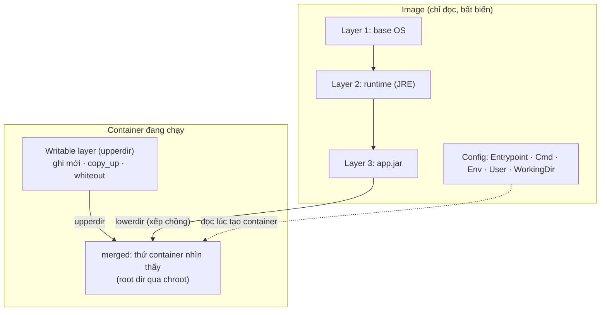
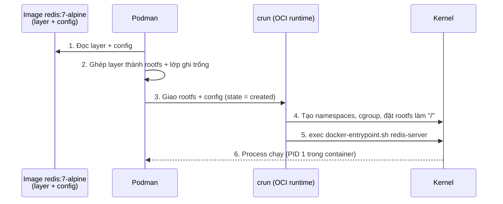

# 6_1_4 Images Layers and Overlay Filesystem

> **Khóa học**: Cloud DevOps Basic — Containers & Kubernetes  
> **Phân nhóm**: 6 Domain 6 - Containers and Kubernetes › 6_1 Container Fundamentals  
> **Chủ đề**: Image = các layer chỉ đọc + metadata; container = image + một lớp ghi; overlayfs hoạt động thế nào  
> **Phiên bản áp dụng**: Docker Docs (classic storage drivers; xem lưu ý Docker Engine 29), Linux overlayfs, OCI image-spec, Podman (`latest`)  
> **Trạng thái**: Draft (WRITE-CTR-6_1_4, 16-11-2026; bổ sung 18-11-2026: mục 1.6 (kèm ví dụ Java), 4.4, 4.5, claim R4.26–R4.28): G4 chạy lại sau bổ sung: 0 lỗi (21.1 KB, giới hạn 24 KB); chưa qua G5 (verifier độc lập)  
> **Phạm vi**: [Topic README](./README.md#6_1_4-image-lớp-layer-và-overlay-filesystem) · **Checkpoint của người học**: [CHECKLIST](../../CHECKLIST.md#6_1-container-fundamentals)

---

## 1. Khái Niệm Cốt Lõi & Bản Chất Kỹ Thuật (Core Concepts & Technical Deep Dive)

### 1.1 Image Là Gì

- Image gồm các **layer**; mỗi layer là một tập thay đổi filesystem: thêm, xóa hoặc sửa file. <!-- ev: R4.1 -->
- Image **bất biến**: tạo xong không sửa được; bạn chỉ có thể tạo image mới hoặc thêm thay đổi lên trên. <!-- ev: R4.2 -->
- Mỗi layer, một khi đã tạo, cũng bất biến. <!-- ev: R4.3 -->
- Ngoài layer còn có **metadata** (image configuration): thông tin như tham số ứng dụng, biến môi trường. <!-- ev: R4.17 --> Ví dụ trường `User` (username hoặc UID mặc định cho process) <!-- ev: R4.18 --> và `WorkingDir` (thư mục làm việc mặc định của entrypoint process). <!-- ev: R4.19 -->
- JSON config được coi là bất biến vì đổi nó sẽ đổi `ImageID` đã tính. <!-- ev: R4.17 -->

Layering dựa trên **content-addressable storage** và **union filesystem**. <!-- ev: R4.15 --> Manifest của image nêu *định danh theo nội dung* của các layer sẽ được giải nén thành filesystem chạy được. <!-- ev: R4.16 -->

### 1.2 Container = Image + Một Lớp Ghi

> Mục này nói về **filesystem** mà process container nhìn thấy. Container vẫn là *một process bị cô lập* (xem [6_1_1](<./6_1_1 Containers vs Virtual Machines.md>)); image chỉ là dữ liệu chỉ đọc, không tự "chạy". Cách process ra đời từ image: xem mục 1.6.

- Khi chạy container, một **union filesystem** được tạo: các layer xếp chồng thành một góc nhìn thống nhất. <!-- ev: R4.4 -->
- Root directory của container được đặt vào thư mục hợp nhất đó bằng `chroot`. <!-- ev: R4.5 -->
- Khác biệt chính giữa container và image là **lớp ghi (writable layer)** ở trên cùng. <!-- ev: R4.6 -->
- Mọi thay đổi (ghi file mới, sửa, xóa) của container đều vào lớp ghi mỏng này. <!-- ev: R4.8 --> Xóa container thì lớp ghi bị xóa; image bên dưới không đổi. <!-- ev: R4.7 -->

### 1.3 overlayfs Hoạt Động Ra Sao

Theo tài liệu kernel:
- Hai thư mục `lowerdir` và `upperdir` được **ghép thành thư mục `merged`** tại thời điểm mount. <!-- ev: R4.9 -->
- `workdir` phải nằm cùng filesystem với `upperdir`. <!-- ev: R4.10 -->
- Có thể có nhiều `lowerdir`, xếp chồng từ **phải sang trái**; bỏ `upperdir` và `workdir` thì overlay **chỉ đọc**. <!-- ev: R4.11 -->
- Khi ghi (hoặc đổi metadata) một file ở lower, file được **copy_up** từ lower lên upper trước. <!-- ev: R4.12 -->
- Xóa file được ghi lại bằng **whiteout** ở upper, **không đổi lower**. <!-- ev: R4.13 --> Khi thấy whiteout, tên trùng ở lower bị bỏ qua và bản thân whiteout cũng bị ẩn. <!-- ev: R4.14 -->

Ánh xạ khái niệm (cách hiểu của bài này): các layer image ↔ `lowerdir`, lớp ghi của container ↔ `upperdir`, thứ container nhìn thấy ↔ `merged`.

### 1.4 Hệ Quả Thực Tế

- **Xóa file ở layer sau không làm image nhỏ đi**: theo cơ chế whiteout, việc xóa chỉ được *ghi lại* ở lớp trên chứ không sửa lớp dưới. <!-- ev: R4.13 --> *Suy luận từ cơ chế này*: file vẫn nằm trong layer trước, nên secret hoặc file lớn đã `COPY` vào một layer vẫn nằm trong image dù lệnh sau xóa nó (xem 6_2_6).
- **Dữ liệu ghi trong container mất khi xóa container**; dữ liệu cần giữ, ghi nhiều hoặc chia sẻ giữa container nên đặt ở **volume**. <!-- ev: R4.7 R4.23 -->
- **Tag vs digest**: tag là cách đặt tên tiện lợi, và pull lại tag để lấy bản mới nhất. <!-- ev: R4.20 --> Muốn cố định đúng một image thì dùng digest (định danh nội dung); chi tiết ở 6_2_7.

### 1.5 Lưu Ý Phiên Bản Docker

Tài liệu Docker mô tả *classic storage drivers* (ví dụ `overlay2`) và ghi rằng **Docker Engine 29.0 trở lên dùng containerd image store mặc định cho cài mới**, dùng snapshotter thay vì classic storage driver. <!-- ev: R4.21 --> Khái niệm layer vẫn đúng, nhưng lệnh và ví dụ có thể khác. Hãy kiểm tra bản Docker của bạn.

### 1.6 Từ Image Đến Process: Vì Sao Chạy Ra Redis?

Process **không "biết"** mình là redis. Không có phép màu nào ở đây, chỉ có ba việc:

1. **File chạy được nằm sẵn trong image.** `redis-server` là một file thường trong các layer của image `redis`.
2. **Config của image ghi chạy file nào.** `Entrypoint` là lệnh chạy khi container khởi động; `Cmd` là đối số mặc định của entrypoint. <!-- ev: R4.26 R4.27 --> `Env` (biến môi trường), `WorkingDir` và `User` cũng là giá trị mặc định. <!-- ev: R4.28 R4.19 R4.18 --> Tất cả đều là **mặc định**: có thể bị thay khi tạo container, còn image không đổi. <!-- ev: R4.26 R4.27 R4.28 -->
3. **Runtime chỉ việc thực thi file đó bên trong filesystem của container.** Runtime cấp thấp (`runc`/`crun`) nhận rootfs cùng config, dựng cô lập rồi chạy lệnh (xem [6_1_5](<./6_1_5 Open Container Initiative Specifications.md>) và [6_1_6](<./6_1_6 Container Runtimes and Ecosystem.md>)).

Các bước với image `redis:7-alpine` (quan sát thật ở mục 4.4):

| Bước | Việc xảy ra | Quan sát được |
| :--- | :--- | :--- |
| 1. Image | Có sẵn layer và config | 7 layer; `Entrypoint=[docker-entrypoint.sh]`, `Cmd=[redis-server]`, `WorkingDir=/data` |
| 2. Tạo container | Layer image thành `lowerdir`, thêm lớp ghi trống <!-- ev: R4.4 R4.6 --> | `state=created`, `pid=0` (chưa có process) |
| 3. Giao cho OCI runtime | Rootfs và config chuyển cho `crun` | `runtime=crun`, `storage=overlay` |
| 4. Cô lập | Namespaces, cgroup; root directory đặt vào rootfs <!-- ev: R4.5 --> | (xem 6_1_2, 6_1_3) |
| 5. Thực thi | Chạy `docker-entrypoint.sh redis-server`; script hạ quyền sang user `redis` rồi `exec` | `exec "$@"` ở cuối script |
| 6. Chạy | Một process thường trên host | PID 1 trong container, PID khác trên host; cha là `conmon`; `redis-cli ping` trả `PONG` |

*Suy luận (không phải trích dẫn)*: sau khi container chạy, cây process chỉ còn `conmon` làm cha của `redis-server` chứ không thấy `crun`; hãy tự quan sát trên máy bạn vì quan hệ cha-con có thể phụ thuộc phiên bản.

#### Ví Dụ Thứ Hai: Image Java, Java Nằm Ở Đâu?

Java cũng không đặc biệt: nó là **một thư mục file thường nằm trong một layer**, còn config chỉ đường cho process tìm thấy nó. Với `docker.io/library/eclipse-temurin:21-jre` (quan sát thật ở mục 4.5):

| Layer (từ dưới lên) | Kích thước | Chứa gì |
| :--- | :--- | :--- |
| Ubuntu base | 113 MB | Hệ điều hành nền |
| `apt-get install ...` | 54.3 MB | Công cụ hệ thống |
| **Tải và giải nén Java** | **166 MB** | **Java 21 tại `/opt/java/openjdk`** |
| `COPY entrypoint.sh` | 7.68 kB | `/__cacert_entrypoint.sh` |

(Ngoài ra còn hai layer rất nhỏ, tổng cộng 6 layer.)

- Config của image có `JAVA_HOME=/opt/java/openjdk` và `PATH` bắt đầu bằng `/opt/java/openjdk/bin`; đó là cách process tìm thấy `java` khi entrypoint gọi nó. <!-- ev: R4.28 -->
- Image ứng dụng (ví dụ [hello-svc](../../shared/hello-svc/Dockerfile)) chỉ **thêm một layer mỏng** (~9 kB, file `.jar`) lên trên và đặt `ENTRYPOINT ["java", "-jar", "/app/hello-svc.jar"]`. Entrypoint này thay giá trị mặc định của image nền. <!-- ev: R4.26 -->
- Đây là **JRE, không phải JDK**: thư mục `bin` chỉ có `java jfr jrunscript jwebserver keytool rmiregistry`, không có `javac`. Chạy app chỉ cần JRE; JDK chỉ cần lúc build.
- Trên máy chỉ có Docker/Podman, bạn **không cài Java lên host**: `pull`/`build` tải các layer về **kho lưu trữ của engine** (Podman rootless: `~/.local/share/containers/storage`; với Docker hãy hỏi `docker info`, nhớ lưu ý ở mục 1.5).
- *Suy luận từ việc layer bất biến* <!-- ev: R4.3 -->: đổi code ứng dụng chỉ tạo lại layer `.jar` nhỏ, còn layer Java 166 MB giữ nguyên. Cách tận dụng cache khi build thuộc bài 6_2.

---

## 2. Ví Dụ Đời Sống Thực Tế Dễ Hiểu (Intuitive Real-World Analogies)

**Chồng tờ giấy bóng kính (overhead transparencies).**
- Mỗi **layer** là một tờ giấy bóng đã in sẵn: tờ 1 vẽ nền nhà, tờ 2 thêm đồ nội thất, tờ 3 thêm đồ trang trí. Bạn **không sửa được tờ đã in** (bất biến).
- Xếp chồng các tờ lên nhau, nhìn từ trên xuống là một bức tranh duy nhất (**union filesystem / merged**).
- Khi chạy container, bạn đặt **thêm một tờ giấy trong trống lên trên cùng** (writable layer) và vẽ lên đó. Muốn "xóa" một món đồ ở tờ dưới? Bạn không xé được tờ dưới, bạn **dán một miếng giấy trắng lên chỗ đó** (whiteout): nhìn từ trên xuống thấy trống, nhưng món đồ vẫn nằm dưới tờ bên dưới.
- Vứt tờ giấy trong trên cùng đi (xóa container) thì chồng giấy bóng gốc nguyên vẹn.

**Hộp bếp mang đi (cho mục 1.6).** Image redis như một hộp bếp: bên trong có sẵn nồi và nguyên liệu (file `redis-server` trong layer) và một **tờ ghi chú dán trên nắp** ("bật bếp, nấu món X, đứng ở khu Y": Entrypoint, Cmd, WorkingDir, Env). Người mở hộp (runtime) dựng bếp rồi làm đúng theo ghi chú; người nấu (process) không cần "biết" trước mình nấu món gì. Muốn đổi món hay đổi chỗ đứng, bạn nói lúc mở hộp (cờ `--entrypoint`, `-w`, `-e`); hộp không bị sửa.

Với image Java, hộp bếp có thêm **một cái bếp ga lớn lắp sẵn** (Java 21 trong một layer 166 MB), còn món của bạn (file `.jar`) chỉ là **tờ công thức mỏng** đặt ở ngăn trên cùng.

---

## 3. Kiến Trúc, Luồng Hoạt Động & Hình Ảnh Trực Quan (Architecture, Diagrams & Visual Media)

<!-- ev: R4.1 R4.4 R4.6 R4.9 R4.12 R4.13 -->


Từ image đến process (mục 1.6):

<!-- ev: R4.4 R4.5 R4.26 R4.27 -->


---

## 4. Thực Hành (Hands-on)

> **Môi trường**: Linux, Podman 5.x (Fedora 43). Với Docker, đổi `podman` thành `docker`.  
> ⚠️ Chưa chạy thử (not executed by the squad). Kết quả là **dự đoán theo tài liệu**. Bài tự dựng overlay cần `sudo`, chỉ chạy trên máy học tập.

### 4.1 Xem Các Layer Của Một Image

<!-- ev: R4.22 R4.1 -->
```bash
# In thông tin từng layer của image
podman history docker.io/library/alpine
```

### 4.2 Tự Dựng Overlay Bằng Tay (theo ví dụ trong tài liệu kernel)

<!-- ev: R4.9 R4.10 R4.12 R4.13 R4.25 -->
```bash
mkdir -p /tmp/ov/{lower,upper,work,merged}
echo "tu-image" > /tmp/ov/lower/a.txt
echo "xoa-toi"  > /tmp/ov/lower/b.txt

# Lệnh mount có dạng như trong tài liệu kernel
sudo mount -t overlay overlay \
  -olowerdir=/tmp/ov/lower,upperdir=/tmp/ov/upper,workdir=/tmp/ov/work /tmp/ov/merged

echo "sua-trong-container" >> /tmp/ov/merged/a.txt   # copy_up: bản sửa nằm ở upper
rm /tmp/ov/merged/b.txt                              # whiteout ở upper, lower không đổi

ls -la /tmp/ov/merged /tmp/ov/upper /tmp/ov/lower
cat /tmp/ov/lower/a.txt                              # lower vẫn là nội dung gốc

sudo umount /tmp/ov/merged
```

Điều cần quan sát: `merged` không còn `b.txt`, `upper` chứa bản sửa của `a.txt` và một mục whiteout cho `b.txt` (tài liệu kernel nói whiteout có thể là character device 0/0 hoặc file thường kích thước 0 có xattr `trusted.overlay.whiteout`) <!-- ev: R4.24 -->, còn `lower` **không đổi**.

### 4.3 Chứng Minh "Lớp Ghi Mất Khi Xóa Container"

<!-- ev: R4.7 -->
```bash
podman run --name w docker.io/library/alpine sh -c 'echo hi > /f && cat /f'
podman rm w
# Tạo lại container mới từ cùng image: file /f không tồn tại
podman run --rm docker.io/library/alpine ls /f
```

### 4.4 Quan Sát Từ Image Đến Process Redis

> **Đã chạy thử** (18-11-2026, Podman rootless, Fedora, `crun` + `overlay`). Output rút gọn; số PID/UID khác nhau mỗi máy.

<!-- ev: R4.26 R4.27 R4.19 -->
```bash
IMG=docker.io/library/redis:7-alpine

# 1) Config mặc định của image (Entrypoint/Cmd/WorkingDir/User)
podman image inspect $IMG --format 'Entrypoint={{.Config.Entrypoint}} Cmd={{.Config.Cmd}} WorkingDir={{.Config.WorkingDir}} User={{.Config.User}}'
# Entrypoint=[docker-entrypoint.sh] Cmd=[redis-server] WorkingDir=/data User=

# 2) redis-server là file nằm trong filesystem của image
podman run --rm --network none --entrypoint sh $IMG -c 'ls -l /usr/local/bin/redis-server /usr/local/bin/docker-entrypoint.sh'

# 3) Tạo (chưa chạy): có rootfs nhưng chưa có process
podman create --name redis-demo --network none $IMG
podman inspect redis-demo --format 'state={{.State.Status}} pid={{.State.Pid}}'
# state=created pid=0

# 4) Chạy rồi xem process từ hai phía
podman start redis-demo
podman top redis-demo pid user args        # 1  redis  redis-server *:6379
P=$(podman inspect -f '{{.State.Pid}}' redis-demo)
ps -o pid,ppid,user,args -p $P             # PID khác trên host; user là UID đã ánh xạ (rootless)
podman exec redis-demo redis-cli ping      # PONG

# 5) Ghi đè config mặc định lúc chạy: image không đổi
podman run --rm --network none --entrypoint sh $IMG -c 'pwd'            # /data
podman run --rm --network none -w /tmp --entrypoint sh $IMG -c 'pwd'    # /tmp

podman stop -t 1 redis-demo && podman rm redis-demo
```

Điều cần quan sát: trước `start` thì `pid=0`; sau `start` process là PID 1 với user `redis` bên trong nhưng mang PID và UID khác trên host (ánh xạ user namespace của rootless, xem [6_1_2](<./6_1_2 Linux Namespaces for Containers.md>)).

### 4.5 Tìm Java Bên Trong Image Java

> **Đã chạy thử** (18-11-2026, Podman rootless). Output rút gọn.

<!-- ev: R4.28 R4.3 -->
```bash
IMG=docker.io/library/eclipse-temurin:21-jre

# 1) Layer nào chứa Java: tìm layer lớn nhất (cột đầu là kích thước)
podman history --format '{{.Size}}|{{.CreatedBy}}' $IMG
# 166MB|RUN /bin/sh -c set -eux; ARCH="$(dpkg ...     <- layer tải và giải nén Java

# 2) Config: JAVA_HOME và PATH
podman image inspect $IMG --format '{{range .Config.Env}}{{println .}}{{end}}' | grep -E '^(JAVA_HOME|PATH)='
# PATH=/opt/java/openjdk/bin:/usr/local/sbin:...
# JAVA_HOME=/opt/java/openjdk

# 3) Java là file thường trong filesystem của container
podman run --rm --network none --entrypoint sh $IMG -c \
  'command -v java; du -sh $JAVA_HOME; ls $JAVA_HOME/bin; java -version 2>&1 | head -1'
# /opt/java/openjdk/bin/java
# 159M   /opt/java/openjdk
# java jfr jrunscript jwebserver keytool rmiregistry     <- không có javac: đây là JRE
# openjdk version "21.0.13" 2026-10-20 LTS
```

Điều cần quan sát: kích thước thư mục (159 MiB) khớp layer ~166 MB (hai cách tính khác nhau), và `bin` không có `javac`.

Thực hành sâu hơn ở [lab-6_2_1-java-multistage-image](../6_2%20Container%20Image%20Engineering/labs/lab-6_2_1-java-multistage-image/README.md) (đã chạy thử, có phần quan sát layer).

---

## 5. Cạm Bẫy Thực Tế & Thực Tiễn Sản Xuất (Production Gotchas & Best Practices)

### 5.1 Cạm Bẫy: "Xóa" File Ở Lệnh Sau Không Làm Image Nhỏ Đi / Không Xóa Được Secret
- **Bản chất**: xóa chỉ được ghi lại ở layer trên, layer dưới không đổi. <!-- ev: R4.13 R4.14 -->
- **Thực tiễn**: không đưa secret vào bất kỳ layer nào; gộp bước tải/giải nén/xóa trong **cùng một lệnh** `RUN`, hoặc dùng multi-stage (6_2_4) và build secret (6_2_6).

### 5.2 Cạm Bẫy: Ghi Dữ Liệu Quan Trọng Vào Lớp Ghi Của Container
- **Hiện tượng**: xóa/tạo lại container (rolling update, `rm`) là mất dữ liệu.
- **Bản chất**: lớp ghi bị xóa cùng container. <!-- ev: R4.7 -->
- **Thực tiễn**: dữ liệu giữ lại nên đặt ở volume (6_1_10, 6_4_6). <!-- ev: R4.23 -->

### 5.3 Cạm Bẫy: Dựa Vào Tag Để Biết "Đúng Image Nào"
- **Bản chất**: tag là tên tiện lợi, pull lại tag có thể cho bản mới hơn. <!-- ev: R4.20 -->
- **Thực tiễn**: định danh bất biến bằng digest (6_2_7).

### 5.4 Cạm Bẫy: Giả Định Mọi Docker Đều Dùng `overlay2`
- **Bản chất**: Docker Engine 29.0 trở lên dùng containerd image store mặc định cho cài mới. <!-- ev: R4.21 -->
- **Thực tiễn**: khi đọc tài liệu/lệnh về storage driver, đối chiếu với phiên bản Docker của bạn.

---

## 6. Câu Hỏi Củng Cố Kiến Thức (Active Recall Quiz)

### Câu Hỏi 1: Vì sao xóa một file ở lệnh `RUN` sau không làm image nhỏ đi?

<details>
<summary>Đáp án</summary>

Layer bất biến; xóa chỉ được ghi lại ở lớp trên (kiểu whiteout), còn lớp dưới giữ nguyên file. Muốn thực sự loại bỏ, đừng tạo file đó ở layer trước (gộp lệnh, multi-stage, build secret).
</details>

### Câu Hỏi 2: Phân biệt `lowerdir`, `upperdir`, `merged` trong ngữ cảnh container.

<details>
<summary>Đáp án</summary>

`lowerdir` là các layer chỉ đọc của image, `upperdir` là lớp ghi của container, `merged` là góc nhìn hợp nhất mà container thấy. Ghi vào file ở lower sẽ `copy_up` lên upper; xóa file tạo whiteout ở upper.
</details>

### Câu Hỏi 3: Điều gì xảy ra với dữ liệu ghi trong container khi xóa container, và nên làm gì?

<details>
<summary>Đáp án</summary>

Lớp ghi bị xóa cùng container, image gốc không đổi. Dữ liệu cần tồn tại lâu, ghi nhiều hoặc chia sẻ giữa container nên dùng volume.
</details>

---

## 7. 📚 Nguồn Tài Liệu Chính Thống (Tier-1 Official References)

- [Docker Docs — What is an image?](https://docs.docker.com/get-started/docker-concepts/the-basics/what-is-an-image/) — Image bất biến, gồm các layer.
- [Docker Docs — Understanding the image layers](https://docs.docker.com/get-started/docker-concepts/building-images/understanding-image-layers/) — Union filesystem, chroot, content-addressable.
- [Docker Docs — Storage drivers](https://docs.docker.com/engine/storage/drivers/) — Lớp ghi của container, copy-on-write, lưu ý Docker Engine 29.
- [Overlay Filesystem — Linux Kernel documentation](https://docs.kernel.org/filesystems/overlayfs.html) — `lowerdir`/`upperdir`/`workdir`, copy_up, whiteout.
- [OCI Image Specification](https://github.com/opencontainers/image-spec/blob/main/spec.md) và [Image Configuration](https://github.com/opencontainers/image-spec/blob/main/config.md) — Manifest, layer, config (`User`, `WorkingDir`).
- [docker image pull](https://docs.docker.com/reference/cli/docker/image/pull/) — Tag và digest khi pull.
- [podman-history(1)](https://docs.podman.io/en/latest/markdown/podman-history.1.html) — Xem layer của image.
