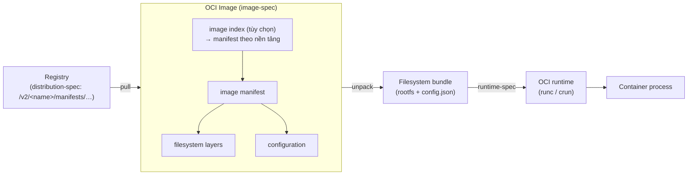

# 6_1_5 Open Container Initiative Specifications

> **Khóa học**: Cloud DevOps Basic — Containers & Kubernetes  
> **Phân nhóm**: 6 Domain 6 - Containers and Kubernetes › 6_1 Container Fundamentals  
> **Chủ đề**: Ba đặc tả OCI (image, runtime, distribution) và vì sao image build bằng công cụ này chạy được ở công cụ khác  
> **Phiên bản áp dụng**: OCI specs (nhánh `main` trên GitHub; số phiên bản cụ thể cần đối chiếu khi dùng)  
> **Trạng thái**: Draft (WRITE-CTR-6_1_5, 16-11-2026): qua G1–G4, chưa qua G5 (verifier độc lập)  
> **Phạm vi**: [Topic README](./README.md#6_1_5-chuẩn-oci-open-container-initiative) · **Checkpoint của người học**: [CHECKLIST](../../CHECKLIST.md#6_1-container-fundamentals)

---

## 1. Khái Niệm Cốt Lõi & Bản Chất Kỹ Thuật (Core Concepts & Technical Deep Dive)

### 1.1 OCI Là Gì Và Có Những Đặc Tả Nào

OCI (Open Container Initiative) được Docker, CoreOS và các bên khác ra mắt ngày 22-06-2015. <!-- ev: R5.1 --> OCI hiện có **ba đặc tả**: Runtime Specification, Image Specification và Distribution Specification. <!-- ev: R5.2 -->
Dự án runC được tặng cho OCI để làm nền tảng của nỗ lực chuẩn hóa này. <!-- ev: R5.13 --> `runc` là công cụ CLI tạo và chạy container theo OCI specification. <!-- ev: R5.14 -->

| Đặc tả | Nó định nghĩa | Ai dùng |
| :--- | :--- | :--- |
| **image-spec** | Định dạng image: manifest, image index (tùy chọn), các layer, configuration <!-- ev: R5.6 --> | Công cụ build, registry, runtime |
| **runtime-spec** | Cách chạy một "filesystem bundle" đã giải nén trên đĩa <!-- ev: R5.3 --> | OCI runtime (`runc`, `crun`) |
| **distribution-spec** | API chuẩn để phân phối image (v1.0 từ tháng 05-2020) <!-- ev: R5.10 --> | Registry và client push/pull |

### 1.2 Image Spec

- Một OCI Image gồm **image manifest**, **image index** (tùy chọn), tập **filesystem layer** và **configuration**. <!-- ev: R5.6 -->
- Mục tiêu: các công cụ để build, vận chuyển và chuẩn bị chạy image có thể **tương thích lẫn nhau**. <!-- ev: R5.7 -->
- **Image index** là manifest cấp cao hơn, trỏ tới danh sách manifest; các manifest này thường khác nhau theo nền tảng (đây là cơ sở của image đa kiến trúc, 6_2_9). <!-- ev: R5.8 -->
- Các thành phần tham chiếu nhau bằng **Content Descriptor**, gồm loại nội dung, **digest** (định danh nội dung) và kích thước byte. <!-- ev: R5.9 -->

### 1.3 Runtime Spec

- Cấu hình một container được mô tả trong **`config.json`**. <!-- ev: R5.5 -->
- Luồng tổng quát: **tải OCI Image → giải nén thành runtime filesystem bundle → bundle được chạy bởi một OCI Runtime**. <!-- ev: R5.4 -->
- Nhờ đó "chuẩn bị image" (công cụ cấp cao như Podman/containerd) tách khỏi "tạo process container" (runtime cấp thấp như `runc`, `crun`) (xem 6_1_6).

### 1.4 Distribution Spec

- Lấy manifest qua đường dẫn dạng `/v2/<name>/manifests/<tag-or-digest>`, trong đó giá trị là digest của manifest hoặc một tag. <!-- ev: R5.11 -->
- Liệt kê tag qua `/v2/<name>/tags/list`. <!-- ev: R5.12 -->
- Đây là API mà `push`/`pull` của Docker, Podman và các registry (Docker Hub, GitLab, GHCR, Harbor...) cùng nói; xem thêm ở 6_2_8.

### 1.5 Ý Nghĩa Thực Tế

Podman nói rõ nó làm việc với **OCI Containers và Container Images**. <!-- ev: R5.15 --> CRI-O mô tả: kéo từ registry tuân chuẩn và chạy mọi container tuân chuẩn OCI. <!-- ev: R5.16 -->
*Suy luận từ các câu trên*: image dựng theo chuẩn OCI có thể chạy ở các runtime tuân chuẩn khác nhau, nên image dựng bằng Docker chạy được ở Podman hay các runtime của Kubernetes. Khi nào hai công cụ **không** tương thích (ví dụ `HEALTHCHECK` ở 6_2_1) là chuyện của *tính năng ngoài chuẩn*, không phải của chuẩn.

---

## 2. Ví Dụ Đời Sống Thực Tế Dễ Hiểu (Intuitive Real-World Analogies)

**Container vận tải tiêu chuẩn ISO.** Trước khi có chuẩn, mỗi hãng tàu một kiểu thùng. Khi có chuẩn kích thước và móc nâng, một thùng xếp được lên tàu, xe tải, tàu hỏa của mọi hãng.
- **image-spec = kích thước và cách đóng thùng** (hàng hóa nằm ở đâu, nhãn dán gì).
- **runtime-spec = cách cần cẩu mở và đặt thùng xuống** (chạy thùng đã đóng).
- **distribution-spec = giao thức giao nhận ở cảng** (nhận/giao thùng theo mã số, tức digest/tag).

Nhờ chuẩn, bạn đóng thùng bằng công cụ của hãng A mà cảng của hãng B vẫn bốc dỡ được.

---

## 3. Kiến Trúc, Luồng Hoạt Động & Hình Ảnh Trực Quan (Architecture, Diagrams & Visual Media)

<!-- ev: R5.2 R5.4 R5.6 R5.8 R5.11 -->


---

## 4. Thực Hành (Hands-on)

> **Môi trường**: Podman 5.x hoặc Docker; có kết nối registry công khai.  
> ⚠️ Chưa chạy thử (not executed by the squad). Lệnh `curl` dưới đây **chỉ minh họa đường dẫn theo distribution-spec**; mỗi registry có thể yêu cầu xác thực/token và khác biệt, hãy đọc tài liệu của registry bạn dùng.

### 4.1 Xem Manifest/Layer Của Một Image

<!-- ev: R5.6 R5.9 -->
```bash
# Podman: in thông tin từng layer (xem lại 6_1_4)
podman history docker.io/library/alpine
```

### 4.2 Gọi API Distribution (Minh Họa, Registry Cục Bộ)

<!-- ev: R5.11 R5.12 -->
```bash
# Giả sử bạn đã chạy một registry cục bộ ở localhost:5000 (xem lab-6_2_2-tags-digests-and-registry)
curl -s http://localhost:5000/v2/<name>/tags/list
curl -s http://localhost:5000/v2/<name>/manifests/<tag-or-digest>
```

`<name>` là namespace của repository; `<tag-or-digest>` phải là digest của manifest hoặc một tag. <!-- ev: R5.11 -->
Lab liên quan đã chạy thử: [lab-6_2_2-tags-digests-and-registry](../6_2%20Container%20Image%20Engineering/labs/lab-6_2_2-tags-digests-and-registry/README.md).

---

## 5. Cạm Bẫy Thực Tế & Thực Tiễn Sản Xuất (Production Gotchas & Best Practices)

### 5.1 Cạm Bẫy: Nhầm Lẫn Giữa "Chuẩn OCI" Và "Tính Năng Riêng Của Công Cụ"
- **Bản chất**: OCI chỉ định nghĩa image, runtime và distribution. <!-- ev: R5.2 --> Tính năng ngoài ba đặc tả này có thể không di chuyển được giữa công cụ (ví dụ `HEALTHCHECK` ở bài 6_2_1).
- **Thực tiễn**: dựa vào chuẩn khi cần tương thích, kiểm tra tài liệu từng công cụ cho phần còn lại.

### 5.2 Cạm Bẫy: Coi Tag Là Định Danh Cố Định
- **Bản chất**: API distribution chấp nhận `<tag-or-digest>`; digest là định danh nội dung còn tag là tên. <!-- ev: R5.11 R5.9 -->
- **Thực tiễn**: ghim digest khi cần đúng một image (6_2_7).

### 5.3 Cạm Bẫy: Image Đơn Kiến Trúc Chạy Trên Máy Khác Kiến Trúc
- **Bản chất**: image index trỏ tới các manifest thay đổi theo nền tảng. <!-- ev: R5.8 -->
- **Thực tiễn**: nếu cần chạy trên nhiều kiến trúc, dùng image index (6_2_9).

---

## 6. Câu Hỏi Củng Cố Kiến Thức (Active Recall Quiz)

### Câu Hỏi 1: OCI có ba đặc tả nào và mỗi đặc tả lo việc gì?

<details>
<summary>Đáp án</summary>

Runtime spec (cách chạy filesystem bundle, cấu hình `config.json`), Image spec (manifest, image index, layer, configuration), Distribution spec (API push/pull với registry).
</details>

### Câu Hỏi 2: Vì sao image build bằng một công cụ chạy được ở công cụ khác?

<details>
<summary>Đáp án</summary>

Vì các công cụ cùng tuân theo đặc tả OCI: image-spec để đóng gói, runtime-spec để chạy, distribution-spec để phân phối. Các công cụ như Podman và CRI-O khai báo làm việc với container/image chuẩn OCI.
</details>

### Câu Hỏi 3: Image index là gì và dùng để làm gì?

<details>
<summary>Đáp án</summary>

Là manifest cấp cao hơn, trỏ tới danh sách các manifest; các manifest này thường khác nhau theo nền tảng. Vì thế một tag có thể phục vụ nhiều kiến trúc.
</details>

---

## 7. 📚 Nguồn Tài Liệu Chính Thống (Tier-1 Official References)

- [About the Open Container Initiative](https://opencontainers.org/about/overview/) — Lịch sử OCI, ba đặc tả, runC.
- [OCI Runtime Specification](https://github.com/opencontainers/runtime-spec/blob/main/spec.md) — `config.json`, filesystem bundle, vòng đời.
- [OCI Image Specification](https://github.com/opencontainers/image-spec/blob/main/spec.md) — Manifest, image index, layer, configuration.
- [OCI Content Descriptors](https://github.com/opencontainers/image-spec/blob/main/descriptor.md) — Digest và kích thước.
- [OCI Distribution Specification](https://github.com/opencontainers/distribution-spec/blob/main/spec.md) — API registry (`/v2/<name>/manifests/…`, `tags/list`).
- [runc](https://github.com/opencontainers/runc) — Runtime tham chiếu theo OCI.
- [What is Podman?](https://docs.podman.io/en/latest/) và [CRI-O](https://cri-o.io/) — Công cụ làm việc với container/image chuẩn OCI.
