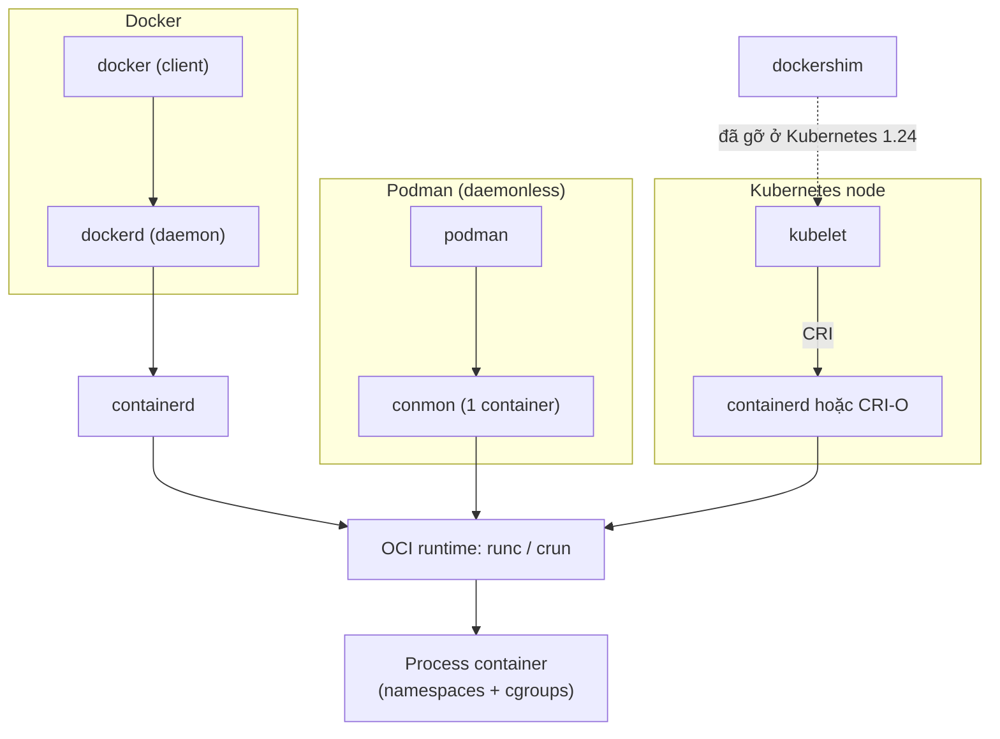

# 6_1_6 Container Runtimes and Ecosystem

> **Khóa học**: Cloud DevOps Basic — Containers & Kubernetes  
> **Phân nhóm**: 6 Domain 6 - Containers and Kubernetes › 6_1 Container Fundamentals  
> **Chủ đề**: Docker, Podman, runc/crun, containerd, CRI-O, CRI và vì sao Kubernetes bỏ dockershim  
> **Phiên bản áp dụng**: Docker Engine (29.0+ khi nói về image store), Podman (trang `latest`), Kubernetes 1.37 (theo trang Container Runtimes tại thời điểm viết)  
> **Trạng thái**: Draft (WRITE-CTR-6_1_6, 16-11-2026; bổ sung 18-11-2026: mục 1.2, 1.3, 1.4, 4.3, claim R6.17–R6.34): G4 chạy lại sau bổ sung: 0 lỗi (16.9 KB); chưa qua G5 (verifier độc lập)  
> **Phạm vi**: [Topic README](./README.md#6_1_6-container-runtime-và-hệ-sinh-thái) · **Checkpoint của người học**: [CHECKLIST](../../CHECKLIST.md#6_1-container-fundamentals)

---

## 1. Khái Niệm Cốt Lõi & Bản Chất Kỹ Thuật (Core Concepts & Technical Deep Dive)

### 1.1 Hai Tầng: Công Cụ Cấp Cao Và Runtime Cấp Thấp

"Container runtime" thực ra là nhiều tầng. Hiểu theo hai tầng giúp khỏi lẫn lộn:
- **Tầng cấp cao (engine/manager)**: nhận lệnh người dùng, quản lý image, mạng, volume (Docker, Podman, containerd, CRI-O).
- **Tầng cấp thấp (OCI runtime)**: tạo process container theo OCI runtime-spec (`runc`, `crun`). Xem [6_1_5](<./6_1_5 Open Container Initiative Specifications.md>).

`runc` là công cụ CLI tạo và chạy container theo OCI specification. <!-- ev: R6.6 -->

### 1.2 Docker: Client → Daemon

- `Daemon` (đọc là "đì-mần") là một chương trình chạy nền liên tục, không gắn với cửa sổ terminal nào, và luôn chờ yêu cầu từ các chương trình khác. Nó không làm gì cho đến khi có người gọi. Khi có yêu cầu, nó mới làm việc rồi trả kết quả. Tài liệu Docker gọi `dockerd` là *persistent process* quản lý container. <!-- ev: R6.17 -->
- `dockerd` (Docker daemon) lắng nghe Docker API request và quản lý image, container, network, volume. <!-- ev: R6.1 -->
- Docker client (`docker`) gửi lệnh như `docker run` tới `dockerd` để `dockerd` thực hiện. <!-- ev: R6.2 -->
- Lưu ý phiên bản: Docker Engine 29.0 trở lên dùng containerd image store mặc định cho cài mới. <!-- ev: R6.14 -->

**`dockerd` làm gì, theo tài liệu Docker:**

| Khía cạnh | Nội dung |
| :--- | :--- |
| Việc chính | Daemon "does the heavy lifting" của việc build, chạy và phân phối container <!-- ev: R6.18 --> |
| Giao tiếp | Client và daemon nói chuyện bằng REST API, qua UNIX socket hoặc giao diện mạng <!-- ev: R6.19 --> |
| Socket mặc định | `/var/run/docker.sock`, cần quyền root hoặc thuộc nhóm `docker` <!-- ev: R6.20 --> |
| Dữ liệu | Thư mục `/var/lib/docker` (tùy chọn `--data-root`) <!-- ev: R6.21 --> |
| Chạy container | Dựa vào một OCI runtime **được gọi qua containerd** <!-- ev: R6.22 -->; mặc định là `runc` <!-- ev: R6.23 --> |
| Quyền | Cần root, trừ khi dùng Rootless mode <!-- ev: R6.24 --> |
| Khi daemon dừng | **Mặc định các container đang chạy bị tắt theo** <!-- ev: R6.25 -->; bật *live restore* để container tiếp tục chạy khi daemon không khả dụng <!-- ev: R6.26 --> |

Hệ quả cần nhớ: với Docker, `dockerd` là điểm điều phối trung tâm và vòng đời container mặc định gắn với nó.

### 1.3 Podman: Không Daemon

- Podman là công cụ **daemonless**. <!-- ev: R6.3 --> README của Podman nêu rõ: không có daemon quản lý, để an toàn hơn và tốn ít tài nguyên khi rảnh. <!-- ev: R6.27 -->
- `conmon` là chương trình giám sát và kênh liên lạc giữa container manager (như Podman hoặc CRI-O) và OCI runtime (như `runc` hoặc `crun`) cho **một container**. <!-- ev: R6.4 --> Nó khởi chạy runtime như tiến trình con của mình. <!-- ev: R6.5 -->
- Khi được chạy, `conmon` (thường) **double-fork** để tách khỏi tiến trình cha đã khởi chạy nó, rồi chạy runtime làm tiến trình con. <!-- ev: R6.28 --> Nhờ đó process quản lý có thể thoát mà conmon vẫn theo dõi và kết nối được với container. <!-- ev: R6.29 --> Trong lúc container chạy, conmon cung cấp socket để attach và giữ mở các luồng chuẩn của container. <!-- ev: R6.30 -->
- Podman vẫn có API khi cần: `podman system service` hỗ trợ systemd socket activation nên API được cung cấp **theo yêu cầu** (chỉ kích hoạt khi có client kết nối vào socket). <!-- ev: R6.31 --> Đó là REST API có giao diện tương thích Docker. <!-- ev: R6.32 -->
- Vì conmon chạy ở process riêng với Podman, việc restart container Podman bằng `systemd` dựa vào điều này. <!-- ev: R6.33 -->
- `crun`: README của dự án nêu crun nhanh hơn `runc` và dùng ít bộ nhớ hơn nhiều (đây là số liệu do chính dự án đo, không phải đánh giá độc lập). <!-- ev: R6.7 -->
- *Chưa có trong tài liệu đã mở*: Podman lưu trạng thái ở đâu và có theo mô hình fork-exec hay không (chỉ README của Buildah ghi rõ fork-exec). Quan sát trên máy tác giả: `podman info` cho thấy `dbbackend=sqlite`; đây là quan sát, chưa phải trích dẫn.
- Về runtime mặc định trên Fedora và các chi tiết rootless/mạng của Podman: bài này **chưa kiểm chứng**, hãy kiểm tra tài liệu Podman và `containers.conf` của bản bạn dùng.

#### So Sánh Docker Và Podman Theo Tài Liệu

| | Docker | Podman |
| :--- | :--- | :--- |
| Điều phối | `dockerd` chạy nền liên tục <!-- ev: R6.17 --> | Không có daemon quản lý <!-- ev: R6.27 --> |
| Giám sát từng container | Qua `dockerd`/containerd và OCI runtime <!-- ev: R6.22 --> | `conmon`, mỗi container một cái <!-- ev: R6.4 --> |
| Khi thành phần điều phối dừng | Mặc định container tắt theo <!-- ev: R6.25 --> | Không có daemon để dừng; conmon tách khỏi tiến trình cha <!-- ev: R6.28 --> |
| API | Luôn do daemon phục vụ <!-- ev: R6.19 --> | Theo yêu cầu qua socket activation <!-- ev: R6.31 --> |
| Restart container | (không nêu ở các trang đã mở) | Dùng restart policy của `systemd` <!-- ev: R6.33 --> |

### 1.4 Kubernetes: Runtime Qua CRI

- Cần cài một container runtime vào **mỗi node** để Pod chạy được. <!-- ev: R6.8 -->
- Theo trang Container Runtimes tại thời điểm viết, Kubernetes 1.37 yêu cầu runtime tuân thủ **CRI (Container Runtime Interface)**. <!-- ev: R6.9 -->
- Trang này liệt kê containerd, CRI-O, Docker Engine và Mirantis Container Runtime. <!-- ev: R6.11 --> Hai tên phổ biến nhất trong bài này:
  - **containerd** tự mô tả là container runtime chuẩn công nghiệp, nhấn mạnh sự đơn giản, bền vững, di động. <!-- ev: R6.13 -->
    - Trang containerd mô tả nó là daemon quản lý toàn bộ vòng đời container: từ tải và lưu image, chạy và giám sát container, đến lưu trữ cấp thấp và gắn mạng. <!-- ev: R6.34 -->
  - **CRI-O** là container runtime nhẹ dành riêng cho Kubernetes. <!-- ev: R6.12 -->
- **Dockershim bị gỡ khỏi Kubernetes từ bản 1.24.** <!-- ev: R6.10 --> Điều này không làm image dựng bằng Docker mất tác dụng vì chúng tuân chuẩn OCI (xem 6_1_5; suy luận từ chuẩn, hãy đọc FAQ dockershim của Kubernetes để biết chi tiết).

### 1.5 Chọn Runtime Khác Nhau Theo Pod

Kubernetes cho đặt RuntimeClass khác nhau giữa các Pod để cân bằng hiệu năng và bảo mật. <!-- ev: R6.15 --> (Đã gặp ở [6_1_1](<./6_1_1 Containers vs Virtual Machines.md>).)

---

## 2. Ví Dụ Đời Sống Thực Tế Dễ Hiểu (Intuitive Real-World Analogies)

**Nhà hàng: quản lý sảnh, bếp trưởng và đầu bếp.**
- **Docker/Podman/containerd/CRI-O = quản lý sảnh**: nhận order (lệnh), kiểm kho (image), sắp xếp bàn (mạng, volume).
- **runc/crun = đầu bếp**: người thực sự nấu (tạo process container) theo công thức chuẩn (OCI runtime-spec). Hai đầu bếp khác nhau vẫn nấu được món theo cùng một công thức.
- **conmon = người trông bếp cho từng món**: đứng cạnh một nồi duy nhất, báo lại cho quản lý khi món xong hay cháy.
- **CRI = mẫu phiếu gọi món chung của chuỗi nhà hàng (Kubernetes)**: quản lý nào dùng đúng mẫu phiếu này thì chuỗi mới nhận.
- **Dockershim = người phiên dịch** giữa chuỗi và một quản lý chỉ nói "tiếng riêng": chuỗi quyết định thôi thuê phiên dịch (v1.24) vì quản lý mới đã nói thẳng mẫu phiếu chung.

---

## 3. Kiến Trúc, Luồng Hoạt Động & Hình Ảnh Trực Quan (Architecture, Diagrams & Visual Media)

<!-- ev: R6.1 R6.2 R6.3 R6.4 R6.5 R6.8 R6.9 R6.10 R6.22 -->


---

## 4. Thực Hành (Hands-on)

> **Môi trường**: Linux, Podman 5.x. Chủ yếu là quan sát, không thay đổi hệ thống.  
> ⚠️ Chưa chạy thử (not executed by the squad). Kết quả là **dự đoán theo tài liệu**.

### 4.1 Nhìn Thấy "Không Có Daemon" Của Podman

<!-- ev: R6.3 R6.4 -->
```bash
# Chạy một container nền, rồi tìm process của nó trên máy chủ
podman run -d --name rt-demo docker.io/library/alpine sleep 600
ps -ef | grep -E "conmon|crun|runc" | grep -v grep
podman rm -f rt-demo
```

Điều cần quan sát: có tiến trình `conmon` đứng giữa manager và runtime cho từng container. Tên và quan hệ cha-con phụ thuộc phiên bản và cấu hình, hãy ghi lại những gì **bạn** thấy thay vì suy đoán.

### 4.3 Quan Sát "Không Daemon" Của Podman Bằng Lệnh

> **Đã chạy thử** (18-11-2026, Podman rootless, Fedora). Máy chỉ có Podman (lệnh `docker` ở đây là lớp giả lập Podman), nên không có `dockerd`.

<!-- ev: R6.27 R6.28 R6.31 -->
```bash
# 1) Có Docker daemon không?
pgrep -a -x dockerd || echo "không có dockerd"
# -> không có dockerd

# 2) Chạy một lệnh podman xong, còn process podman nền nào không?
podman ps -a > /dev/null; pgrep -a -x podman || echo "không có process podman nền"
# -> không có process podman nền

# 3) API theo yêu cầu: socket do systemd giữ
systemctl --user is-active podman.socket
# -> active

# 4) Cha của process container là conmon
podman run -d --rm --name rt-demo --network none --entrypoint sleep docker.io/library/redis:7-alpine 600
P=$(podman inspect -f '{{.State.Pid}}' rt-demo)
ps -o pid,ppid,user,args -p $P                    # sleep 600, PID khác trên host
ps -o pid,args -p $(ps -o ppid= -p $P)            # /usr/bin/conmon --api-version 1 -c <id> ...
podman stop -t 0 rt-demo
```

Điều cần quan sát: không có process `podman` nền sau khi lệnh kết thúc, nhưng container vẫn có `conmon` làm cha. Việc `crun` không còn xuất hiện trong cây process là quan sát trên máy này; quan hệ cha-con có thể phụ thuộc phiên bản và cấu hình.

### 4.2 Xem Runtime Mà Kubernetes Node Dùng

> ⚠️ Chỉ chạy trên cluster thử nghiệm (lab cluster only).

<!-- ev: R6.16 -->
```bash
# Cột CONTAINER-RUNTIME cho biết runtime và phiên bản của mỗi node
kubectl get nodes -o wide
```

Theo tài liệu Kubernetes, cột `CONTAINER-RUNTIME` của `kubectl get nodes -o wide` hiển thị runtime và phiên bản của nó. <!-- ev: R6.16 --> Bài 6_3_1 sẽ đi sâu hơn về node.

---

## 5. Cạm Bẫy Thực Tế & Thực Tiễn Sản Xuất (Production Gotchas & Best Practices)

### 5.1 Cạm Bẫy: "Kubernetes Bỏ Docker Nên Image Của Tôi Hỏng"
- **Bản chất**: dockershim bị gỡ từ 1.24, nhưng Kubernetes yêu cầu runtime tuân thủ CRI. <!-- ev: R6.10 R6.9 --> Chuẩn image là OCI nên image dựng bằng Docker vẫn chạy.
- **Thực tiễn**: kiểm tra runtime thực tế trên node; đọc FAQ dockershim của Kubernetes.

### 5.2 Cạm Bẫy: Nhầm Giữa Manager Và OCI Runtime
- **Bản chất**: `runc`/`crun` chỉ tạo container; image, mạng, volume do manager lo. <!-- ev: R6.6 R6.1 -->
- **Thực tiễn**: khi lỗi "không khởi động được container", xác định lỗi ở tầng nào trước khi tìm cách sửa.

### 5.3 Cạm Bẫy: Đọc Số Liệu Hiệu Năng Của Dự Án Như Sự Thật Tuyệt Đối
- **Bản chất**: so sánh `crun` với `runc` là số liệu từ README của chính dự án. <!-- ev: R6.7 -->
- **Thực tiễn**: tự đo trong môi trường của bạn nếu hiệu năng khởi động là yêu cầu.

### 5.4 Cạm Bẫy: Số Phiên Bản Kubernetes Đổi Liên Tục
- **Bản chất**: câu "Kubernetes 1.37 yêu cầu runtime tuân thủ CRI" là nội dung của trang tại thời điểm viết. <!-- ev: R6.9 -->
- **Thực tiễn**: kiểm tra trang [Container Runtimes](https://kubernetes.io/docs/setup/production-environment/container-runtimes/) của đúng phiên bản bạn dùng.

---

## 6. Câu Hỏi Củng Cố Kiến Thức (Active Recall Quiz)

### Câu Hỏi 1: Khác biệt kiến trúc giữa Docker và Podman?

<details>
<summary>Đáp án</summary>

Docker dùng mô hình client–daemon: `docker` gửi lệnh tới `dockerd`, và mặc định khi daemon dừng thì container đang chạy bị tắt theo (bật live restore để giữ). Podman là daemonless; với từng container có `conmon` giám sát, tách khỏi tiến trình cha và gọi OCI runtime như `runc`/`crun`.
</details>

### Câu Hỏi 2: CRI là gì và vì sao dockershim bị gỡ?

<details>
<summary>Đáp án</summary>

CRI (Container Runtime Interface) là giao diện Kubernetes dùng để nói chuyện với runtime; Kubernetes yêu cầu runtime tuân thủ CRI. Dockershim bị gỡ từ 1.24; các runtime như containerd và CRI-O dùng thay. Image chuẩn OCI vẫn chạy bình thường.
</details>

### Câu Hỏi 3: `runc`/`crun` khác `containerd`/`CRI-O` thế nào?

<details>
<summary>Đáp án</summary>

`runc`/`crun` là OCI runtime cấp thấp tạo process container. `containerd`/`CRI-O` là runtime cấp cao, kubelet gọi qua CRI để quản lý image và vòng đời, rồi chúng gọi OCI runtime bên dưới.
</details>

---

## 7. 📚 Nguồn Tài Liệu Chính Thống (Tier-1 Official References)

- [Kubernetes — Container Runtimes](https://kubernetes.io/docs/setup/production-environment/container-runtimes/) — CRI, containerd, CRI-O, dockershim đã gỡ.
- [Kubernetes — Dockershim Removal FAQ](https://kubernetes.io/blog/2022/02/17/dockershim-faq/) — Blog chính thức về việc gỡ dockershim.
- [Docker Docs — What is Docker?](https://docs.docker.com/get-started/docker-overview/) — Kiến trúc `dockerd` và client.
- [Docker Docs — dockerd reference](https://docs.docker.com/reference/cli/dockerd/) — `dockerd` là persistent process, socket mặc định, `--data-root`, runtime qua containerd, mặc định `runc`.
- [Docker Docs — Docker Engine security](https://docs.docker.com/engine/security/) — Daemon cần root trừ Rootless mode.
- [Docker Docs — Live restore](https://docs.docker.com/engine/containers/live-restore/) — Mặc định daemon dừng thì container bị tắt; cách giữ container chạy.
- [Podman README (GitHub)](https://github.com/containers/podman/blob/main/README.md) — "No manager daemon", REST API tương thích Docker.
- [podman-system-service(1)](https://docs.podman.io/en/latest/markdown/podman-system-service.1.html) và [podman-run(1)](https://docs.podman.io/en/latest/markdown/podman-run.1.html) — API theo yêu cầu qua socket activation; conmon ở process riêng khi restart bằng systemd.
- [What is Podman?](https://docs.podman.io/en/latest/) — Podman daemonless.
- [conmon](https://github.com/containers/conmon), [crun](https://github.com/containers/crun) và [runc](https://github.com/opencontainers/runc) — Giám sát container và các OCI runtime (README dự án).
- [containerd](https://containerd.io/) và [CRI-O](https://cri-o.io/) — Runtime cấp cao cho Kubernetes.
- [Kubernetes — Runtime Class](https://kubernetes.io/docs/concepts/containers/runtime-class/) — Chọn runtime theo Pod.
- [Docker Docs — Storage drivers](https://docs.docker.com/engine/storage/drivers/) — Lưu ý Docker Engine 29 dùng containerd image store.
