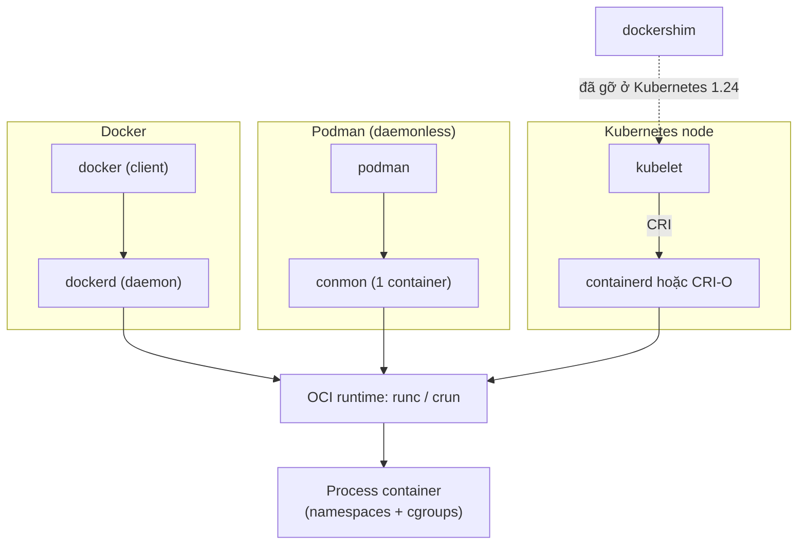

# 6_1_6 Container Runtimes and Ecosystem

> **Khóa học**: Cloud DevOps Basic — Containers & Kubernetes  
> **Phân nhóm**: 6 Domain 6 - Containers and Kubernetes › 6_1 Container Fundamentals  
> **Chủ đề**: Docker, Podman, runc/crun, containerd, CRI-O, CRI và vì sao Kubernetes bỏ dockershim  
> **Phiên bản áp dụng**: Docker Engine (29.0+ khi nói về image store), Podman (trang `latest`), Kubernetes 1.37 (theo trang Container Runtimes tại thời điểm viết)  
> **Trạng thái**: Draft (WRITE-CTR-6_1_6, 16-11-2026): qua G1–G4, chưa qua G5 (verifier độc lập)  
> **Phạm vi**: [Topic README](./README.md#6_1_6-container-runtime-và-hệ-sinh-thái) · **Checkpoint của người học**: [CHECKLIST](../../CHECKLIST.md#6_1-container-fundamentals)

---

## 1. Khái Niệm Cốt Lõi & Bản Chất Kỹ Thuật (Core Concepts & Technical Deep Dive)

### 1.1 Hai Tầng: Công Cụ Cấp Cao Và Runtime Cấp Thấp

"Container runtime" thực ra là nhiều tầng. Hiểu theo hai tầng giúp khỏi lẫn lộn:
- **Tầng cấp cao (engine/manager)**: nhận lệnh người dùng, quản lý image, mạng, volume (Docker, Podman, containerd, CRI-O).
- **Tầng cấp thấp (OCI runtime)**: tạo process container theo OCI runtime-spec (`runc`, `crun`). Xem [6_1_5](<./6_1_5 Open Container Initiative Specifications.md>).

`runc` là công cụ CLI tạo và chạy container theo OCI specification. <!-- ev: R6.6 -->

### 1.2 Docker: Client → Daemon

- `dockerd` (Docker daemon) lắng nghe Docker API request và quản lý image, container, network, volume. <!-- ev: R6.1 -->
- Docker client (`docker`) gửi lệnh như `docker run` tới `dockerd` để `dockerd` thực hiện. <!-- ev: R6.2 -->
- Lưu ý phiên bản: Docker Engine 29.0 trở lên dùng containerd image store mặc định cho cài mới. <!-- ev: R6.14 -->

### 1.3 Podman: Không Daemon

- Podman là công cụ **daemonless**. <!-- ev: R6.3 -->
- `conmon` là chương trình giám sát và kênh liên lạc giữa container manager (như Podman hoặc CRI-O) và OCI runtime (như `runc` hoặc `crun`) cho **một container**. <!-- ev: R6.4 --> Nó khởi chạy runtime như tiến trình con của mình. <!-- ev: R6.5 -->
- `crun`: README của dự án nêu crun nhanh hơn `runc` và dùng ít bộ nhớ hơn nhiều (đây là số liệu do chính dự án đo, không phải đánh giá độc lập). <!-- ev: R6.7 -->
- Về runtime mặc định trên Fedora và các chi tiết rootless/mạng của Podman: bài này **chưa kiểm chứng**, hãy kiểm tra tài liệu Podman và `containers.conf` của bản bạn dùng.

### 1.4 Kubernetes: Runtime Qua CRI

- Cần cài một container runtime vào **mỗi node** để Pod chạy được. <!-- ev: R6.8 -->
- Theo trang Container Runtimes tại thời điểm viết, Kubernetes 1.37 yêu cầu runtime tuân thủ **CRI (Container Runtime Interface)**. <!-- ev: R6.9 -->
- Trang này liệt kê containerd, CRI-O, Docker Engine và Mirantis Container Runtime. <!-- ev: R6.11 --> Hai tên phổ biến nhất trong bài này:
  - **containerd** tự mô tả là container runtime chuẩn công nghiệp, nhấn mạnh sự đơn giản, bền vững, di động. <!-- ev: R6.13 -->
  - **CRI-O** là container runtime nhẹ dành riêng cho Kubernetes. <!-- ev: R6.12 -->
- **Dockershim bị gỡ khỏi Kubernetes từ bản 1.24.** <!-- ev: R6.10 --> Điều này không làm image dựng bằng Docker mất tác dụng vì chúng tuân chuẩn OCI (xem 6_1_5; suy luận từ chuẩn, hãy đọc FAQ dockershim của Kubernetes để biết chi tiết).

### 1.5 Chọn Runtime Khác Nhau Theo Pod

Kubernetes cho đặt RuntimeClass khác nhau giữa các Pod để cân bằng hiệu năng và bảo mật. <!-- ev: R6.15 --> (Đã gặp ở [6_1_1](<./6_1_1 Containers vs Virtual Machines.md>).)

---

## 2. Ví Dụ Đời Sống Thực Tế Dễ Hiểu (Intuitive Real-World Analogies)

**Nhà hàng: quản lý sảnh, bếp trưởng và đầu bếp.**
- **Docker/Podman/containerd/CRI-O = quản lý sảnh**: nhận order (lệnh), kiểm kho (image), sắp xếp bàn (mạng, volume).
- **runc/crun = đầu bếp**: người thực sự nấu (tạo process container) theo công thức chuẩn (OCI runtime-spec). Hai đầu bếp khác nhau vẫn nấu được món theo cùng một công thức.
- **conmon = người trông bếp cho từng món**: đứng cạnh một nồi duy nhất, báo lại cho quản lý khi món xong hay cháy.
- **CRI = mẫu phiếu gọi món chung của chuỗi nhà hàng (Kubernetes)**: quản lý nào dùng đúng mẫu phiếu này thì chuỗi mới nhận.
- **Dockershim = người phiên dịch** giữa chuỗi và một quản lý chỉ nói "tiếng riêng": chuỗi quyết định thôi thuê phiên dịch (v1.24) vì quản lý mới đã nói thẳng mẫu phiếu chung.

---

## 3. Kiến Trúc, Luồng Hoạt Động & Hình Ảnh Trực Quan (Architecture, Diagrams & Visual Media)

<!-- ev: R6.1 R6.2 R6.3 R6.4 R6.5 R6.8 R6.9 R6.10 -->


---

## 4. Thực Hành (Hands-on)

> **Môi trường**: Linux, Podman 5.x. Chủ yếu là quan sát, không thay đổi hệ thống.  
> ⚠️ Chưa chạy thử (not executed by the squad). Kết quả là **dự đoán theo tài liệu**.

### 4.1 Nhìn Thấy "Không Có Daemon" Của Podman

<!-- ev: R6.3 R6.4 -->
```bash
# Chạy một container nền, rồi tìm process của nó trên máy chủ
podman run -d --name rt-demo docker.io/library/alpine sleep 600
ps -ef | grep -E "conmon|crun|runc" | grep -v grep
podman rm -f rt-demo
```

Điều cần quan sát: có tiến trình `conmon` đứng giữa manager và runtime cho từng container. Tên và quan hệ cha-con phụ thuộc phiên bản và cấu hình, hãy ghi lại những gì **bạn** thấy thay vì suy đoán.

### 4.2 Xem Runtime Mà Kubernetes Node Dùng

> ⚠️ Chỉ chạy trên cluster thử nghiệm (lab cluster only).

<!-- ev: R6.16 -->
```bash
# Cột CONTAINER-RUNTIME cho biết runtime và phiên bản của mỗi node
kubectl get nodes -o wide
```

Theo tài liệu Kubernetes, cột `CONTAINER-RUNTIME` của `kubectl get nodes -o wide` hiển thị runtime và phiên bản của nó. <!-- ev: R6.16 --> Bài 6_3_1 sẽ đi sâu hơn về node.

---

## 5. Cạm Bẫy Thực Tế & Thực Tiễn Sản Xuất (Production Gotchas & Best Practices)

### 5.1 Cạm Bẫy: "Kubernetes Bỏ Docker Nên Image Của Tôi Hỏng"
- **Bản chất**: dockershim bị gỡ từ 1.24, nhưng Kubernetes yêu cầu runtime tuân thủ CRI. <!-- ev: R6.10 R6.9 --> Chuẩn image là OCI nên image dựng bằng Docker vẫn chạy.
- **Thực tiễn**: kiểm tra runtime thực tế trên node; đọc FAQ dockershim của Kubernetes.

### 5.2 Cạm Bẫy: Nhầm Giữa Manager Và OCI Runtime
- **Bản chất**: `runc`/`crun` chỉ tạo container; image, mạng, volume do manager lo. <!-- ev: R6.6 R6.1 -->
- **Thực tiễn**: khi lỗi "không khởi động được container", xác định lỗi ở tầng nào trước khi tìm cách sửa.

### 5.3 Cạm Bẫy: Đọc Số Liệu Hiệu Năng Của Dự Án Như Sự Thật Tuyệt Đối
- **Bản chất**: so sánh `crun` với `runc` là số liệu từ README của chính dự án. <!-- ev: R6.7 -->
- **Thực tiễn**: tự đo trong môi trường của bạn nếu hiệu năng khởi động là yêu cầu.

### 5.4 Cạm Bẫy: Số Phiên Bản Kubernetes Đổi Liên Tục
- **Bản chất**: câu "Kubernetes 1.37 yêu cầu runtime tuân thủ CRI" là nội dung của trang tại thời điểm viết. <!-- ev: R6.9 -->
- **Thực tiễn**: kiểm tra trang [Container Runtimes](https://kubernetes.io/docs/setup/production-environment/container-runtimes/) của đúng phiên bản bạn dùng.

---

## 6. Câu Hỏi Củng Cố Kiến Thức (Active Recall Quiz)

### Câu Hỏi 1: Khác biệt kiến trúc giữa Docker và Podman?

<details>
<summary>Đáp án</summary>

Docker dùng mô hình client–daemon: `docker` gửi lệnh tới `dockerd`. Podman là daemonless; với từng container có `conmon` giám sát và gọi OCI runtime như `runc`/`crun`.
</details>

### Câu Hỏi 2: CRI là gì và vì sao dockershim bị gỡ?

<details>
<summary>Đáp án</summary>

CRI (Container Runtime Interface) là giao diện Kubernetes dùng để nói chuyện với runtime; Kubernetes yêu cầu runtime tuân thủ CRI. Dockershim bị gỡ từ 1.24; các runtime như containerd và CRI-O dùng thay. Image chuẩn OCI vẫn chạy bình thường.
</details>

### Câu Hỏi 3: `runc`/`crun` khác `containerd`/`CRI-O` thế nào?

<details>
<summary>Đáp án</summary>

`runc`/`crun` là OCI runtime cấp thấp tạo process container. `containerd`/`CRI-O` là runtime cấp cao, kubelet gọi qua CRI để quản lý image và vòng đời, rồi chúng gọi OCI runtime bên dưới.
</details>

---

## 7. 📚 Nguồn Tài Liệu Chính Thống (Tier-1 Official References)

- [Kubernetes — Container Runtimes](https://kubernetes.io/docs/setup/production-environment/container-runtimes/) — CRI, containerd, CRI-O, dockershim đã gỡ.
- [Kubernetes — Dockershim Removal FAQ](https://kubernetes.io/blog/2022/02/17/dockershim-faq/) — Blog chính thức về việc gỡ dockershim.
- [Docker Docs — What is Docker?](https://docs.docker.com/get-started/docker-overview/) — Kiến trúc `dockerd` và client.
- [What is Podman?](https://docs.podman.io/en/latest/) — Podman daemonless.
- [conmon](https://github.com/containers/conmon), [crun](https://github.com/containers/crun) và [runc](https://github.com/opencontainers/runc) — Giám sát container và các OCI runtime (README dự án).
- [containerd](https://containerd.io/) và [CRI-O](https://cri-o.io/) — Runtime cấp cao cho Kubernetes.
- [Kubernetes — Runtime Class](https://kubernetes.io/docs/concepts/containers/runtime-class/) — Chọn runtime theo Pod.
- [Docker Docs — Storage drivers](https://docs.docker.com/engine/storage/drivers/) — Lưu ý Docker Engine 29 dùng containerd image store.
