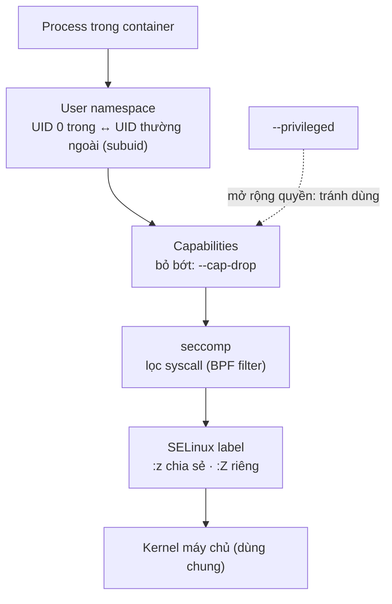

# 6_1_7 Container Security Fundamentals

> **Khóa học**: Cloud DevOps Basic — Containers & Kubernetes  
> **Phân nhóm**: 6 Domain 6 - Containers and Kubernetes › 6_1 Container Fundamentals  
> **Chủ đề**: user namespace và rootless, capabilities, seccomp, SELinux (`:z`/`:Z`), `--privileged`  
> **Phiên bản áp dụng**: Linux (man-pages), Docker Engine docs, Podman (trang `latest`)  
> **Trạng thái**: Draft (WRITE-CTR-6_1_7, 16-11-2026): qua G1–G4, chưa qua G5 (verifier độc lập)  
> **Phạm vi**: [Topic README](./README.md#6_1_7-bảo-mật-container) · **Checkpoint của người học**: [CHECKLIST](../../CHECKLIST.md#6_1-container-fundamentals)

---

## 1. Khái Niệm Cốt Lõi & Bản Chất Kỹ Thuật (Core Concepts & Technical Deep Dive)

### 1.1 Bảo Mật Container Là Nhiều Lớp

Docker nêu bốn khu vực khi đánh giá bảo mật, hai khu vực đầu liên quan trực tiếp bài này: **tính bảo mật nội tại của kernel và hỗ trợ namespaces/cgroups**, và **bề mặt tấn công của daemon**. <!-- ev: R7.18 --> Vì container dùng chung kernel ([6_1_1](<./6_1_1 Containers vs Virtual Machines.md>)), ranh giới bảo mật gồm nhiều lớp chồng lên nhau:

| Lớp | Cơ chế | Mục đích |
| :--- | :--- | :--- |
| Định danh | user namespace, rootless | Root trong container ≠ root thật trên máy chủ |
| Đặc quyền | capabilities | Chia nhỏ quyền root, bỏ bớt phần không cần |
| Syscall | seccomp | Lọc system call mà process được gọi |
| Nhãn truy cập | SELinux/AppArmor | Kiểm soát truy cập file/process theo chính sách |
| Cấu hình | `--privileged`, mount, device | Không mở quyền quá mức |

### 1.2 User Namespace Và Rootless

- User namespace cô lập các định danh và thuộc tính liên quan bảo mật: user ID, group ID, root directory, keys và **capabilities**. <!-- ev: R7.1 -->
- Một process có thể là user thường (không đặc quyền) **bên ngoài** namespace nhưng có UID **0 bên trong**. <!-- ev: R7.2 --> Đây là cơ sở của "root trong container không phải root thật" khi chạy rootless.
- Ánh xạ xem tại `/proc/<pid>/uid_map` và `gid_map` (từ Linux 3.5). <!-- ev: R7.3 -->
- `subuid` cho phép một user ánh xạ các dải user ID của mình vào namespace con. <!-- ev: R7.4 --> Podman rootless yêu cầu user có dải UID trong `/etc/subuid` và `/etc/subgid`. <!-- ev: R7.5 -->
- Podman có `--userns=keep-id`: ánh xạ user của bạn sang **cùng UID** trong container (hữu ích khi mount thư mục, xem 6_1_10). <!-- ev: R7.17 -->

### 1.3 Capabilities

Linux chia đặc quyền của superuser thành các đơn vị riêng gọi là **capabilities**, bật/tắt độc lập. <!-- ev: R7.6 --> Ví dụ `CAP_NET_ADMIN` cho các thao tác mạng như cấu hình interface, quản trị firewall IP, sửa bảng định tuyến. <!-- ev: R7.7 -->
Nguyên tắc: **bỏ những capability không cần**. Podman: `--cap-drop=<capability>` bỏ capability khỏi tập mặc định, hoặc `all` để bỏ hết. <!-- ev: R7.8 --> (Docker cũng có `--cap-add`/`--cap-drop`, xem trang Running containers.)

### 1.4 seccomp

- seccomp (Secure Computing mode) là tính năng kernel Linux, dùng để **hạn chế hành động** trong container. <!-- ev: R7.11 -->
- Chế độ `SECCOMP_SET_MODE_FILTER`: các system call được phép do một chương trình BPF quy định. <!-- ev: R7.12 -->
- Với Docker, tính năng này chỉ có khi Docker được build kèm seccomp và kernel bật `CONFIG_SECCOMP`. <!-- ev: R7.13 -->

### 1.5 SELinux Và Nhãn Volume Trên Fedora/RHEL

Với SELinux, bind mount cần nhãn phù hợp để container đọc/ghi được:
- `:z` → nội dung dùng chung nhiều container, Podman gắn **nhãn chia sẻ**. <!-- ev: R7.14 -->
- `:Z` → nhãn **riêng**, chỉ container hiện tại dùng được. <!-- ev: R7.15 -->
- `--security-opt label=disable` tắt tách nhãn cho container (không nên làm tùy tiện). <!-- ev: R7.16 -->

### 1.6 `--privileged`

Mặc định container Docker là "unprivileged", ví dụ không chạy được Docker daemon bên trong. <!-- ev: R7.9 --> Lý do là mặc định container không được truy cập thiết bị nào. <!-- ev: R7.10 --> `--privileged` mở rộng quyền (Docker: "Give extended privileges to this container"). <!-- ev: R7.19 --> Đây là cờ nên tránh (khuyến nghị của bài, không phải trích dẫn).

---

## 2. Ví Dụ Đời Sống Thực Tế Dễ Hiểu (Intuitive Real-World Analogies)

**Tòa nhà văn phòng nhiều lớp an ninh.**
- **User namespace = thẻ nhân viên "giám đốc" chỉ có hiệu lực trong tầng của bạn**: tấm thẻ ghi "Giám đốc (UID 0)" nhưng ngoài tòa nhà bạn chỉ là nhân viên thường (UID không đặc quyền).
- **Capabilities = chùm chìa khóa chia nhỏ**: thay vì chìa vạn năng, mỗi người chỉ cầm chìa phòng mình cần (`CAP_NET_ADMIN` là chìa phòng mạng). `--cap-drop all` là đòi lại hết chìa rồi chỉ phát lại chìa cần thiết.
- **seccomp = danh sách việc được làm ở quầy lễ tân**: chỉ làm những thao tác trong danh sách; thao tác lạ bị từ chối.
- **SELinux = bảo vệ tra danh sách thẻ khi vào từng phòng** (`:Z` = phòng riêng chỉ bạn vào; `:z` = phòng họp chung).
- **`--privileged` = giao cho nhân viên chùm chìa vạn năng và mở khóa mọi thiết bị**: tiện nhưng phá hết lớp an ninh.

---

## 3. Kiến Trúc, Luồng Hoạt Động & Hình Ảnh Trực Quan (Architecture, Diagrams & Visual Media)

<!-- ev: R7.1 R7.2 R7.6 R7.11 R7.14 R7.15 R7.9 -->


---

## 4. Thực Hành (Hands-on)

> **Môi trường**: Fedora 43 (SELinux bật mặc định theo ghi chú README container), Podman 5.x rootless.  
> ⚠️ Chưa chạy thử (not executed by the squad). Kết quả là **dự đoán theo tài liệu**.

### 4.1 Nhìn Thấy Ánh Xạ UID

<!-- ev: R7.3 R7.5 R7.17 -->
```bash
# Dải UID mà user của bạn được phép ánh xạ (rootless Podman cần các dòng này)
grep "^$USER:" /etc/subuid /etc/subgid

# Bên trong container rootless, process báo UID nào?
podman run --rm docker.io/library/alpine id

# Ánh xạ của process container: lấy PID trên máy chủ từ `podman inspect <tên>`, rồi
# cat /proc/<PID>/uid_map

# Giữ nguyên UID của bạn trong container
podman run --rm --userns=keep-id docker.io/library/alpine id
```

Quan sát: so sánh UID trong container với UID của bạn trên máy chủ; ghi lại ánh xạ bạn thấy trong `uid_map`.

### 4.2 Bỏ Capability Và Chạy Với Nhãn SELinux

<!-- ev: R7.7 R7.8 R7.14 R7.15 -->
```bash
# Bỏ hết capability, rồi thử một thao tác cần đặc quyền mạng
podman run --rm --cap-drop=all docker.io/library/alpine sh -c 'ip link set lo down; echo exit=$?'

# Bind mount có nhãn riêng (:Z) trên hệ thống SELinux
mkdir -p /tmp/data && echo hi > /tmp/data/a.txt
podman run --rm -v /tmp/data:/data:Z docker.io/library/alpine cat /data/a.txt
```

Điều cần quan sát: lệnh `ip link set` có thành công khi đã bỏ hết capability không? (dự đoán: không, vì thao tác mạng cần `CAP_NET_ADMIN` theo R7.7; hãy ghi lại kết quả thật của bạn). Nếu bỏ `:Z` trên hệ thống SELinux, kiểm tra container có đọc được file không.

Thực hành sâu hơn: lab [lab-6_1_1](./README.md#lab-6_1_1-namespaces-and-cgroups-by-hand) (`--memory/--cpus/--pids-limit`) và bài 6_7_2 (Pod Security) nối tiếp ở Kubernetes.

---

## 5. Cạm Bẫy Thực Tế & Thực Tiễn Sản Xuất (Production Gotchas & Best Practices)

### 5.1 Cạm Bẫy: Bind Mount Bị "Permission Denied" Trên Fedora/RHEL
- **Hiện tượng**: container đọc/ghi thư mục mount báo permission denied dù quyền Unix đúng.
- **Bản chất**: nhãn SELinux của thư mục không khớp với container; Podman có tùy chọn `z`/`Z` để gắn nhãn. <!-- ev: R7.14 R7.15 -->
- **Thực tiễn**: dùng `:Z` (riêng) hoặc `:z` (chia sẻ) thay vì tắt SELinux; tắt tách nhãn bằng `label=disable` chỉ là phương án cuối. <!-- ev: R7.16 -->

### 5.2 Cạm Bẫy: Dùng `--privileged` Cho Tiện
- **Bản chất**: mặc định container không được truy cập thiết bị nào; chế độ privileged mở rộng quyền. <!-- ev: R7.10 -->
- **Thực tiễn**: cấp đúng thứ cần (`--cap-add`, `--device`) thay vì `--privileged`.

### 5.3 Cạm Bẫy: Quên Rootless Cần `/etc/subuid`
- **Bản chất**: Podman rootless cần dải UID trong `/etc/subuid` và `/etc/subgid`. <!-- ev: R7.5 -->
- **Thực tiễn**: kiểm tra hai file này khi gặp lỗi ánh xạ UID.

### 5.4 Cạm Bẫy: Nghĩ "Root Trong Container" Luôn Là Root Thật
- **Bản chất**: UID 0 trong user namespace có thể ứng với user thường bên ngoài. <!-- ev: R7.2 --> Điều này **chỉ đúng khi dùng user namespace/rootless**; container rootful chạy như root thật trên máy chủ (*suy luận từ mô hình dùng chung kernel, chưa trích dẫn riêng*).
- **Thực tiễn**: chạy app bằng user không phải root trong image (6_2_6) và ưu tiên rootless khi có thể.

---

## 6. Câu Hỏi Củng Cố Kiến Thức (Active Recall Quiz)

### Câu Hỏi 1: Vì sao "root" trong container rootless không phải root thật?

<details>
<summary>Đáp án</summary>

Nhờ user namespace: một process có thể là user thường ngoài namespace nhưng có UID 0 bên trong. Dải UID được ánh xạ qua `subuid`/`subgid` (xem `/proc/<pid>/uid_map`). Podman rootless cần các dải này trong `/etc/subuid` và `/etc/subgid`.
</details>

### Câu Hỏi 2: Capabilities và seccomp khác nhau thế nào?

<details>
<summary>Đáp án</summary>

Capabilities chia nhỏ **đặc quyền** của root thành các đơn vị bật/tắt độc lập (ví dụ `CAP_NET_ADMIN`). seccomp **lọc system call** mà process được gọi (bằng bộ lọc BPF). Hai cơ chế bổ sung nhau.
</details>

### Câu Hỏi 3: Khi bind mount báo permission denied trên Fedora, bạn kiểm tra gì và sửa thế nào?

<details>
<summary>Đáp án</summary>

Nghi ngờ nhãn SELinux. Dùng `:Z` (nhãn riêng) hoặc `:z` (nhãn chia sẻ) khi mount thay vì tắt SELinux. `label=disable` chỉ là phương án cuối.
</details>

---

## 7. 📚 Nguồn Tài Liệu Chính Thống (Tier-1 Official References)

- [user_namespaces(7)](https://man7.org/linux/man-pages/man7/user_namespaces.7.html) — User namespace và ánh xạ UID/GID.
- [subuid(5)](https://man7.org/linux/man-pages/man5/subuid.5.html) — Cấp dải UID phụ.
- [capabilities(7)](https://man7.org/linux/man-pages/man7/capabilities.7.html) — Danh sách capability, `CAP_NET_ADMIN`.
- [seccomp(2)](https://man7.org/linux/man-pages/man2/seccomp.2.html) — Chế độ filter bằng BPF.
- [Docker Docs — Seccomp security profiles](https://docs.docker.com/engine/security/seccomp/) — seccomp trong Docker.
- [Docker Docs — Docker Engine security](https://docs.docker.com/engine/security/) — Các khu vực bảo mật cần xem xét.
- [Docker Docs — Running containers](https://docs.docker.com/engine/containers/run/) — Runtime privilege, `--cap-add/--cap-drop`, `--privileged`.
- [podman-run(1)](https://docs.podman.io/en/latest/markdown/podman-run.1.html) — `--cap-drop`, `--userns`, `--security-opt`, tùy chọn volume `z`/`Z`.
- [Podman — Rootless tutorial](https://github.com/containers/podman/blob/main/docs/tutorials/rootless_tutorial.md) — `/etc/subuid`, `/etc/subgid`.
