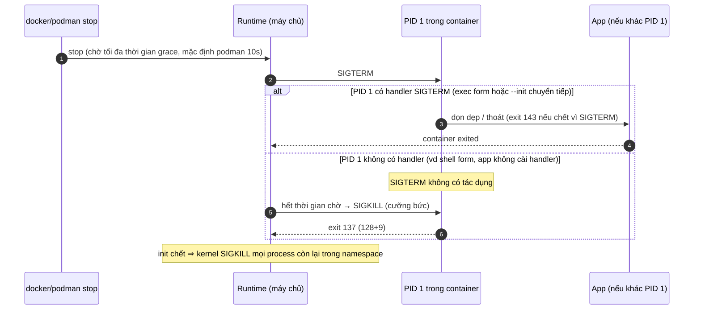

# 6_1_8 Container Lifecycle PID 1 and Signals

> **Khóa học**: Cloud DevOps Basic — Containers & Kubernetes  
> **Phân nhóm**: 6 Domain 6 - Containers and Kubernetes › 6_1 Container Fundamentals  
> **Chủ đề**: Vòng đời container, PID 1 và tín hiệu, exec form vs shell form, `--init`/`tini`, bảng exit code  
> **Phiên bản áp dụng**: Linux (man-pages), Docker Engine docs, Podman (trang `latest`), Dockerfile reference  
> **Trạng thái**: Draft (WRITE-CTR-6_1_8, 16-11-2026): qua G1–G4, chưa qua G5 (verifier độc lập)  
> **Phạm vi**: [Topic README](./README.md#6_1_8-vòng-đời-container-pid-1-và-tín-hiệu) · **Checkpoint của người học**: [CHECKLIST](../../CHECKLIST.md#6_1-container-fundamentals)

> Liên hệ Domain 1 và 3: zombie/orphan (mục 1_2_5) và signals (mục 3_4_1) trong [CHECKLIST gốc](../../../CHECKLIST.md).

---

## 1. Khái Niệm Cốt Lõi & Bản Chất Kỹ Thuật (Core Concepts & Technical Deep Dive)

### 1.1 Vòng Đời Container

Các lệnh Docker tương ứng: **create** (tạo), **start** (khởi động container đã dừng) <!-- ev: R8.22 -->, **stop** (dừng; xem 1.3), **rm** (xóa) <!-- ev: R8.23 -->. `run` gộp tạo và chạy. Chuỗi trạng thái `created → running → exited → removed` là **mô hình rút gọn của bài này** (không phải trích dẫn); xóa container là mất lớp ghi (xem [6_1_4](<./6_1_4 Images Layers and Overlay Filesystem.md>)).

### 1.2 PID 1 Đặc Biệt

Từ [6_1_2](<./6_1_2 Linux Namespaces for Containers.md>): process đầu tiên trong PID namespace có PID 1 và là init của namespace. <!-- ev: R8.5 --> Hệ quả với **tín hiệu**:

- Chỉ những signal mà init **đã cài handler** mới gửi được tới init từ các thành viên khác trong namespace; hạn chế này áp dụng cả cho process đặc quyền, để tránh vô tình giết init. <!-- ev: R8.1 --> Trang `kill(2)` nói tương tự: signal duy nhất gửi được tới PID 1 là signal mà init đã cài handler. <!-- ev: R8.4 -->
- Process ở namespace tổ tiên (ví dụ runtime trên máy chủ) cũng chỉ gửi được signal tới init của PID namespace con nếu init có handler cho signal đó. <!-- ev: R8.2 -->
- **Ngoại lệ**: `SIGKILL` và `SIGSTOP` được chuyển cưỡng bức khi gửi từ namespace tổ tiên. <!-- ev: R8.3 --> `SIGKILL` không thể bị bắt, chặn hay bỏ qua. <!-- ev: R8.21 -->

Hệ quả (suy ra từ các câu trích dẫn trên, đối chiếu với 1.3): nếu process chính của container (PID 1) **không cài handler cho `SIGTERM`**, `SIGTERM` do `docker stop` gửi tới có thể không có tác dụng, và container chỉ dừng khi bị `SIGKILL`.

Hai nhiệm vụ khác của init mà app thường không làm:
- **Nhận nuôi** process mồ côi: chúng được gán cho init của PID namespace. <!-- ev: R8.6 -->
- **Thu dọn (wait)** child đã kết thúc, nếu không chúng ở trạng thái **zombie**. <!-- ev: R8.8 -->
- Init kết thúc → kernel giết mọi process còn lại trong namespace bằng `SIGKILL` (nên PID 1 chết là cả container chết). <!-- ev: R8.7 -->

### 1.3 Dừng Container: `SIGTERM` Rồi `SIGKILL`

- `docker stop`: process chính nhận `SIGTERM`, sau thời gian chờ thì nhận `SIGKILL`. <!-- ev: R8.9 --> Signal đầu có thể đổi bằng `STOPSIGNAL` trong Dockerfile hoặc `--stop-signal`. <!-- ev: R8.10 -->
- `podman stop`: mặc định gửi `SIGTERM` rồi `SIGKILL` sau thời gian chờ; `--time` mặc định **10 giây**. <!-- ev: R8.11 -->

### 1.4 Exec Form Và Shell Form Của ENTRYPOINT

Dockerfile reference: với **shell form**, ENTRYPOINT được chạy như lệnh con của `/bin/sh -c`, shell này **không chuyển signal**; executable **không phải PID 1** và không nhận Unix signal, nên **không nhận `SIGTERM` từ `docker stop`**. <!-- ev: R8.12 -->

| Dạng | Ví dụ | Ai là PID 1 | Nhận `SIGTERM`? |
| :--- | :--- | :--- | :--- |
| Exec form | `ENTRYPOINT ["java","-jar","app.jar"]` | `java` | Có (nếu JVM cài handler, ví dụ shutdown hook) |
| Shell form | `ENTRYPOINT java -jar app.jar` | `/bin/sh -c ...` | Không <!-- ev: R8.12 --> |

*Cột "Ai là PID 1" cho exec form là hệ quả của câu trích dẫn ở trên; việc JVM xử lý `SIGTERM` thế nào thuộc tài liệu Java, ngoài phạm vi bài này.*

### 1.5 Init Nhỏ Cho Container

- Podman: `--init` chạy một init trong container để **chuyển signal và thu dọn process**. <!-- ev: R8.13 -->
- Docker: `--init` dùng init làm PID 1, đảm nhiệm việc thu dọn zombie. <!-- ev: R8.14 -->
- **tini** là một init nhỏ nhưng hợp lệ dành cho container. <!-- ev: R8.15 -->

### 1.6 Bảng Exit Code

| Exit code | Ý nghĩa | Nguồn |
| :--- | :--- | :--- |
| `125` | Lỗi ở chính Docker daemon | <!-- ev: R8.16 --> docker run |
| `126` | Lệnh trong container không thể được gọi thực thi | <!-- ev: R8.17 --> docker run |
| `127` | Không tìm thấy lệnh trong container | <!-- ev: R8.18 --> docker run |
| Khác | Là exit code của chính lệnh trong container | <!-- ev: R8.19 --> docker run |
| `128 + n` | Lệnh bị kết thúc bởi signal n (theo bash) | <!-- ev: R8.20 --> bash |

Suy ra: `137 = 128 + 9` (`SIGKILL`, thường gặp khi hết hạn dừng hoặc bị OOM kill, xem [6_1_3](<./6_1_3 Control Groups v2 for Containers.md>)) và `143 = 128 + 15` (`SIGTERM`).

---

## 2. Ví Dụ Đời Sống Thực Tế Dễ Hiểu (Intuitive Real-World Analogies)

**Trưởng ca trong một phân xưởng.**
- **PID 1 = trưởng ca**: người duy nhất được giao chìa khóa xưởng. Nếu trưởng ca bỏ về (PID 1 thoát), cả xưởng bị đóng cửa ngay (mọi process bị `SIGKILL`).
- **`SIGTERM` = tờ thông báo "chuẩn bị đóng cửa, hãy dọn dẹp"**: có hiệu lực nếu trưởng ca *biết đọc thông báo* (đã cài handler); nếu trưởng ca chưa từng được dạy, tờ giấy bị bỏ qua.
- **`SIGKILL` = bảo vệ cắt điện toàn xưởng**: không thể từ chối.
- **Shell form = trưởng ca là một "thư ký chuyển giấy" (`/bin/sh -c`) không chịu chuyển thông báo cho thợ chính**: thợ chính (app) không bao giờ biết có lệnh đóng cửa, đành đợi tới lúc bị cắt điện.
- **`--init`/`tini` = một người điều phối nhỏ gọn đứng làm trưởng ca**: nhận mọi thông báo, chuyển cho thợ chính, và dọn người đã nghỉ (zombie).

---

## 3. Kiến Trúc, Luồng Hoạt Động & Hình Ảnh Trực Quan (Architecture, Diagrams & Visual Media)

<!-- ev: R8.1 R8.3 R8.9 R8.11 R8.12 R8.13 R8.7 R8.20 -->


---

## 4. Thực Hành (Hands-on)

> **Môi trường**: Linux, Podman 5.x (Fedora 43). Với Docker, đổi `podman` thành `docker`.  
> ⚠️ Chưa chạy thử (not executed by the squad). Kết quả là **dự đoán theo tài liệu**.

### 4.1 Đo Thời Gian Dừng: Có/Không `--init`

<!-- ev: R8.11 R8.13 R8.1 R8.20 -->
```bash
# A. sleep làm PID 1 (không có handler SIGTERM): dự đoán dừng sau ~10 giây rồi bị SIGKILL
podman run -d --name no-init docker.io/library/alpine sleep 600
time podman stop no-init
podman inspect no-init --format '{{.State.ExitCode}}'   # dự đoán: 137

# B. Cùng lệnh nhưng có init chuyển tiếp signal: dự đoán dừng nhanh
podman run -d --init --name with-init docker.io/library/alpine sleep 600
time podman stop with-init
podman inspect with-init --format '{{.State.ExitCode}}' # dự đoán: 143 (hoặc 0 tùy init), hãy ghi kết quả thật

podman rm -f no-init with-init
```

Hãy xem JSON đầy đủ bằng `podman inspect <tên>` để xác nhận tên khóa (`ExitCode`) trên bản Podman của bạn; tôi chưa kiểm chứng tên khóa này trên tài liệu.

### 4.2 Bảng Exit Code Thực Tế

<!-- ev: R8.16 R8.17 R8.18 R8.19 -->
```bash
podman run docker.io/library/alpine foo; echo $?          # lệnh không tồn tại: dự đoán 127
podman run docker.io/library/alpine /etc; echo $?         # thư mục, không thực thi được: dự đoán 126
podman run docker.io/library/alpine sh -c 'exit 3'; echo $? # exit code của lệnh trong container: 3
```

Thực hành sâu hơn: [lab-6_1_2-oom-signals-and-jvm-memory](./README.md#lab-6_1_2-oom-signals-and-jvm-memory) (so sánh shell form và exec form bằng `Dockerfile.naive` của lab 6_2_1).

---

## 5. Cạm Bẫy Thực Tế & Thực Tiễn Sản Xuất (Production Gotchas & Best Practices)

### 5.1 Cạm Bẫy: `docker stop` Luôn Treo Rồi Exit 137
- **Hiện tượng**: container dừng chậm (đúng bằng thời gian chờ) rồi exit code 137.
- **Bản chất**: PID 1 không cài handler `SIGTERM` nên chỉ `SIGKILL` có tác dụng <!-- ev: R8.1 R8.3 -->; hoặc dùng shell form nên app không nhận signal. <!-- ev: R8.12 -->
- **Thực tiễn**: dùng **exec form** cho `ENTRYPOINT`/`CMD`, thêm `--init`, hoặc đảm bảo app xử lý `SIGTERM`.

### 5.2 Cạm Bẫy: Zombie Tích Tụ
- **Bản chất**: child kết thúc mà cha chưa `wait` thành zombie <!-- ev: R8.8 -->; init của namespace là nơi nhận nuôi process mồ côi. <!-- ev: R8.6 -->
- **Thực tiễn**: dùng `--init`/`tini` khi app sinh nhiều process con. <!-- ev: R8.13 R8.14 R8.15 -->

### 5.3 Cạm Bẫy: Hiểu Nhầm Exit Code 126/127
- **Bản chất**: 126 là lệnh không thể gọi thực thi, 127 là không tìm thấy lệnh trong container. <!-- ev: R8.17 R8.18 -->
- **Thực tiễn**: kiểm tra đường dẫn, quyền thực thi và shebang của entrypoint.

### 5.4 Cạm Bẫy: Kết Luận Từ Một Mã Thoát
- **Bản chất**: 137 chỉ cho biết bị `SIGKILL` (`128+9`), có thể do hết hạn dừng hoặc OOM. <!-- ev: R8.20 R8.21 -->
- **Thực tiễn**: phân biệt bằng `OOMKilled` trong `inspect` và `oom_kill` trong `memory.events` (xem 6_1_3).

---

## 6. Câu Hỏi Củng Cố Kiến Thức (Active Recall Quiz)

### Câu Hỏi 1: Vì sao `docker stop` mất đủ thời gian chờ rồi exit 137 với image dùng shell form?

<details>
<summary>Đáp án</summary>

Shell form chạy ENTRYPOINT như lệnh con của `/bin/sh -c`, shell này không chuyển signal; executable không phải PID 1 và không nhận `SIGTERM`. Hết thời gian chờ, runtime gửi `SIGKILL` → exit `128+9 = 137`. Dùng exec form hoặc `--init` để sửa.
</details>

### Câu Hỏi 2: PID 1 đặc biệt thế nào về tín hiệu?

<details>
<summary>Đáp án</summary>

Chỉ signal mà init đã cài handler mới gửi tới init được (kể cả từ process đặc quyền); ngoại lệ `SIGKILL`/`SIGSTOP` được chuyển cưỡng bức từ namespace tổ tiên. Init còn phải nhận nuôi process mồ côi và thu dọn zombie.
</details>

### Câu Hỏi 3: Exit code 125, 126, 127 và 143 nghĩa là gì?

<details>
<summary>Đáp án</summary>

125: lỗi ở chính daemon/công cụ; 126: lệnh trong container không thể gọi thực thi; 127: không tìm thấy lệnh; 143 = `128+15`: bị `SIGTERM`. (137 = `128+9`: bị `SIGKILL`.)
</details>

---

## 7. 📚 Nguồn Tài Liệu Chính Thống (Tier-1 Official References)

- [pid_namespaces(7)](https://man7.org/linux/man-pages/man7/pid_namespaces.7.html) — init của PID namespace, signal tới init, nhận nuôi process mồ côi.
- [kill(2)](https://man7.org/linux/man-pages/man2/kill.2.html) — Signal gửi tới PID 1.
- [wait(2)](https://man7.org/linux/man-pages/man2/wait.2.html) — Zombie.
- [signal(7)](https://man7.org/linux/man-pages/man7/signal.7.html) và [bash(1)](https://man7.org/linux/man-pages/man1/bash.1.html) — `SIGKILL` không bắt được; công thức `128+n`.
- [docker container stop](https://docs.docker.com/reference/cli/docker/container/stop/) và [podman-stop(1)](https://docs.podman.io/en/latest/markdown/podman-stop.1.html) — `SIGTERM` rồi `SIGKILL`.
- [Dockerfile reference — ENTRYPOINT](https://docs.docker.com/reference/dockerfile/) — Exec form vs shell form.
- [Docker Docs — Running containers](https://docs.docker.com/engine/containers/run/) — Exit status 125/126/127.
- [docker container run](https://docs.docker.com/reference/cli/docker/container/run/) và [podman-run(1)](https://docs.podman.io/en/latest/markdown/podman-run.1.html) — Cờ `--init`.
- [tini](https://github.com/krallin/tini) — Init nhỏ cho container (README dự án).
- [docker container start](https://docs.docker.com/reference/cli/docker/container/start/) và [docker container rm](https://docs.docker.com/reference/cli/docker/container/rm/) — Vòng đời container.
