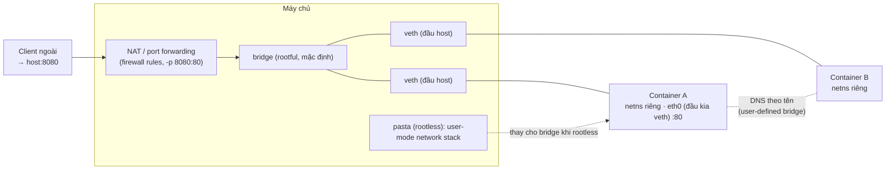

# 6_1_9 Container Networking Basics

> **Khóa học**: Cloud DevOps Basic — Containers & Kubernetes  
> **Phân nhóm**: 6 Domain 6 - Containers and Kubernetes › 6_1 Container Fundamentals  
> **Chủ đề**: Network namespace + `veth`, bridge và rootless (`pasta`), publish cổng (NAT), DNS giữa các container  
> **Phiên bản áp dụng**: Docker Engine docs, Podman (trang `latest`), netavark/aardvark-dns (README dự án); chi tiết mặc định phụ thuộc phiên bản  
> **Trạng thái**: Draft (WRITE-CTR-6_1_9, 16-11-2026): qua G1–G4, chưa qua G5 (verifier độc lập)  
> **Phạm vi**: [Topic README](./README.md#6_1_9-mạng-container-cơ-bản) · **Checkpoint của người học**: [CHECKLIST](../../CHECKLIST.md#6_1-container-fundamentals)

> Liên hệ Domain 2 và 5: NAT (mục 2_4_9), `veth`/bridge, `tcpdump` (mục 5_1_8) trong [CHECKLIST gốc](../../../CHECKLIST.md).

---

## 1. Khái Niệm Cốt Lõi & Bản Chất Kỹ Thuật (Core Concepts & Technical Deep Dive)

### 1.1 Nền Tảng: Network Namespace Và `veth`

Mỗi container có **network namespace riêng** ([6_1_2](<./6_1_2 Linux Namespaces for Containers.md>)). Để nối ra ngoài, runtime dùng **`veth`**:
- `veth` là thiết bị Ethernet ảo, có thể làm **đường hầm giữa các network namespace** (hoặc dùng độc lập). <!-- ev: R9.1 -->
- `veth` luôn được tạo **theo cặp** nối với nhau: một đầu ở namespace này, đầu kia ở namespace kia. <!-- ev: R9.2 -->
- Một thiết bị mạng vật lý chỉ thuộc đúng một network namespace, nên container không "dùng chung" card mạng vật lý của máy chủ mà đi qua cặp `veth`. <!-- ev: R9.3 -->

### 1.2 Hai Kiểu Kết Nối: Rootful Và Rootless (Podman)

Theo tài liệu `podman-run`:
- **`bridge`**: tạo network stack trên **bridge mặc định**; là mặc định cho container **rootful**. <!-- ev: R9.4 -->
- **`pasta`**: dùng `pasta(1)` tạo network stack **ở user-mode**; là mặc định cho container **rootless** và chỉ hỗ trợ rootless. <!-- ev: R9.5 --> Theo mặc định địa chỉ IPv4/IPv6, route và tên interface được **sao chép từ máy chủ**. <!-- ev: R9.6 -->

Hai thành phần đứng sau mạng của Podman: **netavark** là network stack viết bằng Rust, thiết kế để dùng với Podman <!-- ev: R9.12 -->; **aardvark-dns** là DNS server có thẩm quyền cho bản ghi A/AAAA của container và chuyển tiếp các yêu cầu khác tới `/etc/resolv.conf` của máy chủ. <!-- ev: R9.13 -->
*Các mặc định này phụ thuộc phiên bản Podman; hãy đối chiếu trang `podman-run` của bản bạn dùng.*

### 1.3 Publish Cổng

- Podman: `-p`/`--publish` công bố cổng của container ra máy chủ. <!-- ev: R9.7 -->
- Docker: `docker run -p 8080:80` tạo ánh xạ giữa cổng 8080 trên máy chủ và cổng 80 của container. <!-- ev: R9.8 -->
- Docker thực hiện việc này bằng luật firewall để làm **NAT, PAT và masquerading**. <!-- ev: R9.9 --> Nghĩa là "publish port" thực chất là **port forwarding/NAT** từ máy chủ vào container.

### 1.4 DNS Giữa Các Container

Docker: trên **user-defined bridge**, container tìm nhau bằng tên nhờ **DNS tự động** <!-- ev: R9.10 -->; trên **default bridge**, container chỉ truy cập nhau bằng địa chỉ IP (trừ `--link`, được coi là legacy). <!-- ev: R9.11 -->
Với Podman, thành phần DNS tương ứng là aardvark-dns (xem 1.2). *Việc aardvark-dns bật cho loại mạng nào của Podman tôi chưa kiểm chứng ở bài này.*

### 1.5 Kubernetes Dùng Lại Ý Tưởng Này

Trong Kubernetes, mỗi Pod có network namespace riêng và Service/DNS thay vai trò của "publish port" và DNS giữa container. Chi tiết ở [6_4 Kubernetes Networking, Configuration and Storage](<../6_4 Kubernetes Networking Configuration and Storage/README.md>) (mô hình mạng Kubernetes, `Service`, CoreDNS); các nhận định về Kubernetes trong đoạn này chưa được kiểm chứng ở bài hiện tại.

---

## 2. Ví Dụ Đời Sống Thực Tế Dễ Hiểu (Intuitive Real-World Analogies)

**Khu chung cư với đường dây điện thoại nội bộ.**
- **Network namespace = căn hộ có số điện thoại riêng**; bên trong dùng "ổ cắm điện thoại" của riêng mình.
- **`veth` = dây điện thoại hai đầu**: một đầu cắm trong căn hộ, đầu kia cắm ở tổng đài tòa nhà.
- **Bridge = tổng đài nội bộ tòa nhà**: nối mọi căn hộ cho gọi nhau.
- **Publish cổng (NAT) = số máy lẻ ở lễ tân**: người ngoài gọi số tổng đài + máy lẻ 8080, lễ tân chuyển vào đúng căn hộ (cổng 80).
- **DNS = danh bạ nội bộ**: gọi "web" thay vì nhớ số máy; danh bạ này chỉ có đầy đủ ở "tòa nhà riêng" (user-defined bridge), còn tòa nhà mặc định bạn phải nhớ số.
- **`pasta` (rootless) = bạn không có quyền lắp tổng đài**, nên mượn đường dây của chủ nhà (user-mode, sao chép địa chỉ từ máy chủ).

---

## 3. Kiến Trúc, Luồng Hoạt Động & Hình Ảnh Trực Quan (Architecture, Diagrams & Visual Media)

<!-- ev: R9.1 R9.2 R9.4 R9.5 R9.8 R9.9 R9.10 -->


---

## 4. Thực Hành (Hands-on)

> **Môi trường**: Linux, Podman 5.x (Fedora 43). Với Docker, đổi `podman` thành `docker`.  
> ⚠️ Chưa chạy thử (not executed by the squad). Kết quả là **dự đoán theo tài liệu**.

### 4.1 Publish Cổng Và Quan Sát

<!-- ev: R9.7 R9.8 -->
```bash
# Chạy một web server đơn giản, publish cổng 8080 của máy chủ vào cổng 80 của container
podman run -d --name web -p 8080:80 docker.io/library/nginx

# Gọi từ máy chủ
curl -s -o /dev/null -w "%{http_code}\n" http://localhost:8080/

podman rm -f web
```

Quan sát: container không có cổng 8080; chính máy chủ lắng nghe và chuyển tiếp (NAT/port forwarding). Dùng `ss -tulpn` (bài 5_1_3) trên máy chủ để xem cổng nào đang được lắng nghe, và ghi lại tiến trình sở hữu cổng đó trong môi trường của bạn.

### 4.2 Nhìn Vào Network Namespace Của Container

<!-- ev: R9.1 R9.2 -->
```bash
podman run -d --name net-demo docker.io/library/alpine sleep 600
# <PID> lấy từ `podman inspect net-demo` (trường chứa PID của process container)
sudo nsenter -t <PID> -n ip addr    # interface bên trong network namespace của container
ip -br link                          # interface phía máy chủ (tìm đầu veth)
podman rm -f net-demo
```

Điều cần quan sát: trong container có `lo` và một interface nối ra ngoài (đầu kia của cặp `veth`); trên máy chủ có interface `veth...` tương ứng khi dùng mạng bridge. Ở chế độ rootless dùng `pasta`, topology khác (user-mode), hãy ghi lại những gì bạn thấy.

### 4.3 DNS Giữa Hai Container (Podman) — Cách Kiểm Tra

```bash
podman network create appnet
podman run -d --name db --network appnet docker.io/library/alpine sleep 600
podman run --rm --network appnet docker.io/library/alpine ping -c1 db
podman rm -f db && podman network rm appnet
```

> Việc resolve tên `db` trong mạng do Podman tạo là mong đợi từ vai trò của aardvark-dns (R9.13) nhưng **tôi chưa kiểm chứng cách bật DNS theo loại mạng của Podman**; hãy ghi lại kết quả thật của bạn. <!-- ev: R9.13 -->

---

## 5. Cạm Bẫy Thực Tế & Thực Tiễn Sản Xuất (Production Gotchas & Best Practices)

### 5.1 Cạm Bẫy: Container Gọi Nhau Bằng Tên Nhưng Không Resolve Được (Docker Default Bridge)
- **Bản chất**: trên default bridge, container chỉ truy cập nhau bằng IP; tên chỉ resolve trên user-defined bridge. <!-- ev: R9.10 R9.11 -->
- **Thực tiễn**: tạo user-defined network cho ứng dụng nhiều container (và dùng Compose, 6_2_10).

### 5.2 Cạm Bẫy: Hiểu Sai Rootless Networking
- **Bản chất**: rootless dùng `pasta` (user-mode), không phải bridge của rootful. <!-- ev: R9.4 R9.5 --> Địa chỉ/route được sao chép từ máy chủ. <!-- ev: R9.6 -->
- **Thực tiễn**: không giả định cùng topology giữa rootful và rootless khi debug (đừng tìm `veth`/bridge như ở rootful).

### 5.3 Cạm Bẫy: Quên Rằng Publish Port Là NAT
- **Bản chất**: Docker dùng luật firewall để làm NAT/PAT/masquerading cho cổng đã publish. <!-- ev: R9.9 -->
- **Thực tiễn**: khi cổng "không vào được", kiểm tra theo thứ tự: container lắng nghe đúng cổng chưa → ánh xạ `-p` đúng chưa → firewall/NAT trên máy chủ (`ss`, `tcpdump`, 5_1_3, 5_1_8, 5_1_12).

### 5.4 Cạm Bẫy: Công Bố Cổng Ra Mọi Địa Chỉ
- **Bản chất**: `-p 8080:80` ánh xạ cổng 8080 **trên mọi địa chỉ** của máy chủ Docker. <!-- ev: R9.8 -->
- **Thực tiễn**: nếu chỉ cần cục bộ, hãy chỉ định địa chỉ nguồn (cú pháp `[[hostIP:][hostPort]:]containerPort` của Podman). <!-- ev: R9.7 -->

---

## 6. Câu Hỏi Củng Cố Kiến Thức (Active Recall Quiz)

### Câu Hỏi 1: Container nối ra ngoài bằng cách nào?

<details>
<summary>Đáp án</summary>

Mỗi container có network namespace riêng. Runtime tạo một cặp `veth`: một đầu trong container, đầu kia nối vào bridge (rootful) hoặc dùng user-mode networking `pasta` (rootless). Cổng được publish nhờ NAT/port forwarding.
</details>

### Câu Hỏi 2: Vì sao rootless Podman không có bridge như rootful?

<details>
<summary>Đáp án</summary>

Mặc định rootless dùng `pasta` để tạo network stack ở user-mode (bridge là mặc định cho rootful). `pasta` sao chép địa chỉ/route từ máy chủ.
</details>

### Câu Hỏi 3: Container A gọi `db` không resolve được trên Docker. Nguyên nhân thường gặp?

<details>
<summary>Đáp án</summary>

Đang ở default bridge nơi container chỉ truy cập nhau bằng IP. User-defined bridge có DNS tự động để resolve theo tên.
</details>

---

## 7. 📚 Nguồn Tài Liệu Chính Thống (Tier-1 Official References)

- [veth(4)](https://man7.org/linux/man-pages/man4/veth.4.html) — Cặp thiết bị Ethernet ảo.
- [network_namespaces(7)](https://man7.org/linux/man-pages/man7/network_namespaces.7.html) — Network namespace và thiết bị mạng.
- [podman-run(1)](https://docs.podman.io/en/latest/markdown/podman-run.1.html) — `--network` (`bridge`, `pasta`) và `--publish`.
- [Docker Docs — Port publishing and mapping](https://docs.docker.com/engine/network/port-publishing/) — Publish cổng, NAT/PAT.
- [Docker Docs — Bridge network driver](https://docs.docker.com/engine/network/drivers/bridge/) — User-defined bridge và default bridge, DNS tự động.
- [netavark](https://github.com/containers/netavark) và [aardvark-dns](https://github.com/containers/aardvark-dns) — Network stack và DNS của Podman (README dự án).
