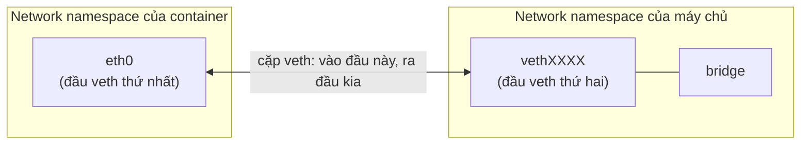
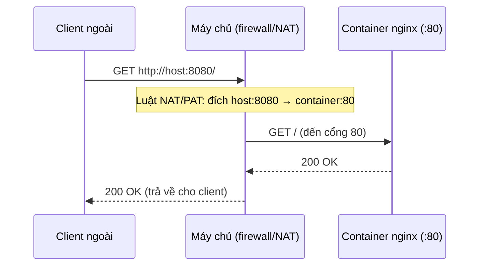
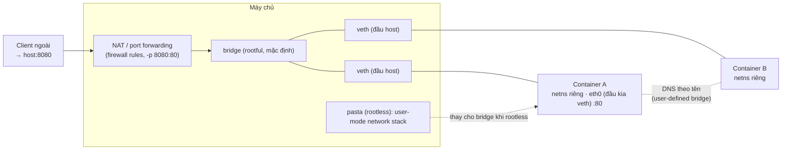

# 6_1_9 Container Networking Basics

> **Khóa học**: Cloud DevOps Basic — Containers & Kubernetes  
> **Phân nhóm**: 6 Domain 6 - Containers and Kubernetes › 6_1 Container Fundamentals  
> **Chủ đề**: Network namespace + `veth`, bridge và rootless (`pasta`), publish cổng (NAT), DNS giữa các container  
> **Phiên bản áp dụng**: Docker Engine docs, Podman (trang `latest`), netavark/aardvark-dns (README dự án); chi tiết mặc định phụ thuộc phiên bản  
> **Trạng thái**: Draft (WRITE-CTR-6_1_9, 16-11-2026): qua G1–G4, chưa qua G5 (verifier độc lập)  
> **Phạm vi**: [Topic README](./README.md#6_1_9-mạng-container-cơ-bản) · **Checkpoint của người học**: [CHECKLIST](../../CHECKLIST.md#6_1-container-fundamentals)

> Liên hệ Domain 2 và 5: NAT (mục 2_4_9), `veth`/bridge, `tcpdump` (mục 5_1_8) trong [CHECKLIST gốc](../../../CHECKLIST.md).

---

## 1. Khái Niệm Cốt Lõi & Bản Chất Kỹ Thuật (Core Concepts & Technical Deep Dive)

### 1.1 Nền Tảng: Network Namespace Và `veth`

Mỗi container có **network namespace riêng** ([6_1_2](<./6_1_2 Linux Namespaces for Containers.md>)). Để nối ra ngoài, runtime dùng **`veth`**:
- `veth` là thiết bị Ethernet ảo, có thể làm **đường hầm giữa các network namespace** (hoặc dùng độc lập). <!-- ev: R9.1 -->
- `veth` luôn được tạo **theo cặp** nối với nhau: một đầu ở namespace này, đầu kia ở namespace kia. <!-- ev: R9.2 -->
- Một thiết bị mạng vật lý chỉ thuộc đúng một network namespace, nên container không "dùng chung" card mạng vật lý của máy chủ mà đi qua cặp `veth`. <!-- ev: R9.3 -->

#### 💡 Giải Thích Dễ Hiểu Hơn Cho 1.1

> *Phần giải thích bổ sung này nhằm làm rõ ba gạch đầu dòng trên; các tuyên bố gốc vẫn là R9.1–R9.3, phần diễn giải thêm chưa qua verifier độc lập.*

**(a) Network namespace thực chất là gì?**
Là một **bản sao riêng của toàn bộ "ngăn xếp mạng"**: danh sách interface (`lo`, `eth0`...), địa chỉ IP, bảng route, luật firewall và danh sách cổng đang lắng nghe. Hai namespace khác nhau **không nhìn thấy interface của nhau**.

Hệ quả thực tế: hai container cùng chạy nginx, cùng lắng nghe cổng 80 mà **không xung đột**, vì "cổng 80" của mỗi container nằm trong namespace khác nhau (giống hai căn hộ đều có "phòng số 1" mà không ảnh hưởng nhau).

**(b) Vấn đề phát sinh: cô lập quá tốt thì không ra ngoài được.**
Container mới sinh ra chỉ có interface `lo` (loopback) — chỉ nói chuyện được với chính nó. Cần một "sợi dây" xuyên qua bức tường giữa hai namespace → đó là `veth`.

**(c) `veth` hoạt động ra sao?**
Hình dung một **sợi cáp mạng ảo có hai đầu cắm**. Gói tin gửi vào đầu này sẽ lập tức đi ra ở đầu kia. Runtime làm như sau: giữ **một đầu ở namespace của máy chủ** (thường nối vào bridge), đưa **đầu còn lại vào namespace của container** (thường đặt tên `eth0`).



**(d) Vì sao không cho container dùng thẳng card mạng thật?**
Card vật lý (ví dụ `enp3s0`) chỉ thuộc **đúng một** namespace — mặc định là của máy chủ. Muốn container dùng card đó, bạn phải *chuyển hẳn* card sang namespace của container và máy chủ sẽ **mất card**. Với hàng chục container thì không thể chuyển card cho từng cái. Cách giải quyết: mỗi container nhận một **card ảo** (đầu `veth`), còn card thật vẫn ở máy chủ; máy chủ chuyển tiếp gói tin giữa hai bên.

**(e) Ví dụ tự tay dựng "container giả" chỉ bằng `ip`** (không cần Docker/Podman, để thấy tận mắt `veth` hoạt động):

```bash
# 1. Tạo một network namespace tên ns1 (đóng vai "container")
sudo ip netns add ns1

# 2. Tạo một CẶP veth: veth-host <---> veth-ns
sudo ip link add veth-host type veth peer name veth-ns

# 3. Đưa một đầu (veth-ns) vào namespace ns1; đầu veth-host ở lại máy chủ
sudo ip link set veth-ns netns ns1

# 4. Gán IP và bật interface ở phía máy chủ
sudo ip addr add 10.200.0.1/24 dev veth-host
sudo ip link set veth-host up

# 5. Gán IP và bật interface ở phía "container" (chạy lệnh BÊN TRONG ns1)
sudo ip netns exec ns1 ip addr add 10.200.0.2/24 dev veth-ns
sudo ip netns exec ns1 ip link set veth-ns up
sudo ip netns exec ns1 ip link set lo up

# 6. Kiểm chứng: máy chủ ping "container" qua cặp veth
ping -c 2 10.200.0.2

# 7. Dọn dẹp: xoá namespace sẽ xoá luôn đầu veth bên trong; đầu kia của cặp cũng biến mất theo
sudo ip netns del ns1
```

Điều cần quan sát: ở bước 3, `ip -br link` trên máy chủ **không còn thấy `veth-ns`** (đã chuyển sang `ns1`), nhưng `sudo ip netns exec ns1 ip -br link` thì thấy. Đó chính là cách runtime nối container ra ngoài, chỉ khác là runtime còn nối đầu `veth-host` vào bridge. *(Chưa chạy thử bởi squad; kết quả là dự đoán theo man page `ip-netns(8)` và `veth(4)`.)*

### 1.2 Hai Kiểu Kết Nối: Rootful Và Rootless (Podman)

Theo tài liệu `podman-run`:
- **`bridge`**: tạo network stack trên **bridge mặc định**; là mặc định cho container **rootful**. <!-- ev: R9.4 -->
- **`pasta`**: dùng `pasta(1)` tạo network stack **ở user-mode**; là mặc định cho container **rootless** và chỉ hỗ trợ rootless. <!-- ev: R9.5 --> Theo mặc định địa chỉ IPv4/IPv6, route và tên interface được **sao chép từ máy chủ**. <!-- ev: R9.6 -->

Hai thành phần đứng sau mạng của Podman: **netavark** là network stack viết bằng Rust, thiết kế để dùng với Podman <!-- ev: R9.12 -->; **aardvark-dns** là DNS server có thẩm quyền cho bản ghi A/AAAA của container và chuyển tiếp các yêu cầu khác tới `/etc/resolv.conf` của máy chủ. <!-- ev: R9.13 -->
*Các mặc định này phụ thuộc phiên bản Podman; hãy đối chiếu trang `podman-run` của bản bạn dùng.*

#### 💡 Giải Thích Dễ Hiểu Hơn Cho 1.2

> *Phần giải thích bổ sung này làm rõ các gạch đầu dòng trên; các tuyên bố gốc vẫn là R9.4–R9.6, R9.12–R9.13. Phần diễn giải thêm chưa qua verifier độc lập.*

**(a) "Rootful" và "rootless" là gì?**
- **Rootful**: bạn chạy Podman bằng `root` (hoặc `sudo podman ...`). Có quyền can thiệp mạng của máy chủ.
- **Rootless**: bạn chạy Podman bằng **user thường** (`podman ...` không `sudo`). Không có quyền quản trị mạng của máy chủ.

**(b) Vì sao cần hai kiểu kết nối khác nhau?**
Kiểu `bridge` (mục 1.1) cần **tạo bridge, tạo cặp `veth` trong namespace của máy chủ và thêm luật firewall**. Đây là những thao tác quản trị mạng nên cần đặc quyền (bối cảnh chung của Linux, không phải trích dẫn từ `podman-run`). User thường không làm được, nên rootless phải dùng cách khác: **`pasta`**.

**(c) `pasta` hiểu đơn giản là gì?**
Một chương trình chạy **bằng quyền user thường**, đóng vai "người phiên dịch" đứng giữa container và mạng của máy chủ: nhận lưu lượng từ container rồi **tự mở kết nối bình thường từ máy chủ** thay mặt container (và ngược lại). Vì chạy ở user-mode nên không cần tạo bridge hay sửa firewall của máy chủ. Mô tả cơ chế bên trong `pasta` nằm ngoài trang `podman-run`; cần chi tiết hơn hãy đối chiếu tài liệu dự án passt/pasta.

**(d) Bảng so sánh nhanh**

| | Rootful (`bridge`) | Rootless (`pasta`) |
|---|---|---|
| Là mặc định cho | container chạy bằng root | container chạy bằng user thường |
| Địa chỉ IP trong container | Thuộc dải mạng riêng của bridge (mạng mặc định của Podman thường là `10.88.0.0/16`; kiểm tra bằng `podman network inspect podman`) | **Sao chép từ máy chủ** (IP, route, tên interface) |
| Mô hình kết nối | container ↔ `veth` ↔ bridge ↔ máy chủ | user-mode, không phải mô hình bridge + `veth` như rootful |
| Khi debug | tìm `veth`/bridge trên máy chủ | đừng tìm `veth`/bridge, hãy xem `pasta` |

**(e) Ví dụ so sánh bằng lệnh** (chạy trên cùng một máy):

```bash
# Xem địa chỉ của chính máy chủ
ip addr

# Rootless (không sudo): theo tài liệu, IP/route/tên interface được sao chép từ máy chủ
podman run --rm docker.io/library/alpine ip addr

# Rootful (sudo): container nhận IP thuộc dải của bridge
sudo podman run --rm docker.io/library/alpine ip addr
```

Điều cần quan sát: lệnh rootless cho ra địa chỉ **giống máy chủ** (ví dụ máy chủ là `192.168.1.50` thì trong container cũng thấy `192.168.1.50`), còn lệnh rootful cho ra địa chỉ dải riêng (ví dụ `10.88.0.x`). *(Chưa chạy thử; kết quả là dự đoán theo mô tả trong `podman-run`. Con số `192.168.1.50` và `10.88.0.x` chỉ là minh hoạ.)*

**(f) `netavark` và `aardvark-dns` làm gì, nói bằng ví dụ?**
- **netavark**: "thợ lắp mạng" của Podman: khi container khởi động thì dựng mạng cho nó. Danh sách việc cụ thể nó làm (bridge, `veth`, firewall...) tôi chưa kiểm chứng ở bài này; hãy đối chiếu README dự án netavark.
- **aardvark-dns**: "danh bạ" của Podman: khi container `app` hỏi "`db` là địa chỉ nào?", aardvark-dns trả về IP của container `db`. Câu hỏi nào nó không biết (ví dụ `example.com`) thì chuyển tiếp tới DNS cấu hình trong `/etc/resolv.conf` của máy chủ.

### 1.3 Publish Cổng

- Podman: `-p`/`--publish` công bố cổng của container ra máy chủ. <!-- ev: R9.7 -->
- Docker: `docker run -p 8080:80` tạo ánh xạ giữa cổng 8080 trên máy chủ và cổng 80 của container. <!-- ev: R9.8 -->
- Docker thực hiện việc này bằng luật firewall để làm **NAT, PAT và masquerading**. <!-- ev: R9.9 --> Nghĩa là "publish port" thực chất là **port forwarding/NAT** từ máy chủ vào container.

#### 💡 Giải Thích Dễ Hiểu Hơn Cho 1.3

> *Phần giải thích bổ sung này làm rõ các gạch đầu dòng trên; các tuyên bố gốc vẫn là R9.7–R9.9. Phần diễn giải thêm chưa qua verifier độc lập.*

**(a) Vì sao phải "publish" cổng?**
Container nằm trong network namespace riêng với IP riêng (xem 1.1, 1.2), nên người dùng **bên ngoài máy chủ không gọi thẳng được** vào nó. Publish cổng nghĩa là: *"hãy cho máy chủ mở một cổng, ai gọi vào cổng đó thì chuyển tiếp vào cổng của container"*.

**(b) Đọc cú pháp `-p 8080:80` đúng chiều**
Quy tắc: **`-p <cổng máy chủ>:<cổng container>`** (trái là máy chủ, phải là container).

| Thành phần | Ý nghĩa |
|---|---|
| `8080` (bên trái) | Cổng mà **máy chủ** lắng nghe: người ngoài gọi `http://<ip-máy-chủ>:8080` |
| `80` (bên phải) | Cổng mà **ứng dụng trong container** lắng nghe (nginx mặc định cổng 80) |

**(c) Giải nghĩa ba thuật ngữ trong tài liệu Docker**
- **NAT (Network Address Translation)**: đổi địa chỉ IP trong gói tin khi nó đi qua máy chủ. Gói đến `<IP máy chủ>:8080` bị đổi đích thành `<IP container>:80`.
- **PAT (Port Address Translation)**: đổi luôn **số cổng**. Ở đây cổng `8080` được đổi thành `80`.
- **Masquerading**: chiều **ra ngoài**. Khi container gọi ra Internet, máy chủ đổi IP nguồn (IP riêng của container) thành **IP của máy chủ** để mạng ngoài biết trả lời về đâu; máy chủ nhớ để chuyển gói trả lời về đúng container.

**(d) Luồng đi của một request**



**(e) Ví dụ 1 — Hai container cùng cổng 80, cổng máy chủ khác nhau**
Mỗi container có namespace riêng nên cả hai đều lắng nghe cổng 80 được. Nhưng máy chủ chỉ có **một** cổng 8080 trên mỗi địa chỉ, nên phải map sang cổng khác nhau:

```bash
podman run -d --name web1 -p 8080:80 docker.io/library/nginx
podman run -d --name web2 -p 8081:80 docker.io/library/nginx

curl -s -o /dev/null -w "%{http_code}\n" http://localhost:8080/   # vào web1
curl -s -o /dev/null -w "%{http_code}\n" http://localhost:8081/   # vào web2

podman rm -f web1 web2
```

Nếu cố chạy cả hai với `-p 8080:80` thì container thứ hai **lỗi** vì cổng 8080 của máy chủ đã bị chiếm (thông báo lỗi cụ thể tuỳ phiên bản, hãy ghi lại kết quả thật của bạn).

**(f) Ví dụ 2 — Chỉ cho phép gọi từ chính máy chủ**
Mặc định `-p 8080:80` mở cổng trên **mọi địa chỉ** của máy chủ (xem 5.4). Muốn chỉ nội bộ máy chủ gọi được, chỉ định địa chỉ nguồn (cú pháp `[[hostIP:][hostPort]:]containerPort` của Podman):

```bash
podman run -d --name web-local -p 127.0.0.1:8080:80 docker.io/library/nginx
curl -s -o /dev/null -w "%{http_code}\n" http://127.0.0.1:8080/   # máy chủ gọi được
# máy khác trong mạng LAN gọi http://<ip-máy-chủ>:8080 sẽ KHÔNG vào được
podman rm -f web-local
```

**(g) Muốn "nhìn thấy" luật NAT?**
Luật nằm ở firewall của máy chủ; nơi xem phụ thuộc runtime và backend firewall (iptables hoặc nftables) của phiên bản bạn dùng, nên hãy ghi lại những gì bạn thấy:

```bash
# Chạy container có publish cổng trước, rồi xem bảng NAT
sudo iptables -t nat -L -n | grep 8080      # nếu hệ thống dùng iptables
sudo nft list ruleset | grep 8080           # nếu hệ thống dùng nftables
```

*(Chưa chạy thử; Docker, Podman/netavark và từng bản phân phối có thể khác nhau về backend firewall nên chưa khẳng định kết quả.)*

**Tóm lại bằng ví dụ đời sống:** container là căn hộ không có địa chỉ đường phố; "publish port" là **số máy lẻ ở lễ tân** — lễ tân (máy chủ) nghe điện ở số 8080, rồi **nối máy vào căn hộ** (container) ở số nội bộ 80. Còn masquerading là khi căn hộ gọi ra ngoài: lễ tân **dùng số tổng đài của tòa nhà** làm số hiển thị, rồi nhớ để chuyển cuộc gọi trả lời về đúng căn hộ.

### 1.4 DNS Giữa Các Container

Docker: trên **user-defined bridge**, container tìm nhau bằng tên nhờ **DNS tự động** <!-- ev: R9.10 -->; trên **default bridge**, container chỉ truy cập nhau bằng địa chỉ IP (trừ `--link`, được coi là legacy). <!-- ev: R9.11 -->
Với Podman, thành phần DNS tương ứng là aardvark-dns (xem 1.2). *Việc aardvark-dns bật cho loại mạng nào của Podman tôi chưa kiểm chứng ở bài này.*

### 1.5 Kubernetes Dùng Lại Ý Tưởng Này

Trong Kubernetes, mỗi Pod có network namespace riêng và Service/DNS thay vai trò của "publish port" và DNS giữa container. Chi tiết ở [6_4 Kubernetes Networking, Configuration and Storage](<../6_4 Kubernetes Networking Configuration and Storage/README.md>) (mô hình mạng Kubernetes, `Service`, CoreDNS); các nhận định về Kubernetes trong đoạn này chưa được kiểm chứng ở bài hiện tại.

---

## 2. Ví Dụ Đời Sống Thực Tế Dễ Hiểu (Intuitive Real-World Analogies)

**Khu chung cư với đường dây điện thoại nội bộ.**
- **Network namespace = căn hộ có số điện thoại riêng**; bên trong dùng "ổ cắm điện thoại" của riêng mình.
- **`veth` = dây điện thoại hai đầu**: một đầu cắm trong căn hộ, đầu kia cắm ở tổng đài tòa nhà.
- **Bridge = tổng đài nội bộ tòa nhà**: nối mọi căn hộ cho gọi nhau.
- **Publish cổng (NAT) = số máy lẻ ở lễ tân**: người ngoài gọi số tổng đài + máy lẻ 8080, lễ tân chuyển vào đúng căn hộ (cổng 80).
- **DNS = danh bạ nội bộ**: gọi "web" thay vì nhớ số máy; danh bạ này chỉ có đầy đủ ở "tòa nhà riêng" (user-defined bridge), còn tòa nhà mặc định bạn phải nhớ số.
- **`pasta` (rootless) = bạn không có quyền lắp tổng đài**, nên mượn đường dây của chủ nhà (user-mode, sao chép địa chỉ từ máy chủ).

---

## 3. Kiến Trúc, Luồng Hoạt Động & Hình Ảnh Trực Quan (Architecture, Diagrams & Visual Media)

<!-- ev: R9.1 R9.2 R9.4 R9.5 R9.8 R9.9 R9.10 -->


---

## 4. Thực Hành (Hands-on)

> **Môi trường**: Linux, Podman 5.x (Fedora 43). Với Docker, đổi `podman` thành `docker`.  
> ⚠️ Chưa chạy thử (not executed by the squad). Kết quả là **dự đoán theo tài liệu**.

### 4.1 Publish Cổng Và Quan Sát

<!-- ev: R9.7 R9.8 -->
```bash
# Chạy một web server đơn giản, publish cổng 8080 của máy chủ vào cổng 80 của container
podman run -d --name web -p 8080:80 docker.io/library/nginx

# Gọi từ máy chủ
curl -s -o /dev/null -w "%{http_code}\n" http://localhost:8080/

podman rm -f web
```

Quan sát: container không có cổng 8080; chính máy chủ lắng nghe và chuyển tiếp (NAT/port forwarding). Dùng `ss -tulpn` (bài 5_1_3) trên máy chủ để xem cổng nào đang được lắng nghe, và ghi lại tiến trình sở hữu cổng đó trong môi trường của bạn.

### 4.2 Nhìn Vào Network Namespace Của Container

<!-- ev: R9.1 R9.2 -->
```bash
podman run -d --name net-demo docker.io/library/alpine sleep 600
# <PID> lấy từ `podman inspect net-demo` (trường chứa PID của process container)
sudo nsenter -t <PID> -n ip addr    # interface bên trong network namespace của container
ip -br link                          # interface phía máy chủ (tìm đầu veth)
podman rm -f net-demo
```

Điều cần quan sát: trong container có `lo` và một interface nối ra ngoài (đầu kia của cặp `veth`); trên máy chủ có interface `veth...` tương ứng khi dùng mạng bridge. Ở chế độ rootless dùng `pasta`, topology khác (user-mode), hãy ghi lại những gì bạn thấy.

### 4.3 DNS Giữa Hai Container (Podman) — Cách Kiểm Tra

```bash
podman network create appnet
podman run -d --name db --network appnet docker.io/library/alpine sleep 600
podman run --rm --network appnet docker.io/library/alpine ping -c1 db
podman rm -f db && podman network rm appnet
```

> Việc resolve tên `db` trong mạng do Podman tạo là mong đợi từ vai trò của aardvark-dns (R9.13) nhưng **tôi chưa kiểm chứng cách bật DNS theo loại mạng của Podman**; hãy ghi lại kết quả thật của bạn. <!-- ev: R9.13 -->

---

## 5. Cạm Bẫy Thực Tế & Thực Tiễn Sản Xuất (Production Gotchas & Best Practices)

### 5.1 Cạm Bẫy: Container Gọi Nhau Bằng Tên Nhưng Không Resolve Được (Docker Default Bridge)
- **Bản chất**: trên default bridge, container chỉ truy cập nhau bằng IP; tên chỉ resolve trên user-defined bridge. <!-- ev: R9.10 R9.11 -->
- **Thực tiễn**: tạo user-defined network cho ứng dụng nhiều container (và dùng Compose, 6_2_10).

### 5.2 Cạm Bẫy: Hiểu Sai Rootless Networking
- **Bản chất**: rootless dùng `pasta` (user-mode), không phải bridge của rootful. <!-- ev: R9.4 R9.5 --> Địa chỉ/route được sao chép từ máy chủ. <!-- ev: R9.6 -->
- **Thực tiễn**: không giả định cùng topology giữa rootful và rootless khi debug (đừng tìm `veth`/bridge như ở rootful).

### 5.3 Cạm Bẫy: Quên Rằng Publish Port Là NAT
- **Bản chất**: Docker dùng luật firewall để làm NAT/PAT/masquerading cho cổng đã publish. <!-- ev: R9.9 -->
- **Thực tiễn**: khi cổng "không vào được", kiểm tra theo thứ tự: container lắng nghe đúng cổng chưa → ánh xạ `-p` đúng chưa → firewall/NAT trên máy chủ (`ss`, `tcpdump`, 5_1_3, 5_1_8, 5_1_12).

### 5.4 Cạm Bẫy: Công Bố Cổng Ra Mọi Địa Chỉ
- **Bản chất**: `-p 8080:80` ánh xạ cổng 8080 **trên mọi địa chỉ** của máy chủ Docker. <!-- ev: R9.8 -->
- **Thực tiễn**: nếu chỉ cần cục bộ, hãy chỉ định địa chỉ nguồn (cú pháp `[[hostIP:][hostPort]:]containerPort` của Podman). <!-- ev: R9.7 -->

---

## 6. Câu Hỏi Củng Cố Kiến Thức (Active Recall Quiz)

### Câu Hỏi 1: Container nối ra ngoài bằng cách nào?

<details>
<summary>Đáp án</summary>

Mỗi container có network namespace riêng. Runtime tạo một cặp `veth`: một đầu trong container, đầu kia nối vào bridge (rootful) hoặc dùng user-mode networking `pasta` (rootless). Cổng được publish nhờ NAT/port forwarding.
</details>

### Câu Hỏi 2: Vì sao rootless Podman không có bridge như rootful?

<details>
<summary>Đáp án</summary>

Mặc định rootless dùng `pasta` để tạo network stack ở user-mode (bridge là mặc định cho rootful). `pasta` sao chép địa chỉ/route từ máy chủ.
</details>

### Câu Hỏi 3: Container A gọi `db` không resolve được trên Docker. Nguyên nhân thường gặp?

<details>
<summary>Đáp án</summary>

Đang ở default bridge nơi container chỉ truy cập nhau bằng IP. User-defined bridge có DNS tự động để resolve theo tên.
</details>

---

## 7. 📚 Nguồn Tài Liệu Chính Thống (Tier-1 Official References)

- [veth(4)](https://man7.org/linux/man-pages/man4/veth.4.html) — Cặp thiết bị Ethernet ảo.
- [ip-netns(8)](https://man7.org/linux/man-pages/man8/ip-netns.8.html) — Tạo/quản lý network namespace và chạy lệnh bên trong (dùng trong ví dụ 1.1).
- [network_namespaces(7)](https://man7.org/linux/man-pages/man7/network_namespaces.7.html) — Network namespace và thiết bị mạng.
- [podman-run(1)](https://docs.podman.io/en/latest/markdown/podman-run.1.html) — `--network` (`bridge`, `pasta`) và `--publish`.
- [Docker Docs — Port publishing and mapping](https://docs.docker.com/engine/network/port-publishing/) — Publish cổng, NAT/PAT.
- [Docker Docs — Bridge network driver](https://docs.docker.com/engine/network/drivers/bridge/) — User-defined bridge và default bridge, DNS tự động.
- [netavark](https://github.com/containers/netavark) và [aardvark-dns](https://github.com/containers/aardvark-dns) — Network stack và DNS của Podman (README dự án).
