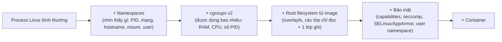

# 6_1 Container Fundamentals

> **Khóa học**: Cloud DevOps Basic — Containers & Kubernetes
> **Phân nhóm**: 6 Domain 6 - Containers and Kubernetes › 6_1 Container Fundamentals
> **Chủ đề**: Container thực chất là gì ở tầng Linux kernel: namespaces, cgroups, filesystem phân lớp, chuẩn OCI và các container runtime
> **Trạng thái**: Bài học: 10/10 viết xong, qua G1–G4 (ledger + `evidence.py` + checker), **chưa qua G5 (verifier độc lập)** (16-11-2026); Lab: 2 lab ở dạng định nghĩa (chưa có thư mục `labs/`, chưa chạy thử)
> **Lộ trình tổng**: [container/README.md](../../README.md) · **Checkpoint**: [CHECKLIST.md](../../CHECKLIST.md#6_1-container-fundamentals)

---

## 🎯 Mục Tiêu

Sau topic này, bạn giải thích được **"container chỉ là một process Linux bị cô lập và bị giới hạn tài nguyên"**, và dùng hiểu biết đó để debug: vì sao container bị kill với exit code 137, vì sao PID 1 không nhận tín hiệu, vì sao file ghi trong container biến mất.

---

## 📚 Những Gì Cần Học

### 6_1_1 Container vs Máy Ảo (VM)
- [ ] VM ảo hóa phần cứng và chạy kernel riêng; container **dùng chung kernel** của máy chủ.
- [ ] Hệ quả: khởi động nhanh, nhẹ, nhưng ranh giới cô lập yếu hơn VM; không chạy được kernel khác (container Linux cần kernel Linux).
- [ ] Khi nào vẫn cần VM: cần kernel khác, cách ly mạnh giữa khách hàng (multi-tenant), hoặc workload yêu cầu.

### 6_1_2 Linux Namespaces (Cô lập "nhìn thấy gì")
- [ ] 8 loại namespace: `pid`, `net`, `mnt`, `uts`, `ipc`, `user`, `cgroup`, `time`.
- [ ] PID namespace: process đầu tiên là **PID 1** bên trong, nhưng có PID khác khi nhìn từ máy chủ.
- [ ] Network namespace: interface, route table, iptables riêng; container mới chỉ có `lo` cho tới khi runtime gắn `veth`.
- [ ] Công cụ: `/proc/<pid>/ns/`, `lsns`, `unshare`, `nsenter`.
- [ ] Liên hệ: mục 3_8_2 trong [CHECKLIST](../../../CHECKLIST.md).

### 6_1_3 Control Groups v2 (Giới hạn "dùng bao nhiêu")
- [ ] Cây cgroup thống nhất tại `/sys/fs/cgroup`; controller `memory`, `cpu`, `io`, `pids`.
- [ ] `memory.max` (giới hạn cứng), `memory.events` (đếm số lần `oom_kill`), `memory.current`, `memory.peak`.
- [ ] `cpu.max` (quota/period: CPU throttling, không kill), `cpu.weight` (chia tỉ lệ khi tranh chấp).
- [ ] `pids.max` để chặn fork bomb.
- [ ] Vượt `memory.max` → kernel **OOM killer** gửi `SIGKILL` → exit code **137** (128 + 9).
- [ ] `docker run --memory/--cpus/--pids-limit` và `resources.limits` của Kubernetes đều được dịch thành các file cgroup này.
- [ ] Liên hệ: mục 3_8_1 và 3_5_2 (OOM killer) trong [CHECKLIST](../../../CHECKLIST.md).

### 6_1_4 Image, Lớp (Layer) và Overlay Filesystem
- [ ] Image = tập các lớp chỉ đọc + metadata (config: `Entrypoint`, `Cmd`, `Env`, `User`, `WorkingDir`).
- [ ] Container = image + **một lớp ghi** (copy-on-write); xóa container là mất lớp ghi.
- [ ] overlayfs: `lowerdir` (các lớp image), `upperdir` (lớp ghi), `merged` (thứ container nhìn thấy).
- [ ] Vì sao xóa file ở lớp sau **không làm image nhỏ đi** (file vẫn nằm ở lớp trước).
- [ ] Image ID / digest là hash nội dung (content-addressable); tag chỉ là tên có thể trỏ sang image khác.

### 6_1_5 Chuẩn OCI (Open Container Initiative)
- [ ] **Image spec**: định dạng image và manifest.
- [ ] **Runtime spec**: `config.json` + root filesystem → runtime cấp thấp (`runc`, `crun`) tạo container.
- [ ] **Distribution spec**: API để push/pull image với registry.
- [ ] Ý nghĩa: image build bằng Docker chạy được trên Podman, containerd, CRI-O.

### 6_1_6 Container Runtime và Hệ Sinh Thái
- [ ] Docker Engine: `docker` CLI → `dockerd` → `containerd` → `runc`.
- [ ] Podman: không có daemon, mỗi container có tiến trình giám sát `conmon`, runtime mặc định trên Fedora là `crun`; hỗ trợ **rootless** tốt.
- [ ] Kubernetes dùng runtime qua **CRI** (Container Runtime Interface): `containerd` hoặc `CRI-O`. Kubernetes đã bỏ dockershim từ v1.24, nhưng image do Docker build vẫn chạy bình thường vì cùng chuẩn OCI.
- [ ] Công cụ build không cần daemon: Buildah (Podman dùng bên dưới), BuildKit.

### 6_1_7 Bảo Mật Container
- [ ] Root trong container ≠ root thật khi dùng **user namespace** (rootless): UID trong container được ánh xạ sang dải `/etc/subuid`.
- [ ] Linux capabilities (`CAP_NET_ADMIN`, `CAP_SYS_ADMIN`...) và nguyên tắc bỏ bớt (`--cap-drop`).
- [ ] seccomp (lọc syscall), SELinux/AppArmor (Fedora/RHEL dùng SELinux, bind mount cần nhãn `:Z` / `:z`).
- [ ] `--privileged` nguy hiểm thế nào; vì sao không chạy app bằng root.

### 6_1_8 Vòng Đời Container, PID 1 và Tín Hiệu
- [ ] `create` → `start` → `running` → `stop` (gửi `SIGTERM`, chờ, rồi `SIGKILL`) → `exited` → `rm`.
- [ ] **PID 1 đặc biệt**: kernel không áp dụng hành vi mặc định của tín hiệu cho PID 1 nếu process không tự đăng ký handler; PID 1 còn phải "nhận nuôi" và dọn zombie.
- [ ] `ENTRYPOINT` dạng **exec** (`["java","-jar",...]`) vs dạng **shell** (`java -jar ...` → `/bin/sh -c` làm PID 1, app không nhận `SIGTERM`).
- [ ] Init nhỏ cho container: `tini`, `docker run --init`, `podman run --init`.
- [ ] Bảng exit code: `0` thành công, `1` lỗi ứng dụng, `126` không thực thi được, `127` không tìm thấy lệnh, `137` bị `SIGKILL` (thường là OOM), `143` bị `SIGTERM`.
- [ ] Liên hệ: mục 1_2_5 (zombie/orphan) và 3_4_1 (signals) trong [CHECKLIST](../../../CHECKLIST.md).

### 6_1_9 Mạng Container Cơ Bản
- [ ] Mỗi container có network namespace riêng, nối ra ngoài qua cặp `veth` và bridge (rootful) hoặc user-mode networking (rootless: Podman 5 mặc định dùng `pasta`).
- [ ] Publish port (`-p 8080:8080`) = NAT/port forwarding từ máy chủ vào container.
- [ ] DNS giữa container trong cùng một network do runtime cung cấp (Docker embedded DNS, Podman `aardvark-dns`).
- [ ] Liên hệ: NAT (2_4_9), veth/bridge, tcpdump (5_1_8) trong [CHECKLIST](../../../CHECKLIST.md).

### 6_1_10 Lưu Trữ Dữ Liệu
- [ ] Volume (runtime quản lý) vs bind mount (thư mục của máy chủ) vs tmpfs (RAM).
- [ ] Dữ liệu trong lớp ghi của container mất khi xóa container → dữ liệu cần giữ phải nằm ở volume.
- [ ] Quyền sở hữu file khi chạy rootless/non-root (UID ánh xạ khác nhau giữa container và máy chủ).

---

## 📂 Bài Học Chi Tiết (Lessons)

> Mỗi bài có 7 mục (khái niệm, ví dụ đời thường, sơ đồ, thực hành, cạm bẫy, quiz, nguồn Tier-1). Trạng thái **Draft**: đã đối chiếu từng claim với trang chính thức (ledger tại `.evidence/research/`), chưa chạy lệnh thật và chưa qua verifier độc lập.

| Bài | Mục tiêu một dòng | Trạng thái |
| :--- | :--- | :--- |
| [6_1_1 Containers vs Virtual Machines](<./6_1_1 Containers vs Virtual Machines.md>) | Container là process bị cô lập dùng chung kernel; khác VM ở đâu | Draft (16-11-2026) |
| [6_1_2 Linux Namespaces for Containers](<./6_1_2 Linux Namespaces for Containers.md>) | 8 loại namespace, PID 1, `veth`, `unshare`/`nsenter`/`lsns` | Draft (16-11-2026) |
| [6_1_3 Control Groups v2 for Containers](<./6_1_3 Control Groups v2 for Containers.md>) | `memory.max`, `cpu.max`, `pids.max`, OOM kill và exit 137 | Draft (16-11-2026) |
| [6_1_4 Images Layers and Overlay Filesystem](<./6_1_4 Images Layers and Overlay Filesystem.md>) | Layer bất biến, lớp ghi, overlayfs, copy_up, whiteout | Draft (16-11-2026) |
| [6_1_5 Open Container Initiative Specifications](<./6_1_5 Open Container Initiative Specifications.md>) | Ba đặc tả OCI: image, runtime, distribution | Draft (16-11-2026) |
| [6_1_6 Container Runtimes and Ecosystem](<./6_1_6 Container Runtimes and Ecosystem.md>) | Docker, Podman, runc/crun, containerd, CRI-O, CRI | Draft (16-11-2026) |
| [6_1_7 Container Security Fundamentals](<./6_1_7 Container Security Fundamentals.md>) | User namespace/rootless, capabilities, seccomp, SELinux `:z`/`:Z` | Draft (16-11-2026) |
| [6_1_8 Container Lifecycle PID 1 and Signals](<./6_1_8 Container Lifecycle PID 1 and Signals.md>) | PID 1, `SIGTERM`/`SIGKILL`, exec vs shell form, `--init`, exit code | Draft (16-11-2026) |
| [6_1_9 Container Networking Basics](<./6_1_9 Container Networking Basics.md>) | `veth`, bridge vs `pasta`, publish cổng (NAT), DNS | Draft (16-11-2026) |
| [6_1_10 Container Data Storage](<./6_1_10 Container Data Storage.md>) | Volume vs bind mount vs tmpfs, UID khi rootless | Draft (16-11-2026) |

---

## 🧪 Labs

> **Bản định nghĩa**: chưa tạo thư mục `labs/`, chưa chạy thử. Lệnh là gợi ý; với Docker thay `podman` bằng `docker`.

| Lab | Nội dung | Thời gian | Trạng thái |
| :--- | :--- | :---: | :--- |
| lab-6_1_1-namespaces-and-cgroups-by-hand | Tự tạo "container" bằng `unshare`, nhìn namespace và file cgroup của container thật | 60 phút | Định nghĩa |
| lab-6_1_2-oom-signals-and-jvm-memory | OOM exit 137, PID 1 và `SIGTERM`, heap JVM theo giới hạn container | 60 phút | Định nghĩa |

### lab-6_1_1-namespaces-and-cgroups-by-hand
- **Các bước chính**:
  1. `sudo unshare --pid --fork --mount-proc --uts --net bash`: đổi hostname, `ps aux` chỉ thấy vài process, `ip link` chỉ có `lo`.
  2. Từ terminal khác: `lsns`, `ls -l /proc/<pid>/ns/` của shell trên, so sánh với PID 1 của máy.
  3. Chạy `podman run -d --name ns-demo --memory 128m --cpus 0.5 --pids-limit 50 <image>`; lấy PID trên host bằng `podman inspect --format '{{.State.Pid}}'`.
  4. Tìm cgroup của container qua `/proc/<pid>/cgroup`, đọc `memory.max`, `cpu.max`, `pids.max` và đối chiếu với cờ đã truyền.
  5. `nsenter -t <pid> -n ip addr` để vào network namespace của container từ host.
- **Checkpoint**:
  - [ ] Giải thích bằng lời "container chỉ là process" kèm bằng chứng từ `/proc` và `/sys/fs/cgroup`.
  - [ ] Nói được cờ `--memory/--cpus/--pids-limit` được ghi vào file cgroup nào.

### lab-6_1_2-oom-signals-and-jvm-memory
- **Các bước chính**:
  1. Chạy `hello-svc` với `--memory 256m` và `ALLOCATE_MB_ON_START=400` → container thoát; đọc exit code và `OOMKilled` trong `podman inspect`, đọc `memory.events` nếu còn truy cập được.
  2. Chạy với `ALLOCATE_MB_ON_START=150` và các giá trị `-XX:MaxRAMPercentage` khác nhau (qua `JAVA_TOOL_OPTIONS`); so sánh: lỗi `OutOfMemoryError` của JVM (exit code 1) với bị kernel OOM kill (137).
  3. `java -XX:+PrintFlagsFinal -version | grep MaxHeapSize` trong container với các mức `--memory` khác nhau.
  4. So sánh `podman stop` với image dùng shell form và exec form (dùng lại `Dockerfile.naive` của lab 6_2_1): thời gian dừng, exit code 137 vs 143; thử `--init`.
- **Checkpoint**:
  - [ ] Phân biệt được "JVM hết heap" và "container bị OOM kill" chỉ từ exit code và log.
  - [ ] Giải thích được vì sao shell form làm `stop` mất ~10 giây.

---

## 📚 Nguồn Tài Liệu Chính Thống (Official References)
- [namespaces(7) - Linux manual page](https://man7.org/linux/man-pages/man7/namespaces.7.html) - Danh sách và hành vi của từng loại namespace.
- [cgroups(7) - Linux manual page](https://man7.org/linux/man-pages/man7/cgroups.7.html) - Tổng quan cgroups v1/v2.
- [Control Group v2 - Linux Kernel documentation](https://docs.kernel.org/admin-guide/cgroup-v2.html) - Đặc tả chính thức các file `memory.max`, `cpu.max`, `pids.max`, `memory.events`.
- [unshare(1)](https://man7.org/linux/man-pages/man1/unshare.1.html) và [lsns(8)](https://man7.org/linux/man-pages/man8/lsns.8.html) - Công cụ dùng trong lab.
- [Overlay Filesystem - Linux Kernel documentation](https://docs.kernel.org/filesystems/overlayfs.html) - Cơ chế lowerdir/upperdir/merged.
- [OCI Runtime Specification](https://github.com/opencontainers/runtime-spec/blob/main/spec.md) và [OCI Image Specification](https://github.com/opencontainers/image-spec/blob/main/spec.md) - Chuẩn chính thức của OCI.
- [Podman documentation](https://docs.podman.io/en/latest/) - Tài liệu chính thức Podman (rootless, `podman run`, `podman top`).
- [Docker - Resource constraints](https://docs.docker.com/engine/containers/resource_constraints/) - Giới hạn bộ nhớ/CPU cho container.
- [Kubernetes - Container Runtimes](https://kubernetes.io/docs/setup/production-environment/container-runtimes/) - CRI, containerd, CRI-O.
- [Kubernetes - Dockershim removal FAQ](https://kubernetes.io/blog/2022/02/17/dockershim-faq/) - Vì sao Kubernetes bỏ dockershim (blog chính thức của dự án).
