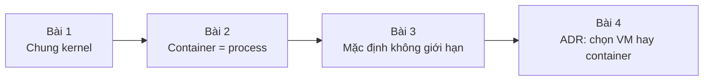

# Capstone 6_1_1: Container vs Máy Ảo — Chứng Minh Bằng Chính Máy Của Bạn

> **Khóa học**: Cloud DevOps Basic — Containers & Kubernetes
> **Phân nhóm**: 6 Domain 6 - Containers and Kubernetes › 6_1 Container Fundamentals › Capstones
> **Bài học gốc**: [6_1_1 Containers vs Virtual Machines](<../6_1_1 Containers vs Virtual Machines.md>)
> **Thời gian**: 90–120 phút · **Chi phí**: 0 · **Cần root/sudo**: Không
> **Trạng thái**: Bài 1–3 **đã chạy thử** (18-11-2026, Fedora 43, kernel 7.3.3, Podman 5.8.9 rootless, cgroup v2). Bài 4 là bài viết, không có lệnh. Số liệu trong phần "Đáp án tham chiếu" là kết quả thật của lần chạy đó; máy bạn có thể khác.

---

## 🎯 Kịch bản

Đội của bạn đang chạy 12 service Java trên 12 máy ảo, mỗi VM dùng chưa tới 10% CPU. Sếp hỏi: *"Chuyển sang container thì được gì, mất gì? Có gì VM làm được mà container không?"* Bạn không được trả lời bằng slide. Bạn phải **chỉ ra bằng chứng ngay trên máy** rồi viết một bản quyết định ngắn (ADR).

## 🗺️ Bản Đồ Phủ Kiến Thức (Coverage)

| Mục trong lesson 6_1_1 | Kiến thức | Bài tập |
| :--- | :--- | :---: |
| 1.1 | Container là một process bị cô lập, đi kèm file nó cần | Bài 2 |
| 1.2 | VM có kernel riêng, container dùng chung kernel; hệ quả về chi phí; không chạy được kernel khác | Bài 1, Bài 3 |
| 1.3 | Cô lập = namespaces + cgroups; **mặc định không giới hạn tài nguyên** | Bài 2, Bài 3 |
| 1.4 | Khi cần cách ly mạnh hơn (RuntimeClass, ảo hóa phần cứng, đổi lại overhead); VM và container dùng cùng nhau | Bài 4 |
| Sơ đồ mục 3 (3 ngăn xếp: VM / container / VM+container) | Phân biệt ba mô hình | Bài 1, Bài 4 |



## 🧰 Chuẩn Bị

```bash
podman --version                     # Podman 5.x (với Docker: thay podman bằng docker)
podman pull -q docker.io/library/alpine
```

> Dọn dẹp ở cuối file. Mọi tên tài nguyên của capstone này bắt đầu bằng `c1-`.

---

## Bài 1 — Chung Kernel (20 phút)

**Yêu cầu**: chứng minh bằng lệnh rằng container và máy chủ dùng **cùng một kernel**, rồi trả lời: *vì sao bạn không thể "chạy một container dùng kernel khác"?*

```bash
uname -r
podman run --rm docker.io/library/alpine uname -r
podman run --rm docker.io/library/alpine cat /proc/version
```

**Tiêu chí hoàn thành**
- [ ] Ba chuỗi kernel trùng nhau (hoặc bạn giải thích được vì sao không trùng, xem lưu ý).
- [ ] Viết 2–3 câu: image `alpine` chứa gì, và **không** chứa gì (gợi ý: có file hệ thống Alpine, không có kernel để boot).

> **Lưu ý**: nếu bạn dùng Docker Desktop hoặc `podman machine`, bên dưới đã có một VM Linux nên chuỗi kernel của container sẽ là kernel của VM đó, không phải của máy chủ. Hãy ghi lại nền tảng của bạn thay vì suy đoán (đúng tinh thần mục 4.2 của lesson).

<details>
<summary>Đáp án tham chiếu</summary>

Quan sát khi chạy thử: ba lệnh cùng in `7.3.3-100.fc43.x86_64` (dòng `/proc/version` cũng cùng bản kernel). Lý do: các container trên cùng máy chủ **dùng chung một kernel** (lesson 1.2). Image chỉ có userland (file, thư viện, `busybox`), nên container Linux cần kernel Linux ở máy chủ và không thể mang theo "kernel khác" như một VM. Đây là *suy luận từ hai dòng trích dẫn của lesson*, không phải câu trích nguyên văn.
</details>

---

## Bài 2 — Container Chỉ Là Một Process (30 phút)

**Yêu cầu**
1. Chạy một container nền `c1-demo` chạy `sleep 600`.
2. Tìm process đó **trên máy chủ** (PID, user, cha của nó).
3. Lập bảng 8 namespace: cột "máy chủ" và cột "process container"; đánh dấu namespace nào **khác**.
4. Chứng minh "container chỉ là process" bằng cách **giết process từ máy chủ** và quan sát trạng thái container.

```bash
podman run -d --name c1-demo docker.io/library/alpine sleep 600
P=$(podman inspect -f '{{.State.Pid}}' c1-demo); echo "PID trên máy chủ = $P"

podman top c1-demo pid user args        # nhìn từ phía Podman
ps -o pid,ppid,user,args -p $P          # nhìn từ máy chủ

for n in cgroup ipc mnt net pid time user uts; do
  printf "%-7s host=%-22s ctr=%s\n" $n "$(readlink /proc/$$/ns/$n)" "$(readlink /proc/$P/ns/$n)"
done

kill -9 $P; sleep 1
podman ps -a --filter name=c1-demo --format '{{.Names}} {{.Status}}'
podman inspect c1-demo -f 'exit={{.State.ExitCode}}'
```

**Tiêu chí hoàn thành**
- [ ] Bạn thấy **cùng một process** với hai PID khác nhau (`1` trong container, số khác trên máy chủ).
- [ ] Bảng namespace có cột đánh dấu khác/giống; bạn giải thích được vì sao hai inode giống nhau nghĩa là cùng namespace.
- [ ] Sau `kill -9`, container chuyển sang `Exited` và bạn giải thích được mã thoát.

<details>
<summary>Đáp án tham chiếu</summary>

- `podman top` hiển thị PID `1`, user `root`; `ps` trên máy chủ hiển thị `sleep 600` với PID khác và user của bạn (UID đã ánh xạ do rootless, xem lesson 6_1_7). Cha của nó là `conmon` (lesson 6_1_6).
- Quan sát: **7/8 namespace khác** (`cgroup`, `ipc`, `mnt`, `net`, `pid`, `user`, `uts`); riêng `time` **giống máy chủ** (`time:[4026531834]`). *Suy luận (chưa kiểm chứng bằng tài liệu)*: Podman/crun không tạo time namespace mới theo mặc định. Đây là điều đáng ghi nhận: "container = một bộ namespace riêng" không có nghĩa cả 8 loại luôn được tạo mới.
- Sau `kill -9`: `Exited (137) ...`, `exit=137` (`128 + 9`, lesson 6_1_3/6_1_8). Container biến mất khỏi trạng thái chạy chỉ vì process đã chết.
</details>

---

## Bài 3 — Mặc Định Không Có Giới Hạn, Giới Hạn Đến Từ cgroups (25 phút)

**Yêu cầu**
1. Với container **không** đặt giới hạn: đọc `memory.max`, `cpu.max`, `pids.max` trong cgroup của nó.
2. Chạy container thứ hai **có** giới hạn `--memory 128m --cpus 0.5 --pids-limit 50` và đọc lại ba file.
3. Đo `memory.current` của container nhàn rỗi và thời gian dựng một container.
4. Trả lời: nếu bạn quên đặt giới hạn trên node chạy 12 service, điều gì có thể xảy ra?

```bash
cg() { echo /sys/fs/cgroup$(cut -d: -f3 /proc/$1/cgroup); }

podman run -d --name c1-free  docker.io/library/alpine sleep 600
podman run -d --name c1-limit --memory 128m --cpus 0.5 --pids-limit 50 docker.io/library/alpine sleep 600

for c in c1-free c1-limit; do
  P=$(podman inspect -f '{{.State.Pid}}' $c); D=$(cg $P); echo "== $c"
  for f in memory.max cpu.max pids.max memory.current; do printf "%-15s %s\n" $f "$(cat $D/$f)"; done
done

time podman run --rm docker.io/library/alpine true
```

**Tiêu chí hoàn thành**
- [ ] Bảng so sánh hai container, ba file giới hạn.
- [ ] Bạn nói được cờ nào ghi vào file nào (`--memory` → `memory.max`, `--cpus` → `cpu.max`, `--pids-limit` → `pids.max`).
- [ ] Câu trả lời mục 4 dùng đúng cơ chế: kernel máy chủ cấp tài nguyên theo bộ lập lịch, không có hàng rào.

<details>
<summary>Đáp án tham chiếu</summary>

| File | `c1-free` | `c1-limit` |
| :--- | :--- | :--- |
| `memory.max` | `max` | `134217728` (= 128 MiB) |
| `cpu.max` | `max 100000` | `50000 100000` |
| `pids.max` | `2048` | `50` |

- `pids.max = 2048` ở container "không giới hạn" là **mặc định của Podman** (lesson 6_1_3, mục 1.4), không phải "vô hạn". Bộ nhớ và CPU thì mặc định không giới hạn (`max`).
- `memory.current` của container `sleep` nhàn rỗi quan sát được ~512 KiB; dựng + chạy + xóa một container `true` mất ~0,2 giây trên máy kiểm chứng. Hai số này chỉ để bạn có cảm giác về *chi phí*, vì container không cần boot một OS. **Không có số liệu VM** trong capstone này; nếu muốn so sánh, tự đo `free -m` và thời gian boot trên một VM của bạn.
- Hệ quả khi quên giới hạn: một service rò rỉ bộ nhớ hoặc ăn CPU có thể làm các container khác trên cùng kernel bị chậm hoặc bị OOM kill. Cách đặt: `--memory/--cpus` hoặc `resources.limits` của Kubernetes (6_3_6).
</details>

---

## Bài 4 — Viết ADR: Chọn VM, Container Hay Cả Hai (30 phút)

**Yêu cầu**: điền bảng quyết định dưới đây (mỗi dòng: lựa chọn + **một lý do kỹ thuật** nêu đúng cơ chế đã học), rồi viết đoạn "Quyết định cho 12 service Java" dài tối đa 8 dòng gồm: được gì, mất gì, rủi ro còn lại.

| # | Tình huống | Chọn gì? | Lý do (cơ chế) |
| :-: | :--- | :--- | :--- |
| a | 12 microservice Java của cùng một công ty, đội tin cậy lẫn nhau | | |
| b | Nền tảng SaaS cho **nhiều khách hàng** chạy code do khách tải lên | | |
| c | Ứng dụng cần một kernel hoặc hệ điều hành khác máy chủ | | |
| d | Node của một cluster Kubernetes trên cloud | | |
| e | Workload cần đảm bảo bảo mật cao nhưng vẫn muốn vận hành bằng Kubernetes | | |

**Tiêu chí hoàn thành**
- [ ] Cả 5 dòng có lý do nêu được "dùng chung kernel", "namespaces + cgroups" hoặc "overhead".
- [ ] Đoạn ADR nêu rõ **ranh giới cô lập yếu hơn VM** là rủi ro, và biện pháp giảm (giới hạn tài nguyên, 6_1_7, RuntimeClass).

<details>
<summary>Đáp án tham chiếu</summary>

| # | Chọn | Lý do |
| :-: | :--- | :--- |
| a | Container | Dùng chung kernel nên chạy được nhiều ứng dụng hơn trên ít hạ tầng hơn; rủi ro cô lập chấp nhận được vì cùng mức tin cậy. Vẫn phải đặt giới hạn tài nguyên. |
| b | Cách ly mạnh hơn container thường: VM, hoặc runtime dùng ảo hóa phần cứng (RuntimeClass) | Container dùng chung kernel; code không tin cậy làm ranh giới này quan trọng (suy luận từ 1.2 và 1.4, lesson cũng nói đây là cách hiểu chung). Cái giá là thêm overhead. |
| c | VM | Container không mang kernel riêng; container Linux cần kernel Linux ở máy chủ. |
| d | VM chạy container runtime | Lesson 1.4: trên cloud, máy được cấp thường là VM và một VM chạy container runtime có thể chạy nhiều ứng dụng container hóa. Hai công nghệ dùng **cùng nhau**. |
| e | Kubernetes + RuntimeClass chọn runtime dùng ảo hóa phần cứng cho Pod đó | Lesson 1.4: có thể chọn runtime khác cho từng Pod; đổi lại thêm overhead. |

Ví dụ ADR: *"Chuyển 12 service sang container trên một số VM node. Được: mật độ cao, khởi động nhanh, image nhất quán. Mất: ranh giới cô lập yếu hơn VM vì dùng chung kernel; không chạy được kernel khác. Rủi ro còn lại: lỗ hổng kernel ảnh hưởng mọi container trên node. Giảm: luôn đặt memory/cpu/pids limit, chạy non-root/rootless, bỏ capability không cần; workload nhạy cảm dùng RuntimeClass riêng."*
</details>

---

## ✅ Nghiệm Thu Capstone

- [ ] Bài 1–3 có output thật của máy bạn (dán vào ghi chú cá nhân).
- [ ] ADR ở Bài 4 đọc cho một người không rành container hiểu trong 2 phút.
- [ ] Bạn trả lời được ba câu dưới đây không nhìn tài liệu.

## 🧠 Câu Hỏi Bảo Vệ

1. Vì sao khởi động container nhanh hơn VM, và đổi lại bạn mất gì?
2. "Container là VM nhẹ": đúng hay sai? Nêu hai bằng chứng từ Bài 1 và Bài 2.
3. Container không đặt `--memory` thì dùng được bao nhiêu RAM? Ai quyết định?

## 🧹 Dọn Dẹp

```bash
podman rm -f -t 0 c1-demo c1-free c1-limit 2>/dev/null
```

## 📚 Nguồn Tài Liệu Chính Thống (Official References)
- [Docker Docs — What is a container?](https://docs.docker.com/get-started/docker-concepts/the-basics/what-is-a-container/) — Container là process cô lập, so sánh với VM.
- [namespaces(7)](https://man7.org/linux/man-pages/man7/namespaces.7.html) — 8 loại namespace và `/proc/pid/ns/`.
- [Control Group v2 — Linux Kernel documentation](https://docs.kernel.org/admin-guide/cgroup-v2.html) — `memory.max`, `cpu.max`, `pids.max`.
- [Docker Docs — Resource constraints](https://docs.docker.com/engine/containers/resource_constraints/) — Mặc định không giới hạn và cách đặt giới hạn.
- [Kubernetes — Runtime Class](https://kubernetes.io/docs/concepts/containers/runtime-class/) — Chọn runtime cách ly mạnh hơn cho từng Pod.
- [podman-run(1)](https://docs.podman.io/en/latest/markdown/podman-run.1.html) và [podman-top(1)](https://docs.podman.io/en/latest/markdown/podman-top.1.html) — Các cờ dùng trong bài.
