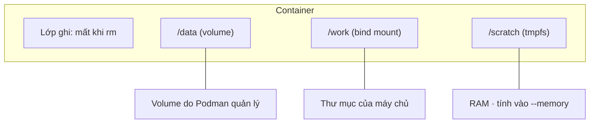

# Capstone 6_1_10: Dữ Liệu Phải Sống Sót Qua Rolling Update — Volume, Bind Mount, tmpfs Và Quyền File

> **Khóa học**: Cloud DevOps Basic — Containers & Kubernetes
> **Phân nhóm**: 6 Domain 6 - Containers and Kubernetes › 6_1 Container Fundamentals › Capstones
> **Bài học gốc**: [6_1_10 Container Data Storage](<../6_1_10 Container Data Storage.md>)
> **Thời gian**: 3–4 giờ · **Chi phí**: 0 · **Cần root/sudo**: Không
> **Yêu cầu**: Podman 5.x rootless; SELinux Enforcing (Fedora/RHEL) cho các bài có nhãn `:Z`
> **Trạng thái**: Bài 1–6 **đã chạy thử** (18-11-2026, Fedora 43, kernel 7.3.3, Podman 5.8.9 rootless, SELinux Enforcing). Bài 7 là bài viết. Số UID (`525521`...) phụ thuộc `/etc/subuid` của máy bạn.

---

## 🎯 Kịch bản

Service `counter` của bạn đếm số lần chạy và lưu vào file. Sau mỗi lần deploy (thay container bằng bản mới) bộ đếm **về 1**. Ở máy dev, bind mount thì `Permission denied`. Ở production, một container ghi tmpfs quá tay bị kill. Bạn phải tái hiện, giải thích và sửa **cả ba**, đồng thời chứng minh rủi ro bảo mật của bind mount.

## 🗺️ Bản Đồ Phủ Kiến Thức (Coverage)

| Mục trong lesson 6_1_10 | Kiến thức | Bài |
| :--- | :--- | :---: |
| 1.1 | Lớp ghi mất khi xóa container ⇒ ba cơ chế: volume, bind mount, tmpfs | 1, 7 |
| 1.2 | Volume: tạo tường minh hoặc tự tạo; `-v NAME:/DIR` tự tạo nếu chưa có; vị trí lưu | 1, 2 |
| 1.3 | Bind mount: ghi được vào file máy chủ, rủi ro; (`:ro` ngoài lesson) | 3 |
| 1.4 | tmpfs: chỉ ở RAM, mất khi dừng, **tính vào giới hạn bộ nhớ cgroup**, `--tmpfs` | 4 |
| 1.5 | Quyền sở hữu khi rootless: `--userns=keep-id`, tùy chọn `U`, nhãn `:Z` | 5 |
| 1.6 | Cú pháp `--mount=type=...` | 6 |
| Gotcha 5.1–5.4 | Mất dữ liệu khi thay container; bind mount mở quyền rộng; permission denied rootless; tmpfs "ăn" bộ nhớ | 1, 3, 5, 4 |



## 🧰 Chuẩn Bị

```bash
podman pull -q docker.io/library/alpine
WORK=$(mktemp -d /tmp/c10-XXXXXX); cd "$WORK"; echo "thư mục làm việc: $WORK"
# "Ứng dụng" đếm số lần chạy, lưu vào /data/counter
CNT='mkdir -p /data; n=$(cat /data/counter 2>/dev/null || echo 0); n=$((n+1)); echo $n > /data/counter; echo "version=$APP_VERSION counter=$n"'
```

> Tên tài nguyên: `c10-*`. Dọn dẹp ở cuối file. **Không** dùng `podman volume prune` trong capstone này: lệnh đó xóa **mọi volume không dùng**, kể cả của dự án khác. Luôn xóa volume bằng **tên** của chính bạn.

---

## Bài 1 — Tái Hiện Sự Cố "Bộ Đếm Về 1" Và Sửa Bằng Volume (45 phút)

**Yêu cầu**: chạy "ứng dụng" ở ba tình huống: (a) mỗi lần một container mới **không** có volume; (b) cùng một container chạy lại, rồi xóa và tạo lại; (c) mỗi lần một container mới **có** volume `c10-state`. Ghi bộ đếm ở từng lần.

```bash
echo "== (a) thay container mỗi lần, không volume"
for v in 1 2 3; do podman run --rm -e APP_VERSION=$v docker.io/library/alpine sh -c "$CNT"; done

echo "== (b) cùng một container chạy lại, rồi rm + tạo lại"
podman create --name c10-keep -e APP_VERSION=1 docker.io/library/alpine sh -c "$CNT" >/dev/null
podman start -a c10-keep; podman start -a c10-keep
podman rm c10-keep >/dev/null
podman create --name c10-keep -e APP_VERSION=1 docker.io/library/alpine sh -c "$CNT" >/dev/null
podman start -a c10-keep; podman rm c10-keep >/dev/null

echo "== (c) có volume (bản 1, 1, rồi bản 2)"
for v in 1 1 2; do podman run --rm -e APP_VERSION=$v -v c10-state:/data docker.io/library/alpine sh -c "$CNT"; done
```

**Tiêu chí hoàn thành**
- [ ] (a): `1, 1, 1`. (b): `1, 2, rồi lại 1`. (c): `1, 2, 3` (bản 2 vẫn **tiếp tục** bộ đếm).
- [ ] Giải thích bằng cơ chế: (a) mỗi `run` tạo lớp ghi mới; (b) `start` lại giữ lớp ghi, `rm` xóa nó (lesson 1.1, capstone 6_1_4 Bài 3); (c) volume nằm ngoài lớp ghi.
- [ ] Ghi chú: `-v c10-state:/data` tự **tạo** volume nếu chưa có (lesson 1.2).
- [ ] Liên hệ rolling update của Kubernetes: Pod bị thay thế ⇒ dữ liệu trong container mất ⇒ cần PersistentVolume (6_4_6).

<details>
<summary>Đáp án tham chiếu</summary>

Quan sát: (a) `counter=1` ba lần; (b) `counter=1`, `counter=2`, rồi sau `rm` + tạo lại `counter=1`; (c) `counter=1`, `counter=2`, `counter=3` (với `version=2` ở lần cuối). Dòng `mkdir -p /data` trong `CNT` là cần thiết vì khi không mount volume, thư mục `/data` chưa tồn tại trong image `alpine` (lỗi `nonexistent directory` nếu thiếu).
</details>

---

## Bài 2 — Cơ Học Của Volume: Ở Đâu, Tên Gì, Xóa An Toàn (35 phút)

**Yêu cầu**: tìm nơi volume lưu dữ liệu, phân biệt **named** và **anonymous** volume, và dọn đúng tên.

```bash
podman volume ls --format '{{.Name}} {{.Driver}}' | grep c10-state
podman volume inspect c10-state -f '{{.Mountpoint}}'                  # đường dẫn trên máy chủ
podman unshare cat "$(podman volume inspect c10-state -f '{{.Mountpoint}}')/counter"

# Anonymous volume: KHÔNG dùng --rm (với --rm, volume ẩn danh bị xóa theo container)
BEFORE=$(podman volume ls -q | sort)
podman run --name c10-an -v /anon docker.io/library/alpine true
podman inspect c10-an -f '{{range .Mounts}}{{.Type}} {{.Destination}} {{.Name}}{{end}}' | cut -c1-45
podman rm c10-an >/dev/null
AFTER=$(podman volume ls -q | sort)
NEW=$(comm -13 <(echo "$BEFORE") <(echo "$AFTER")); echo "volume ẩn danh mới còn lại sau khi rm container: $(echo "$NEW" | grep -c .)"
for v in $NEW; do podman volume rm "$v" >/dev/null; done        # xóa ĐÚNG tên
podman volume rm c10-state
```

**Tiêu chí hoàn thành**
- [ ] `Mountpoint` nằm trong kho lưu trữ của Podman của bạn (rootless: dưới `~/.local/share/containers/storage/volumes/<tên>/_data`); file `counter` có giá trị `3`.
- [ ] Volume **ẩn danh** (tên là chuỗi hash) vẫn tồn tại sau khi `rm` container (không dùng `--rm`) và bạn đã xóa đúng nó **bằng tên**.
- [ ] Giải thích rủi ro của `volume prune`: xóa volume **không được container nào dùng**, nên có thể xóa dữ liệu thật mà bạn đang tạm không chạy container (chỉ cân nhắc khi bạn đã liệt kê và hiểu từng volume).
- [ ] Giải thích sự khác nhau với Docker: lesson mô tả `docker volume create` và vùng lưu trữ của Docker; Podman tự tạo khi `-v SOURCE-VOLUME:/DIR` chưa có (lesson 1.2).

<details>
<summary>Đáp án tham chiếu</summary>

Quan sát: `c10-state local`; `Mountpoint` dạng `~/.local/share/containers/storage/volumes/c10-state/_data`; nội dung `counter` là `3`. Với `-v /anon` và **không** `--rm`: `inspect` cho `volume /anon <hash>`; sau `rm` container, volume ẩn danh **vẫn còn (1)**. (Lần thử đầu với `--rm` không để lại volume ẩn danh nào: hành vi này là quan sát, **ngoài lesson**.) Việc `volume prune` có thể xóa dữ liệu thật là kiến thức chung, hãy đọc `podman-volume-prune(1)` trước khi dùng.
</details>

---

## Bài 3 — Bind Mount: Tiện Cho Dev, Nguy Hiểm Cho Máy Chủ (40 phút)

**Yêu cầu**: chứng minh **container xóa được file trên máy chủ** qua bind mount ghi được; sau đó thu hẹp quyền bằng `:ro`. Trên SELinux Enforcing thêm nhãn `:Z` (xem 6_1_7).

```bash
mkdir -p bm && echo important > bm/keep.txt

podman run --rm -v $PWD/bm:/work:Z docker.io/library/alpine rm /work/keep.txt
echo "file còn lại trên máy chủ: $(ls bm | wc -l)"                 # 0 => đã bị xóa

echo important > bm/keep.txt
podman run --rm -v $PWD/bm:/work:ro,Z docker.io/library/alpine sh -c \
  'rm /work/keep.txt; echo "rm rc=$?"; touch /work/x; echo "touch rc=$?"'
ls bm
```

> Chỉ dùng thư mục thử nghiệm `bm`. **Không** thử bind mount thư mục thật (`/etc`, `$HOME`) với quyền ghi.

**Tiêu chí hoàn thành**
- [ ] Lần 1: file trên máy chủ **biến mất** (số file còn lại `0`).
- [ ] Lần 2 với `:ro`: `Read-only file system`, file còn nguyên.
- [ ] Giải thích đúng thuật ngữ của lesson: bind mount có quyền ghi vào file máy chủ **theo mặc định**; process trong container có thể tạo/sửa/xóa file quan trọng của máy chủ.
- [ ] Giải thích vì sao ví dụ dùng `:Z` (SELinux) và nếu bỏ sẽ gặp gì (capstone 6_1_7 Bài 4).
- [ ] Viết 3 quy tắc bind mount an toàn (đúng thư mục, `:ro` khi có thể, không mount thư mục nhạy cảm).

<details>
<summary>Đáp án tham chiếu</summary>

Quan sát: lần 1 `file còn lại trên máy chủ: 0`; lần 2: `rm: can't remove '/work/keep.txt': Read-only file system` (rc 1), `touch: /work/x: Read-only file system` (rc 1), `ls bm` vẫn có `keep.txt`. Lesson **không** trích dẫn cờ `:ro`; đã được xác nhận bằng lần chạy này, nhưng hãy đọc `podman-run(1)` để biết cú pháp chính thức (tùy chọn `ro`).
</details>

---

## Bài 4 — tmpfs: Nhanh, Tạm Thời Và "Ăn" Bộ Nhớ (40 phút)

**Yêu cầu**
1. Gắn tmpfs `10m`, ghi 20 MB và quan sát.
2. Gắn tmpfs `200m` vào container giới hạn `--memory 64m`, ghi 150 MB, rồi đọc `OOMKilled` và exit code.
3. Xem mount của tmpfs và dạng `--mount type=tmpfs`.

```bash
podman run --rm --tmpfs /scratch:rw,size=10m docker.io/library/alpine sh -c \
  'df -h /scratch | tail -1; dd if=/dev/zero of=/scratch/f bs=1M count=20 2>&1 | tail -2'

podman run --name c10-tm --memory 64m --tmpfs /scratch:rw,size=200m docker.io/library/alpine sh -c \
  'dd if=/dev/zero of=/scratch/f bs=1M count=150 2>&1 | tail -2'
podman inspect c10-tm -f 'exit={{.State.ExitCode}} oom={{.State.OOMKilled}}'
podman rm c10-tm >/dev/null

podman run --rm --tmpfs /scratch docker.io/library/alpine sh -c 'echo x > /scratch/t; mount | grep scratch | cut -c1-100'
podman run --rm --mount type=tmpfs,destination=/scratch,tmpfs-size=5m docker.io/library/alpine sh -c 'df -h /scratch | tail -1'
```

**Tiêu chí hoàn thành**
- [ ] Bước 1: tmpfs 10 MB hiện đúng size; ghi 20 MB **không** hết (lỗi *no space left* hoặc chỉ 10 MB ghi được).
- [ ] Bước 2: dòng `Killed` của `dd`, `oom=true`. **Chú ý exit code**: container có thể thoát `0` vì PID 1 (`sh`) vẫn kết thúc bình thường. Giải thích vì sao `OOMKilled=true` mới là bằng chứng (capstone 6_1_3 Bài 2 và 5).
- [ ] Giải thích: dữ liệu tmpfs **tính vào giới hạn bộ nhớ cgroup** của container (lesson 1.4) ⇒ tmpfs lớn + `--memory` nhỏ ⇒ OOM.
- [ ] Nêu quy tắc: "tính kích thước tmpfs vào `--memory`" (gotcha 5.4).
- [ ] Mount của `--tmpfs` hiển thị `tmpfs on /scratch type tmpfs ...`; `--mount type=tmpfs,...,tmpfs-size=5m` cho `df` 5 MB.

<details>
<summary>Đáp án tham chiếu</summary>

Quan sát: bước 1 `tmpfs 10.0M ... /scratch`, `dd` ghi được 10 MB (`10+0 records out`) rồi dừng; bước 2 `Killed`, `exit=0 oom=true` (shell vẫn thoát bình thường); `--tmpfs /scratch` mặc định cho mount `tmpfs ... rw,context=...,nosuid,nodev,...`; `--mount type=tmpfs,destination=/scratch,tmpfs-size=5m` cho `df` `5.0M`. Cờ con `tmpfs-size` và danh sách loại mount của `--mount` lấy từ `podman-run(1)`; lesson chỉ liệt kê các loại (mục 1.6).
</details>

---

## Bài 5 — Quyền Sở Hữu File Khi Rootless: Ma Trận Bốn Cách Sửa (60 phút)

**Yêu cầu**: bind mount thư mục do **bạn** sở hữu vào container ở bốn cấu hình và ghi bảng: UID trong container, chủ file khi nhìn từ trong container (`ls -ln`), ghi được không, và chủ file khi nhìn từ máy chủ.

```bash
mkdir -p $HOME/c10-data && echo hello > $HOME/c10-data/a.txt
echo "UID của tôi: $(id -u)"; ls -ln $HOME/c10-data

echo "[1] root trong container";     podman run --rm -v $HOME/c10-data:/data:Z docker.io/library/alpine sh -c 'id -u; ls -ln /data; echo more >> /data/a.txt && echo write-ok'
echo "[2] user 1234";                podman run --rm --user 1234 -v $HOME/c10-data:/data:Z docker.io/library/alpine sh -c 'id -u; ls -ln /data; echo more >> /data/a.txt; echo "rc=$?"'
echo "[3] --userns=keep-id";         podman run --rm --userns=keep-id -v $HOME/c10-data:/data:Z docker.io/library/alpine sh -c 'id -u; ls -ln /data; echo more >> /data/a.txt && echo write-ok'
echo "[4] user 1234 + volume option U"
podman run --rm --user 1234 -v $HOME/c10-data:/data:Z,U docker.io/library/alpine sh -c 'ls -ln /data; echo more >> /data/a.txt && echo write-ok'
echo "chủ file nhìn từ máy chủ SAU [4]:"; ls -ln $HOME/c10-data
```

**Tiêu chí hoàn thành**
- [ ] Bảng 4 dòng (`[1]`–`[4]`) đủ 4 cột.
- [ ] `[1]`: root trong container **ghi được** vì root trong container = UID của bạn trên máy chủ; từ trong container file thuộc `0`. `[2]`: `1234` thấy file thuộc `0` ⇒ `Permission denied`. `[3]`: UID trong container = UID của bạn ⇒ ghi được. `[4]`: `U` đổi chủ sở hữu file thành `1234` (từ trong container) ⇒ ghi được.
- [ ] Chỉ ra **tác dụng phụ nguy hiểm của `U`**: sau `[4]` chủ file trên máy chủ thành UID lạ (ví dụ `525521`), bạn **mất quyền** sửa trực tiếp. Giải thích bằng công thức ánh xạ (capstone 6_1_7 Bài 1) và cách lấy lại: `podman unshare chown ...`.
- [ ] Nêu khi nào chọn mỗi cách: `keep-id` (dev, cần UID khớp), `U` (volume riêng của container, chấp nhận đổi chủ), chỉnh quyền thư mục (khi biết UID đích).

```bash
# Lấy lại quyền sở hữu (khi cần) rồi dọn: chạy trong user namespace của Podman
podman unshare chown -R 0:0 $HOME/c10-data       # UID 0 trong namespace = UID của bạn trên máy chủ
ls -ldn $HOME/c10-data
podman unshare rm -rf $HOME/c10-data
```

<details>
<summary>Đáp án tham chiếu</summary>

| # | UID trong container | Chủ file thấy từ trong | Ghi được? | Chủ file thấy từ máy chủ |
| :-: | :-: | :-: | :-: | :-: |
| 1 | 0 | `0` | có | `1000` (UID của bạn) |
| 2 | 1234 | `0` | **không** (`Permission denied`, rc 1) | `1000` |
| 3 | 1000 | `1000` | có | `1000` |
| 4 (`U`) | 1234 | `1234` | có | **`525521`** (= 524288 + 1233) |

`--userns=keep-id` ánh xạ user của bạn sang **cùng UID** trong container; tùy chọn `U`/`chown` đổi chủ sở hữu đệ quy của volume nguồn dựa trên UID/GID của container (lesson 1.5). Số `525521` khác ở máy bạn. Lệnh `podman unshare chown` để lấy lại quyền là kỹ thuật của capstone, **ngoài lesson** (đối chiếu `podman-unshare(1)`).
</details>

---

## Bài 6 — Dịch `-v` / `--tmpfs` Sang `--mount` (25 phút)

**Yêu cầu**: viết lại ba mount ở dạng `--mount=type=...` và kiểm tra bằng `inspect` rằng kết quả tương đương.

```bash
mkdir -p bm2
podman run -d --name c10-mm \
  --mount type=volume,source=c10-vol2,destination=/data \
  --mount type=bind,source=$PWD/bm2,destination=/work,ro=true,relabel=private \
  --mount type=tmpfs,destination=/scratch,tmpfs-size=5m \
  docker.io/library/alpine sleep 60 >/dev/null
podman inspect c10-mm -f '{{range .Mounts}}{{.Type}}|{{.Destination}}|rw={{.RW}}{{"\n"}}{{end}}'
podman exec c10-mm sh -c 'df -h /scratch | tail -1; touch /work/x 2>&1; touch /data/ok && echo "data ghi được"'
podman rm -f -t 0 c10-mm >/dev/null; podman volume rm c10-vol2
```

**Tiêu chí hoàn thành**
- [ ] Bảng "`-v`/`--tmpfs` tương đương ↔ `--mount`": volume ↔ `type=volume,source=...,destination=...`; bind ↔ `type=bind,...`; tmpfs ↔ `type=tmpfs,...`.
- [ ] `inspect` cho `volume|/data|rw=true` và `bind|/work|rw=false`; tmpfs thì kiểm bằng `df` (`5.0M`).
- [ ] Liệt kê các loại mount mà `--mount` hỗ trợ theo trang `podman-run(1)` `latest` (artifact, bind, devpts, glob, image, ramfs, tmpfs, volume) và ghi chú đây phụ thuộc phiên bản Podman.

<details>
<summary>Đáp án tham chiếu</summary>

Quan sát: `volume|/data|rw=true`, `bind|/work|rw=false`; trong danh sách `.Mounts` **không** thấy mục tmpfs (Podman liệt kê riêng), nhưng `df -h /scratch` báo `5.0M` nên mount có hiệu lực. Các tùy chọn con (`ro=true`, `relabel=private`, `tmpfs-size`) lấy từ `podman-run(1)`; lesson chỉ liệt kê các loại `type=`. Đối chiếu bản Podman/Docker của bạn.
</details>

---

## Bài 7 — Quyết Định Kiến Trúc: Chọn Cơ Chế Cho Từng Loại Dữ Liệu (25 phút, bài viết)

**Yêu cầu**: chọn volume / bind mount / tmpfs / "không cần" cho mỗi loại dữ liệu và nêu **một rủi ro**.

| # | Dữ liệu | Chọn | Lý do + rủi ro |
| :-: | :--- | :--- | :--- |
| a | File của database (Postgres) | | |
| b | Mã nguồn bạn đang sửa trên laptop, container chạy hot-reload | | |
| c | Cache tạm của ứng dụng, mất cũng không sao, cần nhanh | | |
| d | File upload của người dùng, nhiều container cùng đọc | | |
| e | File tạm sinh ra trong lúc xử lý một request, xóa ngay | | |

<details>
<summary>Đáp án tham chiếu</summary>

| # | Chọn | Gợi ý |
| :-: | :--- | :--- |
| a | **Volume** | Cơ chế được ưu tiên cho dữ liệu do container sinh ra và dùng, tách khỏi vòng đời container. Rủi ro: xóa volume = mất dữ liệu; sao lưu riêng. Ở Kubernetes: PersistentVolume (6_4_6) |
| b | **Bind mount** | Đưa thư mục có sẵn của máy chủ vào container. Rủi ro: container ghi được vào máy chủ (dùng `:ro` nếu chỉ đọc); rootless cần `keep-id`/nhãn `:Z` |
| c | **tmpfs** | Chỉ ở RAM, mất khi dừng. Rủi ro: tính vào `--memory` ⇒ OOM nếu quá lớn |
| d | **Volume** (chia sẻ) | Chia sẻ giữa container; hiểu giới hạn đồng thời ghi: lesson chỉ nói volume phù hợp khi dữ liệu cần "chia sẻ giữa container" |
| e | Thường **lớp ghi** hoặc tmpfs | Dữ liệu ngắn hạn, không cần giữ; nếu lớn/ghi nhiều thì volume hoặc tmpfs có giới hạn |

Ghi chú: lesson nói volume là cơ chế ưu tiên và dữ liệu "cần tồn tại lâu, ghi nhiều hoặc chia sẻ giữa container" nên đặt ở volume. Các chi tiết về đồng thời ghi (d) **không** nằm trong lesson.
</details>

---

## ✅ Nghiệm Thu Capstone

- [ ] Bảng 3 tình huống Bài 1, ma trận Bài 5 (4 dòng), bảng Bài 7 có đủ dữ liệu từ máy bạn.
- [ ] Viết **ghi chú 1 trang** "Dữ liệu trong container": lớp ghi vs volume vs bind vs tmpfs; 3 rủi ro (mất khi `rm`; bind ghi được vào máy chủ; tmpfs ăn RAM) và cách phòng.
- [ ] Chứng minh được "rolling update không mất dữ liệu" bằng đúng ví dụ bộ đếm.

## 🧠 Câu Hỏi Bảo Vệ

1. Dữ liệu ghi vào `/var/lib/app` trong container (không mount gì) đi đâu khi `podman rm`?
2. Vì sao bind mount là rủi ro bảo mật còn volume thì ít hơn?
3. Container rootless báo `Permission denied` khi ghi thư mục mount. Ba cách sửa và đánh đổi của từng cách?
4. Tmpfs có "miễn phí" bộ nhớ không?

## 🧹 Dọn Dẹp

```bash
podman rm -f -t 0 c10-keep c10-an c10-tm c10-mm 2>/dev/null
podman volume rm c10-state c10-vol2 2>/dev/null          # chỉ xóa đúng tên của capstone
podman unshare rm -rf $HOME/c10-data 2>/dev/null
cd ~ && rm -rf "$WORK"
```

## 📚 Nguồn Tài Liệu Chính Thống (Official References)
- [Docker Docs — Volumes](https://docs.docker.com/engine/storage/volumes/) — Volume, cách tạo, khi nào dùng.
- [Docker Docs — Bind mounts](https://docs.docker.com/engine/storage/bind-mounts/) — Bind mount và cân nhắc bảo mật.
- [Docker Docs — tmpfs mounts](https://docs.docker.com/engine/storage/tmpfs/) — tmpfs và giới hạn bộ nhớ.
- [Docker Docs — Storage drivers](https://docs.docker.com/engine/storage/drivers/) — Lớp ghi của container.
- [podman-run(1)](https://docs.podman.io/en/latest/markdown/podman-run.1.html) — `--volume`, `--mount`, `--tmpfs`, `--userns`, tùy chọn `U`, `ro`, `z`/`Z`.
- [podman-volume-prune(1)](https://docs.podman.io/en/latest/markdown/podman-volume-prune.1.html) — Hành vi của prune (đọc trước khi dùng).
- [podman-unshare(1)](https://docs.podman.io/en/latest/markdown/podman-unshare.1.html) — Chạy lệnh trong user namespace của Podman (ngoài lesson).
