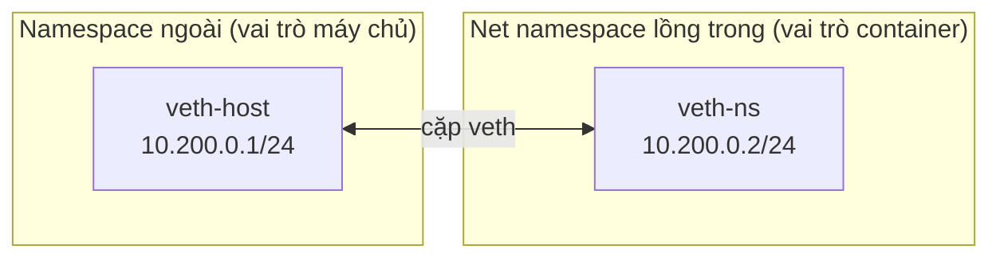

# Capstone 6_1_2: Dựng "Container Thô" Từ Namespaces, Không Cần Docker

> **Khóa học**: Cloud DevOps Basic — Containers & Kubernetes
> **Phân nhóm**: 6 Domain 6 - Containers and Kubernetes › 6_1 Container Fundamentals › Capstones
> **Bài học gốc**: [6_1_2 Linux Namespaces for Containers](<../6_1_2 Linux Namespaces for Containers.md>)
> **Thời gian**: 3–4 giờ · **Chi phí**: 0 · **Cần root/sudo**: **Không** (mọi bài dùng user namespace; bản `sudo` chỉ được nhắc, chưa chạy thử)
> **Công cụ**: `unshare`, `nsenter`, `lsns` (util-linux), `ip` (iproute2), `gcc`, Podman
> **Trạng thái**: Bài 1–6 **đã chạy thử** (18-11-2026, Fedora 43, kernel 7.3.3, util-linux 2.41, Podman 5.8.9 rootless). Số PID/inode luôn khác ở mỗi lần chạy; chỉ để ý chúng **giống hay khác nhau**.

---

## 🎯 Kịch bản

Bạn là SRE được gọi vào lúc nửa đêm: *"container `api` có cùng mạng với host không? Process của nó có thấy process của host không? Sao `docker exec` vào được còn tôi `nsenter` thì báo lỗi?"* Để trả lời chắc chắn, bạn phải hiểu container ở mức **syscall và `/proc`**. Capstone này bắt bạn tự dựng một "container thô" gồm PID, mạng, hostname, user, time namespace rồi nối nó ra mạng bằng `veth`, và viết vài dòng C gọi `clone`, `unshare`, `setns`.

## 🗺️ Bản Đồ Phủ Kiến Thức (Coverage)

| Mục trong lesson 6_1_2 | Kiến thức | Bài |
| :--- | :--- | :---: |
| 1.1 | Namespace bao một tài nguyên toàn cục; container = **bộ** namespace; namespace = "thấy gì", cgroup = "dùng bao nhiêu" | 1, 2 |
| 1.2 | 8 loại namespace và cờ `CLONE_NEW*`, `time` từ Linux 5.6 | 1, 2 |
| 1.3 | PID 1; orphan được init nhận nuôi; init chết ⇒ `SIGKILL` cả namespace | 3 |
| 1.4 | Network namespace; `veth` theo cặp; namespace bị giải phóng ⇒ `veth` bị hủy | 4 |
| 1.5 | `/proc/<pid>/ns/`, so inode, `lsns`, `unshare`, `nsenter` | 1, 2 |
| 1.6 | `clone(2)` / `unshare(2)` / `setns(2)`; `CAP_SYS_ADMIN`; ngoại lệ user namespace | 5 |
| 1.7 | User namespace, `uid_map`/`gid_map` | 2, 6 |
| 1.8 | Time namespace: 2 đồng hồ, `timens_offsets`, `time_for_children` | 6 |
| README 6_1_2 | "container mới chỉ có `lo` cho tới khi runtime gắn `veth`" | 2, 4 |

## 🧰 Chuẩn Bị

```bash
podman pull -q docker.io/library/alpine
WORK=$(mktemp -d /tmp/c2-XXXXXX); cd "$WORK"; echo "thư mục làm việc: $WORK"
unshare --version; gcc --version | head -1
```

> Tên tài nguyên của capstone này bắt đầu bằng `c2-`. Dọn dẹp ở cuối file.

---

## Bài 1 — Đọc Namespace Của Một Container Thật (25 phút)

**Yêu cầu**
1. Chạy container nền `c2-demo` (`sleep 600`) và lấy PID trên máy chủ.
2. Liệt kê namespace của nó bằng `/proc/<pid>/ns` và `lsns -p`.
3. Dùng `nsenter` **chỉ với `-n`** để xem mạng của container, và ghi lại lỗi. Sau đó thêm `-U` và giải thích vì sao lần này chạy được.

```bash
podman run -d --name c2-demo docker.io/library/alpine sleep 600
P=$(podman inspect -f '{{.State.Pid}}' c2-demo); echo "PID=$P"

ls -l /proc/$P/ns
lsns -p $P

nsenter -t $P -n ip -br addr          # dự đoán: lỗi
nsenter -t $P -U -n ip -br addr       # vào user namespace trước, rồi net
```

**Tiêu chí hoàn thành**
- [ ] Bảng 8 dòng: loại namespace, cờ `CLONE_NEW*`, nó cô lập gì, container có khác máy chủ không.
- [ ] Giải thích được lệnh đầu lỗi còn lệnh thứ hai chạy: gia nhập namespace cần quyền trong **user namespace sở hữu** nó (`setns(2)`, mục 1.6 của lesson).

<details>
<summary>Đáp án tham chiếu</summary>

- `ls -l /proc/$P/ns` cho 8 symlink dạng `loại:[inode]`. Khác máy chủ: `cgroup`, `ipc`, `mnt`, `net`, `pid`, `user`, `uts`. **`time` giống máy chủ**.
- `nsenter -t $P -n ...` báo `nsenter: reassociate to namespaces failed: Operation not permitted`.
- `nsenter -t $P -U -n ...` chạy được và in interface bên trong container. Lý do (theo `setns(2)` đã trích ở lesson 1.6): vào net namespace cần `CAP_SYS_ADMIN` trong user namespace của chính bạn **và** trong user namespace sở hữu namespace đích; vào user namespace trước thì bạn có capability đó vì process cha cùng UID với chủ sở hữu user namespace. Với container rootful bạn sẽ dùng `sudo nsenter -t <PID> -n` (mục 4.3 của lesson, **chưa chạy thử** ở capstone này vì không có sudo).
- Quan sát về nội dung: container rootless mặc định nhìn thấy `lo` và một interface mang **tên và địa chỉ sao chép từ máy chủ** (do `pasta`, xem 6_1_9).
</details>

---

## Bài 2 — Tự Dựng "Container Thô" Bằng `unshare` (30 phút)

**Yêu cầu**: một lệnh `unshare` duy nhất tạo process có PID, hostname, IPC, mạng, cgroup, mount và user namespace riêng. Bên trong hãy chứng minh từng thứ.

```bash
unshare -r -p -f --mount-proc -u -n -i -C bash -c '
  hostname raw-box
  echo "hostname=$(hostname)  pid=$$"
  ps -e -o pid,ppid,comm
  ip -br link
  id -u; cat /proc/self/uid_map
  for n in cgroup ipc mnt net pid time user uts; do echo "$n=$(readlink /proc/self/ns/$n)"; done'
echo "hostname máy chủ vẫn là: $(hostname)"

# Không có -r (không có user namespace) thì sao?
unshare -p -f true; echo "rc=$?"
```

**Tiêu chí hoàn thành**
- [ ] Trong "container": hostname đổi, `ps` chỉ có vài process, `bash` là PID 1, `ip link` chỉ có `lo`, `id -u` là `0`.
- [ ] Ngoài: hostname máy chủ không đổi.
- [ ] Trả lời: vì sao lệnh cuối lỗi và `-r` khắc phục thế nào? (`CAP_SYS_ADMIN`, ngoại lệ của user namespace)
- [ ] Trả lời: cờ nào của lệnh `unshare` tương ứng với từng loại trong 8 loại? Loại nào **không** có trong lệnh trên (gợi ý: `time`).

<details>
<summary>Đáp án tham chiếu</summary>

Quan sát khi chạy thử: `hostname=raw-box pid=1`; `ps` chỉ có `bash` (PID 1) và `ps`; `ip -br link` chỉ có `lo` ở trạng thái `DOWN`; `id -u` là `0`; `uid_map` là `0 1000 1` (UID 0 trong namespace = UID 1000 bên ngoài, dải dài 1); hostname máy chủ không đổi; inode `time` **giống** máy chủ (lệnh chưa có `-T`).

Lệnh không có `-r` báo `unshare: unshare failed: Operation not permitted`. Theo lesson 1.6: tạo namespace bằng `clone/unshare` hầu hết cần `CAP_SYS_ADMIN`, **ngoại lệ là user namespace** (từ Linux 3.8 không cần đặc quyền). `-r` tạo user namespace và ánh xạ bạn thành root trong đó nên có quyền tạo các namespace còn lại.

Lưu ý cờ: `-p` pid, `-f` fork (cần khi tạo PID namespace), `--mount-proc` mount `proc` mới, `-u` uts, `-n` net, `-i` ipc, `-C` cgroup, `-r` user + map root, `-T` time.
</details>

---

## Bài 3 — PID 1: Nhận Nuôi, Tín Hiệu Và Cái Chết Của Init (30 phút)

**Yêu cầu**: tái hiện ba hành vi của PID 1 trong PID namespace (lesson 1.3). Chú ý: kết thúc bằng `; :` để `bash` không tự `exec` lệnh cuối và vô tình thay đổi ai là PID 1.

```bash
# (a) Orphan được init nhận nuôi: cha của sleep sẽ là PID 1
unshare -r -p -f --mount-proc bash -c 'bash -c "sleep 300 &"; sleep 0.3; ps -e -o pid,ppid,comm; :'

# (b) PID 1 không có handler thì bỏ qua SIGTERM; cài handler thì nhận
unshare -r -p -f --mount-proc bash -c '
  kill -TERM 1; echo "sau kill -TERM 1: vẫn sống (PID $$)"
  trap "echo da-nhan-TERM" TERM; kill -TERM 1; sleep 0.2; echo end'

# (c) Init chết => kernel SIGKILL cả namespace
unshare -r -p -f --mount-proc bash -c 'sleep 301 & sleep 302 & wait' >/dev/null 2>&1 &
sleep 1
INIT=$(pgrep -f -x 'bash -c sleep 301 & sleep 302 & wait'); echo "init (nhìn từ máy chủ) = $INIT"
pstree -p $INIT
kill -TERM $INIT; sleep 0.5; kill -0 $INIT 2>/dev/null && echo "SIGTERM từ máy chủ: init vẫn sống"
kill -9 $INIT;    sleep 1;   pgrep -x -f 'sleep 30[12]' >/dev/null || echo "SIGKILL init: các sleep cũng biến mất"
```

**Tiêu chí hoàn thành**
- [ ] (a) `sleep` có `PPID` là `1`.
- [ ] (b) lần `kill -TERM 1` đầu không có tác dụng; lần sau handler chạy.
- [ ] (c) `SIGTERM` không giết được init; `SIGKILL` giết được init và **cả hai `sleep`** biến mất.
- [ ] Nối với container: viết 3 câu giải thích vì sao `docker stop` một image mà process chính không cài handler `SIGTERM` thì phải đợi hết thời gian chờ (chi tiết ở capstone 6_1_8).

<details>
<summary>Đáp án tham chiếu</summary>

(a) Quan sát: `bash` là PID 1, `sleep` có PPID `1` (cha trực tiếp đã thoát nên init nhận nuôi). (b) `kill -TERM 1` im lặng, sau `trap` in `da-nhan-TERM` rồi `end`. (c) `pstree` cho `bash(init)` với hai `sleep` con; sau `kill -TERM` init vẫn sống, sau `kill -9` không còn `sleep` nào.

Lý do (lesson 1.3 và 6_1_8): chỉ signal mà init đã cài handler mới tới được init từ trong namespace; `SIGKILL`/`SIGSTOP` từ **namespace tổ tiên** (máy chủ) được chuyển cưỡng bức; init kết thúc ⇒ kernel giết mọi process còn lại bằng `SIGKILL`.
</details>

---

## Bài 4 — Network Namespace Và `veth` Bằng Tay (35 phút)

**Yêu cầu**: dựng đúng topology dưới đây **không cần root** (làm bên trong một user + net namespace), ping giữa hai đầu, rồi chứng minh `veth` bị hủy khi namespace biến mất.



```bash
cat > veth.sh <<'EOF'
set -e
ip link set lo up
unshare -n sleep 30 &                      # "container": net namespace mới, chỉ có lo
sleep 0.5; CP=$(pgrep -n -x sleep)
ip link add veth-host type veth peer name veth-ns
echo "-- trước khi chuyển:"; ip -br link
ip link set veth-ns netns $CP              # chuyển một đầu sang "container"
echo "-- sau khi chuyển (ns ngoài):"; ip -br link
ip addr add 10.200.0.1/24 dev veth-host; ip link set veth-host up
nsenter -t $CP -n ip addr add 10.200.0.2/24 dev veth-ns
nsenter -t $CP -n ip link set veth-ns up
nsenter -t $CP -n ip link set lo up
echo "-- trong container:"; nsenter -t $CP -n ip -br addr
ping -c 2 -W 1 10.200.0.2
kill $CP; sleep 0.3
echo "-- sau khi namespace container biến mất:"; ip -br link
EOF
unshare -r -n bash veth.sh
```

**Tiêu chí hoàn thành**
- [ ] Trước khi chuyển có **cả hai** đầu `veth` ở namespace ngoài; sau khi chuyển namespace ngoài chỉ còn `veth-host`.
- [ ] `ping` thành công.
- [ ] Cuối cùng `veth-host` **cũng biến mất** (`veth` theo cặp, namespace bị giải phóng thì thiết bị bên trong bị hủy).
- [ ] Trả lời: runtime thật làm thêm gì so với script này để container ra được Internet? (gợi ý: bridge, NAT; xem 6_1_9)

<details>
<summary>Đáp án tham chiếu</summary>

Quan sát: trước khi chuyển có `veth-ns@veth-host` và `veth-host@veth-ns`; sau khi chuyển chỉ còn `veth-host@if2`; trong "container" `veth-ns@if3` có `10.200.0.2/24`; ping 2/2 gói, độ trễ ~0,03–0,08 ms; sau khi namespace container bị hủy, namespace ngoài chỉ còn `lo`.

Bản có root: thay `unshare -r -n bash veth.sh` bằng script dùng `sudo ip netns add ns1` như mục 1.1(e) của lesson 6_1_9 (**chưa chạy thử** ở capstone này).
</details>

---

## Bài 5 — Ba Syscall Bằng C (45 phút)

**Yêu cầu**
1. `ns_probe.c`: dùng `setns(2)` **vào user namespace rồi net namespace** của PID cho trước và in danh sách interface. Chạy với container ở Bài 1.
2. `clone_pid.c`: dùng `clone(2)` với `CLONE_NEWUSER | CLONE_NEWPID`; con in `getpid()` và `getppid()`.
3. Trả lời bằng bảng: `clone` vs `unshare` vs `setns`: ai vào namespace, namespace mới hay cũ?

```bash
cat > ns_probe.c <<'EOF'
#define _GNU_SOURCE
#include <fcntl.h>
#include <net/if.h>
#include <sched.h>
#include <stdio.h>
#include <stdlib.h>
#include <unistd.h>

static void join(const char *pid, const char *type, int nstype) {
    char path[64];
    snprintf(path, sizeof path, "/proc/%s/ns/%s", pid, type);
    int fd = open(path, O_RDONLY);
    if (fd == -1) { perror(path); exit(1); }
    if (setns(fd, nstype) == -1) { perror("setns"); exit(1); }
    close(fd);
}

int main(int argc, char **argv) {
    if (argc != 2) { fprintf(stderr, "usage: %s <pid>\n", argv[0]); return 1; }
    join(argv[1], "user", CLONE_NEWUSER);   // user ns trước: có CAP_SYS_ADMIN trong đó
    join(argv[1], "net",  CLONE_NEWNET);
    struct if_nameindex *ifs = if_nameindex();
    for (struct if_nameindex *i = ifs; i && i->if_index; i++)
        printf("%u %s\n", i->if_index, i->if_name);
    if_freenameindex(ifs);
    return 0;
}
EOF

cat > clone_pid.c <<'EOF'
#define _GNU_SOURCE
#include <sched.h>
#include <signal.h>
#include <stdio.h>
#include <stdlib.h>
#include <sys/wait.h>
#include <unistd.h>

static char stack[1024 * 1024];

static int child(void *arg) {
    printf("child : getpid()=%d getppid()=%d\n", getpid(), getppid());
    return 0;
}

int main(void) {
    setvbuf(stdout, NULL, _IONBF, 0);       // con thoát bằng _exit: không để mất output đã buffer
    printf("parent: getpid()=%d\n", getpid());
    pid_t pid = clone(child, stack + sizeof stack, CLONE_NEWUSER | CLONE_NEWPID | SIGCHLD, NULL);
    if (pid == -1) { perror("clone"); exit(1); }
    printf("parent: máy chủ thấy con là PID %d\n", pid);
    waitpid(pid, NULL, 0);
    return 0;
}
EOF

gcc -Wall -o ns_probe ns_probe.c && gcc -Wall -o clone_pid clone_pid.c
./ns_probe $P            # $P là PID container từ Bài 1 (nếu shell mới: lấy lại bằng podman inspect)
./clone_pid
```

**Tiêu chí hoàn thành**
- [ ] `ns_probe` in được interface **của container** (khác `ip -br link` trên máy chủ). Nếu bỏ dòng `join(... "user" ...)` thì lỗi `Operation not permitted`; bạn giải thích được.
- [ ] `clone_pid`: con báo `getpid()=1`, `getppid()=0`, trong khi cha thấy con là một PID lớn.
- [ ] Bảng 3 dòng đúng.

<details>
<summary>Đáp án tham chiếu</summary>

| Syscall | Ai vào namespace | Namespace |
| :--- | :--- | :--- |
| `clone(2)` + `CLONE_NEW*` | **process con** | mới, tạo cho từng cờ |
| `unshare(2)` + `CLONE_NEW*` | **chính process gọi** | mới |
| `setns(2)` + fd `/proc/pid/ns/*` | **chính process gọi** | đã có sẵn |

Quan sát: `clone_pid` in `child : getpid()=1 getppid()=0`. `ns_probe` với container rootless in `1 lo` và một interface khác mang tên giống interface của máy chủ (`pasta` sao chép, xem 6_1_9). `setns` cho user namespace trước là cần thiết (Bài 1). Dòng `setvbuf` ở `clone_pid.c` có vì tiến trình con thoát bằng `_exit` nên buffer `stdout` không được xả; nếu bỏ thì dòng `child` có thể không xuất hiện khi output đi qua pipe (đúng quan sát trong lesson 1.6).
</details>

---

## Bài 6 — User Namespace Và Time Namespace (20 phút)

**Yêu cầu**: đọc ánh xạ UID của bạn, của "container thô", và của container Podman; rồi ảo hóa đồng hồ.

```bash
unshare -r bash -c 'id -u; cat /proc/self/uid_map'                 # container thô
podman unshare cat /proc/self/uid_map                               # user namespace của Podman rootless
cat /proc/$P/uid_map                                                # container ở Bài 1 (PID trên máy chủ)

cut -d. -f1 /proc/uptime
unshare -r -T --boottime 86400 bash -c 'cut -d. -f1 /proc/uptime; cat /proc/self/timens_offsets'
```

**Tiêu chí hoàn thành**
- [ ] Giải thích từng dòng `uid_map`: *UID đầu trong namespace*, *UID đầu bên ngoài*, *độ dài dải*.
- [ ] `uptime` trong time namespace lệch đúng `86400` giây, máy chủ không đổi.
- [ ] Nêu 2 đồng hồ mà time namespace ảo hóa, và đồng hồ **không** thuộc danh sách (gợi ý: wall-clock).

<details>
<summary>Đáp án tham chiếu</summary>

- `unshare -r`: `0 1000 1` (UID 0 trong ↔ UID 1000 ngoài, dải dài 1).
- `podman unshare` và container Podman rootless: `0 1000 1` rồi `1 524288 65536` (UID 1…65536 trong ↔ dải trong `/etc/subuid` ngoài; số cụ thể phụ thuộc máy bạn).
- Quan sát: uptime máy chủ ~17 010 s, trong time namespace ~103 410 s (= +86 400); `timens_offsets` hiện `boottime 86400 0`.
- Time namespace ảo hóa `CLOCK_MONOTONIC` và `CLOCK_BOOTTIME`; đồng hồ thời gian thực **không** thuộc hai đồng hồ đó (lesson 1.8, nên đối chiếu `time_namespaces(7)`).
</details>

---

## ✅ Nghiệm Thu Capstone

- [ ] Có bảng 8 namespace (Bài 1) và output các Bài 2–6.
- [ ] Giải thích được bằng lời: *container = một process trong bộ namespace + nó "thấy" khác máy chủ ở đâu*.
- [ ] Giải thích được vì sao rootless cần user namespace và vì sao `nsenter -n` đơn lẻ lỗi.

## 🧠 Câu Hỏi Bảo Vệ

1. Hai process có cùng namespace `net` khi nào? Kiểm tra bằng gì?
2. Process chính của container thoát. Chuyện gì xảy ra với các process còn lại? Vì sao?
3. `unshare` khác `nsenter` ở điểm nào? `unshare(2)` khác `clone(2)` ở điểm nào?
4. Vì sao `unshare -p` thường cần `-f`?

## 🧹 Dọn Dẹp

```bash
podman rm -f -t 0 c2-demo 2>/dev/null
cd ~ && rm -rf "$WORK"      # các "sleep 300/301/302/30" ở Bài 3–4 tự thoát khi hết giờ hoặc khi namespace bị hủy
```

## 📚 Nguồn Tài Liệu Chính Thống (Official References)
- [namespaces(7)](https://man7.org/linux/man-pages/man7/namespaces.7.html) — Khái niệm, 8 loại, `/proc/pid/ns/`.
- [pid_namespaces(7)](https://man7.org/linux/man-pages/man7/pid_namespaces.7.html) — PID 1/init, nhận nuôi, hậu quả khi init chết.
- [network_namespaces(7)](https://man7.org/linux/man-pages/man7/network_namespaces.7.html) và [veth(4)](https://man7.org/linux/man-pages/man4/veth.4.html) — Thiết bị mạng và cặp `veth`.
- [user_namespaces(7)](https://man7.org/linux/man-pages/man7/user_namespaces.7.html) — `uid_map`, `gid_map`.
- [time_namespaces(7)](https://man7.org/linux/man-pages/man7/time_namespaces.7.html) — Hai đồng hồ và `timens_offsets`.
- [setns(2)](https://man7.org/linux/man-pages/man2/setns.2.html) — Quyền cần để gia nhập từng loại namespace.
- [unshare(1)](https://man7.org/linux/man-pages/man1/unshare.1.html), [nsenter(1)](https://man7.org/linux/man-pages/man1/nsenter.1.html), [lsns(8)](https://man7.org/linux/man-pages/man8/lsns.8.html) — Công cụ dòng lệnh dùng trong bài.
