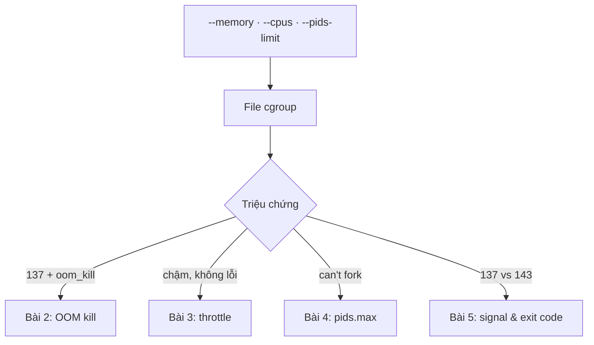

# Capstone 6_1_3: Điều Tra Giới Hạn Tài Nguyên — OOM, Throttle Và Fork Bomb

> **Khóa học**: Cloud DevOps Basic — Containers & Kubernetes
> **Phân nhóm**: 6 Domain 6 - Containers and Kubernetes › 6_1 Container Fundamentals › Capstones
> **Bài học gốc**: [6_1_3 Control Groups v2 for Containers](<../6_1_3 Control Groups v2 for Containers.md>)
> **Thời gian**: 3–4 giờ · **Chi phí**: 0 · **Cần root/sudo**: Không (đọc file cgroup của chính bạn)
> **Yêu cầu**: Linux cgroup v2 (`stat -fc %T /sys/fs/cgroup` in ra `cgroup2fs`), Podman rootless có delegation controller `cpu io memory pids`, image `selflearn.invalid/hello-svc:1.0.0` (build bằng [build-images.sh](../../../shared/scripts/build-images.sh))
> **Trạng thái**: Bài 1–6 **đã chạy thử** (18-11-2026, Fedora 43, kernel 7.3.3, Podman 5.8.9, crun 1.28). Một số kết quả (swap, `OOMKilled`) **vượt ra ngoài lesson** và được đánh dấu rõ.

---

## 🎯 Kịch bản

Một Pod Java của bạn bị `OOMKilled` lúc 3 giờ sáng, một Pod khác chậm đi 3 lần mà không có lỗi nào, một vụ `fork` thất bại không rõ lý do. Ba triệu chứng, một nguồn gốc: **cgroups**. Capstone này bắt bạn tái hiện từng triệu chứng, đọc bằng chứng **thẳng từ file cgroup**, và phân biệt chúng chỉ bằng exit code, trạng thái container và `memory.events`.

## 🗺️ Bản Đồ Phủ Kiến Thức (Coverage)

| Mục trong lesson 6_1_3 | Kiến thức | Bài |
| :--- | :--- | :---: |
| 1.1 | Hierarchy duy nhất của v2; cờ CLI sửa cài đặt cgroup; `/proc/<pid>/cgroup` | 1 |
| 1.2 | `memory.max`, `memory.current`, `memory.peak`, `memory.events` (`oom_kill`) | 1, 2 |
| 1.2 | OOM killer chạy trong cgroup; **chỉ khi kernel thấy áp lực** nên không phải lúc nào cũng giết ngay | 2 |
| 1.3 | `cpu.max` (throttle, không kill) và `cpu.weight` | 1, 3 |
| 1.4 | `pids.max`, `fork()` trả `-EAGAIN` | 4 |
| 1.5 | `SIGKILL` không bắt được; `128+n`: 137 và 143 | 5 |
| 1.6 | Ánh xạ Podman / Docker / Kubernetes → file cgroup | 1, 6 |
| Gotcha 5.1–5.4 | Exit 137 không log; CPU limit làm chậm; quên limit; rootless | 2, 3, 6 |



## 🧰 Chuẩn Bị

```bash
stat -fc %T /sys/fs/cgroup                        # cgroup2fs
podman pull -q docker.io/library/alpine
podman image exists selflearn.invalid/hello-svc:1.0.0 || bash ../../../shared/scripts/build-images.sh

# Hàm dùng chung: in thư mục cgroup của một PID (trên máy chủ)
cg() { echo /sys/fs/cgroup$(cut -d: -f3 /proc/$1/cgroup); }
```

> Tên tài nguyên: `c3-*`. Dọn dẹp ở cuối file. Nếu đổi shell, **định nghĩa lại `cg`**.

---

## Bài 1 — Bản Đồ "Cờ → File cgroup" (30 phút)

**Yêu cầu**: chạy một container với bốn cờ giới hạn, rồi lập bảng: cờ → giá trị JSON của `podman inspect` → file cgroup → giá trị thật.

```bash
podman run -d --name c3-lim --memory 128m --cpus 0.5 --pids-limit 50 --cpu-shares 512 \
  docker.io/library/alpine sleep 600
P=$(podman inspect -f '{{.State.Pid}}' c3-lim); D=$(cg $P)

cat /proc/$P/cgroup                                 # dạng "0::<đường dẫn>"
cat $D/cgroup.controllers
for f in memory.max memory.current memory.peak memory.events cpu.max cpu.weight pids.max pids.current; do
  printf "%-15s %s\n" $f "$(cat $D/$f | tr '\n' ' ')"
done
podman inspect c3-lim -f 'Mem={{.HostConfig.Memory}} NanoCpus={{.HostConfig.NanoCpus}} CpuQuota={{.HostConfig.CpuQuota}} CpuPeriod={{.HostConfig.CpuPeriod}} Pids={{.HostConfig.PidsLimit}} CpuShares={{.HostConfig.CpuShares}}'
```

**Tiêu chí hoàn thành**
- [ ] Bảng 4 dòng (`--memory`, `--cpus`, `--pids-limit`, `--cpu-shares`) khớp giá trị bạn đọc.
- [ ] Tự tính ra `--memory 128m` = `134217728` byte và `--cpus 0.5` = quota `50000` / period `100000`.
- [ ] Giải thích dòng `0::...` (hierarchy ID là `0`, danh sách controller rỗng ⇒ cgroup v2).
- [ ] Phân biệt **giới hạn cứng** (`memory.max`) với **chia tỉ lệ khi tranh chấp** (`cpu.weight`).

<details>
<summary>Đáp án tham chiếu</summary>

Quan sát: `0::/user.slice/user-1000.slice/user@1000.service/user.slice/libpod-<id>.scope/container`; controller `cpu io memory pids`; `memory.max=134217728`, `cpu.max=50000 100000`, `cpu.weight=59`, `pids.max=50`, `memory.events` toàn `0`.

- `--cpu-shares 512` được dịch thành `cpu.weight = 59`. **Công thức chuyển đổi không nằm trong lesson**; đối chiếu `podman-run(1)` và tài liệu cgroup v2 nếu cần chính xác. Khi tranh chấp CPU, `cpu.weight` chỉ chia theo **tỉ lệ**; khi CPU rảnh nó không giới hạn ai (lesson 1.3).
- Tên thư mục `.../container` ở cuối đường dẫn là cấu trúc của Podman/crun trên máy này, không phải chuẩn; luôn lấy đường dẫn từ `/proc/<pid>/cgroup`.
- Ba hệ công cụ cùng ghi vào các file này; xem Bài 6.
</details>

---

## Bài 2 — Bốn Kiểu "Hết Bộ Nhớ" Và Cách Phân Biệt (60 phút)

**Yêu cầu**: tái hiện bốn tình huống và ghi bảng `exit code`, `OOMKilled`, `oom_kill` (nếu đọc được), có log hay không.

```bash
# 2a) PID 1 của container bị kernel OOM kill
podman run --name c3-oom1 --memory 64m docker.io/library/alpine tail /dev/zero; echo "rc=$?"
podman inspect c3-oom1 -f 'exit={{.State.ExitCode}} oom={{.State.OOMKilled}}'

# 2b) Process KHÁC PID 1 (qua exec) bị OOM kill: container vẫn sống
podman exec c3-lim sh -c 'tail /dev/zero'; echo "exec exit=$?"
cat $(cg $P)/memory.events
podman inspect c3-lim -f 'oom={{.State.OOMKilled}} running={{.State.Running}}'

# 2c) JVM tự hết heap (không phải kernel)
podman run --name c3-oom3 --memory 256m -e ALLOCATE_MB_ON_START=300 \
  selflearn.invalid/hello-svc:1.0.0 2>&1 | grep -E 'OutOfMemoryError' | head -1
podman inspect c3-oom3 -f 'exit={{.State.ExitCode}} oom={{.State.OOMKilled}}'
```

> **2b** dùng container `c3-lim` ở Bài 1 (có `--memory 128m`); `$P` là PID của nó.

**Bài 2d — Cái bẫy swap (ngoài lesson)**: cấp phát 400 MiB trong container 256 MiB, cho JVM `-Xmx1g` để *JVM không tự dừng*. Chạy hai lần: mặc định và `--memory-swap 256m`.

```bash
# 2d-1) mặc định: dự đoán của bạn là gì? Chạy nền, đợi 8 giây, rồi đọc file
podman run -d --name c3-sw --memory 256m -e ALLOCATE_MB_ON_START=400 -e JAVA_TOOL_OPTIONS=-Xmx1g \
  selflearn.invalid/hello-svc:1.0.0
sleep 8; P2=$(podman inspect -f '{{.State.Pid}}' c3-sw); D2=$(cg $P2)
for f in memory.max memory.swap.max memory.current memory.swap.current memory.peak; do echo "$f $(cat $D2/$f)"; done
grep -E 'oom' $D2/memory.events; podman inspect c3-sw -f 'status={{.State.Status}}'
podman rm -f -t 0 c3-sw

# 2d-2) tắt swap cho container: --memory-swap bằng --memory
podman run --name c3-ns --memory 256m --memory-swap 256m -e ALLOCATE_MB_ON_START=400 \
  -e JAVA_TOOL_OPTIONS=-Xmx1g selflearn.invalid/hello-svc:1.0.0 >/dev/null 2>&1
podman inspect c3-ns -f 'exit={{.State.ExitCode}} oom={{.State.OOMKilled}}'
```

**Tiêu chí hoàn thành**
- [ ] Bảng 4 dòng (2a, 2b, 2c, 2d) với exit code, `OOMKilled`, `oom_kill`.
- [ ] Giải thích vì sao 2b cho `oom_kill 1` nhưng `OOMKilled=false` và container vẫn chạy: **đừng chỉ tin một chỉ báo**.
- [ ] Phân biệt 2a (137, kernel) với 2c (exit 1, `OutOfMemoryError`, JVM tự thoát).
- [ ] Giải thích 2d: vì sao container không bị giết khi vượt `memory.max`, và vì sao `--memory-swap 256m` đổi kết quả.

<details>
<summary>Đáp án tham chiếu</summary>

| | exit | `OOMKilled` | `oom_kill` | Ghi chú |
| :--- | :-: | :-: | :-: | :--- |
| 2a PID 1 bị kernel kill | `137` (`128+9`) | `true` | (cgroup đã bị xóa cùng container, không đọc được) | lesson 1.2/1.5 |
| 2b process exec bị kill | exec `137` | **`false`** | **`1`** | container vẫn `running`; `memory.peak` = `134217728` |
| 2c JVM hết heap | `1` | `false` | — | `java.lang.OutOfMemoryError: Java heap space` trong log |
| 2d-1 vượt limit nhưng còn swap | (vẫn chạy) | — | `0` | xem dưới |
| 2d-2 không swap | `137` | `true` | — | |

2d-1 quan sát: `memory.max=268435456`, **`memory.swap.max=268435456`**, `memory.current≈267.7 MB` (sát trần), `memory.swap.current≈260.8 MB`, `oom_kill 0`, container `running`. Máy có 8 GiB swap. **Giải thích**: `--memory 256m` một mình khiến Podman đặt thêm trần swap (`HostConfig.MemorySwap=536870912`), nên phần vượt RAM bị đẩy ra swap và kernel **chưa thấy cần OOM kill**; phù hợp với câu của lesson 1.2 rằng container cấp phát vượt giới hạn "chưa chắc bị giết ngay". Cơ chế `memory.swap.max` và cờ `--memory-swap` **không nằm trong lesson**; hãy đọc `podman-run(1)` và tài liệu cgroup v2. Hệ quả vận hành: trên node có swap, `--memory` đơn lẻ có thể thành "chậm vì swap" thay vì "bị kill"; để hành vi giống Kubernetes (không swap theo mặc định) hãy đặt `--memory-swap` bằng `--memory` khi tái hiện lỗi OOM. Hành vi swap của Pod trên Kubernetes phụ thuộc cấu hình node và phiên bản: **chưa kiểm chứng ở capstone này**, hãy đối chiếu tài liệu Kubernetes về swap trước khi kết luận.

> Hệ quả cho lab 6_1_2 ở [README của 6_1](../README.md#lab-6_1_2-oom-signals-and-jvm-memory): kết quả "container thoát với 137" có thể không xảy ra nếu máy có swap; thêm `--memory-swap` bằng `--memory`.
</details>

---

## Bài 3 — CPU Bị Throttle, Không Bị Kill (30 phút)

**Yêu cầu**: chạy vòng lặp ăn CPU trong container `--cpus 0.5`, đo mức CPU thực và thống kê throttle trong `cpu.stat`, rồi chứng minh container **không** bị kill.

```bash
podman run -d --name c3-cpu --cpus 0.5 docker.io/library/alpine sh -c 'while :; do :; done'
PC=$(podman inspect -f '{{.State.Pid}}' c3-cpu); sleep 5
grep -E 'nr_periods|nr_throttled|throttled_usec|usage_usec' $(cg $PC)/cpu.stat
podman stats --no-stream --format '{{.Name}} cpu={{.CPUPerc}}' c3-cpu
podman inspect c3-cpu -f 'running={{.State.Running}} exit={{.State.ExitCode}}'
```

**Tiêu chí hoàn thành**
- [ ] `podman stats` ~50% CPU dù vòng lặp đòi 100%.
- [ ] `nr_throttled` gần bằng `nr_periods`; `throttled_usec` lớn.
- [ ] Container vẫn `running`; giải thích vì sao tình huống này không để lại log lỗi (gotcha 5.2).
- [ ] Nêu hai đại lượng bạn sẽ theo dõi (ở cấp cgroup) để phát hiện throttle trong production. *(Tên metric Kubernetes: đối chiếu tài liệu, lesson dặn như vậy.)*

<details>
<summary>Đáp án tham chiếu</summary>

Quan sát sau 5 giây: `nr_periods 51`, `nr_throttled 50`, `throttled_usec ≈ 2,14 triệu`, `usage_usec ≈ 2,53 triệu`; `podman stats` cho `cpu=50.28%`; container `running`. Mỗi `period` 100 ms container được dùng 50 ms rồi bị chặn: ứng dụng **chậm đi nhưng không có sự kiện lỗi** (lesson 1.3). `cpu.stat` và các trường trên không nằm trong lesson; tên file/trường lấy từ tài liệu cgroup v2.

Phần `cpu.weight` (chia tỉ lệ) **không đo được** trên máy kiểm chứng: `--cpuset-cpus` không dùng được ở rootless vì controller `cpuset` chưa được delegate, và image `alpine` không có `taskset` để ghim vào một CPU. Nếu máy bạn có, thử hai container cùng ghim một CPU với `--cpu-shares 1024` và `256` rồi so `podman stats`; **đây là phần chưa kiểm chứng**.
</details>

---

## Bài 4 — `pids.max` Chặn Fork Bomb (20 phút)

**Yêu cầu**: giới hạn số process rồi cố sinh vượt giới hạn; đọc `pids.events`.

```bash
podman exec c3-lim sh -c 'for i in $(seq 1 80); do sleep 100 & done 2>&1; sleep 1; echo spawned'
cat $(cg $P)/pids.events; cat $(cg $P)/pids.current
```

**Tiêu chí hoàn thành**
- [ ] Thấy thông báo `can't fork: Resource temporarily unavailable`.
- [ ] `pids.current` dừng ở **gần** `pids.max` (50); `pids.events` có `max` > 0.
- [ ] Giải thích lỗi trên là `EAGAIN` từ `fork()`/`clone()` (lesson 1.4) chứ không phải OOM.
- [ ] So sánh với container ở Bài 1 của capstone 6_1_1: giá trị mặc định `pids.max` của Podman là bao nhiêu?

<details>
<summary>Đáp án tham chiếu</summary>

Quan sát: `sh: can't fork: Resource temporarily unavailable`; `pids.events: max 1`; `pids.current 49`. (Các `sleep 100` nền tồn tại đến khi hết 100 giây hoặc khi xóa container.) Mặc định Podman: `pids.max = 2048` (lesson 1.4).
</details>

---

## Bài 5 — Exit Code 137 vs 143 (30 phút)

**Yêu cầu**: tạo ra đúng hai mã thoát, giải thích từng chữ số, và tìm ra điều bất ngờ: **PID 1 không tự `SIGKILL` được mình**.

```bash
# (a) PID 1 tự gửi SIGKILL cho chính nó: chuyện gì xảy ra?
podman run --rm docker.io/library/alpine sh -c 'kill -9 $$; echo "PID 1 vẫn sống sau SIGKILL"'; echo "exit=$?"

# (b) Một process con (không phải PID 1) bị kill
podman run --rm docker.io/library/alpine sh -c 'sh -c "kill -9 \$\$"; echo "con exit=$?"; sh -c "kill -15 \$\$"; echo "con exit=$?"'

# (c) Từ ngoài: podman kill (SIGKILL mặc định) vào PID 1
podman run -d --name c3-k docker.io/library/alpine sleep 600
podman kill c3-k >/dev/null; sleep 0.5
podman inspect c3-k -f 'exit={{.State.ExitCode}} oom={{.State.OOMKilled}}'

# (d) 143: process có handler SIGTERM (JVM shutdown hook) bị podman stop
podman run -d --name c3-hs selflearn.invalid/hello-svc:1.0.0; sleep 2
podman stop c3-hs >/dev/null; podman inspect c3-hs -f 'exit={{.State.ExitCode}}'
```

**Tiêu chí hoàn thành**
- [ ] Bảng: tình huống → exit → tính (`128 + n`) → có phải OOM không.
- [ ] Giải thích (a): vì sao `exit=0`? (kernel không chuyển `SIGKILL` do chính PID 1 gửi trong cùng namespace; xem 6_1_8)
- [ ] Phân biệt `137` do **OOM** (2a: `OOMKilled=true`) với `137` do **`podman kill`/hết hạn dừng** (`OOMKilled=false`).
- [ ] Giải thích vì sao `SIGKILL` là cách duy nhất chắc chắn dừng được process: không bắt, chặn hay bỏ qua được.

<details>
<summary>Đáp án tham chiếu</summary>

| Tình huống | exit | Phép tính | OOM? |
| :--- | :-: | :--- | :-: |
| (a) PID 1 tự `kill -9` | `0` (bị bỏ qua) | — | không |
| (b) con `kill -9` / `kill -15` | `137` / `143` | `128+9` / `128+15` | không |
| (c) `podman kill` vào PID 1 | `137` | `128+9` | **không** (`OOMKilled=false`) |
| (d) `podman stop` JVM | `143` | `128+15` | không (log có "shutdown signal received") |
| 2a (Bài 2) | `137` | `128+9` | **có** (`OOMKilled=true`) |

Kết luận: mã `137` chỉ cho biết bị `SIGKILL`; nguồn gốc (OOM, `kill`, hết hạn `stop`) phải xác nhận bằng `OOMKilled` và `memory.events` (lesson 1.5 và gotcha 5.1).
</details>

---

## Bài 6 — Cùng Một File, Ba Công Cụ (25 phút)

**Yêu cầu**
1. Chứng minh rằng file giới hạn không do "Podman riêng" tạo ra: dùng `systemd-run` để đặt `MemoryMax`/`TasksMax` rồi đọc lại file.
2. Điền bảng dưới (không có cluster, đây là bài viết) và nêu một điểm khác nhau giữa cờ Podman và `resources` của Kubernetes về **hậu quả khi vượt**.

```bash
systemd-run --user --scope -q -p MemoryMax=64M -p TasksMax=20 sh -c '
  D=/sys/fs/cgroup$(cut -d: -f3 /proc/self/cgroup); echo $D; cat $D/memory.max $D/pids.max'
```

| Bạn đặt | Podman | Docker | Kubernetes | File |
| :--- | :--- | :--- | :--- | :--- |
| Bộ nhớ | | | | |
| CPU | | | | |
| Số process | | | | |

**Tiêu chí hoàn thành**
- [ ] `memory.max=67108864`, `pids.max=20` (cùng kernel, cùng file, công cụ khác).
- [ ] Bảng đúng; ghi rõ ô nào **lesson không có** (Kubernetes đặt `pids` trực tiếp: chưa kiểm chứng).

<details>
<summary>Đáp án tham chiếu</summary>

Quan sát: đường dẫn `.../app.slice/run-p...scope`; `memory.max=67108864`; `pids.max=20`. Bảng: Bộ nhớ — `--memory` / cờ giới hạn bộ nhớ / `limits.memory` / `memory.max`; CPU — `--cpus` / `--cpus` (= `--cpu-period` + `--cpu-quota`) / `limits.cpu` / `cpu.max`; Số process — `--pids-limit` / tương tự / (lesson không đặt trực tiếp) / `pids.max`.

Khác nhau khi vượt: bộ nhớ ⇒ OOM kill (Kubernetes: chỉ khi kernel phát hiện áp lực); CPU ⇒ throttle, không kill.
</details>

---

## ✅ Nghiệm Thu Capstone

- [ ] Bảng Bài 1, bảng 5 dòng Bài 2, số liệu Bài 3–5 đã điền từ máy bạn.
- [ ] Viết **runbook 6 dòng** "Container bị exit 137": kiểm tra theo thứ tự nào, bằng lệnh gì (`inspect` → `OOMKilled` → `memory.events` → `memory.peak` → có swap không → ai gửi `SIGKILL`).
- [ ] Trả lời không nhìn tài liệu: vì sao throttle không gây lỗi, còn OOM thì có?

## 🧠 Câu Hỏi Bảo Vệ

1. Một container `--memory 512m` dùng 700 MiB mà không chết. Nêu hai nguyên nhân có thể (một trong số đó là swap).
2. Vì sao `exit 137` có thể không phải OOM? Cho hai ví dụ.
3. Pod Java chậm khi tải cao, CPU "chỉ" 50% node, không có restart. Bạn nghi gì và đọc file nào?
4. Giải thích `cpu.max = 150000 100000`.

## 🧹 Dọn Dẹp

```bash
podman rm -f -t 0 c3-lim c3-cpu c3-k c3-hs c3-sw c3-ns c3-oom1 c3-oom3 2>/dev/null
```

## 📚 Nguồn Tài Liệu Chính Thống (Official References)
- [Control Group v2 — Linux Kernel documentation](https://docs.kernel.org/admin-guide/cgroup-v2.html) — `memory.max`, `memory.events`, `memory.swap.*`, `cpu.max`, `cpu.weight`, `cpu.stat`, `pids.max`, `pids.events`.
- [cgroups(7)](https://man7.org/linux/man-pages/man7/cgroups.7.html) — Tổng quan và `/proc/pid/cgroup`.
- [podman-run(1)](https://docs.podman.io/en/latest/markdown/podman-run.1.html) — `--memory`, `--memory-swap`, `--cpus`, `--cpu-shares`, `--pids-limit`.
- [podman-inspect(1)](https://docs.podman.io/en/latest/markdown/podman-inspect.1.html) — `--format`, `State.OOMKilled`.
- [Docker Docs — Resource constraints](https://docs.docker.com/engine/containers/resource_constraints/) — `--memory`, `--cpus`, `--memory-swap`.
- [Kubernetes — Resource Management for Pods and Containers](https://kubernetes.io/docs/concepts/configuration/manage-resources-containers/) — Cách `limits` được thực thi (throttle, OOM kill).
- [signal(7)](https://man7.org/linux/man-pages/man7/signal.7.html) và [bash(1)](https://man7.org/linux/man-pages/man1/bash.1.html) — `SIGKILL` không bắt được; `128+n`.
- [systemd.resource-control(5)](https://man7.org/linux/man-pages/man5/systemd.resource-control.5.html) — `MemoryMax=`, `TasksMax=` dùng ở Bài 6.
