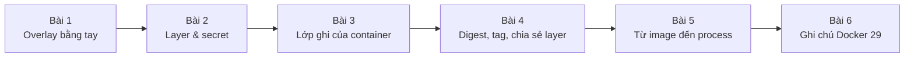

# Capstone 6_1_4: Mổ Xẻ Image — Layer, Lớp Ghi, Whiteout Và Secret Bị Lộ

> **Khóa học**: Cloud DevOps Basic — Containers & Kubernetes
> **Phân nhóm**: 6 Domain 6 - Containers and Kubernetes › 6_1 Container Fundamentals › Capstones
> **Bài học gốc**: [6_1_4 Images Layers and Overlay Filesystem](<../6_1_4 Images Layers and Overlay Filesystem.md>)
> **Thời gian**: 3–4 giờ · **Chi phí**: 0 · **Cần root/sudo**: **Không** (overlay tự mount trong user + mount namespace)
> **Công cụ**: Podman 5.x, `unshare`, `jq`, `tar`
> **Trạng thái**: Bài 1–5 **đã chạy thử** (18-11-2026, Fedora 43, kernel 7.3.3, Podman 5.8.9 rootless, overlay). Bài 6 là bài viết. Kích thước/ID/PID khác nhau mỗi máy.

---

## 🎯 Kịch bản

Một đồng nghiệp commit `Dockerfile` có dòng `RUN rm /secret.txt` và nói *"yên tâm, secret đã xóa khỏi image rồi"*. Bạn phải **chứng minh bằng file** rằng điều đó sai, đo xem image phình ra bao nhiêu, và chỉ ra dữ liệu ghi lúc chạy sống ở đâu và chết khi nào.

## 🗺️ Bản Đồ Phủ Kiến Thức (Coverage)

| Mục trong lesson 6_1_4 | Kiến thức | Bài |
| :--- | :--- | :---: |
| 1.1 | Image = layer chỉ đọc, bất biến + config (`Entrypoint`, `Cmd`, `Env`, `User`, `WorkingDir`); content-addressable | 2, 4, 5 |
| 1.2 | Container = image + **lớp ghi**; union filesystem; xóa container mất lớp ghi | 3 |
| 1.3 | overlayfs: `lowerdir` / `upperdir` / `workdir` / `merged`; `copy_up`; whiteout | 1, 3 |
| 1.4 | Xóa ở layer sau không làm image nhỏ; dữ liệu mất khi xóa container; tag vs digest | 2, 3, 4 |
| 1.5 | Docker Engine 29 dùng containerd image store mặc định | 6 |
| 1.6 | Từ image đến process: file có sẵn trong layer, config chỉ đường, runtime chỉ thực thi; ví dụ image Java | 5 |
| README 6_1_4 | Image ID / digest là hash nội dung, tag chỉ là tên | 4 |



## 🧰 Chuẩn Bị

```bash
podman pull -q docker.io/library/alpine
WORK=$(mktemp -d /tmp/c4-XXXXXX); cd "$WORK"; echo "thư mục làm việc: $WORK"
```

> Tên tài nguyên: `c4-*` / thư mục `$WORK`. Dọn dẹp ở cuối file.

---

## Bài 1 — Tự Mount Overlay Bằng Tay (30 phút)

**Yêu cầu**: dựng `lower` (như layer image) + `upper` (như lớp ghi), mount thành `merged`, rồi sửa một file, xóa một file, tạo một file mới. Sau đó đọc cả ba thư mục để thấy `copy_up` và whiteout.

```bash
mkdir -p ov/{lower,upper,work,merged}
echo tu-image > ov/lower/a.txt
echo xoa-toi  > ov/lower/b.txt

unshare -r -m bash -c '
  mount -t overlay overlay -olowerdir=ov/lower,upperdir=ov/upper,workdir=ov/work ov/merged && echo "đã mount"
  echo sua >> ov/merged/a.txt        # sửa file ở lower  -> copy_up
  rm ov/merged/b.txt                 # xóa file ở lower  -> whiteout
  echo moi > ov/merged/c.txt         # file mới          -> chỉ ở upper
  echo "--- merged:"; ls -l ov/merged
  echo "--- upper:";  ls -l ov/upper
  echo "--- lower:";  ls -l ov/lower; cat ov/lower/a.txt
  umount ov/merged'
```

**Tiêu chí hoàn thành**
- [ ] `merged` có `a.txt` (đã sửa) và `c.txt`, **không** có `b.txt`.
- [ ] `upper` có bản sao `a.txt` đã sửa, `c.txt`, và một mục `b.txt` kiểu **thiết bị ký tự 0,0** (whiteout).
- [ ] `lower` **không đổi** (`a.txt` vẫn là `tu-image`, `b.txt` vẫn còn).
- [ ] Gắn mỗi thư mục với khái niệm của container: layer image / lớp ghi / thứ container nhìn thấy.
- [ ] Giải thích vì sao `workdir` phải cùng filesystem với `upperdir`.

<details>
<summary>Đáp án tham chiếu</summary>

Quan sát: `merged` có `a.txt` (13 byte) và `c.txt`; `upper` có `a.txt`, `c.txt` và `c--------- ... 0, 0 b.txt` (whiteout, đúng loại "character device 0/0" mà tài liệu kernel mô tả); `lower` còn đủ `a.txt` = `tu-image` (9 byte) và `b.txt`. Ánh xạ: `lowerdir` ↔ các layer image, `upperdir` ↔ lớp ghi, `merged` ↔ thứ container nhìn thấy. `workdir` phải nằm cùng filesystem với `upperdir` (tài liệu kernel, lesson 1.3).

Ghi chú vận hành: mount overlay không cần root ở đây vì được thực hiện trong user + mount namespace do `unshare -r -m` tạo ra (kernel của bạn phải cho phép). Bản dùng `sudo mount` ở mục 4.2 của lesson **chưa chạy thử** ở capstone này.
</details>

---

## Bài 2 — Xóa File Ở Lệnh Sau Không Làm Image Nhỏ Đi (45 phút)

**Yêu cầu**: build hai image *cùng tạo rồi xóa* một file 30 MB và một "secret": một cách sai (3 lệnh `RUN` riêng) và một cách đúng (gộp 1 lệnh). So sánh kích thước, rồi **lấy secret ra khỏi image sai** bằng cách đọc thẳng các layer.

```bash
mkdir -p lay && cd lay
cat > Containerfile.bad <<'EOF'
FROM docker.io/library/alpine
RUN dd if=/dev/urandom of=/big.bin bs=1M count=30
RUN echo "super-secret" > /secret.txt
RUN rm /big.bin /secret.txt
EOF
cat > Containerfile.good <<'EOF'
FROM docker.io/library/alpine
RUN dd if=/dev/urandom of=/big.bin bs=1M count=30 && echo "super-secret" > /secret.txt && rm /big.bin /secret.txt
EOF
podman build -q -f Containerfile.bad  -t c4-img:bad  . >/dev/null
podman build -q -f Containerfile.good -t c4-img:good . >/dev/null
podman images --format '{{.Repository}}:{{.Tag}} {{.Size}}' | grep '^localhost/c4-img'
podman history c4-img:bad --format '{{.Size}}\t{{.CreatedBy}}' | head -5

# Đọc layer: xuất image ra thư mục theo định dạng OCI
rm -rf oci && podman save --format oci-dir -o oci c4-img:bad >/dev/null 2>&1
M=$(jq -r '.manifests[0].digest' oci/index.json | cut -d: -f2)
jq -c '{mediaType, layers:[.layers[]|{size, digest:.digest[7:19]}]}' oci/blobs/sha256/$M
for d in $(jq -r '.layers[].digest' oci/blobs/sha256/$M | cut -d: -f2); do
  echo "layer ${d:0:12}:"; tar -tvf oci/blobs/sha256/$d | grep -E 'secret|big|\.wh\.'
done
for d in $(jq -r '.layers[].digest' oci/blobs/sha256/$M | cut -d: -f2); do
  tar -xOf oci/blobs/sha256/$d secret.txt 2>/dev/null && echo "(đọc từ layer ${d:0:12})"
done
cd ..
```

> Chỉ dùng "secret" giả. Tuyệt đối không build thử với secret thật.

**Tiêu chí hoàn thành**
- [ ] `bad` lớn hơn `good` ~ **31 MB** (layer 30 MB không biến mất).
- [ ] Bạn chỉ ra layer chứa `big.bin`, layer chứa `secret.txt` và layer chứa hai file `.wh.*` (whiteout).
- [ ] In được dòng `super-secret` từ image "đã xóa".
- [ ] Viết 3 cách sửa Dockerfile thật (gộp lệnh, multi-stage, build secret: tham chiếu 6_2_4 và 6_2_6), và nêu vì sao `docker history`/`podman history` đã đủ để lộ lệnh `RUN` ban đầu.
- [ ] Trỏ ra manifest có `mediaType` OCI, config, và `layers[].size`/`digest` (đây là nối sang 6_1_5).

<details>
<summary>Đáp án tham chiếu</summary>

Quan sát: `c4-img:good ≈ 8,72 MB`, `c4-img:bad ≈ 40,2 MB`. `podman history` của `bad`: layer 31,5 MB (`dd`), hai layer ~2 kB (`echo`, `rm`) và layer base 8,71 MB. Image có **4 layer**: base (~3,98 MB nén), layer chứa `big.bin` (~31,5 MB nén), layer chứa `secret.txt` (121 byte), layer whiteout chứa `.wh.big.bin` và `.wh.secret.txt` (130 byte). Lệnh cuối in `super-secret`.

Giải thích: layer bất biến; xóa chỉ được **ghi lại** bằng whiteout ở layer trên (lesson 1.1, 1.3, 1.4), nên file vẫn nằm nguyên trong layer cũ. Image đã "ship" file đó cho bất kỳ ai `pull` về. *(Cách xuất `oci-dir` và đọc layer bằng `tar` là kỹ thuật của capstone này, không nằm trong lesson; tên lệnh `podman save --format oci-dir`: xem `podman-save(1)`.)*
</details>

---

## Bài 3 — Lớp Ghi Của Container: Nó Ở Đâu, Chết Khi Nào (40 phút)

**Yêu cầu**: chạy container sửa file, xóa file, tạo file; xem thay đổi bằng `podman diff`; tìm thư mục `UpperDir` thật trên đĩa; rồi xóa container và xác nhận lớp ghi biến mất, image không đổi.

```bash
podman run -d --name c4-w docker.io/library/alpine sh -c 'echo hi > /f; rm /etc/motd; echo x >> /etc/hostname; sleep 600'
sleep 0.5
podman diff c4-w                                           # A = thêm, C = đổi, D = xóa
podman inspect c4-w -f '{{json .GraphDriver.Data}}' | jq -r 'keys[]'

UP=$(podman inspect c4-w -f '{{.GraphDriver.Data.UpperDir}}')
podman unshare ls -l "$UP"                                 # lớp ghi trên đĩa (UID đã ánh xạ nên dùng podman unshare)
podman unshare ls "$(dirname "$UP")/merged" | head -3      # thứ container nhìn thấy

podman image inspect docker.io/library/alpine -f '{{.Id}}' | cut -c1-12   # ID trước
podman rm -f -t 0 c4-w
podman unshare ls "$UP" 2>&1 | head -2                                    # sau khi xóa container
podman image inspect docker.io/library/alpine -f '{{.Id}}' | cut -c1-12   # ID sau: không đổi
```

**Tiêu chí hoàn thành**
- [ ] `podman diff` cho `C /etc`, `D /etc/motd`, `A /f` (ghép được vào copy_up / whiteout / file mới ở Bài 1).
- [ ] Liệt kê 4 khóa `GraphDriver.Data` (`LowerDir`, `UpperDir`, `WorkDir`, `MergedDir`) và nói khóa nào là lớp ghi.
- [ ] `UpperDir` có `etc/`, `f`, `run/`; sau `rm` thư mục này **không còn**; ID của image không đổi.
- [ ] Giải thích hệ quả: rolling update thay container ⇒ dữ liệu ghi vào lớp ghi mất ⇒ cần volume (capstone 6_1_10).
- [ ] Hỏi mở: vì sao ví dụ dùng `podman unshare ls` chứ không phải `ls`? (file trong lớp ghi do UID thuộc dải subuid sở hữu, xem 6_1_7; `podman unshare` đứng trong user namespace của Podman)

<details>
<summary>Đáp án tham chiếu</summary>

Quan sát: `C /etc`, `D /etc/motd`, `A /f`; keys `LowerDir MergedDir UpperDir WorkDir`; `UpperDir` dạng `~/.local/share/containers/storage/overlay/<id>/diff` chứa `etc`, `f` (3 byte), `run`; sau `rm` lệnh `ls` báo `No such file or directory`; ID image `alpine` không đổi. `podman diff`, `GraphDriver.Data` và `podman unshare` là công cụ của capstone, **không nằm trong lesson**; hãy đối chiếu `podman-diff(1)`, `podman-unshare(1)`. Đường dẫn storage của Docker khác và còn phụ thuộc bản 29 (Bài 6).
</details>

---

## Bài 4 — Digest, Tag Và Layer Dùng Chung (35 phút)

**Yêu cầu**: chứng minh (1) tag chỉ là tên có thể trỏ sang image khác, (2) image ID/digest là hash nội dung, (3) các image dùng chung layer thì không tốn thêm chỗ.

```bash
mkdir -p tag && cd tag
printf 'FROM docker.io/library/alpine\nRUN echo v1 > /v\n' > Containerfile.t
podman build -q -t c4-app:latest -f Containerfile.t . | cut -c1-12
ID1=$(podman image inspect c4-app:latest -f '{{.Id}}' | cut -c1-12)

printf 'FROM docker.io/library/alpine\nRUN echo v2 > /v\n' > Containerfile.t
podman build -q -t c4-app:latest -f Containerfile.t . | cut -c1-12      # cùng tag, nội dung khác
podman images --format '{{.ID}} {{.Repository}}:{{.Tag}}' | grep -E "c4-app|<none>" | head -3

podman run --rm $ID1 cat /v                                            # chạy image CŨ theo ID
podman run --rm c4-app:latest cat /v                                   # chạy theo tag: image MỚI

# Digest và layer dùng chung
podman image inspect c4-img:good -f '{{.Digest}}'
podman image inspect c4-img:good -f '{{.RootFS.Layers}}' | cut -c1-90
podman image inspect docker.io/library/alpine -f '{{.RootFS.Layers}}' | cut -c1-90
cd ..
```

> `c4-img:good` đến từ Bài 2.

**Tiêu chí hoàn thành**
- [ ] Sau build lần 2, tag `latest` trỏ sang ID mới; image cũ thành `<none>:<none>` nhưng **vẫn chạy được theo ID** và in `v1`. (Danh sách có thể còn các image `<none>` của dự án khác; chỉ xét ID bạn vừa ghi lại.)
- [ ] Layer đầu của `c4-img:good` **trùng** layer duy nhất của `alpine` (cùng chuỗi `sha256:...`).
- [ ] Viết 3 câu: vì sao trong production phải ghim digest thay vì tag (tham chiếu 6_2_7), và vì sao digest đổi khi chỉ đổi một byte.

<details>
<summary>Đáp án tham chiếu</summary>

Quan sát: build 1 cho ID `8cd3dde00e89`, build 2 cho `32d83e180ee8`; `latest` chuyển sang ID mới, ID cũ thành `<none>:<none>`; `podman run --rm 8cd3dde00e89 cat /v` in `v1`. Layer đầu của `c4-img:good` là `sha256:75f1d965...` trùng với layer của `alpine`: layer dùng chung (content-addressable) nên chỉ lưu một bản. Lesson 1.1 và 1.4: định danh theo **nội dung**; tag là cách đặt tên tiện lợi và pull lại tag có thể cho bản mới hơn.
</details>

---

## Bài 5 — Từ Image Đến Process: Process "Biết" Mình Là Gì Từ Đâu? (45 phút)

**Yêu cầu**
1. Build image `c4-cfg` với `ENV`, `WORKDIR`, `USER`, `ENTRYPOINT` (exec form), `CMD`. Đọc config, chạy mặc định, rồi **ghi đè lúc chạy** mà không đổi image.
2. Chứng minh `create` chưa có process (`pid=0`), `start` mới có.
3. Tìm "Java nằm ở đâu" trong `eclipse-temurin:21-jre`: layer nào, `JAVA_HOME` nào, có `javac` không.

```bash
mkdir -p cfg && cd cfg
cat > Containerfile <<'EOF'
FROM docker.io/library/alpine
ENV GREETING=xin-chao
WORKDIR /srv
USER 1234
ENTRYPOINT ["/bin/sh","-c","echo \"$GREETING from $(pwd) uid=$(id -u) args=$*\"","--"]
CMD ["default-arg"]
EOF
podman build -q -t c4-cfg . >/dev/null
podman image inspect c4-cfg -f 'Entrypoint={{.Config.Entrypoint}} Cmd={{.Config.Cmd}} WorkingDir={{.Config.WorkingDir}} User={{.Config.User}}'
podman run --rm c4-cfg                                       # mặc định
podman run --rm c4-cfg other-arg                             # thay CMD
podman run --rm -e GREETING=hello -w /tmp --user 0 c4-cfg    # thay Env, WorkingDir, User
podman run --rm --entrypoint id c4-cfg                       # thay Entrypoint
podman image inspect c4-cfg -f '{{.Id}}' | cut -c1-12        # ID không đổi sau mọi lần chạy

podman create --name c4-cr docker.io/library/alpine sleep 600
podman inspect c4-cr -f 'state={{.State.Status}} pid={{.State.Pid}}'
podman start c4-cr >/dev/null
podman inspect c4-cr -f 'state={{.State.Status}} pid>0={{if gt .State.Pid 0}}yes{{end}}'
podman rm -f -t 0 c4-cr >/dev/null; cd ..

# Java nằm ở đâu?
IMG=docker.io/library/eclipse-temurin:21-jre
podman history --format '{{.Size}}|{{.CreatedBy}}' $IMG | cut -c1-90
podman image inspect $IMG --format '{{range .Config.Env}}{{println .}}{{end}}' | grep -E '^(JAVA_HOME|PATH)='
podman run --rm --network none --entrypoint sh $IMG -c 'command -v java; ls $JAVA_HOME/bin'
```

**Tiêu chí hoàn thành**
- [ ] Bảng: giá trị mặc định (từ image) → giá trị sau khi ghi đè → cờ đã dùng (`-e`, `-w`, `--user`, `--entrypoint`, đối số cuối).
- [ ] `ID` của image không đổi; giải thích: mọi thứ ghi đè là **mặc định bị thay lúc tạo container**, không sửa image.
- [ ] `create`: `pid=0`; sau `start`: có PID. Giải thích bước nào do runtime cấp thấp (`crun`) làm (6_1_5, 6_1_6).
- [ ] Chỉ ra layer lớn nhất của `eclipse-temurin:21-jre` chứa Java, `JAVA_HOME=/opt/java/openjdk`, và `bin/` không có `javac` (JRE, không phải JDK).
- [ ] Giải thích: image ứng dụng Java của bạn (xem [hello-svc/Dockerfile](../../../shared/hello-svc/Dockerfile)) thêm gì lên trên image nền, và vì sao đổi code chỉ tạo lại layer `.jar` nhỏ.

<details>
<summary>Đáp án tham chiếu</summary>

Quan sát: mặc định `xin-chao from /srv uid=1234 args=default-arg`; đổi CMD cho `args=other-arg`; đổi Env/WorkingDir/User cho `hello from /tmp uid=0 args=default-arg`; `--entrypoint id` cho `uid=1234(1234) gid=0(root)...`; ID `d4ace075de3d` không đổi. `create`: `state=created pid=0`; sau `start`: `running`, `pid>0`.

Java: `podman history` cho một layer lớn (~166 MB) là bước tải và giải nén Java; `JAVA_HOME=/opt/java/openjdk`, `PATH` bắt đầu bằng `/opt/java/openjdk/bin`; `bin` chỉ có `java jfr jrunscript jwebserver keytool rmiregistry`. Kích thước layer có thể khác khi image được cập nhật (lesson ghi 166 MB tại thời điểm viết). Đây là ví dụ lesson 1.6 chạy lại bằng tay.
</details>

---

## Bài 6 — Ghi Chú Về Docker 29 (10 phút, bài viết)

**Yêu cầu**: lesson 1.5 nói Docker Engine 29.0+ dùng containerd image store mặc định cho cài mới. Nếu máy bạn có Docker thật, ghi lại phiên bản và storage driver/snapshotter bạn thấy; nếu không, nêu 2 điểm trong capstone này sẽ **khác** trên Docker 29 (gợi ý: đường dẫn `GraphDriver`, lệnh xem layer).

```bash
docker version --format '{{.Server.Version}}' 2>/dev/null || echo "không có Docker Engine thật"
docker info 2>/dev/null | grep -iE 'storage driver|driver-type|snapshotter' || true
```

> Trên máy kiểm chứng `docker` chỉ là lớp giả lập Podman (cảnh báo "Emulate Docker CLI using podman"), nên **chưa kiểm chứng** hành vi của Docker 29. Khái niệm layer vẫn đúng; lệnh và ví dụ có thể khác.

---

## ✅ Nghiệm Thu Capstone

- [ ] Có output của Bài 1–5 từ máy bạn.
- [ ] Viết **bản review PR 5 dòng** cho Dockerfile `bad`: lỗi, bằng chứng, cách sửa, vì sao `rm` không cứu được secret.
- [ ] Vẽ lại (tay hoặc Mermaid) sơ đồ `lowerdir/upperdir/merged` với một ví dụ `copy_up` và một ví dụ whiteout lấy từ Bài 1.

## 🧠 Câu Hỏi Bảo Vệ

1. Container ghi 1 GB log vào `/var/log` của chính nó (không volume). Điều đó nằm ở đâu và chuyện gì xảy ra khi `podman rm`?
2. Hai image dùng chung base. Kéo cả hai tốn bao nhiêu lần dung lượng base? Vì sao?
3. `latest` hôm nay và `latest` tuần sau có chắc là cùng một image không? Dùng gì để chắc chắn?
4. Sửa một dòng cuối Dockerfile thì những layer nào build lại? (nối sang cache ở 6_2)

## 🧹 Dọn Dẹp

```bash
podman rm -f -t 0 c4-w c4-cr 2>/dev/null
podman rmi c4-img:bad c4-img:good c4-app:latest c4-cfg 2>/dev/null
podman rmi "$ID1" 2>/dev/null          # image v1 đã mất tag ở Bài 4 ($ID1 ghi lại ở Bài 4)
cd ~ && chmod -R u+rwx "$WORK" && rm -rf "$WORK"   # chmod vì thư mục workdir của overlay (Bài 1) có quyền 000
```

> Image `<none>:<none>` sinh ra ở Bài 4 (bản `v1`): xóa bằng `podman rmi <ID>` với đúng ID bạn ghi lại; **không** dùng lệnh prune hàng loạt vì nó có thể xóa cả image của dự án khác (máy bạn có thể còn image `<none>:<none>` thuộc dự án khác, đừng xóa chúng).

## 📚 Nguồn Tài Liệu Chính Thống (Official References)
- [Overlay Filesystem — Linux Kernel documentation](https://docs.kernel.org/filesystems/overlayfs.html) — `lowerdir`/`upperdir`/`workdir`, `copy_up`, whiteout.
- [Docker Docs — What is an image?](https://docs.docker.com/get-started/docker-concepts/the-basics/what-is-an-image/) và [Understanding the image layers](https://docs.docker.com/get-started/docker-concepts/building-images/understanding-image-layers/) — Image bất biến, layer, union filesystem.
- [Docker Docs — Storage drivers](https://docs.docker.com/engine/storage/drivers/) — Lớp ghi, copy-on-write, lưu ý Docker Engine 29.
- [OCI Image Specification](https://github.com/opencontainers/image-spec/blob/main/spec.md) và [Image Configuration](https://github.com/opencontainers/image-spec/blob/main/config.md) — Manifest, layer, config (`User`, `WorkingDir`).
- [podman-history(1)](https://docs.podman.io/en/latest/markdown/podman-history.1.html) — Xem layer.
- [podman-diff(1)](https://docs.podman.io/en/latest/markdown/podman-diff.1.html), [podman-save(1)](https://docs.podman.io/en/latest/markdown/podman-save.1.html), [podman-unshare(1)](https://docs.podman.io/en/latest/markdown/podman-unshare.1.html) — Lệnh bổ sung dùng trong capstone (ngoài lesson).
- [unshare(1)](https://man7.org/linux/man-pages/man1/unshare.1.html) — Tạo user + mount namespace cho Bài 1.
