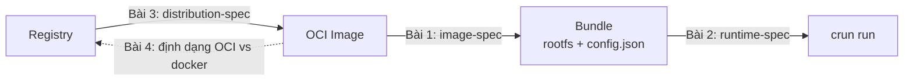

# Capstone 6_1_5: Đi Xuyên Ba Đặc Tả OCI Bằng Tay (Image → Bundle → Registry)

> **Khóa học**: Cloud DevOps Basic — Containers & Kubernetes
> **Phân nhóm**: 6 Domain 6 - Containers and Kubernetes › 6_1 Container Fundamentals › Capstones
> **Bài học gốc**: [6_1_5 Open Container Initiative Specifications](<../6_1_5 Open Container Initiative Specifications.md>)
> **Thời gian**: 3–4 giờ · **Chi phí**: 0 (cần Internet để kéo `alpine` và image `registry:2`) · **Cần root/sudo**: Không
> **Công cụ**: Podman 5.x, `crun`, `skopeo`, `jq`, `curl`, `tar`
> **Trạng thái**: Bài 1–4 **đã chạy thử** (18-11-2026, Fedora 43, Podman 5.8.9 rootless, crun 1.28, skopeo). Bài 5 là bài viết. Số phiên bản đặc tả cụ thể: cần đối chiếu nhánh `main` của các repo OCI khi dùng.

---

## 🎯 Kịch bản

Hợp đồng mới bắt buộc: *"mọi image phải chạy được trên Docker, Podman, containerd và CRI-O"*. Bạn cần chứng minh được **chuẩn nào** bảo đảm điều đó. Capstone này đi lại hành trình của một image qua cả ba đặc tả: đọc manifest/config/layer của nó (image-spec), dựng `config.json` và chạy nó bằng một runtime cấp thấp mà **không dùng Podman** (runtime-spec), rồi hỏi một registry bằng `curl` (distribution-spec).

## 🗺️ Bản Đồ Phủ Kiến Thức (Coverage)

| Mục trong lesson 6_1_5 | Kiến thức | Bài |
| :--- | :--- | :---: |
| 1.1 | OCI = 3 đặc tả (image, runtime, distribution); `runc` là runtime tham chiếu; phần ngoài chuẩn (ví dụ `HEALTHCHECK`) không di động | 1, 2, 3, 4, 5 |
| 1.2 | Image = manifest + image index (tùy chọn) + layer + configuration; Content Descriptor (loại, digest, size) | 1, 3 |
| 1.3 | `config.json`, filesystem bundle, tải image → giải nén bundle → runtime chạy | 2 |
| 1.4 | Distribution API: `/v2/<name>/manifests/<tag-or-digest>`, `/tags/list` | 3 |
| 1.5 | Tương thích giữa công cụ; tính năng ngoài chuẩn | 4, 5 |
| Gotcha 5.1–5.3 | Nhầm chuẩn/tính năng riêng; tag không cố định; image đơn kiến trúc | 3, 4 |



## 🧰 Chuẩn Bị

```bash
for t in podman crun skopeo jq curl; do printf "%-8s %s\n" $t "$(command -v $t || echo THIẾU)"; done
podman pull -q docker.io/library/alpine
WORK=$(mktemp -d /tmp/c5-XXXXXX); cd "$WORK"; echo "thư mục làm việc: $WORK"
```

> Tên tài nguyên: `c5-*`. Dọn dẹp ở cuối file. Thiếu `skopeo`/`crun`: cài bằng trình quản lý gói của bản phân phối (ví dụ `dnf install skopeo crun` trên Fedora).

---

## Bài 1 — Mổ Xẻ Một OCI Image (image-spec) (45 phút)

**Yêu cầu**
1. Xem **image index** của `alpine` trên registry: bao nhiêu manifest, mỗi manifest ứng với nền tảng nào.
2. Xuất `alpine` ra thư mục theo OCI layout; đi từ `index.json` → manifest → config và layer.
3. Kiểm tra bằng `sha256sum`/`stat` rằng **digest và size trong descriptor khớp nội dung file** (content-addressable).

```bash
# 1) Image index (từ registry, không tải layer)
skopeo inspect --raw docker://docker.io/library/alpine:latest | \
  jq -c '{mediaType, manifests:(.manifests|length), platforms:[.manifests[]|(.platform.os+"/"+.platform.architecture)]|unique}'
skopeo inspect --raw docker://docker.io/library/alpine:latest | jq -c '.manifests[0]|{mediaType,digest,size,platform}'

# 2) OCI layout trên đĩa
rm -rf oci && podman save --format oci-dir -o oci docker.io/library/alpine:latest >/dev/null 2>&1
cat oci/oci-layout; echo
jq -c '.manifests[]|{mediaType,digest,size}' oci/index.json
M=$(jq -r '.manifests[0].digest' oci/index.json | cut -d: -f2)
jq -c '{mediaType, config:.config.digest, layers:[.layers[]|{mediaType,size,digest}]}' oci/blobs/sha256/$M
C=$(jq -r '.config.digest' oci/blobs/sha256/$M | cut -d: -f2)
jq -c '{architecture, os, rootfs, config:(.config|keys)}' oci/blobs/sha256/$C

# 3) Digest = hash nội dung; size = số byte
sha256sum oci/blobs/sha256/$M | cut -c1-16; echo "$M" | cut -c1-16
stat -c %s oci/blobs/sha256/$M; jq -r '.manifests[0].size' oci/index.json
ls oci/blobs/sha256 | wc -l
```

**Tiêu chí hoàn thành**
- [ ] Bảng "thành phần OCI image ↔ file bạn thấy": image index (chỉ ở registry), image manifest, config, layer(s), **Content Descriptor** (`mediaType`, `digest`, `size`).
- [ ] `sha256sum` của manifest khớp tên file/digest; `stat` khớp `size`.
- [ ] Giải thích vì sao `alpine:latest` trên registry là **image index** (nhiều nền tảng) còn thư mục bạn xuất chỉ có **một manifest**.
- [ ] Trả lời: nếu chạy image `amd64` trên máy `arm64` thì chuyện gì xảy ra, và image index giúp gì? (gotcha 5.3, 6_2_9)

<details>
<summary>Đáp án tham chiếu</summary>

Quan sát: index `application/vnd.oci.image.index.v1+json` có **16 mục** (các nền tảng `linux/386`, `linux/amd64`, `linux/arm`, `linux/arm64`, `linux/ppc64le`, `linux/riscv64`, `linux/s390x`... cộng các mục có nền tảng `unknown/unknown`); mục đầu: manifest `linux/amd64`, `size 1022`. Thư mục xuất có `oci-layout` (`{"imageLayoutVersion":"1.0.0"}`), `index.json` trỏ **một** manifest (`size 898`), thư mục `blobs/sha256` có đúng **3 file** (manifest, config, một layer `tar+gzip` 3 978 971 byte). Config có `architecture: amd64`, `os: linux`, `rootfs.diff_ids` (1 layer) và các khóa `Cmd`, `Env`, `WorkingDir`. `sha256sum` của manifest trùng digest; `stat` trùng `size`.

Kết luận (lesson 1.2): image index là manifest cấp cao hơn trỏ tới các manifest theo nền tảng; `podman save` chỉ xuất manifest của nền tảng hiện tại. Số mục và kích thước sẽ đổi khi `alpine` cập nhật. Dòng `unknown/unknown` là quan sát, **không** có trong lesson; đừng suy diễn ý nghĩa mà chưa đọc image-spec.
</details>

---

## Bài 2 — Từ Image Đến `config.json` Và Chạy Bằng `crun` Không Có Podman (runtime-spec) (60 phút)

**Yêu cầu**
1. Dựng **filesystem bundle**: thư mục `rootfs/` lấy từ image + file `config.json` do `crun spec` sinh.
2. Đọc `config.json`: tìm `process.args`, `root.path`/`readonly`, `hostname`, danh sách `linux.namespaces`.
3. Sửa `process.args` rồi chạy bundle bằng `crun run`. Quan sát `uid_map` bên trong.
4. Trả lời: phần nào Podman đã làm **trước** `crun` (tải image, giải nén, tạo `config.json`, mạng...) và phần nào `crun` làm.

```bash
rm -rf bundle && mkdir -p bundle/rootfs && cd bundle
podman create --name c5-src docker.io/library/alpine >/dev/null
podman export c5-src | tar -C rootfs -xf -
podman rm c5-src >/dev/null
ls rootfs | head -5 | tr '\n' ' '; echo

crun spec --rootless                                      # sinh config.json mặc định cho rootless
jq -c '{ociVersion, args:.process.args, root, hostname, namespaces:[.linux.namespaces[].type]}' config.json

# đổi lệnh chạy và tắt terminal để chạy không tương tác
jq '.process.args=["sh","-c","echo hello from bundle; id -u; hostname; cat /proc/self/uid_map"] | .process.terminal=false' \
   config.json > c2.json && mv c2.json config.json
crun run c5-bundle
cd ..
```

**Tiêu chí hoàn thành**
- [ ] `rootfs/` có `bin dev etc ...` (root filesystem từ image).
- [ ] Bạn chỉ ra trong `config.json`: `process.args`, `root` (đường dẫn rootfs, `readonly`), `hostname`, `linux.namespaces`.
- [ ] `crun run` in `hello from bundle`, `0`, `crun` (hostname mặc định), và một `uid_map`.
- [ ] Vẽ sơ đồ luồng 3 bước của lesson 1.3 ("tải image → giải nén thành bundle → runtime chạy") và đánh dấu bước nào bạn **tự làm bằng tay** trong bài này (xuất rootfs, tạo config) so với bước Podman/containerd làm.
- [ ] Trả lời: vì sao có thể đổi `crun` thành `runc` mà bundle không đổi? (lesson 1.1, 1.3: runtime cấp thấp chỉ cần bundle theo runtime-spec; `runc` không có trên máy kiểm chứng nên **chưa thử**)

<details>
<summary>Đáp án tham chiếu</summary>

Quan sát: `rootfs` có `bin dev etc home lib ...`; `config.json` mặc định có `args:["sh"]`, `root.path:"rootfs"` với `readonly:true`, `hostname:"crun"`, namespace `pid network ipc uts user cgroup mount`; sau khi sửa, `crun run` in `hello from bundle`, `0`, `crun` và `uid_map` dạng `0 1000 1` rồi `1 524288 65536`. Trường `ociVersion` do phiên bản `crun` quyết định: ghi lại giá trị bạn thấy. Việc `crun spec` đúng là tạo `config.json` mặc định và `--rootless` bật cấu hình rootless: xem `crun(1)` và README crun; lệnh/cờ này **không nằm trong lesson**.

Ý nghĩa: runtime cấp thấp chỉ cần **bundle** (rootfs + `config.json`). Phần "chuẩn bị image" (kéo, giải nén lớp, mạng, volume) thuộc công cụ cấp cao: Podman/containerd/CRI-O (lesson 1.3).
</details>

---

## Bài 3 — Hỏi Registry Bằng `curl` (distribution-spec) (60 phút)

**Yêu cầu**
1. Chạy registry cục bộ `registry:2` ở `127.0.0.1:5055`.
2. Đẩy `alpine` (kèm **cả image index**) vào registry bằng `skopeo copy --all`.
3. Gọi API: `GET /v2/`, `/v2/_catalog`, `/v2/<name>/tags/list`, `/v2/<name>/manifests/<tag>`, rồi gọi lại bằng **digest**; kiểm tra digest = sha256 của chính body manifest.
4. Từ image index, lấy digest manifest `linux/amd64`, rồi lấy config blob.
5. Thử tag không tồn tại.

```bash
podman run -d --name c5-reg -p 127.0.0.1:5055:5000 docker.io/library/registry:2 >/dev/null; sleep 2
R=http://127.0.0.1:5055
A='Accept: application/vnd.oci.image.index.v1+json, application/vnd.oci.image.manifest.v1+json, application/vnd.docker.distribution.manifest.v2+json, application/vnd.docker.distribution.manifest.list.v2+json'

curl -s -o /dev/null -w "GET /v2/ -> %{http_code}\n" $R/v2/
skopeo copy --all --dest-tls-verify=false docker://docker.io/library/alpine:latest docker://127.0.0.1:5055/lab/alpine:multi 2>&1 | tail -1
curl -s $R/v2/_catalog; echo
curl -s $R/v2/lab/alpine/tags/list; echo

curl -s -H "$A" $R/v2/lab/alpine/manifests/multi | jq -c '{mediaType, manifests:(.manifests|length)}'
D=$(curl -s -H "$A" -D - -o /dev/null $R/v2/lab/alpine/manifests/multi | tr -d '\r' | awk -F': ' 'tolower($1)=="docker-content-digest"{print $2}')
echo "digest của manifest theo header: $D"
curl -s -H "$A" $R/v2/lab/alpine/manifests/multi | sha256sum | cut -c1-16; echo "${D#sha256:}" | cut -c1-16
curl -s -H "$A" -o /dev/null -w "gọi bằng digest -> %{http_code}\n" $R/v2/lab/alpine/manifests/$D

MAN=$(curl -s -H "$A" $R/v2/lab/alpine/manifests/multi | jq -r '.manifests[]|select(.platform.architecture=="amd64" and .platform.os=="linux")|.digest')
curl -s -H "$A" $R/v2/lab/alpine/manifests/$MAN | jq -c '{mediaType, config:.config.digest[0:19], layers:[.layers[].size]}'
CD=$(curl -s -H "$A" $R/v2/lab/alpine/manifests/$MAN | jq -r .config.digest)
curl -sI $R/v2/lab/alpine/blobs/$CD | tr -d '\r' | grep -iE 'HTTP|content-length'
curl -s $R/v2/lab/alpine/blobs/$CD | sha256sum | cut -c1-16; echo "${CD#sha256:}" | cut -c1-16
curl -s -o /dev/null -w "tag không tồn tại -> %{http_code}\n" -H "$A" $R/v2/lab/alpine/manifests/khong-co
```

**Tiêu chí hoàn thành**
- [ ] `GET /v2/` trả `200`; `_catalog` có `lab/alpine`; `tags/list` có `multi`.
- [ ] Manifest theo tag và theo digest **trả cùng nội dung**; `sha256sum` của body = digest.
- [ ] Đi được: tag → image index → manifest `amd64` → config blob → kiểm tra hash blob.
- [ ] Tag không tồn tại trả `404`.
- [ ] Giải thích bằng 3 câu: vì sao digest là định danh **bất biến** còn tag có thể bị đẩy sang manifest khác (gotcha 5.2; 6_2_7).

<details>
<summary>Đáp án tham chiếu</summary>

Quan sát: `GET /v2/ -> 200`; `{"repositories":["lab/alpine"]}`; `{"name":"lab/alpine","tags":["multi"]}`; manifest theo tag là `application/vnd.oci.image.index.v1+json` với **16** mục; hai lần `sha256sum` cho cùng một chuỗi (ví dụ `f59abe656b692d90`: hash của body = digest; giá trị đổi khi `alpine` cập nhật); gọi bằng digest `200`; manifest `amd64` là `application/vnd.oci.image.manifest.v1+json` với 1 layer 3 853 673 byte (kích thước theo thời điểm chạy); config blob `Content-Length: 611`, hash khớp; tag lạ `404`.

Chú ý: header `Docker-Content-Digest` và việc registry yêu cầu header `Accept` đúng là hành vi của registry thực tế; lesson chỉ trích hai đường dẫn `/v2/<name>/manifests/<tag-or-digest>` và `/v2/<name>/tags/list`. Mỗi registry có thể yêu cầu xác thực/token và khác biệt: hãy đọc tài liệu registry bạn dùng. Nếu bạn dùng `skopeo copy` **không** có `--all`, registry chỉ nhận một manifest đơn (quan sát thật), không có image index.
</details>

---

## Bài 4 — Chuẩn Và "Ngoài Chuẩn": HEALTHCHECK, Định Dạng OCI Và Docker (35 phút)

**Yêu cầu**: build **cùng một Containerfile có `HEALTHCHECK`** theo hai định dạng, so sánh config và `mediaType` trong registry, rồi kéo lại bằng digest. (Bài này dùng lại registry `c5-reg` đang chạy ở Bài 3.)

```bash
mkdir -p hc && cd hc
printf 'FROM docker.io/library/alpine\nHEALTHCHECK --interval=5s CMD true\nCMD ["sleep","5"]\n' > Containerfile
podman build --format oci    -q -t c5-hc:oci    . 2>&1 | tail -2
podman build --format docker -q -t c5-hc:docker . 2>&1 | tail -2
podman image inspect c5-hc:oci    -f 'oci    healthcheck={{.HealthCheck}}'
podman image inspect c5-hc:docker -f 'docker healthcheck={{.HealthCheck}}'

podman push --tls-verify=false c5-hc:oci    127.0.0.1:5055/lab/hc:oci    2>&1 | tail -1
podman push --tls-verify=false c5-hc:docker 127.0.0.1:5055/lab/hc:docker 2>&1 | tail -1
A='Accept: application/vnd.oci.image.manifest.v1+json, application/vnd.docker.distribution.manifest.v2+json'
for t in oci docker; do
  curl -s -H "$A" http://127.0.0.1:5055/v2/lab/hc/manifests/$t | jq -c '{mediaType, config:.config.mediaType}'
done
D=$(curl -s -H "$A" -D - -o /dev/null http://127.0.0.1:5055/v2/lab/hc/manifests/oci | tr -d '\r' | awk -F': ' 'tolower($1)=="docker-content-digest"{print $2}')
podman pull -q --tls-verify=false 127.0.0.1:5055/lab/hc@$D | cut -c1-12
cd ..
```

**Tiêu chí hoàn thành**
- [ ] Image `oci`: `healthcheck=<nil>` (và Podman có thể in cảnh báo "HEALTHCHECK is not supported for OCI image format"); image `docker`: có `CMD-SHELL true`.
- [ ] Hai `mediaType` khác nhau: OCI (`application/vnd.oci.image.manifest.v1+json`) và Docker v2 (`application/vnd.docker.distribution.manifest.v2+json`).
- [ ] Kéo lại bằng `@digest` thành công.
- [ ] Giải thích đúng thuật ngữ: *"HEALTHCHECK không phải lỗi của OCI, mà là tính năng ngoài chuẩn"* (lesson 1.1, gotcha 5.1), và hệ quả khi chuyển image sang Kubernetes (probe của Kubernetes thay thế; xem 6_3_5).

<details>
<summary>Đáp án tham chiếu</summary>

Quan sát: `oci healthcheck=<nil>`; `docker healthcheck={[CMD-SHELL true] 0s 0s 5s 0s 0}`; manifest `oci` có `mediaType application/vnd.oci.image.manifest.v1+json` + config `application/vnd.oci.image.config.v1+json`; manifest `docker` có `application/vnd.docker.distribution.manifest.v2+json` + config `application/vnd.docker.container.image.v1+json`; config blob của bản `docker` có `Healthcheck` còn bản `oci` thì không. Pull theo digest thành công. Lưu ý: cảnh báo của Podman chỉ hiện ở lần build đầu tiên và bị ẩn khi dùng cache; kết quả `inspect` mới là bằng chứng đáng tin.
</details>

---

## Bài 5 — Bảng "Ai Nói Chuẩn Nào" (20 phút, bài viết)

**Yêu cầu**: điền bảng cho hành trình `podman pull ... && podman run ...` rồi trả lời câu hỏi phỏng vấn.

| Bước | Việc xảy ra | Đặc tả OCI nào | Thành phần làm |
| :-: | :--- | :--- | :--- |
| 1 | Hỏi registry manifest và tải blob | | |
| 2 | Hiểu manifest, config, layer | | |
| 3 | Giải nén thành rootfs + `config.json` | | |
| 4 | Tạo process container với namespace/cgroup | | |

**Câu hỏi**: *"Image build bằng Docker chạy được trên containerd/CRI-O/Podman nhờ đâu? Cho một ví dụ về thứ KHÔNG di động."*

<details>
<summary>Đáp án tham chiếu</summary>

| Bước | OCI | Làm |
| :-: | :--- | :--- |
| 1 | distribution-spec | Công cụ cấp cao (Podman, containerd, CRI-O) nói chuyện với registry |
| 2 | image-spec | Công cụ cấp cao |
| 3 | image-spec → runtime-spec (bundle) | Công cụ cấp cao |
| 4 | runtime-spec | OCI runtime cấp thấp (`runc`, `crun`) |

Trả lời: nhờ các công cụ cùng tuân ba đặc tả OCI (Podman và CRI-O khai báo làm việc với container/image chuẩn OCI); ví dụ không di động: `HEALTHCHECK` (Bài 4).
</details>

---

## ✅ Nghiệm Thu Capstone

- [ ] Output Bài 1–4 từ máy bạn, đặc biệt: hash khớp (Bài 1, 3) và `config.json` chạy được (Bài 2).
- [ ] Bảng Bài 5 điền đúng, đọc cho đồng nghiệp trong 2 phút.
- [ ] Bạn tự giải thích được mọi trường của một Content Descriptor.

## 🧠 Câu Hỏi Bảo Vệ

1. OCI có mấy đặc tả, mỗi đặc tả định nghĩa gì và ai dùng nó?
2. Image index khác image manifest ở đâu? Vì sao cùng một tag chạy được trên amd64 và arm64?
3. Runtime cấp thấp nhận **gì** làm đầu vào? (một câu)
4. Tag `v1` và digest khác nhau thế nào về tính bất biến?

## 🧹 Dọn Dẹp

```bash
podman rm -f -t 0 c5-reg c5-src 2>/dev/null
podman rmi c5-hc:oci c5-hc:docker 2>/dev/null
podman rmi 127.0.0.1:5055/lab/hc@"$D" 2>/dev/null      # image kéo về ở Bài 4 (nếu $D còn)
cd ~ && rm -rf "$WORK"
```

## 📚 Nguồn Tài Liệu Chính Thống (Official References)
- [About the Open Container Initiative](https://opencontainers.org/about/overview/) — Ba đặc tả, lịch sử OCI, runC.
- [OCI Image Specification](https://github.com/opencontainers/image-spec/blob/main/spec.md) và [Content Descriptors](https://github.com/opencontainers/image-spec/blob/main/descriptor.md) — Manifest, image index, layer, config, digest, size.
- [OCI Runtime Specification](https://github.com/opencontainers/runtime-spec/blob/main/spec.md) — `config.json`, filesystem bundle.
- [OCI Distribution Specification](https://github.com/opencontainers/distribution-spec/blob/main/spec.md) — API registry.
- [runc](https://github.com/opencontainers/runc) và [crun](https://github.com/containers/crun) — Hai OCI runtime cấp thấp (README dự án; `crun spec`).
- [skopeo](https://github.com/containers/skopeo) — `inspect --raw`, `copy --all` (công cụ của capstone, ngoài lesson).
- [podman-save(1)](https://docs.podman.io/en/latest/markdown/podman-save.1.html), [podman-build(1)](https://docs.podman.io/en/latest/markdown/podman-build.1.html) và [podman-push(1)](https://docs.podman.io/en/latest/markdown/podman-push.1.html) — `--format oci-dir`, `--format oci|docker`, `--tls-verify`.
