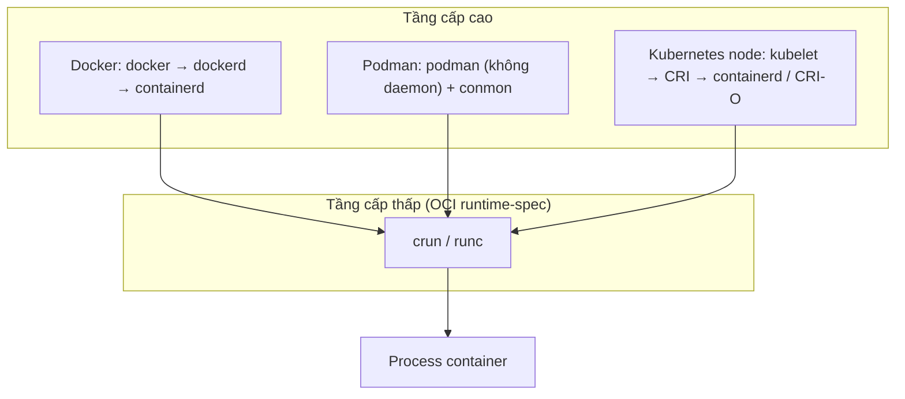

# Capstone 6_1_6: Vẽ Bản Đồ Runtime — Docker, Podman, containerd/CRI-O Và Lỗi Ở Tầng Nào

> **Khóa học**: Cloud DevOps Basic — Containers & Kubernetes
> **Phân nhóm**: 6 Domain 6 - Containers and Kubernetes › 6_1 Container Fundamentals › Capstones
> **Bài học gốc**: [6_1_6 Container Runtimes and Ecosystem](<../6_1_6 Container Runtimes and Ecosystem.md>)
> **Thời gian**: 2,5–3 giờ · **Chi phí**: 0 · **Cần root/sudo**: Không
> **Công cụ**: Podman 5.x (rootless, systemd user), `crun`, `conmon`, `curl`, `jq`, `pstree`. Docker Engine thật (tùy chọn, cho Bài 3).
> **Trạng thái**: Bài 1, 2, 4, 6 **đã chạy thử** (18-11-2026, Fedora 43, Podman 5.8.9, crun 1.28, conmon 2.2.1, netavark). **Bài 3 (Docker `dockerd`) và Bài 5 (Kubernetes/CRI) chưa chạy được ở máy kiểm chứng** vì không có Docker Engine thật (lệnh `docker` ở đây là lớp giả lập Podman) và không có cluster đang chạy; hai bài này được đánh dấu rõ, nội dung dựa trên tài liệu chính thức.

---

## 🎯 Kịch bản

Đồng nghiệp hỏi: *"Kubernetes bỏ Docker rồi, image của mình có hỏng không? Podman không có daemon thì container sống nhờ ai? Lỗi `OCI runtime error` là lỗi của Podman hay của kernel?"* Bạn phải vẽ được **bản đồ các tầng** và chỉ ra bằng chứng trên máy.

## 🗺️ Bản Đồ Phủ Kiến Thức (Coverage)

| Mục trong lesson 6_1_6 | Kiến thức | Bài |
| :--- | :--- | :---: |
| 1.1 | Hai tầng: công cụ cấp cao (Docker/Podman/containerd/CRI-O) và OCI runtime cấp thấp (`runc`/`crun`) | 1, 4, 6 |
| 1.2 | Docker client → `dockerd` (daemon); REST API qua socket; mặc định daemon dừng thì container tắt; live restore; chạy qua containerd và `runc` | 3 |
| 1.3 | Podman daemonless; `conmon` mỗi container; double-fork; API theo yêu cầu qua socket activation; `crun` | 1, 2, 4 |
| 1.4 | Kubernetes: runtime ở **mỗi node**, yêu cầu CRI, containerd/CRI-O, dockershim bị gỡ từ 1.24 | 5 |
| 1.5 | RuntimeClass chọn runtime theo Pod | 5 |
| Gotcha 5.1–5.4 | "Bỏ Docker nên image hỏng"; nhầm manager với OCI runtime; số liệu hiệu năng của dự án; số phiên bản đổi | 5, 6 |



## 🧰 Chuẩn Bị

```bash
podman --version; podman info --format '{{.Host.OCIRuntime.Name}} / {{.Host.Conmon.Package}} / {{.Host.NetworkBackend}}'
podman pull -q docker.io/library/alpine
```

> Tên tài nguyên: `c6-*`. Dọn dẹp ở cuối file.

---

## Bài 1 — Chứng Minh "Podman Không Có Daemon" Và Tìm `conmon` (40 phút)

**Yêu cầu**
1. Xác nhận không có `dockerd` và không có process `podman` chạy thường trực.
2. Chạy container nền, vẽ **chuỗi cha-con** từ process container lên tới `systemd`.
3. Đọc cấu hình runtime/conmon/mạng/DB mà Podman báo.

```bash
pgrep -a -x dockerd || echo "không có dockerd"
podman ps -a >/dev/null; pgrep -a -x podman || echo "không có process podman nền"

podman run -d --name c6-rt --network none docker.io/library/alpine sleep 600
P=$(podman inspect -f '{{.State.Pid}}' c6-rt)
pstree -s -p $P
CP=$(ps -o ppid= -p $P | tr -d ' ')
ps -o pid,ppid,user,comm -p $P,$CP
ps -o args= -p $CP | cut -c1-110

podman info --format 'ociRuntime={{.Host.OCIRuntime.Name}} path={{.Host.OCIRuntime.Path}} conmon={{.Host.Conmon.Path}} network={{.Host.NetworkBackend}} rootless={{.Host.Security.Rootless}} db={{.Host.DatabaseBackend}}'
```

**Tiêu chí hoàn thành**
- [ ] Sơ đồ chuỗi (ví dụ `systemd → systemd --user → conmon → sleep`) có ghi PID bạn thấy.
- [ ] Giải thích 3 điều: (1) ai làm cha của process container, (2) vì sao **không** thấy `crun` trong cây, (3) vì sao thấy `conmon` nhưng không thấy `podman`.
- [ ] Ghi lại `ociRuntime`, đường dẫn `conmon`, `network backend`, `rootless`, `db backend` của **máy bạn** (không suy đoán mặc định).
- [ ] Trả lời: `conmon` làm gì cho **một** container? (giám sát, kênh liên lạc manager ↔ runtime; double-fork)

<details>
<summary>Đáp án tham chiếu</summary>

Quan sát: không có `dockerd`; không có process `podman` nền; cây: `systemd(1) ── systemd(1629) ── conmon(...) ── sleep(...)`; dòng lệnh của cha: `/usr/bin/conmon --api-version 1 -c <id> ...`; `ociRuntime=crun path=/usr/bin/crun conmon=/usr/bin/conmon network=netavark rootless=true db=sqlite`.

Giải thích (lesson 1.3): `conmon` là chương trình giám sát và kênh liên lạc giữa manager và OCI runtime cho **một container**, nó khởi chạy runtime như tiến trình con và **double-fork** để tách khỏi tiến trình cha (nên cha thật là `systemd --user`, không phải `podman`). Việc `crun` không còn trong cây là quan sát trên máy này; lesson cũng dặn quan hệ cha-con có thể phụ thuộc phiên bản và cấu hình. `db=sqlite` là quan sát (lesson ghi rõ đây chưa phải trích dẫn).
</details>

---

## Bài 2 — API "Theo Yêu Cầu" Và Container Không Phụ Thuộc Daemon (45 phút)

**Yêu cầu**
1. Kiểm tra `podman.socket` do systemd giữ; gọi **cả hai** API: libpod (`/libpod/_ping`) và tương thích Docker (`/containers/json`, `/version`).
2. **(Tùy chọn, tạm thời)** dừng `podman.socket` rồi xác nhận container vẫn chạy; sau đó bật lại.

```bash
systemctl --user is-active podman.socket
S=$XDG_RUNTIME_DIR/podman/podman.sock
curl -s --unix-socket $S http://d/v5.0.0/libpod/_ping; echo
curl -s --unix-socket $S http://d/v1.41/containers/json | jq -c '.[]|select(.Names[0]=="/c6-rt")|{Names,Image,State}'
curl -s --unix-socket $S http://d/v1.41/version | jq -c '{Version,ApiVersion,Components:[.Components[].Name]}'
pgrep -a -x podman || echo "không có process podman nền"
sleep 30; pgrep -a -x podman || echo "sau ~30 giây rảnh: service đã tự thoát"
```

```bash
# TÙY CHỌN: bỏ qua nếu đang có công cụ phụ thuộc socket này (Compose, IDE, kind...)
P=$(podman inspect -f '{{.State.Pid}}' c6-rt)
systemctl --user stop podman.socket; sleep 1
kill -0 $P && echo "container pid $P vẫn sống khi socket/service đã dừng"
systemctl --user start podman.socket && systemctl --user is-active podman.socket
```

> Cần `c6-rt` ở Bài 1 còn chạy.

**Tiêu chí hoàn thành**
- [ ] Hai API trả kết quả; `containers/json` liệt kê `c6-rt` với `State: running`.
- [ ] Giải thích "socket activation": vì sao API là **theo yêu cầu** chứ không phải daemon thường trực (lesson 1.3). Ngay sau lệnh gọi API bạn có thể thấy một process `podman ... system service` đang chạy; nó phải **tự thoát** sau một thời gian rảnh.
- [ ] Container vẫn sống khi dừng socket; bạn nêu được vì sao điều này **khác** mô hình mặc định của Docker (daemon dừng ⇒ container tắt, nếu không bật live restore).
- [ ] Phân biệt ba thứ dễ nhầm: `podman` (CLI), `podman system service`/`podman.socket` (API tùy chọn) và `conmon` (giám sát từng container).

<details>
<summary>Đáp án tham chiếu</summary>

Quan sát: `active`; `/libpod/_ping` trả `OK`; ngay sau các lệnh gọi, `pgrep` thấy `/usr/bin/podman --log-level=info system service` và một lúc sau thì không còn (service chỉ sống khi có yêu cầu; khoảng chờ cụ thể không có trong lesson); `containers/json` trả `{"Names":["/c6-rt"],"Image":"docker.io/library/alpine:latest","State":"running"}`; `/version` trả `Version 5.8.9`, `ApiVersion 1.44`, thành phần `Podman Engine`, `Conmon`, `OCI Runtime (crun)`. Sau khi dừng `podman.socket`, process container vẫn chạy (`kill -0` thành công). Đường dẫn `/v5.0.0/libpod/...` và `/v1.41/...` là phiên bản API hợp lệ trên bản Podman này; **hãy dùng đúng phiên bản API của bản bạn** (xem `podman-system-service(1)`). Lesson: API là "REST API có giao diện tương thích Docker", phục vụ theo yêu cầu qua socket activation.
</details>

---

## Bài 3 — Docker: Client → `dockerd` → containerd → `runc` (60 phút, **chưa chạy thử**)

> Cần Docker Engine **thật** (không phải lớp giả lập Podman). Nếu bạn không có, hoàn thành phần **đọc tài liệu** và điền bảng; bỏ phần lệnh.

**Yêu cầu**
1. (Đọc) Điền bảng "dockerd làm gì" dựa trên tài liệu `dockerd` và `live restore`.
2. (Lệnh, nếu có Docker) quan sát daemon, socket, và chuỗi process của một container.

| Khía cạnh | Giá trị theo tài liệu | Đọc ở trang nào |
| :--- | :--- | :--- |
| Socket mặc định và quyền | | |
| Thư mục dữ liệu | | |
| Runtime được gọi thế nào, mặc định là gì | | |
| Cần root không? | | |
| Daemon dừng thì container đang chạy thế nào? Cách giữ chúng chạy? | | |

```bash
docker version                                  # có cả Client và Server => có daemon
ls -l /var/run/docker.sock
pgrep -a dockerd; pgrep -a containerd
docker run -d --name c6-dk docker.io/library/alpine sleep 600
ps -ef | grep -E 'containerd-shim|sleep 600' | grep -v grep
docker rm -f c6-dk
```

**Tiêu chí hoàn thành**
- [ ] Bảng điền đủ, mỗi ô ghi **trang tài liệu** bạn đọc.
- [ ] (Nếu có Docker) bạn thấy `dockerd`, `containerd` và process container; ghi lại **tên shim/parent bạn thật sự thấy** thay vì suy đoán.
- [ ] So sánh 5 dòng Docker vs Podman (điều phối, giám sát từng container, khi thành phần điều phối dừng, API, restart) như bảng ở lesson 1.3.

<details>
<summary>Đáp án tham chiếu (từ lesson, theo tài liệu Docker; chưa kiểm chứng trên máy)</summary>

Socket `/var/run/docker.sock`, cần root hoặc thuộc nhóm `docker`; dữ liệu ở `/var/lib/docker` (tùy chọn `--data-root`); `dockerd` dựa vào một OCI runtime **được gọi qua containerd**, mặc định `runc`; cần root trừ khi dùng Rootless mode; **mặc định các container đang chạy bị tắt khi daemon dừng**, bật *live restore* để chúng tiếp tục chạy. Lưu ý: Docker Engine 29.0+ dùng containerd image store mặc định cho cài mới (đối chiếu bản của bạn).
</details>

---

## Bài 4 — OCI Runtime Là Một Thành Phần Thay Được (20 phút)

**Yêu cầu**: chỉ định runtime bằng cờ toàn cục của Podman, quan sát một runtime **không tồn tại** bị từ chối ở tầng nào, và ghi nhận `runc` có/không có trên máy.

```bash
command -v runc || echo "runc: không có trên máy này"
podman --runtime /usr/bin/crun run --rm docker.io/library/alpine echo "chạy bằng crun chỉ định tường minh"
podman --runtime /usr/bin/no-such-runtime run --rm docker.io/library/alpine echo x 2>&1 | head -1
```

**Tiêu chí hoàn thành**
- [ ] Lệnh đầu thành công; lệnh sau báo lỗi **trước khi** có container nào được tạo, và bạn nói được ai báo lỗi (manager, không phải kernel).
- [ ] Nếu bạn có `runc`: thử `podman --runtime $(command -v runc) run ...` và ghi lại kết quả. *(Trên máy kiểm chứng không có `runc`, nên **chưa thử**.)*
- [ ] Trả lời: README của `crun` nói nó nhanh hơn `runc` và dùng ít bộ nhớ hơn nhiều. Vì sao bạn **không** dùng câu đó làm bằng chứng hiệu năng trong báo cáo? (số liệu do chính dự án đo: gotcha 5.3)

<details>
<summary>Đáp án tham chiếu</summary>

Quan sát: `runc: không có trên máy này`; lệnh với `crun` in ra dòng chữ; lệnh với đường dẫn sai in `Error: no valid executable found for OCI runtime /usr/bin/no-such-runtime: invalid argument`. Đây là lỗi của **manager** (Podman) khi tìm runtime, không phải của kernel hay container. Nếu muốn so sánh hiệu năng khởi động, tự đo trong môi trường của bạn nhiều lần.
</details>

---

## Bài 5 — Kubernetes: CRI, Dockershim Và RuntimeClass (45 phút, **bài viết + tùy chọn lab**)

**Yêu cầu**
1. Vẽ chuỗi gọi cho một Pod trên một node: `kubelet → ? → ? → OCI runtime → process`, và ghi vị trí của **dockershim** trước/sau v1.24.
2. Trả lời bằng đoạn ≤ 6 dòng: *"Kubernetes gỡ dockershim ở 1.24. Image mình build bằng Docker có chạy không? Vì sao?"* (dùng 6_1_5)
3. Viết YAML `RuntimeClass` + Pod dùng nó. **Chưa chạy thử**; đối chiếu trang Runtime Class của Kubernetes trước khi dùng.
4. (Tùy chọn, cần cluster thử nghiệm) xem runtime của node.

```yaml
apiVersion: node.k8s.io/v1
kind: RuntimeClass
metadata:
  name: sandboxed          # tên bạn đặt
handler: <tên handler đã cấu hình ở CRI runtime của node>
---
apiVersion: v1
kind: Pod
metadata:
  name: demo
spec:
  runtimeClassName: sandboxed
  containers:
    - name: app
      image: docker.io/library/alpine
      command: ["sleep", "600"]
```

```bash
# TÙY CHỌN, chỉ trên cluster thử nghiệm (ví dụ kind): cột CONTAINER-RUNTIME cho biết runtime và phiên bản
kubectl get nodes -o wide
```

**Tiêu chí hoàn thành**
- [ ] Sơ đồ có **kubelet → (CRI) → containerd hoặc CRI-O → OCI runtime**; dockershim được vẽ là đã bị gỡ.
- [ ] Đoạn trả lời nêu: Kubernetes yêu cầu runtime **tuân thủ CRI**; image theo chuẩn **OCI** nên vẫn chạy.
- [ ] YAML đúng cấu trúc: `RuntimeClass` có `handler`; Pod dùng `runtimeClassName`. Ghi chú: ở lab, bạn cần cấu hình handler tương ứng trong runtime của node (bài 6_3, 6_7).
- [ ] Ghi lại **số phiên bản Kubernetes** bạn đang tham chiếu và link trang Container Runtimes: nội dung có thể đổi (gotcha 5.4).

<details>
<summary>Đáp án tham chiếu</summary>

Chuỗi: `kubelet → CRI → containerd | CRI-O → OCI runtime (runc/crun/...) → process container`. Dockershim từng là lớp phiên dịch giữa kubelet và Docker; **bị gỡ từ Kubernetes 1.24**. Trang Container Runtimes (thời điểm viết lesson) ghi Kubernetes 1.37 yêu cầu runtime tuân thủ CRI và liệt kê containerd, CRI-O, Docker Engine, Mirantis Container Runtime; **đối chiếu trực tiếp trang hiện tại** vì có thể đổi. RuntimeClass cho phép đặt runtime khác nhau giữa các Pod để cân bằng hiệu năng và bảo mật (ví dụ ảo hóa phần cứng, đổi lại thêm overhead: xem capstone 6_1_1).
</details>

---

## Bài 6 — "Lỗi Này Ở Tầng Nào?" (30 phút)

**Yêu cầu**: tái hiện bốn lỗi dưới đây, ghi **thông điệp nguyên văn** và kết luận tầng chịu trách nhiệm (CLI/manager, registry, OCI runtime hay ứng dụng).

```bash
podman run --rm --badflag docker.io/library/alpine true;         echo "-> exit $?"
podman pull docker.io/library/does-not-exist-xyz-123 2>&1 | tail -1 | cut -c1-160
podman run --rm docker.io/library/alpine foo;                     echo "-> exit $?"
podman run --rm docker.io/library/alpine sh -c 'cat /nonexist';   echo "-> exit $?"
```

**Tiêu chí hoàn thành**
- [ ] Bảng 4 dòng: thông điệp, exit code, tầng.
- [ ] Mỗi kết luận nêu **manh mối trong thông điệp** (ví dụ chữ `OCI runtime`, tên `crun`, `reading manifest`).
- [ ] Một câu quy trình: khi "container không khởi động được", bạn hỏi theo thứ tự nào? (gotcha 5.2)

<details>
<summary>Đáp án tham chiếu</summary>

| Lệnh | Thông điệp (rút gọn) | Exit | Tầng |
| :--- | :--- | :-: | :--- |
| `--badflag` | `Error: unknown flag: --badflag` | `125` | CLI/manager (Podman) |
| pull image lạ | `unable to copy from source docker://...: reading manifest latest in docker.io/library/...` | khác 0 | Manager + registry (không có image) |
| `foo` | `Error: crun: executable file foo not found in $PATH ... OCI runtime attempted to invoke a command that was not found` | `127` | **OCI runtime** (crun) không tìm thấy lệnh |
| `cat /nonexist` | `cat: can't open '/nonexist': ...` | `1` | **Ứng dụng** trong container |

Mã `125/126/127` theo bảng Docker (lesson 6_1_8): `125` lỗi của chính daemon/công cụ, `126`/`127` không thực thi được/không tìm thấy lệnh. Ở bài này `foo` cho `127`, đúng bảng. Một lỗi khác quan sát được trên máy này: `OCI runtime error: crun: controller cpuset is not available ...` khi dùng `--cpuset-cpus` ở rootless: lỗi của OCI runtime vì controller chưa được delegate (xem capstone 6_1_3).
</details>

---

## ✅ Nghiệm Thu Capstone

- [ ] Có sơ đồ 3 chuỗi (Docker, Podman, Kubernetes node) vẽ tay/Mermaid, mỗi chuỗi ghi rõ tầng cấp cao và OCI runtime.
- [ ] Bảng Bài 6 và bảng Bài 3 điền xong (có nguồn).
- [ ] Bạn nói được 1 phút: "Kubernetes bỏ dockershim, image Docker vẫn chạy vì...".

## 🧠 Câu Hỏi Bảo Vệ

1. `runc`/`crun` khác `containerd`/`CRI-O` ở đâu? Ai gọi ai?
2. Docker và Podman khác nhau thế nào khi tiến trình điều phối bị dừng?
3. `conmon` tồn tại vì lý do gì? Vì sao nó double-fork?
4. Một node Kubernetes cần cài gì để chạy Pod? Kubernetes giao tiếp với nó bằng gì?

## 🧹 Dọn Dẹp

```bash
podman rm -f -t 0 c6-rt c6-dk 2>/dev/null
systemctl --user is-active podman.socket    # nếu đã dừng ở Bài 2: systemctl --user start podman.socket
```

## 📚 Nguồn Tài Liệu Chính Thống (Official References)
- [Kubernetes — Container Runtimes](https://kubernetes.io/docs/setup/production-environment/container-runtimes/) — CRI, containerd, CRI-O, dockershim đã gỡ.
- [Kubernetes — Dockershim Removal FAQ](https://kubernetes.io/blog/2022/02/17/dockershim-faq/) — Blog chính thức về việc gỡ dockershim.
- [Kubernetes — Runtime Class](https://kubernetes.io/docs/concepts/containers/runtime-class/) — `RuntimeClass`, `runtimeClassName`.
- [Docker Docs — dockerd reference](https://docs.docker.com/reference/cli/dockerd/) — Socket mặc định, `--data-root`, runtime qua containerd, mặc định `runc`.
- [Docker Docs — Live restore](https://docs.docker.com/engine/containers/live-restore/) — Daemon dừng thì container bị tắt; cách giữ chúng chạy.
- [Docker Docs — What is Docker?](https://docs.docker.com/get-started/docker-overview/) — Client và daemon.
- [Podman README (GitHub)](https://github.com/containers/podman/blob/main/README.md) — "No manager daemon", REST API tương thích Docker.
- [podman-system-service(1)](https://docs.podman.io/en/latest/markdown/podman-system-service.1.html) — API theo yêu cầu qua socket activation.
- [conmon](https://github.com/containers/conmon), [crun](https://github.com/containers/crun), [runc](https://github.com/opencontainers/runc) — Giám sát container và các OCI runtime (README dự án).
- [containerd](https://containerd.io/) và [CRI-O](https://cri-o.io/) — Runtime cấp cao cho Kubernetes.
