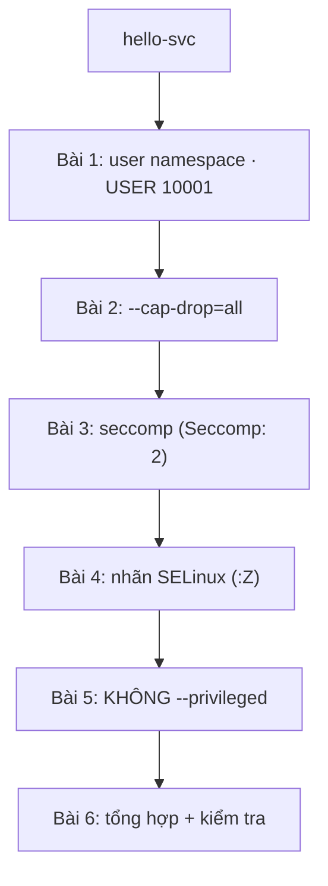

# Capstone 6_1_7: Gia Cố Container Từng Lớp — User Namespace, Capabilities, seccomp, SELinux

> **Khóa học**: Cloud DevOps Basic — Containers & Kubernetes
> **Phân nhóm**: 6 Domain 6 - Containers and Kubernetes › 6_1 Container Fundamentals › Capstones
> **Bài học gốc**: [6_1_7 Container Security Fundamentals](<../6_1_7 Container Security Fundamentals.md>)
> **Thời gian**: 3–4 giờ · **Chi phí**: 0 · **Cần root/sudo**: Không (mọi bài chạy rootless)
> **Yêu cầu**: Podman 5.x rootless có `/etc/subuid`, `/etc/subgid`; `capsh` (gói `libcap`); SELinux Enforcing cho Bài 4 (Fedora/RHEL); image `selflearn.invalid/hello-svc:1.0.0` cho Bài 6
> **Trạng thái**: Bài 1–6 **đã chạy thử** (18-11-2026, Fedora 43, kernel 7.3.3, Podman 5.8.9 rootless, SELinux Enforcing). **Chưa chạy thử** các biến thể rootful (cần `sudo`): mọi nhận định về rootful ở đây là suy luận từ lesson, được đánh dấu.

---

## 🎯 Kịch bản

Đội bảo mật đưa một danh sách kiểm tra cho nền tảng container: *"không chạy bằng root thật, bỏ capability thừa, có seccomp, không `--privileged`, mount có nhãn SELinux"*. Bạn phải **chứng minh từng lớp bằng bằng chứng đọc từ `/proc`** và cuối cùng chạy `hello-svc` với cấu hình gia cố đầy đủ.

## 🗺️ Bản Đồ Phủ Kiến Thức (Coverage)

| Mục trong lesson 6_1_7 | Kiến thức | Bài |
| :--- | :--- | :---: |
| 1.1 | Bảo mật nhiều lớp (định danh, đặc quyền, syscall, nhãn, cấu hình) | 6 |
| 1.2 | User namespace, rootless, `uid_map`, `subuid`/`subgid`, `--userns=keep-id` | 1 |
| 1.3 | Capabilities, `CAP_NET_ADMIN`, `--cap-drop`, nguyên tắc bỏ bớt | 2 |
| 1.4 | seccomp: lọc syscall bằng BPF | 3 |
| 1.5 | SELinux: `:z`, `:Z`, `--security-opt label=disable` | 4 |
| 1.6 | `--privileged` và quyền thiết bị | 5 |
| Gotcha 5.1–5.4 | `permission denied` do nhãn; `--privileged` cho tiện; quên `subuid`; "root trong container luôn là root thật" | 1, 4, 5 |



## 🧰 Chuẩn Bị

```bash
grep "^$USER:" /etc/subuid /etc/subgid          # phải có dải UID cho user của bạn
getenforce 2>/dev/null || echo "không có SELinux (Bài 4 chỉ đọc, không chạy)"
command -v capsh || echo "thiếu capsh (gói libcap) - Bài 2 dùng để giải mã capability"
podman pull -q docker.io/library/alpine
podman image exists selflearn.invalid/hello-svc:1.0.0 || bash ../../../shared/scripts/build-images.sh
WORK=$(mktemp -d /tmp/c7-XXXXXX); cd "$WORK"; echo "thư mục làm việc: $WORK"
```

> Tên tài nguyên: `c7-*`, thư mục `$WORK` và `$HOME/c7-data`. Dọn dẹp ở cuối file.

---

## Bài 1 — "Root" Trong Container Là Ai Trên Máy Chủ? (40 phút)

**Yêu cầu**
1. Đọc dải UID bạn được cấp, `uid_map` của Podman, và `uid_map` của một container.
2. Chạy container bằng root và bằng user `1234`; tìm **UID thật trên máy chủ** của từng process.
3. Tự tính công thức ánh xạ và kiểm chứng; thử `--userns=keep-id`.

```bash
grep "^$USER:" /etc/subuid /etc/subgid
podman unshare cat /proc/self/uid_map
echo "UID của tôi trên máy chủ: $(id -u)"

podman run --rm docker.io/library/alpine id
podman run -d --name c7-root docker.io/library/alpine sleep 600
podman run -d --name c7-u1234 --user 1234 docker.io/library/alpine sleep 600
for c in c7-root c7-u1234; do
  P=$(podman inspect -f '{{.State.Pid}}' $c)
  echo "== $c  pid=$P"; ps -o uid,user,args -p $P; cat /proc/$P/uid_map
done
podman run --rm --userns=keep-id docker.io/library/alpine id
```

**Tiêu chí hoàn thành**
- [ ] Bảng: `UID trong container` → `UID trên máy chủ` cho `0`, `1`, `1234`.
- [ ] Tính đúng: `UID máy chủ = (đầu dải subuid) + (UID trong container − 1)` cho UID ≥ 1; và UID `0` ánh xạ về **UID của bạn**.
- [ ] Giải thích vì sao root trong container rootless **không** phải root thật (user namespace, lesson 1.2).
- [ ] Giải thích `--userns=keep-id` làm gì và khi nào cần (mount thư mục: capstone 6_1_10).
- [ ] Trả lời bằng cách đọc tài liệu (gotcha 5.3; **không** sửa `/etc/subuid` để thử): nếu user thiếu dải UID trong `/etc/subuid` và `/etc/subgid` thì Podman rootless cần gì để hoạt động?

<details>
<summary>Đáp án tham chiếu</summary>

Quan sát trên máy kiểm chứng (số khác nhau ở máy bạn): `subuid`/`subgid` của user: `524288:65536`; `podman unshare cat /proc/self/uid_map` cho `0 1000 1` rồi `1 524288 65536`; container root chạy ở máy chủ với UID `1000`; container user `1234` chạy ở máy chủ với UID `525521` (= 524288 + 1233 ✓); `--userns=keep-id` cho `uid=1000(...)` trong container (cùng UID của bạn).

Về rootful (không chạy thử): lesson 5.4 ghi container rootful chạy như root thật trên máy chủ; đó là **suy luận từ mô hình dùng chung kernel**, chưa có trích dẫn riêng. Đừng trình bày nó như sự thật đã kiểm chứng trong báo cáo.
</details>

---

## Bài 2 — Capabilities: Giải Mã, Bỏ Bớt, Cấp Đúng (40 phút)

**Yêu cầu**
1. Giải mã tập capability mặc định của container (`CapEff` trong `/proc/1/status`) bằng `capsh`.
2. Với `--cap-drop=all`, chạy hai thao tác cần đặc quyền (`ip link set lo down`, `chown`) và ghi kết quả.
3. Chỉ bỏ **một** capability (`CHOWN`) và kiểm tra.
4. Tìm capability **tối thiểu** để tạo interface `dummy` (`ip link add d0 type dummy`).

```bash
podman run --rm docker.io/library/alpine sh -c 'grep -E "CapEff|CapBnd" /proc/1/status'
podman run --rm docker.io/library/alpine grep CapEff /proc/1/status | awk '{print $2}' | xargs -I{} capsh --decode={}

podman run --rm --cap-drop=all docker.io/library/alpine sh -c \
  'grep CapEff /proc/1/status; ip link set lo down; echo "ip rc=$?"; chown 1:1 /etc/hostname; echo "chown rc=$?"'
podman run --rm --cap-drop=CHOWN docker.io/library/alpine sh -c 'chown 1:1 /etc/hostname; echo "chown rc=$?"'

podman run --rm docker.io/library/alpine sh -c 'ip link add d0 type dummy; echo "mặc định rc=$?"'
podman run --rm --cap-add=NET_ADMIN docker.io/library/alpine sh -c \
  'ip link add d0 type dummy; echo "+NET_ADMIN rc=$?"; ip link | grep d0'
```

**Tiêu chí hoàn thành**
- [ ] Liệt kê được tập mặc định (11 capability) và nói **`NET_ADMIN` không nằm trong đó**.
- [ ] Bảng: cấu hình → thao tác → kết quả.
- [ ] Giải thích vì sao `--cap-drop=all` làm `CapEff` về 0 và cả `chown` lẫn `ip link` đều `Operation not permitted`.
- [ ] Nêu nguyên tắc: **bỏ hết rồi chỉ thêm lại cái cần** (`--cap-drop=all --cap-add=...`) thay vì thêm vào tập mặc định.
- [ ] Giải thích `CAP_NET_ADMIN` cho phép thao tác nào (cấu hình interface, firewall IP, bảng định tuyến: lesson 1.3).

<details>
<summary>Đáp án tham chiếu</summary>

Quan sát: `CapEff: 00000000800405fb` giải mã là `cap_chown, cap_dac_override, cap_fowner, cap_fsetid, cap_kill, cap_setgid, cap_setuid, cap_setpcap, cap_net_bind_service, cap_sys_chroot, cap_setfcap` (11 capability; tập mặc định có thể khác giữa các bản Podman/Docker, hãy giải mã trên máy bạn). Với `--cap-drop=all`: `CapEff: 0000000000000000`, `ip: ioctl 0x8914 failed: Operation not permitted` (rc 2), `chown: ... Operation not permitted` (rc 1). `--cap-drop=CHOWN`: `chown` thất bại (rc 1). Tạo `dummy`: mặc định thất bại (`RTNETLINK answers: Operation not permitted`, rc 2); thêm `--cap-add=NET_ADMIN` thành công (rc 0).

Quy tắc đặc quyền theo từng thao tác (ví dụ tạo interface cần `NET_ADMIN`) lấy từ `capabilities(7)`; lesson chỉ trích dẫn `CAP_NET_ADMIN`.
</details>

---

## Bài 3 — seccomp: Lọc Syscall (30 phút)

**Yêu cầu**
1. Đọc trạng thái seccomp của PID 1 container mặc định và khi `seccomp=unconfined`.
2. Viết profile JSON **chặn syscall `mkdir`/`mkdirat`** (trả `EPERM`), chạy container với profile đó, và chứng minh chỉ `mkdir` bị chặn, các thao tác khác vẫn chạy.

```bash
podman run --rm docker.io/library/alpine grep -E '^(Seccomp|Seccomp_filters):' /proc/1/status
podman run --rm --security-opt seccomp=unconfined docker.io/library/alpine grep -E '^(Seccomp|Seccomp_filters):' /proc/1/status

cat > deny-mkdir.json <<'EOF'
{
  "defaultAction": "SCMP_ACT_ALLOW",
  "syscalls": [
    { "names": ["mkdir", "mkdirat"], "action": "SCMP_ACT_ERRNO", "errnoRet": 1 }
  ]
}
EOF
podman run --rm --security-opt "seccomp=$PWD/deny-mkdir.json" docker.io/library/alpine sh -c \
  'mkdir /x; echo "mkdir rc=$?"; touch /y && echo "touch vẫn chạy"'
```

**Tiêu chí hoàn thành**
- [ ] Mặc định `Seccomp: 2` (chế độ filter); `unconfined` cho `Seccomp: 0`.
- [ ] `mkdir` báo `Operation not permitted`, `touch` vẫn chạy.
- [ ] Giải thích seccomp khác capabilities: capabilities chia nhỏ **đặc quyền** của root; seccomp **lọc system call** bằng BPF (lesson 1.4).
- [ ] Nêu một rủi ro khi dùng `seccomp=unconfined` trên production.

<details>
<summary>Đáp án tham chiếu</summary>

Quan sát: mặc định `Seccomp: 2`, `Seccomp_filters: 1`; `unconfined`: `Seccomp: 0`, `Seccomp_filters: 0`; với profile tự viết: `mkdir: can't create directory '/x': Operation not permitted` (rc 1) rồi `touch vẫn chạy`. Định dạng JSON profile (các khóa `defaultAction`, `syscalls`, `names`, `action`, `errnoRet`) theo tài liệu seccomp của runtime: **lesson không nêu định dạng này**, hãy đối chiếu tài liệu Docker/Podman về seccomp trước khi dùng cho workload thật. Ngoài ra, ở máy kiểm chứng, `unshare -U true` trong container vẫn chạy được với seccomp mặc định (rc 0), nên không dùng nó làm ví dụ "bị chặn".
</details>

---

## Bài 4 — SELinux: Nhãn Cho Bind Mount (40 phút, cần SELinux Enforcing)

**Yêu cầu**: cho container đọc file từ thư mục trong `$HOME` ở bốn chế độ: không nhãn, `:Z`, `:z`, `--security-opt label=disable`. Ghi lại **nhãn (`ls -Z`)** trước và sau mỗi lần.

```bash
getenforce
mkdir -p $HOME/c7-data && echo hi > $HOME/c7-data/a.txt
ls -Z $HOME/c7-data/a.txt

podman run --rm -v $HOME/c7-data:/data docker.io/library/alpine sh -c 'cat /data/a.txt; echo "rc=$?"'     # không nhãn
podman run --rm -v $HOME/c7-data:/data:Z docker.io/library/alpine sh -c 'cat /data/a.txt; echo "rc=$?"'   # nhãn riêng
ls -Z $HOME/c7-data/a.txt
podman run --rm -v $HOME/c7-data:/data:z docker.io/library/alpine cat /data/a.txt                          # nhãn chia sẻ
ls -Z $HOME/c7-data/a.txt
podman run --rm --security-opt label=disable -v $HOME/c7-data:/data docker.io/library/alpine cat /data/a.txt
podman run --rm docker.io/library/alpine cat /proc/self/attr/current; echo
```

> ⚠️ `:Z`/`:z` **đổi nhãn thật** của thư mục trên máy chủ. Chỉ dùng thư mục thử nghiệm của bạn; **đừng** gắn `:Z` vào `$HOME` hay thư mục hệ thống.

**Tiêu chí hoàn thành**
- [ ] Không nhãn: `Permission denied` dù quyền Unix đúng. Với `:Z`: đọc được.
- [ ] Bảng nhãn trước/sau: `user_home_t` → `container_file_t:s0:cX,cY` (riêng) → `container_file_t:s0` (chia sẻ).
- [ ] Giải thích khác biệt `:Z` (chỉ container hiện tại) và `:z` (dùng chung nhiều container).
- [ ] Giải thích vì sao `label=disable` chỉ là phương án cuối (tắt cơ chế tách nhãn cho container).
- [ ] Nhãn process container (`container_t:...`) và vai trò của nó trong kiểm soát truy cập.

<details>
<summary>Đáp án tham chiếu</summary>

Quan sát: `Enforcing`; nhãn ban đầu `unconfined_u:object_r:user_home_t:s0`; không nhãn: `cat: can't open '/data/a.txt': Permission denied`, rc 1; sau `:Z`: `hi`, nhãn thành `system_u:object_r:container_file_t:s0:c1,c933` (có **category** riêng); sau `:z`: nhãn `system_u:object_r:container_file_t:s0` (không category, dùng chung); `label=disable` đọc được; nhãn process container `system_u:system_r:container_t:s0:c267,c783`. Category cụ thể (`c1,c933`) khác nhau mỗi lần. Chi tiết cơ chế SELinux ngoài lesson; lesson chỉ trích hành vi `z`/`Z`/`label=disable` của Podman.

Nếu máy bạn **không** bật SELinux (Ubuntu, Debian), bài này chỉ để đọc.
</details>

---

## Bài 5 — `--privileged`: Đo Mức Mở Quyền (25 phút)

**Yêu cầu**: so sánh container mặc định và `--privileged` theo bốn số liệu: `CapEff`, `Seccomp`, số thiết bị trong `/dev`, nhãn SELinux; rồi thử hai thao tác bị chặn ở chế độ mặc định.

```bash
for o in "" "--privileged"; do
  echo "[opts: ${o:-mặc định}]"
  podman run --rm $o docker.io/library/alpine sh -c \
    'grep -E "^(CapEff|Seccomp):" /proc/1/status; echo "devs=$(ls /dev | wc -l)"; cat /proc/self/attr/current; echo'
done
podman run --rm --privileged docker.io/library/alpine sh -c \
  'ip link add d0 type dummy && echo "privileged: tạo dummy OK"; mount -t tmpfs none /mnt && echo "privileged: mount OK"'
```

**Tiêu chí hoàn thành**
- [ ] Bảng so sánh 4 số liệu.
- [ ] Nêu 3 thứ `--privileged` gỡ bỏ so với mặc định (capability, seccomp, thiết bị, nhãn).
- [ ] Giải thích vì sao đây là cờ nên tránh (khuyến nghị của lesson), và đề xuất thay thế: **cấp đúng thứ cần** (`--cap-add`, `--device`).
- [ ] Phân tích giới hạn của bài này: ở **rootless**, "privileged" vẫn bị chặn bởi ranh giới user namespace; mức nguy hiểm trên **rootful** *chưa chạy thử*.

<details>
<summary>Đáp án tham chiếu</summary>

Quan sát: mặc định `CapEff 00000000800405fb`, `Seccomp: 2`, `devs=15`, nhãn `container_t`; `--privileged`: `CapEff 000001ffffffffff` (đầy đủ), `Seccomp: 0`, `devs=171`, nhãn `unconfined_u:unconfined_r:spc_t:s0`; trong chế độ privileged `ip link add` và `mount -t tmpfs` đều thành công. Lesson: mặc định container không được truy cập thiết bị nào và `--privileged` "extended privileges". Số thiết bị phụ thuộc máy.
</details>

---

## Bài 6 — Tổng Hợp: Chạy `hello-svc` Với Cấu Hình Gia Cố Và Chứng Minh (50 phút)

**Yêu cầu**: chạy `hello-svc` với các lớp ở trên và viết **script kiểm tra tự động** in `[PASS]/[FAIL]` cho từng lớp. Cờ `--security-opt no-new-privileges`, `--read-only`, `--tmpfs /tmp` **ngoài lesson**: đối chiếu `podman-run(1)` trước khi dùng thật.

```bash
podman run -d --name c7-hard \
  --user 10001:10001 --cap-drop=all \
  --security-opt no-new-privileges \
  --read-only --tmpfs /tmp:rw,size=16m \
  --memory 256m --pids-limit 200 \
  -p 127.0.0.1:18090:8080 \
  selflearn.invalid/hello-svc:1.0.0
sleep 3

check() { if eval "$2" >/dev/null 2>&1; then echo "[PASS] $1"; else echo "[FAIL] $1"; fi; }
check "service trả 200 trên /health"            'curl -fs localhost:18090/health'
check "không chạy bằng UID 0 trong container"   '[ "$(podman exec c7-hard id -u)" != "0" ]'
check "CapEff = 0 (bỏ hết capability)"          'podman exec c7-hard grep -q "^CapEff:.0000000000000000" /proc/1/status'
check "seccomp ở chế độ filter"                 'podman exec c7-hard grep -q "^Seccomp:.2" /proc/1/status'
check "no-new-privileges bật"                   'podman exec c7-hard grep -q "^NoNewPrivs:.1" /proc/1/status'
check "rootfs chỉ đọc"                          '! podman exec c7-hard touch /app/x'
check "không privileged"                        '[ "$(podman inspect c7-hard -f "{{.HostConfig.Privileged}}")" = "false" ]'
check "chạy rootless (UID thật trên máy chủ khác 0 và khác của bạn)" \
  'P=$(podman inspect -f "{{.State.Pid}}" c7-hard); U=$(ps -o uid= -p $P | tr -d " "); [ "$U" != "0" ] && [ "$U" != "$(id -u)" ]'
P=$(podman inspect -f '{{.State.Pid}}' c7-hard); echo "UID thật trên máy chủ: $(ps -o uid= -p $P | tr -d ' ')"
podman stop c7-hard >/dev/null; podman inspect c7-hard -f 'exit={{.State.ExitCode}}'
```

**Tiêu chí hoàn thành**
- [ ] Cả 8 dòng `[PASS]`.
- [ ] Viết bảng 5 dòng: **lớp bảo mật → cờ/cơ chế → bằng chứng đọc được**.
- [ ] Chỉ ra UID `10001` trong container ứng với UID nào trên máy chủ (công thức Bài 1).
- [ ] Trả lời: lớp nào sẽ **bắt được** nếu ứng dụng bị khai thác và cố (a) tạo interface mạng, (b) ghi vào `/app`, (c) gọi syscall lạ, (d) đọc file của máy chủ.
- [ ] Container dừng sạch (`exit=143`, shutdown hook của JVM): nối với capstone 6_1_8.

<details>
<summary>Đáp án tham chiếu</summary>

Quan sát: `/health` trả `ok`; trong container `uid=10001(10001)`, `CapEff: 0000000000000000`, `NoNewPrivs: 1`, `Seccomp: 2`; `touch /app/x` báo `Read-only file system`, `/tmp` ghi được; `privileged=false readonly=true` và danh sách `CapDrop`; process `java -jar ...` chạy ở máy chủ với UID `534288` (= 524288 + 10000 ✓); `podman stop` cho `exit=143`.

Gợi ý (a)–(d): (a) capability (`NET_ADMIN` đã bỏ); (b) rootfs chỉ đọc + user không phải root; (c) seccomp; (d) user namespace + SELinux/nhãn (không có bind mount nào). Kubernetes tương ứng ở 6_7_2 (Pod Security).
</details>

---

## ✅ Nghiệm Thu Capstone

- [ ] Output Bài 1–6; script kiểm tra ở Bài 6 có đủ `[PASS]`.
- [ ] Một **checklist gia cố** 8 dòng bạn có thể dán vào PR template.
- [ ] Bạn giải thích được "5 lớp" bằng ví dụ **tòa nhà văn phòng nhiều lớp an ninh** ở mục 2 của lesson.

## 🧠 Câu Hỏi Bảo Vệ

1. Root trong container rootless khác root thật ở đâu? Nó **sai** khi nào?
2. Khác nhau giữa capability và seccomp? Bạn dùng cái nào để chặn `mkdir`?
3. Bind mount báo `Permission denied` dù `chmod 777`. Kiểm tra gì trước, sửa thế nào, và vì sao không tắt SELinux?
4. Vì sao `--privileged` "cho tiện" là một quyết định kiến trúc, không phải một cờ lệnh?

## 🧹 Dọn Dẹp

```bash
podman rm -f -t 0 c7-root c7-u1234 c7-hard 2>/dev/null
rm -rf $HOME/c7-data
cd ~ && rm -rf "$WORK"
```

## 📚 Nguồn Tài Liệu Chính Thống (Official References)
- [user_namespaces(7)](https://man7.org/linux/man-pages/man7/user_namespaces.7.html) và [subuid(5)](https://man7.org/linux/man-pages/man5/subuid.5.html) — Ánh xạ UID/GID, dải UID phụ.
- [capabilities(7)](https://man7.org/linux/man-pages/man7/capabilities.7.html) — Danh sách capability, `CAP_NET_ADMIN`.
- [seccomp(2)](https://man7.org/linux/man-pages/man2/seccomp.2.html) và [Docker Docs — Seccomp security profiles](https://docs.docker.com/engine/security/seccomp/) — Lọc syscall bằng BPF.
- [Docker Docs — Docker Engine security](https://docs.docker.com/engine/security/) — Các khu vực bảo mật cần xem xét.
- [Docker Docs — Running containers](https://docs.docker.com/engine/containers/run/) — Runtime privilege, `--cap-add/--cap-drop`, `--privileged`.
- [podman-run(1)](https://docs.podman.io/en/latest/markdown/podman-run.1.html) — `--cap-drop`, `--userns`, `--security-opt`, `--read-only`, `--tmpfs`, tùy chọn volume `z`/`Z`.
- [Podman — Rootless tutorial](https://github.com/containers/podman/blob/main/docs/tutorials/rootless_tutorial.md) — `/etc/subuid`, `/etc/subgid`.
