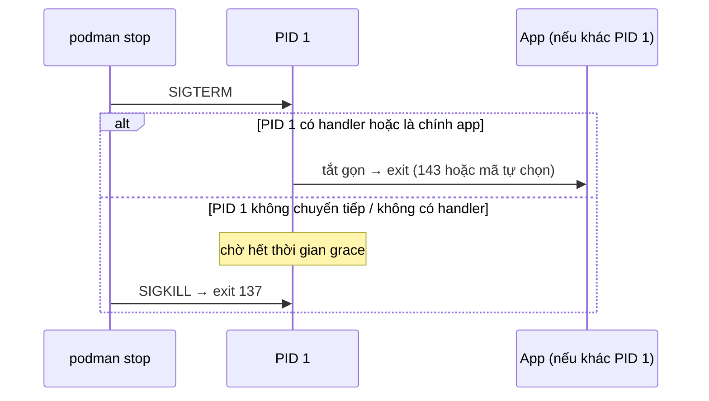

# Capstone 6_1_8: Sự Cố "`stop` Treo 10 Giây Rồi Exit 137" — Điều Tra Từ PID 1 Đến Exit Code

> **Khóa học**: Cloud DevOps Basic — Containers & Kubernetes
> **Phân nhóm**: 6 Domain 6 - Containers and Kubernetes › 6_1 Container Fundamentals › Capstones
> **Bài học gốc**: [6_1_8 Container Lifecycle PID 1 and Signals](<../6_1_8 Container Lifecycle PID 1 and Signals.md>)
> **Thời gian**: 3,5–4,5 giờ · **Chi phí**: 0 · **Cần root/sudo**: Không
> **Yêu cầu**: Podman 5.x, `bc`, image `selflearn.invalid/hello-svc:1.0.0` (build bằng [build-images.sh](../../../shared/scripts/build-images.sh))
> **Trạng thái**: Bài 1–7 **đã chạy thử** (18-11-2026, Fedora 43, Podman 5.8.9 rootless, crun 1.28). Thời gian dừng đo trên máy kiểm chứng; máy bạn lệch vài chục mili-giây nhưng **chênh lệch ~10 giây vs ~0,2 giây** phải xuất hiện.

---

## 🎯 Kịch bản

Pipeline CD của đội cần ~10 giây mỗi lần thay container, log ứng dụng không bao giờ in dòng "shutting down", và `docker ps -a` luôn báo `Exited (137)`. Không có lỗi nào trong log. Bạn phải tìm ra nguyên nhân gốc, sửa theo **ba cách** (và biết cách nào chỉ chữa triệu chứng), rồi viết bài kiểm tra tự động chống tái phát.

## 🗺️ Bản Đồ Phủ Kiến Thức (Coverage)

| Mục trong lesson 6_1_8 | Kiến thức | Bài |
| :--- | :--- | :---: |
| 1.1 | Vòng đời `create → start → running → stop → exited → rm`; `run` = create + start | 1 |
| 1.2 | PID 1 chỉ nhận signal đã cài handler; `SIGKILL` là ngoại lệ; init nhận nuôi orphan và thu dọn zombie; init chết ⇒ cả namespace chết | 2, 5 |
| 1.3 | `stop` = `SIGTERM` rồi `SIGKILL` sau thời gian chờ (mặc định Podman 10 giây); đổi bằng `STOPSIGNAL`/`--stop-signal` | 2, 7 |
| 1.4 | ENTRYPOINT dạng exec vs shell; shell `/bin/sh -c` không chuyển signal | 3, 4 |
| 1.5 | `--init`/`tini`: chuyển signal và thu dọn process | 2, 4, 5 |
| 1.6 | Bảng exit code `0/1/125/126/127/128+n`; 137 và 143 | 6 |
| Gotcha 5.1–5.4 | `stop` treo rồi 137; zombie tích tụ; hiểu nhầm 126/127; kết luận từ một mã thoát | 2–6 |



## 🧰 Chuẩn Bị

```bash
podman pull -q docker.io/library/alpine
podman image exists selflearn.invalid/hello-svc:1.0.0 || bash ../../../shared/scripts/build-images.sh
WORK=$(mktemp -d /tmp/c8-XXXXXX); cd "$WORK"; echo "thư mục làm việc: $WORK"

# Đồng hồ bấm giờ cho "podman stop <tên>" (in số giây)
st() { local s=$(date +%s.%N); podman stop "$1" >/dev/null 2>&1; echo "$(echo "$(date +%s.%N)-$s" | bc | cut -c1-5)s"; }
```

> Tên tài nguyên: `c8-*`. Dọn dẹp ở cuối file. Nếu đổi shell, **định nghĩa lại `st`**.

---

## Bài 1 — Vòng Đời Container Và Trạng Thái (30 phút)

**Yêu cầu**: đi qua đủ các trạng thái, ghi `State.Status`, `Pid`, `ExitCode` ở mỗi bước, và chứng minh: dữ liệu ghi trong container **sống sót qua `stop`/`start`** nhưng **mất khi `rm`**.

```bash
podman create --name c8-lc docker.io/library/alpine sh -c 'echo run-$(date +%s) >> /data.txt; cat /data.txt; sleep 600'
podman inspect c8-lc -f 'created: {{.State.Status}} pid={{.State.Pid}}'
podman start c8-lc >/dev/null; sleep 0.5
podman inspect c8-lc -f 'started: {{.State.Status}} pid>0={{if gt .State.Pid 0}}yes{{end}}'
echo "stop: $(st c8-lc)"; podman inspect c8-lc -f 'stopped: {{.State.Status}} exit={{.State.ExitCode}}'

podman start c8-lc >/dev/null; sleep 0.5
echo "tổng số dòng log sau start lần 2: $(podman logs c8-lc | wc -l)"   # lần 1 in 1 dòng; lần 2 in 2 dòng vì /data.txt còn dòng cũ
podman stop -t 0 c8-lc >/dev/null
podman rm c8-lc >/dev/null
podman ps -a --format '{{.Names}}' | grep -c '^c8-lc$' || true                    # 0 = đã biến mất
```

**Tiêu chí hoàn thành**
- [ ] Bảng 5 trạng thái: `created (pid=0) → running (pid>0) → exited (exit=?) → running → removed`.
- [ ] Chỉ ra `podman run` = `create` + `start` (mục 1.1; đây là mô hình rút gọn của lesson, **không** phải trích dẫn).
- [ ] Giải thích vì sao `/data.txt` còn sau `stop`+`start` nhưng mất sau `rm` (lớp ghi: capstone 6_1_4).
- [ ] Giải thích exit code của lần `stop` đầu (xem Bài 2).

<details>
<summary>Đáp án tham chiếu</summary>

Quan sát: `created: created pid=0`; `started: running pid>0=yes`; `stop` mất **~10,18 giây** và `stopped: exited exit=137` (PID 1 là `sh` không có handler `SIGTERM`); sau `start` lần hai, tổng log là **3 dòng** (lần 1 in 1 dòng `run-...`; lần 2 `cat` in cả dòng cũ lẫn dòng mới), tức `/data.txt` **còn nguyên** sau `stop`/`start`; sau `rm` container không còn trong `ps -a`. Dữ liệu ghi vào lớp ghi **không** bị xóa khi container chỉ `stop`.
</details>

---

## Bài 2 — "Đo, Đừng Đoán": Bốn PID 1, Bốn Kết Cục (45 phút)

**Yêu cầu**: chạy bốn container khác nhau về **ai là PID 1** và đo `podman stop` + exit code của từng cái. Dự đoán **trước khi chạy**, rồi so sánh.

```bash
# A. sleep làm PID 1: không có handler SIGTERM
podman run -d --name c8-a docker.io/library/alpine sleep 600 >/dev/null
echo "A  stop: $(st c8-a)  exit=$(podman inspect c8-a -f '{{.State.ExitCode}}')"

# B. sleep nhưng có init chuyển tiếp signal
podman run -d --name c8-b --init docker.io/library/alpine sleep 600 >/dev/null
podman top c8-b pid args
echo "B  stop: $(st c8-b)  exit=$(podman inspect c8-b -f '{{.State.ExitCode}}')"

# C. shell có trap SIGTERM
podman run -d --name c8-c docker.io/library/alpine sh -c 'trap "echo bye; exit 0" TERM; sleep 600 & wait' >/dev/null
sleep 0.5
echo "C  stop: $(st c8-c)  exit=$(podman inspect c8-c -f '{{.State.ExitCode}}')"; podman logs c8-c

# D. JVM (exec form, có shutdown hook) làm PID 1
podman run -d --name c8-d selflearn.invalid/hello-svc:1.0.0 >/dev/null; sleep 2.5
echo "D  stop: $(st c8-d)  exit=$(podman inspect c8-d -f '{{.State.ExitCode}}')"; podman logs c8-d 2>&1 | grep -c 'shutdown signal'
podman rm -f -t 0 c8-a c8-b c8-c c8-d >/dev/null
```

**Tiêu chí hoàn thành**
- [ ] Bảng 4 dòng: PID 1 là gì / có handler không / thời gian dừng / exit code.
- [ ] Giải thích **vì sao A mất ~10 giây**: PID 1 chỉ nhận signal đã có handler; `SIGKILL` từ namespace tổ tiên được chuyển cưỡng bức sau thời gian chờ (lesson 1.2, 1.3).
- [ ] Giải thích vì sao B dừng nhanh mà exit là 143 (init chuyển `SIGTERM` cho `sleep`; `sleep` chết vì signal 15).
- [ ] Giải thích vì sao C ra `0` (handler tự chọn `exit 0`) và D ra `143`.
- [ ] So sánh với capstone 6_1_2 Bài 3(b): cùng một quy tắc "PID 1 + handler", ở hai cấp độ khác nhau.

<details>
<summary>Đáp án tham chiếu</summary>

| | PID 1 | Handler `SIGTERM` | Thời gian | Exit |
| :--- | :--- | :--- | :-: | :-: |
| A | `sleep` | không | **~10,1–10,3 s** | `137` |
| B | `/run/podman-init -- sleep 600` | init chuyển tiếp | ~0,15 s | `143` |
| C | `sh` có `trap` | có (script) | ~0,18 s | `0` (log `bye`) |
| D | `java -jar ...` | có (JVM shutdown hook) | ~0,22 s | `143` (log có "shutdown signal received") |

Cảnh báo trong output của A: `StopSignal SIGTERM failed to stop container ... in 10 seconds, resorting to SIGKILL`. Lesson ghi `podman stop --time` mặc định **10 giây**. Tên chương trình init (`/run/podman-init`) là quan sát trên máy này; lesson chỉ nói `--init` chạy một init trong container để chuyển signal và thu dọn process.
</details>

---

## Bài 3 — ENTRYPOINT Dạng Shell vs Dạng Exec Với JVM Thật (45 phút)

**Yêu cầu**: dựng hai image từ `hello-svc`, một dùng **shell form**, một **exec form**, rồi so sánh: cây process (`podman top`), thời gian dừng, exit code, và **log có dòng shutdown của ứng dụng hay không**. Sau đó thử thêm `--init` lên bản shell form và **đọc kỹ kết quả**.

```bash
cat > Containerfile.shell <<'EOF'
FROM selflearn.invalid/hello-svc:1.0.0
ENTRYPOINT java -jar /app/hello-svc.jar
EOF
cat > Containerfile.exec <<'EOF'
FROM selflearn.invalid/hello-svc:1.0.0
ENTRYPOINT ["java", "-jar", "/app/hello-svc.jar"]
EOF
podman build -q -f Containerfile.shell -t c8-shell . >/dev/null
podman build -q -f Containerfile.exec  -t c8-exec  . >/dev/null

for v in shell exec; do
  podman run -d --name c8-$v c8-$v >/dev/null; sleep 2.5
  echo "[$v] cây process:"; podman top c8-$v pid args | cut -c1-80
  echo "[$v] stop: $(st c8-$v)  exit=$(podman inspect c8-$v -f '{{.State.ExitCode}}')  log-shutdown=$(podman logs c8-$v 2>&1 | grep -c 'shutdown signal')"
  podman rm -f -t 0 c8-$v >/dev/null
done

echo "[shell + --init]"
podman run -d --name c8-si --init c8-shell >/dev/null; sleep 2.5
echo "stop: $(st c8-si)  exit=$(podman inspect c8-si -f '{{.State.ExitCode}}')  log-shutdown=$(podman logs c8-si 2>&1 | grep -c 'shutdown signal')"
podman rm -f -t 0 c8-si >/dev/null
```

**Tiêu chí hoàn thành**
- [ ] Shell form: PID 1 là `/bin/sh -c java -jar ...`, `java` là PID 2; dừng ~10 giây, exit `137`, **không** có log shutdown.
- [ ] Exec form: `java` là PID 1; dừng ~0,2 giây, exit `143`, có log shutdown.
- [ ] **Phát hiện quan trọng**: `shell + --init` dừng nhanh, exit `143`, nhưng `log-shutdown=0`. Giải thích vì sao thời gian dừng đẹp **không** có nghĩa là ứng dụng được tắt gọn (hook không chạy; JVM bị kéo chết khi namespace bị hủy).
- [ ] Nêu kết luận cho Dockerfile: dùng **exec form**, và `--init` chỉ là phương án bổ sung (thu dọn zombie), không thay cho exec form.

<details>
<summary>Đáp án tham chiếu</summary>

Quan sát: shell form: `1 /bin/sh -c java -jar /app/hello-svc.jar` và `2 java -jar /app/hello-svc.jar`; stop **10,34 s**, `exit=137`, `log-shutdown=0`. Exec form: `1 java -jar /app/hello-svc.jar`; stop **0,22 s**, `exit=143`, `log-shutdown=1`. Shell + `--init`: stop **0,21 s**, `exit=143`, `log-shutdown=0`.

Giải thích (lesson 1.4): shell form chạy ENTRYPOINT như lệnh con của `/bin/sh -c`, shell này không chuyển signal nên app không nhận `SIGTERM`. Với `--init`, init nhận `SIGTERM` và chuyển cho **tiến trình con trực tiếp của nó** (là `sh`) nên `sh` thoát; `java` không nhận tín hiệu. Đây là **suy luận từ kết quả quan sát**: lesson không mô tả cơ chế chuyển tiếp chi tiết của init. Kết luận thực hành: kiểm tra "tắt gọn" bằng log của ứng dụng, không chỉ bằng thời gian.
</details>

---

## Bài 4 — Sự Cố Thật: Wrapper Script, Ba Cách Sửa, Bài Test Chống Tái Phát (60 phút)

**Yêu cầu**: image dưới đây dùng **exec form** nhưng ENTRYPOINT lại là một script (rất phổ biến). Chẩn đoán, sửa bằng ba cách, và viết script kiểm tra.

```bash
cat > start.sh <<'EOF'
#!/bin/sh
echo "preparing..."
java -jar /app/hello-svc.jar
EOF
cat > Containerfile.wrap <<'EOF'
FROM selflearn.invalid/hello-svc:1.0.0
COPY --chmod=755 start.sh /app/start.sh
ENTRYPOINT ["/app/start.sh"]
EOF
podman build -q -f Containerfile.wrap -t c8-wrap . >/dev/null
podman run -d --name c8-w c8-wrap >/dev/null; sleep 2.5
podman top c8-w pid args | cut -c1-70
echo "stop: $(st c8-w)  exit=$(podman inspect c8-w -f '{{.State.ExitCode}}')  log-shutdown=$(podman logs c8-w 2>&1 | grep -c 'shutdown signal')"
podman rm -f -t 0 c8-w >/dev/null
```

**Ba cách sửa (làm cả ba, đo cả ba):**
1. **Sửa script**: đổi dòng cuối thành `exec java -jar /app/hello-svc.jar` (build thành `c8-wrapfix`).
2. **Thêm `--init`** khi chạy `c8-wrap`.
3. **Cài trap trong script** chuyển signal cho `java` rồi `wait` (tự viết; thử **một** `wait` và **hai** `wait`, so kết quả `check-stop.sh`).

Rồi viết `check-stop.sh` nhận tên image và in `[PASS]/[FAIL]` cho 3 điều kiện: thời gian `stop` < 3 giây; exit code ∈ {0, 143}; log chứa `shutdown signal received`.

**Tiêu chí hoàn thành**
- [ ] Chẩn đoán đúng nguyên nhân gốc bằng **hai bằng chứng**: `podman top` (PID 1 là `/bin/sh /app/start.sh`) và log không có dòng shutdown.
- [ ] Cách 1: PASS cả 3 điều kiện.
- [ ] Cách 2: bạn quan sát và giải thích **vì sao không PASS đủ** (như Bài 3).
- [ ] Cách 3: chạy được và PASS (gợi ý: `java ... & PID=$!; trap 'kill -TERM $PID' TERM INT; wait $PID`). Bạn phát hiện và giải thích vì sao bản **một `wait`** vẫn FAIL điều kiện "tắt gọn" còn bản **hai `wait`** thì PASS.
- [ ] Có bước `check-stop.sh` chạy trong CI sẽ **fail** với `c8-wrap` và **pass** với `c8-wrapfix`.

<details>
<summary>Đáp án tham chiếu</summary>

Quan sát với `c8-wrap`: `1 /bin/sh /app/start.sh`, `2 java -jar /app/hello-svc.jar`; stop **~10,2 s**, `exit=137`, `log-shutdown=0`. Với `c8-wrapfix` (`exec java ...`): `1 java -jar /app/hello-svc.jar`; stop **~0,21 s**, `exit=143`, `log-shutdown=1`.

Gợi ý `check-stop.sh`:

```bash
#!/usr/bin/env bash
img=$1; name=c8-chk
podman rm -f -t 0 $name >/dev/null 2>&1
podman run -d --name $name "$img" >/dev/null; sleep 3
start=$(date +%s.%N); podman stop $name >/dev/null 2>&1; dur=$(echo "$(date +%s.%N)-$start" | bc)
code=$(podman inspect $name -f '{{.State.ExitCode}}'); hook=$(podman logs $name 2>&1 | grep -c 'shutdown signal received')
[ "$(echo "$dur < 3" | bc)" = 1 ] && echo "[PASS] stop < 3s ($dur)" || echo "[FAIL] stop mất $dur s"
{ [ "$code" = 0 ] || [ "$code" = 143 ]; } && echo "[PASS] exit=$code" || echo "[FAIL] exit=$code"
[ "$hook" -ge 1 ] && echo "[PASS] app tắt gọn" || echo "[FAIL] không có log shutdown"
podman rm -f -t 0 $name >/dev/null
```

Kết quả khi chạy `./check-stop.sh <image>` (đã chạy thử): `c8-wrap` ⇒ **FAIL cả 3** (~10,28 s, 137, 0 log); `c8-wrapfix` (`exec java`) ⇒ **PASS cả 3** (~0,22 s, 143, có log).

Cách 3: script gồm `java -jar /app/hello-svc.jar &`, `PID=$!`, `trap 'kill -TERM $PID' TERM INT`:
- **một** `wait $PID` ⇒ dừng nhanh, exit 143, nhưng **FAIL "tắt gọn"** (không có log shutdown). Lý do (suy luận từ kết quả): `wait` bị ngắt ngay khi trap chạy, script thoát, PID 1 chết ⇒ kernel `SIGKILL` cả namespace trước khi shutdown hook của JVM kịp ghi log;
- **hai** `wait $PID` (lần hai chờ `java` thật sự thoát) ⇒ **PASS cả 3**, exit 143.

Cách 2 (`--init` trên `c8-wrap`) quan sát ở Bài 3 với shell form: nhanh nhưng không tắt gọn.
</details>

---

## Bài 5 — Zombie Và Vai Trò "Nhận Nuôi" Của Init (30 phút)

**Yêu cầu**: tạo ba process mồ côi trong container mà PID 1 **không `wait`**; đếm zombie; lặp lại với `--init`.

```bash
for o in "" "--init"; do
  echo "[chạy $o]"
  podman run -d --name c8-z $o docker.io/library/alpine sh -c \
    'for i in 1 2 3; do (sleep 0.1 &) ; done; exec sleep 600' >/dev/null
  sleep 1; podman exec c8-z ps -o pid,ppid,stat,args
  podman rm -f -t 0 c8-z >/dev/null
done
```

**Tiêu chí hoàn thành**
- [ ] Không `--init`: ba process `Z` (zombie, `[sleep]`) có `PPID 1`.
- [ ] Có `--init`: không còn zombie.
- [ ] Giải thích bằng 4 câu: orphan được **gán cho init của namespace** (lesson 1.2) → init phải `wait` → `sleep 600` (PID 1 ở đây) không biết `wait` → thành zombie; init nhỏ làm việc đó.
- [ ] Nêu khi nào zombie trở thành vấn đề thật (số lượng lớn, bảng PID, `pids.max`: nối capstone 6_1_3).
- [ ] Giải thích vì sao `exec sleep 600` quan trọng trong lệnh: không có `exec`, PID 1 sẽ là `sh` và hành vi khác.

<details>
<summary>Đáp án tham chiếu</summary>

Quan sát: không `--init`: `1 0 S sleep 600` và ba dòng `Z [sleep]` có `PPID 1`; có `--init`: `1 0 S /run/podman-init -- sh -c ...`, `2 1 S sleep 600`, **không có** `Z`. `ps -o` dùng bản busybox trong alpine; `podman top ... stat` **không** dùng được vì không hợp lệ ở bản này, nên dùng `podman exec ... ps`.
</details>

---

## Bài 6 — Bảng Exit Code Do Chính Bạn Tạo Ra (35 phút)

**Yêu cầu**: tạo ra **mỗi** mã thoát bằng một lệnh cụ thể và điền bảng: `0, 1, 3, 125, 126, 127, 137, 143`. Mỗi dòng ghi lệnh, mã thật, nguồn gốc (daemon/runtime/app/signal).

```bash
podman run --rm docker.io/library/alpine true;                               echo "0   -> $?"
podman run --rm docker.io/library/alpine sh -c 'cat /nonexist';              echo "1   -> $?"
podman run --rm docker.io/library/alpine sh -c 'exit 3';                     echo "3   -> $?"
podman run --rm --badflag docker.io/library/alpine true 2>/dev/null;        echo "125 -> $?"
podman run --rm docker.io/library/alpine /etc 2>/dev/null;                   echo "126 -> $?  (thư mục)"
podman run --rm --entrypoint /bin/sh docker.io/library/alpine -c 'echo x > /bin/noexec; chmod 644 /bin/noexec; /bin/noexec'
echo "126 -> $?  (file không có quyền thực thi)"
podman run --rm docker.io/library/alpine foo 2>/dev/null;                    echo "127 -> $?"
podman run -d --name c8-k docker.io/library/alpine sleep 600 >/dev/null; podman kill c8-k >/dev/null; sleep 0.5
echo "137 -> $(podman inspect c8-k -f '{{.State.ExitCode}}') (podman kill)"; podman rm c8-k >/dev/null
podman run -d --name c8-t selflearn.invalid/hello-svc:1.0.0 >/dev/null; sleep 2.5; podman stop c8-t >/dev/null
echo "143 -> $(podman inspect c8-t -f '{{.State.ExitCode}}') (podman stop, JVM)"; podman rm c8-t >/dev/null
```

**Tiêu chí hoàn thành**
- [ ] Bảng 8 dòng đủ mã, có **thông điệp lỗi nguyên văn** cho 125/126/127.
- [ ] Phân loại đúng: `125` = lỗi của công cụ/daemon, `126`/`127` = runtime không thể thực thi/không tìm thấy lệnh, `1`/`3` = mã của chính lệnh, `137`/`143` = `128 + signal`.
- [ ] Giải thích vì sao `137` **không** đủ để kết luận OOM (gotcha 5.4): nêu ba nguồn gốc có thể (`podman kill`, hết hạn `stop`, OOM kill) và cách phân biệt (`OOMKilled`, `memory.events`: capstone 6_1_3).
- [ ] Giải thích vì sao thử `kill -9 $$` **bên trong** container (PID 1 tự giết mình) lại cho `0` chứ không phải `137`.

<details>
<summary>Đáp án tham chiếu</summary>

Quan sát: `0 / 1 / 3 / 125 (Error: unknown flag: --badflag) / 126 (Error: crun: the path /etc is not a regular file: Operation not permitted: OCI permission denied) / 126 (/bin/sh: /bin/noexec: Permission denied) / 127 (Error: crun: executable file foo not found in $PATH ... OCI runtime attempted to invoke a command that was not found) / 137 (podman kill) / 143 (podman stop JVM)`. Lesson (theo tài liệu Docker): `125` lỗi ở chính daemon, `126` lệnh không thể gọi thực thi, `127` không tìm thấy lệnh, khác là mã của lệnh; `128+n` theo bash.

PID 1 tự `kill -9`: kernel không chuyển `SIGKILL` do chính PID 1 gửi trong cùng namespace nên lệnh bị bỏ qua và `sh` kết thúc bình thường (quan sát `exit=0`; cơ chế khớp với lesson 1.2: `SIGKILL` chỉ được chuyển cưỡng bức khi gửi từ **namespace tổ tiên**).
</details>

---

## Bài 7 — Đổi Tín Hiệu Và Thời Gian Chờ (25 phút)

**Yêu cầu**: dùng `STOPSIGNAL` trong image, `--stop-signal` và `--stop-timeout`/`-t` để điều khiển quá trình dừng.

```bash
cat > Containerfile.sig <<'EOF'
FROM docker.io/library/alpine
STOPSIGNAL SIGINT
CMD ["sh","-c","trap 'echo got-INT; exit 7' INT; sleep 600 & wait"]
EOF
podman build -q --format docker -f Containerfile.sig -t c8-sig . >/dev/null
podman run -d --name c8-sig c8-sig >/dev/null; sleep 0.5
podman inspect c8-sig -f 'stopsignal={{.Config.StopSignal}}'
echo "stop: $(st c8-sig)  exit=$(podman inspect c8-sig -f '{{.State.ExitCode}}')"; podman logs c8-sig
podman rm c8-sig >/dev/null

podman run -d --name c8-to --stop-timeout 2 docker.io/library/alpine sleep 600 >/dev/null
echo "stop-timeout 2: $(st c8-to)"; podman rm c8-to >/dev/null
```

**Tiêu chí hoàn thành**
- [ ] `stopsignal=SIGINT`; container nhận INT, in `got-INT`, thoát `7`; thời gian dừng ngắn.
- [ ] `--stop-timeout 2` rút thời gian chờ còn ~2 giây (rồi `SIGKILL`).
- [ ] Giải thích bằng ví dụ khi nào nên đổi signal (ứng dụng chỉ tắt gọn khi nhận `SIGQUIT`/`SIGINT`) và khi nào nên **tăng** thời gian chờ (đóng kết nối, ghi buffer): đối chiếu `terminationGracePeriodSeconds` của Kubernetes ở 6_3.
- [ ] Ghi chú: ở `--format oci`, hãy kiểm tra `StopSignal` có được giữ trong image hay không bằng `podman image inspect` (capstone **chưa kiểm chứng** trường hợp này; dùng `--format docker` như trên).

<details>
<summary>Đáp án tham chiếu</summary>

Quan sát: `stopsignal=SIGINT`; stop ~0,16 s; `exit=7`; log `got-INT`; `--stop-timeout 2` cho ~2,2 giây kèm cảnh báo `StopSignal SIGTERM failed to stop container ... in 2 seconds, resorting to SIGKILL`. Lesson: signal đầu có thể đổi bằng `STOPSIGNAL` hoặc `--stop-signal`; `podman stop --time` mặc định 10 giây. Cờ `--stop-timeout` của `podman run` và việc đặt thời gian chờ ở Kubernetes: **đối chiếu `podman-run(1)`/`podman-stop(1)` và tài liệu Kubernetes**; lesson chỉ trích `--time`.
</details>

---

## ✅ Nghiệm Thu Capstone

- [ ] Bảng Bài 2 (4 dòng), Bài 3 (3 dòng), Bài 6 (8 dòng) điền bằng số đo của máy bạn.
- [ ] `check-stop.sh` (Bài 4) fail với image hỏng, pass với image đã sửa.
- [ ] Viết **runbook 8 dòng** "Container dừng chậm rồi exit 137": quan sát gì (`podman top`, exit code, log shutdown) → nguyên nhân → sửa → xác minh.
- [ ] Nêu rõ vì sao "dừng nhanh" ≠ "tắt gọn".

## 🧠 Câu Hỏi Bảo Vệ

1. Vì sao PID 1 đặc biệt về tín hiệu? Cho hai nhiệm vụ khác của init.
2. Dockerfile `ENTRYPOINT java -jar app.jar` có vấn đề gì? Sửa thế nào? Dùng `--init` có đủ không?
3. Phân biệt `137` do OOM và `137` do `stop` hết hạn.
4. `126` và `127` khác nhau thế nào, và từ đâu ra?
5. Một container chạy 3 tháng có hàng nghìn `<defunct>`. Nguyên nhân và cách khắc phục?

## 🧹 Dọn Dẹp

```bash
podman rm -f -t 0 c8-lc c8-a c8-b c8-c c8-d c8-w c8-z c8-k c8-t c8-sig c8-to c8-shell c8-exec c8-si 2>/dev/null
podman rmi c8-shell c8-exec c8-wrap c8-wrapfix c8-sig 2>/dev/null
cd ~ && rm -rf "$WORK"
```

## 📚 Nguồn Tài Liệu Chính Thống (Official References)
- [pid_namespaces(7)](https://man7.org/linux/man-pages/man7/pid_namespaces.7.html) — init của PID namespace, signal tới init, nhận nuôi process mồ côi.
- [kill(2)](https://man7.org/linux/man-pages/man2/kill.2.html), [signal(7)](https://man7.org/linux/man-pages/man7/signal.7.html) và [wait(2)](https://man7.org/linux/man-pages/man2/wait.2.html) — Signal gửi tới PID 1, `SIGKILL`, zombie.
- [bash(1)](https://man7.org/linux/man-pages/man1/bash.1.html) — Công thức exit status `128+n`.
- [docker container stop](https://docs.docker.com/reference/cli/docker/container/stop/) và [podman-stop(1)](https://docs.podman.io/en/latest/markdown/podman-stop.1.html) — `SIGTERM` rồi `SIGKILL`, thời gian chờ.
- [Dockerfile reference](https://docs.docker.com/reference/dockerfile/) — `ENTRYPOINT` exec/shell form, `STOPSIGNAL`.
- [Docker Docs — Running containers](https://docs.docker.com/engine/containers/run/) — Exit status 125/126/127.
- [podman-run(1)](https://docs.podman.io/en/latest/markdown/podman-run.1.html) — `--init`, `--stop-signal`, `--stop-timeout`.
- [tini](https://github.com/krallin/tini) — Init nhỏ cho container (README dự án).
