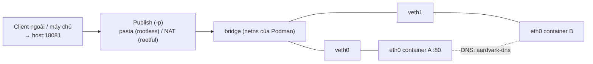

# Capstone 6_1_9: Lần Theo Đường Đi Của Một Gói Tin — veth, Bridge, pasta, NAT Và DNS

> **Khóa học**: Cloud DevOps Basic — Containers & Kubernetes
> **Phân nhóm**: 6 Domain 6 - Containers and Kubernetes › 6_1 Container Fundamentals › Capstones
> **Bài học gốc**: [6_1_9 Container Networking Basics](<../6_1_9 Container Networking Basics.md>)
> **Thời gian**: 3,5–4,5 giờ · **Chi phí**: 0 (bài DNS ngoài cần Internet) · **Cần root/sudo**: **Không** (rootless, dùng `podman unshare --rootless-netns`)
> **Yêu cầu**: Podman 5.x rootless (netavark, aardvark-dns, pasta), `curl`, `ss`, `tcpdump` (tùy chọn, Bài 6), `ip`
> **Trạng thái**: Bài 1–6 **đã chạy thử** (18-11-2026, Fedora 43, Podman 5.8.9 rootless, netavark, pasta). Bài 7 là bài viết. **Chưa chạy thử** các biến thể rootful (`sudo`): bridge mặc định `10.88.0.0/16` của rootful, luật NAT trong `iptables`/`nft`. Địa chỉ IP trong ví dụ là của máy kiểm chứng; hãy thay bằng của bạn.

---

## 🎯 Kịch bản

Một developer báo: *"Service `api` chạy, `curl localhost:8080` từ máy mình không được, nhưng từ trong container thì được. Container `app` gọi `db` bằng tên thì báo bad address."* Bạn phải lần theo **từng chặng** của gói tin (ứng dụng → namespace → veth → bridge/pasta → NAT → máy chủ) và chỉ ra chặng nào hỏng.

## 🗺️ Bản Đồ Phủ Kiến Thức (Coverage)

| Mục trong lesson 6_1_9 | Kiến thức | Bài |
| :--- | :--- | :---: |
| 1.1 | Network namespace riêng; container mới chỉ có `lo`; `veth` theo cặp; vì sao không dùng thẳng NIC vật lý | 1, 2 |
| 1.2 | Rootful `bridge` vs rootless `pasta`; netavark; aardvark-dns | 1, 2, 4 |
| 1.3 | Publish cổng `-p host:container`; NAT/PAT/masquerading; mặc định mở trên mọi địa chỉ | 3, 5 |
| 1.4 | DNS giữa container: user-defined network có, default không | 4 |
| 1.5 | Kubernetes dùng lại ý tưởng (Pod netns, Service, DNS) | 7 |
| Gotcha 5.1–5.4 | Không resolve tên; hiểu sai rootless; quên publish là NAT; mở cổng ra mọi địa chỉ | 3, 4, 5 |



## 🧰 Chuẩn Bị

```bash
podman --version; podman info --format 'network={{.Host.NetworkBackend}} rootless={{.Host.Security.Rootless}}'
podman pull -q docker.io/library/alpine
HOSTIP=$(ip -4 route get 1.1.1.1 | awk '{print $7; exit}'); echo "IP LAN của máy chủ: $HOSTIP"
# Server HTTP tối giản dùng busybox nc (alpine không có httpd):
SRV='while true; do printf "HTTP/1.1 200 OK\r\nContent-Length: 3\r\nConnection: close\r\n\r\nhi\n" | nc -l -p 80; done'
```

> Tên tài nguyên: `c9-*`, mạng `c9net`. Dải cổng dùng: `18081`–`18086`. Dọn dẹp ở cuối file. Nếu đổi shell, định nghĩa lại `HOSTIP` và `SRV`.

---

## Bài 1 — Tìm Cặp `veth` Và Bridge Của Một Container Thật (50 phút)

**Yêu cầu**: tạo một mạng user-defined `c9net`, chạy hai container, rồi tìm **cả hai đầu** `veth` và **bridge**. Ở rootless, các thứ này **không nằm ở namespace của máy chủ** mà nằm trong *network namespace riêng của Podman*.

```bash
podman network create c9net >/dev/null
podman run -d --name c9-a --network c9net docker.io/library/alpine sleep 600 >/dev/null
podman run -d --name c9-b --network c9net docker.io/library/alpine sleep 600 >/dev/null

echo "== trong container A:"; podman exec c9-a ip -o link | awk '{print $1,$2}'; podman exec c9-a ip -o -4 addr | awk '{print $2,$4}'
echo "== ip -br link trên máy chủ (tìm veth/bridge của container):"; ip -br link | grep -E 'podman|veth' || echo "không thấy: không nằm ở netns của máy chủ"
echo "== trong netns của Podman rootless:"
podman unshare --rootless-netns ip -br link  | awk '{print $1,$2}'
podman unshare --rootless-netns ip -br addr  | grep -E 'podman|veth' | awk '{print $1,$3}'
podman unshare --rootless-netns bridge link 2>&1 | cut -c1-110
```

**Tiêu chí hoàn thành**
- [ ] Sơ đồ có: `eth0` (container) ↔ `vethN` (đầu kia) ↔ `bridge` (`podmanX`), kèm số `ifindex` bạn thấy: `eth0@if4` trong container trỏ tới interface số `4` ở namespace của Podman.
- [ ] Giải thích vì sao `ip -br link` trên máy chủ **không** thấy `veth`/bridge ở rootless (netns riêng) và bạn dùng gì để nhìn vào đó.
- [ ] `bridge link` cho thấy **cả hai** `veth` đều thuộc `master podmanX`.
- [ ] Trả lời: nếu chạy **rootful** (`sudo podman ...`) bạn kỳ vọng thấy `veth`/bridge ở đâu? *(suy luận từ lesson 1.1–1.2, chưa chạy thử vì cần sudo)*

<details>
<summary>Đáp án tham chiếu</summary>

Quan sát: trong container A: `lo`, `eth0@if4` với `10.89.8.2/24`. Trên máy chủ: **không** có `veth`/`podman*`. Trong netns của Podman (rootless): `lo`, một interface mang tên card mạng của máy chủ, **bridge `podman9` UP `10.89.8.1/24`** và hai `vethN@if2`; `bridge link` cho `4: veth0@... master podman9` và `5: veth1@... master podman9` (state forwarding). Tên bridge (`podman9`) và dải `10.89.8.0/24` do netavark chọn và khác mỗi máy. Lệnh `podman unshare --rootless-netns` **không có trong lesson**; hãy đối chiếu `podman-unshare(1)`.

Ý nghĩa: đúng như lesson 1.1: cặp `veth` là "dây hai đầu", một đầu trong namespace container (`eth0`), một đầu nối vào bridge ở namespace kia.
</details>

---

## Bài 2 — Bốn Chế Độ Mạng Và Pasta (45 phút)

**Yêu cầu**: so sánh `ip` bên trong container ở bốn chế độ: mặc định (rootless = `pasta`), `--network none`, `--network pasta`, `--network host`, và `--network bridge`. Tìm process `pasta` của máy.

```bash
echo "== máy chủ:";    ip -br addr | awk '{print $1,$2}'
echo "== mặc định:";    podman run --rm docker.io/library/alpine ip -o addr | awk '{print $2,$3,$4}' | head -5
podman run --rm docker.io/library/alpine ip route | head -2
podman run --rm docker.io/library/alpine cat /etc/resolv.conf | head -3
echo "== none:";        podman run --rm --network none  docker.io/library/alpine ip -o link | awk '{print $2}'
echo "== pasta:";       podman run --rm --network pasta docker.io/library/alpine ip -o link | awk '{print $2}' | tr '\n' ' '; echo
echo "== host:";        podman run --rm --network host  docker.io/library/alpine ip -o link | awk '{print $2}' | tr '\n' ' '; echo
echo "== bridge:";      podman run --rm --network bridge docker.io/library/alpine ip -o -4 addr | awk '{print $2,$4}'
podman network inspect podman -f '{{.Driver}} {{range .Subnets}}{{.Subnet}} gw={{.Gateway}}{{end}}'

podman run -d --name c9-p docker.io/library/alpine sleep 600 >/dev/null
ps -eo pid,comm,args | grep -E 'pasta|passt' | grep -v grep | cut -c1-140
```

**Tiêu chí hoàn thành**
- [ ] Bảng 5 dòng: chế độ → interface/IP trong container → nghĩa là gì.
- [ ] Mặc định rootless: container thấy **cùng tên interface, IP, route như máy chủ** (do `pasta` sao chép, lesson 1.2), và `nameserver` là một địa chỉ đặc biệt chứ không phải IP máy chủ.
- [ ] `none`: chỉ có `lo` (đúng với "container mới chỉ có `lo` cho tới khi runtime gắn `veth`", README 6_1_2). `host`: thấy **mọi interface của máy chủ**, vì dùng chung network namespace.
- [ ] `bridge` ở rootless: có `eth0 10.88.0.x/16`; nêu khác biệt với mặc định rootless (`pasta`).
- [ ] Giải thích vì sao rootless cần `pasta` còn rootful dùng bridge (lesson 1.2: tạo bridge, `veth` ở namespace máy chủ và luật firewall cần đặc quyền).

<details>
<summary>Đáp án tham chiếu</summary>

Quan sát: mặc định rootless: `lo` và interface Wi-Fi/Ethernet **cùng tên với máy chủ**, IP **trùng IP máy chủ**, `default via <gateway của máy chủ>`; `resolv.conf` có `nameserver 169.254.1.1` (địa chỉ do `pasta` dùng để chuyển tiếp DNS) rồi các nameserver của máy chủ. `--network none`: `lo`. `--network pasta`: `lo` + interface giống máy chủ. `--network host`: toàn bộ interface của máy chủ. `--network bridge` rootless: `eth0 10.88.0.2/16`, mạng `podman` có driver `bridge`, `10.88.0.0/16` gateway `10.88.0.1`. Process: `pasta.avx2 --config-net --dns-forward 169.254.1.1 ... --netns /run/user/...` (tên binary phụ thuộc CPU/bản). Ý nghĩa `169.254.1.1` và các cờ `pasta` **không có trong lesson**; đối chiếu tài liệu dự án passt/pasta.

Khác biệt rootless: bridge (`10.88.0.x`) **vẫn chạy được ở rootless** trên bản Podman này (nó nằm trong netns của Podman như Bài 1), nên câu "bridge là mặc định rootful, pasta là mặc định rootless" nói về **mặc định**, không phải "rootless không thể có bridge".
</details>

---

## Bài 3 — Publish Cổng: NAT/Port Forwarding, Xung Đột Và Phạm Vi (50 phút)

**Yêu cầu**
1. Chạy hai server cùng nghe cổng 80 trong hai container, publish ra hai cổng khác nhau trên máy chủ.
2. Thử publish **cùng** cổng máy chủ cho container thứ ba và ghi lỗi.
3. Chạy một container chỉ publish ở `127.0.0.1` và thử gọi bằng IP LAN.
4. Tìm **ai đang lắng nghe** cổng được publish trên máy chủ.

```bash
podman run -d --name c9-w1 -p 18081:80 docker.io/library/alpine sh -c "$SRV" >/dev/null
podman run -d --name c9-w2 -p 18082:80 docker.io/library/alpine sh -c "$SRV" >/dev/null
podman run -d --name c9-w4 -p 127.0.0.1:18084:80 docker.io/library/alpine sh -c "$SRV" >/dev/null
sleep 1
curl -s -m 3 localhost:18081/; curl -s -m 3 localhost:18082/; curl -s -m 3 127.0.0.1:18084/
podman port c9-w1

echo "== xung đột cổng:"
podman run -d --name c9-w3 -p 18081:80 docker.io/library/alpine sleep 5 2>&1 | head -3
podman ps -a --format '{{.Names}} {{.Status}}' | grep c9-w3

echo "== ai lắng nghe cổng trên máy chủ?"
ss -ltn | grep -E ':1808[124] ' | awk '{print $4}'
ss -ltnp 2>/dev/null | grep ':18081 ' | awk '{print $6}' | cut -c1-80

echo "== phạm vi:"
curl -s -m 2 -o /dev/null -w "IP LAN :18081 -> %{http_code}\n" http://$HOSTIP:18081/
curl -s -m 2 -o /dev/null -w "IP LAN :18084 -> %{http_code}\n" http://$HOSTIP:18084/
```

**Tiêu chí hoàn thành**
- [ ] Cả hai server trả `hi` dù cùng nghe cổng 80 (vì mỗi container một network namespace).
- [ ] Cổng 18081 trùng ⇒ container thứ ba **không chạy được**, lỗi dạng *address already in use*; `ps -a` cho thấy `Created`.
- [ ] `ss` cho thấy `*:18081`/`*:18082` (mọi địa chỉ) và `127.0.0.1:18084` (chỉ cục bộ); gọi bằng IP LAN: `200` với 18081, `000` (không kết nối) với 18084.
- [ ] Ghi lại **tiến trình sở hữu** cổng trên máy chủ (rootless: không phải container; bạn thấy process gì?).
- [ ] Giải thích `-p <host>:<container>` đọc đúng chiều; NAT/PAT/masquerading là gì (đổi địa chỉ đích, đổi cổng, đổi địa chỉ nguồn khi đi ra) và vì sao "publish port = port forwarding".
- [ ] Nêu rủi ro `-p 8080:80` mở trên **mọi địa chỉ** (gotcha 5.4) và cách giới hạn (`127.0.0.1:...`).

<details>
<summary>Đáp án tham chiếu</summary>

Quan sát: ba lệnh `curl` đều in `hi`; `podman port c9-w1` ⇒ `80/tcp -> 0.0.0.0:18081`; cổng trùng ⇒ thông báo `Listen failed for HOST TCP port */18081: Address already in use` / `Couldn't listen on requested ports`, container `Created`; `ss -ltn` ⇒ `127.0.0.1:18084`, `*:18082`, `*:18081`; **tiến trình lắng nghe là `pasta`** (ví dụ `users:(("pasta.avx2",pid=...))`), tức rootless dùng `pasta` để chuyển tiếp cổng, **không** phải luật iptables như mô tả Docker trong lesson 1.3; gọi qua IP LAN: `18081 → 200`, `18084 → 000`. Câu "Docker dùng luật firewall để làm NAT, PAT và masquerading" là trích dẫn tài liệu Docker; với rootless Podman cơ chế ở máy này là `pasta`, và với rootful **chưa chạy thử** nên không khẳng định (xem 6.3(g) của lesson: `sudo iptables -t nat -L -n` hoặc `sudo nft list ruleset`).
</details>

---

## Bài 4 — DNS Giữa Các Container Và Cái Bẫy Mạng Mặc Định (40 phút)

**Yêu cầu**: chứng minh bằng thí nghiệm rằng tên container chỉ resolve trên **mạng user-defined**; tìm nameserver của container; thử alias và DNS ra ngoài.

```bash
# (a) mạng mặc định
podman run -d --name c9-dd docker.io/library/alpine sleep 120 >/dev/null
podman run --rm docker.io/library/alpine sh -c 'ping -c1 -W1 c9-dd 2>&1 | head -2'
podman rm -f -t 0 c9-dd >/dev/null

# (b) mạng user-defined c9net (tạo ở Bài 1; nếu đã xóa: podman network create c9net)
podman run -d --name c9-db --network c9net --network-alias database docker.io/library/alpine sleep 600 >/dev/null
podman network inspect c9net -f '{{.Driver}} dns={{.DNSEnabled}} {{range .Subnets}}{{.Subnet}} gw={{.Gateway}}{{end}}'
podman run --rm --network c9net docker.io/library/alpine sh -c '
  grep nameserver /etc/resolv.conf
  ping -c1 -W2 c9-db | head -2
  ping -c1 -W2 database | head -1
  nslookup example.com 2>&1 | grep -A1 Name | head -2'
podman inspect c9-db -f '{{range $k,$v := .NetworkSettings.Networks}}{{$k}} {{$v.IPAddress}} aliases={{$v.Aliases}}{{end}}'
```

**Tiêu chí hoàn thành**
- [ ] (a) `ping: bad address 'c9-dd'`: tên **không** resolve trên mạng mặc định.
- [ ] (b) `c9-db` và `database` (alias) resolve ra cùng IP; `nameserver` là **địa chỉ gateway của mạng** (nơi aardvark-dns lắng nghe); tên ngoài (`example.com`) vẫn resolve nhờ chuyển tiếp tới DNS của máy chủ.
- [ ] `podman network inspect` cho `dns=true` ở mạng user-defined.
- [ ] Giải thích vai trò aardvark-dns ("danh bạ": trả A/AAAA cho container, chuyển tiếp phần còn lại tới `/etc/resolv.conf` của máy chủ) và netavark ("thợ lắp mạng").
- [ ] So sánh với Docker (lesson 1.4): user-defined bridge có DNS tự động; default bridge chỉ dùng IP; `--link` là legacy.
- [ ] Viết 3 câu giải thích vì sao "app gọi `db` báo bad address" thường là lỗi **mạng đang dùng**, không phải lỗi ứng dụng.

<details>
<summary>Đáp án tham chiếu</summary>

Quan sát: (a) `ping: bad address 'c9-dd'`. (b) mạng `c9net`: `bridge dns=true 10.89.8.0/24 gw=10.89.8.1`; trong container `nameserver 10.89.8.1`; `ping c9-db` và `ping database` đều ra `10.89.8.2`; `nslookup example.com` trả địa chỉ; `inspect` cho `c9net 10.89.8.2 aliases=[database <id>]`. (Một câu `nslookup c9-db` có thể in `NXDOMAIN` kèm hậu tố `.lan` vì `search` domain của máy chủ: đó là quan sát của `nslookup` busybox, hãy dùng `ping`/`getent hosts` để kiểm tra tên.) Lesson ghi rõ phần "bật DNS theo loại mạng của Podman" là **chưa kiểm chứng ở bài đó**: kết quả ở đây là kiểm chứng đầu tiên trên một máy cụ thể, không phải khẳng định chung cho mọi bản Podman.
</details>

---

## Bài 5 — "Cổng Không Vào Được": Ba Lỗi, Một Thang Chẩn Đoán (60 phút)

**Yêu cầu**: tái hiện ba lỗi và lần lượt dùng thang kiểm tra: **(1) container có lắng nghe đúng cổng/địa chỉ không → (2) ánh xạ `-p` đúng chưa → (3) máy chủ/firewall**. Mỗi lỗi: ghi triệu chứng (`curl` rc/http), manh mối, cách sửa.

```bash
# Lỗi A: ứng dụng nghe 127.0.0.1 BÊN TRONG container (chỉ loopback của netns)
podman run -d --name c9-ea -p 18085:80 docker.io/library/alpine sh -c \
  'while true; do printf "HTTP/1.1 200 OK\r\nContent-Length: 3\r\n\r\nhi\n" | nc -l -s 127.0.0.1 -p 80; done' >/dev/null
sleep 1
curl -s -m 3 -w " rc=%{exitcode} http=%{http_code}\n" localhost:18085/
podman exec c9-ea netstat -ltn | tail -2

# Lỗi B: ánh xạ sai cổng đích (app nghe 80, nhưng publish vào 8080)
podman run -d --name c9-eb -p 18086:8080 docker.io/library/alpine sh -c "$SRV" >/dev/null
sleep 1
curl -s -m 3 -w " rc=%{exitcode} http=%{http_code}\n" localhost:18086/
podman port c9-eb; podman exec c9-eb netstat -ltn | tail -1

# Lỗi C: publish ở 127.0.0.1 nhưng gọi bằng IP LAN (đã gặp ở Bài 3)
curl -s -m 2 -o /dev/null -w "IP LAN :18084 -> http=%{http_code} rc=%{exitcode}\n" http://$HOSTIP:18084/
```

**Tiêu chí hoàn thành**
- [ ] Bảng 3 dòng: lỗi → `curl` → lệnh chẩn đoán → kết luận → cách sửa.
- [ ] Lỗi A: `curl` báo `rc=56` (kết nối bị reset/không nhận dữ liệu); `netstat` trong container cho `127.0.0.1:80`. Sửa: cho ứng dụng nghe `0.0.0.0`.
- [ ] Lỗi B: `podman port` ⇒ `8080/tcp -> 0.0.0.0:18086` còn `netstat` ⇒ `:::80` (nghe cổng 80): ánh xạ trỏ nhầm cổng.
- [ ] Lỗi C: `000` vì bind chỉ `127.0.0.1`.
- [ ] Viết **thang chẩn đoán 5 bước** bằng lệnh cụ thể (gợi ý lesson gotcha 5.3: `ss`, `tcpdump`, 5_1_3, 5_1_8, 5_1_12).

<details>
<summary>Đáp án tham chiếu</summary>

Quan sát: Lỗi A: `curl ... rc=56 http=000`; `netstat -ltn` trong container có `127.0.0.1:80`. Lỗi B: `curl ... rc=56 http=000`; `podman port c9-eb` ⇒ `8080/tcp -> 0.0.0.0:18086`; `netstat` ⇒ `:::80`. Lỗi C: `http=000`. Mã `rc=56` là quan sát của `curl` trên máy này (**không** phải chuẩn của lesson); dùng nó như manh mối, không phải định lý. Thang tham chiếu: (1) `podman exec <c> netstat -ltn` (nghe đúng cổng/`0.0.0.0`?) → (2) `podman port <c>` → (3) `ss -ltnp` trên máy chủ → (4) `curl` từ **trong** container vào `localhost:<cổng>` rồi từ máy chủ → (5) `tcpdump` (Bài 6).
</details>

---

## Bài 6 — Nhìn Thấy Gói Tin Bằng `tcpdump` (Tùy Chọn, 25 phút)

**Yêu cầu**: bắt gói ICMP giữa hai container ở Bài 1 **ngay trong netns của Podman** (rootless, không cần root) và đọc đường đi `veth0 → veth1`.

```bash
BIP=$(podman inspect c9-b -f '{{(index .NetworkSettings.Networks "c9net").IPAddress}}')
( podman unshare --rootless-netns timeout 6 tcpdump -ni any -c 4 icmp 2>&1 | grep -E ' IP |packets' ) &
sleep 1
podman exec c9-a ping -c 2 -W 1 $BIP >/dev/null
wait
```

**Tiêu chí hoàn thành**
- [ ] Thấy `veth0 P IP A > B: ICMP echo request` rồi `veth1 Out ...` (vào bằng `veth0`, ra bằng `veth1` qua bridge) và `echo reply` ngược chiều.
- [ ] Vẽ lại đường đi gói tin ping: container A `eth0` → `veth0` → bridge `podmanX` → `veth1` → container B `eth0`.
- [ ] Nêu hai kênh bạn sẽ dùng để debug thật: `tcpdump` trong netns của Podman; `nsenter -t <PID> -U -n tcpdump ...` (capstone 6_1_2 giải thích vì sao cần `-U`).

<details>
<summary>Đáp án tham chiếu</summary>

Quan sát: 4 gói: `veth0 P IP 10.89.8.2 > 10.89.8.3: ICMP echo request`, `veth1 Out ...`, `veth1 P ... echo reply`, `veth0 Out ...` (cột `P` = gói đến từ interface đó, `Out` = gói đi ra qua interface đó; đây là cách đọc của người viết, **ngoài lesson**, hãy đối chiếu man page tcpdump để chắc chắn). Việc `tcpdump` chạy không cần root ở đây là do nó chạy trong user + network namespace của chính Podman rootless.
</details>

---

## Bài 7 — Từ Container Sang Kubernetes (20 phút, bài viết)

**Yêu cầu**: điền bảng "khái niệm container ↔ khái niệm Kubernetes" (lesson 1.5: Kubernetes dùng lại ý tưởng; chi tiết ở 6_4). Chỉ ghi những gì bạn **biết chắc**; ô nào chưa chắc ghi "tra 6_4".

| Container (capstone này) | Kubernetes tương ứng | Ghi chú |
| :--- | :--- | :--- |
| network namespace của một container | | |
| `-p 18081:80` (publish cổng) | | |
| DNS theo tên container trên mạng user-defined | | |

<details>
<summary>Đáp án tham chiếu</summary>

Theo lesson 1.5: mỗi **Pod** có network namespace riêng; **Service**/DNS thay vai trò của publish cổng và DNS giữa container; chi tiết (mô hình mạng, `Service`, CoreDNS) ở 6_4 và **chưa được kiểm chứng ở lesson 6_1_9**; hãy đối chiếu tài liệu Kubernetes khi học 6_4.
</details>

---

## ✅ Nghiệm Thu Capstone

- [ ] Sơ đồ đường đi gói tin cho (i) container A → B cùng mạng, (ii) client máy chủ → container qua `-p`, (iii) container → Internet, mỗi mũi tên ghi thành phần (veth, bridge/pasta, NAT/pasta, aardvark-dns).
- [ ] Thang chẩn đoán Bài 5 chạy được trên một sự cố giả do bạn tự bịa thêm (một lỗi mới).
- [ ] Nói được khác biệt rootful `bridge` vs rootless `pasta` bằng ba dòng, kể cả điều **chưa kiểm chứng**.

## 🧠 Câu Hỏi Bảo Vệ

1. Vì sao container không dùng thẳng card mạng vật lý của máy chủ?
2. `-p 8080:80`: cổng nào của ai? Hai container cùng nghe 80 có xung đột không? Hai container cùng `-p 8080:80` thì sao?
3. Container A gọi `db` báo `bad address`. Ba nguyên nhân có thể?
4. Rootless khác rootful ở mặc định mạng thế nào, và vì sao?

## 🧹 Dọn Dẹp

```bash
podman rm -f -t 0 c9-a c9-b c9-p c9-w1 c9-w2 c9-w3 c9-w4 c9-ea c9-eb c9-db c9-dd 2>/dev/null
podman network rm c9net 2>/dev/null
```

## 📚 Nguồn Tài Liệu Chính Thống (Official References)
- [veth(4)](https://man7.org/linux/man-pages/man4/veth.4.html) và [network_namespaces(7)](https://man7.org/linux/man-pages/man7/network_namespaces.7.html) — Cặp thiết bị Ethernet ảo, network namespace.
- [ip-netns(8)](https://man7.org/linux/man-pages/man8/ip-netns.8.html) — Network namespace bằng `ip` (ví dụ 1.1(e) của lesson).
- [podman-run(1)](https://docs.podman.io/en/latest/markdown/podman-run.1.html) — `--network` (`bridge`, `pasta`, `none`, `host`), `--publish`, `--network-alias`.
- [podman-unshare(1)](https://docs.podman.io/en/latest/markdown/podman-unshare.1.html) — `--rootless-netns` (ngoài lesson).
- [Docker Docs — Port publishing and mapping](https://docs.docker.com/engine/network/port-publishing/) — Publish cổng, NAT/PAT.
- [Docker Docs — Bridge network driver](https://docs.docker.com/engine/network/drivers/bridge/) — User-defined bridge và default bridge, DNS tự động.
- [netavark](https://github.com/containers/netavark) và [aardvark-dns](https://github.com/containers/aardvark-dns) — Network stack và DNS của Podman (README dự án).
- [tcpdump man page](https://www.tcpdump.org/manpages/tcpdump.1.html) — Bắt gói tin (Bài 6, ngoài lesson); trong Bài 6 chú giải ý nghĩa cột `P`/`Out` cũng lấy ở đây.
