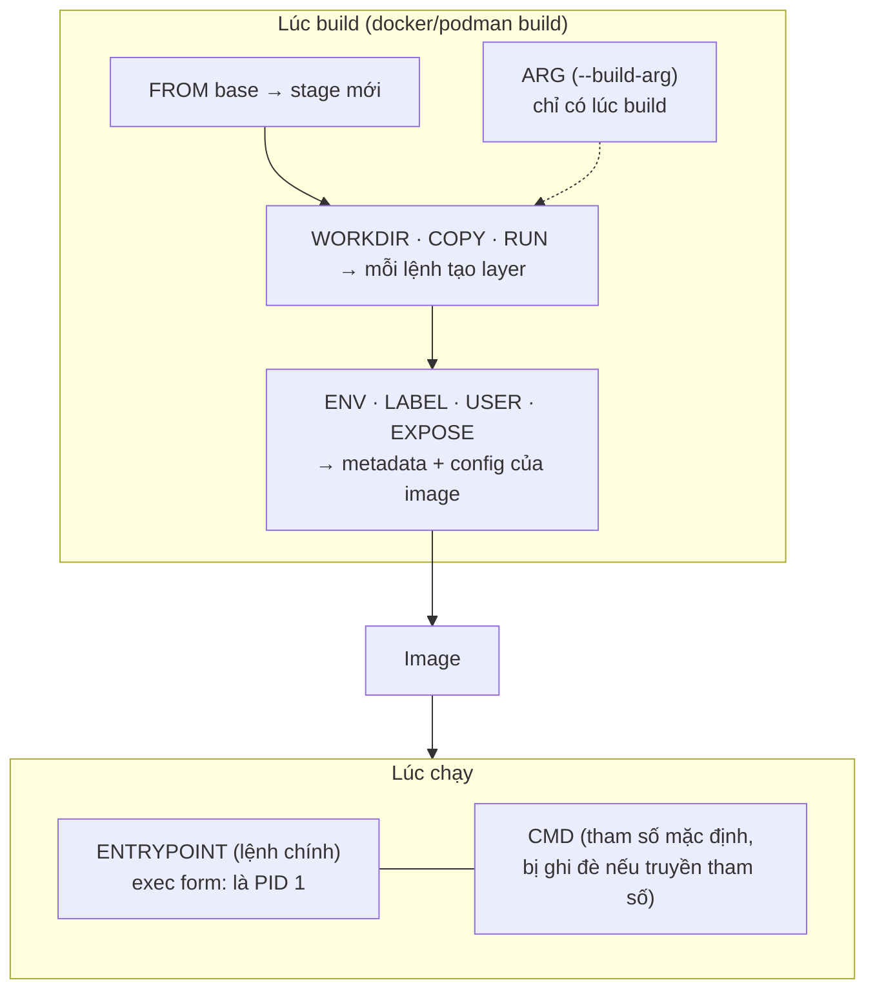

# 6_2_1 Dockerfile Instructions

> **Khóa học**: Cloud DevOps Basic — Containers & Kubernetes  
> **Phân nhóm**: 6 Domain 6 - Containers and Kubernetes › 6_2 Container Image Engineering  
> **Chủ đề**: Các lệnh Dockerfile cốt lõi, `ENV` vs `ARG`, `ENTRYPOINT` vs `CMD`, exec form vs shell form, `HEALTHCHECK`, nhãn OCI  
> **Phiên bản áp dụng**: Dockerfile reference (Docker Docs), Podman (trang `latest`), OCI image-spec annotations  
> **Trạng thái**: Draft (WRITE-CTR-6_2_1, 16-11-2026): qua G1–G4, chưa qua G5 (verifier độc lập)  
> **Phạm vi**: [Topic README](./README.md#6_2_1-các-lệnh-dockerfile) · **Checkpoint của người học**: [CHECKLIST](../../CHECKLIST.md#6_2-container-image-engineering)

---

## 1. Khái Niệm Cốt Lõi & Bản Chất Kỹ Thuật (Core Concepts & Technical Deep Dive)

### 1.1 Dockerfile Là Công Thức Dựng Image

Mỗi lệnh thao tác lên filesystem tạo ra một **layer** ([6_1_4](<../6_1 Container Fundamentals/6_1_4 Images Layers and Overlay Filesystem.md>)). Các lệnh nền tảng:

| Lệnh | Tác dụng (theo Dockerfile reference) |
| :--- | :--- |
| `FROM` | Khởi tạo một **build stage** mới và đặt base image; Dockerfile hợp lệ phải bắt đầu bằng `FROM` <!-- ev: R1.1 --> |
| `RUN` | Thực thi lệnh để tạo một **layer mới** trên image hiện tại <!-- ev: R1.2 --> |
| `COPY` | Chép file/thư mục mới từ `<src>` vào filesystem của image tại `<dest>` <!-- ev: R1.3 --> |
| `ADD` | Tương tự `COPY` nhưng nguồn có thể là build context, **URL từ xa** hoặc **Git repository** <!-- ev: R1.4 --> |
| `WORKDIR` | Đặt thư mục làm việc cho `RUN`, `CMD`, `ENTRYPOINT`, `COPY`, `ADD` theo sau; tự tạo nếu chưa có <!-- ev: R1.6 --> |
| `USER` | Đặt user (hoặc UID) và tùy chọn group (hoặc GID) mặc định cho phần còn lại của stage <!-- ev: R1.7 --> |
| `EXPOSE` | Cho Docker biết container lắng nghe cổng nào lúc chạy (mặc định TCP) <!-- ev: R1.8 --> |
| `LABEL` | Thêm metadata dạng key-value cho image <!-- ev: R1.10 --> |

Hai điểm cần nhớ:
- `ADD` và `COPY` **giống nhau về chức năng nhưng phục vụ mục đích hơi khác**. <!-- ev: R1.5 --> Hãy đọc mục "ADD or COPY" của trang best practices để chọn đúng.
- `EXPOSE` **không thực sự publish** cổng; nó chỉ là tài liệu. <!-- ev: R1.9 --> Publish cổng là việc của `-p` lúc chạy (xem [6_1_9](<../6_1 Container Fundamentals/6_1_9 Container Networking Basics.md>)).

### 1.2 `ENV` Và `ARG`

| | `ENV` | `ARG` |
| :--- | :--- | :--- |
| Dùng để | Đặt biến môi trường cho mọi lệnh sau đó trong stage <!-- ev: R1.11 --> | Biến **truyền lúc build** bằng `--build-arg <varname>=<value>` <!-- ev: R1.13 --> |
| Có nằm trong image đã build? | **Có**, luôn được lưu <!-- ev: R1.12 --> | **Không**, không được lưu như ENV <!-- ev: R1.14 --> |

Hệ quả: đừng dùng `ARG` cho giá trị cần có lúc chạy; đừng dùng `ENV` để chứa bí mật (nó nằm trong image).
Về ảnh hưởng của `ARG` tới cache, xem [6_2_3](<./6_2_3 Layer Caching.md>).

### 1.3 `ENTRYPOINT` Và `CMD`

Quy tắc phối hợp theo tài liệu: cần **ít nhất một** trong `CMD` hoặc `ENTRYPOINT`; `ENTRYPOINT` nên định nghĩa khi dùng container như một chương trình; `CMD` là tham số mặc định (hoặc lệnh tạm), và **bị ghi đè** khi chạy container với tham số khác. <!-- ev: R1.16 -->
- Một Dockerfile chỉ có **một `CMD` hiệu lực**: nếu liệt kê nhiều `CMD`, chỉ cái cuối có tác dụng. <!-- ev: R1.15 -->
- Cách dùng `ENTRYPOINT` tốt nhất theo best practices: đặt **lệnh chính** của image rồi dùng `CMD` làm cờ mặc định. <!-- ev: R1.17 -->

### 1.4 Exec Form Và Shell Form

- **Exec form** được parse như mảng JSON, nên phải dùng **dấu nháy kép**. <!-- ev: R1.18 -->
- Exec form **không tự gọi shell**, nên không có xử lý shell như thay thế biến (`$HOME`). <!-- ev: R1.19 -->
- **Shell form** của `ENTRYPOINT`: chạy như lệnh con của `/bin/sh -c`, shell này không chuyển signal; executable không phải PID 1 và không nhận `SIGTERM` từ `docker stop`. <!-- ev: R1.20 -->

→ Với service Java, dùng exec form: `ENTRYPOINT ["java", "-jar", "app.jar"]`. Vì sao: xem [6_1_8](<../6_1 Container Fundamentals/6_1_8 Container Lifecycle PID 1 and Signals.md>).

### 1.5 `HEALTHCHECK`

`HEALTHCHECK` cho Docker biết **cách kiểm tra container còn hoạt động**. <!-- ev: R1.21 --> Kubernetes quản lý sức khỏe bằng **probe** thay vì cơ chế này; học ở [6_3_5](<../6_3 Kubernetes Architecture and Core Workloads/6_3_5 Liveness Readiness and Startup Probes.md>).

⚠️ **Định dạng image và `HEALTHCHECK`** (chưa kiểm chứng): README topic ghi `HEALTHCHECK` chỉ có trong định dạng image của Docker và Podman bỏ qua nó ở định dạng OCI. Tôi **chưa tìm thấy** câu xác nhận trong tài liệu `podman-build`. Điều đã kiểm chứng: `podman build --format` có hai giá trị, `oci` (image-spec v1.0, **mặc định**) và `docker` (version 2, schema 2). <!-- ev: R1.22 --> Muốn biết `HEALTHCHECK` có được giữ hay không, hãy tự kiểm tra: build với `--format docker` và `--format oci` rồi dùng `podman image inspect`.

### 1.6 Nhãn OCI Chuẩn

Chuẩn OCI định nghĩa các khóa `org.opencontainers.image.*`:
- `source`: URL để lấy mã nguồn build image. <!-- ev: R1.23 -->
- `revision`: định danh revision của source control. <!-- ev: R1.24 -->
- `version`: phiên bản của phần mềm đóng gói. <!-- ev: R1.25 -->
- `created`: thời điểm build image, theo RFC 3339. <!-- ev: R1.26 -->

Nhãn giúp truy vết một image về commit tạo ra nó, rất hữu ích trong pipeline CI/CD (6_6).

---

## 2. Ví Dụ Đời Sống Thực Tế Dễ Hiểu (Intuitive Real-World Analogies)

**Công thức nấu ăn dạng thẻ.**
- `FROM` = chọn **nồi nền** có sẵn (nước dùng hầm sẵn); mỗi dòng sau thêm một bước (`RUN` = nấu thêm, `COPY` = thả nguyên liệu từ bàn bếp của bạn vào nồi).
- `WORKDIR` = đặt **mặt bếp** mà mọi thao tác sau diễn ra; `USER` = **ai đứng bếp** (đầu bếp phụ, không phải chủ nhà).
- `ENV` = **gia vị ghi sẵn trên nhãn món** (người ăn thấy); `ARG` = **ghi chú tạm cho người nấu** chỉ dùng lúc nấu, không đi cùng món.
- `ENTRYPOINT` = **món chính của thực đơn**; `CMD` = **phần ăn kèm mặc định** (khách có thể đổi).
- **Exec form** = đưa order thẳng cho đầu bếp chính; **shell form** = đưa order cho phục vụ bàn, người này không chuyển lời dặn "tắt bếp" tới đầu bếp.
- `LABEL` org.opencontainers.* = **tem truy xuất nguồn gốc** (ai nấu, ngày nào, công thức phiên bản nào).

---

## 3. Kiến Trúc, Luồng Hoạt Động & Hình Ảnh Trực Quan (Architecture, Diagrams & Visual Media)

<!-- ev: R1.1 R1.2 R1.3 R1.11 R1.13 R1.16 R1.18 R1.20 -->


---

## 4. Thực Hành (Hands-on)

> **Môi trường**: Podman 5.x (Fedora 43). Với Docker, đổi `podman` thành `docker`.  
> ⚠️ Chưa chạy thử (not executed by the squad). Kết quả là **dự đoán theo tài liệu**. Dockerfile hoàn chỉnh cho Java: [lab-6_2_1-java-multistage-image](./labs/lab-6_2_1-java-multistage-image/README.md) (đã chạy thử).

### 4.1 Dockerfile Nhỏ Dùng Đủ Các Lệnh Chính

<!-- ev: R1.1 R1.3 R1.6 R1.7 R1.8 R1.11 R1.13 R1.18 R1.23 R1.24 -->
```dockerfile
FROM docker.io/library/alpine:3.20
ARG GIT_SHA=unknown
LABEL org.opencontainers.image.source="https://example.invalid/repo" \
      org.opencontainers.image.revision="${GIT_SHA}"
ENV APP_ENV=production
WORKDIR /app
COPY hello.sh /app/hello.sh
USER 10001
EXPOSE 8080
ENTRYPOINT ["/bin/sh", "/app/hello.sh"]
CMD ["world"]
```

```bash
printf '#!/bin/sh\necho "hello $1 (env=$APP_ENV)"\n' > hello.sh
podman build --build-arg GIT_SHA=$(git rev-parse --short HEAD 2>/dev/null || echo none) -t demo:1 .
podman run --rm demo:1            # dùng CMD mặc định: "world"
podman run --rm demo:1 minh       # tham số mới ghi đè CMD
```

### 4.2 Quan Sát

<!-- ev: R1.16 R1.12 R1.14 R1.22 -->
```bash
podman image inspect demo:1       # xem Config: Entrypoint, Cmd, Env (có APP_ENV, không có GIT_SHA), Labels
podman build --format docker -t demo:docker .   # so với --format oci (mặc định)
```

Điều cần quan sát: `ENV` xuất hiện trong config image còn `ARG` thì không; tham số truyền lúc `run` thay thế `CMD`, còn `ENTRYPOINT` giữ nguyên. Tên khóa/trường trong `podman image inspect` hãy đọc từ output thật của bạn.

---

## 5. Cạm Bẫy Thực Tế & Thực Tiễn Sản Xuất (Production Gotchas & Best Practices)

### 5.1 Cạm Bẫy: Shell Form Làm App Không Nhận `SIGTERM`
- **Bản chất**: shell form chạy lệnh dưới `/bin/sh -c`, không chuyển signal, executable không phải PID 1. <!-- ev: R1.20 -->
- **Thực tiễn**: luôn dùng exec form cho `ENTRYPOINT`/`CMD` của service. <!-- ev: R1.18 R1.19 -->

### 5.2 Cạm Bẫy: Exec Form Dùng Dấu Nháy Đơn Hoặc Biến `$VAR`
- **Bản chất**: exec form là JSON (nháy kép) <!-- ev: R1.18 --> và không có xử lý shell nên `"$HOME"` không được thay thế. <!-- ev: R1.19 -->
- **Thực tiễn**: cần thay thế biến thì gọi shell tường minh (`["/bin/sh","-c","..."]`) và dùng `exec` để app vẫn nhận signal (xem 6_1_8).

### 5.3 Cạm Bẫy: Đặt Bí Mật Vào `ENV`
- **Bản chất**: giá trị `ENV` luôn được lưu trong image. <!-- ev: R1.12 -->
- **Thực tiễn**: không đưa secret vào `ENV`; xem 6_2_6 về build secret.

### 5.4 Cạm Bẫy: Nhầm `EXPOSE` Với Publish
- **Bản chất**: `EXPOSE` chỉ là tài liệu, không publish cổng. <!-- ev: R1.9 -->
- **Thực tiễn**: dùng `-p` khi chạy (hoặc Service ở Kubernetes).

### 5.5 Cạm Bẫy: Nhiều `CMD`
- **Bản chất**: chỉ `CMD` cuối cùng có tác dụng. <!-- ev: R1.15 -->
- **Thực tiễn**: một `CMD` duy nhất, kết hợp `ENTRYPOINT` exec form để đặt lệnh chính. <!-- ev: R1.17 -->

---

## 6. Câu Hỏi Củng Cố Kiến Thức (Active Recall Quiz)

### Câu Hỏi 1: `ENV` khác `ARG` thế nào, và hệ quả bảo mật?

<details>
<summary>Đáp án</summary>

`ENV` đặt biến môi trường và **luôn nằm trong image**; `ARG` truyền lúc build bằng `--build-arg` và **không** được lưu như `ENV`. Vì `ENV` nằm trong image nên không được dùng để chứa bí mật.
</details>

### Câu Hỏi 2: `ENTRYPOINT` và `CMD` phối hợp thế nào khi chạy `podman run img abc`?

<details>
<summary>Đáp án</summary>

`ENTRYPOINT` định nghĩa lệnh chính; `CMD` là tham số mặc định và bị ghi đè khi truyền tham số khác. Với `abc` truyền vào, tham số `abc` thay `CMD` còn `ENTRYPOINT` giữ nguyên.
</details>

### Câu Hỏi 3: Vì sao service Java nên dùng exec form cho `ENTRYPOINT`?

<details>
<summary>Đáp án</summary>

Shell form chạy dưới `/bin/sh -c` không chuyển signal nên app không phải PID 1 và không nhận `SIGTERM` từ `docker stop`, dẫn tới chờ hết thời gian rồi bị `SIGKILL` (exit 137). Exec form đưa lệnh trực tiếp thành PID 1.
</details>

---

## 7. 📚 Nguồn Tài Liệu Chính Thống (Tier-1 Official References)

- [Dockerfile reference](https://docs.docker.com/reference/dockerfile/) — `FROM`, `RUN`, `COPY`, `ADD`, `ENV`, `ARG`, `CMD`, `ENTRYPOINT`, `HEALTHCHECK`, exec/shell form.
- [Docker Docs — Building best practices](https://docs.docker.com/build/building/best-practices/) — Cách dùng `ENTRYPOINT`, `ADD` vs `COPY`.
- [podman-build(1)](https://docs.podman.io/en/latest/markdown/podman-build.1.html) — `--format oci|docker`.
- [OCI Image Specification — Annotations](https://github.com/opencontainers/image-spec/blob/main/annotations.md) — Nhãn chuẩn `org.opencontainers.image.*`.
