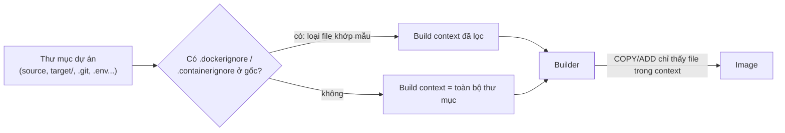

# 6_2_2 Build Context and dockerignore

> **Khóa học**: Cloud DevOps Basic — Containers & Kubernetes  
> **Phân nhóm**: 6 Domain 6 - Containers and Kubernetes › 6_2 Container Image Engineering  
> **Chủ đề**: Build context là gì, vì sao nó ảnh hưởng tốc độ build và an toàn, `.dockerignore` / `.containerignore`  
> **Phiên bản áp dụng**: Docker Build docs, Podman/Buildah (`containerignore(5)`, trang `latest`)  
> **Trạng thái**: Draft (WRITE-CTR-6_2_2, 16-11-2026): qua G1–G4, chưa qua G5 (verifier độc lập)  
> **Phạm vi**: [Topic README](./README.md#6_2_2-build-context-và-dockerignore) · **Checkpoint của người học**: [CHECKLIST](../../CHECKLIST.md#6_2-container-image-engineering)

---

## 1. Khái Niệm Cốt Lõi & Bản Chất Kỹ Thuật (Core Concepts & Technical Deep Dive)

### 1.1 Build Context

**Build context là tập file mà quá trình build truy cập được.** <!-- ev: R2.1 --> Đối số vị trí bạn truyền cho lệnh build (ví dụ dấu `.` trong `podman build .`) chính là thứ xác định context. <!-- ev: R2.2 -->
Lệnh `COPY`/`ADD` ([6_2_1](<./6_2_1 Dockerfile Instructions.md>)) chỉ lấy được file **nằm trong context**. Hai hệ quả thực tế:
1. Context lớn → gửi tới builder chậm hơn (đặc biệt khi builder ở xa như CI hoặc daemon từ xa). *Đây là suy luận từ định nghĩa "toàn bộ tập file được gửi cho builder"; tài liệu nói file bị loại khỏi context **trước khi** gửi tới builder (xem 1.2).*
2. Mọi file trong context đều có khả năng lọt vào image qua `COPY . .`, kể cả file bí mật (`.env`, khóa SSH, `.git`).

### 1.2 `.dockerignore`

- Build client tìm file `.dockerignore` ở **thư mục gốc của context**. Nếu có, các file/thư mục khớp mẫu bị **loại khỏi context trước khi gửi tới builder**. <!-- ev: R2.3 -->
- Cú pháp: danh sách mẫu, mỗi dòng một mẫu, giống file glob của shell Unix. <!-- ev: R2.5 -->
- Có thể có file ignore **riêng cho từng Dockerfile** (đặt cạnh Dockerfile, tên `<tên Dockerfile>.dockerignore`); file riêng được **ưu tiên** hơn `.dockerignore` ở gốc context nếu cả hai cùng có. <!-- ev: R2.4 -->

### 1.3 Podman/Buildah: `.containerignore`

Các công cụ container tìm file tên `.containerignore` **hoặc** `.dockerignore` trong thư mục gốc context. <!-- ev: R2.6 --> `podman build --ignorefile` cho phép chỉ định đường dẫn tới một file `.containerignore` khác. <!-- ev: R2.7 -->

### 1.4 Mẫu Ví Dụ Cho Dự Án Java Maven

```text
# .dockerignore
target/
.git/
.idea/
*.log
.env
```

Ý nghĩa: bỏ thư mục build local (`target/`) để build trong container tự sinh ra, bỏ lịch sử Git, file IDE, log và **file bí mật**. *Danh sách mẫu trên là gợi ý của bài này, không phải trích dẫn từ tài liệu; cú pháp từng mẫu theo tài liệu "Syntax" của Docker.*

---

## 2. Ví Dụ Đời Sống Thực Tế Dễ Hiểu (Intuitive Real-World Analogies)

**Dọn hành lý trước khi gửi hàng đi.**
- **Build context = chiếc thùng bạn gửi cho xưởng đóng gói** (builder): xưởng chỉ làm được việc với những gì có trong thùng.
- **Gửi cả thùng quá lớn** (cả thư mục `.git`, `target/`, ảnh video) = tốn phí vận chuyển và xưởng mở thùng lâu.
- **`.dockerignore` = danh sách "đừng bỏ vào thùng"**: bạn gạch những thứ không cần (và những thứ nhạy cảm như sổ mật khẩu) **trước khi đóng nắp**.
- **`.containerignore` = cùng ý nghĩa**, tên khác ở hệ Podman/Buildah.

---

## 3. Kiến Trúc, Luồng Hoạt Động & Hình Ảnh Trực Quan (Architecture, Diagrams & Visual Media)

<!-- ev: R2.1 R2.2 R2.3 R2.6 -->


---

## 4. Thực Hành (Hands-on)

> **Môi trường**: Podman 5.x. Với Docker, đổi `podman` thành `docker`.  
> ⚠️ Chưa chạy thử (not executed by the squad). Kết quả là **dự đoán theo tài liệu**.

### 4.1 Chứng Minh `.dockerignore` Loại File Khỏi Context

<!-- ev: R2.3 R2.6 -->
```bash
mkdir ctx-demo && cd ctx-demo
echo "public"  > keep.txt
echo "secret"  > .env
printf 'FROM docker.io/library/alpine:3.20\nCOPY . /ctx\nRUN ls -a /ctx\n' > Dockerfile

# Lần 1: không có ignore file
podman build --no-cache -t ctx:1 .    # dự đoán: /ctx có cả .env

# Lần 2: loại .env khỏi context
printf '.env\n' > .dockerignore
podman build --no-cache -t ctx:2 .    # dự đoán: /ctx không có .env
```

Quan sát: bước `RUN ls -a /ctx` in danh sách file trong image; so hai lần build. Vì `--no-cache` chỉ để chắc chắn lệnh `RUN` chạy lại và in kết quả mới (ý nghĩa của cờ này tôi chưa trích dẫn trong bài này).

### 4.2 Ignore File Riêng Cho Một Dockerfile

<!-- ev: R2.4 R2.7 -->
```bash
# Docker: tạo file <tên Dockerfile>.dockerignore cạnh Dockerfile tương ứng
# Podman: có thể chỉ định file khác bằng --ignorefile
podman build --ignorefile ./my.containerignore -t ctx:3 .
```

Thực hành sâu hơn: [lab-6_2_1-java-multistage-image](./labs/lab-6_2_1-java-multistage-image/README.md) (đã chạy thử).

---

## 5. Cạm Bẫy Thực Tế & Thực Tiễn Sản Xuất (Production Gotchas & Best Practices)

### 5.1 Cạm Bẫy: `COPY . .` Mang Theo Bí Mật Và `.git`
- **Bản chất**: file nằm trong context đều có thể được `COPY`; `.dockerignore` loại chúng khỏi context trước khi gửi tới builder. <!-- ev: R2.1 R2.3 -->
- **Thực tiễn**: luôn có `.dockerignore`; loại `.env`, khóa, `.git`.

### 5.2 Cạm Bẫy: Đặt `.dockerignore` Sai Chỗ
- **Bản chất**: build client tìm file ở **thư mục gốc của context**. <!-- ev: R2.3 -->
- **Thực tiễn**: đặt cùng cấp với thư mục bạn truyền cho lệnh build; nếu nhiều Dockerfile, dùng `<tên>.dockerignore`. <!-- ev: R2.4 -->

### 5.3 Cạm Bẫy: Giả Định Podman Chỉ Đọc `.dockerignore`
- **Bản chất**: Podman/Buildah tìm `.containerignore` hoặc `.dockerignore`. <!-- ev: R2.6 -->
- **Thực tiễn**: nếu dự án dùng cả Docker và Podman, giữ một file `.dockerignore` là đủ cho cả hai; chỉ dùng `--ignorefile` khi cần cấu hình riêng. <!-- ev: R2.7 -->

---

## 6. Câu Hỏi Củng Cố Kiến Thức (Active Recall Quiz)

### Câu Hỏi 1: Build context là gì và `COPY` bị giới hạn bởi gì?

<details>
<summary>Đáp án</summary>

Build context là tập file mà build truy cập được, xác định bằng đối số vị trí của lệnh build. `COPY`/`ADD` chỉ lấy được file nằm trong context.
</details>

### Câu Hỏi 2: `.dockerignore` hoạt động ở thời điểm nào?

<details>
<summary>Đáp án</summary>

Build client tìm `.dockerignore` ở gốc context; file khớp mẫu bị loại khỏi context **trước khi** gửi tới builder, nên chúng không thể bị `COPY` vào image.
</details>

### Câu Hỏi 3: Podman dùng file nào khác `.dockerignore`?

<details>
<summary>Đáp án</summary>

`.containerignore` (Podman/Buildah tìm `.containerignore` hoặc `.dockerignore`); có thể chỉ định file khác bằng `--ignorefile`.
</details>

---

## 7. 📚 Nguồn Tài Liệu Chính Thống (Tier-1 Official References)

- [Docker Docs — Build context](https://docs.docker.com/build/concepts/context/) — Build context, `.dockerignore`, file ignore theo Dockerfile, cú pháp.
- [containerignore(5)](https://github.com/containers/common/blob/main/docs/containerignore.5.md) — `.containerignore`/`.dockerignore` cho Podman/Buildah.
- [podman-build(1)](https://docs.podman.io/en/latest/markdown/podman-build.1.html) — `--ignorefile`.
