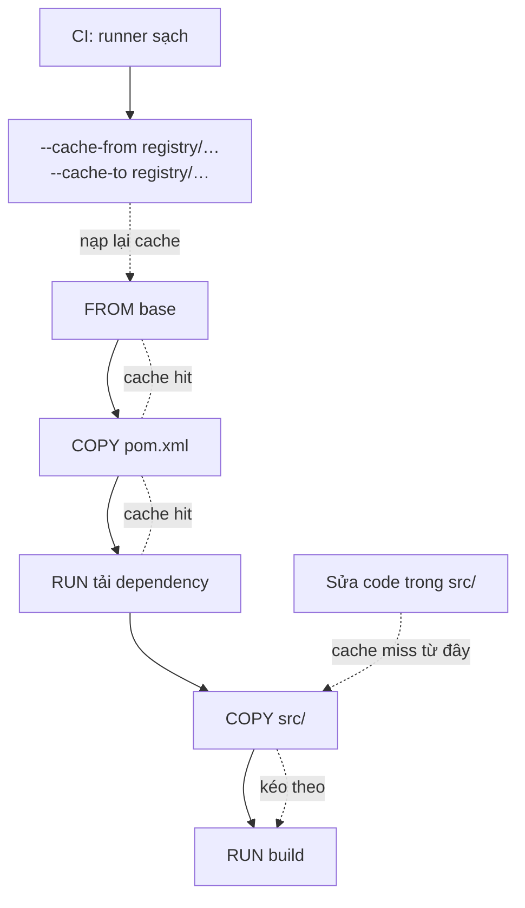

# 6_2_3 Layer Caching

> **Khóa học**: Cloud DevOps Basic — Containers & Kubernetes  
> **Phân nhóm**: 6 Domain 6 - Containers and Kubernetes › 6_2 Container Image Engineering  
> **Chủ đề**: Cache theo layer, thứ tự lệnh, `ARG` và cache (Docker vs quan sát trên Podman), cache mount, cache trong CI  
> **Phiên bản áp dụng**: Docker Build docs (BuildKit), Podman/Buildah (trang `latest`; quan sát lab trên Podman 5.8.9)  
> **Trạng thái**: Draft (WRITE-CTR-6_2_3, 16-11-2026): qua G1–G4, chưa qua G5 (verifier độc lập)  
> **Phạm vi**: [Topic README](./README.md#6_2_3-cache-theo-lớp) · **Checkpoint của người học**: [CHECKLIST](../../CHECKLIST.md#6_2-container-image-engineering)

---

## 1. Khái Niệm Cốt Lõi & Bản Chất Kỹ Thuật (Core Concepts & Technical Deep Dive)

### 1.1 Quy Tắc Cache

- Một layer được **dùng lại từ cache** nếu lệnh và các file nó phụ thuộc **không đổi** kể từ lần build trước. <!-- ev: R3.1 -->
- Nếu một layer đổi thì **mọi layer sau nó cũng bị ảnh hưởng**. <!-- ev: R3.2 --> Cụ thể: khi một layer đổi, mọi layer phía sau phải build lại, dù chúng không tạo ra gì khác. <!-- ev: R3.3 -->

Hệ quả cho cách **sắp xếp** Dockerfile: đặt thứ **ít thay đổi** lên trước (cài gói hệ thống, `pom.xml` + tải dependency), thứ **hay thay đổi** xuống sau (`src/`). Với service Java: `COPY pom.xml` → tải dependency → `COPY src` → build; sửa code chỉ làm mất cache từ `COPY src` trở đi. Cách làm này đã được **đo trong lab** [lab-6_2_1-java-multistage-image](./labs/lab-6_2_1-java-multistage-image/README.md) (đã chạy thử, có số liệu thời gian ở README lab).

### 1.2 `ARG` Và Cache: Docker Nói Gì, Podman Thực Tế Ra Sao

- **Tài liệu Docker**: nếu giá trị `ARG` khác lần build trước thì xảy ra "cache miss" ở **lần dùng đầu tiên**, không phải lúc khai báo. <!-- ev: R3.4 -->
- **Quan sát trong lab 6_2_2** (Fedora 43, Podman 5.8.9, 15-11-2026, Buildah bên dưới): một `ARG` chỉ được dùng trong `ENV` **không** làm mất cache, hai lần build với giá trị khác nhau cho **cùng image ID**. Đây là **quan sát thực nghiệm**, **trái với mô tả của tài liệu Docker**; chi tiết và Dockerfile sửa lỗi ở [lab-6_2_2-tags-digests-and-registry](./labs/lab-6_2_2-tags-digests-and-registry/README.md). Với Docker BuildKit kết quả có thể khác.
- Bài học: **luôn kiểm tra hành vi cache trên đúng công cụ và phiên bản bạn dùng**. Khi `ARG` được dùng trong một lệnh `RUN`, giá trị của nó là một phần của khóa cache lệnh đó theo lab; đặt `ARG` **càng cuối càng tốt** để đổi version chỉ build lại vài lớp cuối.

### 1.3 Cache Mount

`RUN --mount=type=cache` cho thư mục cache **tồn tại giữa các lần build** mà không làm mất instruction cache; nên coi là **tối ưu hiệu năng** (build vẫn phải chạy được với bất kỳ nội dung nào của thư mục cache). <!-- ev: R3.5 --> Ví dụ phổ biến: thư mục tải dependency của Maven/Gradle. *Cú pháp chi tiết (target, id...) đọc ở Dockerfile reference; bài này không đưa ví dụ cụ thể chưa kiểm chứng.*

### 1.4 Một Chi Tiết Về Checksum Cache

Với `RUN` dùng bind mount, thời điểm sửa file (**mtime**) **không** được tính vào checksum cache. <!-- ev: R3.6 --> Nghĩa là chỉ `touch` file không làm mất cache.

### 1.5 Cache Trong CI

Runner CI thường **không giữ cache giữa các job** (nhận định thực tế phổ biến; xem 6_6). Cách xử lý:
- Docker/BuildKit: cache backend (ngoài cache cục bộ) **phải được export và import tường minh** (`--cache-to`, `--cache-from`). <!-- ev: R3.7 -->
- Podman/Buildah: `--cache-from` dùng một repository làm nguồn cache và cố kéo cache image thay vì chạy lại bước build <!-- ev: R3.9 -->; `--cache-to` chỉ định repository từ xa lưu cache image <!-- ev: R3.10 -->; **`--cache-from` bị bỏ qua nếu không có `--layers`**. <!-- ev: R3.8 -->

---

## 2. Ví Dụ Đời Sống Thực Tế Dễ Hiểu (Intuitive Real-World Analogies)

**Xây nhà từng tầng, đổ bê tông có bảo hành.**
- Mỗi **tầng** (layer) đã đổ xong và còn nguyên thiết kế thì không phải xây lại (**cache hit**).
- Nếu bạn **sửa bản vẽ tầng 3**, mọi tầng **phía trên** (4, 5, 6...) phải xây lại, dù thiết kế của chúng không đổi (cache miss lan xuống).
- Vì vậy **làm phần móng ít đổi trước** (cài gói, dependency), **phần trang trí hay đổi sau** (mã nguồn).
- **Cache mount = kho vật liệu dùng chung ở công trường**: không tính vào bản vẽ tầng nhưng giúp lần xây sau nhanh hơn.
- **CI = công trường thuê, mỗi lần dọn sạch**: muốn giữ vật liệu phải mang theo kho riêng (`--cache-from/--cache-to`).

---

## 3. Kiến Trúc, Luồng Hoạt Động & Hình Ảnh Trực Quan (Architecture, Diagrams & Visual Media)

<!-- ev: R3.1 R3.2 R3.3 R3.7 R3.9 -->


---

## 4. Thực Hành (Hands-on)

> **Môi trường**: Podman 5.x. Với Docker, đổi `podman` thành `docker`.  
> ⚠️ Chưa chạy thử (not executed by the squad). Kết quả là **dự đoán theo tài liệu**; lab đã chạy thử là nguồn số liệu thực.

### 4.1 Quan Sát Cache Hit/Miss

<!-- ev: R3.1 R3.2 -->
```bash
mkdir cache-demo && cd cache-demo
echo "v1" > data.txt
printf 'FROM docker.io/library/alpine:3.20\nRUN echo base-step\nCOPY data.txt /data.txt\nRUN echo after-copy\n' > Dockerfile

podman build -t cache:1 .          # lần 1: build đủ các bước
podman build -t cache:1b .         # lần 2 không đổi gì: dự đoán các bước dùng lại cache
echo "v2" > data.txt
podman build -t cache:2 .          # sửa data.txt: dự đoán COPY và RUN sau nó chạy lại, RUN đầu vẫn cache
```

Quan sát: bước nào được báo dùng cache và bước nào chạy lại (cách hiển thị thay đổi theo công cụ/phiên bản).

### 4.2 Tái Hiện Bẫy `ARG` (Đã Có Lab)

Làm theo **Phần B** của [lab-6_2_2-tags-digests-and-registry](./labs/lab-6_2_2-tags-digests-and-registry/README.md): build hai lần với `--build-arg` khác nhau, so sánh image ID, rồi sửa Dockerfile cho `ARG` được dùng trong `RUN`. Nếu bạn dùng Docker, hãy ghi lại kết quả của riêng bạn so với tài liệu.

### 4.3 Cache Registry Trong CI (Khái Niệm, Podman)

<!-- ev: R3.8 R3.9 R3.10 -->
```bash
# Ví dụ có trong tài liệu Podman/Buildah: vừa nạp vừa ghi cache (cần --layers)
buildah build -t test --layers --cache-to registry/myrepo/cache --cache-from registry/myrepo/cache .
```

---

## 5. Cạm Bẫy Thực Tế & Thực Tiễn Sản Xuất (Production Gotchas & Best Practices)

### 5.1 Cạm Bẫy: `COPY . .` Trước Bước Tải Dependency
- **Bản chất**: sửa một file bất kỳ làm mất cache của lớp `COPY . .` và mọi lớp sau (kể cả tải dependency). <!-- ev: R3.2 R3.3 -->
- **Thực tiễn**: `COPY pom.xml` → tải dependency → `COPY src`.

### 5.2 Cạm Bẫy: Tin Hoàn Toàn Vào Tài Liệu Về Cache `ARG`
- **Bản chất**: tài liệu Docker nói thay đổi `ARG` gây cache miss ở lần dùng đầu <!-- ev: R3.4 -->, nhưng lab trên Podman 5.8.9 cho thấy `ARG` chỉ dùng trong `ENV` không làm mất cache.
- **Thực tiễn**: tự kiểm tra bằng cách so image ID khi bạn dùng `ARG` để "đóng dấu phiên bản".

### 5.3 Cạm Bẫy: `--cache-from` Không Có Tác Dụng Trên Podman
- **Bản chất**: `--cache-from` bị bỏ qua nếu không có `--layers`. <!-- ev: R3.8 -->
- **Thực tiễn**: kiểm tra cờ khi chuyển pipeline từ Docker sang Podman/Buildah.

### 5.4 Cạm Bẫy: Dùng Cache Mount Như Một Phần Logic Build
- **Bản chất**: cache mount chỉ để tăng hiệu năng; build phải chạy đúng với bất kỳ nội dung nào của thư mục cache. <!-- ev: R3.5 -->
- **Thực tiễn**: đừng để kết quả build phụ thuộc vào nội dung cache.

---

## 6. Câu Hỏi Củng Cố Kiến Thức (Active Recall Quiz)

### Câu Hỏi 1: Vì sao nên `COPY pom.xml` và tải dependency trước `COPY src`?

<details>
<summary>Đáp án</summary>

Khi một layer đổi, mọi layer sau nó phải build lại. `pom.xml` ít đổi hơn mã nguồn; đặt nó (và bước tải dependency) trước `src/` để sửa code chỉ làm mất cache từ `COPY src` trở đi.
</details>

### Câu Hỏi 2: `ARG` ảnh hưởng cache thế nào theo Docker, và bạn đã quan sát gì trên Podman?

<details>
<summary>Đáp án</summary>

Docker: giá trị `ARG` khác lần trước gây "cache miss" ở lần dùng đầu tiên. Quan sát ở lab 6_2_2 (Podman 5.8.9): `ARG` chỉ dùng trong `ENV` không làm mất cache (cùng image ID). Kết luận: kiểm tra trên đúng công cụ.
</details>

### Câu Hỏi 3: Làm sao giữ cache giữa các job CI?

<details>
<summary>Đáp án</summary>

Export/import cache qua một cache backend: Docker/BuildKit dùng `--cache-to`/`--cache-from` tường minh; Podman/Buildah dùng `--cache-from`/`--cache-to` kèm `--layers`.
</details>

---

## 7. 📚 Nguồn Tài Liệu Chính Thống (Tier-1 Official References)

- [Docker Docs — Docker build cache](https://docs.docker.com/build/cache/) — Cache theo layer, vô hiệu hóa cache.
- [Docker Docs — Optimize cache usage in builds](https://docs.docker.com/build/cache/optimize/) — Điều kiện dùng lại layer.
- [Docker Docs — Build cache invalidation](https://docs.docker.com/build/cache/invalidation/) — Quy tắc checksum cache.
- [Docker Docs — Cache storage backends](https://docs.docker.com/build/cache/backends/) — `--cache-to`/`--cache-from`.
- [Dockerfile reference](https://docs.docker.com/reference/dockerfile/) — `ARG` và cache, `RUN --mount=type=cache`.
- [podman-build(1)](https://docs.podman.io/en/latest/markdown/podman-build.1.html) — `--cache-from`, `--cache-to`, `--layers`.
