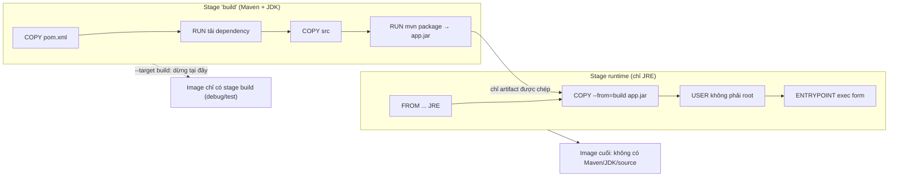

# 6_2_4 Multi-Stage Builds for Java

> **Khóa học**: Cloud DevOps Basic — Containers & Kubernetes  
> **Phân nhóm**: 6 Domain 6 - Containers and Kubernetes › 6_2 Container Image Engineering  
> **Chủ đề**: Tách stage build (Maven + JDK) khỏi stage chạy (JRE), `COPY --from`, `--target`, runtime nhỏ hơn, heap JVM trong container  
> **Phiên bản áp dụng**: Docker Build docs, JDK 21 (`java`, `jlink`), distroless (README dự án)  
> **Trạng thái**: Draft (WRITE-CTR-6_2_4, 16-11-2026): qua G1–G4, chưa qua G5 (verifier độc lập)  
> **Phạm vi**: [Topic README](./README.md#6_2_4-multi-stage-build-cho-java) · **Checkpoint của người học**: [CHECKLIST](../../CHECKLIST.md#6_2-container-image-engineering)

---

## 1. Khái Niệm Cốt Lõi & Bản Chất Kỹ Thuật (Core Concepts & Technical Deep Dive)

### 1.1 Multi-Stage Là Gì

Với multi-stage build, Dockerfile có **nhiều lệnh `FROM`**; mỗi `FROM` có thể dùng base khác và **bắt đầu một stage mới**. Bạn **chọn lọc chép artifact** từ stage này sang stage khác, bỏ lại mọi thứ không muốn có trong image cuối. <!-- ev: R4.1 -->
Lợi ích: **giảm kích thước image cuối** nhờ tách biệt việc build với sản phẩm cuối <!-- ev: R4.2 -->, và không có công cụ build nào nằm trong image cuối. <!-- ev: R4.3 -->

Với Java: stage 1 dùng image có **Maven + JDK** để biên dịch ra file `.jar`; stage 2 dùng image chỉ có **JRE** và chép đúng file `.jar` sang.

### 1.2 `COPY --from`

`COPY` lấy được nguồn từ build context, **build stage**, named context hoặc một image. <!-- ev: R4.4 --> Cú pháp `COPY --from=<tên stage> <src> <dest>` là cách chuyển artifact giữa stage (đặt tên stage bằng `FROM ... AS <tên>`).

### 1.3 Dừng Ở Một Stage: `--target`

`docker build --target <stage>` dừng ở stage được chỉ định; hữu ích khi debug một stage cụ thể (và các trường hợp như dựng stage kiểm thử riêng). <!-- ev: R4.5 --> Trong CI, đây là cách chạy stage test mà không dựng image runtime.

### 1.4 Các Lựa Chọn Runtime Nhỏ Hơn (Khái Niệm)

- **JRE** thay vì JDK: image chạy không cần compiler/Maven.
- **`jlink`**: lắp ráp và tối ưu một tập module cùng phụ thuộc thành **custom runtime image**. <!-- ev: R4.7 --> *Dùng `jlink` cho ứng dụng cần module analysis; bài này không đi sâu.*
- **Distroless**: chỉ chứa ứng dụng và phụ thuộc runtime, **không có package manager, shell hay chương trình khác** của một bản phân phối chuẩn. <!-- ev: R4.8 --> Hệ quả: khó debug bằng `exec` shell (xem [6_2_5](<./README.md#6_2_5-chọn-base-image>)).

### 1.5 JVM Trong Container: Heap Theo Phần Trăm RAM

Tùy chọn `-XX:MaxRAMPercentage=percent` đặt heap tối đa theo phần trăm; **mặc định 25 phần trăm**. <!-- ev: R4.6 --> Vì vậy với giới hạn bộ nhớ container nhỏ, heap mặc định có thể rất bé, còn đặt quá cao có thể làm container bị OOM kill ([6_1_3](<../6_1 Container Fundamentals/6_1_3 Control Groups v2 for Containers.md>)): heap không phải toàn bộ bộ nhớ JVM dùng (suy luận chung, hãy đo bằng lab 6_1_2).
Dockerfile mẫu của repo đặt giá trị này qua biến môi trường `JAVA_TOOL_OPTIONS`; ý nghĩa chính xác của biến này bạn nên đọc ở tài liệu JDK (bài này chưa trích dẫn).

---

## 2. Ví Dụ Đời Sống Thực Tế Dễ Hiểu (Intuitive Real-World Analogies)

**Xưởng bánh và quầy bán hàng.**
- **Stage build = xưởng bếp đầy đủ** (lò, máy nhào, bột, dụng cụ): nặng, bừa bộn, chỉ để làm ra chiếc bánh (file `.jar`).
- **Stage runtime = quầy bán**: chỉ cần chiếc bánh và hộp đựng (JRE), **không** mang cả xưởng ra quầy.
- **`COPY --from` = bê đúng chiếc bánh từ xưởng ra quầy**.
- **`--target` = dừng dây chuyền ở công đoạn kiểm tra chất lượng** để thử bánh, chưa đóng gói.
- **Distroless = quầy tối giản không có dao kéo hay bếp**: an toàn hơn nhưng nếu hỏng thì không có dụng cụ sửa tại chỗ.

---

## 3. Kiến Trúc, Luồng Hoạt Động & Hình Ảnh Trực Quan (Architecture, Diagrams & Visual Media)

<!-- ev: R4.1 R4.3 R4.4 R4.5 -->


---

## 4. Thực Hành (Hands-on)

> **Môi trường**: Podman 5.x (Fedora 43). Với Docker, đổi `podman` thành `docker`.  
> Dockerfile dưới đây là **đáp án của lab 6_2_1, đã chạy thử** trên Fedora 43/Podman 5.8.9 (file [shared/hello-svc/Dockerfile](../../shared/hello-svc/Dockerfile)); phần lệnh bên dưới chưa chạy thử trong bài này.  
> ⚠️ Chưa chạy thử (not executed by the squad).

### 4.1 Dockerfile Multi-Stage Cho `hello-svc`

<!-- ev: R4.1 R4.4 R4.6 -->
```dockerfile
# Stage 1: build jar bằng Maven + JDK
FROM docker.io/library/maven:3.9-eclipse-temurin-21 AS build
WORKDIR /src
COPY pom.xml .
RUN mvn -B -q dependency:go-offline
COPY src ./src
RUN mvn -B -q package

# Stage 2: runtime chỉ có JRE
FROM docker.io/library/eclipse-temurin:21-jre
ENV PORT=8080 \
    JAVA_TOOL_OPTIONS="-XX:MaxRAMPercentage=75"
WORKDIR /app
COPY --from=build /src/target/hello-svc.jar /app/hello-svc.jar
USER 10001:10001
EXPOSE 8080
ENTRYPOINT ["java", "-jar", "/app/hello-svc.jar"]
```

(Bản đầy đủ có thêm `ARG APP_VERSION` ở cuối, xem file trong repo và [6_2_3](<./6_2_3 Layer Caching.md>).)

### 4.2 Build Và Dừng Ở Stage `build`

<!-- ev: R4.5 -->
```bash
cd cloud_devops_basic/container/shared/hello-svc
podman build -t hello-svc:full .                       # image cuối (stage runtime)
podman build --target build -t hello-svc:buildonly .   # dừng ở stage build
podman images | grep hello-svc                         # so sánh kích thước hai image
```

Quan sát: kích thước hai image khác nhau thế nào (hãy ghi số **thật** của bạn). Số liệu tham khảo đã đo nằm ở README [lab-6_2_1-java-multistage-image](./labs/lab-6_2_1-java-multistage-image/README.md).

---

## 5. Cạm Bẫy Thực Tế & Thực Tiễn Sản Xuất (Production Gotchas & Best Practices)

### 5.1 Cạm Bẫy: Image Runtime Vẫn Chứa Công Cụ Build
- **Bản chất**: nếu không dùng stage thứ hai, mọi thứ ở stage build nằm trong image cuối. <!-- ev: R4.3 -->
- **Thực tiễn**: stage cuối chỉ `COPY --from` artifact cần thiết. <!-- ev: R4.1 R4.4 -->

### 5.2 Cạm Bẫy: Heap JVM Không Khớp Giới Hạn Container
- **Bản chất**: `MaxRAMPercentage` mặc định 25 phần trăm. <!-- ev: R4.6 -->
- **Thực tiễn**: đặt tường minh và kiểm chứng bằng lab 6_1_2 (so sánh `OutOfMemoryError` của JVM với OOM kill của kernel).

### 5.3 Cạm Bẫy: Distroless Khó Debug
- **Bản chất**: không có shell hay package manager. <!-- ev: R4.8 -->
- **Thực tiễn**: giữ một stage/tag có công cụ debug (dùng `--target`) <!-- ev: R4.5 -->, hoặc dùng cơ chế debug của Kubernetes ở 6_8.

### 5.4 Cạm Bẫy: Quên Copy Pom Trước Source
- **Bản chất**: một layer đổi thì mọi layer sau phải build lại; xem 6_2_3.
- **Thực tiễn**: `COPY pom.xml` → tải dependency → `COPY src` như ví dụ 4.1.

---

## 6. Câu Hỏi Củng Cố Kiến Thức (Active Recall Quiz)

### Câu Hỏi 1: Multi-stage giải quyết vấn đề gì cho service Java?

<details>
<summary>Đáp án</summary>

Tách build (Maven + JDK) khỏi runtime (JRE): image cuối chỉ chứa artifact cần chạy, nhỏ hơn và không mang công cụ build, mã nguồn.
</details>

### Câu Hỏi 2: `COPY --from` và `--target` khác nhau thế nào?

<details>
<summary>Đáp án</summary>

`COPY --from=<stage>` chép file từ một stage sang stage đang build. `--target <stage>` bảo builder **dừng** ở stage đó (để debug hoặc chạy stage test).
</details>

### Câu Hỏi 3: Vì sao phải quan tâm `MaxRAMPercentage` trong container?

<details>
<summary>Đáp án</summary>

Heap tối đa mặc định là 25 phần trăm (theo tài liệu JDK 21), nên cần đặt tường minh theo giới hạn bộ nhớ container; đặt quá cao có thể gây OOM kill ở cấp kernel.
</details>

---

## 7. 📚 Nguồn Tài Liệu Chính Thống (Tier-1 Official References)

- [Docker Docs — Multi-stage builds](https://docs.docker.com/build/building/multi-stage/) — Nhiều stage, `COPY --from`, `--target`.
- [Docker Docs — Building best practices](https://docs.docker.com/build/building/best-practices/) — Lợi ích của multi-stage.
- [Dockerfile reference](https://docs.docker.com/reference/dockerfile/) — `COPY` từ build stage.
- [The java Command (JDK 21)](https://docs.oracle.com/en/java/javase/21/docs/specs/man/java.html) — `-XX:MaxRAMPercentage`.
- [The jlink Command (JDK 21)](https://docs.oracle.com/en/java/javase/21/docs/specs/man/jlink.html) — Custom runtime image.
- [Distroless](https://github.com/GoogleContainerTools/distroless) — Image tối giản không shell (README dự án).
