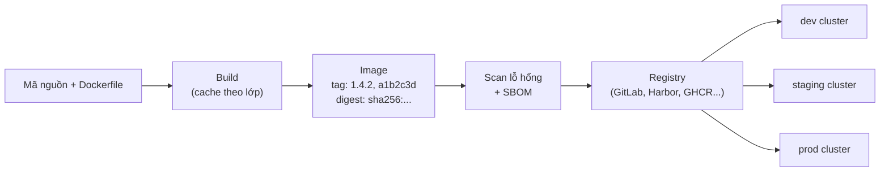

# 6_2 Container Image Engineering

> **Khóa học**: Cloud DevOps Basic — Containers & Kubernetes
> **Phân nhóm**: 6 Domain 6 - Containers and Kubernetes › 6_2 Container Image Engineering
> **Chủ đề**: Viết Dockerfile đúng cách cho service Java, tối ưu cache và kích thước, bảo mật image, quản lý tag/digest và registry
> **Trạng thái**: README lộ trình + 2 lab (đã chạy thử trên Fedora 43, Podman 5.8.9, ngày 15-11-2026)
> **Lộ trình tổng**: [container/README.md](../../README.md) · **Checkpoint**: [CHECKLIST.md](../../CHECKLIST.md#6_2-container-image-engineering)

---

## 🎯 Mục Tiêu

Trong pipeline CI/CD cho microservices, **image là sản phẩm (artifact) duy nhất được build một lần rồi đem đi deploy mọi môi trường**. Topic này giúp bạn tạo ra image nhỏ, an toàn, build nhanh, và định danh image một cách không thể nhầm lẫn.

---

## 📚 Những Gì Cần Học

### 6_2_1 Các Lệnh Dockerfile
- [ ] `FROM`, `RUN`, `COPY` vs `ADD` (ưu tiên `COPY`; `ADD` có thêm khả năng giải nén và tải URL), `WORKDIR`, `USER`, `EXPOSE`, `LABEL`.
- [ ] `ENV` (tồn tại lúc chạy) vs `ARG` (chỉ tồn tại lúc build, truyền bằng `--build-arg`).
- [ ] `ENTRYPOINT` vs `CMD`, và cách chúng kết hợp; **exec form** vs **shell form** (liên hệ 6_1_8).
- [ ] `HEALTHCHECK`: chỉ có trong định dạng image của Docker; image định dạng OCI (mặc định của Podman) bỏ qua nó; Kubernetes không dùng mà dùng probe (6_3).
- [ ] Nhãn chuẩn OCI: `org.opencontainers.image.source`, `.revision`, `.version`, `.created`.

### 6_2_2 Build Context và `.dockerignore`
- [ ] Build context là gì, vì sao gửi cả thư mục lớn làm build chậm.
- [ ] `.dockerignore` (Podman cũng đọc `.containerignore`): loại `target/`, `.git/`, file bí mật.

### 6_2_3 Cache Theo Lớp
- [ ] Mỗi lệnh tạo một lớp; một lớp mất cache thì **mọi lớp sau nó** cũng phải build lại.
- [ ] Sắp xếp: thứ ít thay đổi trước (cài gói, `pom.xml` + tải dependency), thứ hay thay đổi sau (`src/`).
- [ ] `ARG` và cache: tài liệu Docker nói giá trị `ARG` thay đổi gây cache miss ở lần dùng đầu tiên. Thực tế với Podman 5.8.9, `ARG` chỉ dùng trong `ENV` **không** làm mất cache (xem lab 6_2_2). Luôn kiểm tra hành vi trên đúng công cụ bạn dùng.
- [ ] Cache trong CI: runner thường không giữ cache giữa các job → `--cache-from`, cache registry (6_6).

### 6_2_4 Multi-Stage Build cho Java
- [ ] Stage build (Maven/Gradle + JDK) và stage runtime (chỉ JRE).
- [ ] `COPY --from=<stage>`; build một stage cụ thể bằng `--target` (ví dụ stage chạy test).
- [ ] Các lựa chọn runtime nhỏ hơn: JRE, `jlink` tạo runtime tùy chỉnh, image distroless (ở mức khái niệm).
- [ ] JVM trong container: `-XX:MaxRAMPercentage`, `JAVA_TOOL_OPTIONS` (liên hệ lab 6_1_2).

### 6_2_5 Chọn Base Image
- [ ] Debian/Ubuntu (glibc, nhiều công cụ debug) vs Alpine (musl, nhỏ, đôi khi gặp vấn đề tương thích) vs distroless (không có shell) vs Red Hat UBI.
- [ ] Ghim phiên bản base image (tag cụ thể hoặc digest); cập nhật định kỳ để nhận bản vá bảo mật.
- [ ] Dùng tên đầy đủ (`docker.io/library/...`) để tránh nhập nhằng "short name" trên Podman.

### 6_2_6 Bảo Mật Image
- [ ] Chạy bằng UID không phải root (dạng số); image tối thiểu, ít gói thừa.
- [ ] **Không bao giờ** để secret trong image: secret ở một lớp vẫn còn trong lịch sử dù lớp sau xóa file. Dùng build secret (`RUN --mount=type=secret`) khi build cần token.
- [ ] Quét lỗ hổng (Trivy, Grype), sinh SBOM, ký image (cosign/Sigstore) ở mức khái niệm.

### 6_2_7 Tag, Digest và Phiên Bản
- [ ] Tag là con trỏ **có thể ghi đè**; digest (`sha256:...`) là định danh nội dung **bất biến**.
- [ ] Chiến lược tag: semantic version (`1.4.2`), commit SHA (`a1b2c3d`), không dựa vào `latest` khi deploy.
- [ ] "Build once, deploy many": cùng một digest được promote qua dev → staging → prod.
- [ ] Ghim digest khi deploy (`image@sha256:...`) để chắc chắn môi trường chạy đúng thứ đã test.

### 6_2_8 Registry
- [ ] Docker Hub, GitLab Container Registry, GHCR, Harbor, registry của cloud (ECR, ACR).
- [ ] `login`, `tag`, `push`, `pull`; API phân phối OCI (`/v2/<name>/tags/list`, `/v2/<name>/manifests/<ref>`).
- [ ] Registry không có TLS: Docker cho phép `localhost` mặc định; Podman cần `--tls-verify=false` hoặc cấu hình `registries.conf`.
- [ ] Giới hạn tốc độ pull của Docker Hub, mirror/proxy cache để CI không bị chặn.
- [ ] Kubernetes kéo image từ registry riêng bằng `imagePullSecrets`.

### 6_2_9 Image Đa Kiến Trúc
- [ ] Manifest list / image index: một tag cho cả `amd64` và `arm64`.
- [ ] `podman build --platform`, `docker buildx build --platform` ở mức khái niệm.

### 6_2_10 Compose Cho Môi Trường Dev
- [ ] `compose.yaml`: chạy app + Kafka + DB cục bộ; `depends_on`, healthcheck, network, volume.
- [ ] `docker compose` vs `podman compose`; khi nào Compose đủ, khi nào cần Kubernetes.

### 6_2_11 Build Image Trong CI
- [ ] Docker-in-Docker (cần runner privileged) vs công cụ build không cần daemon (Buildah, BuildKit rootless): đánh đổi về bảo mật.
- [ ] Liên hệ [6_6 GitLab CI-CD and Release Strategies](<../6_6 GitLab CI-CD and Release Strategies/README.md>).

---

## 🧪 Labs

| Lab | Nội dung | Thời gian | Trạng thái |
| :--- | :--- | :---: | :--- |
| [lab-6_2_1-java-multistage-image](./labs/lab-6_2_1-java-multistage-image/README.md) | Sửa Dockerfile kém: multi-stage, non-root, exec form, cache dependency | 45–60 phút | Đã chạy thử |
| [lab-6_2_2-tags-digests-and-registry](./labs/lab-6_2_2-tags-digests-and-registry/README.md) | Registry cục bộ, tag bị ghi đè vs digest bất biến, bẫy cache của `ARG` | 40 phút | Đã chạy thử |

---

## 📚 Nguồn Tài Liệu Chính Thống (Official References)
- [Dockerfile reference](https://docs.docker.com/reference/dockerfile/) - Toàn bộ lệnh Dockerfile, `ARG` và ảnh hưởng tới cache.
- [Docker - Multi-stage builds](https://docs.docker.com/build/building/multi-stage/) - Build nhiều giai đoạn.
- [Docker - Build cache](https://docs.docker.com/build/cache/) - Cơ chế cache theo lớp.
- [Docker - Build secrets](https://docs.docker.com/build/building/secrets/) - Truyền secret khi build mà không lưu vào image.
- [podman-build(1)](https://docs.podman.io/en/latest/markdown/podman-build.1.html) và [podman-push(1)](https://docs.podman.io/en/latest/markdown/podman-push.1.html) - Build và push bằng Podman.
- [OCI Image Specification - Annotations](https://github.com/opencontainers/image-spec/blob/main/annotations.md) - Nhãn chuẩn `org.opencontainers.image.*`.
- [OCI Distribution Specification](https://github.com/opencontainers/distribution-spec/blob/main/spec.md) - API registry.
- [Kubernetes - Images](https://kubernetes.io/docs/concepts/containers/images/) - `imagePullPolicy`, digest, `imagePullSecrets`.
- [GitLab Container Registry](https://docs.gitlab.com/user/packages/container_registry/) - Registry tích hợp của GitLab.
- [Trivy documentation](https://trivy.dev/docs/latest/guide/) - Công cụ quét lỗ hổng image mã nguồn mở.
