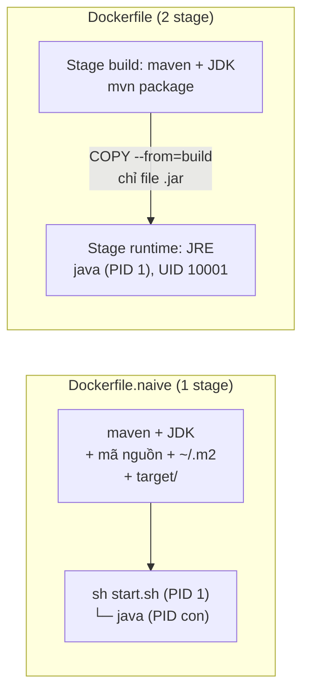

# Lab 6_2_1: Tối Ưu Image Java Bằng Multi-Stage Build

> **Topic**: [6_2 Container Image Engineering](../../README.md)
> **Trạng thái kiểm chứng**: Đã chạy thử trên Fedora 43, Podman 5.8.9 (15-11-2026). Số liệu kích thước và thời gian bên dưới lấy từ lần chạy đó; trên máy bạn có thể chênh lệch.

## 🎯 Objective
Bạn nhận được một `Dockerfile` **chạy được nhưng thiết kế kém** cho service Java `hello-svc`. Hãy đo các vấn đề của nó, rồi viết lại thành image:
- nhỏ hơn (không chứa Maven, JDK, mã nguồn, thư viện build),
- chạy bằng user không phải root,
- nhận `SIGTERM` và tắt gọn (graceful shutdown),
- build lại nhanh khi chỉ sửa code.

## ⏱️ Estimated Time & Cost
- **Thời gian**: 45–60 phút (lần build đầu tải khoảng 900 MB image nền và thư viện Maven).
- **Chi phí**: 0.

## 📋 Prerequisites
- Podman hoặc Docker, `curl`, `bc` (tùy chọn, để đo thời gian).
- Đọc trước [6_1 Container Fundamentals](<../../../6_1 Container Fundamentals/README.md>), phần 6_1_8 (PID 1 và tín hiệu).

## 🏗️ Architecture Diagram



## 📝 Step-by-Step Instructions

> Lệnh dùng `podman`; với Docker thay bằng `docker`. Chạy các lệnh từ thư mục của lab này.

### Bước 1: Chuẩn bị thư mục làm việc

```bash
bash setup/prepare-workdir.sh
cd work
cat Dockerfile.naive start.sh
```

### Bước 2: Build và đo image naive

```bash
podman build -f Dockerfile.naive -t hello-svc-lab:naive .
podman images | grep hello-svc-lab
podman history hello-svc-lab:naive --format '{{.Size}}\t{{.CreatedBy}}' | head -8

podman run -d --name t-naive -p 18083:8080 hello-svc-lab:naive
sleep 3
curl -s localhost:18083/
podman exec t-naive id
podman top t-naive pid args

time podman stop t-naive
podman inspect t-naive --format 'exit={{.State.ExitCode}}'
podman logs t-naive | tail -3
podman rm t-naive
```

Ghi lại: kích thước image, user, PID 1 là gì, `stop` mất bao lâu, exit code, dòng log cuối.

### Bước 3: Viết `Dockerfile` tối ưu

Tạo file `work/Dockerfile` (và `work/.dockerignore`) đạt các yêu cầu:

1. **Hai stage**: stage `build` dùng image Maven để chạy `mvn package`; stage cuối chỉ dùng **JRE** và chỉ copy file `.jar`.
2. **Tận dụng cache**: copy `pom.xml` và tải dependency **trước**, copy `src/` **sau**.
3. **Không chạy bằng root**: dùng UID dạng số (ví dụ `10001`).
4. **Exec form** cho `ENTRYPOINT` để `java` là PID 1; không dùng script bọc ngoài.
5. Nhận version qua `--build-arg APP_VERSION=...` và đặt vào biến môi trường `APP_VERSION`.
6. Cho JVM tự tính heap theo giới hạn container: `-XX:MaxRAMPercentage=75`.
7. `.dockerignore` loại `target/`, `.git/` và các file không cần trong build context.

### Bước 4: Build và so sánh

```bash
podman build --build-arg APP_VERSION=1.0.0 -t hello-svc-lab:optimized .
podman images | grep hello-svc-lab

podman run -d --name t-opt -p 18084:8080 hello-svc-lab:optimized
sleep 3
curl -s localhost:18084/
podman exec t-opt id
podman top t-opt pid args
time podman stop t-opt
podman inspect t-opt --format 'exit={{.State.ExitCode}}'
podman logs t-opt | tail -2
podman rm t-opt
```

### Bước 5: Đo hiệu quả cache

Sửa một dòng trong `src/main/java/dev/selflearn/hello/App.java` (ví dụ đổi chuỗi `"not found\n"`), rồi build lại cả hai image và so thời gian:

```bash
time podman build -q -f Dockerfile.naive -t hello-svc-lab:naive .
time podman build -q --build-arg APP_VERSION=1.0.1 -t hello-svc-lab:optimized .
```

### Câu hỏi cần trả lời
1. Ba nguyên nhân chính khiến image naive lớn là gì? Dùng `podman history` để chỉ ra.
2. Vì sao `podman stop t-naive` mất khoảng 10 giây và exit code là 137?
3. Vì sao image tối ưu dừng gần như ngay lập tức với exit code 143, và log có dòng `shutdown signal received`?
4. Ngoài cách bỏ script, còn cách nào sửa `start.sh` để `java` nhận được `SIGTERM`?
5. Ở Bước 5, vì sao image naive tải lại toàn bộ thư viện Maven khi chỉ sửa một dòng code?
6. Vì sao nên dùng UID dạng số thay vì tên user trong `USER`?
7. Trên Kubernetes, việc app không nhận `SIGTERM` gây hậu quả gì khi rolling update?

## 🧪 Acceptance Criteria & Automated Verification

```bash
bash scripts/verify.sh        # chạy từ thư mục lab (không phải work/)
```

```text
[PASS] Image hello-svc-lab:optimized exists
[PASS] Optimized image is smaller than the naive image (333 MB < 568 MB)
[PASS] Container runs as a non-root UID (10001)
[PASS] PID 1 is the java process
[PASS] HTTP 200 on /
[PASS] Graceful stop in under 5 seconds with shutdown log
```

## 🧹 Teardown

```bash
bash scripts/cleanup.sh
```

---

## ✅ Đáp Án

Đáp án Dockerfile: [solution/Dockerfile](./solution/Dockerfile) và [solution/.dockerignore](./solution/.dockerignore). Muốn dùng ngay: `cp solution/Dockerfile solution/.dockerignore work/`.

<details>
<summary>Kết quả mẫu</summary>

```text
localhost/hello-svc-lab:optimized 333 MB
localhost/hello-svc-lab:naive     568 MB

== naive: uid=0, PID 1 = /bin/sh /app/start.sh, java là PID 14
level=warning msg="StopSignal SIGTERM failed to stop container t-naive in 10 seconds, resorting to SIGKILL"
stop took 10.48 s, exit=137
(log cuối vẫn là "ready": app không biết mình bị dừng)

== optimized: uid=10001, PID 1 = java -jar /app/hello-svc.jar
stop took 0.26 s, exit=143
{"level":"INFO","msg":"shutdown signal received, stopping http server"}
{"level":"INFO","msg":"stopped"}

== Bước 5 (chỉ sửa 1 dòng code rồi build lại)
naive     46.10 s   (tải lại toàn bộ thư viện Maven)
optimized 23.56 s   (lớp pom.xml + dependency dùng cache; phần còn lại là compile, test
                     và plugin test mà dependency:go-offline chưa tải, xem câu 5)
```
</details>

<details>
<summary>1. Vì sao image naive lớn?</summary>

1. **Image nền là Maven + JDK** (khoảng 546 MB) thay vì chỉ JRE: compiler, Maven và công cụ build không cần lúc chạy.
2. **Lớp `RUN mvn -B package`** (~22 MB) chứa cả repository `~/.m2` với thư viện build/test và thư mục `target/` (class, báo cáo test).
3. **`COPY . .`** đưa mọi thứ trong build context vào image, kể cả file không cần (khi không có `.dockerignore`, `target/` hoặc `.git/` cũng bị copy).

Multi-stage giải quyết cả ba: stage cuối bắt đầu lại từ image JRE và chỉ nhận đúng file `.jar` qua `COPY --from=build`.
</details>

<details>
<summary>2. Vì sao stop mất 10 giây và exit 137?</summary>

PID 1 là `/bin/sh /app/start.sh`, còn `java` là process con. `podman stop` gửi `SIGTERM` tới **PID 1**. Shell không đăng ký handler cho `SIGTERM`, và kernel bỏ qua tín hiệu có hành vi mặc định đối với PID 1 của một PID namespace, nên shell không chết. Shell cũng không chuyển tiếp tín hiệu cho `java`. Hết thời gian chờ mặc định 10 giây, Podman gửi `SIGKILL` → mọi process bị kill, exit code `128 + 9 = 137`. App không có cơ hội đóng kết nối hay hoàn tất request đang xử lý.
</details>

<details>
<summary>3. Vì sao image tối ưu dừng ngay với exit 143?</summary>

`ENTRYPOINT ["java", "-jar", "/app/hello-svc.jar"]` (exec form) không qua shell, nên `java` là PID 1. JVM có đăng ký handler cho `SIGTERM`: nó chạy các shutdown hook (app dừng HTTP server và ghi log `stopped`), rồi thoát với mã `128 + 15 = 143`. Exit code 143 sau một lệnh stop là **bình thường**: nghĩa là app đã dừng theo yêu cầu.
</details>

<details>
<summary>4. Sửa <code>start.sh</code> thế nào nếu vẫn cần script?</summary>

Dùng `exec` để thay thế process shell bằng `java` (cùng PID):

```sh
#!/bin/sh
echo "starting hello-svc"
exec java -jar /app/hello-svc.jar
```

Cách khác: chạy kèm init nhỏ (`tini`, hoặc `podman run --init` / `docker run --init`) để init đó làm PID 1, chuyển tiếp tín hiệu và dọn zombie. Script bọc ngoài vẫn hữu ích khi cần chuẩn bị cấu hình trước lúc khởi động, miễn là dòng cuối dùng `exec`.
</details>

<details>
<summary>5. Vì sao image naive tải lại toàn bộ thư viện?</summary>

Cache của mỗi lệnh `COPY` phụ thuộc vào nội dung file được copy. `COPY . .` copy cả `src/`, nên sửa một dòng code làm lớp đó mất cache, kéo theo **mọi lớp phía sau** (kể cả `RUN mvn -B package`, nơi tải thư viện) phải chạy lại. Dockerfile tối ưu tách ra: `COPY pom.xml` → `RUN mvn dependency:go-offline` → `COPY src`. Khi chỉ sửa code, hai lớp đầu vẫn dùng cache. Lưu ý `dependency:go-offline` không tải hết mọi plugin mà Maven cần lúc test, nên bước `package` có thể vẫn tải thêm một ít. Đây là giới hạn đã biết của goal này.
</details>

<details>
<summary>6. Vì sao dùng UID dạng số?</summary>

- Không cần tạo user trong image (image JRE có thể không có sẵn `useradd`).
- Kubernetes `securityContext.runAsNonRoot: true` chỉ kiểm tra được khi image khai báo **UID dạng số**. Nếu `USER` là tên, kubelet không biết tên đó ứng với UID nào và sẽ từ chối chạy container.
- UID nằm ngoài dải user của máy chủ (ví dụ 10001) giảm rủi ro trùng quyền với user thật khi mount volume.
</details>

<details>
<summary>7. Hậu quả trên Kubernetes</summary>

Khi xóa Pod (rolling update, scale down, drain node), kubelet gửi `SIGTERM` rồi chờ `terminationGracePeriodSeconds` (mặc định 30 giây) trước khi gửi `SIGKILL`. Nếu app không nhận `SIGTERM`: mỗi Pod mất trọn 30 giây mới dừng (rollout chậm), request đang xử lý bị cắt ngang, kết nối tới Kafka/DB không được đóng gọn. Với hàng chục microservice và nhiều replica, pipeline deploy sẽ chậm rõ rệt và người dùng gặp lỗi lúc deploy.
</details>

---

## 📚 Official References
- [Docker - Multi-stage builds](https://docs.docker.com/build/building/multi-stage/) - `FROM ... AS`, `COPY --from`.
- [Dockerfile reference - ENTRYPOINT (shell form vs exec form)](https://docs.docker.com/reference/dockerfile/#entrypoint) - Vì sao exec form nhận tín hiệu.
- [Docker - Build cache](https://docs.docker.com/build/cache/) - Quy tắc vô hiệu hóa cache theo thứ tự lệnh.
- [Docker - .dockerignore](https://docs.docker.com/build/concepts/context/#dockerignore-files) - Loại file khỏi build context.
- [podman-build(1)](https://docs.podman.io/en/latest/markdown/podman-build.1.html) và [podman-stop(1)](https://docs.podman.io/en/latest/markdown/podman-stop.1.html) - Build và thời gian chờ khi stop.
- [Kubernetes - Pod termination](https://kubernetes.io/docs/concepts/workloads/pods/pod-lifecycle/#pod-termination) - `SIGTERM`, grace period, `SIGKILL`.
- [Kubernetes - Security context: runAsNonRoot](https://kubernetes.io/docs/tasks/configure-pod-container/security-context/) - Yêu cầu UID khi bật `runAsNonRoot`.
