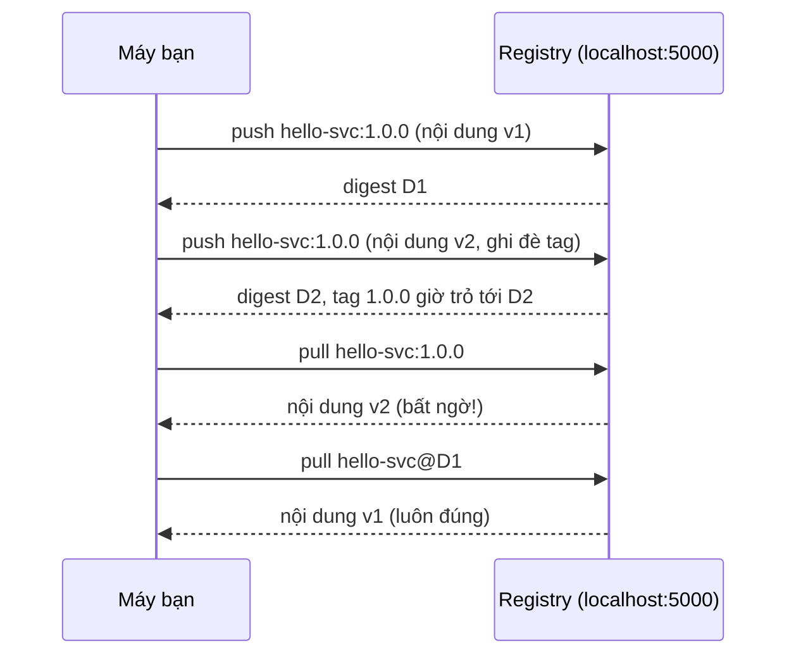

# Lab 6_2_2: Tag, Digest, Registry Cục Bộ và Bẫy Cache Của ARG

> **Topic**: [6_2 Container Image Engineering](../../README.md)
> **Trạng thái kiểm chứng**: Đã chạy thử trên Fedora 43, Podman 5.8.9, image `docker.io/library/registry:2` (15-11-2026). Digest trên máy bạn sẽ khác vì phụ thuộc nội dung image bạn build.

## 🎯 Objective
- Chạy một registry cục bộ và push/pull image qua API phân phối OCI.
- Tự tay chứng minh: **tag có thể bị ghi đè**, còn **digest không bao giờ đổi**. Vì vậy pipeline chuyên nghiệp deploy theo digest (hoặc ít nhất là tag bất biến).
- Phát hiện một bẫy cache thực tế: `ARG` chỉ dùng trong `ENV` có thể khiến image "version mới" thực chất vẫn là image cũ.

## ⏱️ Estimated Time & Cost
- **Thời gian**: 40 phút. **Chi phí**: 0.

## 📋 Prerequisites
- Podman hoặc Docker, `curl`, `jq`.
- Image `selflearn.invalid/hello-svc:1.0.0` và `2.0.0` từ [build-images.sh](../../../../shared/scripts/build-images.sh).
- Cổng `5000` trên máy còn trống.

## 🏗️ Architecture Diagram



## 📝 Step-by-Step Instructions

> Với **Docker**: bỏ `--tls-verify=false` (Docker mặc định cho phép registry `localhost` không TLS), bỏ `--digestfile` và lấy digest bằng `docker inspect --format '{{index .RepoDigests 0}}' <image>` sau khi push.

### Phần A: Tag và Digest

**Bước 1. Chạy registry.**

```bash
podman run -d --name lab-registry -p 5000:5000 docker.io/library/registry:2
curl -s localhost:5000/v2/_catalog
```

**Bước 2. Push bản 1.0.0 và ghi lại digest.**

```bash
podman tag selflearn.invalid/hello-svc:1.0.0 localhost:5000/hello-svc:1.0.0
podman push --tls-verify=false --digestfile d1.txt localhost:5000/hello-svc:1.0.0
D1=$(cat d1.txt); echo "$D1"
```

**Bước 3. Hỏi registry qua API.**

```bash
curl -s localhost:5000/v2/_catalog
curl -s localhost:5000/v2/hello-svc/tags/list
ACC='Accept: application/vnd.oci.image.manifest.v1+json, application/vnd.docker.distribution.manifest.v2+json'
curl -sI -H "$ACC" localhost:5000/v2/hello-svc/manifests/1.0.0 | grep -i -E 'docker-content-digest|content-type'
```

**Bước 4. Mô phỏng sự cố: ai đó push nhầm bản 2.0.0 vào tag 1.0.0.**

```bash
podman tag selflearn.invalid/hello-svc:2.0.0 localhost:5000/hello-svc:1.0.0
podman push --tls-verify=false localhost:5000/hello-svc:1.0.0
curl -sI -H "$ACC" localhost:5000/v2/hello-svc/manifests/1.0.0 | grep -i docker-content-digest

podman rmi localhost:5000/hello-svc:1.0.0
podman pull --tls-verify=false localhost:5000/hello-svc:1.0.0
podman run --rm --entrypoint cat localhost:5000/hello-svc:1.0.0 /app/VERSION

podman pull --tls-verify=false "localhost:5000/hello-svc@${D1}"
podman run --rm --entrypoint cat "localhost:5000/hello-svc@${D1}" /app/VERSION
```

**Bước 5. Khôi phục đúng trạng thái**: tag `1.0.0` trỏ lại bản 1.0.0, và push thêm tag `2.0.0`.

```bash
podman tag selflearn.invalid/hello-svc:1.0.0 localhost:5000/hello-svc:1.0.0
podman tag selflearn.invalid/hello-svc:2.0.0 localhost:5000/hello-svc:2.0.0
podman push --tls-verify=false localhost:5000/hello-svc:1.0.0
podman push --tls-verify=false localhost:5000/hello-svc:2.0.0
curl -s localhost:5000/v2/hello-svc/tags/list
```

**Bước 6. Thử push mà không có `--tls-verify=false`** và đọc thông báo lỗi.

```bash
podman push localhost:5000/hello-svc:1.0.0
```

### Phần B: Bẫy cache của `ARG`

**Bước 7.** Build [setup/Dockerfile.arg-env](./setup/Dockerfile.arg-env) hai lần với hai giá trị khác nhau rồi so image ID:

```bash
podman build -q -f setup/Dockerfile.arg-env --build-arg APP_VERSION=1 -t arg-env:1 .
podman build -q -f setup/Dockerfile.arg-env --build-arg APP_VERSION=2 -t arg-env:2 .
podman image inspect arg-env:1 arg-env:2 --format '{{.Id}}'
podman run --rm arg-env:2 printenv APP_VERSION
```

**Bước 8.** Sửa Dockerfile sao cho hai lần build cho ra hai image khác nhau và `APP_VERSION` đúng giá trị. Lưu thành `Dockerfile.arg-run`, build thành `arg-run:1` và `arg-run:2`.

### Câu hỏi cần trả lời
1. Ở Bước 4, vì sao `pull` theo tag `1.0.0` lại nhận về bản 2.0.0? Điều gì đã thay đổi trong registry?
2. Vì sao pull theo digest vẫn ra đúng bản 1.0.0, kể cả sau khi tag bị ghi đè?
3. Trong pipeline CI/CD nhiều cluster, bạn chống lại sự cố ở Bước 4 thế nào?
4. Bước 6 báo lỗi gì, vì sao? Docker xử lý `localhost` khác Podman ra sao?
5. Ở Bước 7 điều gì xảy ra? Hậu quả trong pipeline thật là gì?
6. Đáp án Bước 8 là gì và vì sao nó hiệu quả?

## 🧪 Acceptance Criteria & Automated Verification

```bash
bash scripts/verify.sh
```

```text
[PASS] Registry is reachable on localhost:5000
[PASS] Repository hello-svc has tags 1.0.0 and 2.0.0
[PASS] Tag 1.0.0 in the registry really contains version 1.0.0
[PASS] Tag 2.0.0 in the registry really contains version 2.0.0
[INFO] arg-env:1 and arg-env:2 have the same image ID (ARG used only in ENV kept the old cache)
[PASS] arg-run:1 and arg-run:2 are different images with the right APP_VERSION
```

Dòng `[INFO]` chỉ là quan sát: với Docker BuildKit kết quả có thể khác (xem đáp án câu 5).

## 🧹 Teardown

```bash
bash scripts/cleanup.sh       # xóa registry, image arg-*, image localhost:5000/*, file d1.txt
```

---

## ✅ Đáp Án

<details>
<summary>Kết quả mẫu</summary>

```text
# Bước 2-3
sha256:5b9b619fd4d43ef4f2abf64e4c40d2acddcc8bdeb0f49716b7e975adf8997234
{"repositories":["hello-svc"]}
{"name":"hello-svc","tags":["1.0.0"]}
Content-Type: application/vnd.oci.image.manifest.v1+json
Docker-Content-Digest: sha256:5b9b619fd4d43ef4f2abf64e4c40d2acddcc8bdeb0f49716b7e975adf8997234

# Bước 4
Docker-Content-Digest: sha256:0c2ca35e7534b4207ff20df74a1b10062ce5cd8ea2929f680174d2c3a3e77e5e
pull by tag 1.0.0 -> 2.0.0
pull by digest    -> 1.0.0

# Bước 6
Error: ... pinging container registry localhost:5000: Get "https://localhost:5000/v2/":
http: server gave HTTP response to HTTPS client

# Bước 7 (Podman 5.8.9)
arg-env:1 b530ba1e8e96...
arg-env:2 b530ba1e8e96...   <- cùng một image
printenv APP_VERSION -> 1   <- sai, mong đợi 2
```
</details>

<details>
<summary>1. Vì sao pull tag 1.0.0 lại ra bản 2.0.0?</summary>

Trong registry, tag chỉ là **một con trỏ tên → digest của manifest**. Push lần hai với cùng tên tag làm registry cập nhật con trỏ sang manifest mới (digest D2). Registry không cấm điều này (trừ khi bạn bật tính năng tag bất biến, ví dụ Harbor có "immutable tag rules"). Ai pull theo tag sau thời điểm đó sẽ nhận nội dung mới mà không có cảnh báo nào.
</details>

<details>
<summary>2. Vì sao digest luôn đúng?</summary>

Digest là hash SHA-256 của chính nội dung manifest, và manifest lại chứa digest của config và từng lớp. Nội dung khác thì hash khác, nên một digest chỉ có thể ứng với **đúng một** nội dung. Manifest cũ (D1) vẫn nằm trong registry (cho tới khi bị dọn bằng garbage collection), nên pull theo D1 vẫn ra bản 1.0.0. Đó là lý do digest được gọi là "content-addressable".
</details>

<details>
<summary>3. Chống sự cố này trong pipeline CI/CD thế nào?</summary>

- Tag bằng thứ **không lặp lại**: commit SHA hoặc version + build number; không deploy bằng `latest`.
- Pipeline chỉ build image **một lần**, lưu digest làm artifact, rồi các bước deploy dev/staging/prod dùng đúng digest đó (Helm: `image.tag` hoặc `image.digest`).
- Bật chính sách tag bất biến trên registry nếu có hỗ trợ; phân quyền push vào repository release.
- Có thể ký image và để cluster chỉ chấp nhận image đã ký (ở mức khái niệm).
</details>

<details>
<summary>4. Lỗi ở Bước 6</summary>

Podman mặc định yêu cầu HTTPS với mọi registry, kể cả `localhost`. Registry của lab chỉ nói HTTP, nên client nhận được phản hồi HTTP cho một yêu cầu HTTPS: `server gave HTTP response to HTTPS client`. Cách xử lý cho lab là `--tls-verify=false`, hoặc khai báo registry `insecure = true` trong `registries.conf`. Docker Engine thì mặc định coi `localhost` (dải `127.0.0.0/8`) là insecure registry nên không cần cờ. Môi trường thật luôn phải dùng TLS.
</details>

<details>
<summary>5. Chuyện gì xảy ra ở Bước 7?</summary>

Với Podman 5.8.9 (Buildah bên dưới), hai lần build cho ra **cùng một image ID**, và `APP_VERSION` của `arg-env:2` vẫn là `1`. Lớp `ENV APP_VERSION=${APP_VERSION}` được lấy từ cache dù giá trị build-arg đã đổi. Tài liệu Dockerfile của Docker mô tả rằng giá trị `ARG` thay đổi sẽ gây cache miss ở lần dùng đầu tiên, nên với Docker BuildKit kết quả có thể khác. Hãy tự chạy và so sánh nếu bạn dùng Docker.

Hậu quả trong pipeline thật: image được tag `2.0.0` nhưng bên trong báo version `1`. Dashboard, log và bước kiểm tra version sau deploy đều sai, gây hiểu lầm khi điều tra sự cố. Đây là loại lỗi rất khó nhận ra nếu không kiểm tra image ID/digest.
</details>

<details>
<summary>6. Đáp án Bước 8</summary>

[solution/Dockerfile.arg-run](./solution/Dockerfile.arg-run):

```dockerfile
FROM docker.io/library/eclipse-temurin:21-jre
ARG APP_VERSION=dev
RUN echo "${APP_VERSION}" > /VERSION
ENV APP_VERSION=${APP_VERSION}
```

Khi `ARG` được dùng trong một lệnh `RUN`, giá trị của nó trở thành một phần của khóa cache cho lệnh đó; giá trị đổi thì `RUN` chạy lại và mọi lớp sau (gồm `ENV`) cũng được tạo mới. Đặt `ARG` **càng cuối càng tốt** để việc đổi version chỉ build lại vài lớp cuối. [Dockerfile chuẩn của hello-svc](../../../../shared/hello-svc/Dockerfile) áp dụng đúng cách này.

```bash
podman build -q -f solution/Dockerfile.arg-run --build-arg APP_VERSION=1 -t arg-run:1 .
podman build -q -f solution/Dockerfile.arg-run --build-arg APP_VERSION=2 -t arg-run:2 .
podman run --rm arg-run:2 printenv APP_VERSION     # 2
```
</details>

---

## 📚 Official References
- [Distribution Registry - Deploying a registry server](https://distribution.github.io/distribution/about/deploying/) - Chạy image `registry`.
- [OCI Distribution Specification](https://github.com/opencontainers/distribution-spec/blob/main/spec.md) - Endpoint `/v2/<name>/tags/list`, `/v2/<name>/manifests/<reference>`, header `Docker-Content-Digest`.
- [podman-push(1)](https://docs.podman.io/en/latest/markdown/podman-push.1.html) - `--digestfile`, `--tls-verify`.
- [containers-registries.conf(5)](https://github.com/containers/image/blob/main/docs/containers-registries.conf.5.md) - Khai báo registry `insecure`.
- [Docker - Test an insecure registry](https://docs.docker.com/reference/cli/dockerd/#insecure-registries) - Cách Docker xử lý registry không TLS.
- [Dockerfile reference - ARG: Impact on build caching](https://docs.docker.com/reference/dockerfile/#impact-on-build-caching) - Mô tả của Docker về `ARG` và cache.
- [Kubernetes - Images: image names and digests](https://kubernetes.io/docs/concepts/containers/images/#image-names) - Dùng digest trong manifest.
