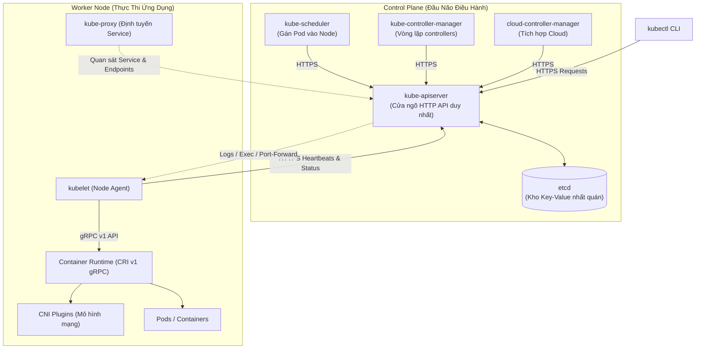
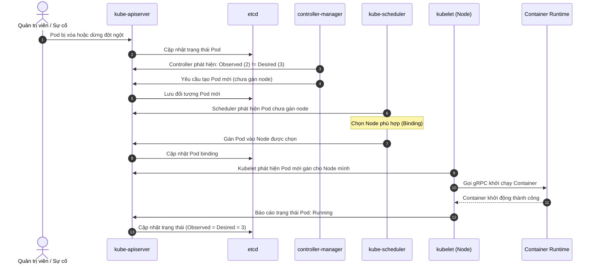

# 6_3_1 Kubernetes Cluster Architecture

> **Khóa học**: Cloud DevOps Basic — Containers & Kubernetes
> **Phân nhóm**: 6 Domain 6 - Containers and Kubernetes › 6_3 Kubernetes Architecture and Core Workloads
> **Chủ đề**: 6_3_1 Kubernetes Cluster Architecture
> **Phiên bản áp dụng**: Kubernetes 1.37
> **Trạng thái**: Định nghĩa (hoàn thiện lý thuyết & thực hành minh họa)
> **Phạm vi**: [Topic README](./README.md#6_3_1-kiến-trúc-cluster) · **Checkpoint**: [CHECKLIST](../../CHECKLIST.md#6_3-kubernetes-architecture-and-core-workloads)

---

## 1. Khái Niệm Cốt Lõi & Bản Chất Kỹ Thuật (Core Concepts & Technical Deep Dive)

Kubernetes là nền tảng điều phối container phân tán giúp tự động hóa triển khai, mở rộng và quản trị ứng dụng. Hệ thống phân chia thành hai tầng: **Control Plane** (bộ não điều hành) và **Worker Nodes** (các máy chủ thực thi). <!-- ev: R1.1 R1.9 -->

### 1.1 Kiến Trúc Hub-and-Spoke & Các Thành Phần Control Plane

Kubernetes áp dụng mô hình kiến trúc **hub-and-spoke**: mọi truy cập API từ các worker node hoặc Pods đều kết thúc tại `kube-apiserver`; không thành phần control plane nào khác mở dịch vụ ra bên ngoài cho client từ xa. <!-- ev: R1.6 -->

Các thành phần cốt lõi của Control Plane gồm:
- **`kube-apiserver`**: Là thành phần máy chủ cốt lõi phơi bày HTTP API của Kubernetes cho toàn cụm. Các thành phần control plane nội bộ khác cũng giao tiếp với API server qua cổng HTTPS bảo mật. <!-- ev: R1.1 R1.7 -->
- **`etcd`**: Là kho lưu trữ key-value phân tán, có tính nhất quán cao và sẵn sàng cao cho toàn bộ dữ liệu của API server. <!-- ev: R1.2 -->
- **`kube-scheduler`**: Quan sát các Pod mới tạo chưa được gán node và chọn lựa node phù hợp nhất để chạy Pod. <!-- ev: R1.3 -->
- **`kube-controller-manager`**: Thực thi các tiến trình controller nội bộ nhằm duy trì hành vi của Kubernetes API. <!-- ev: R1.4 -->
- **`cloud-controller-manager`**: Nhúng logic điều khiển đặc thù của nhà cung cấp điện toán đám mây vào cluster. <!-- ev: R1.5 -->

Kết nối theo chiều ngược lại từ `kube-apiserver` tới `kubelet` trên worker node được dùng cho việc lấy logs của Pod, attach/exec vào Pod đang chạy, và port-forward. <!-- ev: R1.8 -->

### 1.2 Kiến Trúc Worker Node, Chuẩn CRI & Mạng CNI

Mỗi worker node trong cụm Kubernetes gồm ba thành phần bắt buộc: `kubelet`, `container runtime`, và `kube-proxy`. <!-- ev: R1.9 -->

- **`kubelet`**: Là agent chạy trên từng node, đóng vai trò client kết nối tới container runtime cục bộ qua giao thức gRPC. Cờ `--container-runtime-endpoint` chỉ định endpoint socket gRPC của runtime cho kubelet. <!-- ev: R1.9 R1.11 R2.15 R2.16 -->
- **Container Runtime & Chuẩn CRI**: Container Runtime Interface (CRI) là giao diện plugin định nghĩa giao thức gRPC chính giữa kubelet và container runtime, giúp kubelet dùng đa dạng runtime mà không cần biên dịch lại Kubernetes. Từ Kubernetes v1.26 trở đi, kubelet bắt buộc runtime hỗ trợ chuẩn v1 CRI API; nếu không hỗ trợ v1 API, kubelet từ chối đăng ký node vào cluster. <!-- ev: R1.10 R2.13 R2.14 R2.17 R2.18 -->
- **`kube-proxy`**: Chạy trên từng node để phản ánh Service trong Kubernetes API và chuyển tiếp luồng TCP, UDP, SCTP tới Pod backend. <!-- ev: R1.12 -->
- **CNI Plugins**: Container runtime phải được cấu hình để nạp plugin CNI nhằm hiện thực hóa mô hình mạng phẳng của Kubernetes. <!-- ev: R1.13 -->

### 1.3 Mô Hình Khai Báo (Declarative) & Vòng Lặp Điều Hòa (Reconcile Loop)

Kubernetes vận hành theo mô hình khai báo: người dùng chỉ khai báo trạng thái mong muốn (desired state trong `spec`), còn controller là các vòng lặp điều khiển liên tục quan sát trạng thái thực tế (observed state) và đưa ra thay đổi để kéo trạng thái cluster về đúng mong muốn. <!-- ev: R1.14 -->

### 1.4 Quản Lý Hạ Tầng Control Plane: Managed K8s vs kubeadm vs kind

Trong khi Managed K8s (EKS, AKS, GKE) do nhà cung cấp đám mây quản lý control plane, thì `kubeadm` yêu cầu kỹ sư tự quản lý máy chủ control plane (chứa etcd và API server), còn `kind` chạy cluster cục bộ phục vụ kiểm thử bằng cách dùng Docker container làm node dựa trên `node-image`. <!-- ev: R1.15 R1.16 R2.8 R2.12 -->

---

## 2. Ví Dụ Đời Sống Thực Tế Dễ Hiểu (Intuitive Real-World Analogies)

Hãy liên tưởng cluster Kubernetes như **Hệ thống chính quyền đô thị và các nhà máy công nghiệp**:

### Tòa Thị Chính Đô Thị (Control Plane)
- **`kube-apiserver` — Quầy tiếp dân một cửa**: Cửa giao dịch duy nhất tiếp nhận hồ sơ từ kỹ sư (`kubectl`) và quản đốc xưởng (`kubelet`). Quầy kiểm tra thẩm quyền trước khi xử lý, không ai được tự ý vào kho dữ liệu.
- **`etcd` — Sổ cái địa chính đô thị**: Kho lưu giữ toàn bộ quy hoạch và tài sản đô thị với độ tin cậy tuyệt đối. Chỉ nhân viên quầy một cửa (`kube-apiserver`) có quyền ghi sổ cái.
- **`kube-scheduler` — Phòng phân công công việc**: Nhận đơn hàng dự án mới (Pod chưa gán node), khảo sát máy móc và tài nguyên các xưởng để quyết định phân bổ dự án về xưởng phù hợp.
- **`kube-controller-manager` — Ban thanh tra quy hoạch**: Cầm bản quy hoạch mong muốn đối chiếu liên tục với hiện trạng xưởng sản xuất; nếu thiếu hụt thì điều động mở thêm dây chuyền để đưa thực tế về đúng quy hoạch.
- **`cloud-controller-manager` — Ban đối ngoại ngoại vi**: Phụ trách làm việc với các đơn vị hạ tầng bên ngoài khi cần thuê thêm đường truyền hoặc kho bãi.

### Mạng Lưới Nhà Máy (Worker Nodes)
- **Worker Node — Phân xưởng sản xuất**: Mặt bằng máy móc thực tế trực tiếp sản xuất.
- **`kubelet` — Quản đốc phân xưởng**: Đại diện xưởng báo cáo định kỳ lên quầy một cửa và điều khiển máy móc qua bộ đàm tiêu chuẩn.
- **Container Runtime & Chuẩn CRI — Quy chuẩn giao tiếp máy móc**: Chuẩn giao thức gRPC giúp quản đốc điều hành máy móc từ bất kỳ nhà sản xuất nào.
- **`kube-proxy` — Phân luồng xe vận tải**: Điều phối các xe hàng đi đúng cổng xưởng phân phối theo địa chỉ quy định.

---

## 3. Kiến Trúc, Luồng Hoạt Động & Hình Ảnh Trực Quan (Architecture, Diagrams & Visual Media)

### 3.1 Sơ Đồ Kiến Trúc Hub-and-Spoke Trong Kubernetes

<!-- ev: R1.1 R1.2 R1.3 R1.4 R1.5 R1.6 R1.7 R1.9 R1.10 R1.11 R1.12 R1.13 -->
Sơ đồ dưới đây thể hiện luồng giao tiếp tập trung về API server theo mô hình Hub-and-Spoke:



### 3.2 Luồng Hoạt Động Của Vòng Lặp Điều Hòa Khi Pod Bị Xóa

<!-- ev: R1.1 R1.2 R1.3 R1.4 R1.11 R1.14 -->
Khi một Pod bị xóa hoặc gặp sự cố, vòng lặp điều hòa (Reconcile Loop) tự động phục hồi trạng thái theo trình tự:



---

## 4. Code Mẫu Trực Quan Hoặc Dòng Lệnh Thực Chiến (Runnable Sample Code / CLI)

> **Thông tin công cụ thực nghiệm**: `kind` v0.27+, `kubectl` v1.32+, Docker 27+ <!-- ev: R2.3 -->  
> ⚠️ Chưa chạy thử (not executed by the squad)  
> *Các câu lệnh dưới đây minh họa cú pháp cấu hình và thanh tra kiến trúc Kubernetes cluster.*

### 4.1 Khởi Tạo Cluster Cục Bộ Bằng `kind`

<!-- ev: R1.16 R2.8 R2.9 R2.10 R2.11 R2.12 -->
Sử dụng công cụ `kind` để khởi tạo cluster chạy bằng container Docker làm node:

```bash
# 1. Khởi tạo cụm với cờ đặt tên context tùy biến
kind create cluster --name lab-arch
#enabling experimental podman provider
#Creating cluster "lab-arch" ...
# ✓ Ensuring node image (kindest/node:v1.37.0) 🖼️ 
# ✓ Preparing nodes 📦  
# ✓ Writing configuration 📜 
# ✓ Starting control-plane 🕹️ 
# ✓ Installing CNI 🔌 
# ✓ Installing StorageClass 💾 
#Set kubectl context to "kind-lab-arch"
#You can now use your cluster with:
#kubectl cluster-info --context kind-lab-arch
#Not sure what to do next? 😅  Check out https://kind.sigs.k8s.io/docs/user/quick-start/


# 2. Kiểm tra danh sách worker node và thông tin phiên bản
kubectl get nodes -o wide

# 3. Nạp trước container image nội bộ vào các node mà không cần push lên registry
kind load docker-image my-custom-app:v1.0.0 --name lab-arch
```

### 4.2 Thanh Tra Thành Phần Control Plane & Điểm Cuối CRI

<!-- ev: R1.1 R1.2 R1.3 R1.4 R1.12 R2.15 R2.16 -->
Kiểm tra các Pod thành phần đầu não chạy trong namespace `kube-system` và tham số socket gRPC của kubelet:

```bash
# Liệt kê các Pod thành phần Control Plane và kube-proxy
kubectl get pods -n kube-system -o wide

# Kiểm tra cờ chỉ định socket gRPC của container runtime trong tiến trình kubelet
ps aux | grep kubelet | grep -- "--container-runtime-endpoint"
```

---

## 5. Cạm Bẫy Thực Tế & Thực Tiễn Sản Xuất (Production Gotchas & Best Practices)

Trong vận hành kiến trúc cụm Kubernetes, kỹ sư cần nắm vững các cạm bẫy quan trọng sau:

### 5.1 Cạm Bẫy 1: Quên Chu Kỳ Phát Hành & Rơi Vào Phiên Bản Hết Hạn Hỗ Trợ (End-of-Life)

<!-- ev: R1.17 R2.1 R2.2 R2.3 R2.4 R2.5 R2.6 R2.7 -->
- **Quy chuẩn phiên bản**: Kubernetes tuân theo chuẩn Semantic Versioning định dạng `x.y.z`. <!-- ev: R2.3 -->
- **Chu kỳ phát hành**: Dự án Kubernetes tuân thủ chu kỳ phát hành gồm 3 phiên bản mỗi năm dương lịch, mỗi chu kỳ kéo dài xấp xỉ 15 tuần. <!-- ev: R2.5 R2.6 R2.7 -->
- **Thời hạn hỗ trợ**: Kể từ bản 1.19 trở đi, mỗi bản minor nhận được khoảng 1 năm hỗ trợ bản vá. Dự án Kubernetes duy trì các nhánh phát hành và hỗ trợ bản vá cho 3 phiên bản minor gần nhất. <!-- ev: R1.17 R2.1 R2.2 -->
- **Hậu quả**: Các phiên bản đã chạm mốc End-of-Life (EOL) sẽ không còn nhận được các bản sửa lỗi hay bản vá bảo mật nào. <!-- ev: R2.4 -->
- **Khuyến nghị**: Lên lịch nâng cấp cluster định kỳ mỗi 3 đến 4 tháng để luôn nằm trong vùng hỗ trợ của 3 minor version mới nhất.

### 5.2 Cạm Bẫy 2: Vi Phạm Mô Hình Hub-and-Spoke Hoặc Can Thiệp Trực Tiếp Vào `etcd`

<!-- ev: R1.2 R1.6 -->
- Mọi tương tác trong cluster bắt buộc phải kết thúc tại `kube-apiserver`. Không thành phần nào khác được phép đọc ghi trực tiếp vào `etcd`. <!-- ev: R1.2 R1.6 -->
- Việc cố tình can thiệp trực tiếp vào `etcd` bằng công cụ ngoài sẽ bỏ qua khâu xác thực, phân quyền và admission webhook của `kube-apiserver`, gây nguy cơ sai lệch trạng thái dữ liệu trên toàn cụm. <!-- ev: R1.2 R1.6 -->

### 5.3 Cạm Bẫy 3: Bất Tương Thích Chuẩn CRI v1 API Giữa Kubelet & Runtime

<!-- ev: R2.17 R2.18 -->
- Kể từ Kubernetes v1.26 trở đi, `kubelet` bắt buộc container runtime cục bộ phải hỗ trợ chuẩn v1 CRI API. <!-- ev: R2.17 -->
- Nếu container runtime trên worker node không hỗ trợ v1 API, `kubelet` sẽ từ chối đăng ký node vào cluster, khiến node không thể hoạt động. <!-- ev: R2.18 -->

---

## 6. Câu Hỏi Củng Cố Kiến Thức (Active Recall Quiz)

### Câu Hỏi 1: Vì Sao Kubernetes Bắt Buộc Mọi Giao Tiếp Phải Đi Qua `kube-apiserver` (Hub-and-Spoke)?

Tại sao các controller nội bộ và worker node không đọc ghi trực tiếp vào `etcd` để giảm độ trễ mà phải gửi qua `kube-apiserver`?

<details>
<summary>Đáp án</summary>

Mô hình **hub-and-spoke** bảo đảm `kube-apiserver` là trạm kiểm soát trung tâm duy nhất:
1. Thực thi tập trung xác thực (Authentication), phân quyền (Authorization) và kiểm tra schema hợp lệ (Validation/Mutation). Ghi trực tiếp vào `etcd` sẽ bỏ qua các chốt chặn này gây hỏng dữ liệu cụm.
2. Trừu tượng hóa cấu trúc dữ liệu lưu trữ bên dưới, giúp các thành phần không bị phụ thuộc vào cài đặt của `etcd`.
3. Cung cấp cơ chế stream Watch tối ưu giúp các controller theo dõi thay đổi trạng thái theo thời gian thực mà không gây quá tải cho kho dữ liệu.
</details>

### Câu Hỏi 2: Quá Trình Điều Hòa (Reconcile Loop) Diễn Ra Như Thế Nào Khi Một Pod Đang Chạy Bị Xóa Đột Ngột?

Khi một Pod thuộc Deployment bị xóa, sự phối hợp giữa các thành phần kiến trúc diễn ra theo các bước nào để đưa hệ thống về Desired State?

<details>
<summary>Đáp án</summary>

Quá trình điều hòa diễn ra qua các bước:
1. `kube-apiserver` ghi nhận Pod bị xóa và cập nhật trạng thái vào `etcd`.
2. `kube-controller-manager` nhận thấy Observed State (2 Pods) ít hơn Desired State (3 Pods).
3. Controller gửi yêu cầu lên API server để tạo Pod mới ở trạng thái chưa gán node.
4. `kube-scheduler` phát hiện Pod chưa gán node, tính toán tài nguyên và gán Pod vào node thích hợp.
5. `kubelet` trên worker node nhận lệnh, gọi container runtime qua gRPC (CRI) khởi chạy container và báo cáo trạng thái `Running` về `kube-apiserver`.
</details>

### Câu Hỏi 3: Một Cụm Kubernetes Đã Chạy 14 Tháng Không Được Nâng Cấp Thì Đang Đối Mặt Với Nguy Cơ Gì?

Dựa theo chu kỳ phát hành (release cadence) và thời hạn hỗ trợ (support window), cụm này đang ở trạng thái nào và cần hành động gì?

<details>
<summary>Đáp án</summary>

Dựa trên chính sách của Kubernetes:
1. **Trạng thái EOL**: Mỗi bản minor chỉ được hỗ trợ vá lỗi trong khoảng 1 năm (12 tháng), và dự án chỉ duy trì hỗ trợ cho 3 bản minor gần nhất. Sau 14 tháng, cụm đã trễ 3-4 bản minor và chính thức rơi vào trạng thái **End-of-Life (EOL)**.
2. **Rủi ro**: Không còn nhận được các bản vá bảo mật (CVE) hay bản vá lỗi từ cộng đồng Kubernetes.
3. **Khắc phục**: Lập kế hoạch nâng cấp tuần tự từng minor version, kiểm tra container runtime hỗ trợ v1 CRI API, nhằm đưa cluster trở lại nhóm 3 phiên bản minor mới nhất đang được hỗ trợ.
</details>

---

## 7. 📚 Nguồn Tài Liệu Chính Thống (Tier-1 Official References)

- [Kubernetes Documentation — Cluster Architecture: Overview of Cloud Native Components](https://kubernetes.io/docs/concepts/overview/components/) — Tổng quan kiến trúc chính thức về các thành phần cốt lõi của Control Plane và Worker Nodes.
- [Kubernetes Documentation — Control Plane to Node Communication](https://kubernetes.io/docs/concepts/architecture/control-plane-node-communication/) — Đặc tả chuẩn luồng giao tiếp mạng Hub-and-Spoke giữa API Server và các node.
- [Kubernetes Documentation — Container Runtime Interface (CRI)](https://kubernetes.io/docs/concepts/architecture/cri/) — Đặc tả chuẩn plugin gRPC và yêu cầu v1 CRI API cho container runtime.
- [Kubernetes Documentation — Kubernetes Controllers](https://kubernetes.io/docs/concepts/architecture/controller/) — Hướng dẫn kiến trúc về mô hình khai báo và vòng lặp điều hòa (Reconcile Loop).
- [Kubernetes Releases — Kubernetes Release History & Supported Versions](https://kubernetes.io/releases/) — Chính sách chính thức về vòng đời hỗ trợ phiên bản minor và quy chuẩn Semantic Versioning của Kubernetes.
- [Kubernetes Blog — New Kubernetes Release Cadence](https://kubernetes.io/blog/2021/07/20/new-kubernetes-release-cadence/) — Thông báo chính thức về chu kỳ phát hành 3 phiên bản mỗi năm dương lịch.
- [kind Documentation — Quick Start Guide](https://kind.sigs.k8s.io/docs/user/quick-start/) — Hướng dẫn thực hành khởi tạo cluster Kubernetes cục bộ sử dụng Docker container làm node.
