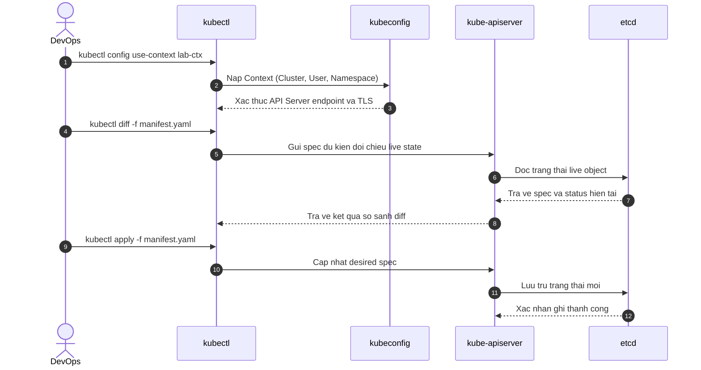
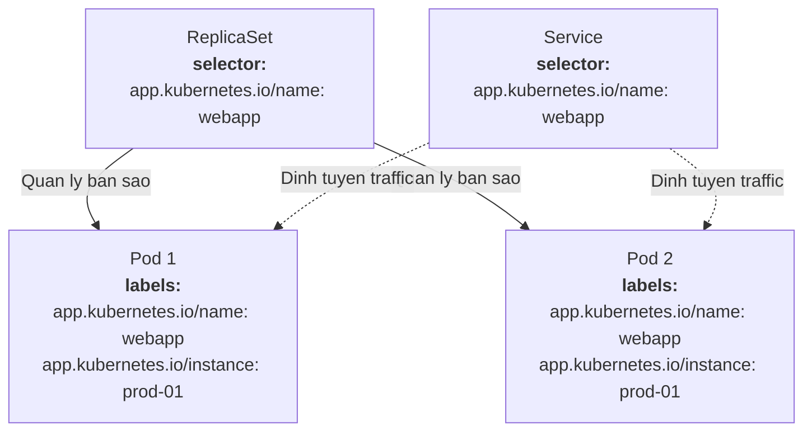

# 6_3_2 kubectl and API Objects

> **Khóa học**: Cloud DevOps Basic — Containers and Kubernetes  
> **Phân nhóm**: 6 Domain 6 - Containers and Kubernetes › 6_3 Kubernetes Architecture and Core Workloads  
> **Chủ đề**: kubectl và Đối Tượng API (Object Structure, Kubeconfig, Declarative vs Imperative, Labels & Namespaces)  
> **Phiên bản áp dụng**: Kubernetes 1.37  
> **Trạng thái**: Draft (WRITE-CTR-6_3_2, 16-11-2026)  
> **Phạm vi**: [Topic README](./README.md#6_3_2-kubectl-và-đối-tượng-api)  
> **Checkpoint**: [CHECKLIST](../../CHECKLIST.md#6_3-kubernetes-architecture-and-core-workloads)  
> **Bài lab thực hành liên quan**: lab-6_3_1-kind-cluster-and-first-deployment trong topic README  

---

## 1. Khái Niệm Cốt Lõi & Bản Chất Kỹ Thuật (Core Concepts & Technical Deep Dive)

Trong hệ sinh thái Kubernetes, mọi thực thể như Pod hay Service đều là đối tượng API do kube-apiserver quản lý và tương tác qua công cụ dòng lệnh kubectl. <!-- ev: R2.19 -->

### 1.1 Cấu Trúc Biểu Mẫu Chuẩn Của Đối Tượng Kubernetes (Object Spec & Status)

Mỗi tài nguyên khai báo với Kubernetes API đều chứa các trường cấp cao chuẩn hóa: <!-- ev: R1.18 R1.19 R1.20 R1.21 R1.22 -->

<!-- ev: R1.18 R1.19 R1.20 R1.21 R1.22 -->
| Trường Cấu Trúc | Kiểu Dữ Liệu | Bản Chất Kỹ Thuật & Vai Trò Trong Hệ Thống |
| :--- | :--- | :--- |
| `apiVersion` | String | Xác định phiên bản của Kubernetes API được sử dụng để tạo đối tượng này. <!-- ev: R1.18 --> |
| `kind` | String | Xác định kiểu đối tượng cụ thể cần tạo trong hệ thống. <!-- ev: R1.19 --> |
| `metadata` | Object | Chứa dữ liệu định danh duy nhất đối tượng gồm tên (`name`), mã `UID`, và `namespace` tùy chọn. <!-- ev: R1.20 --> |
| `spec` | Object | Mô tả các đặc tính cấu hình mong muốn (desired state) do người dùng thiết lập khi tạo đối tượng. <!-- ev: R1.21 --> |
| `status` | Object | Mô tả trạng thái thực tế hiện thời của đối tượng, được cung cấp và cập nhật bởi hệ thống Kubernetes. <!-- ev: R1.22 --> |

### 1.2 Tổ Chức Truy Cập Cụm Qua Kubeconfig (Clusters, Users, Contexts)

Công cụ kubectl sử dụng tệp kubeconfig để điều hướng và xác thực truy cập cụm: <!-- ev: R2.31 -->

- Tệp kubeconfig tổ chức thông tin kết nối gồm các cluster, user, context và namespace. <!-- ev: R2.31 -->
- Context trong kubeconfig định nghĩa kết hợp để chuyển đổi nhanh chóng giữa các cluster và namespace. <!-- ev: R2.32 -->
- Lệnh `kubectl config get-contexts` hiển thị danh sách tất cả các context đã cấu hình từ các tệp kubeconfig. <!-- ev: R2.23 -->
- Lệnh `kubectl config use-context` thực hiện chuyển đổi context hoạt động hiện thời. <!-- ev: R2.33 -->
- Tiện ích `kubectl config view` hỗ trợ lọc các trường có cấu trúc thông qua cú pháp jsonpath templates. <!-- ev: R2.22 -->

### 1.3 Triết Lý Quản Lý Tài Nguyên: Khai Báo (`apply`) vs. Mệnh Lệnh (`create` / `run`)

Kubernetes phân biệt rõ hai cơ chế quản lý vòng đời tài nguyên: <!-- ev: R2.19 R2.29 -->

- Lệnh `kubectl apply` tạo và cập nhật tài nguyên qua tệp khai báo, là phương thức khuyến nghị cho production. <!-- ev: R2.19 -->
- Cú pháp `kubectl apply -f` áp dụng manifest từ đường dẫn tệp cục bộ hoặc URL. <!-- ev: R2.20 -->
- Lệnh `kubectl diff` so sánh trạng thái đang hoạt động (live state) của cluster với manifest. <!-- ev: R2.21 -->
- Lệnh `kubectl run` khởi chạy trực tiếp một Pod từ container image được chỉ định. <!-- ev: R2.29 -->
- Lệnh `kubectl run` cho phép thiết lập chính sách khởi động lại của container với giá trị hợp lệ gồm `Always`, `OnFailure`, và `Never`. <!-- ev: R2.30 -->

### 1.4 Cơ Chế Ghép Lỏng (Loosely Coupled): Labels và Label Selectors

Labels và Selectors tạo nên cơ chế liên kết linh hoạt giữa các đối tượng: <!-- ev: R1.26 R1.28 -->

- Label là các cặp key/value được gắn vào các đối tượng Kubernetes như Pods để tổ chức và truy vấn. <!-- ev: R1.26 -->
- Label cho phép người dùng ánh xạ cấu trúc tổ chức lên các đối tượng hệ thống theo cơ chế ghép lỏng (loosely coupled) mà không yêu cầu client lưu trữ các ánh xạ này. <!-- ev: R1.27 -->
- Label selector là cơ chế gom nhóm cốt lõi trong Kubernetes giúp định danh một tập hợp các đối tượng. <!-- ev: R1.28 -->
- Đối với ReplicaSet, selector của hai instance không được trùng lặp trong cùng một namespace để tránh xung đột controller. <!-- ev: R1.29 -->
- Nhãn khuyến nghị chuẩn hóa mô tả ứng dụng giúp các công cụ và con người truy vấn đồng nhất: <!-- ev: R1.30 -->
  - `app.kubernetes.io/name`: Ghi nhận tên của ứng dụng. <!-- ev: R2.34 -->
  - `app.kubernetes.io/instance`: Định danh bản thể cụ thể của ứng dụng. <!-- ev: R2.35 -->
  - `app.kubernetes.io/version`: Xác định phiên bản ngữ nghĩa hoặc release hash của ứng dụng. <!-- ev: R2.36 -->

### 1.5 Phân Vùng Tài Nguyên: Không Gian Tên (Namespaces)

Phân chia tài nguyên trong cụm được tổ chức qua cơ chế namespace: <!-- ev: R1.23 -->

- Namespace cung cấp cơ chế phân vùng cô lập nhóm tài nguyên bên trong một cluster Kubernetes duy nhất. <!-- ev: R1.23 -->
- Tên tài nguyên bắt buộc phải duy nhất trong phạm vi cùng namespace, nhưng có thể trùng nhau giữa các namespace khác nhau. <!-- ev: R1.24 -->
- Phạm vi namespace chỉ áp dụng nghiêm ngặt cho đối tượng namespaced, không áp dụng cho tài nguyên cấp cụm (cluster-wide). <!-- ev: R2.37 -->
- Tài nguyên tầng thấp như Node và PersistentVolume là phạm vi toàn cluster, không nằm trong namespace nào. <!-- ev: R1.25 -->
- Lệnh `kubectl api-resources --namespaced=true` liệt kê danh sách toàn bộ tài nguyên nằm bên trong namespace. <!-- ev: R2.38 -->

---

## 2. Ví Dụ Đời Sống Thực Tế Dễ Hiểu (Intuitive Real-World Analogies)

### Biểu Mẫu Hồ Sơ Công Quyền (API Objects)
Đối tượng Kubernetes tương tự bộ hồ sơ hành chính một cửa:
- **`apiVersion`**: Số hiệu quy chuẩn văn bản pháp lý quy định mẫu đơn hợp lệ.
- **`kind`**: Tên loại đơn (Giấy phép kinh doanh, Hộ tịch).
- **`metadata`**: Tem định danh gồm tên (`name`), mã số (`UID`), và phân khu (`namespace`). Hai hồ sơ trùng tên ở hai phường khác nhau không bị nhầm.
- **`spec`**: Kê khai cam kết của công dân (*Desired State*, ví dụ: xin thuê 3 quầy hàng).
- **`status`**: Kết quả cán bộ ghi nhận (*Current State*, ví dụ: đã bàn giao 3 quầy).

### Hộ Chiếu và Thị Thực Visa (Kubeconfig & Contexts)
Tệp `kubeconfig` giống cuốn hộ chiếu công vụ:
- **`clusters`**: Danh sách quốc gia đến (Cụm Staging, Cụm Production).
- **`users`**: Danh tính và chứng thư số cán bộ.
- **`contexts`**: Từng trang visa kết hợp cán bộ, quốc gia và đơn vị tiếp nhận. Lệnh `kubectl config use-context` tương đương lật mở đúng trang visa trước khi qua cửa khẩu API Server.

### Mã Vạch Phân Loại Bưu Kiện (Labels & Selectors)
Tại kho phân loại bưu chính:
- Mỗi kiện hàng (Pod) được dán các nhãn (`Labels`): `app.kubernetes.io/name=payment`, `version=1.0`.
- Xe chở hàng (Service / ReplicaSet) dùng máy quét (`Selector`) gom kiện hàng có nhãn quy định. Kiện hàng cũ thay bằng kiện mới mang cùng nhãn thì xe tự tiếp nhận mà không cần đổi cấu hình.

---

## 3. Kiến Trúc, Luồng Hoạt Động & Hình Ảnh Trực Quan (Architecture, Diagrams & Visual Media)

### 3.1 Luồng Tương Tác Giữa kubectl, Kubeconfig và kube-apiserver

Sơ đồ trình tự thể hiện luồng điều hướng ngữ cảnh và kiểm tra trạng thái: <!-- ev: R2.21 R2.31 R2.33 -->



### 3.2 Cơ Chế Ghép Lỏng: Deployment → ReplicaSet → Pods → Service

Sơ đồ liên kết ghép lỏng thông qua nhãn và selector giữa các tầng tài nguyên: <!-- ev: R1.26 R1.27 R1.28 R2.34 R2.35 -->



---

## 4. Code Mẫu Trực Quan Hoặc Dòng Lệnh Thực Chiến (Runnable Sample Code / CLI)

> **Môi trường thực thi**: `kubectl client v1.37.x`, `kind v0.27.0+`  
> ⚠️ Chưa chạy thử (not executed by the squad)  

### 4.1 Khám Phá Schema Tài Nguyên Với `kubectl explain`

Lệnh `kubectl explain` hỗ trợ cờ `-R` hoặc `--recursive` in toàn bộ cây trường con phân cấp của schema tài nguyên API và cờ `--max-depth` để giới hạn độ sâu đệ quy: <!-- ev: R2.24 R2.25 -->

```bash
# In toan bo cau truc cay truong de quy cua Pod
kubectl explain pods --recursive

# Gioi han do sau phan cap cua truong spec o muc 2
kubectl explain pods.spec --recursive --max-depth=2
```

### 4.2 Quản Lý Ngữ Cảnh Kubeconfig

Điều hướng giữa các cụm và lọc dữ liệu cấu hình: <!-- ev: R2.22 R2.23 R2.33 -->

```bash
# Danh sach context da cau hinh
kubectl config get-contexts

# Chuyen doi context hoat dong
kubectl config use-context kind-k8s-lab

# Loc danh sach user bang jsonpath
kubectl config view -o jsonpath='{.users[*].name}'
```

### 4.3 Khai Báo Manifest Với Bộ Nhãn Khuyến Nghị Chuẩn

Tệp manifest định nghĩa một Pod với đầy đủ các trường cấp cao chuẩn hóa: <!-- ev: R1.18 R1.19 R1.20 R1.21 R1.26 R1.30 R2.34 R2.35 R2.36 -->

```yaml
apiVersion: v1
kind: Pod
metadata:
  name: payment-app
  namespace: default
  labels:
    app.kubernetes.io/name: payment-app
    app.kubernetes.io/instance: payment-app-01
    app.kubernetes.io/version: "1.37.0"
spec:
  containers:
    - name: app
      image: nginx:1.27
```

### 4.4 Quy Trình Đối Chiếu `diff` và Áp Dụng `apply`

Quy trình chuẩn hóa trong môi trường sản xuất kiểm tra và áp dụng manifest: <!-- ev: R2.19 R2.20 R2.21 -->

```bash
# So sanh live cluster state va manifest
kubectl diff -f ./pod-standard.yaml

# Ap dung khai bao tai nguyen tu manifest
kubectl apply -f ./pod-standard.yaml
```

### 4.5 Khởi Chạy Pod Mệnh Lệnh Với `kubectl run`

Khởi tạo nhanh container với tùy chọn chính sách khởi động lại: <!-- ev: R2.29 R2.30 -->

```bash
# Khoi chay Pod voi restartPolicy Never
kubectl run worker --image=busybox:1.36 --restart=Never

# Khoi chay Pod voi restartPolicy Always mac dinh
kubectl run web --image=nginx:1.27 --restart=Always
```

### 4.6 Truy Vấn, Lọc Nhãn và Kiểm Tra Namespace

Các câu lệnh truy vấn và lọc đối tượng: <!-- ev: R2.26 R2.27 R2.28 R2.38 -->

```bash
# Hien thi cot IP va Node
kubectl get pods -o wide

# Truy van tren tat ca namespace
kubectl get pods -A

# Loc Pod theo nhan
kubectl get pods -l 'app.kubernetes.io/name=payment-app'
kubectl get pods -l 'app.kubernetes.io/name in (payment-app, webapp)'

# Liet ke tai nguyen namespaced
kubectl api-resources --namespaced=true
```

---

## 5. Cạm Bẫy Thực Tế & Thực Tiễn Sản Xuất (Production Gotchas & Best Practices)

<!-- ev: R1.29 -->
### 5.1 Xung Đột Selector Giữa Các Instance ReplicaSet
- Bản chất: Trùng lặp `spec.selector` giữa hai ReplicaSet trong cùng namespace. <!-- ev: R1.29 -->
- Hậu quả: Hai controller liên tục tranh chấp quyền quản lý Pod, gây hiện tượng xóa và tạo lại Pod liên tục không ổn định. <!-- ev: R1.29 -->
- Phòng ngừa: Luôn kết hợp nhãn phân biệt `app.kubernetes.io/instance` và `app.kubernetes.io/name` để đảm bảo selector là duy nhất. <!-- ev: R1.29 R2.34 R2.35 -->

<!-- ev: R1.25 R2.37 R2.38 -->
### 5.2 Nhầm Lẫn Phạm Vi Tài Nguyên Namespaced và Cluster-Scoped
- Bản chất: Cố gắng đặt namespace cho các tài nguyên cấp cụm như `Node` hay `PersistentVolume`. <!-- ev: R1.25 R2.37 -->
- Hậu quả: Kube-apiserver từ chối hoặc bỏ qua trường namespace đối với các tài nguyên cluster-wide. <!-- ev: R2.37 -->
- Phòng ngừa: Dùng lệnh `kubectl api-resources --namespaced=true` để kiểm tra phân định phạm vi trước khi phân quyền. <!-- ev: R2.38 -->

<!-- ev: R2.19 R2.20 R2.21 R2.29 -->
### 5.3 Lệch Cấu Hình Do Pha Trộn Lệnh Mệnh Lệnh Với Quy Trình Khai Báo
- Bản chất: Sửa nóng cluster bằng các lệnh mệnh lệnh thay vì cập nhật manifest qua Git. <!-- ev: R2.19 R2.29 -->
- Hậu quả: Khi chạy lại `kubectl apply -f`, cấu hình sửa nóng bị ghi đè gây mất ổn định ngoài dự kiến. <!-- ev: R2.19 R2.20 -->
- Phòng ngừa: Luôn quản lý tài nguyên bằng `kubectl apply -f` và đối chiếu trước với `kubectl diff -f`. <!-- ev: R2.19 R2.21 -->

---

## 6. Câu Hỏi Củng Cố Kiến Thức (Active Recall Quiz)

### Câu 1: Chuyển đổi an toàn giữa các cụm Kubernetes qua Kubeconfig
Khi cần chuyển đổi ngữ cảnh làm việc của `kubectl` sang cụm Staging và hiển thị danh sách các context hiện có, kỹ sư cần thực hiện những câu lệnh nào?

<details>
<summary>Đáp án</summary>

- Dùng `kubectl config get-contexts` để liệt kê danh sách toàn bộ các context trong kubeconfig.
- Dùng `kubectl config use-context <context-name>` để chuyển đổi context hoạt động sang cụm mong muốn.
</details>

---

### Câu 2: Quy tắc đặt tên tài nguyên trong Namespace và Cluster-Scoped Objects
Hai nhóm phát triển có thể tạo hai Pod mang cùng tên `app-backend` trong cùng một cluster được không, và quy tắc đặt tên được áp dụng như thế nào?

<details>
<summary>Đáp án</summary>

- Được phép nếu hai Pod nằm trong hai namespace khác nhau, vì tên tài nguyên duy nhất trong cùng namespace nhưng có thể trùng nhau giữa các namespace.
- Các tài nguyên cấp cụm (Node, PersistentVolume) không thuộc namespace nào và tên phải duy nhất trên toàn cụm.
</details>

---

### Câu 3: Hiện tượng gì xảy ra khi hai ReplicaSet có cùng Selector trong một Namespace?
Nếu hai ReplicaSet khác nhau trong cùng một namespace được cấu hình selector trùng khớp nhau, controller sẽ xử lý như thế nào?

<details>
<summary>Đáp án</summary>

- Xảy ra xung đột quyền kiểm soát đối với các Pod con thỏa mãn nhãn selector.
- Hai controller sẽ tranh chấp: một bên xóa bớt Pod khi thấy dư, bên kia tạo mới khi thấy thiếu, khiến Pod bị xóa và tạo lại liên tục.
</details>

---

## 7. 📚 Nguồn Tài Liệu Chính Thống (Tier-1 Official References)

- [Kubernetes Objects Overview](https://kubernetes.io/docs/concepts/overview/working-with-objects/kubernetes-objects/) - Cấu trúc đối tượng `apiVersion`, `kind`, `metadata`, `spec`, `status`.
- [Namespaces in Kubernetes](https://kubernetes.io/docs/concepts/overview/working-with-objects/namespaces/) - Phân vùng cô lập tài nguyên namespaced vs cluster-scoped.
- [Labels and Selectors](https://kubernetes.io/docs/concepts/overview/working-with-objects/labels/) - Gom nhóm cốt lõi và ghép lỏng tài nguyên.
- [Standard Recommended Labels](https://kubernetes.io/docs/concepts/overview/working-with-objects/common-labels/) - Bộ nhãn chuẩn hóa khuyến nghị `app.kubernetes.io/*`.
- [Organizing Cluster Access Using kubeconfig Files](https://kubernetes.io/docs/concepts/configuration/organize-cluster-access-kubeconfig/) - Quản lý truy cập cụm qua kubeconfig.
- [Configure Access to Multiple Clusters](https://kubernetes.io/docs/tasks/access-application-cluster/configure-access-multiple-clusters/) - Điều hướng context với `kubectl config use-context`.
- [kubectl Cheatsheet](https://kubernetes.io/docs/reference/kubectl/cheatsheet/) - Tra cứu `kubectl apply`, `kubectl diff`, jsonpath.
- [kubectl explain Reference](https://kubernetes.io/docs/reference/kubectl/generated/kubectl_explain/) - Tham số `kubectl explain` và cờ `--recursive`.
- [kubectl get Reference](https://kubernetes.io/docs/reference/kubectl/generated/kubectl_get/) - Tham số `kubectl get` (`-o wide`, `-A`, `-l`).
- [kubectl run Reference](https://kubernetes.io/docs/reference/kubectl/generated/kubectl_run/) - Cú pháp `kubectl run` và `--restart`.
