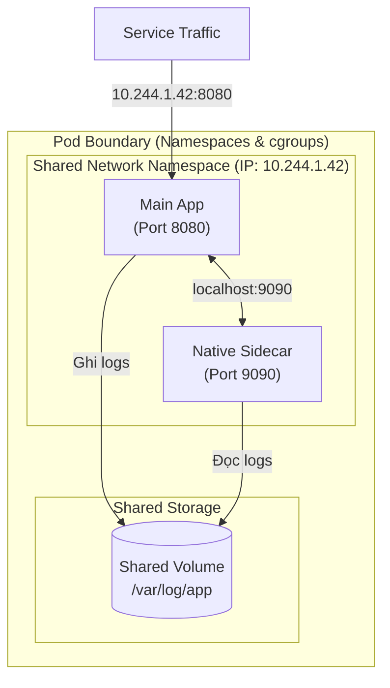
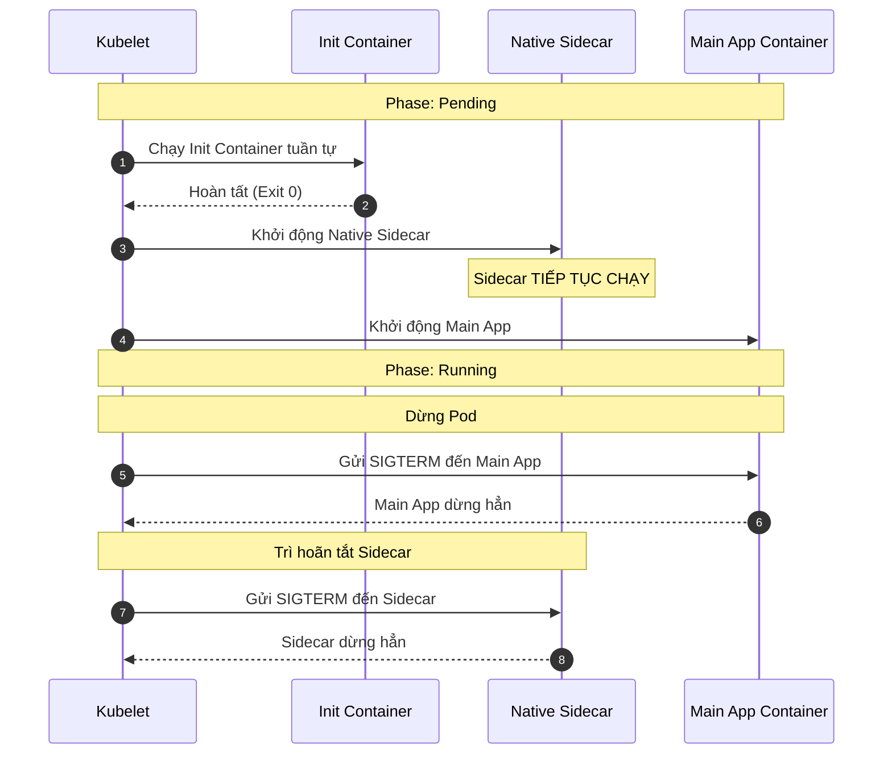
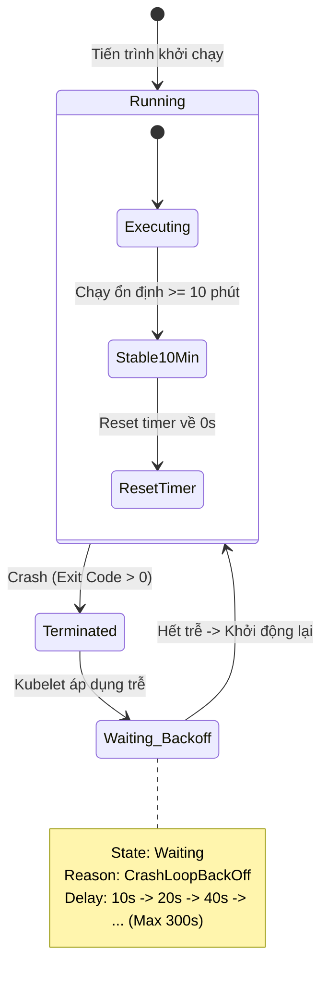

# 6_3_3 Pods

> **Khóa học**: Cloud DevOps Basic — Containers and Kubernetes  
> **Phân nhóm**: 6 Domain 6 - Containers and Kubernetes › 6_3 Kubernetes Architecture and Core Workloads  
> **Chủ đề**: 6_3_3 Pods — Đơn vị tính toán nhỏ nhất, Init & Native Sidecar Containers, Pod Phase vs Container State, Vòng đời và CrashLoopBackOff  
> **Phiên bản áp dụng**: Kubernetes 1.37  
> **Trạng thái**: Draft  
> **Phạm vi**: [Topic README](./README.md#6_3_3-pod)  
> **Checkpoint**: [CHECKLIST](../../CHECKLIST.md#6_3-kubernetes-architecture-and-core-workloads)  

---

## 1. Khái Niệm Cốt Lõi & Bản Chất Kỹ Thuật (Core Concepts & Technical Deep Dive)

Trong Kubernetes, container luôn được đóng gói và vận hành trong đối tượng trừu tượng mang tên **Pod**.

---

### 1.1 Pod — Đơn Vị Tính Toán Cơ Sở & Bối Cảnh Chia Sẻ

- **Đơn vị nguyên tử**: Pod là đơn vị tính toán nhỏ nhất có thể tạo và quản lý trong Kubernetes <!-- ev: R1.31 -->.
- **Bối cảnh chia sẻ**: Bối cảnh chia sẻ của Pod là tập hợp Linux namespace, cgroup và các cơ chế cô lập như một container <!-- ev: R1.32 --> (kế thừa từ [Linux Namespaces & cgroups](../6_1%20Container%20Fundamentals/README.md#6_1_2-linux-namespaces-cô-lập-nhìn-thấy-gì)).
- **Mạng dùng chung**: Mọi container trong Pod đều dùng chung network namespace (chung IP và port), gọi nhau qua `localhost` <!-- ev: R1.33 -->.
- **Điều phối port**: Do dùng chung network namespace, các container trong cùng Pod phải tự điều phối tránh xung đột cổng <!-- ev: R1.34 -->.
- **Volume chia sẻ**: Mọi container trong Pod đều truy cập được các volume dùng chung để chia sẻ file <!-- ev: R1.35 -->.
- **Đối tượng API**: Tài nguyên Pod dùng `apiVersion: v1` và `kind: Pod` <!-- ev: R2.39 -->.
- **Container ứng dụng**: Pod spec định nghĩa container ứng dụng dưới trường `spec.containers` <!-- ev: R2.40 -->.

---

### 1.2 Vòng Đời Khởi Tạo: Init Containers & Native Sidecars

#### A. Init Containers
- **Khai báo**: Pod spec định nghĩa container khởi tạo dưới trường `spec.initContainers` <!-- ev: R2.41 -->.
- **Chạy hoàn tất**: Init container chạy trước app container, bắt buộc phải chạy hoàn tất (run to completion) và thành công trước khi container kế tiếp bắt đầu <!-- ev: R1.36 -->.
- **Tuần tự**: Nếu có nhiều init container, kubelet thực thi tuần tự từng container; mỗi container phải thành công mới chạy cái tiếp theo <!-- ev: R1.37 -->.
- **Điều kiện Ready**: Pod không thể Ready cho đến khi toàn bộ init container thông thường thành công <!-- ev: R2.43 -->.
- **Restart**: Nếu init container thất bại trong Pod có `restartPolicy: Always`, nó khởi động lại theo ngữ nghĩa `OnFailure` <!-- ev: R2.42 -->.

#### B. Native Sidecar Containers (Stable GA từ v1.33)
- **Bản chất**: Native sidecar container được hiện thực như một init container đặc biệt vẫn tiếp tục chạy song song sau khi Pod khởi động <!-- ev: R1.38 -->.
- **Lịch sử**: Tính năng này là alpha ở Kubernetes v1.28 <!-- ev: R2.45 --> và đạt Stable GA từ Kubernetes v1.33 <!-- ev: R2.44 -->.
- **Cú pháp**: Khai báo bên trong `initContainers` với `restartPolicy: Always` <!-- ev: R1.39 R2.46 -->.
- **Thời gian sống**: Init container có `restartPolicy: Always` sẽ chạy suốt toàn bộ vòng đời của Pod <!-- ev: R2.47 -->.
- **Không chặn tiến trình sau**: Sidecar trong `initContainers` tiếp tục chạy sau khi khởi động trong lúc init container kế tiếp chạy <!-- ev: R2.48 -->.
- **Thứ tự dừng**: Khi tắt Pod, kubelet trì hoãn tắt sidecar cho đến khi container ứng dụng chính đã dừng hoàn toàn <!-- ev: R1.40 -->.

---

### 1.3 Phân Tách Trạng Thái: Pod Phase vs Container State

<!-- ev: R1.41 R1.42 R2.52 -->
| Khía cạnh | Pod Phase (`status.phase`) | Container State (`status.containerStatuses[].state`) |
| :--- | :--- | :--- |
| **Phạm vi** | Giai đoạn tổng thể của đối tượng Pod <!-- ev: R1.41 --> | Tiến trình cụ thể của từng container <!-- ev: R1.42 --> |
| **Giá trị** | `Pending`, `Running`, `Succeeded`, `Failed`, `Unknown` <!-- ev: R1.41 --> | `Waiting`, `Running`, `Terminated` <!-- ev: R1.42 R2.52 --> |

- **Pod Phase**: Gồm `Pending`, `Running`, `Succeeded`, `Failed`, và `Unknown` phản ánh giai đoạn vòng đời Pod trên cụm <!-- ev: R1.41 -->.
- **Container State**: Độc lập với Pod phase, gồm `Waiting`, `Running`, và `Terminated` <!-- ev: R1.42 R2.52 -->.
- **Waiting reason**: Container `Waiting` cung cấp trường `reason` mô tả lý do bị chặn <!-- ev: R2.53 -->.
- **Terminated details**: Container `Terminated` cung cấp lý do (`reason`), mã thoát (`exitCode`), cùng thời gian thực thi <!-- ev: R2.54 -->.

---

### 1.4 Chính Sách Khởi Động Lại & CrashLoopBackOff

- **restartPolicy**: Cấp Pod có trường `spec.restartPolicy` gồm `Always`, `OnFailure`, `Never`, mặc định là `Always` <!-- ev: R1.43 R2.49 -->.
- **Độ trễ lũy tiến**: Khi container lỗi, kubelet khởi động lại với độ trễ tăng dần theo hàm mũ (10s, 20s, 40s,...) tối đa 300 giây <!-- ev: R2.50 -->.
- **Nguồn gốc CrashLoopBackOff**: Trạng thái `CrashLoopBackOff` xuất hiện khi cơ chế exponential backoff delay có hiệu lực do container crash và restart liên tục <!-- ev: R1.44 -->.
- **Reset timer**: Nếu container chạy ổn định không lỗi trong 10 phút, kubelet đặt lại bộ đếm restart backoff delay về ban đầu <!-- ev: R2.51 -->.

---

### 1.5 Triết Lý Gia Súc Thay Vì Thú Cưng (Cattle vs Pets)

<!-- ev: R1.31 -->
- **Thú cưng (Pets)**: Máy chủ truyền thống được cấu hình riêng, chăm sóc thủ công khi lỗi <!-- ev: R1.31 -->.
- **Gia súc (Cattle)**: Pod được quản lý theo đàn bằng nhãn. Khi lỗi, hệ thống hủy và thay bằng Pod mới <!-- ev: R1.31 -->.
- **Nguyên tắc**: Không sửa tay Pod đang chạy và không tạo Pod trần; luôn bọc trong controller (xem [lab-6_3_1](./README.md#lab-6_3_1-kind-cluster-and-first-deployment)) <!-- ev: R1.31 -->.

---

## 2. Ví Dụ Đời Sống Thực Tế Dễ Hiểu (Intuitive Real-World Analogies)

### 2.1 Căn Hộ Chung Cư Nhiều Phòng (Apartment Analogy)
Pod giống như **căn hộ chung cư**:
- **Các phòng (Containers)**: Phòng khách (Web App) và phòng kho (Log Shipper).
- **Chung địa chỉ (Shared IP)**: Căn hộ chung một địa chỉ; gọi nhau qua hành lang (`localhost`).
- **Tránh tranh ổ cắm (Port Collision)**: Nếu phòng khách đã cắm thiết bị cổng 80, phòng kho phải cắm cổng khác.
- **Tủ lạnh chung (Shared Volume)**: Nơi các phòng bỏ và lấy dữ liệu chung.

### 2.2 Thợ Sửa Nhà vs Máy Lọc Khí (Init vs Native Sidecar)
- **Init Container (Thợ sửa nhà)**: Thợ sơn xong mới đến thợ sàn; phải xong 100% trước khi chủ nhà vào rồi rời đi.
- **Native Sidecar (Máy lọc khí)**: Bật trước khi vào ở, chạy liên tục cùng chủ nhà. Khi dọn đi, máy lọc khí chạy đến khi đóng cửa mới tắt.

### 2.3 Gia Súc vs Thú Cưng (Cattle vs Pets)
Thú cưng khi ốm được chữa riêng. Đàn bò (Cattle) quản lý theo số thẻ; con nào bệnh thì thay thế ngay để duy trì cả đàn. Pod chính là gia súc.

---

## 3. Kiến Trúc, Luồng Hoạt Động & Hình Ảnh Trực Quan (Architecture, Diagrams & Visual Media)

### 3.1 Cấu Trúc Nội Tại Của Pod



---

### 3.2 Vòng Đời Khởi Tạo Và Kết Thúc Với Native Sidecar



---

### 3.3 Chu Kỳ CrashLoopBackOff



---

## 4. Code Mẫu Trực Quan Hoặc Dòng Lệnh Thực Chiến (Runnable Sample Code / CLI)

> **Môi trường & Công cụ**: `Kubernetes v1.33+ / v1.37`, `kubectl v1.33+ / v1.37`.  
> ⚠️ Chưa chạy thử (not executed by the squad)

### 4.1 Khai Báo Pod Với Init Container Và Native Sidecar

<!-- ev: R1.33 R1.35 R1.36 R1.37 R1.38 R1.39 R1.43 R2.39 R2.40 R2.41 R2.46 R2.47 R2.48 R2.49 -->
```yaml
apiVersion: v1
kind: Pod
metadata:
  name: demo-service-pod
  namespace: default
  labels:
    app.kubernetes.io/name: demo-service
spec:
  restartPolicy: Always
  initContainers:
    # Init container: chạy hoàn tất trước khi app khởi động
    - name: init-prerequisite
      image: busybox:1.36
      command: ['sh', '-c', 'echo "Checking DB..."; sleep 2']
    # Native sidecar: restartPolicy Always bên trong initContainers (GA v1.33)
    - name: log-collector-sidecar
      image: busybox:1.36
      restartPolicy: Always
      command: ['sh', '-c', 'while true; do tail -n 20 /var/log/app/app.log 2>/dev/null; sleep 10; done']
      volumeMounts:
        - name: shared-logs
          mountPath: /var/log/app
  containers:
    - name: web-app
      image: nginx:1.27
      ports:
        - containerPort: 80
      volumeMounts:
        - name: shared-logs
          mountPath: /var/log/app
  volumes:
    - name: shared-logs
      emptyDir: {}
```

---

### 4.2 Các Lệnh Chẩn Đoán Pod Và Trạng Thái Container

<!-- ev: R1.41 R1.42 R1.44 R2.52 R2.53 R2.54 -->
```bash
# 1. Liệt kê Pod kèm IP và Pod Phase
kubectl get pods -o wide

# 2. Khảo sát Pod Phase, Conditions và Events
kubectl describe pod demo-service-pod

# 3. Trích xuất trạng thái Container (Waiting / Running / Terminated)
kubectl get pod demo-service-pod -o jsonpath='{range .status.containerStatuses[*]}{.name}{"\tState: "}{.state}{"\n"}{end}'

# 4. Kiểm tra reason khi container ở trạng thái Waiting
kubectl get pod demo-service-pod -o jsonpath='{range .status.containerStatuses[*]}{.name}{": "}{.state.waiting.reason}{"\n"}{end}'

# 5. Đọc exitCode và lý do khi container bị Terminated
kubectl get pod demo-service-pod -o jsonpath='{range .status.containerStatuses[*]}{.name}{": ExitCode="}{.state.terminated.exitCode}{", Reason="}{.state.terminated.reason}{"\n"}{end}'
```

---

## 5. Cạm Bẫy Thực Tế & Thực Tiễn Sản Xuất (Production Gotchas & Best Practices)

<!-- ev: R1.33 R1.34 -->
### 5.1 Xung Đột Cổng Mạng Khi Gom Nhiều Container Vào Một Pod
- **Hiện tượng**: Container thứ hai liên tục thất bại ở trạng thái `Terminated` hoặc `CrashLoopBackOff` với lỗi cổng đã bị chiếm <!-- ev: R1.34 R1.44 -->.
- **Nguyên nhân**: Mọi container trong Pod dùng chung network namespace và IP <!-- ev: R1.33 -->. Nếu hai tiến trình cùng bind một cổng, xung đột cổng xảy ra lập tức <!-- ev: R1.34 -->.
- **Giải pháp**: Cấu hình các container trong cùng Pod dùng các cổng riêng biệt (ví dụ app cổng 8080, helper cổng 9090) <!-- ev: R1.34 -->.

<!-- ev: R1.36 R1.37 R2.43 -->
### 5.2 Init Container Treo Khiến Pod Kẹt Ở Phase Pending
- **Hiện tượng**: Pod kẹt vô hạn ở phase `Pending` và không chuyển sang `Ready` <!-- ev: R1.41 R2.43 -->.
- **Nguyên nhân**: Init container chạy tuần tự và phải hoàn tất thành công mới cho container kế tiếp chạy <!-- ev: R1.36 R1.37 -->. Nếu lệnh trong init container bị treo không timeout, Pod không thể Ready <!-- ev: R2.43 -->.
- **Giải pháp**: Luôn đặt timeout cho các câu lệnh kiểm tra trong init container.

<!-- ev: R1.44 R2.50 R2.51 -->
### 5.3 Hiểu Đúng Bản Chất Của CrashLoopBackOff
- **Hiện tượng**: Kỹ sư nhầm tưởng `CrashLoopBackOff` là lỗi của Kubernetes.
- **Nguyên nhân**: `CrashLoopBackOff` là cơ chế tự vệ của kubelet <!-- ev: R1.44 -->. Khi container crash liên tục, kubelet áp dụng độ trễ tăng dần (10s, 20s, 40s,... tối đa 300s) để tránh quá tải Node <!-- ev: R2.50 -->.
- **Giải pháp**: Đọc log container cũ (`kubectl logs -p`) và mã thoát (`exitCode`) để sửa lỗi ứng dụng <!-- ev: R2.54 -->. Khi container chạy ổn định đủ 10 phút, kubelet sẽ reset bộ đếm trễ <!-- ev: R2.51 -->.

<!-- ev: R1.31 R1.43 R2.49 -->
### 5.4 Hiểm Họa Triển Khai "Pod Trần" (Naked Pods)
- **Hiện tượng**: Tạo trực tiếp manifest `kind: Pod` mà không qua controller.
- **Nguyên nhân**: Pod là đơn vị tính toán nhỏ nhất <!-- ev: R1.31 --> nhưng không tự phục hồi sang Node khác khi máy chủ hỏng, kể cả khi `restartPolicy` là `Always` <!-- ev: R1.43 R2.49 -->.
- **Giải pháp**: Luôn quản lý Pod qua controller (Deployment, StatefulSet, DaemonSet).

---

## 6. Câu Hỏi Củng Cố Kiến Thức (Active Recall Quiz)

### Câu Hỏi 1: Điểm Khác Biệt Giữa Init Container Và Native Sidecar Container?
Trong Kubernetes từ v1.33 trở đi, sự khác biệt về hành vi vòng đời giữa Init Container thông thường và Native Sidecar Container là gì?

<details>
<summary>Đáp án</summary>

- **Init Container thông thường**: Phải thực thi tuần tự và hoàn tất thành công (exit code 0) trước khi container kế tiếp bắt đầu <!-- ev: R1.36 R1.37 -->. Khi xong, chúng dừng hẳn <!-- ev: R1.36 -->.
- **Native Sidecar Container**: Khai báo trong `initContainers` với `restartPolicy: Always` <!-- ev: R1.39 R2.46 -->. Khởi động trước app chính nhưng tiếp tục chạy suốt vòng đời Pod <!-- ev: R1.38 R2.47 R2.48 -->. Khi tắt Pod, kubelet trì hoãn tắt sidecar cho đến khi app chính đã dừng hẳn <!-- ev: R1.40 -->.
</details>

---

### Câu Hỏi 2: Phân Biệt Giữa Pod Phase Và Container State Trong Chẩn Đoán Lỗi?
Một Pod có Phase là `Running`, nhưng người dùng không truy cập được và số lần restart tăng liên tục. Điều gì đang diễn ra ở cấp độ Container State và cơ chế `CrashLoopBackOff` hoạt động thế nào?

<details>
<summary>Đáp án</summary>

- **Pod Phase vs Container State**: Pod Phase `Running` chỉ báo hiệu Pod đã gán vào Node và có container đang chạy hoặc đang khởi động lại <!-- ev: R1.41 -->. Tuy nhiên, container state thực tế có thể đang ở trạng thái `Waiting` với lý do `CrashLoopBackOff` <!-- ev: R1.42 R1.44 R2.52 R2.53 -->.
- **Cơ chế CrashLoopBackOff**: Kubelet áp dụng độ trễ tăng dần (10s, 20s, 40s,... tối đa 300s) trước mỗi lần khởi động lại <!-- ev: R2.50 -->. Trong lúc chờ, container ở trạng thái `Waiting` với reason `CrashLoopBackOff` <!-- ev: R1.44 R2.53 -->. Kubelet reset bộ đếm trễ khi container chạy ổn định đủ 10 phút <!-- ev: R2.51 -->.
</details>

---

### Câu Hỏi 3: Tại Sao Các Container Trong Cùng Một Pod Phải Điều Phối Cổng Mạng?
Vì sao các container trong cùng một Pod có thể gọi nhau qua `localhost`, nhưng không thể cùng lắng nghe trên một cổng mạng?

<details>
<summary>Đáp án</summary>

- Mọi container trong Pod dùng chung network namespace của Linux kernel, tức chung IP và dải cổng mạng <!-- ev: R1.33 -->.
- Nhờ chung network namespace, các container gọi nhau qua `localhost` <!-- ev: R1.33 -->.
- Hai tiến trình trong cùng network namespace không thể cùng bind vào một cổng mạng <!-- ev: R1.34 -->. Vì vậy, các container trong Pod phải tự điều phối tránh xung đột cổng <!-- ev: R1.34 -->.
</details>

---

## 7. 📚 Nguồn Tài Liệu Chính Thống (Tier-1 Official References)

- [Kubernetes Documentation — Pods](https://kubernetes.io/docs/concepts/workloads/pods/) — Tài liệu đặc tả chính thức về Pod, mạng và lưu trữ dùng chung trong Pod.
- [Kubernetes Documentation — Init Containers](https://kubernetes.io/docs/concepts/workloads/pods/init-containers/) — Hướng dẫn và đặc tả kỹ thuật chi tiết về Init Containers.
- [Kubernetes Documentation — Sidecar Containers](https://kubernetes.io/docs/concepts/workloads/pods/sidecar-containers/) — Tài liệu chính thức về Native Sidecar Containers (Stable GA từ Kubernetes v1.33).
- [Kubernetes Documentation — Pod Lifecycle](https://kubernetes.io/docs/concepts/workloads/pods/pod-lifecycle/) — Đặc tả chuẩn về Pod Phase, Container State, restartPolicy và cơ chế CrashLoopBackOff.
