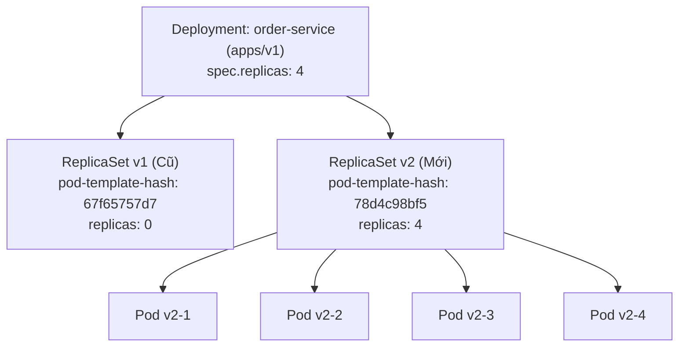
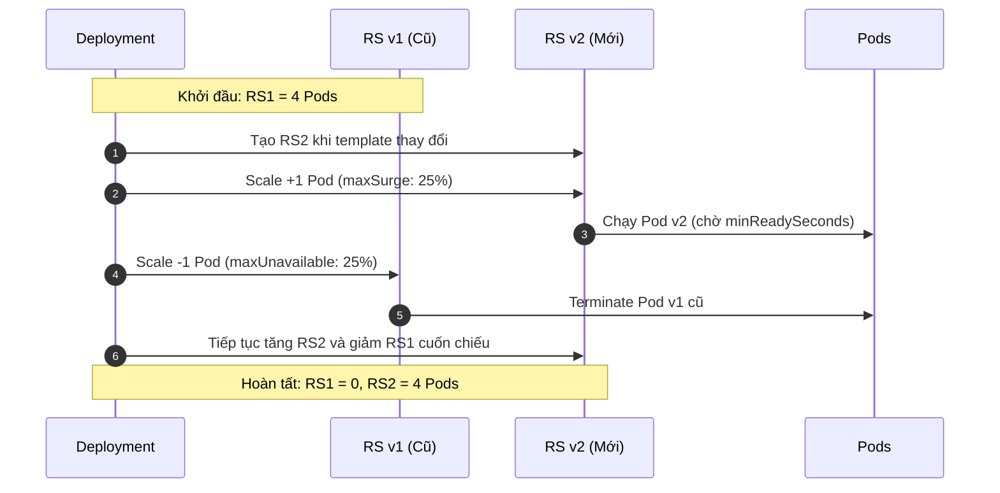
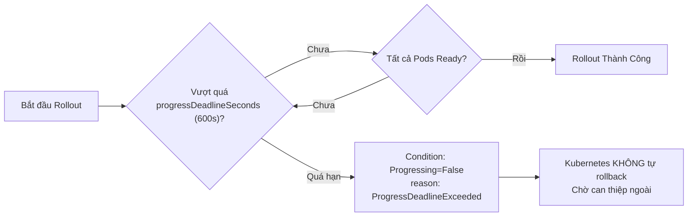

# 6_3_4 ReplicaSets and Deployments

> **Khóa học**: Cloud DevOps Basic — Containers and Kubernetes  
> **Phân nhóm**: 6 Domain 6 - Containers and Kubernetes › 6_3 Kubernetes Architecture and Core Workloads  
> **Chủ đề**: 6_3_4 ReplicaSets and Deployments — Quản lý vòng đời Pod, RollingUpdate vs Recreate, Rollout CLI, và Revision History  
> **Phiên bản áp dụng**: Kubernetes 1.37  
> **Trạng thái**: Draft  
> **Phạm vi**: [Topic README](./README.md#6_3_4-replicaset-và-deployment)  
> **Checkpoint**: [CHECKLIST](../../CHECKLIST.md#6_3-kubernetes-architecture-and-core-workloads)  
> **Lab thực hành**: [lab-6_3_2-rolling-update-and-rollback](./README.md#lab-6_3_2-rolling-update-and-rollback)  

---

## 1. Khái Niệm Cốt Lõi & Bản Chất Kỹ Thuật (Core Concepts & Technical Deep Dive)

Trong Kubernetes, khối lượng công việc phi trạng thái (stateless) được trừu tượng hóa qua hai cấp độ controller: **ReplicaSet** và **Deployment**.

---

### 1.1 Mối Quan Hệ Giữa Deployment, ReplicaSet Và Pod

- **Khai báo API**: Deployment sử dụng `apiVersion: apps/v1` và `kind: Deployment` <!-- ev: R2.55 -->.
- **Mục đích ReplicaSet**: Duy trì ổn định một số lượng bản sao Pod chạy đúng tại mọi thời điểm <!-- ev: R1.45 -->.
- **Trừu tượng hóa Deployment**: Quản lý các ReplicaSet con và cung cấp tính năng cập nhật Pod theo cơ chế khai báo <!-- ev: R1.46 -->.
- **Nhãn `pod-template-hash`**: Deployment controller tự động thêm nhãn `pod-template-hash` (băm từ PodTemplate) vào ReplicaSet con để đảm bảo các ReplicaSet không trùng lặp selector <!-- ev: R1.47 -->.
- **Kích hoạt Rollout**: Rollout chỉ kích hoạt khi và chỉ khi Pod template (`.spec.template`) thay đổi <!-- ev: R1.48 -->. Việc đổi `spec.replicas` chỉ scale Pod chứ không kích hoạt rollout mới <!-- ev: R1.48 -->.

---

### 1.2 Hai Chiến Lược Rollout: RollingUpdate vs Recreate

Trường `.spec.strategy.type` hỗ trợ hai giá trị `RollingUpdate` (mặc định) và `Recreate` <!-- ev: R1.49 -->.

- **RollingUpdate (Mặc định)**: Cập nhật cuốn chiếu bằng cách giảm dần Pod ở ReplicaSet cũ và tăng dần Pod ở ReplicaSet mới <!-- ev: R1.50 R2.56 -->.
  - `maxUnavailable`: Số lượng hoặc tỉ lệ phần trăm Pod tối đa có thể không khả dụng khi cập nhật (mặc định 25%) <!-- ev: R1.51 R2.57 -->. Không thể bằng 0 nếu `maxSurge` bằng 0 <!-- ev: R2.57 -->.
  - `maxSurge`: Số lượng hoặc tỉ lệ phần trăm Pod tối đa có thể tạo vượt mức replica mong muốn (mặc định 25%) <!-- ev: R1.52 R2.58 -->.
- **Recreate**: Tắt toàn bộ các Pod hiện có trước khi tạo bất kỳ Pod mới nào <!-- ev: R1.53 -->. Hệ thống phải chờ xóa sạch hoàn toàn tất cả Pod bản cũ trước khi tạo Pod thuộc revision mới <!-- ev: R1.54 -->.

---

### 1.3 Kiểm Soát Tiến Trình Và Giới Hạn Lịch Sử

- **`minReadySeconds`**: Số giây tối thiểu Pod mới phải duy trì Ready (không crash) để được xem là khả dụng (mặc định 0) <!-- ev: R2.59 -->.
- **`progressDeadlineSeconds`**: Số giây chờ đợi trước khi báo cáo rollout bị đình trệ (mặc định 600 giây) <!-- ev: R1.55 R2.60 -->.
- **Condition `ProgressDeadlineExceeded`**: Khi quá hạn, Deployment controller gán condition `type: Progressing`, `status: "False"`, và `reason: ProgressDeadlineExceeded` <!-- ev: R1.56 -->.
- **Không tự sửa lỗi**: Kubernetes không tự động thực hiện hành động khắc phục nào khi rollout kẹt, chỉ ghi nhận lỗi cho công cụ bên ngoài <!-- ev: R1.57 -->.
- **`revisionHistoryLimit`**: Số lượng ReplicaSet cũ được giữ lại cho rollback (mặc định 10) <!-- ev: R2.61 -->.

---

### 1.4 Bộ Lệnh Điều Khiển Rollout Toàn Diện

<!-- ev: R2.62 R2.69 -->
Kubernetes cung cấp nhóm lệnh `kubectl rollout` để điều phối vòng đời <!-- ev: R2.62 R2.69 -->:
- **Theo dõi**: `kubectl rollout status` giám sát tiến trình và hoàn tất rollout <!-- ev: R2.62 -->.
- **Xem lịch sử**: `kubectl rollout history` liệt kê các revision kèm nguyên nhân <!-- ev: R2.63 -->.
- **Annotation `kubernetes.io/change-cause`**: Ghi nhận nguyên nhân thay đổi để hiển thị trong cột CHANGE-CAUSE <!-- ev: R2.64 -->.
- **Hoàn tác liền kề**: `kubectl rollout undo` hoàn tác về revision liền trước <!-- ev: R2.65 -->.
- **Hoàn tác chỉ định**: `kubectl rollout undo` nhận `--to-revision` để quay về revision cụ thể <!-- ev: R2.66 -->.
- **Tạm dừng & Tiếp tục**: `kubectl rollout pause` tạm dừng rollout <!-- ev: R2.67 -->, và `kubectl rollout resume` tiếp tục tiến trình <!-- ev: R2.68 -->.
- **Khởi động lại**: `kubectl rollout restart` kích hoạt khởi động lại cuốn chiếu toàn bộ Pod <!-- ev: R2.69 -->.

---

### 1.5 Cơ Chế imagePullPolicy Và Cạm Bẫy Tag `:latest`

<!-- ev: R2.70 R2.71 R2.72 -->
Hành vi kéo image của kubelet phụ thuộc vào `imagePullPolicy` <!-- ev: R2.70 R2.71 R2.72 -->:
- **`IfNotPresent`**: Kéo image khi chưa có sẵn trong bộ nhớ đệm trên Node <!-- ev: R2.70 -->.
- **`Always`**: Luôn gửi yêu cầu tới runtime kiểm tra và kéo image khi khởi chạy container <!-- ev: R2.71 -->.
- **`Never`**: Không kéo từ xa, yêu cầu image có sẵn ở máy cục bộ <!-- ev: R2.72 -->.
- **Gán ngầm định**: Nếu bỏ trống, tag `:latest` tự nhận `Always` <!-- ev: R2.73 -->, còn tag khác `:latest` tự nhận `IfNotPresent` <!-- ev: R2.74 -->.
- **Cạm bẫy `:latest`**: Do rollout chỉ kích hoạt khi Pod template thay đổi <!-- ev: R1.48 -->, việc ghi đè image lên tag `:latest` không đổi template nên Deployment không tạo ReplicaSet mới. Cần dùng tag bất biến hoặc digest theo [6_2_7 Tag, Digest và Phiên Bản](../6_2%20Container%20Image%20Engineering/README.md#6_2_7-tag-digest-và-phiên-bản) <!-- ev: R1.48 -->.

---

## 2. Ví Dụ Đời Sống Thực Tế Dễ Hiểu (Intuitive Real-World Analogies)

Hãy liên tưởng Deployment và ReplicaSet với đoàn tàu chở khách 24/7 trên đường ray.

### 2.1 Đoàn Tàu Đang Chạy (RollingUpdate vs Recreate)

Lặp lại tuần tự đến khi 4 toa cũ được thay sạch mà tàu không dừng bánh (Zero-downtime).
Trưởng tàu phanh gấp tại ga, sơ tán khách xuống hết, kéo toàn bộ toa cũ vào bãi rồi mới lắp toa mới gây gián đoạn hoàn toàn (Downtime).

### 2.2 Trưởng Tàu Và Kíp Lái (Deployment Điều Hành ReplicaSets)

- **Pod** là từng toa tàu chở khách độc lập.
- **ReplicaSet** là kíp lái có nhiệm vụ duy trì đúng quân số toa trên đường ray.
- **Deployment** là Trưởng tàu. Khi có mẫu toa mới (thay đổi `spec.template`), Trưởng tàu ký hợp đồng với kíp lái mới (ReplicaSet mới), phát phù hiệu định danh độc nhất (`pod-template-hash`) để không lẫn với kíp cũ, rồi điều phối kíp cũ bàn giao dần toa cho kíp mới.

---

## 3. Kiến Trúc, Luồng Hoạt Động & Hình Ảnh Trực Quan (Architecture, Diagrams & Visual Media)

---

### 3.1 Cấu Trúc Phân Tầng: Deployment Điều Khiển ReplicaSets

<!-- ev: R1.45 R1.46 R1.47 R2.55 -->


---

### 3.2 Luồng Vận Hành Của RollingUpdate

<!-- ev: R1.48 R1.50 R1.51 R1.52 R2.56 R2.57 R2.58 R2.59 -->


---

### 3.3 Giới Hạn Thời Gian Rollout

<!-- ev: R1.55 R1.56 R1.57 R2.60 -->


---

## 4. Code Mẫu Trực Quan Hoặc Dòng Lệnh Thực Chiến (Runnable Sample Code / CLI)

<!-- ev: R2.55 -->
> **Môi trường & Công cụ**: `Kubernetes v1.33+ / v1.37`, `kubectl v1.33+ / v1.37`. <!-- ev: R2.55 -->  
> ⚠️ Chưa chạy thử (not executed by the squad)

### 4.1 Khai Báo Manifest Deployment Chuẩn Production

<!-- ev: R1.47 R1.48 R1.49 R1.50 R1.51 R1.52 R2.55 R2.56 R2.57 R2.58 R2.59 R2.60 R2.61 R2.64 R2.71 -->
```yaml
# =====================================================================
# CHỈ CÓ 1 ĐỐI TƯỢNG DUY NHẤT (Deployment) trong file này.
# ReplicaSet và Pod KHÔNG được viết riêng: chúng được định nghĩa gián tiếp
#   - Pod         -> khối  spec.template   (mẫu Pod)
#   - ReplicaSet  -> do Deployment controller TỰ TẠO từ replicas + selector + template
# Luồng: Deployment --(tạo)--> ReplicaSet --(tạo)--> Pod
# =====================================================================
apiVersion: apps/v1            # Deployment thuộc nhóm API "apps" (khác Pod là "v1")
kind: Deployment               # Loại đối tượng; đây là tầng trên cùng, bạn chỉ khai báo tầng này
metadata:                      # Danh tính của CHÍNH Deployment (không phải của Pod)
  name: order-service          # Tên Deployment, duy nhất trong namespace
  namespace: default           # Phân vùng chứa Deployment
  annotations:
    # Ghi chú cho người đọc, KHÔNG dùng để chọn đối tượng. Được copy sang các revision
    # và hiện ở cột CHANGE-CAUSE của "kubectl rollout history".
    # Nằm ngoài spec.template nên chỉ sửa dòng này KHÔNG kích hoạt rollout.
    kubernetes.io/change-cause: "Release order-service v1.4.2"
  labels:                      # Nhãn trên Deployment, để tìm kiếm và gom nhóm
    app.kubernetes.io/name: order-service
spec:
  # ------------------------------------------------------------------
  # (A) CẤP DEPLOYMENT: cách Deployment điều phối rollout và lịch sử
  # ------------------------------------------------------------------
  revisionHistoryLimit: 10     # Giữ tối đa 10 ReplicaSet cũ (mỗi cái = 1 revision) để rollback; mặc định 10.
                               # Đặt 0 sẽ xóa sạch lịch sử và không thể rollback.
  minReadySeconds: 10          # Pod mới phải Ready liên tục 10 giây (không crash) mới tính là "available"; mặc định 0.
                               # Giúp bắt lỗi "báo Ready rồi sập ngay" trước khi thay tiếp Pod cũ.
  progressDeadlineSeconds: 600 # Chờ tối đa 600 giây để rollout tiến triển; mặc định 600, phải lớn hơn minReadySeconds.
                               # Quá hạn: condition Progressing=False, reason=ProgressDeadlineExceeded.
                               # Kubernetes KHÔNG tự rollback, chỉ báo cho công cụ bên ngoài (CI/CD, con người).
  strategy:
    type: RollingUpdate        # Thay cuốn chiếu (mặc định); lựa chọn khác: Recreate (tắt hết rồi mới tạo mới)
    rollingUpdate:
      maxSurge: 25%            # Được tạo THỪA tối đa 25% so với replicas (làm tròn LÊN): 4 x 25% = 1 -> tối đa 5 Pod
      maxUnavailable: 25%      # Được THIẾU tối đa 25% Pod phục vụ (làm tròn XUỐNG): 4 x 25% = 1 -> luôn có >= 3 Pod
                               # Hai giá trị này không được cùng bằng 0, nếu không rollout không có chỗ để nhúc nhích.

  # ------------------------------------------------------------------
  # (B) NGUYÊN LIỆU ĐỂ DEPLOYMENT SINH RA REPLICASET
  #     (ReplicaSet con sẽ nhận replicas, selector và template bên dưới)
  # ------------------------------------------------------------------
  replicas: 4                  # Số Pod mong muốn. Đổi số này chỉ SCALE, không tạo revision hay rollout mới.
  selector:                    # "Máy quét" cho biết Pod nào thuộc Deployment/ReplicaSet này
    matchLabels:
      app.kubernetes.io/name: order-service
      # BẮT BUỘC khớp với labels của Pod template bên dưới, nếu không API server sẽ từ chối.
      # Deployment controller tự thêm nhãn pod-template-hash vào selector của từng ReplicaSet con
      # để các ReplicaSet (cũ/mới) không giành Pod của nhau. Bạn KHÔNG tự viết và KHÔNG sửa nhãn này.

  # ------------------------------------------------------------------
  # (C) MẪU POD: đây chính là nơi bạn "định nghĩa Pod"
  #     Rollout chỉ xảy ra khi và chỉ khi khối .spec.template này thay đổi
  # ------------------------------------------------------------------
  template:
    metadata:                  # Danh tính của từng POD được tạo ra (không có name: tên Pod do ReplicaSet sinh)
      labels:                  # Nhãn dán lên mỗi Pod; phải khớp selector ở trên
        app.kubernetes.io/name: order-service
    spec:                      # spec của Pod, giống phần spec trong một file kind: Pod
      containers:
        - name: app            # Tên container, duy nhất trong Pod
          # Tag cố định 1.4.2 (không dùng :latest) để biết chính xác bản nào đang chạy.
          # registry.example.com chỉ là tên minh họa: chạy trên cụm thật cần thay bằng registry của bạn,
          # nếu không Pod sẽ lỗi kéo image (ErrImagePull / ImagePullBackOff).
          image: registry.example.com/order-service:1.4.2
          imagePullPolicy: Always  # Luôn kiểm tra lại registry khi khởi tạo container (mặc định của tag cụ thể là IfNotPresent)
          ports:
            - containerPort: 8080  # Cổng ứng dụng lắng nghe; các container trong cùng Pod dùng chung dải cổng
              name: http           # Tên cổng để tham chiếu từ Service hoặc probe
```

> **Lưu ý**: Mỗi lần đổi giá trị trong khối `spec.template` (ví dụ đổi tag image), Deployment tạo một ReplicaSet mới (một revision mới) rồi thay dần Pod cũ theo `strategy`. Việc đổi `replicas` chỉ scale ReplicaSet hiện tại. Bạn có thể kiểm tra bằng `kubectl get deploy,rs,pods --show-labels`.

---

### 4.2 Các Lệnh Quản Trị Rollout Thực Chiến

<!-- ev: R1.48 R2.62 R2.63 R2.64 R2.65 R2.66 R2.67 R2.68 R2.69 -->
```bash
# 1. Triển khai Deployment
kubectl apply -f order-service-deployment.yaml

# 2. Theo dõi tiến trình rollout
kubectl rollout status deployment/order-service

# 3. Xem lịch sử revision
kubectl rollout history deployment/order-service

# 4. Chi tiết revision cụ thể
kubectl rollout history deployment/order-service --revision=2

# 5. Đổi image kèm change-cause
kubectl annotate deployment/order-service kubernetes.io/change-cause="Upgrade to v1.4.3" --overwrite
kubectl set image deployment/order-service app=registry.example.com/order-service:1.4.3

# 6. Tạm dừng rollout
kubectl rollout pause deployment/order-service

# 7. Tiếp tục rollout
kubectl rollout resume deployment/order-service

# 8. Hoàn tác về revision trước
kubectl rollout undo deployment/order-service

# 9. Hoàn tác về revision chỉ định
kubectl rollout undo deployment/order-service --to-revision=1

# 10. Khởi động lại cuốn chiếu Pod
kubectl rollout restart deployment/order-service
```

---

## 5. Cạm Bẫy Thực Tế & Thực Tiễn Sản Xuất (Production Gotchas & Best Practices)

<!-- ev: R1.48 R2.70 R2.71 R2.73 R2.74 -->
### 5.1 Cạm Bẫy Tag `:latest` Khiến Hệ Thống Không Cập Nhật Mã Mới
- **Hiện tượng**: Đẩy code mới lên registry với tag `:latest` rồi chạy `kubectl apply`, nhưng không có Pod mới nào được tạo <!-- ev: R1.48 -->.
- **Bản chất**: Deployment chỉ kích hoạt rollout khi `.spec.template` thay đổi <!-- ev: R1.48 -->. Manifest vẫn giữ nguyên `image: app:latest` nên template hash không đổi, Deployment không làm gì <!-- ev: R1.47 R1.48 -->.
- **Hành vi kéo image**: Tag `:latest` tự gán `imagePullPolicy: Always` <!-- ev: R2.73 -->, chỉ kéo image khi có Pod mới tạo chứ không tự kích hoạt tạo Pod <!-- ev: R2.71 -->. Tag khác `:latest` tự gán `IfNotPresent` <!-- ev: R2.74 -->.
- **Thực tiễn**: Luôn dùng tag bất biến hoặc digest theo [6_2_7 Tag, Digest và Phiên Bản](../6_2%20Container%20Image%20Engineering/README.md#6_2_7-tag-digest-và-phiên-bản) <!-- ev: R1.48 -->.

<!-- ev: R1.51 R1.52 R2.57 R2.58 -->
### 5.2 Lỗi Cấu Hình Đồng Thời `maxSurge: 0` Và `maxUnavailable: 0`
- **Hiện tượng**: Cấu hình rollingUpdate với cả hai tham số đều là 0 bị API server từ chối <!-- ev: R2.57 -->.
- **Bản chất**: `maxSurge: 0` cấm tạo thêm Pod mới trước khi giảm Pod cũ <!-- ev: R1.52 R2.58 -->. `maxUnavailable: 0` cấm xóa Pod cũ trước khi có Pod mới <!-- ev: R1.51 R2.57 -->. Hai điều kiện mâu thuẫn gây bế tắc hoàn toàn <!-- ev: R2.57 -->.
- **Thực tiễn**: Đảm bảo ít nhất một giá trị lớn hơn 0, chuẩn nhất là mặc định 25% cho cả hai <!-- ev: R1.51 R1.52 R2.57 R2.58 -->.

<!-- ev: R1.55 R1.56 R1.57 R2.60 R2.62 R2.65 -->
### 5.3 Rollout Bị Kẹt Khi Vượt Quá `progressDeadlineSeconds`
- **Hiện tượng**: Pod mới crash hoặc lỗi kéo image khiến rollout treo vô hạn <!-- ev: R1.55 R2.60 -->.
- **Bản chất**: Hết hạn `progressDeadlineSeconds` (mặc định 600 giây) <!-- ev: R1.55 R2.60 -->, controller gán condition `Progressing=False` với `reason: ProgressDeadlineExceeded` <!-- ev: R1.56 -->. Kubernetes không tự động rollback <!-- ev: R1.57 -->.
- **Thực tiễn**: CI/CD pipeline phải kiểm tra `kubectl rollout status --timeout=600s` <!-- ev: R2.62 --> và gọi `kubectl rollout undo` khi gặp lỗi timeout <!-- ev: R2.65 -->.

<!-- ev: R2.59 -->
### 5.4 Thiếu `minReadySeconds` Khiến Cắt Lưu Lượng Khi App Chưa Khởi Động Xong
- **Hiện tượng**: Rolling update cắt lưu lượng Pod cũ quá nhanh làm dịch vụ gián đoạn <!-- ev: R2.59 -->.
- **Bản chất**: `minReadySeconds` mặc định là 0 <!-- ev: R2.59 -->. Khi probe vừa báo pass, controller coi Pod khả dụng và xóa ngay Pod cũ, khiến app chưa kịp nạp cache bị quá tải <!-- ev: R2.59 -->.
- **Thực tiễn**: Khai báo `minReadySeconds` từ 10 đến 30 giây để tạo khoảng đệm an toàn <!-- ev: R2.59 -->.

---

## 6. Câu Hỏi Củng Cố Kiến Thức (Active Recall Quiz)

### Câu Hỏi 1: Khác Biệt Giữa RollingUpdate Và Recreate, Khi Nào Dùng Recreate?
So sánh cơ chế giữa RollingUpdate và Recreate. Khi nào bắt buộc phải dùng Recreate?

<details>
<summary>Đáp án</summary>

- **RollingUpdate (Mặc định)**: Cập nhật cuốn chiếu bằng cách tăng dần Pod ở ReplicaSet mới và giảm dần Pod ở ReplicaSet cũ <!-- ev: R1.50 R2.56 --> theo `maxSurge` và `maxUnavailable` (mặc định 25%) <!-- ev: R1.51 R1.52 R2.57 R2.58 -->, duy trì zero-downtime <!-- ev: R1.50 -->.
- **Recreate**: Tắt và xóa sạch toàn bộ Pod cũ trước khi tạo Pod mới <!-- ev: R1.53 R1.54 -->, gây downtime hoàn toàn <!-- ev: R1.54 -->.
- **Trường hợp bắt buộc**: Khi database thay đổi schema phá vỡ tương thích ngược, không cho phép hai bản code đọc/ghi đồng thời.
</details>

---

### Câu Hỏi 2: Bản Chất Của `pod-template-hash` Và Vì Sao Lệnh Scale Không Tạo Rollout?
Tại sao Deployment controller thêm nhãn `pod-template-hash` vào ReplicaSet? Vì sao lệnh `kubectl scale` không tạo revision mới?

<details>
<summary>Đáp án</summary>

- **Bản chất `pod-template-hash`**: Deployment controller băm PodTemplate thành mã định danh ngắn và gắn vào nhãn `pod-template-hash` của ReplicaSet <!-- ev: R1.47 -->, tránh xung đột selector giữa các ReplicaSet khác phiên bản <!-- ev: R1.47 -->.
- **Vì sao scale không tạo rollout mới**: Rollout chỉ kích hoạt khi Pod template (`.spec.template`) thay đổi <!-- ev: R1.48 -->. Lệnh scale chỉ đổi `spec.replicas` bên ngoài template nên mã băm không đổi và không sinh revision mới <!-- ev: R1.47 R1.48 -->.
</details>

---

### Câu Hỏi 3: Quá Hạn `progressDeadlineSeconds`, Kubernetes Xử Lý Thế Nào?
Nếu rollout bị kẹt và vượt quá `progressDeadlineSeconds`, Kubernetes có tự động quay lui không và kỹ sư cần làm gì?

<details>
<summary>Đáp án</summary>

- **Phản ứng của Kubernetes**: Hết hạn `progressDeadlineSeconds` (mặc định 600 giây) <!-- ev: R1.55 R2.60 -->, controller đổi condition `Progressing=False` với `reason: ProgressDeadlineExceeded` <!-- ev: R1.56 -->. Kubernetes không tự động rollback hay can thiệp <!-- ev: R1.57 -->.
- **Cách xử lý**: Kỹ sư hoặc CI/CD pipeline theo dõi qua `kubectl rollout status` <!-- ev: R2.62 --> và chủ động thực thi `kubectl rollout undo` để phục hồi về phiên bản trước <!-- ev: R2.65 -->.
</details>

---

## 7. 📚 Nguồn Tài Liệu Chính Thống (Tier-1 Official References)

- [Kubernetes Documentation — Deployments](https://kubernetes.io/docs/concepts/workloads/controllers/deployment/) — Đặc tả chính thức về Deployment, chiến lược cập nhật và quản lý revision.
- [Kubernetes Documentation — ReplicaSet](https://kubernetes.io/docs/concepts/workloads/controllers/replicaset/) — Đặc tả kỹ thuật về vai trò và quản lý bản sao Pod của ReplicaSet.
- [Kubernetes Documentation — Images](https://kubernetes.io/docs/concepts/containers/images/) — Hướng dẫn về cơ chế kéo image và quy tắc gán ngầm định imagePullPolicy.
- [Kubernetes kubectl Reference — kubectl rollout restart](https://kubernetes.io/docs/reference/kubectl/generated/kubectl_rollout/kubectl_rollout_restart/) — Tham chiếu nhóm lệnh CLI kubectl rollout.
